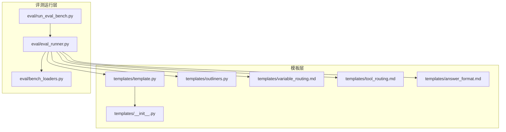
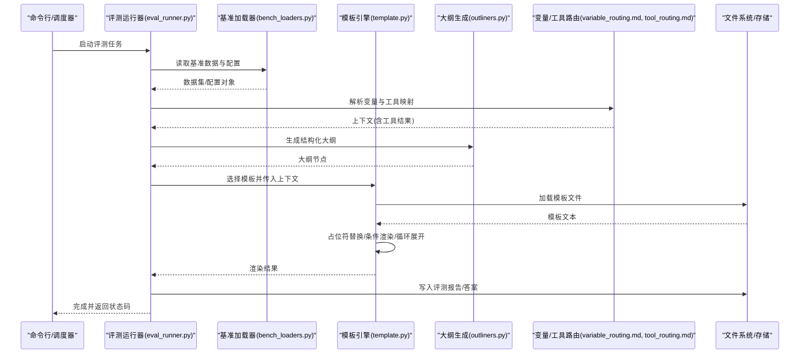
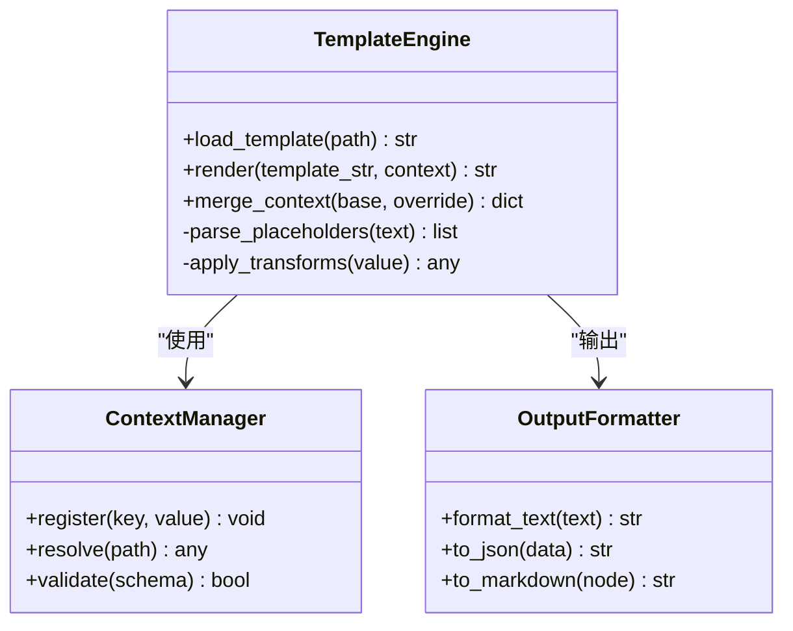
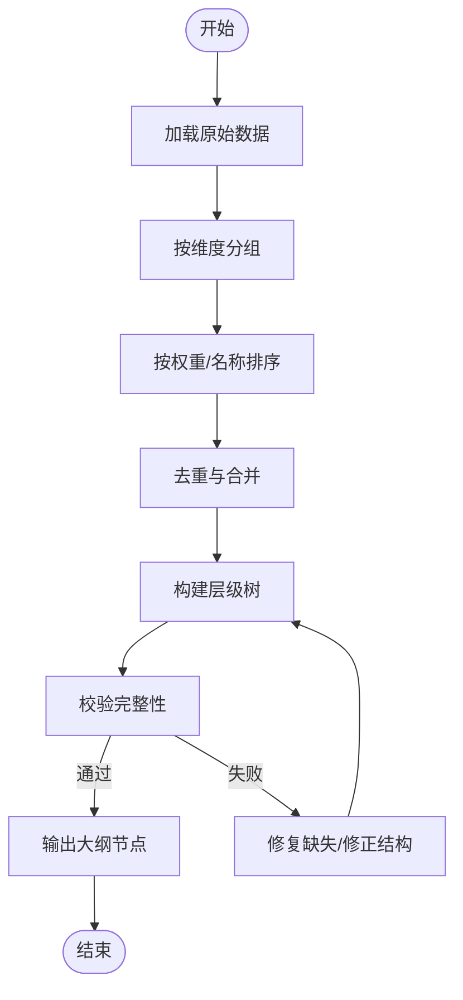
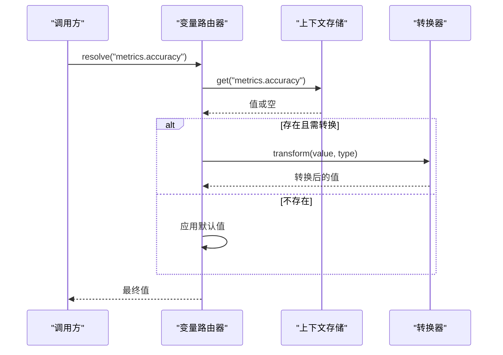
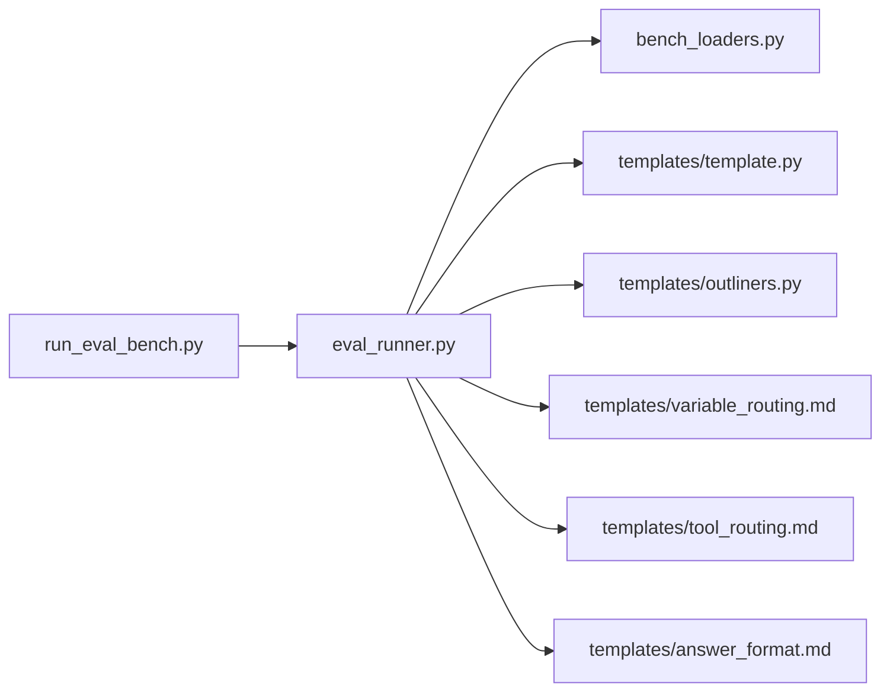

# 模板引擎系统

<cite>
**本文引用的文件**   
- [template.py](file://docs/prd/molbench_repo/templates/template.py)
- [outliners.py](file://docs/prd/molbench_repo/templates/outliners.py)
- [variable_routing.md](file://docs/prd/molbench_repo/templates/variable_routing.md)
- [tool_routing.md](file://docs/prd/molbench_repo/templates/tool_routing.md)
- [answer_format.md](file://docs/prd/molbench_repo/templates/answer_format.md)
- [__init__.py](file://docs/prd/molbench_repo/templates/__init__.py)
- [run_eval_bench.py](file://docs/prd/molbench_repo/eval/run_eval_bench.py)
- [eval_runner.py](file://docs/prd/molbench_repo/eval/eval_runner.py)
- [bench_loaders.py](file://docs/prd/molbench_repo/eval/bench_loaders.py)
</cite>

## 目录
1. [简介](#简介)
2. [项目结构](#项目结构)
3. [核心组件](#核心组件)
4. [架构总览](#架构总览)
5. [详细组件分析](#详细组件分析)
6. [依赖关系分析](#依赖关系分析)
7. [性能与缓存优化](#性能与缓存优化)
8. [故障排查指南](#故障排查指南)
9. [结论](#结论)
10. [附录：模板开发示例](#附录模板开发示例)

## 简介
本文件面向“模板引擎系统”的文档化目标，围绕模板渲染引擎、变量路由机制与内容生成框架进行系统化说明。结合仓库中现有的模板与评估运行代码，我们提炼出以下关键能力：
- 模板渲染引擎：提供统一的模板加载、解析与渲染流程，支持从配置或数据源注入上下文变量，输出结构化结果（如报告、评测结果等）。
- 变量路由机制：将外部数据（评测指标、任务元信息、工具返回）映射到模板占位符，实现动态内容与条件渲染。
- 内容生成框架：在评测执行过程中，基于模板与上下文自动生成可复用的产物（答案格式、评测报告、工作流描述等）。

此外，文档还涵盖模板继承、组件复用、样式定制、模板验证、缓存优化与性能调优策略，并提供从简单报告模板到复杂工作流描述文件的完整开发示例路径。

## 项目结构
模板相关代码集中在 docs/prd/molbench_repo 下，其中 templates 子目录包含模板引擎核心与模板定义；eval 子目录包含评测运行器与加载器，负责驱动模板渲染与结果生成。

图表来源
- [template.py](file://docs/prd/molbench_repo/templates/template.py)
- [outliners.py](file://docs/prd/molbench_repo/templates/outliners.py)
- [variable_routing.md](file://docs/prd/molbench_repo/templates/variable_routing.md)
- [tool_routing.md](file://docs/prd/molbench_repo/templates/tool_routing.md)
- [answer_format.md](file://docs/prd/molbench_repo/templates/answer_format.md)
- [__init__.py](file://docs/prd/molbench_repo/templates/__init__.py)
- [run_eval_bench.py](file://docs/prd/molbench_repo/eval/run_eval_bench.py)
- [eval_runner.py](file://docs/prd/molbench_repo/eval/eval_runner.py)
- [bench_loaders.py](file://docs/prd/molbench_repo/eval/bench_loaders.py)

章节来源
- [template.py](file://docs/prd/molbench_repo/templates/template.py)
- [outliners.py](file://docs/prd/molbench_repo/templates/outliners.py)
- [variable_routing.md](file://docs/prd/molbench_repo/templates/variable_routing.md)
- [tool_routing.md](file://docs/prd/molbench_repo/templates/tool_routing.md)
- [answer_format.md](file://docs/prd/molbench_repo/templates/answer_format.md)
- [__init__.py](file://docs/prd/molbench_repo/templates/__init__.py)
- [run_eval_bench.py](file://docs/prd/molbench_repo/eval/run_eval_bench.py)
- [eval_runner.py](file://docs/prd/molbench_repo/eval/eval_runner.py)
- [bench_loaders.py](file://docs/prd/molbench_repo/eval/bench_loaders.py)

## 核心组件
- 模板引擎核心（template.py）
  - 职责：统一加载模板、解析占位符、合并上下文、执行渲染管线、输出最终文本或结构化内容。
  - 关键点：模板路径解析、占位符匹配策略、上下文合并顺序、错误回退与日志记录。
- 大纲与结构生成器（outliners.py）
  - 职责：根据输入数据生成结构化大纲或骨架，供模板填充使用；支持多级标题、列表、表格等结构元素。
  - 关键点：层级构建算法、节点去重与排序、空值处理与默认分支。
- 变量路由（variable_routing.md）
  - 职责：定义变量命名空间、映射规则与优先级；支持嵌套对象访问、别名与转换函数。
  - 关键点：键路径解析、缺失键容错、类型转换钩子。
- 工具路由（tool_routing.md）
  - 职责：将工具调用结果注入模板上下文；支持异步/同步工具、重试与超时控制。
  - 关键点：工具注册表、参数绑定、返回值规范化。
- 答案格式模板（answer_format.md）
  - 职责：标准化评测答案的结构与字段，便于下游消费与比较。
  - 关键点：必填字段校验、枚举约束、扩展字段兼容。
- 模块初始化（__init__.py）
  - 职责：暴露公共接口、注册默认路由与模板集、提供便捷入口。
  - 关键点：懒加载、单例模式、插件发现。

章节来源
- [template.py](file://docs/prd/molbench_repo/templates/template.py)
- [outliners.py](file://docs/prd/molbench_repo/templates/outliners.py)
- [variable_routing.md](file://docs/prd/molbench_repo/templates/variable_routing.md)
- [tool_routing.md](file://docs/prd/molbench_repo/templates/tool_routing.md)
- [answer_format.md](file://docs/prd/molbench_repo/templates/answer_format.md)
- [__init__.py](file://docs/prd/molbench_repo/templates/__init__.py)

## 架构总览
模板渲染的整体流程由评测运行器驱动：加载基准数据与配置，准备上下文，选择并渲染模板，最后持久化结果。

图表来源
- [run_eval_bench.py](file://docs/prd/molbench_repo/eval/run_eval_bench.py)
- [eval_runner.py](file://docs/prd/molbench_repo/eval/eval_runner.py)
- [bench_loaders.py](file://docs/prd/molbench_repo/eval/bench_loaders.py)
- [template.py](file://docs/prd/molbench_repo/templates/template.py)
- [outliners.py](file://docs/prd/molbench_repo/templates/outliners.py)
- [variable_routing.md](file://docs/prd/molbench_repo/templates/variable_routing.md)
- [tool_routing.md](file://docs/prd/molbench_repo/templates/tool_routing.md)

## 详细组件分析

### 模板引擎核心（template.py）
- 设计要点
  - 模板加载：支持相对/绝对路径、多目录扫描、缓存已加载模板。
  - 占位符解析：支持点号路径、方括号索引、函数调用表达式（受控环境）。
  - 上下文合并：按优先级合并多个字典，避免覆盖关键键。
  - 渲染管线：预处理（清理空白）、解析（AST/正则）、后处理（格式化/转义）。
- 复杂度与性能
  - 模板解析时间复杂度近似 O(n)，n 为模板长度；占位符查找采用哈希映射，平均 O(1)。
  - 建议对大模板启用分块渲染与增量更新。
- 错误处理
  - 缺失键：提供默认值或跳过渲染。
  - 类型不匹配：自动转换或抛出明确异常。
  - 模板语法错误：定位行号与上下文片段，便于调试。

章节来源
- [template.py](file://docs/prd/molbench_repo/templates/template.py)

#### 类图（概念映射）

图表来源
- [template.py](file://docs/prd/molbench_repo/templates/template.py)

### 大纲与结构生成器（outliners.py）
- 设计要点
  - 输入：原始数据项集合（如评测指标、步骤清单）。
  - 输出：树形大纲节点，每个节点包含标题、内容、子节点与元数据。
  - 算法：自顶向下分组、按权重排序、去重合并。
- 适用场景
  - 评测报告目录生成、工作流步骤编排、答案结构约束。
- 扩展点
  - 自定义分组策略、排序规则、节点渲染器。

章节来源
- [outliners.py](file://docs/prd/molbench_repo/templates/outliners.py)

#### 流程图（大纲生成）

图表来源
- [outliners.py](file://docs/prd/molbench_repo/templates/outliners.py)

### 变量路由机制（variable_routing.md）
- 设计要点
  - 命名空间：顶层键、子对象键、数组索引。
  - 映射规则：支持别名、转换函数、默认值。
  - 优先级：显式覆盖 > 配置文件 > 默认值。
- 典型用法
  - 将评测指标映射到模板变量名。
  - 将工具返回结果注入到特定路径。
- 验证策略
  - 必填字段检查、类型约束、范围限制。

章节来源
- [variable_routing.md](file://docs/prd/molbench_repo/templates/variable_routing.md)

#### 序列图（变量解析）

图表来源
- [variable_routing.md](file://docs/prd/molbench_repo/templates/variable_routing.md)

### 工具路由（tool_routing.md）
- 设计要点
  - 工具注册：声明式注册表，支持版本与依赖。
  - 参数绑定：从上下文提取参数，支持可选与默认。
  - 执行模型：同步/异步、重试、超时、熔断。
- 集成方式
  - 在渲染前预取工具结果，注入上下文。
  - 在渲染中按需调用，延迟求值。

章节来源
- [tool_routing.md](file://docs/prd/molbench_repo/templates/tool_routing.md)

### 答案格式模板（answer_format.md）
- 设计要点
  - 字段规范：ID、标题、摘要、指标、结论、附件。
  - 约束规则：必填、枚举、数值范围、引用格式。
  - 扩展兼容：允许额外字段但不影响主流程。
- 用途
  - 统一评测答案结构，便于自动化比较与归档。

章节来源
- [answer_format.md](file://docs/prd/molbench_repo/templates/answer_format.md)

### 模块初始化（__init__.py）
- 设计要点
  - 暴露高层 API：render、register_tool、set_default_context。
  - 插件发现：扫描模板目录与工具包。
  - 生命周期：启动时预热常用模板与路由。

章节来源
- [__init__.py](file://docs/prd/molbench_repo/templates/__init__.py)

## 依赖关系分析
评测运行器与模板层的耦合关系如下：

图表来源
- [run_eval_bench.py](file://docs/prd/molbench_repo/eval/run_eval_bench.py)
- [eval_runner.py](file://docs/prd/molbench_repo/eval/eval_runner.py)
- [bench_loaders.py](file://docs/prd/molbench_repo/eval/bench_loaders.py)
- [template.py](file://docs/prd/molbench_repo/templates/template.py)
- [outliners.py](file://docs/prd/molbench_repo/templates/outliners.py)
- [variable_routing.md](file://docs/prd/molbench_repo/templates/variable_routing.md)
- [tool_routing.md](file://docs/prd/molbench_repo/templates/tool_routing.md)
- [answer_format.md](file://docs/prd/molbench_repo/templates/answer_format.md)

章节来源
- [run_eval_bench.py](file://docs/prd/molbench_repo/eval/run_eval_bench.py)
- [eval_runner.py](file://docs/prd/molbench_repo/eval/eval_runner.py)
- [bench_loaders.py](file://docs/prd/molbench_repo/eval/bench_loaders.py)

## 性能与缓存优化
- 模板缓存
  - 文件级缓存：按模板路径与修改时间缓存解析结果。
  - 渲染缓存：对相同上下文与模板组合缓存输出。
- 上下文优化
  - 惰性求值：仅在需要时计算昂贵变量。
  - 增量更新：仅重新渲染变更部分。
- I/O 优化
  - 批量读写：合并小文件写入，减少系统调用。
  - 并行渲染：对独立任务并发渲染，注意线程安全。
- 监控与诊断
  - 计时埋点：记录加载、解析、渲染耗时。
  - 热点分析：识别慢变量与复杂模板。

[本节为通用指导，无需具体文件来源]

## 故障排查指南
- 常见问题
  - 变量未找到：检查路由映射与命名空间，确认默认值设置。
  - 工具调用失败：查看重试与超时配置，确认工具注册与权限。
  - 模板语法错误：定位行号与上下文片段，简化模板逐步排查。
- 日志与断点
  - 开启详细日志，记录上下文快照与中间结果。
  - 在关键路径插入断点，观察数据流转。
- 回归测试
  - 维护最小用例集，覆盖边界条件与异常路径。
  - 对比基线输出，快速定位差异。

章节来源
- [template.py](file://docs/prd/molbench_repo/templates/template.py)
- [variable_routing.md](file://docs/prd/molbench_repo/templates/variable_routing.md)
- [tool_routing.md](file://docs/prd/molbench_repo/templates/tool_routing.md)

## 结论
本模板引擎系统以“模板+路由+生成器”为核心，提供了灵活的动态内容生成能力。通过清晰的变量路由与工具集成，评测运行器能够高效地将数据转化为标准化的报告与答案。配合缓存与并行策略，可在大规模评测场景中保持良好性能。后续可扩展模板继承、组件复用与样式定制，进一步提升创作者体验与产出一致性。

[本节为总结性内容，无需具体文件来源]

## 附录：模板开发示例

### 示例一：简单报告模板
- 目标：生成基础评测报告，包含标题、摘要、关键指标与结论。
- 步骤
  - 在 answer_format.md 中定义字段规范。
  - 在 variable_routing.md 中映射指标到模板变量。
  - 使用 template.py 的 render 接口传入上下文并输出 Markdown。
- 参考路径
  - [answer_format.md](file://docs/prd/molbench_repo/templates/answer_format.md)
  - [variable_routing.md](file://docs/prd/molbench_repo/templates/variable_routing.md)
  - [template.py](file://docs/prd/molbench_repo/templates/template.py)

### 示例二：复杂工作流描述文件
- 目标：描述多步骤工作流，包括前置条件、步骤详情、工具调用与后置校验。
- 步骤
  - 使用 outliners.py 生成工作流大纲。
  - 在 tool_routing.md 中注册所需工具与参数绑定。
  - 通过 template.py 将大纲与工具结果渲染为结构化文档。
- 参考路径
  - [outliners.py](file://docs/prd/molbench_repo/templates/outliners.py)
  - [tool_routing.md](file://docs/prd/molbench_repo/templates/tool_routing.md)
  - [template.py](file://docs/prd/molbench_repo/templates/template.py)

### 模板继承与组件复用
- 继承机制
  - 定义基础模板（如通用头部、页脚、样式）。
  - 子模板通过 extends/include 指令复用基础结构。
- 组件化
  - 将常见段落（如指标卡片、图表占位）封装为组件。
  - 在模板中按需引入组件，提升复用率与维护性。
- 样式定制
  - 通过主题变量与 CSS 钩子实现外观切换。
  - 支持运行时注入样式片段，满足个性化需求。

[本节为概念性说明，无需具体文件来源]

### 模板验证与质量保障
- 静态校验
  - 检查占位符是否存在于上下文。
  - 校验必填字段与类型约束。
- 动态校验
  - 在渲染前后对输出进行格式与内容校验。
  - 对工具返回结果进行断言与容错处理。
- 持续集成
  - 在 CI 中运行模板单元测试与回归测试。
  - 对比基线输出，确保变更可控。

[本节为通用指导，无需具体文件来源]