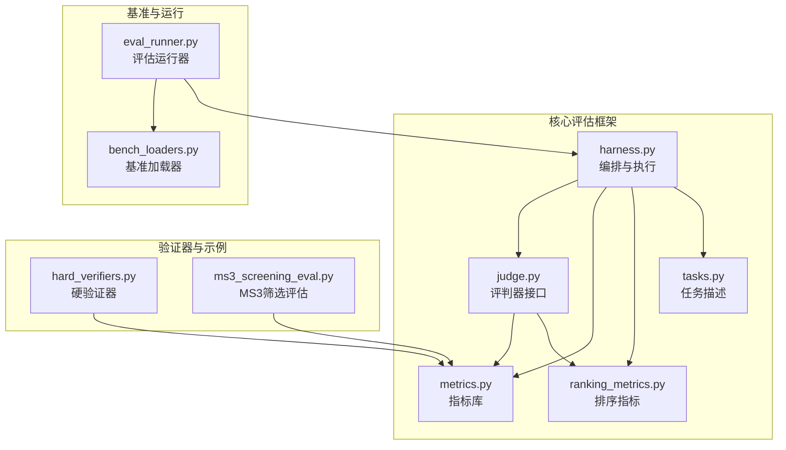
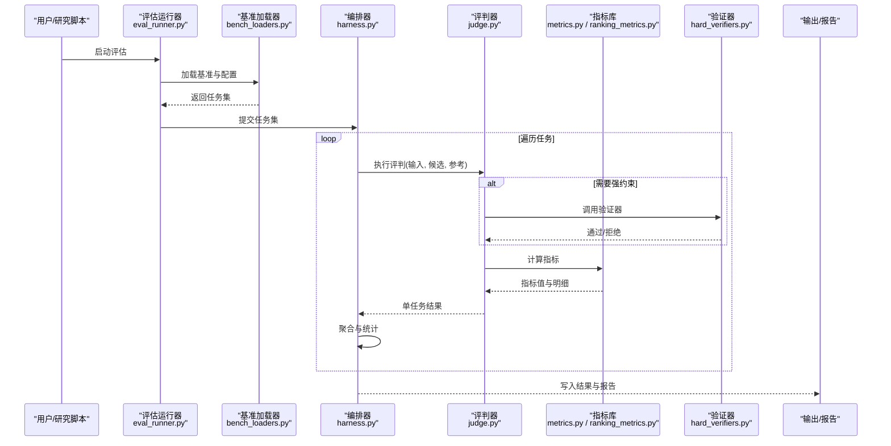
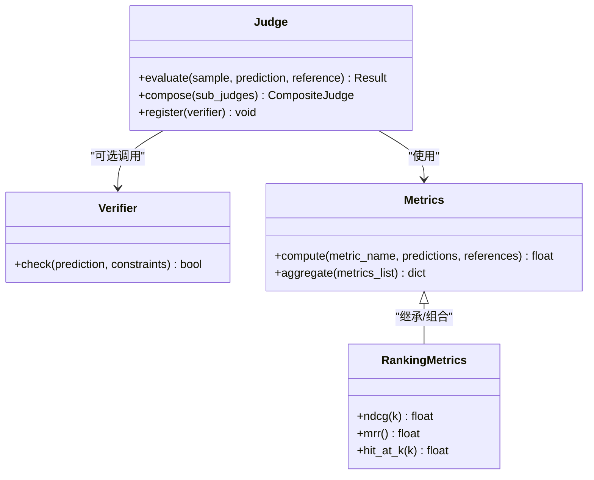
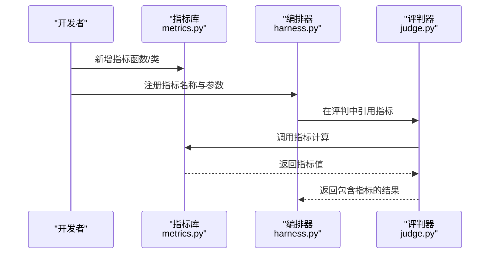
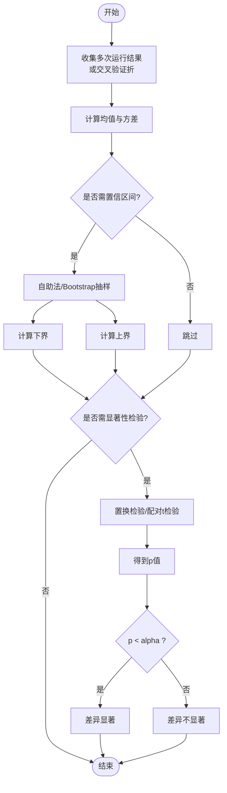
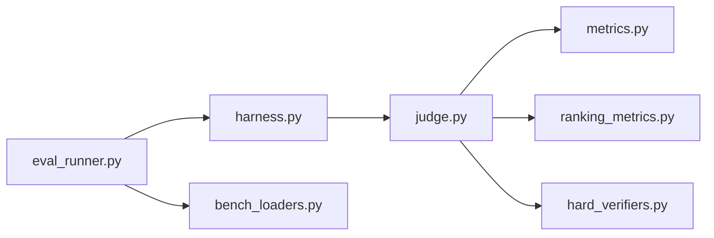

# 评估器扩展机制

<cite>
**本文引用的文件**   
- [autonomy_mvp/core/harness.py](file://autonomy_mvp/core/harness.py)
- [autonomy_mvp/core/judge.py](file://autonomy_mvp/core/judge.py)
- [autonomy_mvp/core/metrics.py](file://autonomy_mvp/core/metrics.py)
- [autonomy_mvp/core/ranking_metrics.py](file://autonomy_mvp/core/ranking_metrics.py)
- [autonomy_mvp/core/tasks.py](file://autonomy_mvp/core/tasks.py)
- [autonomy_mvp/tests/test_core.py](file://autonomy_mvp/tests/test_core.py)
- [longhorizon/verifiers/hard_verifiers.py](file://longhorizon/verifiers/hard_verifiers.py)
- [task3/B_ms3_screening_prototype/ms3_screening_eval.py](file://task3/B_ms3_screening_prototype/ms3_screening_eval.py)
- [docs/prd/molbench_repo/eval/eval_runner.py](file://docs/prd/molbench_repo/eval/eval_runner.py)
- [docs/prd/molbench_repo/eval/bench_loaders.py](file://docs/prd/molbench_repo/eval/bench_loaders.py)
</cite>

## 目录
1. [引言](#引言)
2. [项目结构](#项目结构)
3. [核心组件](#核心组件)
4. [架构总览](#架构总览)
5. [详细组件分析](#详细组件分析)
6. [依赖关系分析](#依赖关系分析)
7. [性能考量](#性能考量)
8. [故障排查指南](#故障排查指南)
9. [结论](#结论)
10. [附录](#附录)

## 引言
本文件面向研究者与工程人员，系统化阐述评估框架的插件化架构、指标计算系统与评判器设计模式，并给出从简单数值比较到复杂AI代理行为分析的完整扩展方案。文档覆盖：
- 如何添加新的评估指标与自定义评分算法
- 多维度评估体系的设计与实现
- 评估流程编排、结果聚合与报告生成机制
- 评估基准定义、置信度计算与统计显著性检验方法
- 可复现实验与可扩展的评测流水线

## 项目结构
仓库围绕“任务—运行—评估—报告”的主线组织，核心评估能力集中在 autonomy_mvp/core 与 longhorizon/verifiers，同时在各任务子项目中提供领域特定的评估脚本与基准加载器。

图表来源
- [autonomy_mvp/core/harness.py](file://autonomy_mvp/core/harness.py)
- [autonomy_mvp/core/judge.py](file://autonomy_mvp/core/judge.py)
- [autonomy_mvp/core/metrics.py](file://autonomy_mvp/core/metrics.py)
- [autonomy_mvp/core/ranking_metrics.py](file://autonomy_mvp/core/ranking_metrics.py)
- [autonomy_mvp/core/tasks.py](file://autonomy_mvp/core/tasks.py)
- [longhorizon/verifiers/hard_verifiers.py](file://longhorizon/verifiers/hard_verifiers.py)
- [task3/B_ms3_screening_prototype/ms3_screening_eval.py](file://task3/B_ms3_screening_prototype/ms3_screening_eval.py)
- [docs/prd/molbench_repo/eval/eval_runner.py](file://docs/prd/molbench_repo/eval/eval_runner.py)
- [docs/prd/molbench_repo/eval/bench_loaders.py](file://docs/prd/molbench_repo/eval/bench_loaders.py)

章节来源
- [autonomy_mvp/core/harness.py](file://autonomy_mvp/core/harness.py)
- [autonomy_mvp/core/judge.py](file://autonomy_mvp/core/judge.py)
- [autonomy_mvp/core/metrics.py](file://autonomy_mvp/core/metrics.py)
- [autonomy_mvp/core/ranking_metrics.py](file://autonomy_mvp/core/ranking_metrics.py)
- [autonomy_mvp/core/tasks.py](file://autonomy_mvp/core/tasks.py)
- [longhorizon/verifiers/hard_verifiers.py](file://longhorizon/verifiers/hard_verifiers.py)
- [task3/B_ms3_screening_prototype/ms3_screening_eval.py](file://task3/B_ms3_screening_prototype/ms3_screening_eval.py)
- [docs/prd/molbench_repo/eval/eval_runner.py](file://docs/prd/molbench_repo/eval/eval_runner.py)
- [docs/prd/molbench_repo/eval/bench_loaders.py](file://docs/prd/molbench_repo/eval/bench_loaders.py)

## 核心组件
- 编排器（Harness）：负责加载基准、调度任务、调用评判器与指标、汇总结果与输出报告。
- 评判器（Judge）：定义统一的评判接口，支持规则型与模型型评判策略，并可组合多个子评判器形成复合评判。
- 指标系统（Metrics）：提供原子指标（如准确率、F1、AUC等）与复合指标（加权、阈值、分段统计），支持对多模态输出进行结构化抽取与打分。
- 排序指标（Ranking Metrics）：针对排序与检索场景的指标集合（如NDCG、MRR、Hit@K）。
- 任务描述（Tasks）：以声明式方式定义输入、期望输出、约束条件与评估元数据。
- 验证器（Verifiers）：面向特定任务的强约束校验器，用于快速失败与一致性检查。
- 基准加载器与运行器：将数据集与配置转换为可执行的评估任务流。

章节来源
- [autonomy_mvp/core/harness.py](file://autonomy_mvp/core/harness.py)
- [autonomy_mvp/core/judge.py](file://autonomy_mvp/core/judge.py)
- [autonomy_mvp/core/metrics.py](file://autonomy_mvp/core/metrics.py)
- [autonomy_mvp/core/ranking_metrics.py](file://autonomy_mvp/core/ranking_metrics.py)
- [autonomy_mvp/core/tasks.py](file://autonomy_mvp/core/tasks.py)
- [longhorizon/verifiers/hard_verifiers.py](file://longhorizon/verifiers/hard_verifiers.py)
- [docs/prd/molbench_repo/eval/bench_loaders.py](file://docs/prd/molbench_repo/eval/bench_loaders.py)
- [docs/prd/molbench_repo/eval/eval_runner.py](file://docs/prd/molbench_repo/eval/eval_runner.py)

## 架构总览
下图展示了从基准加载到评估执行、再到结果聚合与报告的端到端流程。

图表来源
- [docs/prd/molbench_repo/eval/eval_runner.py](file://docs/prd/molbench_repo/eval/eval_runner.py)
- [docs/prd/molbench_repo/eval/bench_loaders.py](file://docs/prd/molbench_repo/eval/bench_loaders.py)
- [autonomy_mvp/core/harness.py](file://autonomy_mvp/core/harness.py)
- [autonomy_mvp/core/judge.py](file://autonomy_mvp/core/judge.py)
- [autonomy_mvp/core/metrics.py](file://autonomy_mvp/core/metrics.py)
- [autonomy_mvp/core/ranking_metrics.py](file://autonomy_mvp/core/ranking_metrics.py)
- [longhorizon/verifiers/hard_verifiers.py](file://longhorizon/verifiers/hard_verifiers.py)

## 详细组件分析

### 编排器（Harness）
职责
- 解析任务清单与配置，构建执行图
- 并行或串行调度任务，管理资源与重试
- 收集中间产物，触发指标计算与报告生成
- 暴露统一API供上层运行器调用

关键流程
- 初始化：加载基准、注册指标与评判器
- 执行：按依赖顺序推进任务节点
- 聚合：跨任务/跨维度汇总指标，计算置信区间与显著性
- 输出：序列化结果、生成可读报告

章节来源
- [autonomy_mvp/core/harness.py](file://autonomy_mvp/core/harness.py)

### 评判器（Judge）
设计模式
- 策略模式：支持多种评判策略（规则、启发式、LLM-as-a-Judge）
- 组合模式：将多个子评判器组合为复合评判器
- 模板模式：定义评判骨架，子类实现具体打分逻辑

接口要点
- 输入：样本、模型输出、参考答案/约束
- 输出：分数、细粒度标签、解释字段
- 副作用：日志、中间产物、断言与失败路径

扩展点
- 新增评判器：实现统一接口并注册
- 动态路由：根据任务类型选择最佳评判器
- 可插拔验证器：在评判前/后插入强约束检查

章节来源
- [autonomy_mvp/core/judge.py](file://autonomy_mvp/core/judge.py)
- [longhorizon/verifiers/hard_verifiers.py](file://longhorizon/verifiers/hard_verifiers.py)

### 指标系统（Metrics）
分类
- 原子指标：精确率、召回率、F1、AUC、MAE、RMSE、相似度等
- 复合指标：加权平均、分段统计、阈值判定、排名相关指标
- 文本/结构化指标：基于正则/JSON Schema/语义匹配的结构化抽取打分

复杂度与性能
- 向量化计算优先，避免逐条循环
- 惰性求值与缓存命中，减少重复计算
- 大对象（如嵌入向量）按需加载与批处理

章节来源
- [autonomy_mvp/core/metrics.py](file://autonomy_mvp/core/metrics.py)
- [autonomy_mvp/core/ranking_metrics.py](file://autonomy_mvp/core/ranking_metrics.py)

### 任务描述（Tasks）
作用
- 以声明式方式定义输入格式、期望输出、约束与评估元数据
- 与编排器协作，驱动数据准备与结果对齐

章节来源
- [autonomy_mvp/core/tasks.py](file://autonomy_mvp/core/tasks.py)

### 验证器（Verifiers）
定位
- 面向特定任务的强约束校验器，用于快速失败与一致性检查
- 可与评判器组合，形成“先验证、后打分”的两阶段流程

章节来源
- [longhorizon/verifiers/hard_verifiers.py](file://longhorizon/verifiers/hard_verifiers.py)

### 领域评估示例：MS3筛选评估
说明
- 展示如何在任务级封装领域特定的评估逻辑，复用通用指标与评判器
- 典型流程：读取候选与真值、过滤无效样本、计算主指标、输出明细

章节来源
- [task3/B_ms3_screening_prototype/ms3_screening_eval.py](file://task3/B_ms3_screening_prototype/ms3_screening_eval.py)

### 基准加载器与运行器
职责
- 基准加载器：将数据集与配置转换为标准任务对象
- 运行器：协调加载器与编排器，管理批次、并发与容错

章节来源
- [docs/prd/molbench_repo/eval/bench_loaders.py](file://docs/prd/molbench_repo/eval/bench_loaders.py)
- [docs/prd/molbench_repo/eval/eval_runner.py](file://docs/prd/molbench_repo/eval/eval_runner.py)

### 类图：评判器与指标的关系

图表来源
- [autonomy_mvp/core/judge.py](file://autonomy_mvp/core/judge.py)
- [autonomy_mvp/core/metrics.py](file://autonomy_mvp/core/metrics.py)
- [autonomy_mvp/core/ranking_metrics.py](file://autonomy_mvp/core/ranking_metrics.py)
- [longhorizon/verifiers/hard_verifiers.py](file://longhorizon/verifiers/hard_verifiers.py)

### 序列图：添加新指标的流程

图表来源
- [autonomy_mvp/core/metrics.py](file://autonomy_mvp/core/metrics.py)
- [autonomy_mvp/core/harness.py](file://autonomy_mvp/core/harness.py)
- [autonomy_mvp/core/judge.py](file://autonomy_mvp/core/judge.py)

### 流程图：置信度与显著性检验

[本节为概念性流程，无需源码映射]

## 依赖关系分析
- 低耦合：评判器与指标解耦，便于替换与扩展
- 高内聚：同一模块内的指标与评判逻辑紧密关联
- 外部依赖：基准加载器与运行器作为入口，屏蔽数据源差异
- 潜在环：应避免在指标中反向依赖编排器；如需状态共享，通过上下文对象传递

图表来源
- [docs/prd/molbench_repo/eval/eval_runner.py](file://docs/prd/molbench_repo/eval/eval_runner.py)
- [autonomy_mvp/core/harness.py](file://autonomy_mvp/core/harness.py)
- [autonomy_mvp/core/judge.py](file://autonomy_mvp/core/judge.py)
- [autonomy_mvp/core/metrics.py](file://autonomy_mvp/core/metrics.py)
- [autonomy_mvp/core/ranking_metrics.py](file://autonomy_mvp/core/ranking_metrics.py)
- [longhorizon/verifiers/hard_verifiers.py](file://longhorizon/verifiers/hard_verifiers.py)
- [docs/prd/molbench_repo/eval/bench_loaders.py](file://docs/prd/molbench_repo/eval/bench_loaders.py)

章节来源
- [docs/prd/molbench_repo/eval/eval_runner.py](file://docs/prd/molbench_repo/eval/eval_runner.py)
- [autonomy_mvp/core/harness.py](file://autonomy_mvp/core/harness.py)
- [autonomy_mvp/core/judge.py](file://autonomy_mvp/core/judge.py)
- [autonomy_mvp/core/metrics.py](file://autonomy_mvp/core/metrics.py)
- [autonomy_mvp/core/ranking_metrics.py](file://autonomy_mvp/core/ranking_metrics.py)
- [longhorizon/verifiers/hard_verifiers.py](file://longhorizon/verifiers/hard_verifiers.py)
- [docs/prd/molbench_repo/eval/bench_loaders.py](file://docs/prd/molbench_repo/eval/bench_loaders.py)

## 性能考量
- 批量计算：尽量使用向量化操作，减少Python层循环
- 缓存与去重：对昂贵计算（如嵌入、模型推理）启用缓存
- 惰性求值：仅在需要时计算指标，避免全量扫描
- 内存控制：分块读取与增量聚合，避免一次性加载全部数据
- 并行与I/O：合理设置并发度，避免磁盘与网络瓶颈

[本节为通用指导，无需源码映射]

## 故障排查指南
常见问题与对策
- 指标缺失或命名不一致：检查指标注册表与调用名是否一致
- 评判器未生效：确认策略路由与优先级配置
- 验证器误杀样本：放宽约束或增加白名单，记录失败样例
- 结果不可复现：固定随机种子、锁定依赖版本、记录环境信息
- 报告不完整：检查中间产物落盘与异常捕获路径

章节来源
- [autonomy_mvp/tests/test_core.py](file://autonomy_mvp/tests/test_core.py)

## 结论
本评估框架通过“编排器—评判器—指标—验证器”的分层设计，提供了高度可扩展的评测能力。研究者可在不改动核心代码的前提下，快速添加新指标、自定义评分算法与多维度评估体系，并通过基准加载器与运行器实现端到端的自动化评测与报告生成。结合置信度与显著性检验，可提升评估结果的科学性与可信度。

## 附录

### 如何添加新指标（步骤清单）
- 在指标库中实现新指标函数/类，明确输入输出与边界条件
- 在编排器中注册指标名称与默认参数
- 在评判器中引用该指标，必要时加入权重与阈值
- 编写单元测试，覆盖正常与异常路径
- 在基准加载器中为新任务绑定指标

章节来源
- [autonomy_mvp/core/metrics.py](file://autonomy_mvp/core/metrics.py)
- [autonomy_mvp/core/harness.py](file://autonomy_mvp/core/harness.py)
- [autonomy_mvp/core/judge.py](file://autonomy_mvp/core/judge.py)

### 如何扩展多维评估体系
- 定义维度：如准确性、效率、鲁棒性、公平性等
- 为每个维度选择合适指标，并设定权重与阈值
- 在编排器中按维度聚合，输出分层报告
- 支持按任务族/子域切片对比

章节来源
- [autonomy_mvp/core/harness.py](file://autonomy_mvp/core/harness.py)
- [autonomy_mvp/core/metrics.py](file://autonomy_mvp/core/metrics.py)

### 评估基准定义建议
- 明确输入/输出契约与数据类型
- 标注参考答案来源与质量等级
- 定义失败与不确定情形的处理策略
- 提供最小可复现示例与数据采样脚本

章节来源
- [autonomy_mvp/core/tasks.py](file://autonomy_mvp/core/tasks.py)
- [docs/prd/molbench_repo/eval/bench_loaders.py](file://docs/prd/molbench_repo/eval/bench_loaders.py)

### 置信度与显著性检验实践
- 置信区间：Bootstrap抽样，报告均值与上下界
- 显著性检验：配对t检验或置换检验，控制I类错误
- 多重比较校正：如Bonferroni或FDR
- 可视化：箱线图、误差带、分布直方图

[本节为概念性内容，无需源码映射]