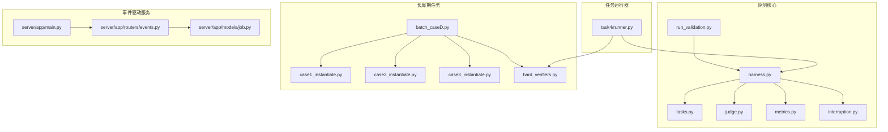
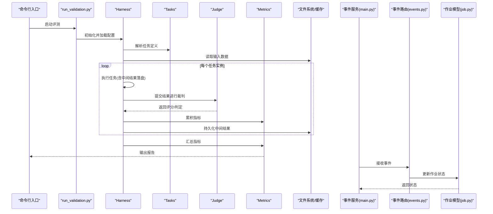
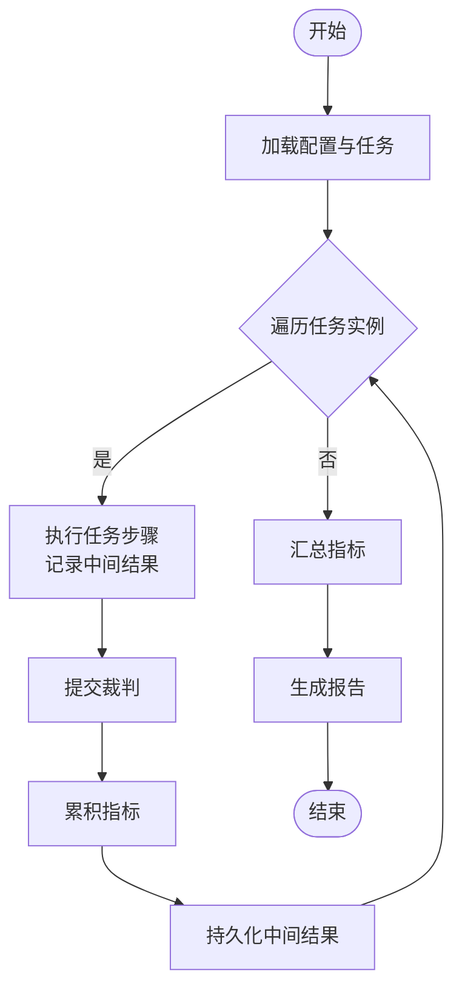
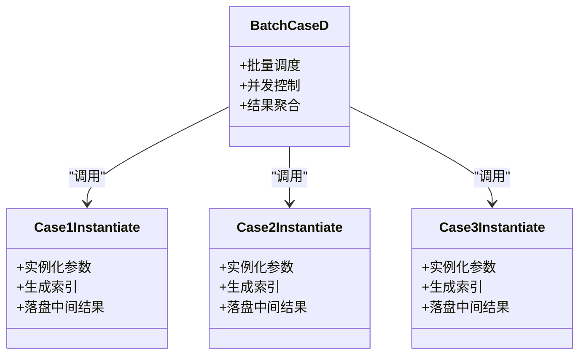
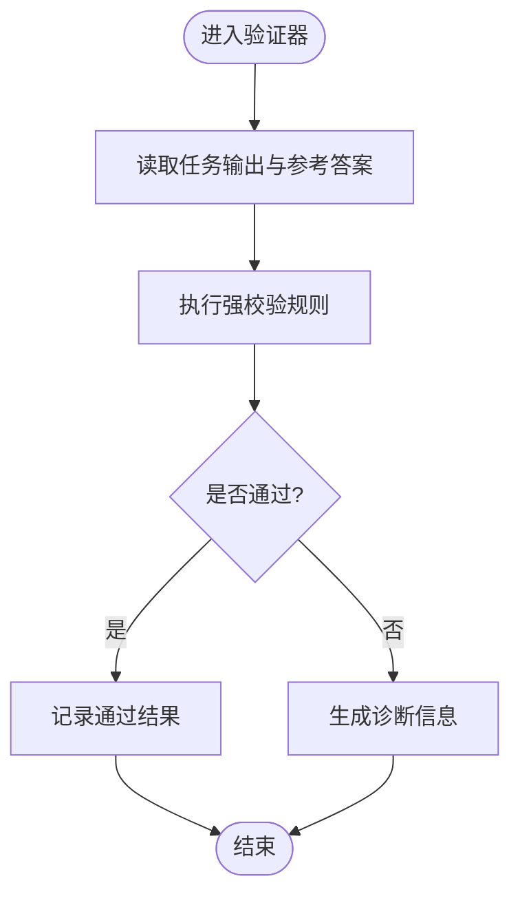
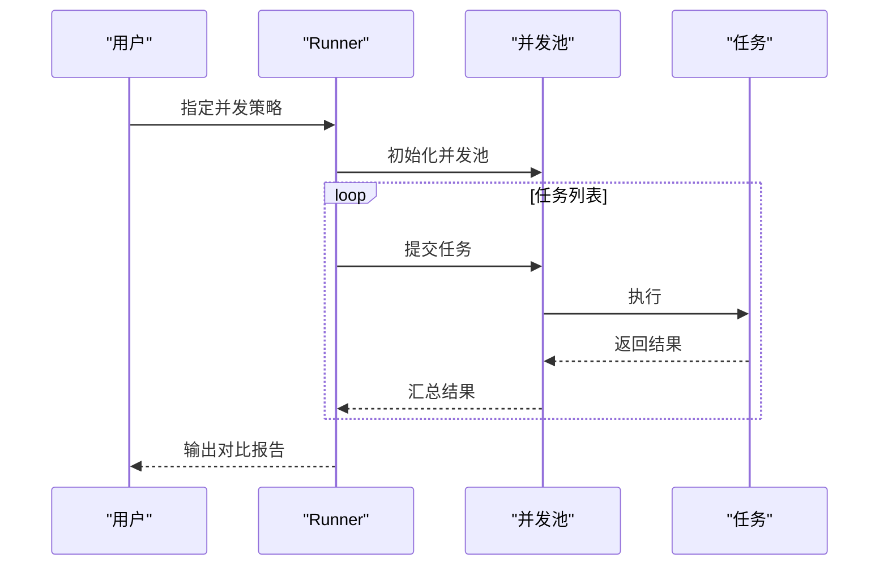
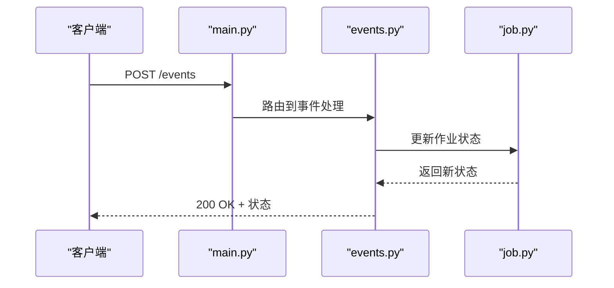
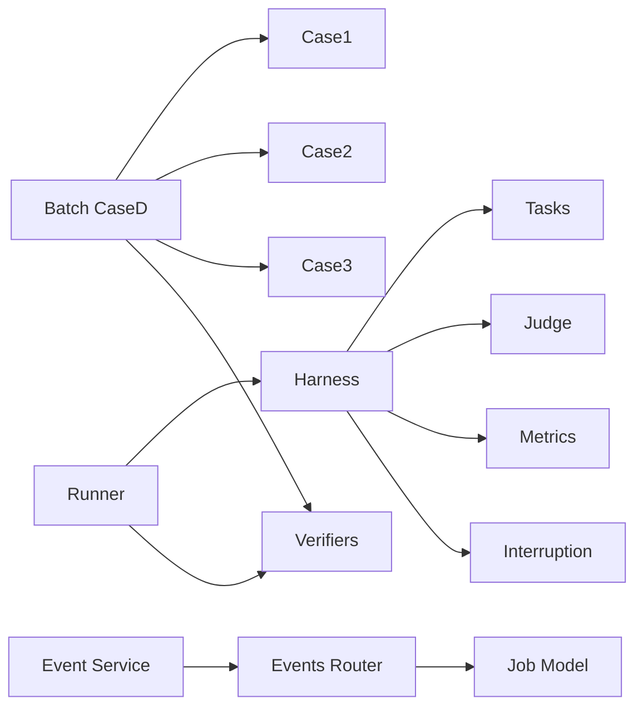

# 数据流与控制流

<cite>
**本文引用的文件**   
- [autonomy_mvp/core/harness.py](file://autonomy_mvp/core/harness.py)
- [autonomy_mvp/core/tasks.py](file://autonomy_mvp/core/tasks.py)
- [autonomy_mvp/core/judge.py](file://autonomy_mvp/core/judge.py)
- [autonomy_mvp/core/metrics.py](file://autonomy_mvp/core/metrics.py)
- [autonomy_mvp/core/interruption.py](file://autonomy_mvp/core/interruption.py)
- [autonomy_mvp/run_validation.py](file://autonomy_mvp/run_validation.py)
- [longhorizon/instantiate/case1_instantiate.py](file://longhorizon/instantiate/case1_instantiate.py)
- [longhorizon/instantiate/case2_instantiate.py](file://longhorizon/instantiate/case2_instantiate.py)
- [longhorizon/instantiate/case3_instantiate.py](file://longhorizon/instantiate/case3_instantiate.py)
- [longhorizon/instantiate/batch_caseD.py](file://longhorizon/instantiate/batch_caseD.py)
- [longhorizon/verifiers/hard_verifiers.py](file://longhorizon/verifiers/hard_verifiers.py)
- [task4/runner.py](file://task4/runner.py)
- [task7/poc1_do_challenge/server/app/main.py](file://task7/poc1_do_challenge/server/app/main.py)
- [task7/poc1_do_challenge/server/app/routers/events.py](file://task7/poc1_do_challenge/server/app/routers/events.py)
- [task7/poc1_do_challenge/server/app/models/job.py](file://task7/poc1_do_challenge/server/app/models/job.py)
</cite>

## 目录
1. [简介](#简介)
2. [项目结构](#项目结构)
3. [核心组件](#核心组件)
4. [架构总览](#架构总览)
5. [详细组件分析](#详细组件分析)
6. [依赖分析](#依赖分析)
7. [性能考虑](#性能考虑)
8. [故障排查指南](#故障排查指南)
9. [结论](#结论)
10. [附录](#附录)

## 简介
本文件聚焦于系统的数据流与控制流，覆盖以下关键主题：
- 数据流转路径与中间结果缓存策略
- 控制指令传递机制与任务实例化流程
- 异步事件处理、消息队列使用模式与并发控制
- 最终结果的聚合方式与评估指标计算
- 性能优化策略与内存管理建议

为便于理解，文档提供数据流图与控制流程图，并给出关键路径上的数据处理步骤。

## 项目结构
仓库包含多个子项目与实验脚本，围绕“自动化评测/长周期任务”展开。与数据流和控制流密切相关的代码主要分布在：
- autonomy_mvp：基准评测核心（编排、任务定义、裁判、指标）
- longhorizon：长周期任务的实例化与验证器
- task4：并行/单线程运行对比的 Runner
- task7/poc1_do_challenge：基于 FastAPI 的事件驱动服务（事件路由、作业模型）

图表来源
- [autonomy_mvp/core/harness.py](file://autonomy_mvp/core/harness.py)
- [autonomy_mvp/core/tasks.py](file://autonomy_mvp/core/tasks.py)
- [autonomy_mvp/core/judge.py](file://autonomy_mvp/core/judge.py)
- [autonomy_mvp/core/metrics.py](file://autonomy_mvp/core/metrics.py)
- [autonomy_mvp/core/interruption.py](file://autonomy_mvp/core/interruption.py)
- [autonomy_mvp/run_validation.py](file://autonomy_mvp/run_validation.py)
- [longhorizon/instantiate/case1_instantiate.py](file://longhorizon/instantiate/case1_instantiate.py)
- [longhorizon/instantiate/case2_instantiate.py](file://longhorizon/instantiate/case2_instantiate.py)
- [longhorizon/instantiate/case3_instantiate.py](file://longhorizon/instantiate/case3_instantiate.py)
- [longhorizon/instantiate/batch_caseD.py](file://longhorizon/instantiate/batch_caseD.py)
- [longhorizon/verifiers/hard_verifiers.py](file://longhorizon/verifiers/hard_verifiers.py)
- [task4/runner.py](file://task4/runner.py)
- [task7/poc1_do_challenge/server/app/main.py](file://task7/poc1_do_challenge/server/app/main.py)
- [task7/poc1_do_challenge/server/app/routers/events.py](file://task7/poc1_do_challenge/server/app/routers/events.py)
- [task7/poc1_do_challenge/server/app/models/job.py](file://task7/poc1_do_challenge/server/app/models/job.py)

章节来源
- [autonomy_mvp/run_validation.py](file://autonomy_mvp/run_validation.py)
- [autonomy_mvp/core/harness.py](file://autonomy_mvp/core/harness.py)
- [longhorizon/instantiate/batch_caseD.py](file://longhorizon/instantiate/batch_caseD.py)
- [task4/runner.py](file://task4/runner.py)
- [task7/poc1_do_challenge/server/app/main.py](file://task7/poc1_do_challenge/server/app/main.py)

## 核心组件
- 编排器（Harness）：负责加载任务、调度执行、收集中间结果、触发裁判与指标计算、处理中断信号。
- 任务定义（Tasks）：声明式描述任务输入、工具调用、期望输出与约束。
- 裁判（Judge）：对任务执行结果进行判定，返回结构化评分或布尔结果。
- 指标（Metrics）：汇总与统计，生成可比较的评测报告。
- 中断（Interruption）：支持外部中断与优雅退出，保障长时任务的可控性。
- 实例化脚本（Case*）：将高层用例转换为具体任务实例，写入索引与中间产物。
- 批处理器（Batch CaseD）：批量实例化与分发，协调多任务并发。
- 验证器（Hard Verifiers）：对复杂场景进行强校验，确保结果一致性。
- 运行器（Task4 Runner）：对比单线程与多线程/进程的执行差异，暴露并发瓶颈。
- 事件服务（FastAPI）：提供事件订阅/发布接口，持久化作业状态，支撑异步工作流。

章节来源
- [autonomy_mvp/core/harness.py](file://autonomy_mvp/core/harness.py)
- [autonomy_mvp/core/tasks.py](file://autonomy_mvp/core/tasks.py)
- [autonomy_mvp/core/judge.py](file://autonomy_mvp/core/judge.py)
- [autonomy_mvp/core/metrics.py](file://autonomy_mvp/core/metrics.py)
- [autonomy_mvp/core/interruption.py](file://autonomy_mvp/core/interruption.py)
- [longhorizon/instantiate/case1_instantiate.py](file://longhorizon/instantiate/case1_instantiate.py)
- [longhorizon/instantiate/case2_instantiate.py](file://longhorizon/instantiate/case2_instantiate.py)
- [longhorizon/instantiate/case3_instantiate.py](file://longhorizon/instantiate/case3_instantiate.py)
- [longhorizon/instantiate/batch_caseD.py](file://longhorizon/instantiate/batch_caseD.py)
- [longhorizon/verifiers/hard_verifiers.py](file://longhorizon/verifiers/hard_verifiers.py)
- [task4/runner.py](file://task4/runner.py)
- [task7/poc1_do_challenge/server/app/main.py](file://task7/poc1_do_challenge/server/app/main.py)

## 架构总览
整体采用“编排+事件驱动”的混合架构：
- 同步编排：通过 Harness 驱动任务生命周期，集中管理中间结果与指标。
- 异步事件：通过 FastAPI 服务接收外部事件，更新作业状态，触发后续流水线。
- 批处理与并发：实例化脚本与批处理器负责任务拆分与并发调度；Runner 用于对比不同并发策略。

图表来源
- [autonomy_mvp/run_validation.py](file://autonomy_mvp/run_validation.py)
- [autonomy_mvp/core/harness.py](file://autonomy_mvp/core/harness.py)
- [autonomy_mvp/core/tasks.py](file://autonomy_mvp/core/tasks.py)
- [autonomy_mvp/core/judge.py](file://autonomy_mvp/core/judge.py)
- [autonomy_mvp/core/metrics.py](file://autonomy_mvp/core/metrics.py)
- [task7/poc1_do_challenge/server/app/main.py](file://task7/poc1_do_challenge/server/app/main.py)
- [task7/poc1_do_challenge/server/app/routers/events.py](file://task7/poc1_do_challenge/server/app/routers/events.py)
- [task7/poc1_do_challenge/server/app/models/job.py](file://task7/poc1_do_challenge/server/app/models/job.py)

## 详细组件分析

### 编排器（Harness）数据流与控制流
- 数据流
  - 输入：任务定义、数据集、配置参数
  - 中间结果：每步执行的产物（如工具调用输出、阶段摘要）
  - 输出：裁判结果、指标汇总、最终报告
- 控制流
  - 初始化 → 加载任务 → 循环执行 → 裁判 → 指标累积 → 持久化 → 结束
- 中断处理
  - 监听中断信号，安全保存中间结果并退出

图表来源
- [autonomy_mvp/core/harness.py](file://autonomy_mvp/core/harness.py)
- [autonomy_mvp/core/interruption.py](file://autonomy_mvp/core/interruption.py)

章节来源
- [autonomy_mvp/core/harness.py](file://autonomy_mvp/core/harness.py)
- [autonomy_mvp/core/interruption.py](file://autonomy_mvp/core/interruption.py)

### 任务实例化（Case*）与批处理（Batch CaseD）
- 数据转换
  - 从高层用例到具体任务实例的参数映射与校验
  - 生成索引文件以追踪批次与实例关系
- 中间结果缓存
  - 按实例维度落盘，避免重复计算
- 最终聚合
  - 批处理器汇总各实例结果，形成批次级报告

图表来源
- [longhorizon/instantiate/case1_instantiate.py](file://longhorizon/instantiate/case1_instantiate.py)
- [longhorizon/instantiate/case2_instantiate.py](file://longhorizon/instantiate/case2_instantiate.py)
- [longhorizon/instantiate/case3_instantiate.py](file://longhorizon/instantiate/case3_instantiate.py)
- [longhorizon/instantiate/batch_caseD.py](file://longhorizon/instantiate/batch_caseD.py)

章节来源
- [longhorizon/instantiate/case1_instantiate.py](file://longhorizon/instantiate/case1_instantiate.py)
- [longhorizon/instantiate/case2_instantiate.py](file://longhorizon/instantiate/case2_instantiate.py)
- [longhorizon/instantiate/case3_instantiate.py](file://longhorizon/instantiate/case3_instantiate.py)
- [longhorizon/instantiate/batch_caseD.py](file://longhorizon/instantiate/batch_caseD.py)

### 验证器（Hard Verifiers）
- 职责：对复杂场景进行强校验，确保结果一致性与正确性
- 数据流：输入任务输出与参考答案，输出校验结果与诊断信息
- 控制流：顺序校验 → 条件分支 → 失败快速返回或继续

图表来源
- [longhorizon/verifiers/hard_verifiers.py](file://longhorizon/verifiers/hard_verifiers.py)

章节来源
- [longhorizon/verifiers/hard_verifiers.py](file://longhorizon/verifiers/hard_verifiers.py)

### 运行器（Task4 Runner）并发对比
- 目标：对比单线程与多线程/进程的执行差异，定位并发瓶颈
- 数据流：同一组任务在不同并发策略下的执行轨迹与耗时
- 控制流：创建执行环境 → 选择并发策略 → 执行任务 → 收集指标 → 输出对比报告

图表来源
- [task4/runner.py](file://task4/runner.py)

章节来源
- [task4/runner.py](file://task4/runner.py)

### 事件驱动服务（FastAPI）
- 职责：提供事件订阅/发布接口，持久化作业状态，支撑异步工作流
- 数据流：事件载荷 → 路由处理 → 模型更新 → 响应客户端
- 控制流：请求到达 → 鉴权/校验 → 业务处理 → 状态持久化 → 返回

图表来源
- [task7/poc1_do_challenge/server/app/main.py](file://task7/poc1_do_challenge/server/app/main.py)
- [task7/poc1_do_challenge/server/app/routers/events.py](file://task7/poc1_do_challenge/server/app/routers/events.py)
- [task7/poc1_do_challenge/server/app/models/job.py](file://task7/poc1_do_challenge/server/app/models/job.py)

章节来源
- [task7/poc1_do_challenge/server/app/main.py](file://task7/poc1_do_challenge/server/app/main.py)
- [task7/poc1_do_challenge/server/app/routers/events.py](file://task7/poc1_do_challenge/server/app/routers/events.py)
- [task7/poc1_do_challenge/server/app/models/job.py](file://task7/poc1_do_challenge/server/app/models/job.py)

## 依赖分析
- 模块耦合
  - Harness 依赖 Tasks、Judge、Metrics、Interruption
  - 实例化脚本依赖批处理器与验证器
  - Runner 依赖 Harness 与验证器
  - 事件服务独立，通过 HTTP 与外部系统交互
- 潜在循环依赖
  - 当前结构未见明显循环依赖；若扩展需保持单向依赖原则
- 外部依赖
  - 文件系统用于中间结果缓存
  - FastAPI 用于事件服务

图表来源
- [autonomy_mvp/core/harness.py](file://autonomy_mvp/core/harness.py)
- [autonomy_mvp/core/tasks.py](file://autonomy_mvp/core/tasks.py)
- [autonomy_mvp/core/judge.py](file://autonomy_mvp/core/judge.py)
- [autonomy_mvp/core/metrics.py](file://autonomy_mvp/core/metrics.py)
- [autonomy_mvp/core/interruption.py](file://autonomy_mvp/core/interruption.py)
- [longhorizon/instantiate/batch_caseD.py](file://longhorizon/instantiate/batch_caseD.py)
- [longhorizon/instantiate/case1_instantiate.py](file://longhorizon/instantiate/case1_instantiate.py)
- [longhorizon/instantiate/case2_instantiate.py](file://longhorizon/instantiate/case2_instantiate.py)
- [longhorizon/instantiate/case3_instantiate.py](file://longhorizon/instantiate/case3_instantiate.py)
- [longhorizon/verifiers/hard_verifiers.py](file://longhorizon/verifiers/hard_verifiers.py)
- [task4/runner.py](file://task4/runner.py)
- [task7/poc1_do_challenge/server/app/main.py](file://task7/poc1_do_challenge/server/app/main.py)
- [task7/poc1_do_challenge/server/app/routers/events.py](file://task7/poc1_do_challenge/server/app/routers/events.py)
- [task7/poc1_do_challenge/server/app/models/job.py](file://task7/poc1_do_challenge/server/app/models/job.py)

章节来源
- [autonomy_mvp/core/harness.py](file://autonomy_mvp/core/harness.py)
- [longhorizon/instantiate/batch_caseD.py](file://longhorizon/instantiate/batch_caseD.py)
- [task4/runner.py](file://task4/runner.py)
- [task7/poc1_do_challenge/server/app/main.py](file://task7/poc1_do_challenge/server/app/main.py)

## 性能考虑
- 中间结果缓存
  - 按实例维度落盘，避免重复计算；建议在 Harness 中实现幂等写入与增量更新
- 并发控制
  - 使用 Runner 对比不同并发策略，识别 CPU/IO 瓶颈；根据任务特性选择线程或进程池
- 内存管理
  - 大对象及时释放；分块处理数据；避免在循环中持有全局引用
- 指标计算
  - 延迟聚合，分批计算，减少峰值内存占用
- 事件服务
  - 使用连接池与限流；异步处理事件，避免阻塞主循环

[本节为通用指导，不直接分析具体文件]

## 故障排查指南
- 常见问题
  - 任务执行中断：检查 Interruption 处理逻辑与中间结果持久化
  - 并发死锁：通过 Runner 对比单线程与并发执行，定位竞争条件
  - 事件丢失：确认事件路由与作业模型的状态一致性
- 调试建议
  - 增加日志粒度，记录关键节点输入输出
  - 使用断点与快照恢复，结合中间结果文件定位问题

章节来源
- [autonomy_mvp/core/interruption.py](file://autonomy_mvp/core/interruption.py)
- [task4/runner.py](file://task4/runner.py)
- [task7/poc1_do_challenge/server/app/routers/events.py](file://task7/poc1_do_challenge/server/app/routers/events.py)
- [task7/poc1_do_challenge/server/app/models/job.py](file://task7/poc1_do_challenge/server/app/models/job.py)

## 结论
本系统通过“编排+事件驱动”的混合架构实现了灵活的任务执行与异步协作。Harness 作为核心编排器，统一了数据流与控制流；实例化与批处理提供了可扩展的任务生成能力；Runner 帮助识别并发瓶颈；事件服务则增强了系统的可观测性与可恢复性。通过合理的缓存策略、并发控制与内存管理，可在保证正确性的同时提升性能与稳定性。

[本节为总结，不直接分析具体文件]

## 附录
- 术语表
  - 编排器：负责任务生命周期管理的核心组件
  - 中间结果：任务执行过程中的阶段性产物
  - 裁判：对任务结果进行判定的模块
  - 指标：用于量化评估的统计量
  - 事件驱动：基于事件的消息传递与状态更新模式

[本节为概念说明，不直接分析具体文件]