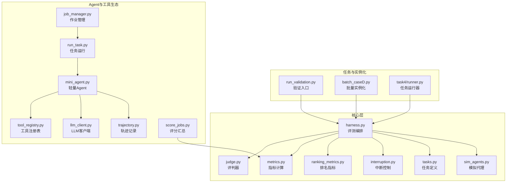
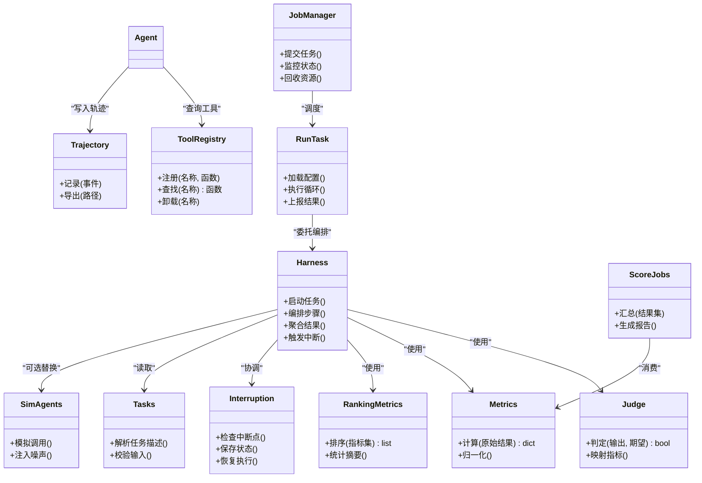
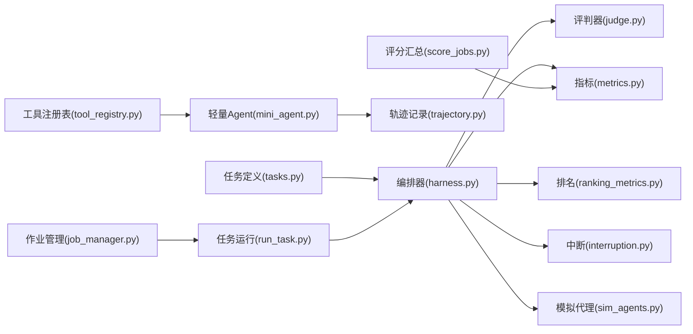

# 核心架构设计

<cite>
**本文引用的文件**   
- [autonomy_mvp/core/harness.py](file://autonomy_mvp/core/harness.py)
- [autonomy_mvp/core/judge.py](file://autonomy_mvp/core/judge.py)
- [autonomy_mvp/core/metrics.py](file://autonomy_mvp/core/metrics.py)
- [autonomy_mvp/core/ranking_metrics.py](file://autonomy_mvp/core/ranking_metrics.py)
- [autonomy_mvp/core/interruption.py](file://autonomy_mvp/core/interruption.py)
- [autonomy_mvp/core/tasks.py](file://autonomy_mvp/core/tasks.py)
- [autonomy_mvp/core/sim_agents.py](file://autonomy_mvp/core/sim_agents.py)
- [autonomy_mvp/run_validation.py](file://autonomy_mvp/run_validation.py)
- [autonomy_mvp/ACCEPTANCE.md](file://autonomy_mvp/ACCEPTANCE.md)
- [autonomy_mvp/schema.md](file://autonomy_mvp/schema.md)
- [longhorizon/instantiate/batch_caseD.py](file://longhorizon/instantiate/batch_caseD.py)
- [task4/runner.py](file://task4/runner.py)
- [task7/poc3_physicianbench/scripts/job_manager.py](file://task7/poc3_physicianbench/scripts/job_manager.py)
- [task7/poc3_physicianbench/scripts/run_task.py](file://task7/poc3_physicianbench/scripts/run_task.py)
- [task7/poc3_physicianbench/scripts/score_jobs.py](file://task7/poc3_physicianbench/scripts/score_jobs.py)
- [task7/poc3_physicianbench/agent/tool_registry.py](file://task7/poc3_physicianbench/agent/tool_registry.py)
- [task7/poc3_physicianbench/agent/trajectory.py](file://task7/poc3_physicianbench/agent/trajectory.py)
- [task7/poc3_physicianbench/agent/llm_client.py](file://task7/poc3_physicianbench/agent/llm_client.py)
- [task7/poc3_physicianbench/agent/mini_agent.py](file://task7/poc3_physicianbench/agent/mini_agent.py)
- [task7/poc3_physicianbench/pyproject.toml](file://task7/poc3_physicianbench/pyproject.toml)
</cite>

## 目录
1. [引言](#引言)
2. [项目结构](#项目结构)
3. [核心组件](#核心组件)
4. [架构总览](#架构总览)
5. [详细组件分析](#详细组件分析)
6. [依赖关系分析](#依赖关系分析)
7. [性能与可扩展性](#性能与可扩展性)
8. [故障排查指南](#故障排查指南)
9. [结论](#结论)
10. [附录](#附录)

## 引言
本文件面向科学计算基准测试框架的核心架构设计，聚焦分层架构、模块化设计与插件系统；阐述自主性评估引擎、任务调度器、工具注册表与结果收集器的设计理念与交互关系；说明数据流控制、事件驱动机制与异步处理架构；并提供架构图与技术决策权衡，帮助开发者快速理解并扩展系统。

## 项目结构
仓库采用“多任务/多领域”的横向组织方式：每个任务或子域拥有独立入口与运行脚本，同时共享一套可复用的核心能力（如评测编排、指标计算、中断与模拟代理等）。关键模块分布如下：
- 自主性MVP核心：提供评测编排、评判器、指标、中断控制、任务定义与模拟代理等基础能力
- 长周期案例实例化：批量生成与执行不同场景的任务实例
- 任务级运行器：各任务的统一入口，负责加载配置、调度执行与产出结果
- 医疗Poc示例：包含作业管理、任务运行、评分汇总以及Agent侧的工具注册与轨迹记录

图表来源
- [autonomy_mvp/core/harness.py](file://autonomy_mvp/core/harness.py)
- [autonomy_mvp/core/judge.py](file://autonomy_mvp/core/judge.py)
- [autonomy_mvp/core/metrics.py](file://autonomy_mvp/core/metrics.py)
- [autonomy_mvp/core/ranking_metrics.py](file://autonomy_mvp/core/ranking_metrics.py)
- [autonomy_mvp/core/interruption.py](file://autonomy_mvp/core/interruption.py)
- [autonomy_mvp/core/tasks.py](file://autonomy_mvp/core/tasks.py)
- [autonomy_mvp/core/sim_agents.py](file://autonomy_mvp/core/sim_agents.py)
- [autonomy_mvp/run_validation.py](file://autonomy_mvp/run_validation.py)
- [longhorizon/instantiate/batch_caseD.py](file://longhorizon/instantiate/batch_caseD.py)
- [task4/runner.py](file://task4/runner.py)
- [task7/poc3_physicianbench/scripts/job_manager.py](file://task7/poc3_physicianbench/scripts/job_manager.py)
- [task7/poc3_physicianbench/scripts/run_task.py](file://task7/poc3_physicianbench/scripts/run_task.py)
- [task7/poc3_physicianbench/scripts/score_jobs.py](file://task7/poc3_physicianbench/scripts/score_jobs.py)
- [task7/poc3_physicianbench/agent/tool_registry.py](file://task7/poc3_physicianbench/agent/tool_registry.py)
- [task7/poc3_physicianbench/agent/trajectory.py](file://task7/poc3_physicianbench/agent/trajectory.py)
- [task7/poc3_physicianbench/agent/llm_client.py](file://task7/poc3_physicianbench/agent/llm_client.py)
- [task7/poc3_physicianbench/agent/mini_agent.py](file://task7/poc3_physicianbench/agent/mini_agent.py)

章节来源
- [autonomy_mvp/ACCEPTANCE.md](file://autonomy_mvp/ACCEPTANCE.md)
- [autonomy_mvp/schema.md](file://autonomy_mvp/schema.md)

## 核心组件
- 评测编排器（Harness）：负责任务生命周期管理、步骤编排、资源协调与结果聚合，是系统的“中枢神经”。
- 评判器（Judge）：将模型输出与期望答案进行比对，支持规则判定与指标映射。
- 指标与排名（Metrics/Ranking Metrics）：提供原子指标与组合排名逻辑，支撑多维度评估。
- 中断控制（Interruption）：在长时间运行中提供可控的中断与恢复点，保障稳定性。
- 任务定义（Tasks）：以结构化描述声明任务输入、约束与期望输出，便于复用与组合。
- 模拟代理（Sim Agents）：用于离线回放与压力测试，替代真实外部依赖。
- 工具注册表（Tool Registry）：集中管理可调用的工具函数，实现插件式扩展。
- 轨迹记录（Trajectory）：持久化Agent调用链路与中间状态，便于审计与回溯。
- 作业管理与任务运行（Job Manager/Run Task）：负责并发调度、资源隔离与任务分发。
- 评分汇总（Score Jobs）：聚合多任务结果，生成最终报告。

章节来源
- [autonomy_mvp/core/harness.py](file://autonomy_mvp/core/harness.py)
- [autonomy_mvp/core/judge.py](file://autonomy_mvp/core/judge.py)
- [autonomy_mvp/core/metrics.py](file://autonomy_mvp/core/metrics.py)
- [autonomy_mvp/core/ranking_metrics.py](file://autonomy_mvp/core/ranking_metrics.py)
- [autonomy_mvp/core/interruption.py](file://autonomy_mvp/core/interruption.py)
- [autonomy_mvp/core/tasks.py](file://autonomy_mvp/core/tasks.py)
- [autonomy_mvp/core/sim_agents.py](file://autonomy_mvp/core/sim_agents.py)
- [task7/poc3_physicianbench/agent/tool_registry.py](file://task7/poc3_physicianbench/agent/tool_registry.py)
- [task7/poc3_physicianbench/agent/trajectory.py](file://task7/poc3_physicianbench/agent/trajectory.py)
- [task7/poc3_physicianbench/scripts/job_manager.py](file://task7/poc3_physicianbench/scripts/job_manager.py)
- [task7/poc3_physicianbench/scripts/run_task.py](file://task7/poc3_physicianbench/scripts/run_task.py)
- [task7/poc3_physicianbench/scripts/score_jobs.py](file://task7/poc3_physicianbench/scripts/score_jobs.py)

## 架构总览
整体采用“分层+插件”的架构模式：
- 表现层：任务运行器与作业管理器，暴露CLI/API供外部调用
- 编排层：评测编排器负责流程控制、事件分发与错误恢复
- 能力层：评判器、指标、中断控制、任务定义与模拟代理
- 插件层：工具注册表与Agent侧工具实现，支持热插拔
- 数据层：轨迹记录与结果收集器，统一落盘与导出

图表来源
- [autonomy_mvp/core/harness.py](file://autonomy_mvp/core/harness.py)
- [autonomy_mvp/core/judge.py](file://autonomy_mvp/core/judge.py)
- [autonomy_mvp/core/metrics.py](file://autonomy_mvp/core/metrics.py)
- [autonomy_mvp/core/ranking_metrics.py](file://autonomy_mvp/core/ranking_metrics.py)
- [autonomy_mvp/core/interruption.py](file://autonomy_mvp/core/interruption.py)
- [autonomy_mvp/core/tasks.py](file://autonomy_mvp/core/tasks.py)
- [autonomy_mvp/core/sim_agents.py](file://autonomy_mvp/core/sim_agents.py)
- [task7/poc3_physicianbench/agent/tool_registry.py](file://task7/poc3_physicianbench/agent/tool_registry.py)
- [task7/poc3_physicianbench/agent/trajectory.py](file://task7/poc3_physicianbench/agent/trajectory.py)
- [task7/poc3_physicianbench/scripts/job_manager.py](file://task7/poc3_physicianbench/scripts/job_manager.py)
- [task7/poc3_physicianbench/scripts/run_task.py](file://task7/poc3_physicianbench/scripts/run_task.py)
- [task7/poc3_physicianbench/scripts/score_jobs.py](file://task7/poc3_physicianbench/scripts/score_jobs.py)

## 详细组件分析

### 评测编排器（Harness）
- 职责：任务生命周期管理、步骤编排、异常捕获与重试、结果聚合、与中断控制协作
- 设计要点：
  - 基于步骤图或序列的编排模型，支持条件分支与并行阶段
  - 通过事件总线发布/订阅关键节点（开始、完成、失败、中断）
  - 与指标和排名模块解耦，仅消费标准化结果对象
- 优化建议：
  - 引入背压与限流，避免外部服务过载
  - 对长耗时步骤启用检查点，配合中断控制实现可恢复执行

章节来源
- [autonomy_mvp/core/harness.py](file://autonomy_mvp/core/harness.py)

### 评判器（Judge）
- 职责：将模型输出与期望答案进行匹配，返回布尔判定与细粒度信号
- 设计要点：
  - 支持多种匹配策略（精确、模糊、语义相似度）
  - 与指标模块协作，将判定信号转换为数值指标
- 扩展点：
  - 新增自定义匹配器，通过注册接口接入

章节来源
- [autonomy_mvp/core/judge.py](file://autonomy_mvp/core/judge.py)

### 指标与排名（Metrics / Ranking Metrics）
- 职责：计算原子指标、组合指标与排名统计
- 设计要点：
  - 指标函数幂等且可缓存，支持增量更新
  - 排名算法可插拔（Top-K、加权平均、分位数等）
- 性能考虑：
  - 大规模结果集下采用批处理与向量化计算

章节来源
- [autonomy_mvp/core/metrics.py](file://autonomy_mvp/core/metrics.py)
- [autonomy_mvp/core/ranking_metrics.py](file://autonomy_mvp/core/ranking_metrics.py)

### 中断控制（Interruption）
- 职责：提供安全中断点、状态快照与恢复执行
- 设计要点：
  - 基于检查点的状态序列化
  - 与编排器协作，在异常或外部信号时优雅降级
- 适用场景：
  - 长时间运行的科学计算任务、外部API不稳定时的容错

章节来源
- [autonomy_mvp/core/interruption.py](file://autonomy_mvp/core/interruption.py)

### 任务定义（Tasks）
- 职责：以结构化描述声明任务输入、约束、期望输出与元数据
- 设计要点：
  - 支持JSON/YAML等格式，便于版本化管理
  - 与Schema校验结合，确保输入一致性
- 复用策略：
  - 通过模板与参数化实例化，减少重复定义

章节来源
- [autonomy_mvp/core/tasks.py](file://autonomy_mvp/core/tasks.py)
- [autonomy_mvp/schema.md](file://autonomy_mvp/schema.md)

### 模拟代理（Sim Agents）
- 职责：在离线环境模拟外部依赖，注入可控噪声与延迟
- 设计要点：
  - 提供确定性回放与随机扰动两种模式
  - 与编排器无缝替换，不影响上层逻辑
- 用途：
  - 单元测试、回归测试与压力测试

章节来源
- [autonomy_mvp/core/sim_agents.py](file://autonomy_mvp/core/sim_agents.py)

### 工具注册表（Tool Registry）
- 职责：集中管理可调用的工具函数，支持动态发现与卸载
- 设计要点：
  - 命名空间隔离，避免冲突
  - 提供类型签名与文档字符串，便于自动发现与提示
- 扩展方式：
  - 按包扫描或显式注册，支持热更新

章节来源
- [task7/poc3_physicianbench/agent/tool_registry.py](file://task7/poc3_physicianbench/agent/tool_registry.py)

### 轨迹记录（Trajectory）
- 职责：持久化Agent调用链路与中间状态，支持审计与回溯
- 设计要点：
  - 事件流式写入，支持追加与压缩
  - 提供查询接口，便于定位问题与性能分析
- 与评测集成：
  - 作为结果收集的补充，辅助解释性与可追溯性

章节来源
- [task7/poc3_physicianbench/agent/trajectory.py](file://task7/poc3_physicianbench/agent/trajectory.py)

### 作业管理与任务运行（Job Manager / Run Task）
- 职责：并发调度、资源隔离、任务分发与状态监控
- 设计要点：
  - 基于队列的作业模型，支持优先级与重试
  - 与编排器协作，保证任务边界清晰
- 性能考量：
  - 根据外部依赖特性调整并发度，避免资源争用

章节来源
- [task7/poc3_physicianbench/scripts/job_manager.py](file://task7/poc3_physicianbench/scripts/job_manager.py)
- [task7/poc3_physicianbench/scripts/run_task.py](file://task7/poc3_physicianbench/scripts/run_task.py)

### 评分汇总（Score Jobs）
- 职责：聚合多任务结果，生成最终报告与可视化素材
- 设计要点：
  - 与指标模块对接，直接消费标准化结果
  - 支持多格式导出（JSON、CSV、Markdown等）

章节来源
- [task7/poc3_physicianbench/scripts/score_jobs.py](file://task7/poc3_physicianbench/scripts/score_jobs.py)

### 轻量Agent与LLM客户端（Mini Agent / LLM Client）
- 职责：封装对外部大模型的调用，提供重试、超时与速率限制
- 设计要点：
  - 抽象统一的请求/响应接口，屏蔽底层差异
  - 与工具注册表协作，按需选择工具

章节来源
- [task7/poc3_physicianbench/agent/mini_agent.py](file://task7/poc3_physicianbench/agent/mini_agent.py)
- [task7/poc3_physicianbench/agent/llm_client.py](file://task7/poc3_physicianbench/agent/llm_client.py)

### 验证入口与批量实例化（Run Validation / Batch Case D）
- 职责：提供端到端验证与批量任务实例化能力
- 设计要点：
  - 从配置或数据集加载任务列表，驱动编排器执行
  - 输出一致的结构化结果，便于后续分析

章节来源
- [autonomy_mvp/run_validation.py](file://autonomy_mvp/run_validation.py)
- [longhorizon/instantiate/batch_caseD.py](file://longhorizon/instantiate/batch_caseD.py)

### 任务运行器（Task Runner）
- 职责：统一入口，加载配置、初始化上下文、调用编排器并产出结果
- 设计要点：
  - 与作业管理器解耦，专注单任务执行
  - 提供日志与追踪信息，便于调试

章节来源
- [task4/runner.py](file://task4/runner.py)

## 依赖关系分析
- 低耦合高内聚：编排器仅依赖标准化的任务、指标与中断接口，不关心具体实现
- 插件化扩展：工具注册表与模拟代理通过约定接口接入，无需修改核心逻辑
- 数据流清晰：输入→编排→执行→评判→指标→排名→汇总，每步可观测与可回滚

图表来源
- [autonomy_mvp/core/harness.py](file://autonomy_mvp/core/harness.py)
- [autonomy_mvp/core/judge.py](file://autonomy_mvp/core/judge.py)
- [autonomy_mvp/core/metrics.py](file://autonomy_mvp/core/metrics.py)
- [autonomy_mvp/core/ranking_metrics.py](file://autonomy_mvp/core/ranking_metrics.py)
- [autonomy_mvp/core/interruption.py](file://autonomy_mvp/core/interruption.py)
- [autonomy_mvp/core/sim_agents.py](file://autonomy_mvp/core/sim_agents.py)
- [task7/poc3_physicianbench/agent/tool_registry.py](file://task7/poc3_physicianbench/agent/tool_registry.py)
- [task7/poc3_physicianbench/agent/trajectory.py](file://task7/poc3_physicianbench/agent/trajectory.py)
- [task7/poc3_physicianbench/agent/mini_agent.py](file://task7/poc3_physicianbench/agent/mini_agent.py)
- [task7/poc3_physicianbench/scripts/job_manager.py](file://task7/poc3_physicianbench/scripts/job_manager.py)
- [task7/poc3_physicianbench/scripts/run_task.py](file://task7/poc3_physicianbench/scripts/run_task.py)
- [task7/poc3_physicianbench/scripts/score_jobs.py](file://task7/poc3_physicianbench/scripts/score_jobs.py)

## 性能与可扩展性
- 并发与背压：作业管理器按外部依赖特性设置并发上限，编排器内部对热点步骤实施限流
- 检查点与恢复：中断控制与轨迹记录共同保障长任务的可恢复性，降低失败成本
- 指标批处理：大规模结果集采用批处理与向量化计算，减少I/O与CPU开销
- 插件热插拔：工具注册表支持运行时加载与卸载，满足动态扩展需求
- 资源隔离：每个任务在独立工作区执行，避免状态污染与资源竞争

[本节为通用指导，不涉及具体文件分析]

## 故障排查指南
- 常见问题定位：
  - 任务失败：查看轨迹记录与日志，确认是否因外部依赖超时或权限不足
  - 指标异常：核对评判器匹配策略与指标定义，确保输入格式一致
  - 并发阻塞：检查作业管理器的并发配置与外部服务限流策略
- 恢复与重试：
  - 利用中断控制的检查点恢复执行
  - 对幂等步骤启用自动重试，非幂等步骤需人工介入
- 诊断工具：
  - 使用轨迹导出进行链路回放
  - 通过评分汇总报告定位瓶颈环节

章节来源
- [task7/poc3_physicianbench/agent/trajectory.py](file://task7/poc3_physicianbench/agent/trajectory.py)
- [autonomy_mvp/core/interruption.py](file://autonomy_mvp/core/interruption.py)
- [task7/poc3_physicianbench/scripts/score_jobs.py](file://task7/poc3_physicianbench/scripts/score_jobs.py)

## 结论
本架构以编排器为核心，围绕评判器、指标、中断控制、任务定义与模拟代理形成稳定内核；通过工具注册表与轨迹记录实现插件化与可观测性；作业管理与任务运行器提供并发与资源管理能力；评分汇总完成结果聚合与报告生成。该设计兼顾可扩展性、稳定性与可维护性，适合复杂科学计算基准测试场景。

[本节为总结性内容，不涉及具体文件分析]

## 附录
- 验收标准与Schema参考：
  - 验收标准文档定义了端到端验证的关键要求
  - Schema文档规范了任务描述的字段与约束

章节来源
- [autonomy_mvp/ACCEPTANCE.md](file://autonomy_mvp/ACCEPTANCE.md)
- [autonomy_mvp/schema.md](file://autonomy_mvp/schema.md)