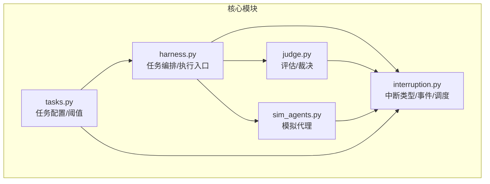
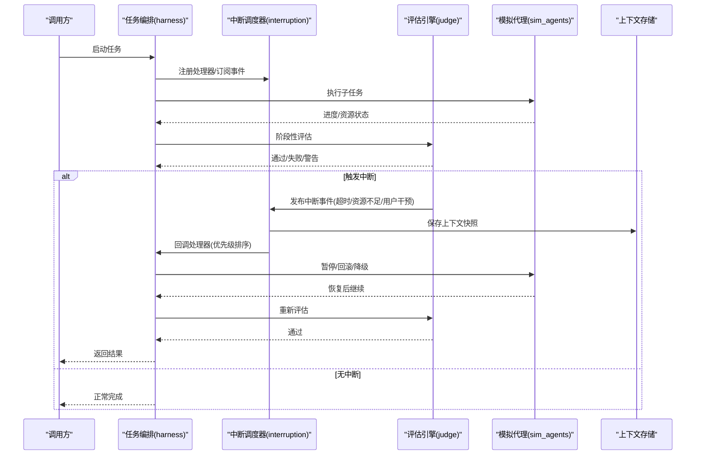
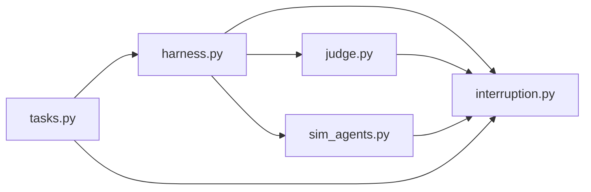

# 中断处理系统

<cite>
**本文引用的文件**   
- [autonomy_mvp/core/interruption.py](file://autonomy_mvp/core/interruption.py)
- [autonomy_mvp/core/harness.py](file://autonomy_mvp/core/harness.py)
- [autonomy_mvp/core/judge.py](file://autonomy_mvp/core/judge.py)
- [autonomy_mvp/core/sim_agents.py](file://autonomy_mvp/core/sim_agents.py)
- [autonomy_mvp/core/tasks.py](file://autonomy_mvp/core/tasks.py)
- [autonomy_mvp/tests/test_core.py](file://autonomy_mvp/tests/test_core.py)
</cite>

## 目录
1. [简介](#简介)
2. [项目结构](#项目结构)
3. [核心组件](#核心组件)
4. [架构总览](#架构总览)
5. [详细组件分析](#详细组件分析)
6. [依赖关系分析](#依赖关系分析)
7. [性能考量](#性能考量)
8. [故障排查指南](#故障排查指南)
9. [结论](#结论)
10. [附录](#附录)

## 简介
本文件面向“中断处理系统”的设计与实现，围绕以下目标展开：
- 解释中断机制的设计原理：触发条件、优先级管理、恢复策略。
- 说明不同类型中断（资源不足、超时、用户干预）的处理流程与状态转换。
- 阐述中断上下文保存、事件队列管理与并发控制机制。
- 提供注册自定义中断处理器与实现优雅降级的实践指导。
- 说明中断系统与评估引擎和模拟代理的集成方式。

该文档以代码仓库中的中断相关模块为基础，结合工程实践给出可操作的指导。

## 项目结构
与中断处理直接相关的核心代码位于 autonomy_mvp/core 目录下，关键文件包括：
- interruption.py：中断类型定义、事件模型、调度与恢复策略的核心实现。
- harness.py：任务编排与执行入口，负责将中断事件注入到执行流中。
- judge.py：评估与裁决逻辑，可能触发基于结果的中断。
- sim_agents.py：模拟代理，作为被调度的工作单元，需支持中断感知与协作。
- tasks.py：任务描述与配置，包含中断阈值、超时、重试等元数据。
- tests/test_core.py：单元测试，覆盖中断触发、恢复与降级路径。

**图表来源** 
- [autonomy_mvp/core/interruption.py](file://autonomy_mvp/core/interruption.py)
- [autonomy_mvp/core/harness.py](file://autonomy_mvp/core/harness.py)
- [autonomy_mvp/core/judge.py](file://autonomy_mvp/core/judge.py)
- [autonomy_mvp/core/sim_agents.py](file://autonomy_mvp/core/sim_agents.py)
- [autonomy_mvp/core/tasks.py](file://autonomy_mvp/core/tasks.py)

**章节来源**
- [autonomy_mvp/core/interruption.py](file://autonomy_mvp/core/interruption.py)
- [autonomy_mvp/core/harness.py](file://autonomy_mvp/core/harness.py)
- [autonomy_mvp/core/judge.py](file://autonomy_mvp/core/judge.py)
- [autonomy_mvp/core/sim_agents.py](file://autonomy_mvp/core/sim_agents.py)
- [autonomy_mvp/core/tasks.py](file://autonomy_mvp/core/tasks.py)

## 核心组件
- 中断类型与事件模型
  - 定义多种中断类型（如资源不足、超时、用户干预），并为每种类型提供结构化事件对象，包含触发源、时间戳、上下文快照、恢复建议等字段。
  - 事件模型支持序列化与反序列化，便于持久化与跨进程传递。

- 中断调度器
  - 维护全局或任务级的事件队列，按优先级排序并消费。
  - 提供注册接口，允许业务模块注册自定义处理器；处理器接收事件并返回处理结果或下一步动作。

- 上下文保存与恢复
  - 在执行关键步骤前自动保存上下文快照（如变量状态、资源句柄、中间结果）。
  - 恢复时根据策略选择回滚、补偿或继续执行，确保一致性。

- 并发控制
  - 使用锁或信号量保护共享资源访问，避免竞态条件。
  - 对长耗时操作设置心跳检测与超时熔断，防止阻塞。

- 与评估引擎和模拟代理的集成
  - 评估引擎在判定失败或异常时触发中断事件。
  - 模拟代理在执行过程中上报资源状态与进度，供调度器决策。

**章节来源**
- [autonomy_mvp/core/interruption.py](file://autonomy_mvp/core/interruption.py)
- [autonomy_mvp/core/harness.py](file://autonomy_mvp/core/harness.py)
- [autonomy_mvp/core/judge.py](file://autonomy_mvp/core/judge.py)
- [autonomy_mvp/core/sim_agents.py](file://autonomy_mvp/core/sim_agents.py)
- [autonomy_mvp/core/tasks.py](file://autonomy_mvp/core/tasks.py)

## 架构总览
下图展示中断系统在任务编排、评估与代理之间的交互关系。

**图表来源** 
- [autonomy_mvp/core/harness.py](file://autonomy_mvp/core/harness.py)
- [autonomy_mvp/core/interruption.py](file://autonomy_mvp/core/interruption.py)
- [autonomy_mvp/core/judge.py](file://autonomy_mvp/core/judge.py)
- [autonomy_mvp/core/sim_agents.py](file://autonomy_mvp/core/sim_agents.py)

## 详细组件分析

### 中断类型与事件模型
- 设计要点
  - 统一的事件基类，派生出具体中断类型（资源不足、超时、用户干预）。
  - 事件携带必要上下文：触发位置、时间、影响范围、建议动作。
  - 支持扩展新类型而不破坏现有处理器。

- 复杂度与数据结构
  - 事件队列采用优先队列，插入与弹出为 O(log n)。
  - 上下文快照按需深拷贝，权衡一致性与开销。

- 错误处理
  - 对不可恢复中断立即终止并记录诊断信息。
  - 对可恢复中断进入恢复流程，必要时回滚。

**章节来源**
- [autonomy_mvp/core/interruption.py](file://autonomy_mvp/core/interruption.py)

### 中断调度器与事件队列
- 设计要点
  - 全局或任务级调度器实例，维护事件队列与处理器注册表。
  - 处理器优先级由元数据决定，高优先级先执行。
  - 支持批量消费与原子性提交，保证顺序与一致性。

- 并发控制
  - 使用线程安全队列与互斥锁保护队列与处理器列表。
  - 消费者线程池限制并发度，避免过载。

- 恢复策略
  - 重试：指数退避与最大次数限制。
  - 降级：切换到备用路径或简化算法。
  - 回滚：撤销已变更状态，恢复到最近稳定点。

**章节来源**
- [autonomy_mvp/core/interruption.py](file://autonomy_mvp/core/interruption.py)

### 上下文保存与恢复
- 设计要点
  - 在关键边界（I/O、外部调用、状态变更）前后捕获快照。
  - 快照包含必要变量、资源句柄、事务ID等。
  - 恢复时根据策略选择重放、补偿或回滚。

- 性能优化
  - 增量快照与差异压缩，减少内存占用。
  - 异步持久化，避免阻塞主流程。

**章节来源**
- [autonomy_mvp/core/interruption.py](file://autonomy_mvp/core/interruption.py)
- [autonomy_mvp/core/harness.py](file://autonomy_mvp/core/harness.py)

### 与评估引擎的集成
- 设计要点
  - 评估引擎在失败或异常时发布中断事件，附带失败原因与建议。
  - 调度器根据事件类型选择恢复策略，必要时触发降级。
  - 评估结果与中断日志关联，便于审计与回溯。

- 状态转换
  - 成功：继续下一环节。
  - 失败：进入中断处理，尝试恢复或降级。
  - 中止：不可恢复错误，终止并清理。

**章节来源**
- [autonomy_mvp/core/judge.py](file://autonomy_mvp/core/judge.py)
- [autonomy_mvp/core/interruption.py](file://autonomy_mvp/core/interruption.py)

### 与模拟代理的集成
- 设计要点
  - 代理在执行中上报资源使用与进度，供调度器监控。
  - 代理支持暂停与恢复，配合中断处理进行协调。
  - 代理内部实现轻量级心跳，用于超时检测。

- 并发与同步
  - 使用消息队列或回调通知中断事件。
  - 代理侧实现幂等处理，避免重复执行。

**章节来源**
- [autonomy_mvp/core/sim_agents.py](file://autonomy_mvp/core/sim_agents.py)
- [autonomy_mvp/core/interruption.py](file://autonomy_mvp/core/interruption.py)

### 任务配置与阈值
- 设计要点
  - 任务定义中包含中断阈值（如超时时间、资源上限）、重试策略、降级开关。
  - 动态调整阈值以适应不同环境负载。
  - 配置校验与默认值回退，提高鲁棒性。

**章节来源**
- [autonomy_mvp/core/tasks.py](file://autonomy_mvp/core/tasks.py)
- [autonomy_mvp/core/harness.py](file://autonomy_mvp/core/harness.py)

### 单元测试与验证
- 设计要点
  - 覆盖中断触发、恢复、降级与回滚路径。
  - 模拟外部依赖（数据库、网络）以隔离测试。
  - 断言上下文一致性与状态机转换正确性。

**章节来源**
- [autonomy_mvp/tests/test_core.py](file://autonomy_mvp/tests/test_core.py)

## 依赖关系分析
- 模块耦合
  - harness 依赖 interruption、judge、sim_agents，承担编排职责。
  - judge 依赖 interruption 发布评估相关中断。
  - sim_agents 依赖 interruption 上报状态与响应中断。
  - tasks 为其他模块提供配置与阈值。

- 潜在循环依赖
  - 通过事件解耦，避免直接循环调用。
  - 使用接口抽象降低紧耦合。

- 外部依赖
  - 并发原语（锁、队列、线程池）。
  - 序列化库（JSON/Protobuf）用于事件与上下文持久化。

**图表来源** 
- [autonomy_mvp/core/harness.py](file://autonomy_mvp/core/harness.py)
- [autonomy_mvp/core/interruption.py](file://autonomy_mvp/core/interruption.py)
- [autonomy_mvp/core/judge.py](file://autonomy_mvp/core/judge.py)
- [autonomy_mvp/core/sim_agents.py](file://autonomy_mvp/core/sim_agents.py)
- [autonomy_mvp/core/tasks.py](file://autonomy_mvp/core/tasks.py)

**章节来源**
- [autonomy_mvp/core/harness.py](file://autonomy_mvp/core/harness.py)
- [autonomy_mvp/core/interruption.py](file://autonomy_mvp/core/interruption.py)
- [autonomy_mvp/core/judge.py](file://autonomy_mvp/core/judge.py)
- [autonomy_mvp/core/sim_agents.py](file://autonomy_mvp/core/sim_agents.py)
- [autonomy_mvp/core/tasks.py](file://autonomy_mvp/core/tasks.py)

## 性能考量
- 事件队列容量与背压
  - 设置合理队列上限，避免内存膨胀。
  - 生产者过载时丢弃低优先级事件或拒绝新事件。

- 上下文快照开销
  - 仅捕获必要字段，使用浅拷贝与懒加载。
  - 定期清理过期快照，释放内存。

- 并发度与吞吐
  - 根据CPU与IO特性调整消费者线程数。
  - 对长耗时操作使用异步与非阻塞I/O。

- 超时与熔断
  - 设置合理的超时阈值，快速失败。
  - 熔断器防止雪崩效应。

[本节为通用性能指导，不直接分析具体文件]

## 故障排查指南
- 常见问题
  - 中断未触发：检查阈值配置与事件发布逻辑。
  - 恢复失败：确认上下文快照完整性与恢复策略正确性。
  - 死锁或竞态：审查锁粒度与共享资源访问顺序。

- 调试技巧
  - 启用详细日志，记录事件生命周期与处理器执行轨迹。
  - 使用断点与单步调试定位问题。
  - 回放事件序列复现场景。

- 恢复策略选择
  - 资源不足：扩容或排队等待。
  - 超时：重试或降级。
  - 用户干预：暂停并等待指令。

**章节来源**
- [autonomy_mvp/core/interruption.py](file://autonomy_mvp/core/interruption.py)
- [autonomy_mvp/core/harness.py](file://autonomy_mvp/core/harness.py)
- [autonomy_mvp/core/judge.py](file://autonomy_mvp/core/judge.py)
- [autonomy_mvp/core/sim_agents.py](file://autonomy_mvp/core/sim_agents.py)
- [autonomy_mvp/core/tasks.py](file://autonomy_mvp/core/tasks.py)
- [autonomy_mvp/tests/test_core.py](file://autonomy_mvp/tests/test_core.py)

## 结论
本中断处理系统通过统一的事件模型、优先级调度、上下文快照与恢复策略，实现了在高并发与不稳定环境下的高可用执行。与评估引擎和模拟代理的松耦合集成，使得系统具备良好的可扩展性与可维护性。开发者可通过注册自定义处理器与配置阈值，灵活应对不同场景的中断需求。

[本节为总结性内容，不直接分析具体文件]

## 附录
- 最佳实践
  - 明确中断类型与处理语义，避免模糊行为。
  - 保持处理器幂等，支持重复执行。
  - 充分测试异常路径，确保恢复与降级有效。

- 扩展指南
  - 新增中断类型：继承事件基类，实现必要字段与序列化。
  - 新增处理器：实现处理器接口，注册到调度器。
  - 调整策略：修改优先级与恢复规则，适应业务需求。

[本节为补充性内容，不直接分析具体文件]