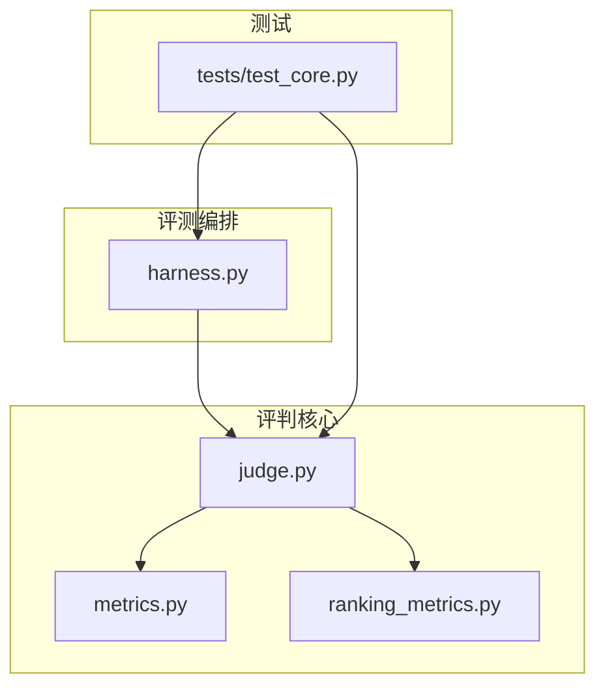
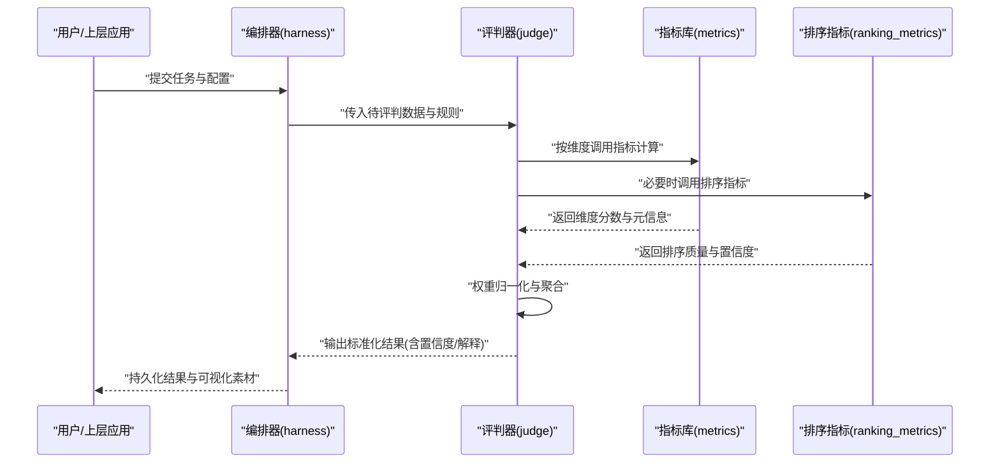
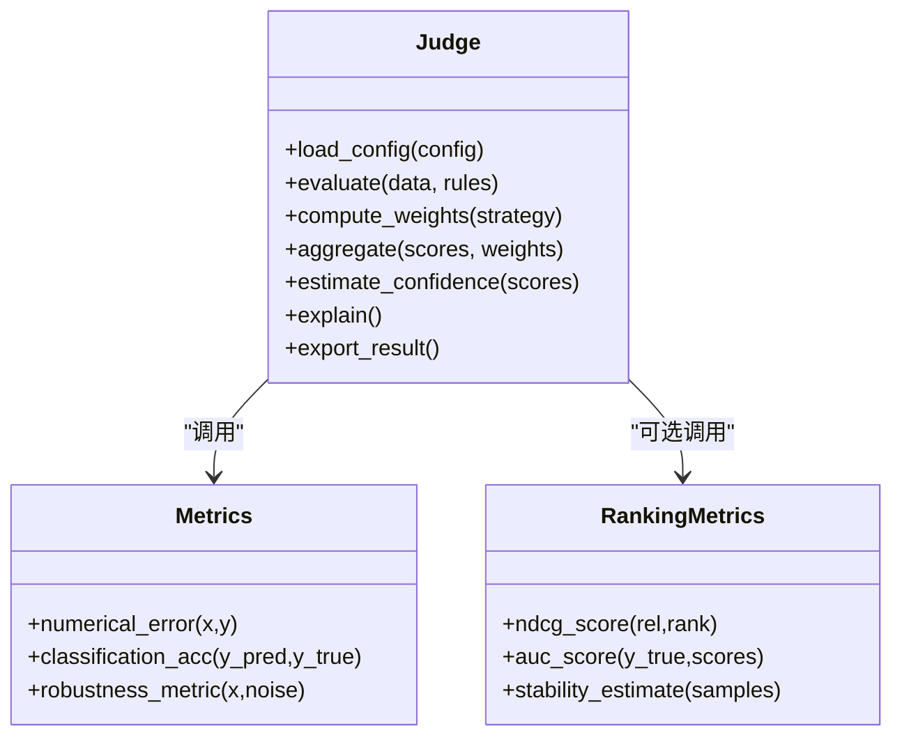
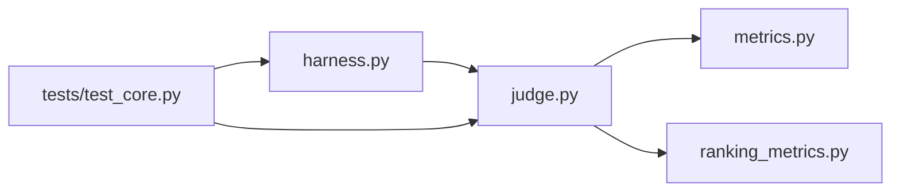

# 智能评判器（Judge）

<cite>
**本文引用的文件**   
- [autonomy_mvp/core/judge.py](file://autonomy_mvp/core/judge.py)
- [autonomy_mvp/core/metrics.py](file://autonomy_mvp/core/metrics.py)
- [autonomy_mvp/core/ranking_metrics.py](file://autonomy_mvp/core/ranking_metrics.py)
- [autonomy_mvp/core/harness.py](file://autonomy_mvp/core/harness.py)
- [autonomy_mvp/tests/test_core.py](file://autonomy_mvp/tests/test_core.py)
</cite>

## 目录
1. [简介](#简介)
2. [项目结构](#项目结构)
3. [核心组件](#核心组件)
4. [架构总览](#架构总览)
5. [详细组件分析](#详细组件分析)
6. [依赖关系分析](#依赖关系分析)
7. [性能考量](#性能考量)
8. [故障排查指南](#故障排查指南)
9. [结论](#结论)
10. [附录](#附录) 

## 简介
本文件面向开发者，系统化阐述“智能评判器（Judge）”的算法设计与评分机制。内容覆盖多维度评估指标、权重计算与置信度分析的实现思路；评判规则的配置方式与动态调整机制；评判结果的标准化输出、可解释性分析与可视化展示建议；以及自定义评判规则与扩展评判维度的实践方法。同时给出评判器与评估引擎的数据交互接口说明与性能优化策略，帮助快速集成与高效使用。

## 项目结构
围绕智能评判的核心代码位于 autonomy_mvp/core 目录下，关键文件包括：
- judge.py：评判器主逻辑，负责加载配置、执行维度打分、聚合得分、生成结果与置信度等。
- metrics.py：基础度量定义与实现，提供数值型/分类型/序列型等多类指标。
- ranking_metrics.py：排序与对比类指标，用于相对表现评估。
- harness.py：评测编排与运行框架，驱动任务执行并调用评判器产出结果。
- tests/test_core.py：单元测试与回归用例，覆盖常见评判流程与边界条件。

图表来源
- [autonomy_mvp/core/harness.py](file://autonomy_mvp/core/harness.py)
- [autonomy_mvp/core/judge.py](file://autonomy_mvp/core/judge.py)
- [autonomy_mvp/core/metrics.py](file://autonomy_mvp/core/metrics.py)
- [autonomy_mvp/core/ranking_metrics.py](file://autonomy_mvp/core/ranking_metrics.py)
- [autonomy_mvp/tests/test_core.py](file://autonomy_mvp/tests/test_core.py)

章节来源
- [autonomy_mvp/core/judge.py](file://autonomy_mvp/core/judge.py)
- [autonomy_mvp/core/metrics.py](file://autonomy_mvp/core/metrics.py)
- [autonomy_mvp/core/ranking_metrics.py](file://autonomy_mvp/core/ranking_metrics.py)
- [autonomy_mvp/core/harness.py](file://autonomy_mvp/core/harness.py)
- [autonomy_mvp/tests/test_core.py](file://autonomy_mvp/tests/test_core.py)

## 核心组件
- 评判器（Judge）
  - 职责：解析评判配置，调度各维度指标计算，进行加权聚合，输出标准化结果与置信度，并提供可解释性摘要。
  - 关键能力：多指标并行计算、权重归一化、缺失值处理、异常容错、结果缓存与增量更新。
- 指标库（Metrics）
  - 职责：提供通用度量函数族，支持数值误差、分类准确率、排序质量、鲁棒性与稳定性等。
  - 关键能力：输入校验、单位与量纲统一、阈值与区间判定、分布假设检查。
- 排序指标（Ranking Metrics）
  - 职责：对候选集或轨迹进行相对排序评估，如命中率、NDCG、AUC 等。
  - 关键能力：部分观测处理、负样本采样、稳定性估计。
- 编排器（Harness）
  - 职责：组织任务生命周期，协调数据准备、模型/代理执行、评判器调用与结果落盘。
  - 关键能力：批处理、并发控制、断点续跑、日志与追踪。

章节来源
- [autonomy_mvp/core/judge.py](file://autonomy_mvp/core/judge.py)
- [autonomy_mvp/core/metrics.py](file://autonomy_mvp/core/metrics.py)
- [autonomy_mvp/core/ranking_metrics.py](file://autonomy_mvp/core/ranking_metrics.py)
- [autonomy_mvp/core/harness.py](file://autonomy_mvp/core/harness.py)

## 架构总览
评判系统采用“编排-评判-度量”分层设计。编排层负责任务调度与数据流转；评判层负责规则解析、指标计算与结果聚合；度量层提供可插拔的指标实现。

图表来源
- [autonomy_mvp/core/harness.py](file://autonomy_mvp/core/harness.py)
- [autonomy_mvp/core/judge.py](file://autonomy_mvp/core/judge.py)
- [autonomy_mvp/core/metrics.py](file://autonomy_mvp/core/metrics.py)
- [autonomy_mvp/core/ranking_metrics.py](file://autonomy_mvp/core/ranking_metrics.py)

## 详细组件分析

### 评判器（Judge）
- 算法设计要点
  - 多维度评估：将复杂任务拆解为多个独立维度（如准确性、效率、稳健性、可解释性等），每个维度对应一个或多个指标。
  - 权重计算：支持静态权重与动态权重两种模式。静态权重由配置指定；动态权重可根据数据分布、难度或历史表现自适应调整，并进行归一化保证总和为1。
  - 置信度分析：基于指标方差、样本量与分布假设（如中心极限定理）估计置信区间；对排序指标可采用重抽样或Bootstrap提升稳定性。
  - 结果聚合：采用加权求和或层次化聚合（先组内再跨组），支持非线性变换（如分位数映射）以缓解极端值影响。
  - 可解释性：记录每个维度的贡献度、敏感特征与异常项定位，便于人工复核与迭代改进。
- 配置与动态调整
  - 配置项通常包含：维度清单、指标映射、权重策略、阈值与惩罚项、缺失值处理策略、随机种子与并行度等。
  - 动态调整机制：根据在线反馈或离线验证集自动微调权重，例如通过贝叶斯优化或简单启发式（如误差大者降权）。
- 标准化输出
  - 结构化JSON：包含总分、维度分、权重、置信区间、指标明细、异常标记与解释摘要。
  - 可视化素材：雷达图、条形图、箱线图与热力图等，便于多维对比与趋势分析。
- 扩展与自定义
  - 新增维度：在指标库中注册新指标，并在评判配置中声明维度与权重即可接入。
  - 自定义规则：通过插件接口注入新的聚合策略或后处理逻辑，无需改动核心流程。

图表来源
- [autonomy_mvp/core/judge.py](file://autonomy_mvp/core/judge.py)
- [autonomy_mvp/core/metrics.py](file://autonomy_mvp/core/metrics.py)
- [autonomy_mvp/core/ranking_metrics.py](file://autonomy_mvp/core/ranking_metrics.py)

章节来源
- [autonomy_mvp/core/judge.py](file://autonomy_mvp/core/judge.py)
- [autonomy_mvp/core/metrics.py](file://autonomy_mvp/core/metrics.py)
- [autonomy_mvp/core/ranking_metrics.py](file://autonomy_mvp/core/ranking_metrics.py)

### 指标库（Metrics）
- 设计原则
  - 输入契约：明确数据类型、形状与取值范围，提供严格校验与类型转换。
  - 量纲统一：对数值型指标进行标准化或归一化，避免尺度差异导致权重失衡。
  - 鲁棒性：对异常值与噪声具备容忍能力，必要时提供稳健统计量（如中位数、MAD）。
- 典型指标类别
  - 数值误差：MAE、RMSE、MAPE、SMAPE等，适用于连续目标预测。
  - 分类质量：Accuracy、Precision、Recall、F1、ROC-AUC、PR-AUC等。
  - 序列/结构：编辑距离、BLEU、ROUGE、结构相似度等。
  - 稳健性：扰动敏感性、分布偏移下的退化程度。
- 复杂度与优化
  - 向量化实现优先，减少Python循环开销；对大规模数据采用分块计算与内存映射。
  - 缓存中间结果，避免重复计算；对确定性指标启用幂等缓存键。

章节来源
- [autonomy_mvp/core/metrics.py](file://autonomy_mvp/core/metrics.py)

### 排序指标（Ranking Metrics）
- 适用场景
  - 检索/推荐/排序任务，关注Top-K命中与整体排序质量。
- 常用指标
  - NDCG、MAP、Hit@K、AUC、Pairwise Accuracy等。
- 稳定性与置信度
  - 通过Bootstrap或交叉验证估计置信区间；对稀疏正样本采用下采样或加权策略降低方差。

章节来源
- [autonomy_mvp/core/ranking_metrics.py](file://autonomy_mvp/core/ranking_metrics.py)

### 编排器（Harness）
- 职责与流程
  - 读取任务清单与配置，初始化环境，分发子任务，收集中间产物，调用评判器，汇总与持久化结果。
- 并发与容错
  - 支持进程/线程级并行，限制资源占用；失败重试与断点续跑；结构化日志与追踪ID贯穿全链路。
- 与评判器的接口
  - 输入：任务数据、评判规则、运行参数。
  - 输出：标准化结果对象、解释摘要、可视化素材路径。

章节来源
- [autonomy_mvp/core/harness.py](file://autonomy_mvp/core/harness.py)

### 单元测试与回归（tests/test_core.py）
- 覆盖范围
  - 基本评判流程、权重归一化、缺失值处理、异常分支、排序指标边界情况。
- 最佳实践
  - 使用固定随机种子确保可复现；构造最小可复现实例；对关键路径添加断言与覆盖率报告。

章节来源
- [autonomy_mvp/tests/test_core.py](file://autonomy_mvp/tests/test_core.py)

## 依赖关系分析
评判器强依赖指标库与排序指标模块，编排器作为入口驱动评判器。测试覆盖编排与评判的关键路径。

图表来源
- [autonomy_mvp/core/harness.py](file://autonomy_mvp/core/harness.py)
- [autonomy_mvp/core/judge.py](file://autonomy_mvp/core/judge.py)
- [autonomy_mvp/core/metrics.py](file://autonomy_mvp/core/metrics.py)
- [autonomy_mvp/core/ranking_metrics.py](file://autonomy_mvp/core/ranking_metrics.py)
- [autonomy_mvp/tests/test_core.py](file://autonomy_mvp/tests/test_core.py)

章节来源
- [autonomy_mvp/core/harness.py](file://autonomy_mvp/core/harness.py)
- [autonomy_mvp/core/judge.py](file://autonomy_mvp/core/judge.py)
- [autonomy_mvp/core/metrics.py](file://autonomy_mvp/core/metrics.py)
- [autonomy_mvp/core/ranking_metrics.py](file://autonomy_mvp/core/ranking_metrics.py)
- [autonomy_mvp/tests/test_core.py](file://autonomy_mvp/tests/test_core.py)

## 性能考量
- 计算并行化
  - 维度间指标计算天然可并行；利用进程池或线程池结合I/O异步，提高吞吐。
- 内存与I/O
  - 大数据集采用流式读取与分块计算；中间结果按需落盘，避免常驻内存。
- 缓存与增量
  - 对确定性指标建立缓存键（输入指纹+配置哈希）；支持增量更新仅重算变化维度。
- 数值稳定
  - 对接近零的分母做平滑；对极端值进行截断或Winsorize；对数变换降低长尾影响。
- 监控与诊断
  - 记录耗时、内存峰值、失败率与指标方差；对慢路径进行热点分析与针对性优化。

[本节为通用指导，不直接分析具体文件]

## 故障排查指南
- 常见问题
  - 维度缺失或指标未注册：检查配置中的维度清单与指标映射是否完整。
  - 权重不归一化：确认权重策略是否正确执行归一化步骤。
  - 置信区间异常：检查样本量是否过小或分布假设不成立，考虑改用非参方法。
  - 排序指标不稳定：增加Bootstrap次数或引入正则化/平滑策略。
- 调试建议
  - 开启详细日志与追踪ID，定位失败维度与输入片段。
  - 使用最小可复现实例隔离问题；逐步关闭并行与缓存验证。
  - 对关键指标打印分布统计与异常样本列表，辅助人工复核。

章节来源
- [autonomy_mvp/core/judge.py](file://autonomy_mvp/core/judge.py)
- [autonomy_mvp/core/metrics.py](file://autonomy_mvp/core/metrics.py)
- [autonomy_mvp/core/ranking_metrics.py](file://autonomy_mvp/core/ranking_metrics.py)
- [autonomy_mvp/core/harness.py](file://autonomy_mvp/core/harness.py)
- [autonomy_mvp/tests/test_core.py](file://autonomy_mvp/tests/test_core.py)

## 结论
智能评判器通过模块化指标库与灵活的权重/置信度机制，实现了多维度、可解释且可扩展的自动化评估体系。配合编排器的工程化能力，可在复杂任务上稳定产出高质量、可追溯的评判结果。开发者可通过注册新指标与维度、配置动态权重策略，快速适配不同业务场景，并通过可视化与解释性输出提升决策透明度。

[本节为总结性内容，不直接分析具体文件]

## 附录

### 评判规则配置示例（概念性）
- 维度定义：列出所有评估维度及对应指标名称。
- 权重策略：选择静态权重或动态权重，并设置归一化方式。
- 阈值与惩罚：为关键维度设定阈值与越界惩罚项。
- 缺失值处理：选择填充、忽略或降级策略。
- 随机种子与并行度：保证可复现与性能调优。

[本节为概念性说明，不直接分析具体文件]

### 自定义评判规则与扩展维度（概念性）
- 新增指标：在指标库中实现新函数，遵循输入契约与返回值规范。
- 注册维度：在评判配置中声明维度名、指标映射与初始权重。
- 动态权重：实现权重更新策略（如基于误差或重要性），并在评判流程中调用。
- 结果解释：为新增维度补充解释字段（如贡献度、敏感特征、异常样本）。

[本节为概念性说明，不直接分析具体文件]

### 与评估引擎的数据交互接口（概念性）
- 输入
  - 任务数据：原始样本、标注、上下文与约束。
  - 评判规则：维度、指标、权重、阈值与后处理策略。
  - 运行参数：随机种子、并行度、缓存开关等。
- 输出
  - 标准化结果：总分、维度分、权重、置信区间、指标明细与解释摘要。
  - 可视化素材：图表文件路径或序列化数据。
  - 运行日志：耗时、错误码与追踪ID。

[本节为概念性说明，不直接分析具体文件]