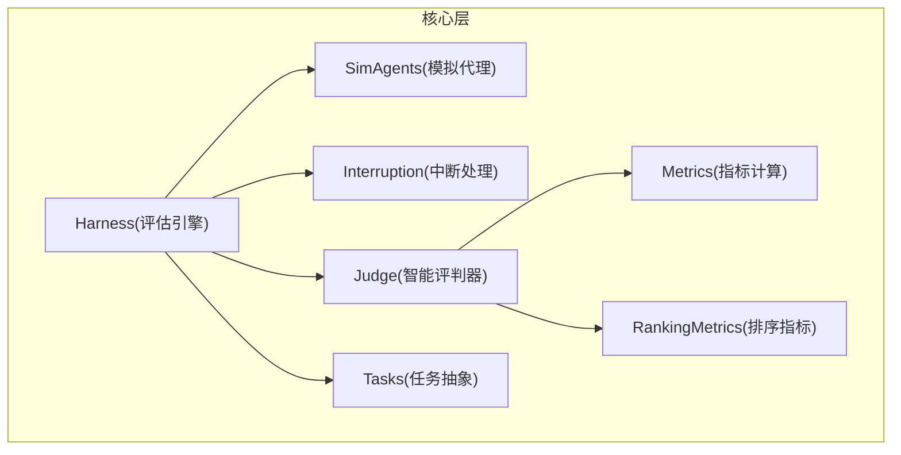
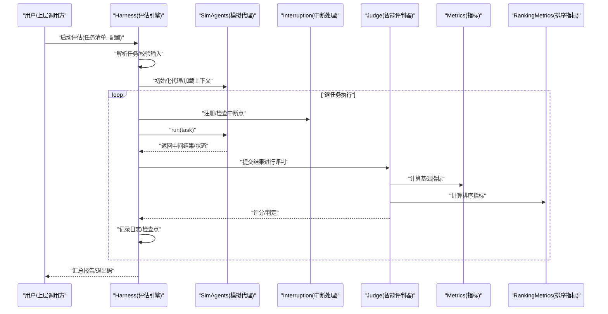
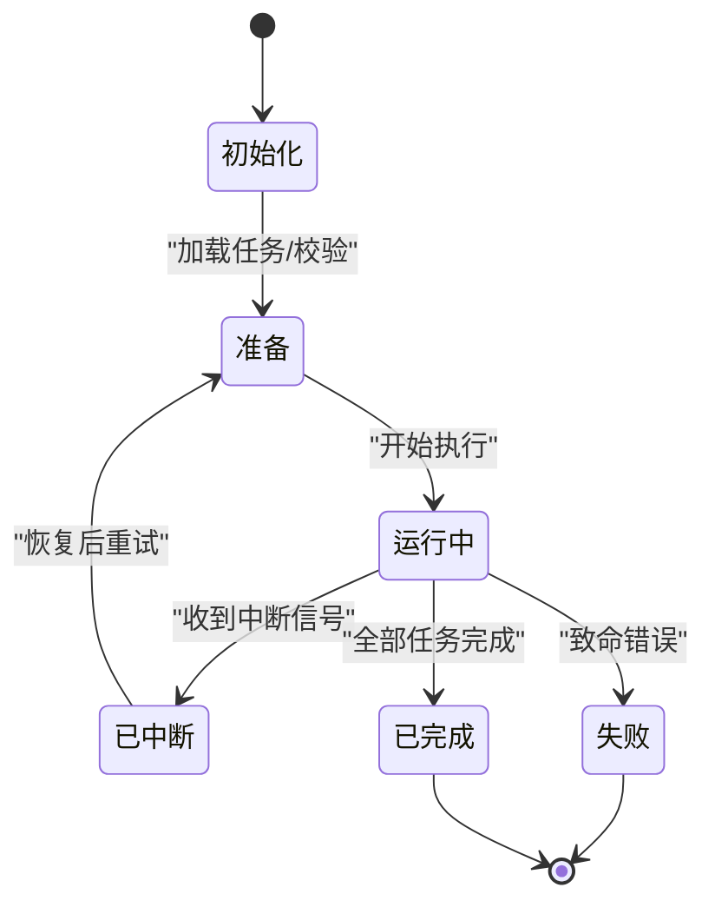
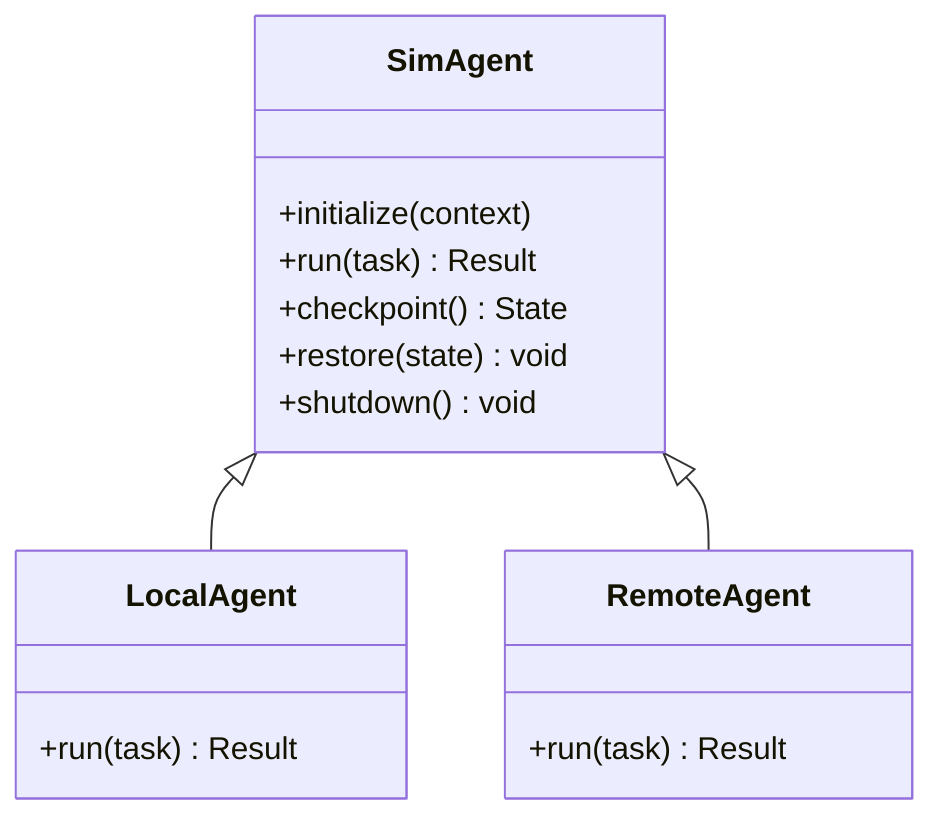
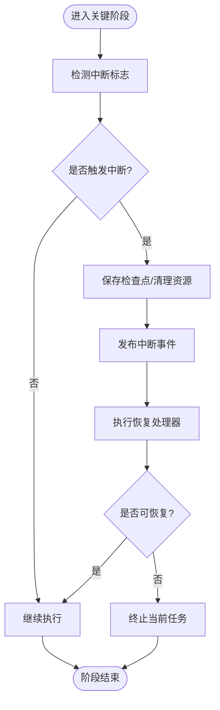
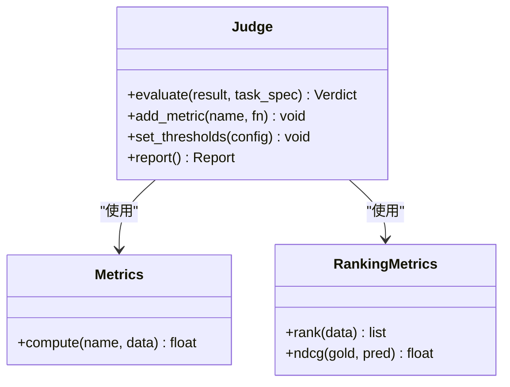
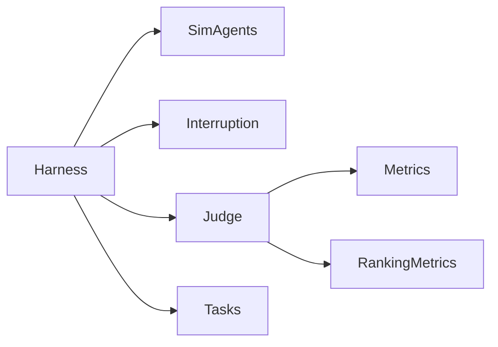

# 核心组件设计

<cite>
**本文引用的文件**   
- [harness.py](file://autonomy_mvp/core/harness.py)
- [sim_agents.py](file://autonomy_mvp/core/sim_agents.py)
- [interruption.py](file://autonomy_mvp/core/interruption.py)
- [judge.py](file://autonomy_mvp/core/judge.py)
- [metrics.py](file://autonomy_mvp/core/metrics.py)
- [ranking_metrics.py](file://autonomy_mvp/core/ranking_metrics.py)
- [tasks.py](file://autonomy_mvp/core/tasks.py)
- [test_core.py](file://autonomy_mvp/tests/test_core.py)
</cite>

## 目录
1. [简介](#简介)
2. [项目结构](#项目结构)
3. [核心组件](#核心组件)
4. [架构总览](#架构总览)
5. [详细组件分析](#详细组件分析)
6. [依赖关系分析](#依赖关系分析)
7. [性能考量](#性能考量)
8. [故障排查指南](#故障排查指南)
9. [结论](#结论)
10. [附录](#附录) 

## 简介
本文件聚焦于评估框架的核心组件设计，围绕以下四个关键模块展开：
- 评估引擎（Harness）：负责任务编排、生命周期管理、中断与恢复、结果聚合。
- 模拟代理（SimAgents）：提供可插拔的模拟执行环境，承载被测智能体或流程的运行。
- 中断处理（Interruption）：定义中断信号、传播与恢复策略，保障长时任务的稳健性。
- 智能评判器（Judge）：基于规则/指标/排序等维度对运行结果进行评分与判定。

文档将给出职责边界、接口约定、交互协议、状态机、错误处理策略以及扩展点说明，并辅以架构图、时序图与流程图帮助理解。

## 项目结构
核心代码位于 autonomy_mvp/core 目录下，测试用例位于 autonomy_mvp/tests。整体采用“按功能分层”的组织方式：
- core：核心能力（编排、代理、中断、评判、指标、任务抽象）
- tests：单元测试与夹具，覆盖核心组件的关键路径

图表来源
- [harness.py](file://autonomy_mvp/core/harness.py)
- [sim_agents.py](file://autonomy_mvp/core/sim_agents.py)
- [interruption.py](file://autonomy_mvp/core/interruption.py)
- [judge.py](file://autonomy_mvp/core/judge.py)
- [metrics.py](file://autonomy_mvp/core/metrics.py)
- [ranking_metrics.py](file://autonomy_mvp/core/ranking_metrics.py)
- [tasks.py](file://autonomy_mvp/core/tasks.py)

章节来源
- [harness.py](file://autonomy_mvp/core/harness.py)
- [sim_agents.py](file://autonomy_mvp/core/sim_agents.py)
- [interruption.py](file://autonomy_mvp/core/interruption.py)
- [judge.py](file://autonomy_mvp/core/judge.py)
- [metrics.py](file://autonomy_mvp/core/metrics.py)
- [ranking_metrics.py](file://autonomy_mvp/core/ranking_metrics.py)
- [tasks.py](file://autonomy_mvp/core/tasks.py)
- [test_core.py](file://autonomy_mvp/tests/test_core.py)

## 核心组件
本节概述各组件的职责与协作关系，后续章节将深入实现细节与扩展点。

- 评估引擎 Harness
  - 职责：加载任务、初始化代理、调度执行、捕获中断、收集中间态、驱动评判、汇总输出。
  - 关键点：统一入口、状态机驱动、异常隔离、可恢复执行。
- 模拟代理 SimAgents
  - 职责：提供受控的执行上下文，封装工具调用、资源访问、日志与检查点。
  - 关键点：沙箱化、幂等重试、断点续跑。
- 中断处理 Interruption
  - 职责：定义中断类型、注册处理器、在关键阶段触发中断、支持恢复。
  - 关键点：非阻塞检测、最小侵入、可组合的中断链。
- 智能评判器 Judge
  - 职责：根据任务目标与指标体系对结果打分、生成报告、判定通过/失败。
  - 关键点：多指标融合、可配置阈值、可扩展评分函数。
- 指标 Metrics / RankingMetrics
  - 职责：基础指标计算与排序型指标（如排名、分位数）。
  - 关键点：无副作用、可并行、可缓存。
- 任务 Tasks
  - 职责：描述任务元数据、输入输出契约、评测约束。
  - 关键点：JSON/YAML 驱动、版本兼容、校验严格。

章节来源
- [harness.py](file://autonomy_mvp/core/harness.py)
- [sim_agents.py](file://autonomy_mvp/core/sim_agents.py)
- [interruption.py](file://autonomy_mvp/core/interruption.py)
- [judge.py](file://autonomy_mvp/core/judge.py)
- [metrics.py](file://autonomy_mvp/core/metrics.py)
- [ranking_metrics.py](file://autonomy_mvp/core/ranking_metrics.py)
- [tasks.py](file://autonomy_mvp/core/tasks.py)

## 架构总览
下图展示从任务到结果的端到端流程，包括中断与评判的介入点。

图表来源
- [harness.py](file://autonomy_mvp/core/harness.py)
- [sim_agents.py](file://autonomy_mvp/core/sim_agents.py)
- [interruption.py](file://autonomy_mvp/core/interruption.py)
- [judge.py](file://autonomy_mvp/core/judge.py)
- [metrics.py](file://autonomy_mvp/core/metrics.py)
- [ranking_metrics.py](file://autonomy_mvp/core/ranking_metrics.py)

## 详细组件分析

### 评估引擎 Harness
- 设计模式
  - 命令模式：将每个任务视为一个可执行的命令对象，便于重试与回滚。
  - 观察者模式：在执行前后钩子中通知监听者（日志、监控、检查点）。
  - 状态机：维护“待执行/运行中/已中断/已完成/失败”等状态。
- 关键职责
  - 任务装配与参数注入
  - 代理实例化与资源隔离
  - 中断协调与恢复
  - 结果收集与评判调度
  - 统计汇总与导出
- 生命周期
  - 初始化 -> 准备 -> 执行循环 -> 收尾 -> 销毁
- 错误处理
  - 捕获代理侧异常，转换为统一错误模型
  - 区分可重试与不可重试错误
  - 中断优先：任何阶段均可被中断信号打断
- 扩展点
  - 自定义任务工厂
  - 自定义代理适配器
  - 自定义评判器接入
  - 自定义指标插件

图表来源
- [harness.py](file://autonomy_mvp/core/harness.py)

章节来源
- [harness.py](file://autonomy_mvp/core/harness.py)

### 模拟代理 SimAgents
- 设计模式
  - 适配器模式：屏蔽不同后端（本地/远程/容器）差异。
  - 模板方法：定义 run 骨架，子类实现具体步骤。
- 关键职责
  - 提供受控执行环境（文件系统、网络、外部工具）
  - 记录轨迹（轨迹、日志、快照）
  - 支持幂等与断点续跑
- 状态与契约
  - 输入：任务描述、环境变量、工具集
  - 输出：结构化结果、中间状态、诊断信息
- 错误处理
  - 超时控制、资源泄漏防护
  - 可观测的错误分类（IO/权限/依赖缺失/业务异常）
- 扩展点
  - 新增后端适配器
  - 注入自定义工具/服务
  - 扩展轨迹格式

图表来源
- [sim_agents.py](file://autonomy_mvp/core/sim_agents.py)

章节来源
- [sim_agents.py](file://autonomy_mvp/core/sim_agents.py)

### 中断处理 Interruption
- 设计模式
  - 责任链：多个中断处理器串联，按优先级处理。
  - 事件总线：发布中断事件，订阅者响应。
- 关键职责
  - 定义中断类型（用户取消、资源不足、健康检查失败等）
  - 在关键阶段（任务切换、I/O、长时间计算）检测中断
  - 提供恢复原语（保存状态、清理资源）
- 状态机
  - 未中断 -> 中断中 -> 已恢复/已终止
- 错误处理
  - 中断不应导致数据不一致
  - 支持优雅降级与部分成功
- 扩展点
  - 自定义中断源
  - 自定义恢复策略

图表来源
- [interruption.py](file://autonomy_mvp/core/interruption.py)

章节来源
- [interruption.py](file://autonomy_mvp/core/interruption.py)

### 智能评判器 Judge
- 设计模式
  - 策略模式：不同评判策略（规则/阈值/学习式）可插拔。
  - 组合模式：将多个指标组合为复合评判。
- 关键职责
  - 接收运行结果与任务契约
  - 调用指标模块计算分数
  - 生成判定与报告
- 指标集成
  - 基础指标：准确率、召回率、F1、AUC 等
  - 排序指标：NDCG、平均排名、分位对比等
- 错误处理
  - 缺失字段容错、默认值策略
  - 数值越界与NaN处理
- 扩展点
  - 自定义指标函数
  - 自定义评分规则
  - 自定义报告模板

图表来源
- [judge.py](file://autonomy_mvp/core/judge.py)
- [metrics.py](file://autonomy_mvp/core/metrics.py)
- [ranking_metrics.py](file://autonomy_mvp/core/ranking_metrics.py)

章节来源
- [judge.py](file://autonomy_mvp/core/judge.py)
- [metrics.py](file://autonomy_mvp/core/metrics.py)
- [ranking_metrics.py](file://autonomy_mvp/core/ranking_metrics.py)

### 任务抽象 Tasks
- 设计要点
  - 以声明式描述任务：输入、期望输出、约束条件、评测规则引用
  - 强校验：缺失必填项、类型不匹配时尽早失败
- 与 Harness/Judge 的契约
  - Harness 负责加载与注入
  - Judge 依据任务契约验证结果完整性与正确性

章节来源
- [tasks.py](file://autonomy_mvp/core/tasks.py)

## 依赖关系分析
- 内聚与耦合
  - Harness 作为编排中心，耦合度最高；通过接口与策略降低对具体实现的依赖。
  - SimAgents 与外部系统解耦，通过适配器扩展。
  - Judge 仅依赖指标模块，保持纯函数风格，易于测试。
- 外部依赖
  - 文件系统、进程/线程、网络 I/O、序列化库等由底层运行时提供。
- 潜在循环依赖
  - 通过事件与回调避免直接双向引用。

图表来源
- [harness.py](file://autonomy_mvp/core/harness.py)
- [sim_agents.py](file://autonomy_mvp/core/sim_agents.py)
- [interruption.py](file://autonomy_mvp/core/interruption.py)
- [judge.py](file://autonomy_mvp/core/judge.py)
- [metrics.py](file://autonomy_mvp/core/metrics.py)
- [ranking_metrics.py](file://autonomy_mvp/core/ranking_metrics.py)
- [tasks.py](file://autonomy_mvp/core/tasks.py)

章节来源
- [harness.py](file://autonomy_mvp/core/harness.py)
- [sim_agents.py](file://autonomy_mvp/core/sim_agents.py)
- [interruption.py](file://autonomy_mvp/core/interruption.py)
- [judge.py](file://autonomy_mvp/core/judge.py)
- [metrics.py](file://autonomy_mvp/core/metrics.py)
- [ranking_metrics.py](file://autonomy_mvp/core/ranking_metrics.py)
- [tasks.py](file://autonomy_mvp/core/tasks.py)

## 性能考量
- 批处理与并行
  - 任务级并行：不同任务可在独立代理中并发执行。
  - 指标计算无副作用，适合并行归约。
- 内存与I/O
  - 大结果流式写入，避免一次性加载。
  - 检查点增量更新，减少磁盘压力。
- 可观测性
  - 关键路径埋点（耗时、吞吐、错误率）。
  - 指标缓存与去重，避免重复计算。

[本节为通用指导，不涉及具体文件分析]

## 故障排查指南
- 常见问题定位
  - 任务无法启动：检查任务契约与参数注入。
  - 代理执行超时：确认资源配额与外部依赖可用性。
  - 中断频繁触发：审查中断阈值与恢复策略。
  - 评判结果为空：核对指标字段与阈值配置。
- 调试建议
  - 开启详细日志与轨迹导出。
  - 使用最小复现用例逐步缩小范围。
  - 借助检查点恢复至最近稳定状态。

章节来源
- [test_core.py](file://autonomy_mvp/tests/test_core.py)

## 结论
本框架通过清晰的职责划分与可插拔设计，实现了高内聚、低耦合的评估流水线。Harness 作为编排中枢，结合 SimAgents 的可扩展执行环境与 Interruption 的稳健中断机制，配合 Judge 的多指标评判能力，形成一套面向复杂科学工作流的基准评测方案。开发者可通过扩展点快速接入新的代理后端、指标与评判策略，满足多样化评测需求。

[本节为总结性内容，不涉及具体文件分析]

## 附录
- 使用示例参考
  - 单元测试展示了典型用法与断言方式，可作为扩展与二次开发的参考。
- 术语表
  - 任务：一次评测的最小单元，包含输入、约束与期望输出。
  - 代理：承载任务运行的受控环境。
  - 中断：在关键阶段主动或被动触发的暂停/恢复信号。
  - 评判：基于指标与规则的评分与判定过程。

章节来源
- [test_core.py](file://autonomy_mvp/tests/test_core.py)