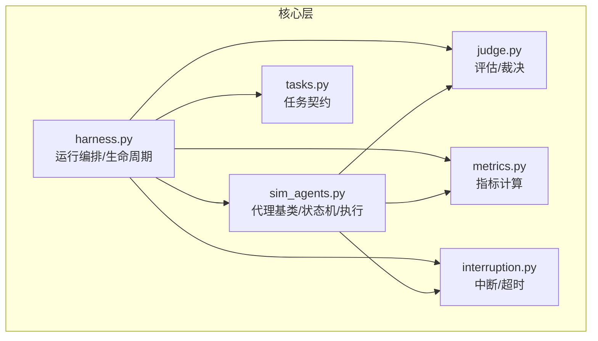
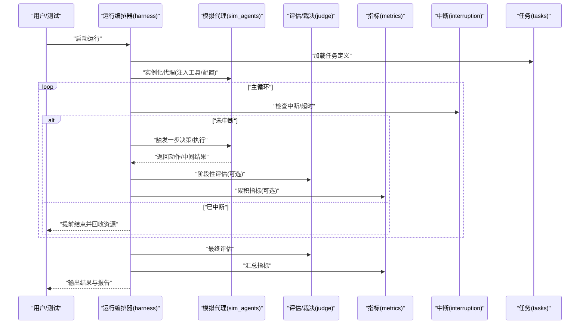
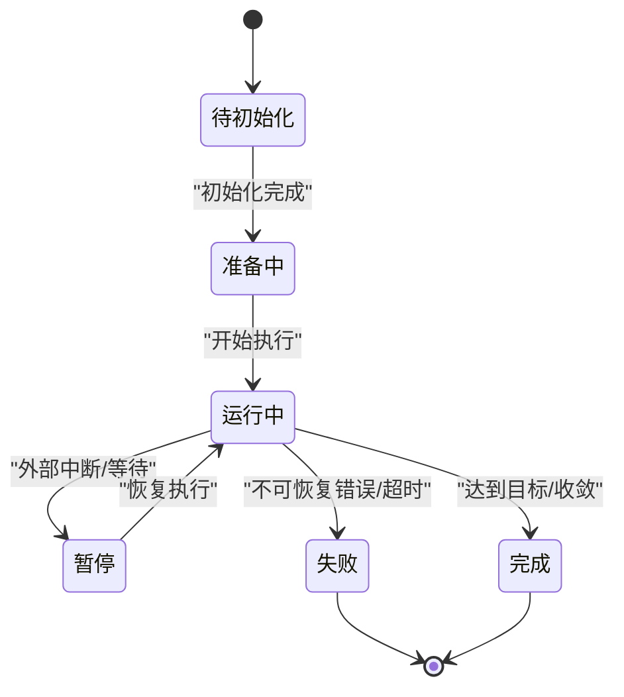
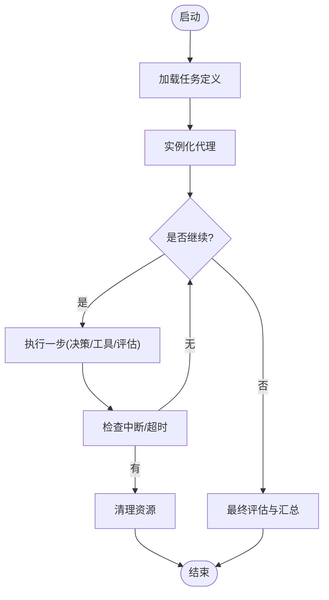
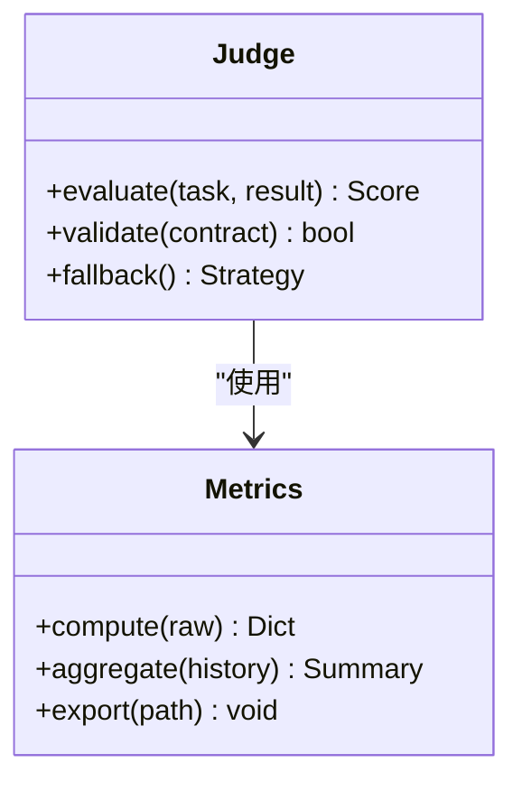
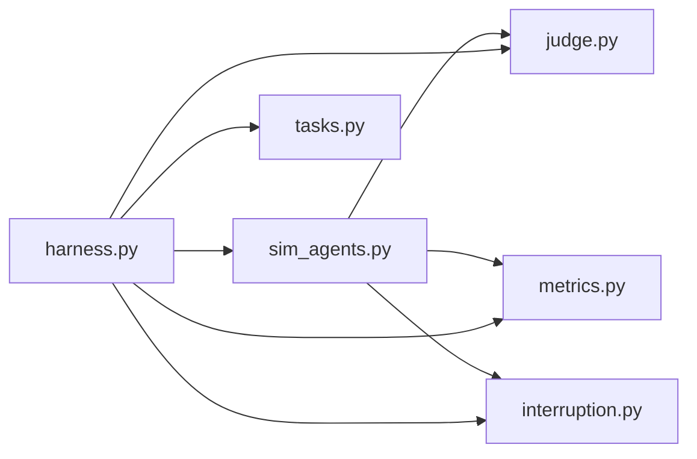

# 模拟代理（SimAgents）

<cite>
**本文引用的文件**   
- [autonomy_mvp/core/sim_agents.py](file://autonomy_mvp/core/sim_agents.py)
- [autonomy_mvp/core/harness.py](file://autonomy_mvp/core/harness.py)
- [autonomy_mvp/core/judge.py](file://autonomy_mvp/core/judge.py)
- [autonomy_mvp/core/metrics.py](file://autonomy_mvp/core/metrics.py)
- [autonomy_mvp/core/interruption.py](file://autonomy_mvp/core/interruption.py)
- [autonomy_mvp/core/tasks.py](file://autonomy_mvp/core/tasks.py)
- [autonomy_mvp/tests/test_core.py](file://autonomy_mvp/tests/test_core.py)
</cite>

## 目录
1. [简介](#简介)
2. [项目结构](#项目结构)
3. [核心组件](#核心组件)
4. [架构总览](#架构总览)
5. [详细组件分析](#详细组件分析)
6. [依赖关系分析](#依赖关系分析)
7. [性能考量](#性能考量)
8. [故障排查指南](#故障排查指南)
9. [结论](#结论)
10. [附录](#附录)

## 简介
本文件面向开发者与研究者，系统化阐述“模拟代理（SimAgents）”的架构设计、行为模式与实现要点。内容覆盖：
- 代理状态机、决策逻辑与执行策略
- 不同类型代理的职责分工与协作机制（如研究者代理、实验代理）
- 代理生命周期管理、消息传递协议与异常处理策略
- 与评估引擎、工具系统的交互接口
- 如何创建自定义代理类型并扩展其行为

目标是帮助读者快速理解现有实现，并在不侵入核心框架的前提下进行二次开发与扩展。

## 项目结构
围绕模拟代理的核心代码集中在 autonomy_mvp/core 目录下，关键文件包括：
- sim_agents.py：定义模拟代理基类、状态机、调度与执行流程
- harness.py：编排运行器，负责任务加载、代理实例化、循环执行与结果收集
- judge.py：评估/裁决模块，提供评分与判定逻辑
- metrics.py：指标计算与汇总
- interruption.py：中断与超时控制
- tasks.py：任务描述与数据契约

图表来源
- [autonomy_mvp/core/sim_agents.py](file://autonomy_mvp/core/sim_agents.py)
- [autonomy_mvp/core/harness.py](file://autonomy_mvp/core/harness.py)
- [autonomy_mvp/core/judge.py](file://autonomy_mvp/core/judge.py)
- [autonomy_mvp/core/metrics.py](file://autonomy_mvp/core/metrics.py)
- [autonomy_mvp/core/interruption.py](file://autonomy_mvp/core/interruption.py)
- [autonomy_mvp/core/tasks.py](file://autonomy_mvp/core/tasks.py)

章节来源
- [autonomy_mvp/core/sim_agents.py](file://autonomy_mvp/core/sim_agents.py)
- [autonomy_mvp/core/harness.py](file://autonomy_mvp/core/harness.py)
- [autonomy_mvp/core/judge.py](file://autonomy_mvp/core/judge.py)
- [autonomy_mvp/core/metrics.py](file://autonomy_mvp/core/metrics.py)
- [autonomy_mvp/core/interruption.py](file://autonomy_mvp/core/interruption.py)
- [autonomy_mvp/core/tasks.py](file://autonomy_mvp/core/tasks.py)

## 核心组件
本节聚焦 SimAgents 的关键抽象与职责边界，便于后续深入分析与扩展。

- 模拟代理基类
  - 职责：封装状态机、消息收发、工具调用、日志记录、错误恢复等通用能力
  - 关键点：统一的状态转换入口、可插拔的工具路由、可配置的超时与重试策略
- 运行编排器（Harness）
  - 职责：加载任务、初始化代理、驱动主循环、协调评估与指标统计、输出结果
  - 关键点：生命周期钩子、中断/超时处理、并发与资源隔离
- 评估与裁决（Judge/Metrics）
  - 职责：对代理产出进行打分、一致性校验、指标聚合
  - 关键点：可配置评分规则、多指标融合、失败降级策略
- 任务契约（Tasks）
  - 职责：定义输入输出格式、约束条件、示例与断言
  - 关键点：强类型字段、默认值、校验器
- 中断与超时（Interruption）
  - 职责：外部信号、时间上限、资源限制
  - 关键点：可中断点、优雅退出、上下文清理

章节来源
- [autonomy_mvp/core/sim_agents.py](file://autonomy_mvp/core/sim_agents.py)
- [autonomy_mvp/core/harness.py](file://autonomy_mvp/core/harness.py)
- [autonomy_mvp/core/judge.py](file://autonomy_mvp/core/judge.py)
- [autonomy_mvp/core/metrics.py](file://autonomy_mvp/core/metrics.py)
- [autonomy_mvp/core/interruption.py](file://autonomy_mvp/core/interruption.py)
- [autonomy_mvp/core/tasks.py](file://autonomy_mvp/core/tasks.py)

## 架构总览
下图展示了从任务到评估的整体流程，以及代理在其中的角色。

图表来源
- [autonomy_mvp/core/harness.py](file://autonomy_mvp/core/harness.py)
- [autonomy_mvp/core/sim_agents.py](file://autonomy_mvp/core/sim_agents.py)
- [autonomy_mvp/core/judge.py](file://autonomy_mvp/core/judge.py)
- [autonomy_mvp/core/metrics.py](file://autonomy_mvp/core/metrics.py)
- [autonomy_mvp/core/interruption.py](file://autonomy_mvp/core/interruption.py)
- [autonomy_mvp/core/tasks.py](file://autonomy_mvp/core/tasks.py)

## 详细组件分析

### 代理基类与状态机
- 状态机设计
  - 典型状态：待初始化、准备中、运行中、暂停、完成、失败
  - 事件：开始、步骤执行、工具调用、评估回调、中断、终止
  - 转换原则：单入口、幂等、可回滚、可观测
- 决策与执行
  - 决策阶段：解析当前状态与上下文，选择下一步动作（思考/规划/调用工具/等待）
  - 执行阶段：调用工具或内部方法，更新状态与记忆，记录轨迹
- 工具系统对接
  - 通过注册表发现与路由工具
  - 参数校验、返回值标准化、错误映射
- 记忆与上下文
  - 短期记忆：最近若干步的摘要
  - 长期记忆：结构化知识、经验回放
- 可观测性
  - 结构化日志、指标上报、轨迹导出

图表来源
- [autonomy_mvp/core/sim_agents.py](file://autonomy_mvp/core/sim_agents.py)

章节来源
- [autonomy_mvp/core/sim_agents.py](file://autonomy_mvp/core/sim_agents.py)

### 运行编排器（Harness）
- 生命周期管理
  - 初始化：加载任务、构建代理、注入工具与环境
  - 主循环：按步推进、处理中断、收集中间结果
  - 收尾：最终评估、指标汇总、资源释放
- 并发与隔离
  - 支持并行运行多个代理实例
  - 资源配额与隔离（内存/CPU/IO）
- 与评估/指标的集成
  - 周期性评估与最终评估
  - 指标增量计算与持久化

图表来源
- [autonomy_mvp/core/harness.py](file://autonomy_mvp/core/harness.py)
- [autonomy_mvp/core/interruption.py](file://autonomy_mvp/core/interruption.py)

章节来源
- [autonomy_mvp/core/harness.py](file://autonomy_mvp/core/harness.py)
- [autonomy_mvp/core/interruption.py](file://autonomy_mvp/core/interruption.py)

### 评估与裁决（Judge/Metrics）
- 评估维度
  - 正确性：答案/产物是否符合预期
  - 过程质量：步骤合理性、工具使用规范性
  - 效率：步数、耗时、资源占用
- 指标体系
  - 基础指标：准确率、召回率、F1、耗时
  - 复合指标：加权评分、排名分位
- 容错与降级
  - 缺失字段/部分失败的补偿策略
  - 指标不可用时的回退方案

图表来源
- [autonomy_mvp/core/judge.py](file://autonomy_mvp/core/judge.py)
- [autonomy_mvp/core/metrics.py](file://autonomy_mvp/core/metrics.py)

章节来源
- [autonomy_mvp/core/judge.py](file://autonomy_mvp/core/judge.py)
- [autonomy_mvp/core/metrics.py](file://autonomy_mvp/core/metrics.py)

### 任务契约（Tasks）
- 契约要素
  - 输入：问题描述、初始条件、约束
  - 输出：期望答案、产物格式、验证脚本
  - 元数据：难度、领域、评测版本
- 校验与示例
  - 字段类型与取值范围
  - 样例与边界用例

章节来源
- [autonomy_mvp/core/tasks.py](file://autonomy_mvp/core/tasks.py)

### 中断与超时（Interruption）
- 中断源
  - 外部信号（Ctrl-C、进程信号）
  - 时间上限（最大运行时长）
  - 资源上限（内存/磁盘/网络）
- 处理策略
  - 可中断点：每步执行前后、工具调用前后
  - 优雅退出：保存中间状态、释放锁与句柄
  - 告警与上报：记录中断原因与上下文

章节来源
- [autonomy_mvp/core/interruption.py](file://autonomy_mvp/core/interruption.py)

### 不同类型代理的职责与协作
- 研究者代理（Researcher Agent）
  - 职责：问题分解、文献/数据检索、假设生成、方案设计
  - 行为：长周期探索、迭代优化、知识沉淀
- 实验代理（Experiment Agent）
  - 职责：执行具体实验、采集数据、复现实验、对比分析
  - 行为：短周期高吞吐、严格遵循SOP、结果可追溯
- 协作机制
  - 任务委派：研究者将子任务下发给实验代理
  - 结果反馈：实验结果回流至研究者的知识库
  - 冲突解决：基于优先级与置信度的仲裁策略

章节来源
- [autonomy_mvp/core/sim_agents.py](file://autonomy_mvp/core/sim_agents.py)
- [autonomy_mvp/core/harness.py](file://autonomy_mvp/core/harness.py)

### 消息传递协议
- 消息模型
  - 类型：指令、查询、结果、事件、心跳
  - 载荷：结构化字段（ID、来源、目标、时间戳、负载）
- 路由与投递
  - 点对点：明确的目标代理
  - 广播：订阅者模式
  - 队列：顺序保证与重试
- 可靠性
  - 去重、幂等、ACK/NACK
  - 死信队列与人工介入

章节来源
- [autonomy_mvp/core/sim_agents.py](file://autonomy_mvp/core/sim_agents.py)
- [autonomy_mvp/core/harness.py](file://autonomy_mvp/core/harness.py)

### 异常处理策略
- 分类
  - 可恢复：网络抖动、临时资源不足
  - 不可恢复：数据损坏、契约违反
- 策略
  - 重试与退避
  - 熔断与降级
  - 快照与回滚
- 观测
  - 错误码与堆栈
  - 上下文快照与追踪ID

章节来源
- [autonomy_mvp/core/sim_agents.py](file://autonomy_mvp/core/sim_agents.py)
- [autonomy_mvp/core/interruption.py](file://autonomy_mvp/core/interruption.py)

### 与评估引擎和工具系统的交互接口
- 评估引擎
  - 接口：提交结果、获取评分、拉取评测规则
  - 回调：阶段性评估、最终评估
- 工具系统
  - 注册：工具名、签名、描述、权限
  - 调用：参数校验、执行、结果标准化
  - 治理：限流、审计、缓存

章节来源
- [autonomy_mvp/core/sim_agents.py](file://autonomy_mvp/core/sim_agents.py)
- [autonomy_mvp/core/judge.py](file://autonomy_mvp/core/judge.py)

### 自定义代理开发指南
- 步骤概览
  - 继承代理基类，实现必要接口
  - 定义状态转换与决策函数
  - 注册工具与回调
  - 编写单元测试与回归用例
- 最佳实践
  - 保持幂等与可观测
  - 显式声明副作用与资源需求
  - 使用契约校验输入输出
- 参考路径
  - 基类与模板位置
  - 已有代理类型的实现参考

章节来源
- [autonomy_mvp/core/sim_agents.py](file://autonomy_mvp/core/sim_agents.py)
- [autonomy_mvp/tests/test_core.py](file://autonomy_mvp/tests/test_core.py)

## 依赖关系分析
- 内聚与耦合
  - 代理基类低耦合于工具与评估，通过接口与注册表解耦
  - 编排器集中管理生命周期，降低各组件间直接依赖
- 外部依赖
  - 工具系统：文件系统、网络、第三方库
  - 评估系统：评分规则、指标库
- 潜在风险
  - 循环依赖：通过分层与接口规避
  - 全局状态：尽量使用上下文对象传递

图表来源
- [autonomy_mvp/core/sim_agents.py](file://autonomy_mvp/core/sim_agents.py)
- [autonomy_mvp/core/harness.py](file://autonomy_mvp/core/harness.py)
- [autonomy_mvp/core/judge.py](file://autonomy_mvp/core/judge.py)
- [autonomy_mvp/core/metrics.py](file://autonomy_mvp/core/metrics.py)
- [autonomy_mvp/core/interruption.py](file://autonomy_mvp/core/interruption.py)
- [autonomy_mvp/core/tasks.py](file://autonomy_mvp/core/tasks.py)

章节来源
- [autonomy_mvp/core/sim_agents.py](file://autonomy_mvp/core/sim_agents.py)
- [autonomy_mvp/core/harness.py](file://autonomy_mvp/core/harness.py)
- [autonomy_mvp/core/judge.py](file://autonomy_mvp/core/judge.py)
- [autonomy_mvp/core/metrics.py](file://autonomy_mvp/core/metrics.py)
- [autonomy_mvp/core/interruption.py](file://autonomy_mvp/core/interruption.py)
- [autonomy_mvp/core/tasks.py](file://autonomy_mvp/core/tasks.py)

## 性能考量
- 批处理与并行
  - 多代理并行执行，合理设置并发度
  - 任务分片与负载均衡
- 缓存与复用
  - 工具结果缓存、中间态快照
- 资源控制
  - 超时、内存上限、I/O限速
- 监控与诊断
  - 关键路径耗时、错误率、吞吐

[本节为通用指导，无需特定文件引用]

## 故障排查指南
- 常见问题
  - 代理卡死：检查中断与超时配置、工具阻塞
  - 评估失败：核对任务契约、字段缺失或类型不符
  - 指标异常：确认计算口径与数据完整性
- 定位手段
  - 查看结构化日志与追踪ID
  - 导出中间状态与轨迹
  - 最小化复现用例
- 修复建议
  - 增加重试与退避
  - 完善契约校验与默认值
  - 补充断言与单元测试

章节来源
- [autonomy_mvp/core/interruption.py](file://autonomy_mvp/core/interruption.py)
- [autonomy_mvp/core/judge.py](file://autonomy_mvp/core/judge.py)
- [autonomy_mvp/core/metrics.py](file://autonomy_mvp/core/metrics.py)
- [autonomy_mvp/core/tasks.py](file://autonomy_mvp/core/tasks.py)
- [autonomy_mvp/tests/test_core.py](file://autonomy_mvp/tests/test_core.py)

## 结论
SimAgents 以清晰的分层与接口设计，实现了可扩展的代理生态。通过统一的状态机、编排器与评估/指标体系，开发者可以高效地构建与研究/实验相关的多种代理类型，并以一致的方式接入工具系统与评估引擎。建议在扩展时遵循契约与可观测性原则，确保稳定性与可维护性。

[本节为总结性内容，无需特定文件引用]

## 附录
- 术语
  - 代理：具备感知、决策与执行能力的软件实体
  - 编排器：负责生命周期管理与流程调度的组件
  - 契约：输入输出的结构与约束规范
- 参考路径
  - 代理基类与模板：见 sim_agents.py
  - 运行编排：见 harness.py
  - 评估与指标：见 judge.py、metrics.py
  - 任务与中断：见 tasks.py、interruption.py
  - 测试用例：见 tests/test_core.py

[本节为索引性内容，无需特定文件引用]