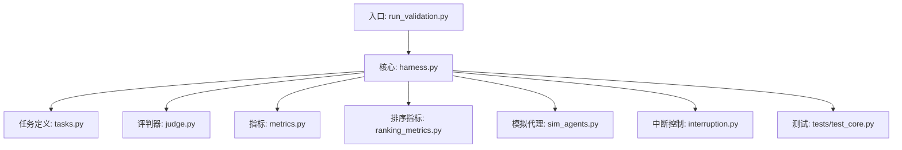
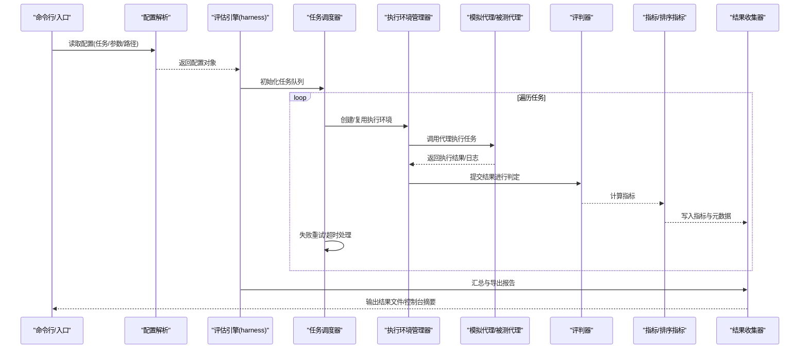
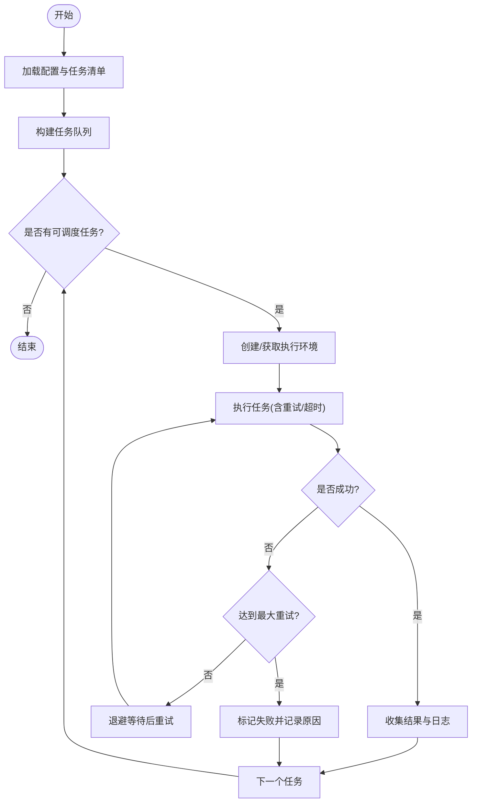
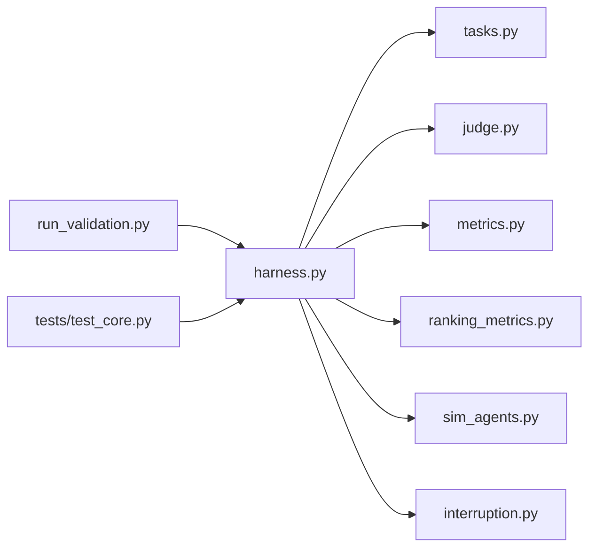

# 评估引擎（Harness）

<cite>
**本文引用的文件**   
- [harness.py](file://autonomy_mvp/core/harness.py)
- [tasks.py](file://autonomy_mvp/core/tasks.py)
- [judge.py](file://autonomy_mvp/core/judge.py)
- [metrics.py](file://autonomy_mvp/core/metrics.py)
- [ranking_metrics.py](file://autonomy_mvp/core/ranking_metrics.py)
- [sim_agents.py](file://autonomy_mvp/core/sim_agents.py)
- [interruption.py](file://autonomy_mvp/core/interruption.py)
- [run_validation.py](file://autonomy_mvp/run_validation.py)
- [test_core.py](file://autonomy_mvp/tests/test_core.py)
</cite>

## 目录
1. [简介](#简介)
2. [项目结构](#项目结构)
3. [核心组件](#核心组件)
4. [架构总览](#架构总览)
5. [详细组件分析](#详细组件分析)
6. [依赖关系分析](#依赖关系分析)
7. [性能与扩展性](#性能与扩展性)
8. [故障排查指南](#故障排查指南)
9. [结论](#结论)
10. [附录：扩展与集成示例](#附录扩展与集成示例)

## 简介
本文件面向“评估引擎（Harness）”的开发者与维护者，系统性阐述评估框架的核心设计、任务调度机制、执行环境管理、结果收集流程以及生命周期管理。文档同时覆盖配置解析、依赖注入、错误处理与重试策略的设计模式，并给出如何扩展评估逻辑与自定义评估器的实践指导，以及与模拟代理、工具系统和评判器的集成方式。

## 项目结构
评估引擎位于 autonomy_mvp/core 目录下，围绕 harness.py 组织，配合 tasks.py、judge.py、metrics.py、ranking_metrics.py、sim_agents.py、interruption.py 等模块共同构成完整的评估闭环。入口脚本 run_validation.py 负责加载配置、实例化评估器与驱动评测流程；tests/test_core.py 提供单元测试与回归用例。

图示来源
- [run_validation.py](file://autonomy_mvp/run_validation.py)
- [harness.py](file://autonomy_mvp/core/harness.py)
- [tasks.py](file://autonomy_mvp/core/tasks.py)
- [judge.py](file://autonomy_mvp/core/judge.py)
- [metrics.py](file://autonomy_mvp/core/metrics.py)
- [ranking_metrics.py](file://autonomy_mvp/core/ranking_metrics.py)
- [sim_agents.py](file://autonomy_mvp/core/sim_agents.py)
- [interruption.py](file://autonomy_mvp/core/interruption.py)
- [test_core.py](file://autonomy_mvp/tests/test_core.py)

章节来源
- [run_validation.py](file://autonomy_mvp/run_validation.py)
- [harness.py](file://autonomy_mvp/core/harness.py)
- [tasks.py](file://autonomy_mvp/core/tasks.py)
- [judge.py](file://autonomy_mvp/core/judge.py)
- [metrics.py](file://autonomy_mvp/core/metrics.py)
- [ranking_metrics.py](file://autonomy_mvp/core/ranking_metrics.py)
- [sim_agents.py](file://autonomy_mvp/core/sim_agents.py)
- [interruption.py](file://autonomy_mvp/core/interruption.py)
- [test_core.py](file://autonomy_mvp/tests/test_core.py)

## 核心组件
- 任务调度器：负责任务队列构建、优先级/并发控制、失败重试与超时管理。
- 执行环境管理器：负责为每个任务准备隔离的执行上下文、资源分配与清理。
- 结果收集器：统一采集运行日志、中间产物与最终评分，支持持久化与聚合统计。
- 评判器与指标：将模型输出与标准答案或规则进行比对，计算单样本与全局指标。
- 模拟代理：在无需真实外部系统时，提供可插拔的仿真行为以加速迭代。
- 中断控制：支持优雅停止、信号捕获与状态回滚，保障长时运行的稳定性。

章节来源
- [harness.py](file://autonomy_mvp/core/harness.py)
- [tasks.py](file://autonomy_mvp/core/tasks.py)
- [judge.py](file://autonomy_mvp/core/judge.py)
- [metrics.py](file://autonomy_mvp/core/metrics.py)
- [ranking_metrics.py](file://autonomy_mvp/core/ranking_metrics.py)
- [sim_agents.py](file://autonomy_mvp/core/sim_agents.py)
- [interruption.py](file://autonomy_mvp/core/interruption.py)

## 架构总览
评估引擎采用“配置驱动 + 插件化”的架构：通过配置文件声明任务集、评判规则、指标与运行参数；运行时由调度器按策略分发任务到执行环境，执行完成后由结果收集器汇总并输出报告。

图示来源
- [run_validation.py](file://autonomy_mvp/run_validation.py)
- [harness.py](file://autonomy_mvp/core/harness.py)
- [tasks.py](file://autonomy_mvp/core/tasks.py)
- [judge.py](file://autonomy_mvp/core/judge.py)
- [metrics.py](file://autonomy_mvp/core/metrics.py)
- [ranking_metrics.py](file://autonomy_mvp/core/ranking_metrics.py)
- [sim_agents.py](file://autonomy_mvp/core/sim_agents.py)
- [interruption.py](file://autonomy_mvp/core/interruption.py)

## 详细组件分析

### 任务调度器（Task Scheduler）
- 职责
  - 从配置中解析任务清单，构建任务队列。
  - 根据并发度与资源限制调度任务执行。
  - 实现失败重试、退避策略与超时控制。
  - 维护任务状态机（待执行/执行中/成功/失败/跳过）。
- 关键设计
  - 基于工厂模式的任务注册与实例化，便于新增任务类型。
  - 使用可插拔的重试策略（固定间隔/指数退避/抖动）。
  - 支持中断信号下的安全退出与未完成任务的状态持久化。
- 复杂度与优化
  - 任务入队/出队 O(1)，整体调度复杂度取决于并发度与任务耗时。
  - 建议对 IO 密集型任务采用异步/协程提升吞吐。

图示来源
- [harness.py](file://autonomy_mvp/core/harness.py)
- [tasks.py](file://autonomy_mvp/core/tasks.py)
- [interruption.py](file://autonomy_mvp/core/interruption.py)

章节来源
- [harness.py](file://autonomy_mvp/core/harness.py)
- [tasks.py](file://autonomy_mvp/core/tasks.py)
- [interruption.py](file://autonomy_mvp/core/interruption.py)

### 执行环境管理器（Execution Environment Manager）
- 职责
  - 为每个任务准备隔离的运行上下文（工作目录、环境变量、依赖）。
  - 管理进程/线程池、GPU/CPU 资源配额与清理。
  - 提供统一的异常捕获与堆栈信息收集。
- 关键设计
  - 工厂/模板方法模式：不同任务类型可定制环境初始化与销毁流程。
  - 资源回收钩子：确保即使异常也能释放句柄、临时文件与锁。
- 扩展点
  - 新增环境提供者（如容器化、沙箱、云函数）只需实现接口契约。

章节来源
- [harness.py](file://autonomy_mvp/core/harness.py)

### 结果收集器（Result Collector）
- 职责
  - 统一收集任务输出、中间产物、日志与指标。
  - 将结构化结果持久化到文件系统或数据库。
  - 生成汇总报告与可视化摘要。
- 关键设计
  - 观察者模式：各阶段事件（开始、完成、失败）触发回调写入。
  - 幂等写入：支持断点续跑与增量更新。
- 输出格式
  - 单任务 JSON 记录（包含元数据、时间戳、指标字典）。
  - 全局汇总 CSV/JSON（用于后续分析与排名）。

章节来源
- [harness.py](file://autonomy_mvp/core/harness.py)

### 评判器与指标（Judge & Metrics）
- 评判器
  - 将模型输出与参考答案或规则进行匹配，返回布尔/分数/结构化判定。
  - 支持多策略组合（精确匹配、模糊匹配、启发式规则、LLM-as-a-Judge）。
- 指标
  - 基础指标：准确率、召回率、F1、AUC、RMSE 等。
  - 排序指标：NDCG、MAP、MRR 等，用于排序类任务。
- 设计要点
  - 指标可插拔：通过注册表动态加载。
  - 批处理友好：支持批量输入以提升吞吐。

章节来源
- [judge.py](file://autonomy_mvp/core/judge.py)
- [metrics.py](file://autonomy_mvp/core/metrics.py)
- [ranking_metrics.py](file://autonomy_mvp/core/ranking_metrics.py)

### 模拟代理（Simulated Agents）
- 职责
  - 在无外部系统或真实 API 可用时，提供确定性或可控随机行为的仿真代理。
  - 支持注入种子、回放轨迹与边界条件构造。
- 适用场景
  - 快速验证评估管线、回归测试、压力测试。
- 扩展方式
  - 实现统一接口，注册到代理工厂即可被调度器发现与使用。

章节来源
- [sim_agents.py](file://autonomy_mvp/core/sim_agents.py)

### 中断控制（Interruption Control）
- 职责
  - 捕获系统信号（如 SIGINT/SIGTERM），触发优雅关闭。
  - 保存当前进度，避免重复执行已完成任务。
- 设计要点
  - 原子性检查点：每完成一个任务即落盘状态。
  - 可恢复性：重启后自动从最近检查点继续。

章节来源
- [interruption.py](file://autonomy_mvp/core/interruption.py)

## 依赖关系分析
- 模块耦合
  - harness.py 作为编排中心，依赖 tasks、judge、metrics、sim_agents、interruption。
  - run_validation.py 仅负责配置解析与启动编排，保持低耦合。
- 外部依赖
  - 文件系统、可选的数据库/消息队列（用于结果持久化与分布式扩展）。
- 潜在循环依赖
  - 通过接口抽象与工厂注册避免直接循环引用。

图示来源
- [harness.py](file://autonomy_mvp/core/harness.py)
- [tasks.py](file://autonomy_mvp/core/tasks.py)
- [judge.py](file://autonomy_mvp/core/judge.py)
- [metrics.py](file://autonomy_mvp/core/metrics.py)
- [ranking_metrics.py](file://autonomy_mvp/core/ranking_metrics.py)
- [sim_agents.py](file://autonomy_mvp/core/sim_agents.py)
- [interruption.py](file://autonomy_mvp/core/interruption.py)
- [run_validation.py](file://autonomy_mvp/run_validation.py)
- [test_core.py](file://autonomy_mvp/tests/test_core.py)

章节来源
- [harness.py](file://autonomy_mvp/core/harness.py)
- [run_validation.py](file://autonomy_mvp/run_validation.py)
- [test_core.py](file://autonomy_mvp/tests/test_core.py)

## 性能与扩展性
- 并发与并行
  - 合理设置并发度，结合 IO/CPU 特性选择线程/进程/协程。
  - 对长耗时任务启用分片与批处理。
- 缓存与去重
  - 对相同输入的结果进行缓存，避免重复计算。
  - 使用任务指纹（输入哈希）做幂等键。
- 可扩展性
  - 通过注册表机制扩展任务、评判器、指标与代理。
  - 配置驱动减少硬编码，支持多环境切换。

[本节为通用指导，不直接分析具体文件]

## 故障排查指南
- 常见问题
  - 任务超时：检查执行环境资源与网络延迟，调整超时阈值。
  - 重试风暴：确认退避策略与最大重试次数，避免雪崩。
  - 结果不一致：核对随机种子与浮点精度，确保可复现。
  - 中断恢复：检查检查点文件完整性与权限。
- 定位手段
  - 开启详细日志，记录任务 ID、输入指纹、关键步骤耗时。
  - 使用最小可复现用例缩小问题范围。
  - 对比基准结果与历史基线，定位回归。

章节来源
- [harness.py](file://autonomy_mvp/core/harness.py)
- [interruption.py](file://autonomy_mvp/core/interruption.py)
- [test_core.py](file://autonomy_mvp/tests/test_core.py)

## 结论
评估引擎以配置驱动与插件化为核心，通过任务调度器、执行环境管理器与结果收集器形成稳定可靠的评测闭环。借助可插拔的评判器、指标与模拟代理，系统具备良好的扩展性与可维护性。遵循本文档提供的扩展与集成指南，可快速接入新任务与新评估逻辑，并在生产环境中获得高可用与高性能表现。

[本节为总结性内容，不直接分析具体文件]

## 附录：扩展与集成示例

### 扩展自定义任务
- 步骤
  - 在任务注册表中新增任务类型，实现任务初始化、执行与清理钩子。
  - 在配置文件中声明任务参数与依赖。
  - 编写单元测试覆盖正常与异常分支。
- 参考路径
  - [任务定义与注册](file://autonomy_mvp/core/tasks.py)
  - [核心编排与调度](file://autonomy_mvp/core/harness.py)
  - [单元测试示例](file://autonomy_mvp/tests/test_core.py)

章节来源
- [tasks.py](file://autonomy_mvp/core/tasks.py)
- [harness.py](file://autonomy_mvp/core/harness.py)
- [test_core.py](file://autonomy_mvp/tests/test_core.py)

### 自定义评判器
- 步骤
  - 实现评判接口（输入预测与参考答案，输出分数/判定）。
  - 注册到评判器工厂，供 harness 按需调用。
  - 在指标层对接相应度量函数。
- 参考路径
  - [评判器接口与实现](file://autonomy_mvp/core/judge.py)
  - [指标定义](file://autonomy_mvp/core/metrics.py)
  - [排序指标](file://autonomy_mvp/core/ranking_metrics.py)

章节来源
- [judge.py](file://autonomy_mvp/core/judge.py)
- [metrics.py](file://autonomy_mvp/core/metrics.py)
- [ranking_metrics.py](file://autonomy_mvp/core/ranking_metrics.py)

### 集成模拟代理
- 步骤
  - 实现代理接口（接收任务上下文，返回执行结果与日志）。
  - 注册到代理工厂，并在配置中选择对应代理。
  - 使用固定种子保证可复现。
- 参考路径
  - [模拟代理实现](file://autonomy_mvp/core/sim_agents.py)
  - [调度与执行](file://autonomy_mvp/core/harness.py)

章节来源
- [sim_agents.py](file://autonomy_mvp/core/sim_agents.py)
- [harness.py](file://autonomy_mvp/core/harness.py)

### 集成工具系统
- 说明
  - 若需调用外部工具（如科学计算库、API 服务），在执行环境管理器中封装工具调用与错误处理。
  - 通过环境变量与密钥管理注入凭据，避免硬编码。
- 参考路径
  - [执行环境管理](file://autonomy_mvp/core/harness.py)

章节来源
- [harness.py](file://autonomy_mvp/core/harness.py)

### 配置解析与依赖注入
- 步骤
  - 在入口脚本中解析 YAML/JSON 配置，转换为运行时对象。
  - 使用工厂/容器注入所需组件（任务、评判器、指标、代理）。
- 参考路径
  - [入口与配置驱动](file://autonomy_mvp/run_validation.py)
  - [核心编排](file://autonomy_mvp/core/harness.py)

章节来源
- [run_validation.py](file://autonomy_mvp/run_validation.py)
- [harness.py](file://autonomy_mvp/core/harness.py)

### 错误处理与重试机制
- 设计要点
  - 区分可重试与不可重试异常，设置最大重试次数与退避策略。
  - 记录失败原因与堆栈，便于事后分析。
  - 支持中断后的断点续跑。
- 参考路径
  - [调度与重试](file://autonomy_mvp/core/harness.py)
  - [中断控制](file://autonomy_mvp/core/interruption.py)

章节来源
- [harness.py](file://autonomy_mvp/core/harness.py)
- [interruption.py](file://autonomy_mvp/core/interruption.py)