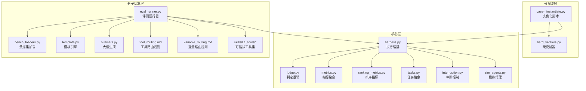
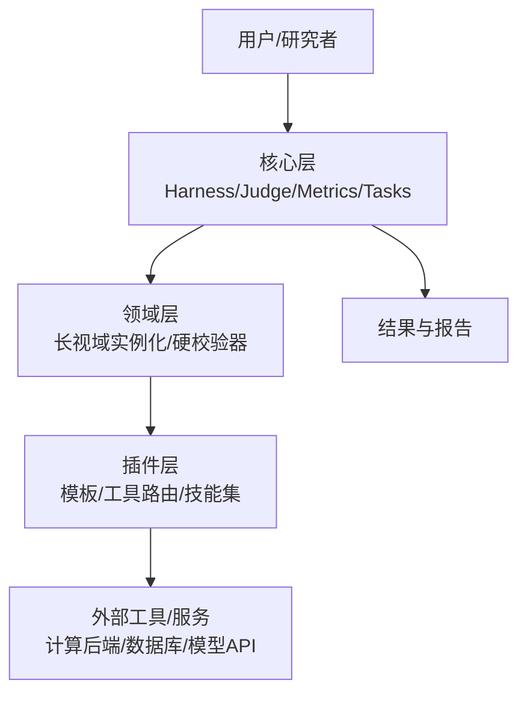
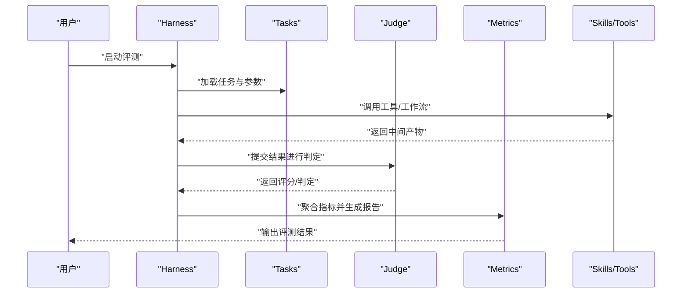
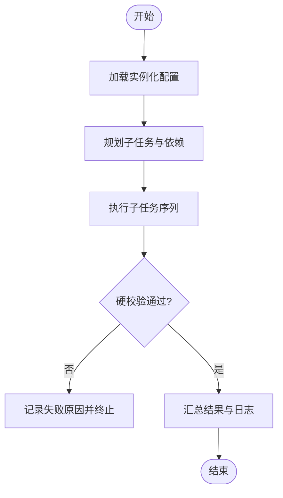
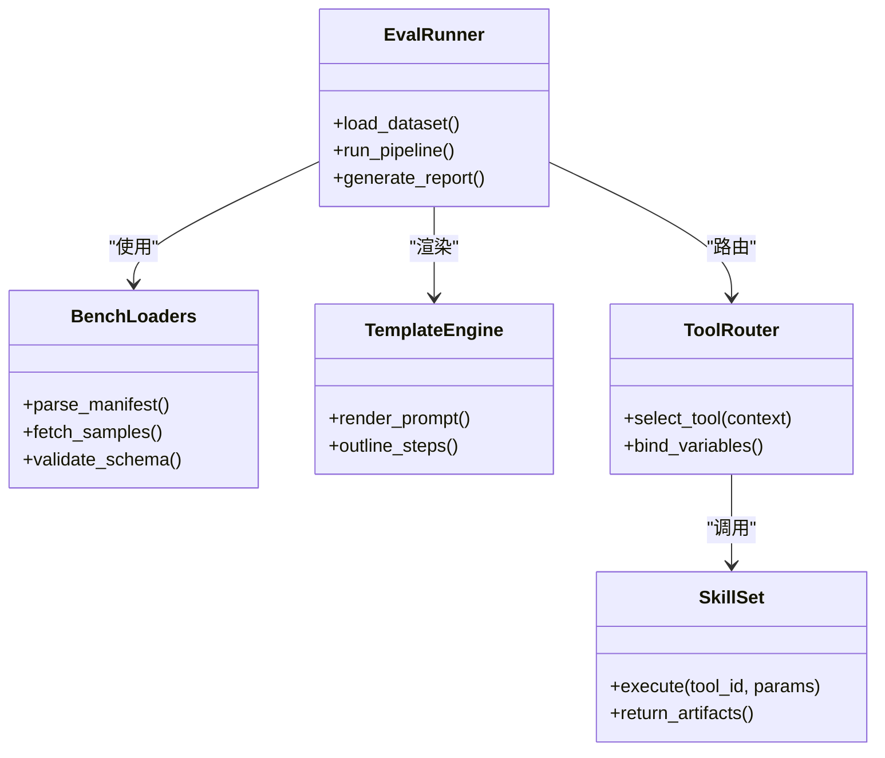
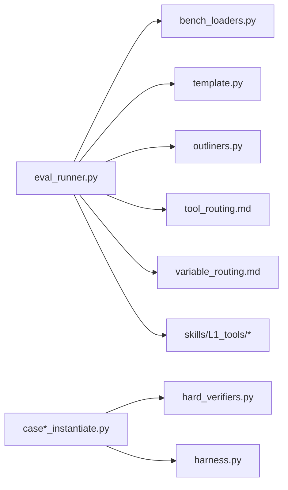

# 系统架构概览

<cite>
**本文引用的文件**   
- [autonomy_mvp/core/harness.py](file://autonomy_mvp/core/harness.py)
- [autonomy_mvp/core/judge.py](file://autonomy_mvp/core/judge.py)
- [autonomy_mvp/core/metrics.py](file://autonomy_mvp/core/metrics.py)
- [autonomy_mvp/core/ranking_metrics.py](file://autonomy_mvp/core/ranking_metrics.py)
- [autonomy_mvp/core/tasks.py](file://autonomy_mvp/core/tasks.py)
- [autonomy_mvp/core/interruption.py](file://autonomy_mvp/core/interruption.py)
- [autonomy_mvp/core/sim_agents.py](file://autonomy_mvp/core/sim_agents.py)
- [longhorizon/instantiate/case1_instantiate.py](file://longhorizon/instantiate/case1_instantiate.py)
- [longhorizon/instantiate/case2_instantiate.py](file://longhorizon/instantiate/case2_instantiate.py)
- [longhorizon/instantiate/case3_instantiate.py](file://longhorizon/instantiate/case3_instantiate.py)
- [longhorizon/instantiate/caseD_instantiate.py](file://longhorizon/instantiate/caseD_instantiate.py)
- [longhorizon/instantiate/caseE_instantiate.py](file://longhorizon/instantiate/caseE_instantiate.py)
- [longhorizon/instantiate/caseF_instantiate.py](file://longhorizon/instantiate/caseF_instantiate.py)
- [longhorizon/verifiers/hard_verifiers.py](file://longhorizon/verifiers/hard_verifiers.py)
- [task4_papers/molbench_repo/eval/bench_loaders.py](file://docs/task4_papers/molbench_repo/eval/bench_loaders.py)
- [task4_papers/molbench_repo/eval/eval_runner.py](file://docs/task4_papers/molbench_repo/eval/eval_runner.py)
- [task4_papers/molbench_repo/templates/template.py](file://docs/task4_papers/molbench_repo/templates/template.py)
- [task4_papers/molbench_repo/templates/outliners.py](file://docs/task4_papers/molbench_repo/templates/outliners.py)
- [task4_papers/molbench_repo/templates/tool_routing.md](file://docs/task4_papers/molbench_repo/templates/tool_routing.md)
- [task4_papers/molbench_repo/templates/variable_routing.md](file://docs/task4_papers/molbench_repo/templates/variable_routing.md)
- [task4_papers/molbench_repo/skills/L1_tools/molclaw-mol-basic-metrics/molclaw-mol-basic-metrics.py](file://docs/task4_papers/molbench_repo/skills/L1_tools/molclaw-mol-basic-metrics/molclaw-mol-basic-metrics.py)
- [task4_papers/molbench_repo/skills/L1_tools/molclaw-docking-screening/molclaw-docking-screening.py](file://docs/task4_papers/molbench_repo/skills/L1_tools/molclaw-docking-screening/molclaw-docking-screening.py)
- [task4_papers/molbench_repo/skills/L1_tools/molclaw-prolif-tool/molclaw-prolif-tool.py](file://docs/task4_papers/molbench_repo/skills/L1_tools/molclaw-prolif-tool/molclaw-prolif-tool.py)
- [task4_papers/molbench_repo/skills/L1_tools/molclaw-equiscore-tool/molclaw-equiscore-tool.py](file://docs/task4_papers/molbench_repo/skills/L1_tools/molclaw-equiscore-tool/molclaw-equiscore-tool.py)
- [task4_papers/molbench_repo/skills/L1_tools/molclaw-fpocket-tool/molclaw-fpocket-tool.py](file://docs/task4_papers/molbench_repo/skills/L1_tools/molclaw-fpocket-tool/molclaw-fpocket-tool.py)
- [task4_papers/molbench_repo/skills/L1_tools/molclaw-openawsem-tool/molclaw-openawsem-tool.py](file://docs/task4_papers/molbench_repo/skills/L1_tools/molclaw-openawsem-tool/molclaw-openawsem-tool.py)
- [task4_papers/molbench_repo/skills/L1_tools/molclaw-protein-openmm/molclaw-protein-openmm.py](file://docs/task4_papers/molbench_repo/skills/L1_tools/molclaw-protein-openmm/molclaw-protein-openmm.py)
- [task4_papers/molbench_repo/skills/L1_tools/molclaw-prolif-md/molclaw-prolif-md.py](file://docs/task4_papers/molbench_repo/skills/L1_tools/molclaw-prolif-md/molclaw-prolif-md.py)
- [task4_papers/molbench_repo/skills/L1_tools/molclaw-prolif-pdb/molclaw-prolif-pdb.py](file://docs/task4_papers/molbench_repo/skills/L1_tools/molclaw-prolif-pdb/molclaw-prolif-pdb.py)
- [task4_papers/molbench_repo/skills/L1_tools/molclaw-protein-protein-mmpbsa/molclaw-protein-protein-mmpbsa.py](file://docs/task4_papers/molbench_repo/skills/L1_tools/molclaw-protein-protein-mmpbsa/molclaw-protein-protein-mmpbsa.py)
- [task4_papers/molbench_repo/skills/L1_tools/molclaw-protein-ligand-mmpbsa/molclaw-protein-ligand-mmpbsa.py](file://docs/task4_papers/molbench_repo/skills/L1_tools/molclaw-protein-ligand-mmpbsa/molclaw-protein-ligand-mmpbsa.py)
- [task4_papers/molbench_repo/skills/L1_tools/molclaw-quickvina-docking/molclaw-quickvina-docking.py](file://docs/task4_papers/molbench_repo/skills/L1_tools/molclaw-quickvina-docking/molclaw-quickvina-docking.py)
- [task4_papers/molbench_repo/skills/L1_tools/molclaw-chai1-predict/molclaw-chai1-predict.py](file://docs/task4_papers/molbench_repo/skills/L1_tools/molclaw-chai1-predict/molclaw-chai1-predict.py)
- [task4_papers/molbench_repo/skills/L1_tools/molclaw-esmfold/molclaw-esmfold.py](file://docs/task4_papers/molbench_repo/skills/L1_tools/molclaw-esmfold/molclaw-esmfold.py)
- [task4_papers/molbench_repo/skills/L1_tools/molclaw-evobind-tool/molclaw-evobind-tool.py](file://docs/task4_papers/molbench_repo/skills/L1_tools/molclaw-evobind-tool/molclaw-evobind-tool.py)
- [task4_papers/molbench_repo/skills/L1_tools/molclaw-goca-tool/molclaw-goca-tool.py](file://docs/task4_papers/molbench_repo/skills/L1_tools/molclaw-goca-tool/molclaw-goca-tool.py)
- [task4_papers/molbench_repo/skills/L1_tools/molclaw-hdock-tool/molclaw-hdock-tool.py](file://docs/task4_papers/molbench_repo/skills/L1_tools/molclaw-hdock-tool/molclaw-hdock-tool.py)
- [task4_papers/molbench_repo/skills/L1_tools/molclaw-karmadock-tool/molclaw-karmadock-tool.py](file://docs/task4_papers/molbench_repo/skills/L1_tools/molclaw-karmadock-tool/molclaw-karmadock-tool.py)
- [task4_papers/molbench_repo/skills/L1_tools/molclaw-linker-sampling/molclaw-linker-sampling.py](file://docs/task4_papers/molbench_repo/skills/L1_tools/molclaw-linker-sampling/molclaw-linker-sampling.py)
- [task4_papers/molbench_repo/skills/L1_tools/molclaw-mol2mol-sampling/molclaw-mol2mol-sampling.py](file://docs/task4_papers/molbench_repo/skills/L1_tools/molclaw-mol2mol-sampling/molclaw-mol2mol-sampling.py)
- [task4_papers/molbench_repo/skills/L1_tools/molclaw-p2rank/molclaw-p2rank.py](file://docs/task4_papers/molbench_repo/skills/L1_tools/molclaw-p2rank/molclaw-p2rank.py)
- [task4_papers/molbench_repo/skills/L1_tools/molclaw-pack-sidechains/molclaw-pack-sidechains.py](file://docs/task4_papers/molbench_repo/skills/L1_tools/molclaw-pack-sidechains/molclaw-pack-sidechains.py)
- [task4_papers/molbench_repo/skills/L1_tools/molclaw-pdbfixer/molclaw-pdbfixer.py](file://docs/task4_papers/molbench_repo/sskills/L1_tools/molclaw-pdbfixer/molclaw-pdbfixer.py)
- [task4_papers/molbench_repo/skills/L1_tools/molclaw-peptide-sampling/molclaw-peptide-sampling.py](file://docs/task4_papers/molbench_repo/skills/L1_tools/molclaw-peptide-sampling/molclaw-peptide-sampling.py)
- [task4_papers/molbench_repo/skills/L1_tools/molclaw-prolif-tool/molclaw-prolif-tool.py](file://docs/task4_papers/molbench_repo/skills/L1_tools/molclaw-prolif-tool/molclaw-prolif-tool.py)
- [task4_papers/molbench_repo/skills/L1_tools/molclaw-protein-sequence-retrieve/molclaw-protein-sequence-retrieve.py](file://docs/task4_papers/molbench_repo/skills/L1_tools/molclaw-protein-sequence-retrieve/molclaw-protein-sequence-retrieve.py)
- [task4_papers/molbench_repo/skills/L1_tools/molclaw-protein-structure-retrieve/molclaw-protein-structure-retrieve.py](file://docs/task4_papers/molbench_repo/skills/L1_tools/molclaw-protein-structure-retrieve/molclaw-protein-structure-retrieve.py)
- [task4_papers/molbench_repo/skills/L1_tools/molclaw-proteinmpnn-tool/molclaw-proteinmpnn-tool.py](file://docs/task4_papers/molbench_repo/skills/L1_tools/molclaw-proteinmpnn-tool/molclaw-proteinmpnn-tool.py)
- [task4_papers/molbench_repo/skills/L1_tools/molclaw-pulchura-rebuild/molclaw-pulchura-rebuild.py](file://docs/task4_papers/molbench_repo/skills/L1_tools/molclaw-pulchura-rebuild/molclaw-pulchura-rebuild.py)
- [task4_papers/molbench_repo/skills/L1_tools/molclaw-rgroup-sampling/molclaw-rgroup-sampling.py](file://docs/task4_papers/molbench_repo/skills/L1_tools/molclaw-rgroup-sampling/molclaw-rgroup-sampling.py)
- [task4_papers/molbench_repo/skills/L1_tools/molclaw-run-bioemu/molclaw-run-bioemu.py](file://docs/task4_papers/molbench_repo/skills/L1_tools/molclaw-run-bioemu/molclaw-run-bioemu.py)
- [task4_papers/molbench_repo/skills/L1_tools/molclaw-scp-server/molclaw-scp-server.py](file://docs/task4_papers/molbench_repo/skills/L1_tools/molclaw-scp-server/molclaw-scp-server.py)
- [task4_papers/molbench_repo/skills/L1_tools/molclaw-sequence-valid-check/molclaw-sequence-valid-check.py](file://docs/task4_papers/molbench_repo/skills/L1_tools/molclaw-sequence-valid-check/molclaw-sequence-valid-check.py)
- [task4_papers/molbench_repo/skills/L1_tools/molclaw-smiles-fg-editor/molclaw-smiles-fg-editor.py](file://docs/task4_papers/molbench_repo/skills/L1_tools/molclaw-smiles-fg-editor/molclaw-smiles-fg-editor.py)
- [task4_papers/molbench_repo/skills/L1_tools/molclaw-smiles-valid-check/molclaw-smiles-valid-check.py](file://docs/task4_papers/molbench_repo/skills/L1_tools/molclaw-smiles-valid-check/molclaw-smiles-valid-check.py)
- [task4_papers/molbench_repo/skills/L1_tools/molclaw-interaction-visualizer/molclaw-interaction-visualizer.py](file://docs/task4_papers/molbench_repo/skills/L1_tools/molclaw-interaction-visualizer/molclaw-interaction-visualizer.py)
- [task4_papers/molbench_repo/skills/L1_tools/molclaw-file-transfer/molclaw-file-transfer.py](file://docs/task4_papers/molbench_repo/skills/L1_tools/molclaw-file-transfer/molclaw-file-transfer.py)
- [task4_papers/molbench_repo/skills/L1_tools/molclaw-fix-pdb/molclaw-fix-pdb.py](file://docs/task4_papers/molbench_repo/skills/L1_tools/molclaw-fix-pdb/molclaw-fix-pdb.py)
- [task4_papers/molbench_repo/skills/L1_tools/molclaw-extract-chains/molclaw-extract-chains.py](file://docs/task4_papers/molbench_repo/skills/L1_tools/molclaw-extract-chains/molclaw-extract-chains.py)
- [task4_papers/molbench_repo/skills/L1_tools/molclaw-dleps/molclaw-dleps.py](file://docs/task4_papers/molbench_repo/skills/L1_tools/molclaw-dleps/molclaw-dleps.py)
- [task4_papers/molbench_repo/skills/L1_tools/molclaw-drug-likeness/molclaw-drug-likeness.py](file://docs/task4_papers/molbench_repo/skills/L1_tools/molclaw-drug-likeness/molclaw-drug-likeness.py)
- [task4_papers/molbench_repo/skills/L1_tools/molclaw-compound-retrieve/molclaw-compound-retrieve.py](file://docs/task4_papers/molbench_repo/skills/L1_tools/molclaw-compound-retrieve/molclaw-compound-retrieve.py)
- [task4_papers/molbench_repo/skills/L1_tools/molclaw-chroma-toolkit/molclaw-chroma-toolkit.py](file://docs/task4_papers/molbench_repo/skills/L1_tools/molclaw-chroma-toolkit/molclaw-chroma-toolkit.py)
- [task4_papers/molbench_repo/skills/L1_tools/molclaw-denovo-sampling/molclaw-denovo-sampling.py](file://docs/task4_papers/molbench_repo/skills/L1_tools/molclaw-denovo-sampling/molclaw-denovo-sampling.py)
- [task4_papers/molbench_repo/skills/L1_tools/molclaw-diffdock-auto/molclaw-diffdock-auto.py](file://docs/task4_papers/molbench_repo/skills/L1_tools/molclaw-diffdock-auto/molclaw-diffdock-auto.py)
- [task4_papers/molbench_repo/skills/L1_tools/molclaw-boltz2-affinity/molclaw-boltz2-affinity.py](file://docs/task4_papers/molbench_repo/skills/L1_tools/molclaw-boltz2-affinity/molclaw-boltz2-affinity.py)
- [task4_papers/molbench_repo/skills/L1_tools/molclaw-admet/molclaw-admet.py](file://docs/task4_papers/molbench_repo/skills/L1_tools/molclaw-admet/molclaw-admet.py)
- [task4_papers/molbench_repo/skills/L1_tools/molclaw-mol-opt-physchem/molclaw-mol-opt-physchem.py](file://docs/task4_papers/molbench_repo/skills/L1_tools/molclaw-mol-opt-physchem/molclaw-mol-opt-physchem.py)
- [task4_papers/molbench_repo/skills/L1_tools/molclaw-mol-similarity/molclaw-mol-similarity.py](file://docs/task4_papers/molbench_repo/skills/L1_tools/molclaw-mol-similarity/molclaw-mol-similarity.py)
- [task4_papers/molbench_repo/skills/L1_tools/molclaw-mol-structure-metrics/molclaw-mol-structure-metrics.py](file://docs/task4_papers/molbench_repo/skills/L1_tools/molclaw-mol-structure-metrics.py)
- [task4_papers/molbench_repo/skills/L1_tools/molclaw-mol-topology-metrics/molclaw-mol-topology-metrics.py](file://docs/task4_papers/molbench_repo/skills/L1_tools/molclaw-mol-topology-metrics.py)
- [task4_papers/molbench_repo/skills/L1_tools/molclaw-mol-complexity-metrics/molclaw-mol-complexity-metrics.py](file://docs/task4_papers/molbench_repo/skills/L1_tools/molclaw-mol-complexity-metrics.py)
- [task4_papers/molbench_repo/skills/L1_tools/molclaw-mol-hbond-metrics/molclaw-mol-hbond-metrics.py](file://docs/task4_papers/molbench_repo/skills/L1_tools/molclaw-mol-hbond-metrics.py)
- [task4_papers/molbench_repo/skills/L1_tools/molclaw-mol-hydrophobicity-metrics/molclaw-mol-hydrophobicity-metrics.py](file://docs/task4_papers/molbench_repo/skills/L1_tools/molclaw-mol-hydrophobicity-metrics.py)
- [task4_papers/molbench_repo/skills/L1_tools/molclaw-mol-charge-metrics/molclaw-mol-charge-metrics.py](file://docs/task4_papers/molbench_repo/skills/L1_tools/molclaw-mol-charge-metrics.py)
- [task4_papers/molbench_repo/skills/L1_tools/molclaw-mol2mol-sampling/molclaw-mol2mol-sampling.py](file://docs/task4_papers/molbench_repo/skills/L1_tools/molclaw-mol2mol-sampling/molclaw-mol2mol-sampling.py)
- [task4_papers/molbench_repo/skills/L1_tools/molclaw-prolif-tool/molclaw-prolif-tool.py](file://docs/task4_papers/molbench_repo/skills/L1_tools/molclaw-prolif-tool/molclaw-prolif-tool.py)
- [task4_papers/molbench_repo/skills/L1_tools/molclaw-prolif-md/molclaw-prolif-md.py](file://docs/task4_papers/molbench_repo/skills/L1_tools/molclaw-prolif-md/molclaw-prolif-md.py)
- [task4_papers/molbench_repo/skills/L1_tools/molclaw-prolif-pdb/molclaw-prolif-pdb.py](file://docs/task4_papers/molbench_repo/skills/L1_tools/molclaw-prolif-pdb/molclaw-prolif-pdb.py)
- [task4_papers/molbench_repo/skills/L1_tools/molclaw-protein-protein-mmpbsa/molclaw-protein-protein-mmpbsa.py](file://docs/task4_papers/molbench_repo/skills/L1_tools/molclaw-protein-protein-mmpbsa/molclaw-protein-protein-mmpbsa.py)
- [task4_papers/molbench_repo/skills/L1_tools/molclaw-protein-ligand-mmpbsa/molclaw-protein-ligand-mmpbsa.py](file://docs/task4_papers/molbench_repo/skills/L1_tools/molclaw-protein-ligand-mmpbsa/molclaw-protein-ligand-mmpbsa.py)
- [task4_papers/molbench_repo/skills/L1_tools/molclaw-quickvina-docking/molclaw-quickvina-docking.py](file://docs/task4_papers/molbench_repo/skills/L1_tools/molclaw-quickvina-docking/molclaw-quickvina-docking.py)
- [task4_papers/molbench_repo/skills/L1_tools/molclaw-chai1-predict/molclaw-chai1-predict.py](file://docs/task4_papers/molbench_repo/skills/L1_tools/molclaw-chai1-predict/molclaw-chai1-predict.py)
- [task4_papers/molbench_repo/skills/L1_tools/molclaw-esmfold/molclaw-esmfold.py](file://docs/task4_papers/molbench_repo/skills/L1_tools/molclaw-esmfold/molclaw-esmfold.py)
- [task4_papers/molbench_repo/skills/L1_tools/molclaw-evobind-tool/molclaw-evobind-tool.py](file://docs/task4_papers/molbench_repo/skills/L1_tools/molclaw-evobind-tool/molclaw-evobind-tool.py)
- [task4_papers/molbench_repo/skills/L1_tools/molclaw-goca-tool/molclaw-goca-tool.py](file://docs/task4_papers/molbench_repo/skills/L1_tools/molclaw-goca-tool/molclaw-goca-tool.py)
- [task4_papers/molbench_repo/skills/L1_tools/molclaw-hdock-tool/molclaw-hdock-tool.py](file://docs/task4_papers/molbench_repo/skills/L1_tools/molclaw-hdock-tool/molclaw-hdock-tool.py)
- [task4_papers/molbench_repo/skills/L1_tools/molclaw-karmadock-tool/molclaw-karmadock-tool.py](file://docs/task4_papers/molbench_repo/skills/L1_tools/molclaw-karmadock-tool/molclaw-karmadock-tool.py)
- [task4_papers/molbench_repo/skills/L1_tools/molclaw-linker-sampling/molclaw-linker-sampling.py](file://docs/task4_papers/molbench_repo/skills/L1_tools/molclaw-linker-sampling/molclaw-linker-sampling.py)
- [task4_papers/molbench_repo/skills/L1_tools/molclaw-mol2mol-sampling/molclaw-mol2mol-sampling.py](file://docs/task4_papers/molbench_repo/skills/L1_tools/molclaw-mol2mol-sampling/molclaw-mol2mol-sampling.py)
- [task4_papers/molbench_repo/skills/L1_tools/molclaw-p2rank/molclaw-p2rank.py](file://docs/task4_papers/molbench_repo/skills/L1_tools/molclaw-p2rank/molclaw-p2rank.py)
- [task4_papers/molbench_repo/skills/L1_tools/molclaw-pack-sidechains/molclaw-pack-sidechains.py](file://docs/task4_papers/molbench_repo/skills/L1_tools/molclaw-pack-sidechains/molclaw-pack-sidechains.py)
- [task4_papers/molbench_repo/skills/L1_tools/molclaw-pdbfixer/molclaw-pdbfixer.py](file://docs/task4_papers/molbench_repo/skills/L1_tools/molclaw-pdbfixer/molclaw-pdbfixer.py)
- [task4_papers/molbench_repo/skills/L1_tools/molclaw-peptide-sampling/molclaw-peptide-sampling.py](file://docs/task4_papers/molbench_repo/skills/L1_tools/molclaw-peptide-sampling/molclaw-peptide-sampling.py)
- [task4_papers/molbench_repo/skills/L1_tools/molclaw-protein-sequence-retrieve/molclaw-protein-sequence-retrieve.py](file://docs/task4_papers/molbench_repo/skills/L1_tools/molclaw-protein-sequence-retrieve/molclaw-protein-sequence-retrieve.py)
- [task4_papers/molbench_repo/skills/L1_tools/molclaw-protein-structure-retrieve/molclaw-protein-structure-retrieve.py](file://docs/task4_papers/molbench_repo/skills/L1_tools/molclaw-protein-structure-retrieve/molclaw-protein-structure-retrieve.py)
- [task4_papers/molbench_repo/skills/L1_tools/molclaw-proteinmpnn-tool/molclaw-proteinmpnn-tool.py](file://docs/task4_papers/molbench_repo/skills/L1_tools/molclaw-proteinmpnn-tool/molclaw-proteinmpnn-tool.py)
- [task4_papers/molbench_repo/skills/L1_tools/molclaw-pulchura-rebuild/molclaw-pulchura-rebuild.py](file://docs/task4_papers/molbench_repo/skills/L1_tools/molclaw-pulchura-rebuild/molclaw-pulchura-rebuild.py)
- [task4_papers/molbench_repo/skills/L1_tools/molclaw-rgroup-sampling/molclaw-rgroup-sampling.py](file://docs/task4_papers/molbench_repo/skills/L1_tools/molclaw-rgroup-sampling/molclaw-rgroup-sampling.py)
- [task4_papers/molbench_repo/skills/L1_tools/molclaw-run-bioemu/molclaw-run-bioemu.py](file://docs/task4_papers/molbench_repo/skills/L1_tools/molclaw-run-bioemu/molclaw-run-bioemu.py)
- [task4_papers/molbench_repo/skills/L1_tools/molclaw-scp-server/molclaw-scp-server.py](file://docs/task4_papers/molbench_repo/skills/L1_tools/molclaw-scp-server/molclaw-scp-server.py)
- [task4_papers/molbench_repo/skills/L1_tools/molclaw-sequence-valid-check/molclaw-sequence-valid-check.py](file://docs/task4_papers/molbench_repo/skills/L1_tools/molclaw-sequence-valid-check/molclaw-sequence-valid-check.py)
- [task4_papers/molbench_repo/skills/L1_tools/molclaw-smiles-fg-editor/molclaw-smiles-fg-editor.py](file://docs/task4_papers/molbench_repo/skills/L1_tools/molclaw-smiles-fg-editor/molclaw-smiles-fg-editor.py)
- [task4_papers/molbench_repo/skills/L1_tools/molclaw-smiles-valid-check/molclaw-smiles-valid-check.py](file://docs/task4_papers/molbench_repo/skills/L1_tools/molclaw-smiles-valid-check/molclaw-smiles-valid-check.py)
- [task4_papers/molbench_repo/skills/L1_tools/molclaw-interaction-visualizer/molclaw-interaction-visualizer.py](file://docs/task4_papers/molbench_repo/skills/L1_tools/molclaw-interaction-visualizer/molclaw-interaction-visualizer.py)
- [task4_papers/molbench_repo/skills/L1_tools/molclaw-file-transfer/molclaw-file-transfer.py](file://docs/task4_papers/molbench_repo/skills/L1_tools/molclaw-file-transfer/molclaw-file-transfer.py)
- [task4_papers/molbench_repo/skills/L1_tools/molclaw-fix-pdb/molclaw-fix-pdb.py](file://docs/task4_papers/molbench_repo/skills/L1_tools/molclaw-fix-pdb/molclaw-fix-pdb.py)
- [task4_papers/molbench_repo/skills/L1_tools/molclaw-extract-chains/molclaw-extract-chains.py](file://docs/task4_papers/molbench_repo/skills/L1_tools/molclaw-extract-chains/molclaw-extract-chains.py)
- [task4_papers/molbench_repo/skills/L1_tools/molclaw-dleps/molclaw-dleps.py](file://docs/task4_papers/molbench_repo/skills/L1_tools/molclaw-dleps/molclaw-dleps.py)
- [task4_papers/molbench_repo/skills/L1_tools/molclaw-drug-likeness/molclaw-drug-likeness.py](file://docs/task4_papers/molbench_repo/skills/L1_tools/molclaw-drug-likeness/molclaw-drug-likeness.py)
- [task4_papers/molbench_repo/skills/L1_tools/molclaw-compound-retrieve/molclaw-compound-retrieve.py](file://docs/task4_papers/molbench_repo/skills/L1_tools/molclaw-compound-retrieve/molclaw-compound-retrieve.py)
- [task4_papers/molbench_repo/skills/L1_tools/molclaw-chroma-toolkit/molclaw-chroma-toolkit.py](file://docs/task4_papers/molbench_repo/skills/L1_tools/molclaw-chroma-toolkit/molclaw-chroma-toolkit.py)
- [task4_papers/molbench_repo/skills/L1_tools/molclaw-denovo-sampling/molclaw-denovo-sampling.py](file://docs/task4_papers/molbench_repo/skills/L1_tools/molclaw-denovo-sampling/molclaw-denovo-sampling.py)
- [task4_papers/molbench_repo/skills/L1_tools/molclaw-diffdock-auto/molclaw-diffdock-auto.py](file://docs/task4_papers/molbench_repo/skills/L1_tools/molclaw-diffdock-auto/molclaw-diffdock-auto.py)
- [task4_papers/molbench_repo/skills/L1_tools/molclaw-boltz2-affinity/molclaw-boltz2-affinity.py](file://docs/task4_papers/molbench_repo/skills/L1_tools/molclaw-boltz2-affinity/molclaw-boltz2-affinity.py)
- [task4_papers/molbench_repo/skills/L1_tools/molclaw-admet/molclaw-admet.py](file://docs/task4_papers/molbench_repo/skills/L1_tools/molclaw-admet/molclaw-admet.py)
- [task4_papers/molbench_repo/skills/L1_tools/molclaw-mol-opt-physchem/molclaw-mol-opt-physchem.py](file://docs/task4_papers/molbench_repo/skills/L1_tools/molclaw-mol-opt-physchem/molclaw-mol-opt-physchem.py)
- [task4_papers/molbench_repo/skills/L1_tools/molclaw-mol-similarity/molclaw-mol-similarity.py](file://docs/task4_papers/molbench_repo/skills/L1_tools/molclaw-mol-similarity/molclaw-mol-similarity.py)
- [task4_papers/molbench_repo/skills/L1_tools/molclaw-mol-structure-metrics/molclaw-mol-structure-metrics.py](file://docs/task4_papers/molbench_repo/skills/L1_tools/molclaw-mol-structure-metrics.py)
- [task4_papers/molbench_repo/skills/L1_tools/molclaw-mol-topology-metrics/molclaw-mol-topology-metrics.py](file://docs/task4_papers/molbench_repo/skills/L1_tools/molclaw-mol-topology-metrics.py)
- [task4_papers/molbench_repo/skills/L1_tools/molclaw-mol-complexity-metrics/molclaw-mol-complexity-metrics.py](file://docs/task4_papers/molbench_repo/skills/L1_tools/molclaw-mol-complexity-metrics.py)
- [task4_papers/molbench_repo/skills/L1_tools/molclaw-mol-hbond-metrics/molclaw-mol-hbond-metrics.py](file://docs/task4_papers/molbench_repo/skills/L1_tools/molclaw-mol-hbond-metrics.py)
- [task4_papers/molbench_repo/skills/L1_tools/molclaw-mol-hydrophobicity-metrics/molclaw-mol-hydrophobicity-metrics.py](file://docs/task4_papers/molbench_repo/skills/L1_tools/molclaw-mol-hydrophobicity-metrics.py)
- [task4_papers/molbench_repo/skills/L1_tools/molclaw-mol-charge-metrics/molclaw-mol-charge-metrics.py](file://docs/task4_papers/molbench_repo/skills/L1_tools/molclaw-mol-charge-metrics.py)
</cite>

## 目录
1. [引言](#引言)
2. [项目结构](#项目结构)
3. [核心组件](#核心组件)
4. [架构总览](#架构总览)
5. [详细组件分析](#详细组件分析)
6. [依赖关系分析](#依赖关系分析)
7. [性能考量](#性能考量)
8. [故障排查指南](#故障排查指南)
9. [结论](#结论)
10. [附录](#附录)

## 引言
本文件为科学计算基准测试框架的系统架构概览，面向初学者与高级开发者。文档聚焦以下目标：
- 分层架构设计与模块化组织原则
- 插件化扩展机制（工具、评测器、任务模板）
- 核心设计理念：自主性评估驱动、长视域任务支持、多领域工具集成
- 技术栈选择与权衡、系统边界定义
- 高层架构图与数据流说明

## 项目结构
仓库采用“按能力域+按用例”的混合组织方式：
- autonomy_mvp：最小可用验证集，提供统一的执行编排、评测指标、中断控制与模拟代理等核心能力
- longhorizon：面向长视域任务的实例化与验证器集合，覆盖材料发现、闭环优化、逆合成、靶点验证等场景
- docs/task4_papers/molbench_repo：分子科学领域的完整基准套件，包含数据集加载、评测运行器、模板系统与大量可插拔技能（L1工具与L2工作流）
- task1~task7：不同任务域的探索与原型实现（如对话式评测、并行策略对比、医疗与药学基准Poc等）

图表来源
- [autonomy_mvp/core/harness.py](file://autonomy_mvp/core/harness.py)
- [autonomy_mvp/core/judge.py](file://autonomy_mvp/core/judge.py)
- [autonomy_mvp/core/metrics.py](file://autonomy_mvp/core/metrics.py)
- [autonomy_mvp/core/ranking_metrics.py](file://autonomy_mvp/core/ranking_metrics.py)
- [autonomy_mvp/core/tasks.py](file://autonomy_mvp/core/tasks.py)
- [autonomy_mvp/core/interruption.py](file://autonomy_mvp/core/interruption.py)
- [autonomy_mvp/core/sim_agents.py](file://autonomy_mvp/core/sim_agents.py)
- [longhorizon/instantiate/case1_instantiate.py](file://longhorizon/instantiate/case1_instantiate.py)
- [longhorizon/instantiate/case2_instantiate.py](file://longhorizon/instantiate/case2_instantiate.py)
- [longhorizon/instantiate/case3_instantiate.py](file://longhorizon/instantiate/case3_instantiate.py)
- [longhorizon/instantiate/caseD_instantiate.py](file://longhorizon/instantiate/caseD_instantiate.py)
- [longhorizon/instantiate/caseE_instantiate.py](file://longhorizon/instantiate/caseE_instantiate.py)
- [longhorizon/instantiate/caseF_instantiate.py](file://longhorizon/instantiate/caseF_instantiate.py)
- [longhorizon/verifiers/hard_verifiers.py](file://longhorizon/verifiers/hard_verifiers.py)
- [docs/task4_papers/molbench_repo/eval/bench_loaders.py](file://docs/task4_papers/molbench_repo/eval/bench_loaders.py)
- [docs/task4_papers/molbench_repo/eval/eval_runner.py](file://docs/task4_papers/molbench_repo/eval/eval_runner.py)
- [docs/task4_papers/molbench_repo/templates/template.py](file://docs/task4_papers/molbench_repo/templates/template.py)
- [docs/task4_papers/molbench_repo/templates/outliners.py](file://docs/task4_papers/molbench_repo/templates/outliners.py)
- [docs/task4_papers/molbench_repo/templates/tool_routing.md](file://docs/task4_papers/molbench_repo/templates/tool_routing.md)
- [docs/task4_papers/molbench_repo/templates/variable_routing.md](file://docs/task4_papers/molbench_repo/templates/variable_routing.md)

章节来源
- [autonomy_mvp/core/harness.py](file://autonomy_mvp/core/harness.py)
- [autonomy_mvp/core/judge.py](file://autonomy_mvp/core/judge.py)
- [autonomy_mvp/core/metrics.py](file://autonomy_mvp/core/metrics.py)
- [autonomy_mvp/core/ranking_metrics.py](file://autonomy_mvp/core/ranking_metrics.py)
- [autonomy_mvp/core/tasks.py](file://autonomy_mvp/core/tasks.py)
- [autonomy_mvp/core/interruption.py](file://autonomy_mvp/core/interruption.py)
- [autonomy_mvp/core/sim_agents.py](file://autonomy_mvp/core/sim_agents.py)
- [longhorizon/instantiate/case1_instantiate.py](file://longhorizon/instantiate/case1_instantiate.py)
- [longhorizon/instantiate/case2_instantiate.py](file://longhorizon/instantiate/case2_instantiate.py)
- [longhorizon/instantiate/case3_instantiate.py](file://longhorizon/instantiate/case3_instantiate.py)
- [longhorizon/instantiate/caseD_instantiate.py](file://longhorizon/instantiate/caseD_instantiate.py)
- [longhorizon/instantiate/caseE_instantiate.py](file://longhorizon/instantiate/caseE_instantiate.py)
- [longhorizon/instantiate/caseF_instantiate.py](file://longhorizon/instantiate/caseF_instantiate.py)
- [longhorizon/verifiers/hard_verifiers.py](file://longhorizon/verifiers/hard_verifiers.py)
- [docs/task4_papers/molbench_repo/eval/bench_loaders.py](file://docs/task4_papers/molbench_repo/eval/bench_loaders.py)
- [docs/task4_papers/molbench_repo/eval/eval_runner.py](file://docs/task4_papers/molbench_repo/eval/eval_runner.py)
- [docs/task4_papers/molbench_repo/templates/template.py](file://docs/task4_papers/molbench_repo/templates/template.py)
- [docs/task4_papers/molbench_repo/templates/outliners.py](file://docs/task4_papers/molbench_repo/templates/outliners.py)
- [docs/task4_papers/molbench_repo/templates/tool_routing.md](file://docs/task4_papers/molbench_repo/templates/tool_routing.md)
- [docs/task4_papers/molbench_repo/templates/variable_routing.md](file://docs/task4_papers/molbench_repo/templates/variable_routing.md)

## 核心组件
- 执行编排（Harness）：负责任务生命周期管理、步骤调度、上下文传递、结果收集与异常处理
- 判定器（Judge）：将原始输出映射为结构化评分或布尔判定，支撑自动化评测
- 指标体系（Metrics/Ranking Metrics）：提供通用指标计算与排序方法，便于跨任务比较
- 任务抽象（Tasks）：统一任务描述、输入输出契约与元数据，屏蔽领域差异
- 中断控制（Interruption）：在长时运行中支持安全中断、恢复与状态快照
- 模拟代理（Sim Agents）：用于离线回放与回归测试，保证评测稳定性
- 长视域实例化（Case* Instructors）：针对复杂研究流程的端到端实例化脚本，串联多步工具链
- 硬校验器（Hard Verifiers）：对关键约束进行强一致性检查（如物理合理性、格式规范）
- 分子基准套件（MolBench）：数据集加载、评测运行器、模板与工具路由，形成可插拔生态

章节来源
- [autonomy_mvp/core/harness.py](file://autonomy_mvp/core/harness.py)
- [autonomy_mvp/core/judge.py](file://autonomy_mvp/core/judge.py)
- [autonomy_mvp/core/metrics.py](file://autonomy_mvp/core/metrics.py)
- [autonomy_mvp/core/ranking_metrics.py](file://autonomy_mvp/core/ranking_metrics.py)
- [autonomy_mvp/core/tasks.py](file://autonomy_mvp/core/tasks.py)
- [autonomy_mvp/core/interruption.py](file://autonomy_mvp/core/interruption.py)
- [autonomy_mvp/core/sim_agents.py](file://autonomy_mvp/core/sim_agents.py)
- [longhorizon/instantiate/case1_instantiate.py](file://longhorizon/instantiate/case1_instantiate.py)
- [longhorizon/instantiate/case2_instantiate.py](file://longhorizon/instantiate/case2_instantiate.py)
- [longhorizon/instantiate/case3_instantiate.py](file://longhorizon/instantiate/case3_instantiate.py)
- [longhorizon/instantiate/caseD_instantiate.py](file://longhorizon/instantiate/caseD_instantiate.py)
- [longhorizon/instantiate/caseE_instantiate.py](file://longhorizon/instantiate/caseE_instantiate.py)
- [longhorizon/instantiate/caseF_instantiate.py](file://longhorizon/instantiate/caseF_instantiate.py)
- [longhorizon/verifiers/hard_verifiers.py](file://longhorizon/verifiers/hard_verifiers.py)
- [docs/task4_papers/molbench_repo/eval/bench_loaders.py](file://docs/task4_papers/molbench_repo/eval/bench_loaders.py)
- [docs/task4_papers/molbench_repo/eval/eval_runner.py](file://docs/task4_papers/molbench_repo/eval/eval_runner.py)
- [docs/task4_papers/molbench_repo/templates/template.py](file://docs/task4_papers/molbench_repo/templates/template.py)
- [docs/task4_papers/molbench_repo/templates/outliners.py](file://docs/task4_papers/molbench_repo/templates/outliners.py)
- [docs/task4_papers/molbench_repo/templates/tool_routing.md](file://docs/task4_papers/molbench_repo/templates/tool_routing.md)
- [docs/task4_papers/molbench_repo/templates/variable_routing.md](file://docs/task4_papers/molbench_repo/templates/variable_routing.md)

## 架构总览
整体采用“核心层 + 领域层 + 插件层”的分层架构：
- 核心层：提供通用的执行、评测、指标与中断能力，确保跨任务一致性与可移植性
- 领域层：封装具体科学问题（材料、药物、医学等）的任务实例化与验证器
- 插件层：以“技能（Skills）”形式暴露工具与工作流，通过模板与路由规则动态装配

图表来源
- [autonomy_mvp/core/harness.py](file://autonomy_mvp/core/harness.py)
- [autonomy_mvp/core/judge.py](file://autonomy_mvp/core/judge.py)
- [autonomy_mvp/core/metrics.py](file://autonomy_mvp/core/metrics.py)
- [autonomy_mvp/core/tasks.py](file://autonomy_mvp/core/tasks.py)
- [longhorizon/instantiate/case1_instantiate.py](file://longhorizon/instantiate/case1_instantiate.py)
- [longhorizon/verifiers/hard_verifiers.py](file://longhorizon/verifiers/hard_verifiers.py)
- [docs/task4_papers/molbench_repo/templates/template.py](file://docs/task4_papers/molbench_repo/templates/template.py)
- [docs/task4_papers/molbench_repo/templates/tool_routing.md](file://docs/task4_papers/molbench_repo/templates/tool_routing.md)

## 详细组件分析

### 核心执行与评测流水线
- 执行编排（Harness）
  - 职责：任务加载、步骤调度、上下文维护、错误传播、结果归档
  - 设计要点：将“任务-步骤-工具-评测”解耦，支持异步与重试
- 判定器（Judge）
  - 职责：将自然语言/结构化输出转换为可量化分数或二元判定
  - 设计要点：可配置规则与阈值，支持多模态输入
- 指标与排序（Metrics/Ranking Metrics）
  - 职责：统计指标计算、排名算法、置信区间估计
  - 设计要点：指标可组合、可插拔，避免硬编码领域知识

图表来源
- [autonomy_mvp/core/harness.py](file://autonomy_mvp/core/harness.py)
- [autonomy_mvp/core/judge.py](file://autonomy_mvp/core/judge.py)
- [autonomy_mvp/core/metrics.py](file://autonomy_mvp/core/metrics.py)
- [autonomy_mvp/core/tasks.py](file://autonomy_mvp/core/tasks.py)

章节来源
- [autonomy_mvp/core/harness.py](file://autonomy_mvp/core/harness.py)
- [autonomy_mvp/core/judge.py](file://autonomy_mvp/core/judge.py)
- [autonomy_mvp/core/metrics.py](file://autonomy_mvp/core/metrics.py)
- [autonomy_mvp/core/ranking_metrics.py](file://autonomy_mvp/core/ranking_metrics.py)
- [autonomy_mvp/core/tasks.py](file://autonomy_mvp/core/tasks.py)

### 长视域任务实例化与硬校验
- 实例化脚本（case*_instantiate.py）
  - 职责：将复杂研究流程拆解为可执行的子任务序列，管理依赖与资源
  - 设计要点：声明式配置驱动，支持批量与并行
- 硬校验器（hard_verifiers.py）
  - 职责：对关键约束进行强一致性检查（如文件格式、数值范围、物理合理性）
  - 设计要点：快速失败、明确错误定位、可插拔规则集

图表来源
- [longhorizon/instantiate/case1_instantiate.py](file://longhorizon/instantiate/case1_instantiate.py)
- [longhorizon/instantiate/case2_instantiate.py](file://longhorizon/instantiate/case2_instantiate.py)
- [longhorizon/instantiate/case3_instantiate.py](file://longhorizon/instantiate/case3_instantiate.py)
- [longhorizon/instantiate/caseD_instantiate.py](file://longhorizon/instantiate/caseD_instantiate.py)
- [longhorizon/instantiate/caseE_instantiate.py](file://longhorizon/instantiate/caseE_instantiate.py)
- [longhorizon/instantiate/caseF_instantiate.py](file://longhorizon/instantiate/caseF_instantiate.py)
- [longhorizon/verifiers/hard_verifiers.py](file://longhorizon/verifiers/hard_verifiers.py)

章节来源
- [longhorizon/instantiate/case1_instantiate.py](file://longhorizon/instantiate/case1_instantiate.py)
- [longhorizon/instantiate/case2_instantiate.py](file://longhorizon/instantiate/case2_instantiate.py)
- [longhorizon/instantiate/case3_instantiate.py](file://longhorizon/instantiate/case3_instantiate.py)
- [longhorizon/instantiate/caseD_instantiate.py](file://longhorizon/instantiate/caseD_instantiate.py)
- [longhorizon/instantiate/caseE_instantiate.py](file://longhorizon/instantiate/caseE_instantiate.py)
- [longhorizon/instantiate/caseF_instantiate.py](file://longhorizon/instantiate/caseF_instantiate.py)
- [longhorizon/verifiers/hard_verifiers.py](file://longhorizon/verifiers/hard_verifiers.py)

### 分子基准套件（MolBench）：模板、路由与技能
- 模板引擎（template.py/outliners.py）
  - 职责：生成任务提示、大纲与结构化输出模板，降低Prompt工程成本
- 路由规则（tool_routing.md/variable_routing.md）
  - 职责：根据任务上下文自动选择合适工具与变量绑定，提升可维护性
- 技能集（skills/L1_tools/*）
  - 职责：封装常用科学计算工具（对接算、检索、可视化、采样、打分等），以统一接口暴露
- 评测运行器（eval_runner.py/bench_loaders.py）
  - 职责：加载数据集、组装评测流水线、产出标准化报告

图表来源
- [docs/task4_papers/molbench_repo/eval/eval_runner.py](file://docs/task4_papers/molbench_repo/eval/eval_runner.py)
- [docs/task4_papers/molbench_repo/eval/bench_loaders.py](file://docs/task4_papers/molbench_repo/eval/bench_loaders.py)
- [docs/task4_papers/molbench_repo/templates/template.py](file://docs/task4_papers/molbench_repo/templates/template.py)
- [docs/task4_papers/molbench_repo/templates/outliners.py](file://docs/task4_papers/molbench_repo/templates/outliners.py)
- [docs/task4_papers/molbench_repo/templates/tool_routing.md](file://docs/task4_papers/molbench_repo/templates/tool_routing.md)
- [docs/task4_papers/molbench_repo/templates/variable_routing.md](file://docs/task4_papers/molbench_repo/templates/variable_routing.md)
- [docs/task4_papers/molbench_repo/skills/L1_tools/molclaw-mol-basic-metrics/molclaw-mol-basic-metrics.py](file://docs/task4_papers/molbench_repo/skills/L1_tools/molclaw-mol-basic-metrics/molclaw-mol-basic-metrics.py)
- [docs/task4_papers/molbench_repo/skills/L1_tools/molclaw-docking-screening/molclaw-docking-screening.py](file://docs/task4_papers/molbench_repo/skills/L1_tools/molclaw-docking-screening/molclaw-docking-screening.py)
- [docs/task4_papers/molbench_repo/skills/L1_tools/molclaw-prolif-tool/molclaw-prolif-tool.py](file://docs/task4_papers/molbench_repo/skills/L1_tools/molclaw-prolif-tool/molclaw-prolif-tool.py)
- [docs/task4_papers/molbench_repo/skills/L1_tools/molclaw-equiscore-tool/molclaw-equiscore-tool.py](file://docs/task4_papers/molbench_repo/skills/L1_tools/molclaw-equiscore-tool/molclaw-equiscore-tool.py)
- [docs/task4_papers/molbench_repo/skills/L1_tools/molclaw-fpocket-tool/molclaw-fpocket-tool.py](file://docs/task4_papers/molbench_repo/skills/L1_tools/molclaw-fpocket-tool/molclaw-fpocket-tool.py)
- [docs/task4_papers/molbench_repo/skills/L1_tools/molclaw-openawsem-tool/molclaw-openawsem-tool.py](file://docs/task4_papers/molbench_repo/skills/L1_tools/molclaw-openawsem-tool/molclaw-openawsem-tool.py)
- [docs/task4_papers/molbench_repo/skills/L1_tools/molclaw-protein-openmm/molclaw-protein-openmm.py](file://docs/task4_papers/molbench_repo/skills/L1_tools/molclaw-protein-openmm/molclaw-protein-openmm.py)
- [docs/task4_papers/molbench_repo/skills/L1_tools/molclaw-prolif-md/molclaw-prolif-md.py](file://docs/task4_papers/molbench_repo/skills/L1_tools/molclaw-prolif-md/molclaw-prolif-md.py)
- [docs/task4_papers/molbench_repo/skills/L1_tools/molclaw-prolif-pdb/molclaw-prolif-pdb.py](file://docs/task4_papers/molbench_repo/skills/L1_tools/molclaw-prolif-pdb/molclaw-prolif-pdb.py)
- [docs/task4_papers/molbench_repo/skills/L1_tools/molclaw-protein-protein-mmpbsa/molclaw-protein-protein-mmpbsa.py](file://docs/task4_papers/molbench_repo/skills/L1_tools/molclaw-protein-protein-mmpbsa/molclaw-protein-protein-mmpbsa.py)
- [docs/task4_papers/molbench_repo/skills/L1_tools/molclaw-protein-ligand-mmpbsa/molclaw-protein-ligand-mmpbsa.py](file://docs/task4_papers/molbench_repo/skills/L1_tools/molclaw-protein-ligand-mmpbsa/molclaw-protein-ligand-mmpbsa.py)
- [docs/task4_papers/molbench_repo/skills/L1_tools/molclaw-quickvina-docking/molclaw-quickvina-docking.py](file://docs/task4_papers/molbench_repo/skills/L1_tools/molclaw-quickvina-docking/molclaw-quickvina-docking.py)
- [docs/task4_papers/molbench_repo/skills/L1_tools/molclaw-chai1-predict/molclaw-chai1-predict.py](file://docs/task4_papers/molbench_repo/skills/L1_tools/molclaw-chai1-predict/molclaw-chai1-predict.py)
- [docs/task4_papers/molbench_repo/skills/L1_tools/molclaw-esmfold/molclaw-esmfold.py](file://docs/task4_papers/molbench_repo/skills/L1_tools/molclaw-esmfold/molclaw-esmfold.py)
- [docs/task4_papers/molbench_repo/skills/L1_tools/molclaw-evobind-tool/molclaw-evobind-tool.py](file://docs/task4_papers/molbench_repo/skills/L1_tools/molclaw-evobind-tool/molclaw-evobind-tool.py)
- [docs/task4_papers/molbench_repo/skills/L1_tools/molclaw-goca-tool/molclaw-goca-tool.py](file://docs/task4_papers/molbench_repo/skills/L1_tools/molclaw-goca-tool/molclaw-goca-tool.py)
- [docs/task4_papers/molbench_repo/skills/L1_tools/molclaw-hdock-tool/molclaw-hdock-tool.py](file://docs/task4_papers/molbench_repo/skills/L1_tools/molclaw-hdock-tool/molclaw-hdock-tool.py)
- [docs/task4_papers/molbench_repo/skills/L1_tools/molclaw-karmadock-tool/molclaw-karmadock-tool.py](file://docs/task4_papers/molbench_repo/skills/L1_tools/molclaw-karmadock-tool/molclaw-karmadock-tool.py)
- [docs/task4_papers/molbench_repo/skills/L1_tools/molclaw-linker-sampling/molclaw-linker-sampling.py](file://docs/task4_papers/molbench_repo/skills/L1_tools/molclaw-linker-sampling/molclaw-linker-sampling.py)
- [docs/task4_papers/molbench_repo/skills/L1_tools/molclaw-mol2mol-sampling/molclaw-mol2mol-sampling.py](file://docs/task4_papers/molbench_repo/skills/L1_tools/molclaw-mol2mol-sampling/molclaw-mol2mol-sampling.py)
- [docs/task4_papers/molbench_repo/skills/L1_tools/molclaw-p2rank/molclaw-p2rank.py](file://docs/task4_papers/molbench_repo/skills/L1_tools/molclaw-p2rank/molclaw-p2rank.py)
- [docs/task4_papers/molbench_repo/skills/L1_tools/molclaw-pack-sidechains/molclaw-pack-sidechains.py](file://docs/task4_papers/molbench_repo/skills/L1_tools/molclaw-pack-sidechains/molclaw-pack-sidechains.py)
- [docs/task4_papers/molbench_repo/skills/L1_tools/molclaw-pdbfixer/molclaw-pdbfixer.py](file://docs/task4_papers/molbench_repo/skills/L1_tools/molclaw-pdbfixer/molclaw-pdbfixer.py)
- [docs/task4_papers/molbench_repo/skills/L1_tools/molclaw-peptide-sampling/molclaw-peptide-sampling.py](file://docs/task4_papers/molbench_repo/skills/L1_tools/molclaw-peptide-sampling/molclaw-peptide-sampling.py)
- [docs/task4_papers/molbench_repo/skills/L1_tools/molclaw-protein-sequence-retrieve/molclaw-protein-sequence-retrieve.py](file://docs/task4_papers/molbench_repo/skills/L1_tools/molclaw-protein-sequence-retrieve/molclaw-protein-sequence-retrieve.py)
- [docs/task4_papers/molbench_repo/skills/L1_tools/molclaw-protein-structure-retrieve/molclaw-protein-structure-retrieve.py](file://docs/task4_papers/molbench_repo/skills/L1_tools/molclaw-protein-structure-retrieve/molclaw-protein-structure-retrieve.py)
- [docs/task4_papers/molbench_repo/skills/L1_tools/molclaw-proteinmpnn-tool/molclaw-proteinmpnn-tool.py](file://docs/task4_papers/molbench_repo/skills/L1_tools/molclaw-proteinmpnn-tool/molclaw-proteinmpnn-tool.py)
- [docs/task4_papers/molbench_repo/skills/L1_tools/molclaw-pulchura-rebuild/molclaw-pulchura-rebuild.py](file://docs/task4_papers/molbench_repo/skills/L1_tools/molclaw-pulchura-rebuild/molclaw-pulchura-rebuild.py)
- [docs/task4_papers/molbench_repo/skills/L1_tools/molclaw-rgroup-sampling/molclaw-rgroup-sampling.py](file://docs/task4_papers/molbench_repo/skills/L1_tools/molclaw-rgroup-sampling/molclaw-rgroup-sampling.py)
- [docs/task4_papers/molbench_repo/skills/L1_tools/molclaw-run-bioemu/molclaw-run-bioemu.py](file://docs/task4_papers/molbench_repo/skills/L1_tools/molclaw-run-bioemu/molclaw-run-bioemu.py)
- [docs/task4_papers/molbench_repo/skills/L1_tools/molclaw-scp-server/molclaw-scp-server.py](file://docs/task4_papers/molbench_repo/skills/L1_tools/molclaw-scp-server/molclaw-scp-server.py)
- [docs/task4_papers/molbench_repo/skills/L1_tools/molclaw-sequence-valid-check/molclaw-sequence-valid-check.py](file://docs/task4_papers/molbench_repo/skills/L1_tools/molclaw-sequence-valid-check/molclaw-sequence-valid-check.py)
- [docs/task4_papers/molbench_repo/skills/L1_tools/molclaw-smiles-fg-editor/molclaw-smiles-fg-editor.py](file://docs/task4_papers/molbench_repo/skills/L1_tools/molclaw-smiles-fg-editor/molclaw-smiles-fg-editor.py)
- [docs/task4_papers/molbench_repo/skills/L1_tools/molclaw-smiles-valid-check/molclaw-smiles-valid-check.py](file://docs/task4_papers/molbench_repo/skills/L1_tools/molclaw-smiles-valid-check/molclaw-smiles-valid-check.py)
- [docs/task4_papers/molbench_repo/skills/L1_tools/molclaw-interaction-visualizer/molclaw-interaction-visualizer.py](file://docs/task4_papers/molbench_repo/skills/L1_tools/molclaw-interaction-visualizer/molclaw-interaction-visualizer.py)
- [docs/task4_papers/molbench_repo/skills/L1_tools/molclaw-file-transfer/molclaw-file-transfer.py](file://docs/task4_papers/molbench_repo/skills/L1_tools/molclaw-file-transfer/molclaw-file-transfer.py)
- [docs/task4_papers/molbench_repo/skills/L1_tools/molclaw-fix-pdb/molclaw-fix-pdb.py](file://docs/task4_papers/molbench_repo/skills/L1_tools/molclaw-fix-pdb/molclaw-fix-pdb.py)
- [docs/task4_papers/molbench_repo/skills/L1_tools/molclaw-extract-chains/molclaw-extract-chains.py](file://docs/task4_papers/molbench_repo/skills/L1_tools/molclaw-extract-chains/molclaw-extract-chains.py)
- [docs/task4_papers/molbench_repo/skills/L1_tools/molclaw-dleps/molclaw-dleps.py](file://docs/task4_papers/molbench_repo/skills/L1_tools/molclaw-dleps/molclaw-dleps.py)
- [docs/task4_papers/molbench_repo/skills/L1_tools/molclaw-drug-likeness/molclaw-drug-likeness.py](file://docs/task4_papers/molbench_repo/skills/L1_tools/molclaw-drug-likeness/molclaw-drug-likeness.py)
- [docs/task4_papers/molbench_repo/skills/L1_tools/molclaw-compound-retrieve/molclaw-compound-retrieve.py](file://docs/task4_papers/molbench_repo/skills/L1_tools/molclaw-compound-retrieve/molclaw-compound-retrieve.py)
- [docs/task4_papers/molbench_repo/skills/L1_tools/molclaw-chroma-toolkit/molclaw-chroma-toolkit.py](file://docs/task4_papers/molbench_repo/skills/L1_tools/molclaw-chroma-toolkit/molclaw-chroma-toolkit.py)
- [docs/task4_papers/molbench_repo/skills/L1_tools/molclaw-denovo-sampling/molclaw-denovo-sampling.py](file://docs/task4_papers/molbench_repo/skills/L1_tools/molclaw-denovo-sampling/molclaw-denovo-sampling.py)
- [docs/task4_papers/molbench_repo/skills/L1_tools/molclaw-diffdock-auto/molclaw-diffdock-auto.py](file://docs/task4_papers/molbench_repo/skills/L1_tools/molclaw-diffdock-auto/molclaw-diffdock-auto.py)
- [docs/task4_papers/molbench_repo/skills/L1_tools/molclaw-boltz2-affinity/molclaw-boltz2-affinity.py](file://docs/task4_papers/molbench_repo/skills/L1_tools/molclaw-boltz2-affinity/molclaw-boltz2-affinity.py)
- [docs/task4_papers/molbench_repo/skills/L1_tools/molclaw-admet/molclaw-admet.py](file://docs/task4_papers/molbench_repo/skills/L1_tools/molclaw-admet/molclaw-admet.py)
- [docs/task4_papers/molbench_repo/skills/L1_tools/molclaw-mol-opt-physchem/molclaw-mol-opt-physchem.py](file://docs/task4_papers/molbench_repo/skills/L1_tools/molclaw-mol-opt-physchem/molclaw-mol-opt-physchem.py)
- [docs/task4_papers/molbench_repo/skills/L1_tools/molclaw-mol-similarity/molclaw-mol-similarity.py](file://docs/task4_papers/molbench_repo/skills/L1_tools/molclaw-mol-similarity/molclaw-mol-similarity.py)
- [docs/task4_papers/molbench_repo/skills/L1_tools/molclaw-mol-structure-metrics/molclaw-mol-structure-metrics.py](file://docs/task4_papers/molbench_repo/skills/L1_tools/molclaw-mol-structure-metrics.py)
- [docs/task4_papers/molbench_repo/skills/L1_tools/molclaw-mol-topology-metrics/molclaw-mol-topology-metrics.py](file://docs/task4_papers/molbench_repo/skills/L1_tools/molclaw-mol-topology-metrics.py)
- [docs/task4_papers/molbench_repo/skills/L1_tools/molclaw-mol-complexity-metrics/molclaw-mol-complexity-metrics.py](file://docs/task4_papers/molbench_repo/skills/L1_tools/molclaw-mol-complexity-metrics.py)
- [docs/task4_papers/molbench_repo/skills/L1_tools/molclaw-mol-hbond-metrics/molclaw-mol-hbond-metrics.py](file://docs/task4_papers/molbench_repo/skills/L1_tools/molclaw-mol-hbond-metrics.py)
- [docs/task4_papers/molbench_repo/skills/L1_tools/molclaw-mol-hydrophobicity-metrics/molclaw-mol-hydrophobicity-metrics.py](file://docs/task4_papers/molbench_repo/skills/L1_tools/molclaw-mol-hydrophobicity-metrics.py)
- [docs/task4_papers/molbench_repo/skills/L1_tools/molclaw-mol-charge-metrics/molclaw-mol-charge-metrics.py](file://docs/task4_papers/molbench_repo/skills/L1_tools/molclaw-mol-charge-metrics.py)

章节来源
- [docs/task4_papers/molbench_repo/eval/eval_runner.py](file://docs/task4_papers/molbench_repo/eval/eval_runner.py)
- [docs/task4_papers/molbench_repo/eval/bench_loaders.py](file://docs/task4_papers/molbench_repo/eval/bench_loaders.py)
- [docs/task4_papers/molbench_repo/templates/template.py](file://docs/task4_papers/molbench_repo/templates/template.py)
- [docs/task4_papers/molbench_repo/templates/outliners.py](file://docs/task4_papers/molbench_repo/templates/outliners.py)
- [docs/task4_papers/molbench_repo/templates/tool_routing.md](file://docs/task4_papers/molbench_repo/templates/tool_routing.md)
- [docs/task4_papers/molbench_repo/templates/variable_routing.md](file://docs/task4_papers/molbench_repo/templates/variable_routing.md)
- [docs/task4_papers/molbench_repo/skills/L1_tools/molclaw-mol-basic-metrics/molclaw-mol-basic-metrics.py](file://docs/task4_papers/molbench_repo/skills/L1_tools/molclaw-mol-basic-metrics/molclaw-mol-basic-metrics.py)
- [docs/task4_papers/molbench_repo/skills/L1_tools/molclaw-docking-screening/molclaw-docking-screening.py](file://docs/task4_papers/molbench_repo/skills/L1_tools/molclaw-docking-screening/molclaw-docking-screening.py)
- [docs/task4_papers/molbench_repo/skills/L1_tools/molclaw-prolif-tool/molclaw-prolif-tool.py](file://docs/task4_papers/molbench_repo/skills/L1_tools/molclaw-prolif-tool/molclaw-prolif-tool.py)
- [docs/task4_papers/molbench_repo/skills/L1_tools/molclaw-equiscore-tool/molclaw-equiscore-tool.py](file://docs/task4_papers/molbench_repo/skills/L1_tools/molclaw-equiscore-tool/molclaw-equiscore-tool.py)
- [docs/task4_papers/molbench_repo/skills/L1_tools/molclaw-fpocket-tool/molclaw-fpocket-tool.py](file://docs/task4_papers/molbench_repo/skills/L1_tools/molclaw-fpocket-tool/molclaw-fpocket-tool.py)
- [docs/task4_papers/molbench_repo/skills/L1_tools/molclaw-openawsem-tool/molclaw-openawsem-tool.py](file://docs/task4_papers/molbench_repo/skills/L1_tools/molclaw-openawsem-tool/molclaw-openawsem-tool.py)
- [docs/task4_papers/molbench_repo/skills/L1_tools/molclaw-protein-openmm/molclaw-protein-openmm.py](file://docs/task4_papers/molbench_repo/skills/L1_tools/molclaw-protein-openmm/molclaw-protein-openmm.py)
- [docs/task4_papers/molbench_repo/skills/L1_tools/molclaw-prolif-md/molclaw-prolif-md.py](file://docs/task4_papers/molbench_repo/skills/L1_tools/molclaw-prolif-md/molclaw-prolif-md.py)
- [docs/task4_papers/molbench_repo/skills/L1_tools/molclaw-prolif-pdb/molclaw-prolif-pdb.py](file://docs/task4_papers/molbench_repo/skills/L1_tools/molclaw-prolif-pdb/molclaw-prolif-pdb.py)
- [docs/task4_papers/molbench_repo/skills/L1_tools/molclaw-protein-protein-mmpbsa/molclaw-protein-protein-mmpbsa.py](file://docs/task4_papers/molbench_repo/skills/L1_tools/molclaw-protein-protein-mmpbsa/molclaw-protein-protein-mmpbsa.py)
- [docs/task4_papers/molbench_repo/skills/L1_tools/molclaw-protein-ligand-mmpbsa/molclaw-protein-ligand-mmpbsa.py](file://docs/task4_papers/molbench_repo/skills/L1_tools/molclaw-protein-ligand-mmpbsa/molclaw-protein-ligand-mmpbsa.py)
- [docs/task4_papers/molbench_repo/skills/L1_tools/molclaw-quickvina-docking/molclaw-quickvina-docking.py](file://docs/task4_papers/molbench_repo/skills/L1_tools/molclaw-quickvina-docking/molclaw-quickvina-docking.py)
- [docs/task4_papers/molbench_repo/skills/L1_tools/molclaw-chai1-predict/molclaw-chai1-predict.py](file://docs/task4_papers/molbench_repo/skills/L1_tools/molclaw-chai1-predict/molclaw-chai1-predict.py)
- [docs/task4_papers/molbench_repo/skills/L1_tools/molclaw-esmfold/molclaw-esmfold.py](file://docs/task4_papers/molbench_repo/skills/L1_tools/molclaw-esmfold/molclaw-esmfold.py)
- [docs/task4_papers/molbench_repo/skills/L1_tools/molclaw-evobind-tool/molclaw-evobind-tool.py](file://docs/task4_papers/molbench_repo/skills/L1_tools/molclaw-evobind-tool/molclaw-evobind-tool.py)
- [docs/task4_papers/molbench_repo/skills/L1_tools/molclaw-goca-tool/molclaw-goca-tool.py](file://docs/task4_papers/molbench_repo/skills/L1_tools/molclaw-goca-tool/molclaw-goca-tool.py)
- [docs/task4_papers/molbench_repo/skills/L1_tools/molclaw-hdock-tool/molclaw-hdock-tool.py](file://docs/task4_papers/molbench_repo/skills/L1_tools/molclaw-hdock-tool/molclaw-hdock-tool.py)
- [docs/task4_papers/molbench_repo/skills/L1_tools/molclaw-karmadock-tool/molclaw-karmadock-tool.py](file://docs/task4_papers/molbench_repo/skills/L1_tools/molclaw-karmadock-tool/molclaw-karmadock-tool.py)
- [docs/task4_papers/molbench_repo/skills/L1_tools/molclaw-linker-sampling/molclaw-linker-sampling.py](file://docs/task4_papers/molbench_repo/skills/L1_tools/molclaw-linker-sampling/molclaw-linker-sampling.py)
- [docs/task4_papers/molbench_repo/skills/L1_tools/molclaw-mol2mol-sampling/molclaw-mol2mol-sampling.py](file://docs/task4_papers/molbench_repo/skills/L1_tools/molclaw-mol2mol-sampling/molclaw-mol2mol-sampling.py)
- [docs/task4_papers/molbench_repo/skills/L1_tools/molclaw-p2rank/molclaw-p2rank.py](file://docs/task4_papers/molbench_repo/skills/L1_tools/molclaw-p2rank/molclaw-p2rank.py)
- [docs/task4_papers/molbench_repo/skills/L1_tools/molclaw-pack-sidechains/molclaw-pack-sidechains.py](file://docs/task4_papers/molbench_repo/skills/L1_tools/molclaw-pack-sidechains/molclaw-pack-sidechains.py)
- [docs/task4_papers/molbench_repo/skills/L1_tools/molclaw-pdbfixer/molclaw-pdbfixer.py](file://docs/task4_papers/molbench_repo/skills/L1_tools/molclaw-pdbfixer/molclaw-pdbfixer.py)
- [docs/task4_papers/molbench_repo/skills/L1_tools/molclaw-peptide-sampling/molclaw-peptide-sampling.py](file://docs/task4_papers/molbench_repo/skills/L1_tools/molclaw-peptide-sampling/molclaw-peptide-sampling.py)
- [docs/task4_papers/molbench_repo/skills/L1_tools/molclaw-protein-sequence-retrieve/molclaw-protein-sequence-retrieve.py](file://docs/task4_papers/molbench_repo/skills/L1_tools/molclaw-protein-sequence-retrieve/molclaw-protein-sequence-retrieve.py)
- [docs/task4_papers/molbench_repo/skills/L1_tools/molclaw-protein-structure-retrieve/molclaw-protein-structure-retrieve.py](file://docs/task4_papers/molbench_repo/skills/L1_tools/molclaw-protein-structure-retrieve/molclaw-protein-structure-retrieve.py)
- [docs/task4_papers/molbench_repo/skills/L1_tools/molclaw-proteinmpnn-tool/molclaw-proteinmpnn-tool.py](file://docs/task4_papers/molbench_repo/skills/L1_tools/molclaw-proteinmpnn-tool/molclaw-proteinmpnn-tool.py)
- [docs/task4_papers/molbench_repo/skills/L1_tools/molclaw-pulchura-rebuild/molclaw-pulchura-rebuild.py](file://docs/task4_papers/molbench_repo/skills/L1_tools/molclaw-pulchura-rebuild/molclaw-pulchura-rebuild.py)
- [docs/task4_papers/molbench_repo/skills/L1_tools/molclaw-rgroup-sampling/molclaw-rgroup-sampling.py](file://docs/task4_papers/molbench_repo/skills/L1_tools/molclaw-rgroup-sampling/molclaw-rgroup-sampling.py)
- [docs/task4_papers/molbench_repo/skills/L1_tools/molclaw-run-bioemu/molclaw-run-bioemu.py](file://docs/task4_papers/molbench_repo/skills/L1_tools/molclaw-run-bioemu/molclaw-run-bioemu.py)
- [docs/task4_papers/molbench_repo/skills/L1_tools/molclaw-scp-server/molclaw-scp-server.py](file://docs/task4_papers/molbench_repo/skills/L1_tools/molclaw-scp-server/molclaw-scp-server.py)
- [docs/task4_papers/molbench_repo/skills/L1_tools/molclaw-sequence-valid-check/molclaw-sequence-valid-check.py](file://docs/task4_papers/molbench_repo/skills/L1_tools/molclaw-sequence-valid-check/molclaw-sequence-valid-check.py)
- [docs/task4_papers/molbench_repo/skills/L1_tools/molclaw-smiles-fg-editor/molclaw-smiles-fg-editor.py](file://docs/task4_papers/molbench_repo/skills/L1_tools/molclaw-smiles-fg-editor/molclaw-smiles-fg-editor.py)
- [docs/task4_papers/molbench_repo/skills/L1_tools/molclaw-smiles-valid-check/molclaw-smiles-valid-check.py](file://docs/task4_papers/molbench_repo/skills/L1_tools/molclaw-smiles-valid-check/molclaw-smiles-valid-check.py)
- [docs/task4_papers/molbench_repo/skills/L1_tools/molclaw-interaction-visualizer/molclaw-interaction-visualizer.py](file://docs/task4_papers/molbench_repo/skills/L1_tools/molclaw-interaction-visualizer/molclaw-interaction-visualizer.py)
- [docs/task4_papers/molbench_repo/skills/L1_tools/molclaw-file-transfer/molclaw-file-transfer.py](file://docs/task4_papers/molbench_repo/skills/L1_tools/molclaw-file-transfer/molclaw-file-transfer.py)
- [docs/task4_papers/molbench_repo/skills/L1_tools/molclaw-fix-pdb/molclaw-fix-pdb.py](file://docs/task4_papers/molbench_repo/skills/L1_tools/molclaw-fix-pdb/molclaw-fix-pdb.py)
- [docs/task4_papers/molbench_repo/skills/L1_tools/molclaw-extract-chains/molclaw-extract-chains.py](file://docs/task4_papers/molbench_repo/skills/L1_tools/molclaw-extract-chains/molclaw-extract-chains.py)
- [docs/task4_papers/molbench_repo/skills/L1_tools/molclaw-dleps/molclaw-dleps.py](file://docs/task4_papers/molbench_repo/skills/L1_tools/molclaw-dleps/molclaw-dleps.py)
- [docs/task4_papers/molbench_repo/skills/L1_tools/molclaw-drug-likeness/molclaw-drug-likeness.py](file://docs/task4_papers/molbench_repo/skills/L1_tools/molclaw-drug-likeness/molclaw-drug-likeness.py)
- [docs/task4_papers/molbench_repo/skills/L1_tools/molclaw-compound-retrieve/molclaw-compound-retrieve.py](file://docs/task4_papers/molbench_repo/skills/L1_tools/molclaw-compound-retrieve/molclaw-compound-retrieve.py)
- [docs/task4_papers/molbench_repo/skills/L1_tools/molclaw-chroma-toolkit/molclaw-chroma-toolkit.py](file://docs/task4_papers/molbench_repo/skills/L1_tools/molclaw-chroma-toolkit/molclaw-chroma-toolkit.py)
- [docs/task4_papers/molbench_repo/skills/L1_tools/molclaw-denovo-sampling/molclaw-denovo-sampling.py](file://docs/task4_papers/molbench_repo/skills/L1_tools/molclaw-denovo-sampling/molclaw-denovo-sampling.py)
- [docs/task4_papers/molbench_repo/skills/L1_tools/molclaw-diffdock-auto/molclaw-diffdock-auto.py](file://docs/task4_papers/molbench_repo/skills/L1_tools/molclaw-diffdock-auto/molclaw-diffdock-auto.py)
- [docs/task4_papers/molbench_repo/skills/L1_tools/molclaw-boltz2-affinity/molclaw-boltz2-affinity.py](file://docs/task4_papers/molbench_repo/skills/L1_tools/molclaw-boltz2-affinity/molclaw-boltz2-affinity.py)
- [docs/task4_papers/molbench_repo/skills/L1_tools/molclaw-admet/molclaw-admet.py](file://docs/task4_papers/molbench_repo/skills/L1_tools/molclaw-admet/molclaw-admet.py)
- [docs/task4_papers/molbench_repo/skills/L1_tools/molclaw-mol-opt-physchem/molclaw-mol-opt-physchem.py](file://docs/task4_papers/molbench_repo/skills/L1_tools/molclaw-mol-opt-physchem/molclaw-mol-opt-physchem.py)
- [docs/task4_papers/molbench_repo/skills/L1_tools/molclaw-mol-similarity/molclaw-mol-similarity.py](file://docs/task4_papers/molbench_repo/skills/L1_tools/molclaw-mol-similarity/molclaw-mol-similarity.py)
- [docs/task4_papers/molbench_repo/skills/L1_tools/molclaw-mol-structure-metrics/molclaw-mol-structure-metrics.py](file://docs/task4_papers/molbench_repo/skills/L1_tools/molclaw-mol-structure-metrics.py)
- [docs/task4_papers/molbench_repo/skills/L1_tools/molclaw-mol-topology-metrics/molclaw-mol-topology-metrics.py](file://docs/task4_papers/molbench_repo/skills/L1_tools/molclaw-mol-topology-metrics.py)
- [docs/task4_papers/molbench_repo/skills/L1_tools/molclaw-mol-complexity-metrics/molclaw-mol-complexity-metrics.py](file://docs/task4_papers/molbench_repo/skills/L1_tools/molclaw-mol-complexity-metrics.py)
- [docs/task4_papers/molbench_repo/skills/L1_tools/molclaw-mol-hbond-metrics/molclaw-mol-hbond-metrics.py](file://docs/task4_papers/molbench_repo/skills/L1_tools/molclaw-mol-hbond-metrics.py)
- [docs/task4_papers/molbench_repo/skills/L1_tools/molclaw-mol-hydrophobicity-metrics/molclaw-mol-hydrophobicity-metrics.py](file://docs/task4_papers/molbench_repo/skills/L1_tools/molclaw-mol-hydrophobicity-metrics.py)
- [docs/task4_papers/molbench_repo/skills/L1_tools/molclaw-mol-charge-metrics/molclaw-mol-charge-metrics.py](file://docs/task4_papers/molbench_repo/skills/L1_tools/molclaw-mol-charge-metrics.py)

## 依赖关系分析
- 耦合与内聚
  - 核心层低耦合：通过任务抽象与指标接口隔离领域差异
  - 领域层高内聚：长视域实例化脚本与硬校验器围绕特定科学问题组织
  - 插件层可扩展：技能以统一接口注册，模板与路由规则解耦业务逻辑
- 直接/间接依赖
  - eval_runner 依赖 bench_loaders、template、routing 与 skills
  - case*_instantiate 依赖 harness 与 hard_verifiers
- 外部依赖与集成点
  - 科学计算后端（OpenMM、ProLIF、QuickVina、ESMFold、BioEmu 等）
  - 数据源（PDB、序列库、化合物库）
  - 模型API（预测、打分、生成）

图表来源
- [docs/task4_papers/molbench_repo/eval/eval_runner.py](file://docs/task4_papers/molbench_repo/eval/eval_runner.py)
- [docs/task4_papers/molbench_repo/eval/bench_loaders.py](file://docs/task4_papers/molbench_repo/eval/bench_loaders.py)
- [docs/task4_papers/molbench_repo/templates/template.py](file://docs/task4_papers/molbench_repo/templates/template.py)
- [docs/task4_papers/molbench_repo/templates/outliners.py](file://docs/task4_papers/molbench_repo/templates/outliners.py)
- [docs/task4_papers/molbench_repo/templates/tool_routing.md](file://docs/task4_papers/molbench_repo/templates/tool_routing.md)
- [docs/task4_papers/molbench_repo/templates/variable_routing.md](file://docs/task4_papers/molbench_repo/templates/variable_routing.md)
- [longhorizon/instantiate/case1_instantiate.py](file://longhorizon/instantiate/case1_instantiate.py)
- [longhorizon/instantiate/case2_instantiate.py](file://longhorizon/instantiate/case2_instantiate.py)
- [longhorizon/instantiate/case3_instantiate.py](file://longhorizon/instantiate/case3_instantiate.py)
- [longhorizon/instantiate/caseD_instantiate.py](file://longhorizon/instantiate/caseD_instantiate.py)
- [longhorizon/instantiate/caseE_instantiate.py](file://longhorizon/instantiate/caseE_instantiate.py)
- [longhorizon/instantiate/caseF_instantiate.py](file://longhorizon/instantiate/caseF_instantiate.py)
- [longhorizon/verifiers/hard_verifiers.py](file://longhorizon/verifiers/hard_verifiers.py)
- [autonomy_mvp/core/harness.py](file://autonomy_mvp/core/harness.py)

章节来源
- [docs/task4_papers/molbench_repo/eval/eval_runner.py](file://docs/task4_papers/molbench_repo/eval/eval_runner.py)
- [docs/task4_papers/molbench_repo/eval/bench_loaders.py](file://docs/task4_papers/molbench_repo/eval/bench_loaders.py)
- [docs/task4_papers/molbench_repo/templates/template.py](file://docs/task4_papers/molbench_repo/templates/template.py)
- [docs/task4_papers/molbench_repo/templates/outliners.py](file://docs/task4_papers/molbench_repo/templates/outliners.py)
- [docs/task4_papers/molbench_repo/templates/tool_routing.md](file://docs/task4_papers/molbench_repo/templates/tool_routing.md)
- [docs/task4_papers/molbench_repo/templates/variable_routing.md](file://docs/task4_papers/molbench_repo/templates/variable_routing.md)
- [longhorizon/instantiate/case1_instantiate.py](file://longhorizon/instantiate/case1_instantiate.py)
- [longhorizon/instantiate/case2_instantiate.py](file://longhorizon/instantiate/case2_instantiate.py)
- [longhorizon/instantiate/case3_instantiate.py](file://longhorizon/instantiate/case3_instantiate.py)
- [longhorizon/instantiate/caseD_instantiate.py](file://longhorizon/instantiate/caseD_instantiate.py)
- [longhorizon/instantiate/caseE_instantiate.py](file://longhorizon/instantiate/caseE_instantiate.py)
- [longhorizon/instantiate/caseF_instantiate.py](file://longhorizon/instantiate/caseF_instantiate.py)
- [longhorizon/verifiers/hard_verifiers.py](file://longhorizon/verifiers/hard_verifiers.py)
- [autonomy_mvp/core/harness.py](file://autonomy_mvp/core/harness.py)

## 性能考量
- 并行与批处理
  - 长视域实例化支持批量与并行执行，需关注I/O与GPU/CPU资源争用
- 缓存与复用
  - 中间产物与结果缓存可减少重复计算；注意缓存失效策略与一致性
- 指标计算开销
  - 大规模样本下指标聚合应增量计算，避免全量重算
- 外部工具延迟
  - 对耗时工具（MD、对接、自由能计算）建议异步队列与超时控制

[本节为通用指导，不直接分析具体文件]

## 故障排查指南
- 常见错误定位
  - 任务加载失败：检查任务清单与schema一致性
  - 工具调用异常：核对工具参数与依赖环境
  - 指标计算异常：确认数据类型与缺失值处理
- 诊断手段
  - 启用详细日志与断点保存
  - 使用模拟代理进行离线回放与回归测试
  - 借助硬校验器快速定位结构性错误

章节来源
- [autonomy_mvp/core/sim_agents.py](file://autonomy_mvp/core/sim_agents.py)
- [autonomy_mvp/core/interruption.py](file://autonomy_mvp/core/interruption.py)
- [longhorizon/verifiers/hard_verifiers.py](file://longhorizon/verifiers/hard_verifiers.py)

## 结论
本框架通过分层架构与插件化机制，实现了“自主性评估驱动、长视域任务支持、多领域工具集成”的核心目标。核心层提供稳定一致的评测基座，领域层封装复杂科学流程，插件层以技能与模板实现灵活扩展。该设计兼顾可维护性、可扩展性与可移植性，适合在多学科科学计算场景中持续演进。

[本节为总结性内容，不直接分析具体文件]

## 附录
- 术语表
  - 长视域任务：需要多步推理与工具协作的复杂任务
  - 技能（Skill）：封装单一能力的可插拔模块
  - 模板（Template）：用于生成提示词与结构化输出的模板系统
- 最佳实践
  - 优先使用模板与路由规则减少硬编码
  - 为耗时工具设置超时与重试策略
  - 保持指标与判定的可组合性与可解释性

[本节为概念性内容，不直接分析具体文件]