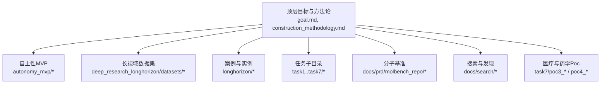
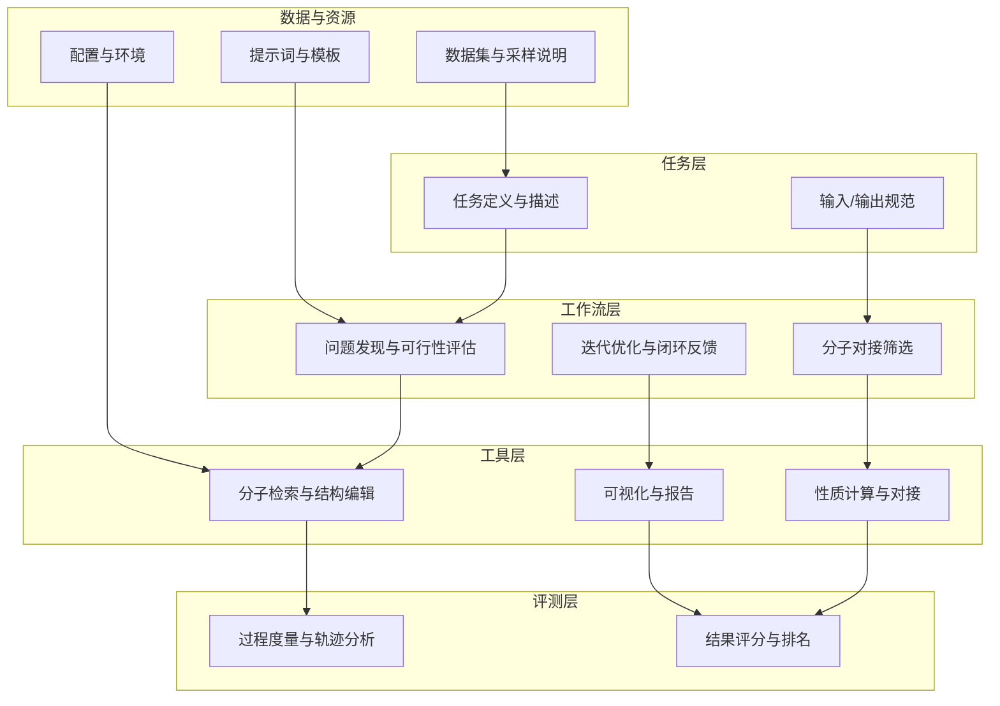
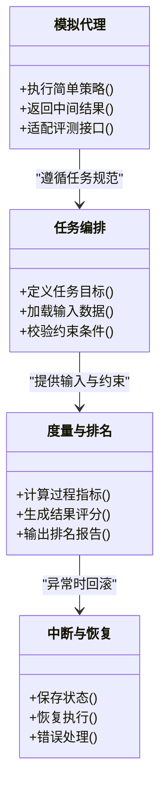
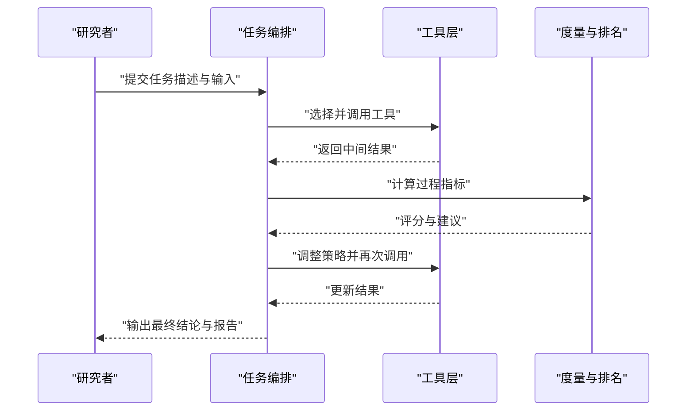
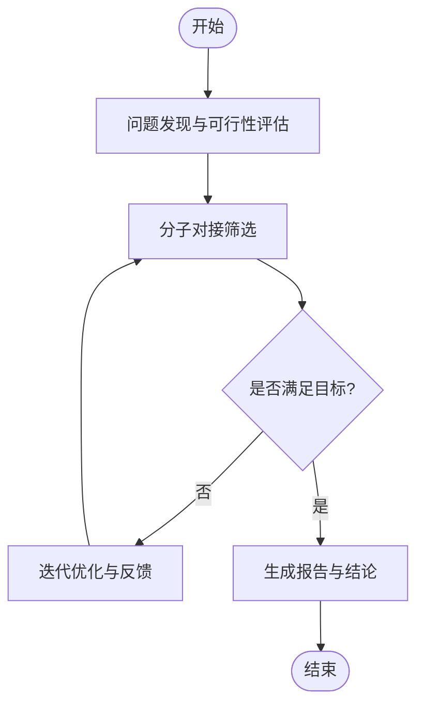
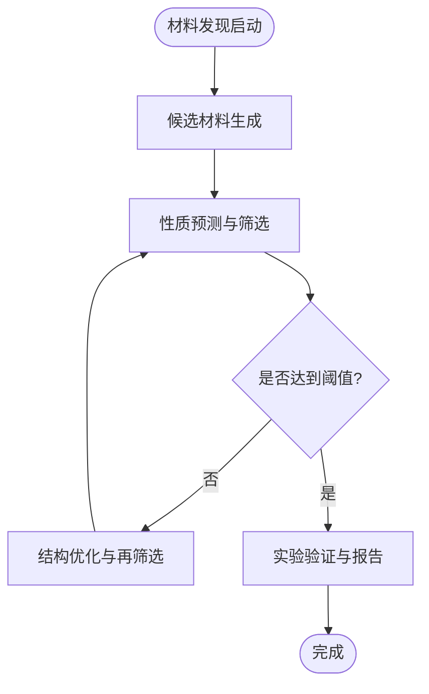
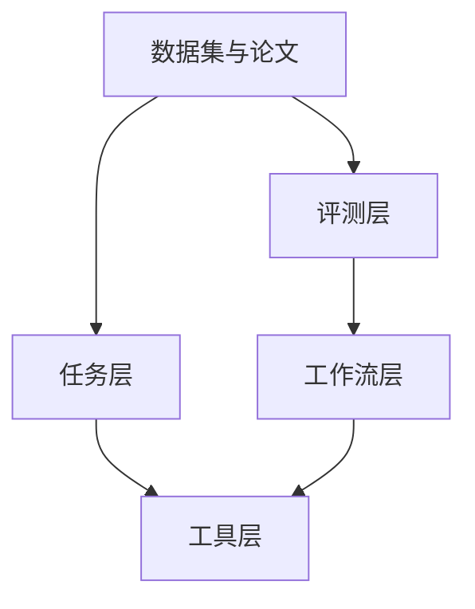

# 项目背景与目标

<cite>
**本文引用的文件**   
- [goal.md](file://goal.md)
- [PROJECT_RESULT.md](file://PROJECT_RESULT.md)
- [construction_methodology.md](file://construction_methodology.md)
- [autonomy_mvp/ACCEPTANCE.md](file://autonomy_mvp/ACCEPTANCE.md)
- [autonomy_mvp/schema.md](file://autonomy_mvp/schema.md)
- [deep_research_longhorizon/datasets/OdysseyBench/README_采样说明.md](file://deep_research_longhorizon/datasets/OdysseyBench/README_采样说明.md)
- [deep_research_longhorizon/datasets/MultiAgentBench_MARBLE/REPO_README.md](file://deep_research_longhorizon/datasets/MultiAgentBench_MARBLE/REPO_README.md)
- [deep_research_longhorizon/datasets/SWE-bench_Verified/README.md](file://deep_research_longhorizon/datasets/SWE-bench_Verified/README.md)
- [longhorizon/case1_材料发现_超导体.md](file://longhorizon/case1_材料发现_超导体.md)
- [longhorizon/caseD_材料闭环优化_BaTiO.md](file://longhorizon/caseD_材料闭环优化_BaTiO.md)
- [task4/goal.md](file://task4/goal.md)
- [task6/README.md](file://task6/README.md)
- [task7/poc3_physicianbench/PhysicianBench/README.md](file://task7/poc3_physicianbench/PhysicianBench/README.md)
- [task7/poc4_pharmabench/results.md](file://task7/poc4_pharmabench/results.md)
- [docs/prd/molbench_repo/README.md](file://docs/prd/molbench_repo/README.md)
- [docs/prd/molbench_repo/skills/L2_workflows/00-problem-discovery-and-feasibility-triage.md](file://docs/prd/molbench_repo/skills/L2_workflows/00-problem-discovery-and-feasibility-triage.md)
- [docs/prd/molbench_repo/skills/L2_workflows/02-molecular-docking-screening.md](file://docs/prd/molbench_repo/skills/L2_workflows/02-molecular-docking-screening.md)
- [docs/prd/molbench_repo/skills/L2_workflows/05-iterative-molecular-optimization.md](file://docs/prd/molbench_repo/skills/L2_workflows/05-iterative-molecular-optimization.md)
- [docs/prd/task4_papers/2304.05376.xml](file://docs/prd/task4_papers/2304.05376.xml)
- [docs/prd/task6_papers/2308.14920.xml](file://docs/prd/task6_papers/2308.14920.xml)
- [docs/search/molbench_dataset_findings.md](file://docs/search/molbench_dataset_findings.md)
- [docs/search/semiconductor_gt_findings.md](file://docs/search/semiconductor_gt_findings.md)
- [docs/search/superconductor_gt_findings.md](file://docs/search/superconductor_gt_findings.md)
</cite>

## 目录
1. [引言](#引言)
2. [项目结构](#项目结构)
3. [核心组件](#核心组件)
4. [架构总览](#架构总览)
5. [详细组件分析](#详细组件分析)
6. [依赖关系分析](#依赖关系分析)
7. [性能考量](#性能考量)
8. [故障排查指南](#故障排查指南)
9. [结论](#结论)
10. [附录](#附录)

## 引言
本项目面向科学计算与AI代理的交叉领域，旨在构建一个综合性、可复现、可扩展的基准测试平台。其科学背景源于以下现实需求：
- 科学研究日益数据密集、流程复杂，传统工具链难以支撑“端到端”的自动化探索与验证。
- AI代理在长视域任务中需要跨多工具、多数据集、多步骤协同工作，现有评测往往碎片化，无法反映真实科研场景。
- 药物发现、材料设计、生物医学等关键领域亟需统一的评估体系，以衡量模型在“发现问题—提出假设—执行实验—得出结论”的全链路能力。

项目的核心目标包括：
- 建立覆盖多领域的统一基准，支持AI代理自主性评估（规划、工具调用、反思与迭代）。
- 强化长视域任务执行能力评测，涵盖从问题定义到结果解释的完整链条。
- 在多领域科学发现（如药物筛选、材料性质预测、临床推理）中提供可复现实验与可比指标。
- 填补现有工具的空白：将分散的数据集、工具与工作流整合为标准化评测环境，降低重复建设成本，提升研究效率。

愿景与使命：
- 愿景：成为AI驱动科学研究的“通用标尺”，推动高质量、可复现、可比较的科学发现。
- 使命：通过开放基准、标准化工具链与透明评测流程，加速AI与科学计算的深度融合。
- 预期影响：为学术界与工业界提供一致的评价基线，促进方法创新、工具生态完善与跨学科协作。

本节不直接分析具体代码文件，故无章节来源。

## 项目结构
仓库采用“按任务与领域组织”的结构，便于扩展与维护：
- 顶层目标与方法论文档：定义总体目标、构建方法与阶段性成果。
- 自主性MVP：最小可行评测框架，包含任务、度量、评判器与模拟代理。
- 长视域数据集：聚合多个公开数据集与采样说明，用于长程任务评测。
- 案例与实例：材料发现、闭环优化、逆合成、靶点验证等典型科学任务。
- 任务子目录：针对特定任务的实现与结果记录。
- 分子基准（molbench）：围绕分子属性、对接、生成与优化的技能与工作流集合。
- 搜索与发现：数据集洞察与真值发现报告。
- 医疗与药学Poc：医生推理与药物性质预测等垂直领域试点。

图表来源
- [goal.md:1-50](file://goal.md#L1-L50)
- [construction_methodology.md:1-50](file://construction_methodology.md#L1-L50)

章节来源
- [goal.md:1-50](file://goal.md#L1-L50)
- [construction_methodology.md:1-50](file://construction_methodology.md#L1-L50)

## 核心组件
- 自主性评测核心（MVP）
  - 任务编排与执行：定义任务描述、输入输出与约束条件。
  - 评判与度量：对过程与结果进行量化评分，支持排名与对比。
  - 中断与容错：在长时间运行中支持中断恢复与状态检查。
  - 模拟代理：提供轻量级参考实现，便于快速验证与回归测试。
- 长视域数据集与采样策略
  - 多源数据集集成：AgentBoard、OdysseyBench、SWE-bench Verified、PRM800K、ProcessBench等。
  - 采样说明与一致性：保证不同任务的可比性与可复现性。
- 案例与实例库
  - 材料发现与闭环优化：超导体候选筛选、BaTiO等材料体系的迭代优化。
  - 逆合成与靶点验证：从目标分子出发，规划合成路径并验证活性。
- 分子基准与技能工作流
  - L1工具：分子检索、结构编辑、性质计算、对接与打分等原子能力。
  - L2工作流：问题发现、可行性评估、分子对接筛选、逆向设计与迭代优化等复合流程。
- 搜索与真值发现
  - 数据集洞察：对分子与材料数据集进行系统性梳理与真值标注建议。
- 医疗与药学试点
  - 医生推理基准：基于FHIR数据的临床决策辅助评测。
  - 药物性质预测：logD等性质的预测与评估。

章节来源
- [autonomy_mvp/ACCEPTANCE.md:1-50](file://autonomy_mvp/ACCEPTANCE.md#L1-L50)
- [autonomy_mvp/schema.md:1-50](file://autonomy_mvp/schema.md#L1-L50)
- [deep_research_longhorizon/datasets/OdysseyBench/README_采样说明.md:1-50](file://deep_research_longhorizon/datasets/OdysseyBench/README_采样说明.md#L1-L50)
- [deep_research_longhorizon/datasets/MultiAgentBench_MARBLE/REPO_README.md:1-50](file://deep_research_longhorizon/datasets/MultiAgentBench_MARBLE/REPO_README.md#L1-L50)
- [deep_research_longhorizon/datasets/SWE-bench_Verified/README.md:1-50](file://deep_research_longhorizon/datasets/SWE-bench_Verified/README.md#L1-L50)
- [longhorizon/case1_材料发现_超导体.md:1-50](file://longhorizon/case1_材料发现_超导体.md#L1-L50)
- [longhorizon/caseD_材料闭环优化_BaTiO.md:1-50](file://longhorizon/caseD_材料闭环优化_BaTiO.md#L1-L50)
- [docs/prd/molbench_repo/README.md:1-50](file://docs/prd/molbench_repo/README.md#L1-L50)
- [docs/prd/molbench_repo/skills/L2_workflows/00-problem-discovery-and-feasibility-triage.md:1-50](file://docs/prd/molbench_repo/skills/L2_workflows/00-problem-discovery-and-feasibility-triage.md#L1-L50)
- [docs/prd/molbench_repo/skills/L2_workflows/02-molecular-docking-screening.md:1-50](file://docs/prd/molbench_repo/skills/L2_workflows/02-molecular-docking-screening.md#L1-L50)
- [docs/prd/molbench_repo/skills/L2_workflows/05-iterative-molecular-optimization.md:1-50](file://docs/prd/molbench_repo/skills/L2_workflows/05-iterative-molecular-optimization.md#L1-L50)
- [docs/search/molbench_dataset_findings.md:1-50](file://docs/search/molbench_dataset_findings.md#L1-L50)
- [docs/search/semiconductor_gt_findings.md:1-50](file://docs/search/semiconductor_gt_findings.md#L1-L50)
- [docs/search/superconductor_gt_findings.md:1-50](file://docs/search/superconductor_gt_findings.md#L1-L50)
- [task7/poc3_physicianbench/PhysicianBench/README.md:1-50](file://task7/poc3_physicianbench/PhysicianBench/README.md#L1-L50)
- [task7/poc4_pharmabench/results.md:1-50](file://task7/poc4_pharmabench/results.md#L1-L50)

## 架构总览
整体架构围绕“任务—工具—工作流—评测”展开，强调可组合与可扩展：
- 任务层：定义科学问题与评测目标，提供输入数据与期望输出。
- 工具层：封装原子能力（检索、计算、可视化、仿真），形成可复用技能。
- 工作流层：将工具串联为复合流程，支持条件分支与循环优化。
- 评测层：对过程轨迹与最终结果进行多维度评分，支持排名与对比。
- 数据与资源：统一管理与版本控制数据集、提示词模板与配置文件。

图表来源
- [docs/prd/molbench_repo/skills/L2_workflows/00-problem-discovery-and-feasibility-triage.md:1-50](file://docs/prd/molbench_repo/skills/L2_workflows/00-problem-discovery-and-feasibility-triage.md#L1-L50)
- [docs/prd/molbench_repo/skills/L2_workflows/02-molecular-docking-screening.md:1-50](file://docs/prd/molbench_repo/skills/L2_workflows/02-molecular-docking-screening.md#L1-L50)
- [docs/prd/molbench_repo/skills/L2_workflows/05-iterative-molecular-optimization.md:1-50](file://docs/prd/molbench_repo/skills/L2_workflows/05-iterative-molecular-optimization.md#L1-L50)
- [autonomy_mvp/schema.md:1-50](file://autonomy_mvp/schema.md#L1-L50)

## 详细组件分析

### 自主性MVP组件
该组件提供最小可行的评测内核，聚焦于任务编排、度量与评判：
- 任务编排：通过结构化描述定义任务目标、输入格式与约束条件。
- 度量与排名：对代理行为与结果进行量化，支持横向对比与纵向追踪。
- 中断与恢复：在长时间运行中支持安全中断与状态保存。
- 模拟代理：提供轻量实现，便于快速验证与回归测试。

图表来源
- [autonomy_mvp/ACCEPTANCE.md:1-50](file://autonomy_mvp/ACCEPTANCE.md#L1-L50)
- [autonomy_mvp/schema.md:1-50](file://autonomy_mvp/schema.md#L1-L50)

章节来源
- [autonomy_mvp/ACCEPTANCE.md:1-50](file://autonomy_mvp/ACCEPTANCE.md#L1-L50)
- [autonomy_mvp/schema.md:1-50](file://autonomy_mvp/schema.md#L1-L50)

### 长视域任务执行流程
长视域任务强调从问题定义到结论输出的全链路执行，典型流程如下：
- 问题定义：明确科学问题与成功标准。
- 工具选择与调用：根据任务需求选择合适的工具与参数。
- 结果分析与反思：对中间结果进行评估，必要时调整策略。
- 闭环优化：在迭代中逐步逼近最优解或可靠结论。

图表来源
- [docs/prd/molbench_repo/skills/L2_workflows/05-iterative-molecular-optimization.md:1-50](file://docs/prd/molbench_repo/skills/L2_workflows/05-iterative-molecular-optimization.md#L1-L50)
- [autonomy_mvp/schema.md:1-50](file://autonomy_mvp/schema.md#L1-L50)

章节来源
- [docs/prd/molbench_repo/skills/L2_workflows/05-iterative-molecular-optimization.md:1-50](file://docs/prd/molbench_repo/skills/L2_workflows/05-iterative-molecular-optimization.md#L1-L50)
- [autonomy_mvp/schema.md:1-50](file://autonomy_mvp/schema.md#L1-L50)

### 分子基准工作流
分子基准围绕“问题发现—可行性评估—对接筛选—迭代优化”的工作流展开：
- 问题发现与可行性评估：识别潜在目标与约束条件。
- 分子对接筛选：利用对接工具对候选分子进行初步评估。
- 迭代优化：结合性质计算与反馈机制，持续改进候选分子。

图表来源
- [docs/prd/molbench_repo/skills/L2_workflows/00-problem-discovery-and-feasibility-triage.md:1-50](file://docs/prd/molbench_repo/skills/L2_workflows/00-problem-discovery-and-feasibility-triage.md#L1-L50)
- [docs/prd/molbench_repo/skills/L2_workflows/02-molecular-docking-screening.md:1-50](file://docs/prd/molbench_repo/skills/L2_workflows/02-molecular-docking-screening.md#L1-L50)
- [docs/prd/molbench_repo/skills/L2_workflows/05-iterative-molecular-optimization.md:1-50](file://docs/prd/molbench_repo/skills/L2_workflows/05-iterative-molecular-optimization.md#L1-L50)

章节来源
- [docs/prd/molbench_repo/skills/L2_workflows/00-problem-discovery-and-feasibility-triage.md:1-50](file://docs/prd/molbench_repo/skills/L2_workflows/00-problem-discovery-and-feasibility-triage.md#L1-L50)
- [docs/prd/molbench_repo/skills/L2_workflows/02-molecular-docking-screening.md:1-50](file://docs/prd/molbench_repo/skills/L2_workflows/02-molecular-docking-screening.md#L1-L50)
- [docs/prd/molbench_repo/skills/L2_workflows/05-iterative-molecular-optimization.md:1-50](file://docs/prd/molbench_repo/skills/L2_workflows/05-iterative-molecular-optimization.md#L1-L50)

### 案例与实例：材料发现与闭环优化
- 材料发现（超导体）：从候选材料空间出发，结合性质预测与筛选，定位高潜力候选。
- 闭环优化（BaTiO）：在迭代中引入反馈机制，逐步优化结构与性能。

图表来源
- [longhorizon/case1_材料发现_超导体.md:1-50](file://longhorizon/case1_材料发现_超导体.md#L1-L50)
- [longhorizon/caseD_材料闭环优化_BaTiO.md:1-50](file://longhorizon/caseD_材料闭环优化_BaTiO.md#L1-L50)

章节来源
- [longhorizon/case1_材料发现_超导体.md:1-50](file://longhorizon/case1_材料发现_超导体.md#L1-L50)
- [longhorizon/caseD_材料闭环优化_BaTiO.md:1-50](file://longhorizon/caseD_材料闭环优化_BaTiO.md#L1-L50)

### 医疗与药学试点
- 医生推理基准：基于FHIR数据的临床决策辅助评测，关注诊断逻辑与治疗建议。
- 药物性质预测：logD等性质的预测与评估，为药物筛选提供参考。

章节来源
- [task7/poc3_physicianbench/PhysicianBench/README.md:1-50](file://task7/poc3_physicianbench/PhysicianBench/README.md#L1-L50)
- [task7/poc4_pharmabench/results.md:1-50](file://task7/poc4_pharmabench/results.md#L1-L50)

## 依赖关系分析
- 任务与工具耦合度低：通过标准化接口与数据结构，任务层与工具层松耦合，便于替换与扩展。
- 工作流对工具有强依赖：复合流程需要稳定的工具能力与一致的输入输出契约。
- 评测层对过程轨迹敏感：需要完整的执行日志与中间结果，以支持细粒度度量。
- 外部数据集与论文引用：作为基准与真值的来源，确保评测的权威性与可复现性。

图表来源
- [docs/prd/task4_papers/2304.05376.xml:1-50](file://docs/prd/task4_papers/2304.05376.xml#L1-L50)
- [docs/prd/task6_papers/2308.14920.xml:1-50](file://docs/prd/task6_papers/2308.14920.xml#L1-L50)
- [docs/search/molbench_dataset_findings.md:1-50](file://docs/search/molbench_dataset_findings.md#L1-L50)

章节来源
- [docs/prd/task4_papers/2304.05376.xml:1-50](file://docs/prd/task4_papers/2304.05376.xml#L1-L50)
- [docs/prd/task6_papers/2308.14920.xml:1-50](file://docs/prd/task6_papers/2308.14920.xml#L1-L50)
- [docs/search/molbench_dataset_findings.md:1-50](file://docs/search/molbench_dataset_findings.md#L1-L50)

## 性能考量
- 并行与批处理：在大规模评测中，合理划分任务批次，避免资源争用与死锁。
- 缓存与复用：对昂贵计算（如对接、MD模拟）的结果进行缓存，减少重复开销。
- 监控与告警：对长时间运行的任务设置超时与重试策略，及时捕获异常。
- 数据预取与索引：对大型数据集建立索引与预取机制，提升I/O效率。

本节提供一般性指导，不涉及具体代码文件分析，故无章节来源。

## 故障排查指南
- 任务执行失败：检查任务描述与输入格式是否符合规范；确认工具可用性与权限。
- 评测分数异常：核对度量函数与评分规则；查看中间结果与日志定位偏差。
- 长时运行中断：启用状态保存与恢复；检查系统资源与外部服务可用性。
- 数据不一致：对照采样说明与真值报告；确保版本一致与来源可信。

章节来源
- [autonomy_mvp/ACCEPTANCE.md:1-50](file://autonomy_mvp/ACCEPTANCE.md#L1-L50)
- [autonomy_mvp/schema.md:1-50](file://autonomy_mvp/schema.md#L1-L50)
- [docs/search/semiconductor_gt_findings.md:1-50](file://docs/search/semiconductor_gt_findings.md#L1-L50)
- [docs/search/superconductor_gt_findings.md:1-50](file://docs/search/superconductor_gt_findings.md#L1-L50)

## 结论
本项目通过统一的任务定义、标准化的工具与工作流、以及透明的评测体系，构建了面向AI驱动科学研究的综合基准平台。它不仅填补了现有工具的空白，也为多领域科学发现提供了可复现、可比较的评测基线。随着生态的不断完善，项目将在推动AI与科学计算的深度融合中发挥重要作用。

本节为总结性内容，不涉及具体代码文件分析，故无章节来源。

## 附录
- 相关目标与决议：
  - [task4/goal.md](file://task4/goal.md)
  - [task6/README.md](file://task6/README.md)
  - [PROJECT_RESULT.md](file://PROJECT_RESULT.md)

章节来源
- [task4/goal.md:1-50](file://task4/goal.md#L1-L50)
- [task6/README.md:1-50](file://task6/README.md#L1-L50)
- [PROJECT_RESULT.md:1-50](file://PROJECT_RESULT.md#L1-L50)