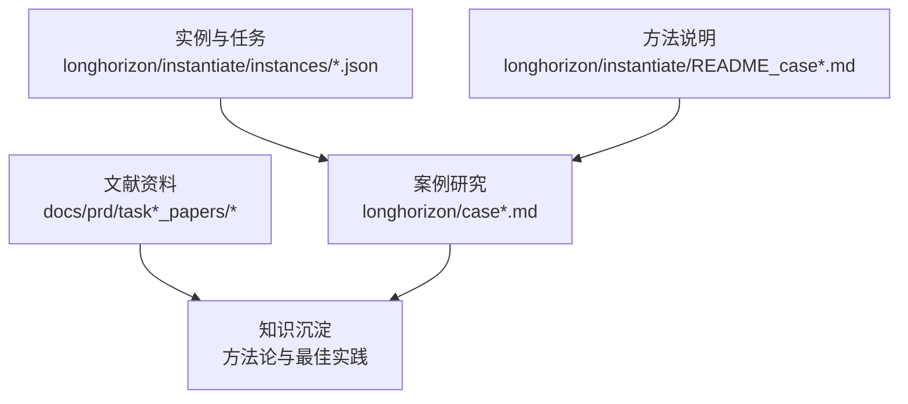
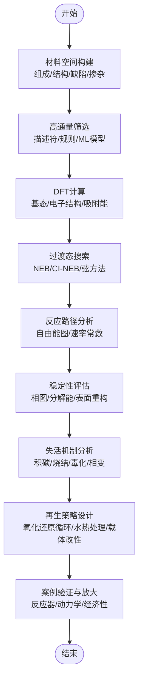
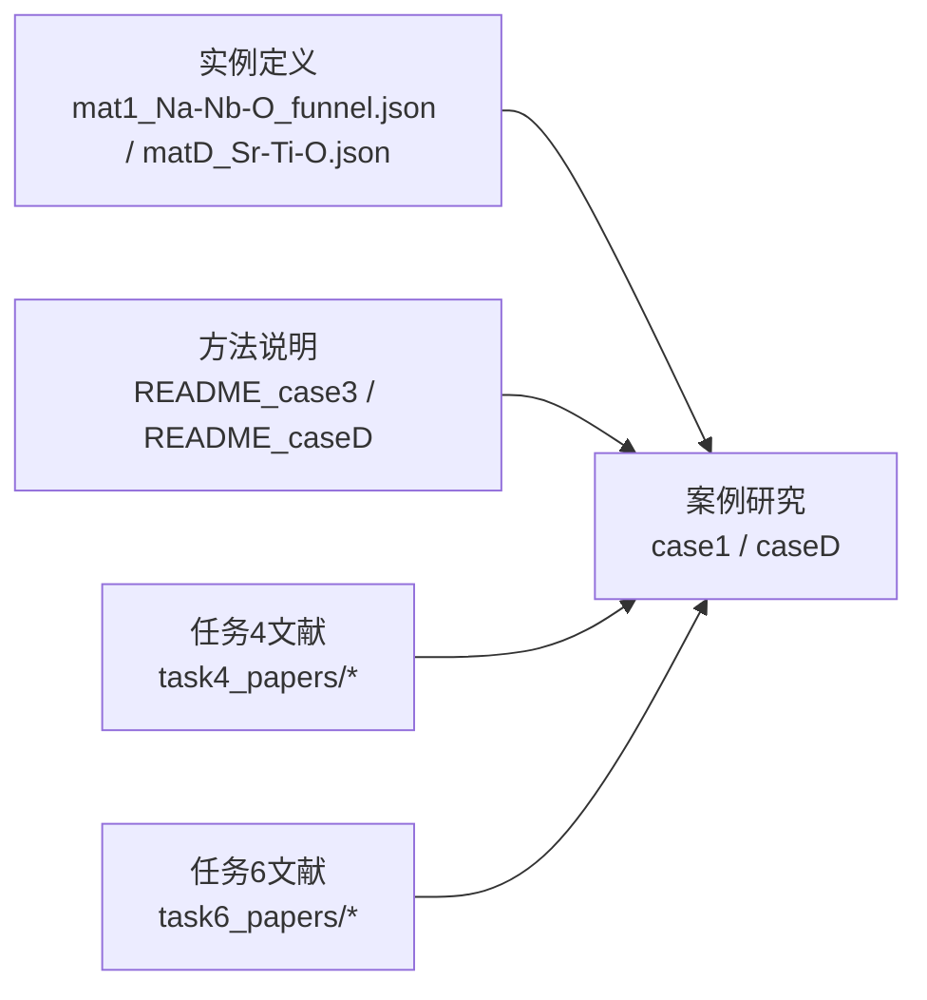

# 催化剂材料设计

<cite>
**本文引用的文件**   
- [longhorizon/instantiate/instances/mat1_Na-Nb-O_funnel.json](file://longhorizon/instantiate/instances/mat1_Na-Nb-O_funnel.json)
- [longhorizon/instantiate/instances/matD_Sr-Ti-O.json](file://longhorizon/instantiate/instances/matD_Sr-Ti-O.json)
- [longhorizon/case1_材料发现_超导体.md](file://longhorizon/case1_材料发现_超导体.md)
- [longhorizon/caseD_材料闭环优化_BaTiO.md](file://longhorizon/caseD_材料闭环优化_BaTiO.md)
- [longhorizon/instantiate/README_case3_机理模拟.md](file://longhorizon/instantiate/README_case3_机理模拟.md)
- [longhorizon/instantiate/README_caseD_闭环优化.md](file://longhorizon/instantiate/README_caseD_闭环优化.md)
- [task4/papers/task4_papers/2304.05376.xml](file://docs/prd/task4_papers/2304.05376.xml)
- [task4/papers/task4_papers/2310.03302.xml](file://docs/prd/task4_papers/2310.03302.xml)
- [task4/papers/task4_papers/2310.10632.html](file://docs/prd/task4_papers/2310.10632.html)
- [task4/papers/task4_papers/2405.16205.xml](file://docs/prd/task4_papers/2405.16205.xml)
- [task4/papers/task4_papers/2407.01725.html](file://docs/prd/task4_papers/2407.01725.html)
- [task4/papers/task4_papers/2407.18901.xml](file://docs/prd/task4_papers/2407.18901.xml)
- [task4/papers/task4_papers/2410.05080.html](file://docs/prd/task4_papers/2410.05080.html)
- [task4/papers/task4_papers/2412.14161.html](file://docs/prd/task4_papers/2412.14161.html)
- [task4/papers/task4_papers/2501.14654.xml](file://docs/prd/task4_papers/2501.14654.xml)
- [task6/papers/task6_papers/2308.14920.xml](file://docs/prd/task6_papers/2308.14920.xml)
- [task6/papers/task6_papers/2310.19796.xml](file://docs/prd/task6_papers/2310.19796.xml)
- [task6/papers/task6_papers/2401.13178.xml](file://docs/prd/task6_papers/2401.13178.xml)
- [task6/papers/task6_papers/2409.07314.xml](file://docs/prd/task6_papers/2409.07314.xml)
- [task6/papers/task6_papers/2411.00177.xml](file://docs/prd/task6_papers/2411.00177.xml)
- [task6/papers/task6_papers/2505.23802.xml](file://docs/prd/task6_papers/2505.23802.xml)
- [task6/papers/task6_papers/2601.21800.xml](file://docs/prd/task6_papers/2601.21800.xml)
- [task6/papers/task6_papers/2602.00663.xml](file://docs/prd/task6_papers/2602.00663.xml)
- [task6/papers/task6_papers/2602.21230.xml](file://docs/prd/task6_papers/2602.21230.xml)
- [task6/papers/task6_papers/2604.27470.xml](file://docs/prd/task6_papers/2604.27470.xml)
- [task6/papers/task6_papers/2605.00803.xml](file://docs/prd/task6_papers/2605.00803.xml)
- [task6/papers/task6_papers/2605.02240.xml](file://docs/prd/task6_papers/2605.02240.xml)
- [task6/papers/task6_papers/2605.15461.xml](file://docs/prd/task6_papers/2605.15461.xml)
- [task6/papers/task6_papers/2605.15766.xml](file://docs/prd/task6_papers/2605.15766.xml)
</cite>

## 目录
1. [引言](#引言)
2. [项目结构](#项目结构)
3. [核心组件](#核心组件)
4. [架构总览](#架构总览)
5. [详细组件分析](#详细组件分析)
6. [依赖关系分析](#依赖关系分析)
7. [性能与可扩展性](#性能与可扩展性)
8. [故障排查指南](#故障排查指南)
9. [结论](#结论)
10. [附录](#附录)

## 引言
本文件面向“催化剂材料设计”任务，围绕催化反应基本原理、活性位点理论与选择性控制机制展开，结合Na-Nb-O、Sr-Ti-O等氧化物体系的结构特征、表面性质与催化活性的关联进行系统阐述。文档同时覆盖密度泛函理论（DFT）计算、过渡态搜索与反应路径分析方法；介绍机器学习势函数、活性描述符构建与高通量虚拟筛选技术；并给出稳定性评估、失活机制分析与再生策略设计的实践要点。最后通过从理论计算到工业应用的完整案例展示，包括反应工程放大与商业化考虑，形成可落地的开发流程与方法论。

## 项目结构
仓库中与催化剂材料设计相关的资源主要分布在以下位置：
- 实例与任务定义：长周期任务实例化配置与说明文档
- 案例研究：材料发现与闭环优化的案例文档
- 文献资料：任务4与任务6的论文集合，涵盖机器学习势、高通量筛选、稳定性与再生等主题

图表来源
- [longhorizon/instantiate/instances/mat1_Na-Nb-O_funnel.json](file://longhorizon/instantiate/instances/mat1_Na-Nb-O_funnel.json)
- [longhorizon/instantiate/instances/matD_Sr-Ti-O.json](file://longhorizon/instantiate/instances/matD_Sr-Ti-O.json)
- [longhorizon/case1_材料发现_超导体.md](file://longhorizon/case1_材料发现_超导体.md)
- [longhorizon/caseD_材料闭环优化_BaTiO.md](file://longhorizon/caseD_材料闭环优化_BaTiO.md)
- [longhorizon/instantiate/README_case3_机理模拟.md](file://longhorizon/instantiate/README_case3_机理模拟.md)
- [longhorizon/instantiate/README_caseD_闭环优化.md](file://longhorizon/instantiate/README_caseD_闭环优化.md)

章节来源
- [longhorizon/instantiate/instances/mat1_Na-Nb-O_funnel.json](file://longhorizon/instantiate/instances/mat1_Na-Nb-O_funnel.json)
- [longhorizon/instantiate/instances/matD_Sr-Ti-O.json](file://longhorizon/instantiate/instances/matD_Sr-Ti-O.json)
- [longhorizon/case1_材料发现_超导体.md](file://longhorizon/case1_材料发现_超导体.md)
- [longhorizon/caseD_材料闭环优化_BaTiO.md](file://longhorizon/caseD_材料闭环优化_BaTiO.md)
- [longhorizon/instantiate/README_case3_机理模拟.md](file://longhorizon/instantiate/README_case3_机理模拟.md)
- [longhorizon/instantiate/README_caseD_闭环优化.md](file://longhorizon/instantiate/README_caseD_闭环优化.md)

## 核心组件
- 任务实例与漏斗筛选配置：用于组织候选材料空间、筛选条件与目标属性，支撑高通量虚拟筛选流程
- 案例研究文档：提供从理论计算到实验验证与放大的端到端流程示例
- 方法说明文档：解释机理模拟与闭环优化的关键步骤、数据流与工具链
- 文献资料库：为机器学习势函数、活性描述符、稳定性与再生策略提供前沿参考

章节来源
- [longhorizon/instantiate/instances/mat1_Na-Nb-O_funnel.json](file://longhorizon/instantiate/instances/mat1_Na-Nb-O_funnel.json)
- [longhorizon/instantiate/instances/matD_Sr-Ti-O.json](file://longhorizon/instantiate/instances/matD_Sr-Ti-O.json)
- [longhorizon/case1_材料发现_超导体.md](file://longhorizon/case1_材料发现_超导体.md)
- [longhorizon/caseD_材料闭环优化_BaTiO.md](file://longhorizon/caseD_材料闭环优化_BaTiO.md)
- [longhorizon/instantiate/README_case3_机理模拟.md](file://longhorizon/instantiate/README_case3_机理模拟.md)
- [longhorizon/instantiate/README_caseD_闭环优化.md](file://longhorizon/instantiate/README_caseD_闭环优化.md)

## 架构总览
下图展示了“催化剂材料设计”的整体工作流：从材料空间生成与筛选，到DFT与机器学习势加速的计算，再到过渡态搜索与反应路径分析，最终进入稳定性评估、失活机制分析与再生策略设计，并通过案例与文献资料驱动迭代优化。

[此图为概念性流程图，不直接映射具体源文件]

## 详细组件分析

### Na-Nb-O 氧化物体系
- 结构特征：关注Nb的配位环境、氧空位分布与层状/隧道结构的连通性，这些决定反应物扩散与吸附位点的可及性
- 表面性质：表面羟基化程度、Lewis/Brønsted酸碱性、氧迁移能力影响吸附构型与活化能垒
- 活性关系：Nb价态与配位不饱和度与底物活化相关；氧空位浓度与选择性密切相关
- 计算方法：DFT计算吸附能与电荷转移；过渡态搜索定位关键步骤能垒；结合机器学习势加速采样
- 筛选策略：基于描述符（如d带中心、氧空位形成能、表面酸强度）进行高通量排序与过滤

章节来源
- [longhorizon/instantiate/instances/mat1_Na-Nb-O_funnel.json](file://longhorizon/instantiate/instances/mat1_Na-Nb-O_funnel.json)

### Sr-Ti-O 氧化物体系
- 结构特征：钙钛矿型或相关结构中的Ti-O八面体畸变、A位Sr占位与氧空位协同作用
- 表面性质：Ti-OH与Sr-O终端对反应中间体的稳定化差异显著
- 活性关系：Ti价态与氧空位协同调控C-H/O-H键活化；选择性受表面酸性/碱性与孔道限域效应影响
- 计算方法：DFT+U处理强关联电子；NEB/CI-NEB搜索多步反应路径；结合微动弹性带与频率分析确认极小值与鞍点
- 筛选策略：以吸附能线性关系（Scaling Relations）与火山曲线为指导，结合机器学习势进行大规模预筛

章节来源
- [longhorizon/instantiate/instances/matD_Sr-Ti-O.json](file://longhorizon/instantiate/instances/matD_Sr-Ti-O.json)

### 机理模拟与闭环优化
- 机理模拟：明确反应网络、关键中间体与决速步；通过自由能图量化选择性分支
- 闭环优化：将计算结果反馈至材料设计与合成参数，形成“预测—验证—修正”的迭代循环
- 工具链：DFT软件、过渡态搜索工具、分子动力学与机器学习势函数的集成

章节来源
- [longhorizon/instantiate/README_case3_机理模拟.md](file://longhorizon/instantiate/README_case3_机理模拟.md)
- [longhorizon/instantiate/README_caseD_闭环优化.md](file://longhorizon/instantiate/README_caseD_闭环优化.md)

### 案例研究：从理论到应用
- 材料发现案例：展示如何从材料空间出发，经筛选与计算验证，锁定候选体系
- 闭环优化案例：在BaTiO体系中演示如何通过反馈机制提升性能指标与稳定性

章节来源
- [longhorizon/case1_材料发现_超导体.md](file://longhorizon/case1_材料发现_超导体.md)
- [longhorizon/caseD_材料闭环优化_BaTiO.md](file://longhorizon/caseD_材料闭环优化_BaTiO.md)

### 机器学习势函数与高通量筛选
- 机器学习势函数：利用原子间势能面的代理模型实现大尺度与长时间尺度的动力学模拟
- 活性描述符：构建与吸附能、能垒、表面酸碱性相关的低维表征，指导筛选与优化
- 高通量虚拟筛选：结合规则过滤与模型预测，快速缩小候选空间并聚焦高潜力体系

章节来源
- [docs/prd/task4_papers/2304.05376.xml](file://docs/prd/task4_papers/2304.05376.xml)
- [docs/prd/task4_papers/2310.03302.xml](file://docs/prd/task4_papers/2310.03302.xml)
- [docs/prd/task4_papers/2310.10632.html](file://docs/prd/task4_papers/2310.10632.html)
- [docs/prd/task4_papers/2405.16205.xml](file://docs/prd/task4_papers/2405.16205.xml)
- [docs/prd/task4_papers/2407.01725.html](file://docs/prd/task4_papers/2407.01725.html)
- [docs/prd/task4_papers/2407.18901.xml](file://docs/prd/task4_papers/2407.18901.xml)
- [docs/prd/task4_papers/2410.05080.html](file://docs/prd/task4_papers/2410.05080.html)
- [docs/prd/task4_papers/2412.14161.html](file://docs/prd/task4_papers/2412.14161.html)
- [docs/prd/task4_papers/2501.14654.xml](file://docs/prd/task4_papers/2501.14654.xml)

### 稳定性评估、失活机制与再生策略
- 稳定性评估：热力学稳定性（相图、分解能）、动力学稳定性（表面重构、相变）、操作条件下的抗烧结与抗中毒能力
- 失活机制：积碳沉积、金属/氧化物烧结、毒化物种吸附、结构坍塌与活性位点流失
- 再生策略：氧化还原循环、水热处理、载体改性、助剂添加与操作条件优化

章节来源
- [docs/prd/task6_papers/2308.14920.xml](file://docs/prd/task6_papers/2308.14920.xml)
- [docs/prd/task6_papers/2310.19796.xml](file://docs/prd/task6_papers/2310.19796.xml)
- [docs/prd/task6_papers/2401.13178.xml](file://docs/prd/task6_papers/2401.13178.xml)
- [docs/prd/task6_papers/2409.07314.xml](file://docs/prd/task6_papers/2409.07314.xml)
- [docs/prd/task6_papers/2411.00177.xml](file://docs/prd/task6_papers/2411.00177.xml)
- [docs/prd/task6_papers/2505.23802.xml](file://docs/prd/task6_papers/2505.23802.xml)
- [docs/prd/task6_papers/2601.21800.xml](file://docs/prd/task6_papers/2601.21800.xml)
- [docs/prd/task6_papers/2602.00663.xml](file://docs/prd/task6_papers/2602.00663.xml)
- [docs/prd/task6_papers/2602.21230.xml](file://docs/prd/task6_papers/2602.21230.xml)
- [docs/prd/task6_papers/2604.27470.xml](file://docs/prd/task6_papers/2604.27470.xml)
- [docs/prd/task6_papers/2605.00803.xml](file://docs/prd/task6_papers/2605.00803.xml)
- [docs/prd/task6_papers/2605.02240.xml](file://docs/prd/task6_papers/2605.02240.xml)
- [docs/prd/task6_papers/2605.15461.xml](file://docs/prd/task6_papers/2605.15461.xml)
- [docs/prd/task6_papers/2605.15766.xml](file://docs/prd/task6_papers/2605.15766.xml)

### 反应工程放大与商业化考虑
- 反应器设计：固定床/流化床/膜反应器的选择与传质传热匹配
- 动力学建模：基于DFT与实验拟合的微动力学模型，预测转化率与选择性随温度/压力的变化
- 经济性与生命周期：原料成本、能耗、催化剂寿命与再生成本的综合评估

章节来源
- [longhorizon/case1_材料发现_超导体.md](file://longhorizon/case1_材料发现_超导体.md)
- [longhorizon/caseD_材料闭环优化_BaTiO.md](file://longhorizon/caseD_材料闭环优化_BaTiO.md)

## 依赖关系分析
- 实例与案例之间的耦合：实例定义驱动案例研究的输入与约束；案例结果反哺实例的参数调整
- 方法与文献的支撑：方法说明文档为计算与筛选流程提供规范；文献资料为关键技术提供理论依据与实践参考
- 工具链集成：DFT、过渡态搜索、机器学习势与高通量筛选工具的协作，形成端到端的自动化流水线

图表来源
- [longhorizon/instantiate/instances/mat1_Na-Nb-O_funnel.json](file://longhorizon/instantiate/instances/mat1_Na-Nb-O_funnel.json)
- [longhorizon/instantiate/instances/matD_Sr-Ti-O.json](file://longhorizon/instantiate/instances/matD_Sr-Ti-O.json)
- [longhorizon/case1_材料发现_超导体.md](file://longhorizon/case1_材料发现_超导体.md)
- [longhorizon/caseD_材料闭环优化_BaTiO.md](file://longhorizon/caseD_材料闭环优化_BaTiO.md)
- [longhorizon/instantiate/README_case3_机理模拟.md](file://longhorizon/instantiate/README_case3_机理模拟.md)
- [longhorizon/instantiate/README_caseD_闭环优化.md](file://longhorizon/instantiate/README_caseD_闭环优化.md)
- [docs/prd/task4_papers/2304.05376.xml](file://docs/prd/task4_papers/2304.05376.xml)
- [docs/prd/task6_papers/2308.14920.xml](file://docs/prd/task6_papers/2308.14920.xml)

章节来源
- [longhorizon/instantiate/instances/mat1_Na-Nb-O_funnel.json](file://longhorizon/instantiate/instances/mat1_Na-Nb-O_funnel.json)
- [longhorizon/instantiate/instances/matD_Sr-Ti-O.json](file://longhorizon/instantiate/instances/matD_Sr-Ti-O.json)
- [longhorizon/case1_材料发现_超导体.md](file://longhorizon/case1_材料发现_超导体.md)
- [longhorizon/caseD_材料闭环优化_BaTiO.md](file://longhorizon/caseD_材料闭环优化_BaTiO.md)
- [longhorizon/instantiate/README_case3_机理模拟.md](file://longhorizon/instantiate/README_case3_机理模拟.md)
- [longhorizon/instantiate/README_caseD_闭环优化.md](file://longhorizon/instantiate/README_caseD_闭环优化.md)
- [docs/prd/task4_papers/2304.05376.xml](file://docs/prd/task4_papers/2304.05376.xml)
- [docs/prd/task6_papers/2308.14920.xml](file://docs/prd/task6_papers/2308.14920.xml)

## 性能与可扩展性
- 计算效率：使用机器学习势函数替代部分DFT计算，显著提升采样规模与时间尺度
- 并行与批处理：高通量筛选采用并行任务调度，缩短整体迭代周期
- 数据管理：建立统一的数据格式与版本控制，确保计算结果的可追溯性与复用性

[本节为通用指导，无需特定文件引用]

## 故障排查指南
- 过渡态搜索失败：检查初始猜测结构、收敛阈值与频率分析结果；必要时采用多起点搜索
- 稳定性评估异常：核对相图数据来源与能量参考态；确认表面模型尺寸与周期性边界设置
- 机器学习势外推风险：识别训练集覆盖范围，避免对未见构型的过度预测；引入不确定性估计与主动学习
- 再生策略无效：分析失活主因（积碳/烧结/毒化），针对性调整再生条件与载体配方

章节来源
- [longhorizon/instantiate/README_case3_机理模拟.md](file://longhorizon/instantiate/README_case3_机理模拟.md)
- [longhorizon/instantiate/README_caseD_闭环优化.md](file://longhorizon/instantiate/README_caseD_闭环优化.md)

## 结论
本文件围绕催化剂材料设计的全流程，系统梳理了从原理到应用的关键环节。通过Na-Nb-O与Sr-Ti-O体系的深入分析，结合DFT与机器学习势的计算手段，构建了从材料空间筛选到反应路径解析、稳定性评估与再生策略设计的完整框架。案例研究与文献资料为实际落地提供了方法论与最佳实践，有助于推动从实验室到工业化的高效转化。

[本节为总结性内容，无需特定文件引用]

## 附录
- 术语表：活性位点、过渡态、自由能图、机器学习势、描述符、高通量筛选、失活机制、再生策略
- 推荐工具链：DFT软件、过渡态搜索工具、分子动力学平台、机器学习势框架、高通量筛选引擎
- 数据与基准：公开材料数据库、反应动力学基准、稳定性与再生数据集

[本节为补充信息，无需特定文件引用]