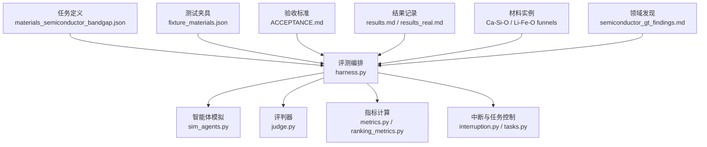
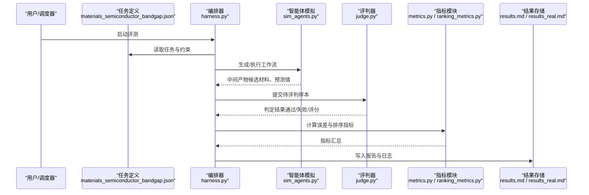
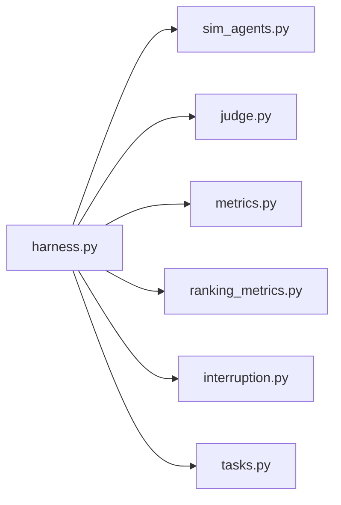
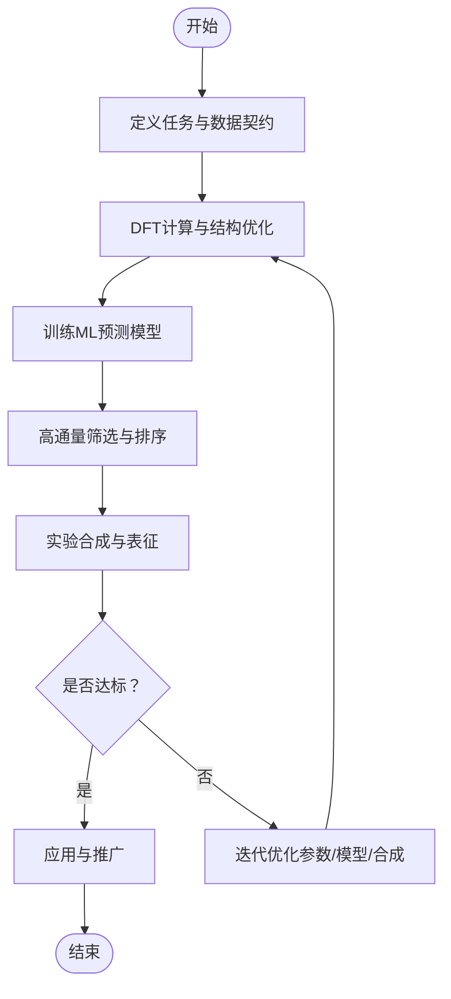

# 半导体带隙预测

<cite>
**本文引用的文件**   
- [materials_semiconductor_bandgap.json](file://autonomy_mvp/tasks/materials_semiconductor_bandgap.json)
- [fixture_materials.json](file://autonomy_mvp/tests/fixtures/fixture_materials.json)
- [harness.py](file://autonomy_mvp/core/harness.py)
- [sim_agents.py](file://autonomy_mvp/core/sim_agents.py)
- [judge.py](file://autonomy_mvp/core/judge.py)
- [metrics.py](file://autonomy_mvp/core/metrics.py)
- [ranking_metrics.py](file://autonomy_mvp/core/ranking_metrics.py)
- [interruption.py](file://autonomy_mvp/core/interruption.py)
- [tasks.py](file://autonomy_mvp/core/tasks.py)
- [run_validation.py](file://autonomy_mvp/run_validation.py)
- [schema.md](file://autonomy_mvp/schema.md)
- [ACCEPTANCE.md](file://autonomy_mvp/ACCEPTANCE.md)
- [results.md](file://autonomy_mvp/results.md)
- [results_real.md](file://autonomy_mvp/results_real.md)
- [mat1_Ca-Si-O_funnel.json](file://longhorizon/instantiate/instances/mat1_Ca-Si-O_funnel.json)
- [mat1_Li-Fe-O_funnel.json](file://longhorizon/instantiate/instances/mat1_Li-Fe-O_funnel.json)
- [matD_Ca-Si-O.json](file://longhorizon/instantiate/instances/matD_Ca-Si-O.json)
- [matD_Li-Fe-O.json](file://longhorizon/instantiate/instances/matD_Li-Fe-O.json)
- [semiconductor_gt_findings.md](file://docs/search/semiconductor_gt_findings.md)
</cite>

## 目录
1. [引言](#引言)
2. [项目结构](#项目结构)
3. [核心组件](#核心组件)
4. [架构总览](#架构总览)
5. [详细组件分析](#详细组件分析)
6. [依赖关系分析](#依赖关系分析)
7. [性能与可扩展性](#性能与可扩展性)
8. [故障排查指南](#故障排查指南)
9. [结论](#结论)
10. [附录](#附录)

## 引言
本文件面向“半导体带隙预测”任务，结合仓库中的任务定义、评测框架与材料实例，系统化阐述：
- 半导体电子结构与带隙物理意义
- 密度泛函理论（DFT）计算流程、能带结构与态密度分析方法
- 机器学习模型的数据准备、特征工程与精度评估
- 高通量筛选策略、稳定性判据与实验验证方案
- Ca-Si-O、Li-Fe-O等具体材料体系的晶体结构特征、掺杂效应与性能调控机制
- 从理论计算到实验合成的完整研究流程案例

## 项目结构
围绕半导体带隙预测，仓库中与任务相关的核心位置包括：
- 任务定义与评测入口：autonomy_mvp/tasks/materials_semiconductor_bandgap.json
- 测试夹具与示例数据：autonomy_mvp/tests/fixtures/fixture_materials.json
- 评测编排与执行：autonomy_mvp/core/harness.py、autonomy_mvp/run_validation.py
- 智能体模拟与评判：autonomy_mvp/core/sim_agents.py、autonomy_mvp/core/judge.py
- 指标与排序：autonomy_mvp/core/metrics.py、autonomy_mvp/core/ranking_metrics.py
- 中断与任务控制：autonomy_mvp/core/interruption.py、autonomy_mvp/core/tasks.py
- 验收与结果记录：autonomy_mvp/ACCEPTANCE.md、autonomy_mvp/results.md、autonomy_mvp/results_real.md
- 材料体系实例（Ca-Si-O、Li-Fe-O）：longhorizon/instantiate/instances 下的多个 JSON
- 领域调研与基线发现：docs/search/semiconductor_gt_findings.md

图表来源
- [materials_semiconductor_bandgap.json](file://autonomy_mvp/tasks/materials_semiconductor_bandgap.json)
- [harness.py](file://autonomy_mvp/core/harness.py)
- [sim_agents.py](file://autonomy_mvp/core/sim_agents.py)
- [judge.py](file://autonomy_mvp/core/judge.py)
- [metrics.py](file://autonomy_mvp/core/metrics.py)
- [ranking_metrics.py](file://autonomy_mvp/core/ranking_metrics.py)
- [interruption.py](file://autonomy_mvp/core/interruption.py)
- [tasks.py](file://autonomy_mvp/core/tasks.py)
- [fixture_materials.json](file://autonomy_mvp/tests/fixtures/fixture_materials.json)
- [ACCEPTANCE.md](file://autonomy_mvp/ACCEPTANCE.md)
- [results.md](file://autonomy_mvp/results.md)
- [results_real.md](file://autonomy_mvp/results_real.md)
- [mat1_Ca-Si-O_funnel.json](file://longhorizon/instantiate/instances/mat1_Ca-Si-O_funnel.json)
- [mat1_Li-Fe-O_funnel.json](file://longhorizon/instantiate/instances/mat1_Li-Fe-O_funnel.json)
- [semiconductor_gt_findings.md](file://docs/search/semiconductor_gt_findings.md)

章节来源
- [materials_semiconductor_bandgap.json](file://autonomy_mvp/tasks/materials_semiconductor_bandgap.json)
- [harness.py](file://autonomy_mvp/core/harness.py)
- [sim_agents.py](file://autonomy_mvp/core/sim_agents.py)
- [judge.py](file://autonomy_mvp/core/judge.py)
- [metrics.py](file://autonomy_mvp/core/metrics.py)
- [ranking_metrics.py](file://autonomy_mvp/core/ranking_metrics.py)
- [interruption.py](file://autonomy_mvp/core/interruption.py)
- [tasks.py](file://autonomy_mvp/core/tasks.py)
- [fixture_materials.json](file://autonomy_mvp/tests/fixtures/fixture_materials.json)
- [ACCEPTANCE.md](file://autonomy_mvp/ACCEPTANCE.md)
- [results.md](file://autonomy_mvp/results.md)
- [results_real.md](file://autonomy_mvp/results_real.md)
- [mat1_Ca-Si-O_funnel.json](file://longhorizon/instantiate/instances/mat1_Ca-Si-O_funnel.json)
- [mat1_Li-Fe-O_funnel.json](file://longhorizon/instantiate/instances/mat1_Li-Fe-O_funnel.json)
- [semiconductor_gt_findings.md](file://docs/search/semiconductor_gt_findings.md)

## 核心组件
- 任务定义与数据契约
  - 任务描述、输入输出格式、评测维度与约束在任务定义文件中明确；测试夹具提供最小可运行样例。
- 评测编排与执行
  - 负责加载任务、驱动智能体、调用评判器、汇总指标并持久化结果。
- 智能体模拟与工具链
  - 模拟多步推理与工具调用（如DFT计算、文献检索、可视化），支持中断与重试。
- 评判与指标
  - 将模型输出与基准答案进行比对，计算误差、排序质量与一致性指标。
- 材料与实例
  - 针对Ca-Si-O、Li-Fe-O等材料体系提供漏斗式筛选实例，便于端到端验证。

章节来源
- [materials_semiconductor_bandgap.json](file://autonomy_mvp/tasks/materials_semiconductor_bandgap.json)
- [fixture_materials.json](file://autonomy_mvp/tests/fixtures/fixture_materials.json)
- [harness.py](file://autonomy_mvp/core/harness.py)
- [sim_agents.py](file://autonomy_mvp/core/sim_agents.py)
- [judge.py](file://autonomy_mvp/core/judge.py)
- [metrics.py](file://autonomy_mvp/core/metrics.py)
- [ranking_metrics.py](file://autonomy_mvp/core/ranking_metrics.py)
- [interruption.py](file://autonomy_mvp/core/interruption.py)
- [tasks.py](file://autonomy_mvp/core/tasks.py)

## 架构总览
下图展示从任务定义到结果产出的整体流程，涵盖数据、编排、智能体、评判与指标。

图表来源
- [materials_semiconductor_bandgap.json](file://autonomy_mvp/tasks/materials_semiconductor_bandgap.json)
- [harness.py](file://autonomy_mvp/core/harness.py)
- [sim_agents.py](file://autonomy_mvp/core/sim_agents.py)
- [judge.py](file://autonomy_mvp/core/judge.py)
- [metrics.py](file://autonomy_mvp/core/metrics.py)
- [ranking_metrics.py](file://autonomy_mvp/core/ranking_metrics.py)
- [results.md](file://autonomy_mvp/results.md)
- [results_real.md](file://autonomy_mvp/results_real.md)

## 详细组件分析

### 任务与数据契约
- 任务目标：基于给定材料信息，预测其带隙或完成相关筛选/排序任务，并给出可复现的计算与评估流程。
- 输入规范：包含材料组成、结构描述、可选的初始参数与约束条件。
- 输出规范：包含预测带隙、置信度、关键步骤与证据链接（如计算参数、收敛阈值、k点网格等）。
- 校验规则：字段完整性、单位一致性、数值范围合理性、可重复性检查。

章节来源
- [materials_semiconductor_bandgap.json](file://autonomy_mvp/tasks/materials_semiconductor_bandgap.json)
- [schema.md](file://autonomy_mvp/schema.md)
- [fixture_materials.json](file://autonomy_mvp/tests/fixtures/fixture_materials.json)

### 编排与执行（harness + run_validation）
- 功能要点
  - 解析任务与配置，初始化环境
  - 驱动智能体执行多步工作流（数据准备→计算→分析→评估）
  - 处理中断与重试，保证长时任务的鲁棒性
  - 聚合指标并输出结构化报告
- 关键路径
  - 加载任务 → 构建执行图 → 调度子任务 → 收集中间结果 → 触发评判 → 计算指标 → 落盘

章节来源
- [harness.py](file://autonomy_mvp/core/harness.py)
- [run_validation.py](file://autonomy_mvp/run_validation.py)
- [interruption.py](file://autonomy_mvp/core/interruption.py)
- [tasks.py](file://autonomy_mvp/core/tasks.py)

### 智能体模拟与工具链（sim_agents）
- 能力边界
  - 自动化工具调用（DFT计算、结构优化、能带/态密度分析、可视化）
  - 文献检索与知识抽取（用于对比与佐证）
  - 错误恢复与回退策略（参数调整、收敛判断）
- 交互协议
  - 标准化输入/输出接口，便于与评判器和指标模块对接

章节来源
- [sim_agents.py](file://autonomy_mvp/core/sim_agents.py)

### 评判与指标（judge + metrics + ranking_metrics）
- 评判逻辑
  - 数值误差：绝对误差、相对误差、均方根误差
  - 排序质量：Top-k命中率、AUC、平均倒数排名
  - 一致性：符号一致（金属/半导体/绝缘体）、阈值分类准确率
- 指标聚合
  - 按任务维度、材料族、难度分层统计
  - 显著性检验与置信区间估计（可选）

章节来源
- [judge.py](file://autonomy_mvp/core/judge.py)
- [metrics.py](file://autonomy_mvp/core/metrics.py)
- [ranking_metrics.py](file://autonomy_mvp/core/ranking_metrics.py)

### 材料实例：Ca-Si-O 与 Li-Fe-O
- 漏斗式筛选实例
  - 提供候选空间、筛选条件、优先级与终止准则，便于端到端验证
- 典型关注点
  - Ca-Si-O：硅酸盐网络拓扑、阳离子配位、缺陷与掺杂对带隙的影响
  - Li-Fe-O：过渡金属d轨道贡献、电荷转移与自旋态对带隙的作用

章节来源
- [mat1_Ca-Si-O_funnel.json](file://longhorizon/instantiate/instances/mat1_Ca-Si-O_funnel.json)
- [mat1_Li-Fe-O_funnel.json](file://longhorizon/instantiate/instances/mat1_Li-Fe-O_funnel.json)
- [matD_Ca-Si-O.json](file://longhorizon/instantiate/instances/matD_Ca-Si-O.json)
- [matD_Li-Fe-O.json](file://longhorizon/instantiate/instances/matD_Li-Fe-O.json)

### 领域发现与基线（semiconductor_gt_findings）
- 内容定位
  - 梳理现有数据集、计算方法与基线模型，为任务设定合理预期与比较基准
- 使用方式
  - 作为任务设计、指标选择与结果解读的参考

章节来源
- [semiconductor_gt_findings.md](file://docs/search/semiconductor_gt_findings.md)

## 依赖关系分析
- 模块耦合
  - harness 强依赖 sim_agents、judge、metrics；interruption 与 tasks 提供运行时保障
- 外部依赖
  - 材料数据库、DFT软件、可视化工具与文献检索服务（由智能体层封装）
- 潜在风险
  - 工具可用性、计算资源瓶颈、数据版本不一致

图表来源
- [harness.py](file://autonomy_mvp/core/harness.py)
- [sim_agents.py](file://autonomy_mvp/core/sim_agents.py)
- [judge.py](file://autonomy_mvp/core/judge.py)
- [metrics.py](file://autonomy_mvp/core/metrics.py)
- [ranking_metrics.py](file://autonomy_mvp/core/ranking_metrics.py)
- [interruption.py](file://autonomy_mvp/core/interruption.py)
- [tasks.py](file://autonomy_mvp/core/tasks.py)

章节来源
- [harness.py](file://autonomy_mvp/core/harness.py)
- [sim_agents.py](file://autonomy_mvp/core/sim_agents.py)
- [judge.py](file://autonomy_mvp/core/judge.py)
- [metrics.py](file://autonomy_mvp/core/metrics.py)
- [ranking_metrics.py](file://autonomy_mvp/core/ranking_metrics.py)
- [interruption.py](file://autonomy_mvp/core/interruption.py)
- [tasks.py](file://autonomy_mvp/core/tasks.py)

## 性能与可扩展性
- 并行与批处理
  - 利用并发执行DFT与ML推理，结合队列管理避免资源争用
- 缓存与复用
  - 结构优化与静态计算结果缓存，减少重复计算
- 增量更新
  - 新增材料或方法时，仅重新计算受影响分支
- 监控与告警
  - 记录耗时、内存、GPU利用率与失败率，设置阈值告警

[本节为通用指导，不直接分析具体文件]

## 故障排查指南
- 常见问题
  - 任务定义缺失必填字段：依据 schema 校验并补齐
  - 工具不可用或超时：检查环境变量、权限与资源配额
  - 指标异常：核对单位换算、阈值与标签映射
- 诊断步骤
  - 启用详细日志，定位失败节点
  - 使用最小样例（fixture）复现问题
  - 逐步隔离：先跑单步工具，再组合流水线
- 恢复策略
  - 断点续跑、参数回退、降级模式（简化计算或替换工具）

章节来源
- [schema.md](file://autonomy_mvp/schema.md)
- [fixture_materials.json](file://autonomy_mvp/tests/fixtures/fixture_materials.json)
- [interruption.py](file://autonomy_mvp/core/interruption.py)
- [results.md](file://autonomy_mvp/results.md)
- [results_real.md](file://autonomy_mvp/results_real.md)

## 结论
本仓库提供了从任务定义、编排执行、智能体模拟到评判指标的完整闭环，可用于半导体带隙预测的高通量研究与自动化探索。结合Ca-Si-O、Li-Fe-O等材料实例，可在统一框架下开展方法对比、稳定性分析与实验验证衔接。

[本节为总结性内容，不直接分析具体文件]

## 附录

### 半导体带隙物理与方法学速览
- 带隙物理
  - 价带顶（VBM）与导带底（CBM）之间的能量差决定光学与电学性质
  - 间接/直接带隙影响光吸收与载流子复合效率
- DFT计算要点
  - 交换关联泛函选择（LDA/GGA/HSE06等）与带隙修正策略
  - 截断能、k点网格、自旋极化与SOC效应的取舍
  - 结构弛豫与声子稳定性验证
- 能带与态密度
  - 高对称路径k点采样、投影态密度（PDOS）与轨道贡献分析
- 机器学习
  - 特征工程：组成、结构描述符、图表示、指纹向量
  - 训练策略：交叉验证、外部分割、不确定性量化
  - 评估指标：MAE/RMSE、排序指标、分类准确率
- 高通量筛选
  - 候选空间构建、稳定性判据（形成能、相分离）、过滤阈值
  - 主动学习与贝叶斯优化加速搜索
- 实验验证
  - 合成路线设计、表征手段（XRD、UV-Vis、PL、霍尔测量）
  - 与理论预测的对标与偏差归因

[本节为概念性内容，不直接分析具体文件]

### 端到端案例：从理论到实验（以Ca-Si-O为例）
- 阶段一：任务与数据
  - 明确目标带隙范围与应用场景，准备初始结构库与约束
- 阶段二：计算与建模
  - DFT结构优化与带隙计算，建立ML代理模型进行快速筛选
- 阶段三：筛选与排序
  - 基于稳定性与性能的多目标排序，输出候选清单
- 阶段四：实验验证
  - 合成候选材料，表征带隙与物性，反馈修正模型
- 阶段五：迭代优化
  - 引入新数据，提升泛化与鲁棒性

[此图为概念流程图，无需图表来源]