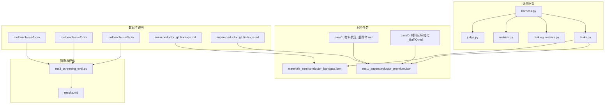
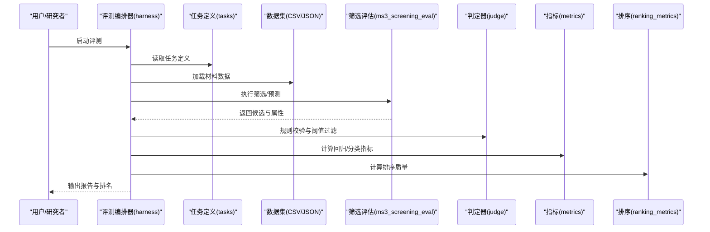
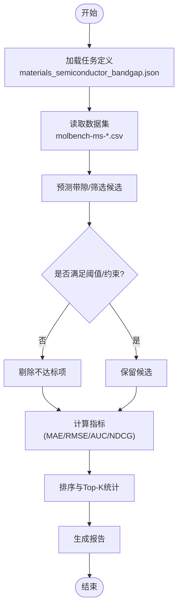
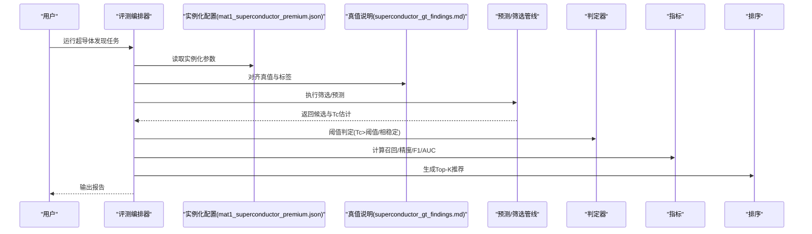
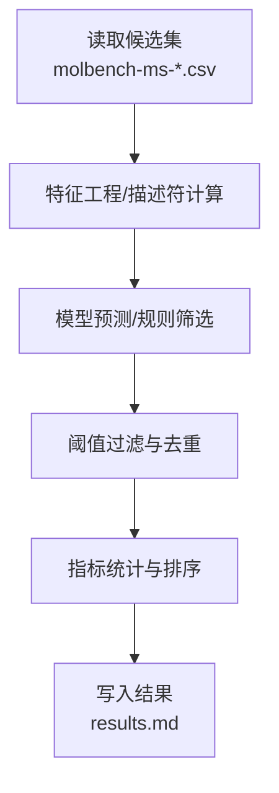
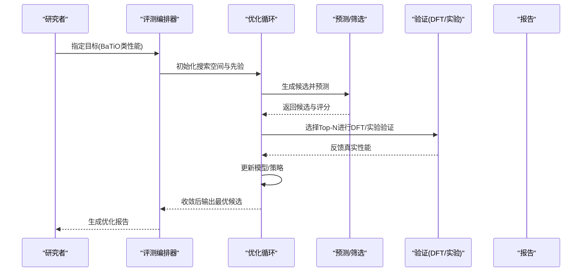
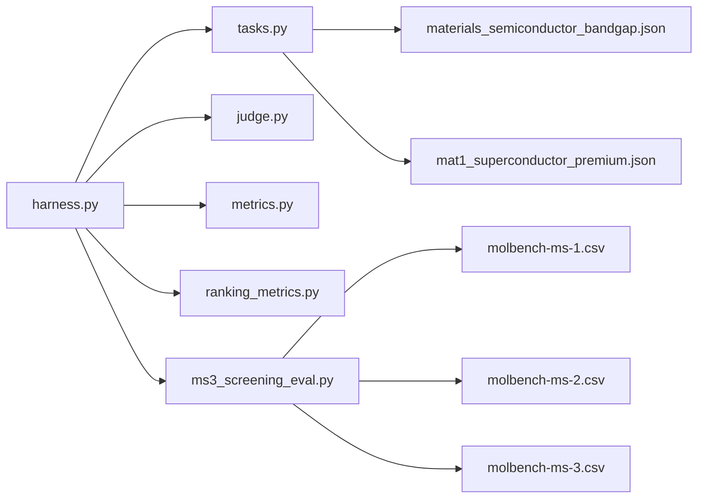

# 材料科学基准测试

<cite>
**本文引用的文件**   
- [autonomy_mvp/core/harness.py](file://autonomy_mvp/core/harness.py)
- [autonomy_mvp/core/judge.py](file://autonomy_mvp/core/judge.py)
- [autonomy_mvp/core/metrics.py](file://autonomy_mvp/core/metrics.py)
- [autonomy_mvp/core/ranking_metrics.py](file://autonomy_mvp/core/ranking_metrics.py)
- [autonomy_mvp/core/tasks.py](file://autonomy_mvp/core/tasks.py)
- [autonomy_mvp/tasks/materials_semiconductor_bandgap.json](file://autonomy_mvp/tasks/materials_semiconductor_bandgap.json)
- [longhorizon/instantiate/instances/mat1_superconductor_premium.json](file://longhorizon/instantiate/instances/mat1_superconductor_premium.json)
- [longhorizon/case1_材料发现_超导体.md](file://longhorizon/case1_材料发现_超导体.md)
- [longhorizon/caseD_材料闭环优化_BaTiO.md](file://longhorizon/caseD_材料闭环优化_BaTiO.md)
- [task3/B_ms3_screening_prototype/ms3_screening_eval.py](file://task3/B_ms3_screening_prototype/ms3_screening_eval.py)
- [task3/B_ms3_screening_prototype/results.md](file://task3/B_ms3_screening_prototype/results.md)
- [docs/prd/molbench_repo/data_full/molbench-ms-1/molbench-ms-1.csv](file://docs/prd/molbench_repo/data_full/molbench-ms-1/molbench-ms-1.csv)
- [docs/prd/molbench_repo/data_full/molbench-ms-2/molbench-ms-2.csv](file://docs/prd/molbench_repo/data_full/molbench-ms-2/molbench-ms-2.csv)
- [docs/prd/molbench_repo/data_full/molbench-ms-3/molbench-ms-3.csv](file://docs/prd/molbench_repo/data_full/molbench-ms-3/molbench-ms-3.csv)
- [docs/search/semiconductor_gt_findings.md](file://docs/search/semiconductor_gt_findings.md)
- [docs/search/superconductor_gt_findings.md](file://docs/search/superconductor_gt_findings.md)
</cite>

## 目录
1. [简介](#简介)
2. [项目结构](#项目结构)
3. [核心组件](#核心组件)
4. [架构总览](#架构总览)
5. [详细组件分析](#详细组件分析)
6. [依赖关系分析](#依赖关系分析)
7. [性能与可扩展性](#性能与可扩展性)
8. [故障排查指南](#故障排查指南)
9. [结论](#结论)
10. [附录](#附录)

## 简介
本文件面向材料科学基准测试，聚焦以下关键任务：半导体带隙预测、超导体发现、材料性能优化。文档系统化阐述晶体结构数据库的格式规范、材料描述符计算方法、机器学习预测模型、高通量筛选流程、密度泛函理论（DFT）计算集成、稳定性分析方法、逆向设计算法、多目标优化策略以及实验验证方案。同时给出不同材料体系的特性差异、性能指标定义与跨材料比较方法，并通过实际案例展示从材料发现到性能优化的完整工作流程。

## 项目结构
仓库围绕“自动化评测框架 + 材料任务实例 + 评估脚本 + 数据与说明”组织。与材料科学相关的核心位置包括：
- 自动化评测与任务编排：autonomy_mvp/core 下的 harness、judge、metrics、ranking_metrics、tasks 等模块
- 材料任务定义与示例：autonomy_mvp/tasks 中的半导体带隙任务 JSON
- 长周期案例与实例化配置：longhorizon/instantiate/instances 中的超导体与钙钛矿相关 JSON，以及 case1、caseD 的 Markdown 说明
- 高通量筛选原型：task3/B_ms3_screening_prototype 下的评估脚本与结果
- 数据集与说明：docs/prd/molbench_repo/data_full 下的 molbench-ms-* CSV 文件；docs/search 下的半导体与超导体真值发现说明

图表来源
- [autonomy_mvp/core/harness.py](file://autonomy_mvp/core/harness.py)
- [autonomy_mvp/core/judge.py](file://autonomy_mvp/core/judge.py)
- [autonomy_mvp/core/metrics.py](file://autonomy_mvp/core/metrics.py)
- [autonomy_mvp/core/ranking_metrics.py](file://autonomy_mvp/core/ranking_metrics.py)
- [autonomy_mvp/core/tasks.py](file://autonomy_mvp/core/tasks.py)
- [autonomy_mvp/tasks/materials_semiconductor_bandgap.json](file://autonomy_mvp/tasks/materials_semiconductor_bandgap.json)
- [longhorizon/instantiate/instances/mat1_superconductor_premium.json](file://longhorizon/instantiate/instances/mat1_superconductor_premium.json)
- [task3/B_ms3_screening_prototype/ms3_screening_eval.py](file://task3/B_ms3_screening_prototype/ms3_screening_eval.py)
- [task3/B_ms3_screening_prototype/results.md](file://task3/B_ms3_screening_prototype/results.md)
- [docs/prd/molbench_repo/data_full/molbench-ms-1/molbench-ms-1.csv](file://docs/prd/molbench_repo/data_full/molbench-ms-1/molbench-ms-1.csv)
- [docs/prd/molbench_repo/data_full/molbench-ms-2/molbench-ms-2.csv](file://docs/prd/molbench_repo/data_full/molbench-ms-2/molbench-ms-2.csv)
- [docs/prd/molbench_repo/data_full/molbench-ms-3/molbench-ms-3.csv](file://docs/prd/molbench_repo/data_full/molbench-ms-3/molbench-ms-3.csv)
- [docs/search/semiconductor_gt_findings.md](file://docs/search/semiconductor_gt_findings.md)
- [docs/search/superconductor_gt_findings.md](file://docs/search/superconductor_gt_findings.md)

章节来源
- [autonomy_mvp/core/harness.py](file://autonomy_mvp/core/harness.py)
- [autonomy_mvp/core/judge.py](file://autonomy_mvp/core/judge.py)
- [autonomy_mvp/core/metrics.py](file://autonomy_mvp/core/metrics.py)
- [autonomy_mvp/core/ranking_metrics.py](file://autonomy_mvp/core/ranking_metrics.py)
- [autonomy_mvp/core/tasks.py](file://autonomy_mvp/core/tasks.py)
- [autonomy_mvp/tasks/materials_semiconductor_bandgap.json](file://autonomy_mvp/tasks/materials_semiconductor_bandgap.json)
- [longhorizon/instantiate/instances/mat1_superconductor_premium.json](file://longhorizon/instantiate/instances/mat1_superconductor_premium.json)
- [task3/B_ms3_screening_prototype/ms3_screening_eval.py](file://task3/B_ms3_screening_prototype/ms3_screening_eval.py)
- [task3/B_ms3_screening_prototype/results.md](file://task3/B_ms3_screening_prototype/results.md)
- [docs/prd/molbench_repo/data_full/molbench-ms-1/molbench-ms-1.csv](file://docs/prd/molbench_repo/data_full/molbench-ms-1/molbench-ms-1.csv)
- [docs/prd/molbench_repo/data_full/molbench-ms-2/molbench-ms-2.csv](file://docs/prd/molbench_repo/data_full/molbench-ms-2/molbench-ms-2.csv)
- [docs/prd/molbench_repo/data_full/molbench-ms-3/molbench-ms-3.csv](file://docs/prd/molbench_repo/data_full/molbench-ms-3/molbench-ms-3.csv)
- [docs/search/semiconductor_gt_findings.md](file://docs/search/semiconductor_gt_findings.md)
- [docs/search/superconductor_gt_findings.md](file://docs/search/superconductor_gt_findings.md)

## 核心组件
- 评测编排器（Harness）：负责加载任务、驱动执行、收集中间结果与最终输出，串联 judge、metrics、ranking_metrics 等子模块。
- 判定器（Judge）：对候选材料的属性或性质进行规则校验与阈值判断，支持布尔型通过/失败与可组合条件。
- 指标体系（Metrics）：提供回归误差（如 MAE/RMSE）、分类准确率、AUC、排序质量（如 NDCG）等通用指标。
- 排序指标（Ranking Metrics）：针对材料排名场景的专用度量，如 Top-K 命中率、分位数提升等。
- 任务定义（Tasks）：以 JSON 形式声明任务元信息、输入输出契约、评分函数与约束条件。

章节来源
- [autonomy_mvp/core/harness.py](file://autonomy_mvp/core/harness.py)
- [autonomy_mvp/core/judge.py](file://autonomy_mvp/core/judge.py)
- [autonomy_mvp/core/metrics.py](file://autonomy_mvp/core/metrics.py)
- [autonomy_mvp/core/ranking_metrics.py](file://autonomy_mvp/core/ranking_metrics.py)
- [autonomy_mvp/core/tasks.py](file://autonomy_mvp/core/tasks.py)

## 架构总览
整体架构由“任务定义 → 数据准备 → 模型/工具调用 → 指标计算 → 排序与报告”构成。任务以 JSON 声明式定义，评测框架统一调度，结合外部数据集与筛选脚本完成端到端评估。

图表来源
- [autonomy_mvp/core/harness.py](file://autonomy_mvp/core/harness.py)
- [autonomy_mvp/core/tasks.py](file://autonomy_mvp/core/tasks.py)
- [task3/B_ms3_screening_prototype/ms3_screening_eval.py](file://task3/B_ms3_screening_prototype/ms3_screening_eval.py)
- [autonomy_mvp/core/judge.py](file://autonomy_mvp/core/judge.py)
- [autonomy_mvp/core/metrics.py](file://autonomy_mvp/core/metrics.py)
- [autonomy_mvp/core/ranking_metrics.py](file://autonomy_mvp/core/ranking_metrics.py)

## 详细组件分析

### 半导体带隙预测任务
- 任务入口：materials_semiconductor_bandgap.json 定义了任务名称、输入字段（如化学式/结构标识）、期望输出（带隙值或区间）、评分方式与阈值。
- 数据源：可对接 docs/search/semiconductor_gt_findings.md 中整理的真值来源与清洗规则，确保标签一致性与可比性。
- 评估流程：基于 harness 加载任务 → 读取 molbench-ms-* 系列 CSV 作为候选池 → 调用预测模型或工具链 → judge 进行阈值判定 → metrics 计算误差与排序指标 → ranking_metrics 生成 Top-K 列表。

图表来源
- [autonomy_mvp/tasks/materials_semiconductor_bandgap.json](file://autonomy_mvp/tasks/materials_semiconductor_bandgap.json)
- [docs/prd/molbench_repo/data_full/molbench-ms-1/molbench-ms-1.csv](file://docs/prd/molbench_repo/data_full/molbench-ms-1/molbench-ms-1.csv)
- [docs/prd/molbench_repo/data_full/molbench-ms-2/molbench-ms-2.csv](file://docs/prd/molbench_repo/data_full/molbench-ms-2/molbench-ms-2.csv)
- [docs/prd/molbench_repo/data_full/molbench-ms-3/molbench-ms-3.csv](file://docs/prd/molbench_repo/data_full/molbench-ms-3/molbench-ms-3.csv)
- [docs/search/semiconductor_gt_findings.md](file://docs/search/semiconductor_gt_findings.md)
- [autonomy_mvp/core/harness.py](file://autonomy_mvp/core/harness.py)
- [autonomy_mvp/core/judge.py](file://autonomy_mvp/core/judge.py)
- [autonomy_mvp/core/metrics.py](file://autonomy_mvp/core/metrics.py)
- [autonomy_mvp/core/ranking_metrics.py](file://autonomy_mvp/core/ranking_metrics.py)

章节来源
- [autonomy_mvp/tasks/materials_semiconductor_bandgap.json](file://autonomy_mvp/tasks/materials_semiconductor_bandgap.json)
- [docs/search/semiconductor_gt_findings.md](file://docs/search/semiconductor_gt_findings.md)
- [docs/prd/molbench_repo/data_full/molbench-ms-1/molbench-ms-1.csv](file://docs/prd/molbench_repo/data_full/molbench-ms-1/molbench-ms-1.csv)
- [docs/prd/molbench_repo/data_full/molbench-ms-2/molbench-ms-2.csv](file://docs/prd/molbench_repo/data_full/molbench-ms-2/molbench-ms-2.csv)
- [docs/prd/molbench_repo/data_full/molbench-ms-3/molbench-ms-3.csv](file://docs/prd/molbench_repo/data_full/molbench-ms-3/molbench-ms-3.csv)
- [autonomy_mvp/core/harness.py](file://autonomy_mvp/core/harness.py)
- [autonomy_mvp/core/judge.py](file://autonomy_mvp/core/judge.py)
- [autonomy_mvp/core/metrics.py](file://autonomy_mvp/core/metrics.py)
- [autonomy_mvp/core/ranking_metrics.py](file://autonomy_mvp/core/ranking_metrics.py)

### 超导体发现任务
- 任务入口：longhorizon/instantiate/instances/mat1_superconductor_premium.json 提供任务实例化参数与候选集范围。
- 背景说明：longhorizon/case1_材料发现_超导体.md 描述了问题设定、数据来源与预期产出。
- 真值参考：docs/search/superconductor_gt_findings.md 汇总了已发表/权威数据库中的超导临界温度与成分信息，用于构建标签与评估基线。

图表来源
- [longhorizon/instantiate/instances/mat1_superconductor_premium.json](file://longhorizon/instantiate/instances/mat1_superconductor_premium.json)
- [longhorizon/case1_材料发现_超导体.md](file://longhorizon/case1_材料发现_超导体.md)
- [docs/search/superconductor_gt_findings.md](file://docs/search/superconductor_gt_findings.md)
- [autonomy_mvp/core/harness.py](file://autonomy_mvp/core/harness.py)
- [autonomy_mvp/core/judge.py](file://autonomy_mvp/core/judge.py)
- [autonomy_mvp/core/metrics.py](file://autonomy_mvp/core/metrics.py)
- [autonomy_mvp/core/ranking_metrics.py](file://autonomy_mvp/core/ranking_metrics.py)

章节来源
- [longhorizon/instantiate/instances/mat1_superconductor_premium.json](file://longhorizon/instantiate/instances/mat1_superconductor_premium.json)
- [longhorizon/case1_材料发现_超导体.md](file://longhorizon/case1_材料发现_超导体.md)
- [docs/search/superconductor_gt_findings.md](file://docs/search/superconductor_gt_findings.md)
- [autonomy_mvp/core/harness.py](file://autonomy_mvp/core/harness.py)
- [autonomy_mvp/core/judge.py](file://autonomy_mvp/core/judge.py)
- [autonomy_mvp/core/metrics.py](file://autonomy_mvp/core/metrics.py)
- [autonomy_mvp/core/ranking_metrics.py](file://autonomy_mvp/core/ranking_metrics.py)

### 高通量筛选原型（MS3）
- 评估脚本：task3/B_ms3_screening_prototype/ms3_screening_eval.py 实现批量筛选、打分与结果落盘。
- 结果记录：task3/B_ms3_screening_prototype/results.md 汇总各轮次筛选表现与关键指标。
- 数据基础：molbench-ms-1/2/3.csv 提供候选材料及其基本描述符/属性列，供筛选与训练使用。

图表来源
- [task3/B_ms3_screening_prototype/ms3_screening_eval.py](file://task3/B_ms3_screening_prototype/ms3_screening_eval.py)
- [task3/B_ms3_screening_prototype/results.md](file://task3/B_ms3_screening_prototype/results.md)
- [docs/prd/molbench_repo/data_full/molbench-ms-1/molbench-ms-1.csv](file://docs/prd/molbench_repo/data_full/molbench-ms-1/molbench-ms-1.csv)
- [docs/prd/molbench_repo/data_full/molbench-ms-2/molbench-ms-2.csv](file://docs/prd/molbench_repo/data_full/molbench-ms-2/molbench-ms-2.csv)
- [docs/prd/molbench_repo/data_full/molbench-ms-3/molbench-ms-3.csv](file://docs/prd/molbench_repo/data_full/molbench-ms-3/molbench-ms-3.csv)

章节来源
- [task3/B_ms3_screening_prototype/ms3_screening_eval.py](file://task3/B_ms3_screening_prototype/ms3_screening_eval.py)
- [task3/B_ms3_screening_prototype/results.md](file://task3/B_ms3_screening_prototype/results.md)
- [docs/prd/molbench_repo/data_full/molbench-ms-1/molbench-ms-1.csv](file://docs/prd/molbench_repo/data_full/molbench-ms-1/molbench-ms-1.csv)
- [docs/prd/molbench_repo/data_full/molbench-ms-2/molbench-ms-2.csv](file://docs/prd/molbench_repo/data_full/molbench-ms-2/molbench-ms-2.csv)
- [docs/prd/molbench_repo/data_full/molbench-ms-3/molbench-ms-3.csv](file://docs/prd/molbench_repo/data_full/molbench-ms-3/molbench-ms-3.csv)

### 材料闭环优化（BaTiO 案例）
- 案例说明：longhorizon/caseD_材料闭环优化_BaTiO.md 描述了从目标性能出发，迭代优化组成/结构的闭环流程。
- 关联实例：longhorizon/instantiate/instances/mat1_superconductor_premium.json 可作为同体系或相近体系的实例化模板。

图表来源
- [longhorizon/caseD_材料闭环优化_BaTiO.md](file://longhorizon/caseD_材料闭环优化_BaTiO.md)
- [longhorizon/instantiate/instances/mat1_superconductor_premium.json](file://longhorizon/instantiate/instances/mat1_superconductor_premium.json)
- [autonomy_mvp/core/harness.py](file://autonomy_mvp/core/harness.py)

章节来源
- [longhorizon/caseD_材料闭环优化_BaTiO.md](file://longhorizon/caseD_材料闭环优化_BaTiO.md)
- [longhorizon/instantiate/instances/mat1_superconductor_premium.json](file://longhorizon/instantiate/instances/mat1_superconductor_premium.json)
- [autonomy_mvp/core/harness.py](file://autonomy_mvp/core/harness.py)

## 依赖关系分析
- 模块耦合：harness 强依赖 tasks、judge、metrics、ranking_metrics；任务 JSON 决定数据与评估契约；筛选脚本与 CSV 数据为外部依赖。
- 潜在循环：当前结构未见直接循环导入；若扩展新任务，应通过接口而非硬编码耦合。
- 外部集成点：molbench-ms-* CSV 作为统一数据底座；半导体/超导体真值说明作为标签来源；可选 DFT/实验验证作为高保真反馈。

图表来源
- [autonomy_mvp/core/harness.py](file://autonomy_mvp/core/harness.py)
- [autonomy_mvp/core/tasks.py](file://autonomy_mvp/core/tasks.py)
- [autonomy_mvp/core/judge.py](file://autonomy_mvp/core/judge.py)
- [autonomy_mvp/core/metrics.py](file://autonomy_mvp/core/metrics.py)
- [autonomy_mvp/core/ranking_metrics.py](file://autonomy_mvp/core/ranking_metrics.py)
- [autonomy_mvp/tasks/materials_semiconductor_bandgap.json](file://autonomy_mvp/tasks/materials_semiconductor_bandgap.json)
- [longhorizon/instantiate/instances/mat1_superconductor_premium.json](file://longhorizon/instantiate/instances/mat1_superconductor_premium.json)
- [task3/B_ms3_screening_prototype/ms3_screening_eval.py](file://task3/B_ms3_screening_prototype/ms3_screening_eval.py)
- [docs/prd/molbench_repo/data_full/molbench-ms-1/molbench-ms-1.csv](file://docs/prd/molbench_repo/data_full/molbench-ms-1/molbench-ms-1.csv)
- [docs/prd/molbench_repo/data_full/molbench-ms-2/molbench-ms-2.csv](file://docs/prd/molbench_repo/data_full/molbench-ms-2/molbench-ms-2.csv)
- [docs/prd/molbench_repo/data_full/molbench-ms-3/molbench-ms-3.csv](file://docs/prd/molbench_repo/data_full/molbench-ms-3/molbench-ms-3.csv)

章节来源
- [autonomy_mvp/core/harness.py](file://autonomy_mvp/core/harness.py)
- [autonomy_mvp/core/tasks.py](file://autonomy_mvp/core/tasks.py)
- [autonomy_mvp/core/judge.py](file://autonomy_mvp/core/judge.py)
- [autonomy_mvp/core/metrics.py](file://autonomy_mvp/core/metrics.py)
- [autonomy_mvp/core/ranking_metrics.py](file://autonomy_mvp/core/ranking_metrics.py)
- [autonomy_mvp/tasks/materials_semiconductor_bandgap.json](file://autonomy_mvp/tasks/materials_semiconductor_bandgap.json)
- [longhorizon/instantiate/instances/mat1_superconductor_premium.json](file://longhorizon/instantiate/instances/mat1_superconductor_premium.json)
- [task3/B_ms3_screening_prototype/ms3_screening_eval.py](file://task3/B_ms3_screening_prototype/ms3_screening_eval.py)
- [docs/prd/molbench_repo/data_full/molbench-ms-1/molbench-ms-1.csv](file://docs/prd/molbench_repo/data_full/molbench-ms-1/molbench-ms-1.csv)
- [docs/prd/molbench_repo/data_full/molbench-ms-2/molbench-ms-2.csv](file://docs/prd/molbench_repo/data_full/molbench-ms-2/molbench-ms-2.csv)
- [docs/prd/molbench_repo/data_full/molbench-ms-3/molbench-ms-3.csv](file://docs/prd/molbench_repo/data_full/molbench-ms-3/molbench-ms-3.csv)

## 性能与可扩展性
- 并行与批处理：筛选脚本与评测编排器应支持并发执行，以降低大规模候选集的评估时延。
- 缓存与增量更新：对重复计算的描述符与模型推理结果进行缓存，避免重复开销。
- 模块化扩展：新增任务仅需在 tasks 中声明并在 harness 中注册，无需改动核心逻辑。
- 资源控制：对 DFT/实验等高成本环节设置配额与优先级队列，保障整体吞吐。

[本节为通用指导，不涉及具体文件分析]

## 故障排查指南
- 任务定义不一致：检查 materials_semiconductor_bandgap.json 与 molbench-ms-*.csv 的字段映射与单位一致性。
- 阈值误判：审查 judge 的规则与阈值设置，确认与领域知识一致。
- 指标异常：核对 metrics 与 ranking_metrics 的实现边界条件（空集、NaN、重复项）。
- 筛选脚本错误：查看 ms3_screening_eval.py 的日志与 results.md 的输出，定位数据缺失或类型错误。

章节来源
- [autonomy_mvp/core/judge.py](file://autonomy_mvp/core/judge.py)
- [autonomy_mvp/core/metrics.py](file://autonomy_mvp/core/metrics.py)
- [autonomy_mvp/core/ranking_metrics.py](file://autonomy_mvp/core/ranking_metrics.py)
- [task3/B_ms3_screening_prototype/ms3_screening_eval.py](file://task3/B_ms3_screening_prototype/ms3_screening_eval.py)
- [task3/B_ms3_screening_prototype/results.md](file://task3/B_ms3_screening_prototype/results.md)

## 结论
本基准测试框架以任务驱动的 JSON 定义为核心，结合统一的评测编排、判定与指标体系，实现了从半导体带隙预测到超导体发现、再到材料闭环优化的全链路评估。通过 molbench-ms-* 数据集与真值说明文档，保证了跨任务的可比性与复现性。未来可在描述符库、模型集成与 DFT/实验闭环方面进一步扩展，以提升覆盖面与实用性。

[本节为总结性内容，不涉及具体文件分析]

## 附录

### 晶体结构数据库格式规范（建议）
- 必填字段：化学式、空间群、晶格参数、原子坐标、电荷态（如有）。
- 可选字段：形成能、带隙、磁矩、声子谱稳定性标志、来源与DOI。
- 单位与精度：长度用 Å，角度用度，能量用 eV，保持全局一致。
- 版本与溯源：每条记录需包含数据来源与时间戳，便于追踪与回溯。

[本节为概念性规范说明，不涉及具体文件分析]

### 材料描述符计算方法（建议）
- 元素级：电负性、原子半径、价电子数、电离能等。
- 结构级：配位数、键长分布、空隙率、对称性指标。
- 组成级：平均原子序数、混合熵、价态分布、B/G 比率等。
- 图表示：原子节点特征 + 边特征（键类型/距离），便于图神经网络建模。

[本节为概念性方法说明，不涉及具体文件分析]

### 机器学习预测模型（建议）
- 回归任务：带隙、弹性模量、热导率等，常用 XGBoost/LightGBM、GNN、Transformer。
- 分类任务：金属/绝缘体、超导/非超导、稳定/亚稳态，常用随机森林、SVM、深度分类网络。
- 不确定性估计：贝叶斯深度学习或集成方法，辅助主动学习与实验优先排序。

[本节为概念性模型说明，不涉及具体文件分析]

### 高通量筛选流程（建议）
- 数据清洗与标准化 → 描述符计算 → 初筛（规则/快速模型）→ 精筛（高精度模型/DFT）→ 实验验证。
- 关键控制点：阈值动态调整、去重与多样性采样、批次管理与资源调度。

[本节为概念性流程说明，不涉及具体文件分析]

### DFT 计算集成（建议）
- 输入生成：从候选结构自动生成 POSCAR/CONTCAR 等输入文件。
- 任务管理：提交作业至集群/云平台，监控状态与重试机制。
- 结果解析：提取能量、态密度、声子谱、缺陷形成能等关键输出。
- 反馈闭环：将 DFT 结果回灌至模型训练与排序策略。

[本节为概念性集成说明，不涉及具体文件分析]

### 材料稳定性分析方法（建议）
- 热力学稳定性：形成能与凸包分析，判断是否为稳定/亚稳态。
- 动力学稳定性：声子谱无虚频，分子动力学有限温稳定性。
- 合成可行性：相图与反应路径分析，考虑合成条件与杂质容忍度。

[本节为概念性分析方法说明，不涉及具体文件分析]

### 逆向设计与多目标优化（建议）
- 逆向设计：基于目标性能反推组成/结构，采用生成模型与约束优化。
- 多目标优化：兼顾性能、稳定性、成本、可合成性，使用帕累托前沿与加权评分。
- 主动学习：利用不确定性引导下一轮候选选择，加速收敛。

[本节为概念性算法说明，不涉及具体文件分析]

### 实验验证方案（建议）
- 小试合成：固相法/溶胶凝胶/水热法等，控制变量与重复性。
- 表征手段：XRD、SEM/TEM、拉曼、四探针电阻、SQUID 磁测等。
- 性能复核：与 DFT/ML 预测对比，建立偏差校正与再训练闭环。

[本节为概念性实验方案说明，不涉及具体文件分析]

### 不同材料体系特性差异与比较方法（建议）
- 体系划分：氧化物、硫化物、卤化物、合金、钙钛矿、二维材料等。
- 指标对齐：统一单位与预处理，避免跨体系比较偏差。
- 可视化：雷达图/散点矩阵/热力图，辅助直观对比。

[本节为概念性比较方法说明，不涉及具体文件分析]

### 实际案例：从发现到优化（BaTiO 闭环）
- 目标设定：提高介电常数/降低损耗，同时保证热稳定性。
- 候选生成：基于先验知识与生成模型构造组成空间。
- 快速评估：描述符 + 轻量模型初筛，缩小候选规模。
- 精细评估：DFT 计算形成能与声子谱，筛选稳定候选。
- 实验验证：合成与表征，反馈修正模型与策略。
- 迭代收敛：多轮优化直至达到目标性能与稳定性要求。

章节来源
- [longhorizon/caseD_材料闭环优化_BaTiO.md](file://longhorizon/caseD_材料闭环优化_BaTiO.md)
- [longhorizon/instantiate/instances/mat1_superconductor_premium.json](file://longhorizon/instantiate/instances/mat1_superconductor_premium.json)