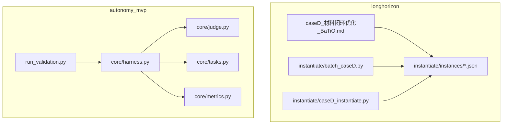
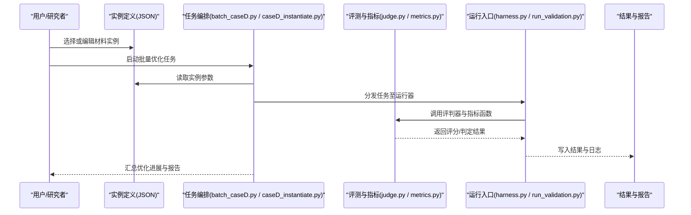
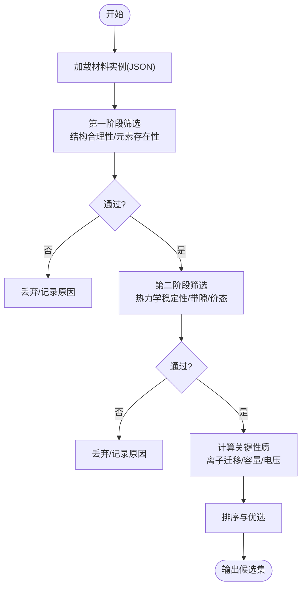
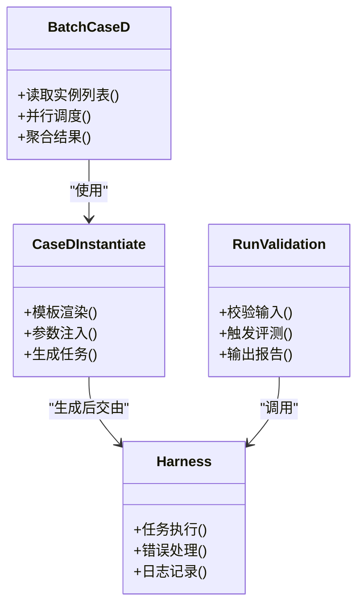
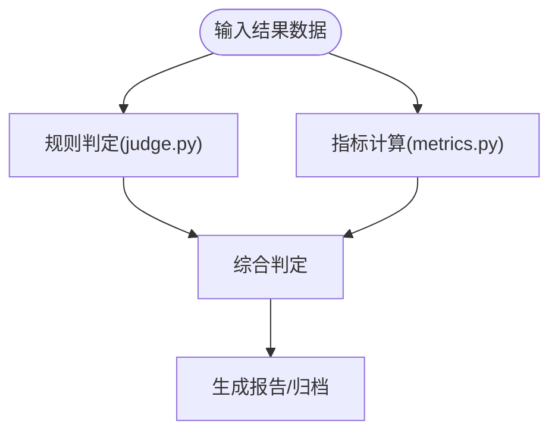
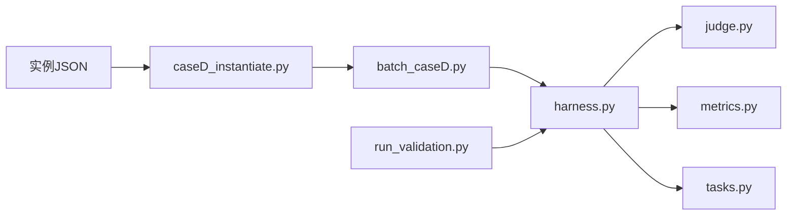

# 电池材料性能优化

<cite>
**本文引用的文件**   
- [longhorizon/caseD_材料闭环优化_BaTiO.md](file://longhorizon/caseD_材料闭环优化_BaTiO.md)
- [longhorizon/instantiate/instances/matD_Ba-Ti-O.json](file://longhorizon/instantiate/instances/matD_Ba-Ti-O.json)
- [longhorizon/instantiate/instances/matD_Al-Ti-O.json](file://longhorizon/instantiate/instances/matD_Al-Ti-O.json)
- [longhorizon/instantiate/instances/matD_Li-Co-O.json](file://longhorizon/instantiate/instances/matD_Li-Co-O.json)
- [longhorizon/instantiate/instances/matD_Li-Fe-O.json](file://longhorizon/instantiate/instances/matD_Li-Fe-O.json)
- [longhorizon/instantiate/instances/mat1_Li-Fe-O_funnel.json](file://longhorizon/instantiate/instances/mat1_Li-Fe-O_funnel.json)
- [longhorizon/instantiate/batch_caseD.py](file://longhorizon/instantiate/batch_caseD.py)
- [longhorizon/instantiate/caseD_instantiate.py](file://longhorizon/instantiate/caseD_instantiate.py)
- [autonomy_mvp/core/judge.py](file://autonomy_mvp/core/judge.py)
- [autonomy_mvp/core/metrics.py](file://autonomy_mvp/core/metrics.py)
- [autonomy_mvp/core/tasks.py](file://autonomy_mvp/core/tasks.py)
- [autonomy_mvp/core/harness.py](file://autonomy_mvp/core/harness.py)
- [autonomy_mvp/run_validation.py](file://autonomy_mvp/run_validation.py)
</cite>

## 目录
1. [引言](#引言)
2. [项目结构](#项目结构)
3. [核心组件](#核心组件)
4. [架构总览](#架构总览)
5. [详细组件分析](#详细组件分析)
6. [依赖关系分析](#依赖关系分析)
7. [性能与稳定性考量](#性能与稳定性考量)
8. [故障排查指南](#故障排查指南)
9. [结论](#结论)
10. [附录](#附录)

## 引言
本文件面向“电池材料性能优化”任务，聚焦锂离子电池与固态电池体系中的关键正极、负极与电解质材料，系统阐述其晶体结构特征、离子传输机制与电化学性能评估方法。结合仓库中已有的材料闭环优化案例（以 Ba-Ti-O 为代表）及相关实例配置，文档进一步给出机器学习驱动的材料逆向设计思路、高通量计算筛选流程与实验验证协议，并总结循环稳定性提升策略、容量衰减机制与界面工程方法。最后提供从材料设计到电池集成的完整开发流程与实际案例展示路径。

## 项目结构
仓库围绕“长周期研究/多智能体工作流”组织，其中与电池材料优化直接相关的资源主要位于 longhorizon 与 autonomy_mvp 两个子模块：
- longhorizon：包含材料闭环优化案例说明、批量执行脚本与具体材料实例定义（如 Ba-Ti-O、Al-Ti-O、Li-Co-O、Li-Fe-O 等）。
- autonomy_mvp：提供评测与验证框架（评判器、指标、任务编排与运行入口），可用于对材料优化流程进行自动化评估与回归测试。

图表来源
- [longhorizon/caseD_材料闭环优化_BaTiO.md](file://longhorizon/caseD_材料闭环优化_BaTiO.md)
- [longhorizon/instantiate/batch_caseD.py](file://longhorizon/instantiate/batch_caseD.py)
- [longhorizon/instantiate/caseD_instantiate.py](file://longhorizon/instantiate/caseD_instantiate.py)
- [autonomy_mvp/core/harness.py](file://autonomy_mvp/core/harness.py)
- [autonomy_mvp/core/judge.py](file://autonomy_mvp/core/judge.py)
- [autonomy_mvp/core/metrics.py](file://autonomy_mvp/core/metrics.py)
- [autonomy_mvp/core/tasks.py](file://autonomy_mvp/core/tasks.py)
- [autonomy_mvp/run_validation.py](file://autonomy_mvp/run_validation.py)

章节来源
- [longhorizon/caseD_材料闭环优化_BaTiO.md](file://longhorizon/caseD_材料闭环优化_BaTiO.md)
- [longhorizon/instantiate/batch_caseD.py](file://longhorizon/instantiate/batch_caseD.py)
- [longhorizon/instantiate/caseD_instantiate.py](file://longhorizon/instantiate/caseD_instantiate.py)
- [autonomy_mvp/core/harness.py](file://autonomy_mvp/core/harness.py)
- [autonomy_mvp/core/judge.py](file://autonomy_mvp/core/judge.py)
- [autonomy_mvp/core/metrics.py](file://autonomy_mvp/core/metrics.py)
- [autonomy_mvp/core/tasks.py](file://autonomy_mvp/core/tasks.py)
- [autonomy_mvp/run_validation.py](file://autonomy_mvp/run_validation.py)

## 核心组件
- 材料实例定义：以 JSON 形式描述目标材料体系、候选空间、约束条件与评价指标，覆盖 Ba-Ti-O、Al-Ti-O、Li-Co-O、Li-Fe-O 等典型体系，以及 Li-Fe-O 的漏斗式筛选配置。
- 闭环优化编排：通过 Python 脚本批量生成与调度材料优化任务，串联“设计—计算—评估—迭代”的闭环流程。
- 评测与验证：基于 judge、metrics、tasks 与 harness 构建统一评测接口，支持对优化结果进行一致性检查、指标量化与回归验证。

章节来源
- [longhorizon/instantiate/instances/matD_Ba-Ti-O.json](file://longhorizon/instantiate/instances/matD_Ba-Ti-O.json)
- [longhorizon/instantiate/instances/matD_Al-Ti-O.json](file://longhorizon/instantiate/instances/matD_Al-Ti-O.json)
- [longhorizon/instantiate/instances/matD_Li-Co-O.json](file://longhorizon/instantiate/instances/matD_Li-Co-O.json)
- [longhorizon/instantiate/instances/matD_Li-Fe-O.json](file://longhorizon/instantiate/instances/matD_Li-Fe-O.json)
- [longhorizon/instantiate/instances/mat1_Li-Fe-O_funnel.json](file://longhorizon/instantiate/instances/mat1_Li-Fe-O_funnel.json)
- [longhorizon/instantiate/batch_caseD.py](file://longhorizon/instantiate/batch_caseD.py)
- [longhorizon/instantiate/caseD_instantiate.py](file://longhorizon/instantiate/caseD_instantiate.py)
- [autonomy_mvp/core/judge.py](file://autonomy_mvp/core/judge.py)
- [autonomy_mvp/core/metrics.py](file://autonomy_mvp/core/metrics.py)
- [autonomy_mvp/core/tasks.py](file://autonomy_mvp/core/tasks.py)
- [autonomy_mvp/core/harness.py](file://autonomy_mvp/core/harness.py)
- [autonomy_mvp/run_validation.py](file://autonomy_mvp/run_validation.py)

## 架构总览
整体架构由“材料实例定义—任务编排—计算与评估—结果验证”构成，形成可复用的闭环优化流水线。

图表来源
- [longhorizon/instantiate/batch_caseD.py](file://longhorizon/instantiate/batch_caseD.py)
- [longhorizon/instantiate/caseD_instantiate.py](file://longhorizon/instantiate/caseD_instantiate.py)
- [autonomy_mvp/core/harness.py](file://autonomy_mvp/core/harness.py)
- [autonomy_mvp/core/judge.py](file://autonomy_mvp/core/judge.py)
- [autonomy_mvp/core/metrics.py](file://autonomy_mvp/core/metrics.py)
- [autonomy_mvp/run_validation.py](file://autonomy_mvp/run_validation.py)

## 详细组件分析

### 材料实例与体系覆盖
- 目标体系：Ba-Ti-O、Al-Ti-O、Li-Co-O、Li-Fe-O 等，分别对应电解质/介电材料、过渡金属氧化物正极材料等方向。
- 漏斗式筛选：针对 Li-Fe-O 提供 funnel 配置，用于分阶段过滤候选结构与性质，提高筛选效率。
- 关键属性：化学式、相稳定性、带隙/能级、离子迁移势垒、理论容量、电压平台、热力学/动力学约束等（以实例字段为准）。

图表来源
- [longhorizon/instantiate/instances/mat1_Li-Fe-O_funnel.json](file://longhorizon/instantiate/instances/mat1_Li-Fe-O_funnel.json)
- [longhorizon/instantiate/instances/matD_Li-Fe-O.json](file://longhorizon/instantiate/instances/matD_Li-Fe-O.json)
- [longhorizon/instantiate/instances/matD_Li-Co-O.json](file://longhorizon/instantiate/instances/matD_Li-Co-O.json)
- [longhorizon/instantiate/instances/matD_Al-Ti-O.json](file://longhorizon/instantiate/instances/matD_Al-Ti-O.json)
- [longhorizon/instantiate/instances/matD_Ba-Ti-O.json](file://longhorizon/instantiate/instances/matD_Ba-Ti-O.json)

章节来源
- [longhorizon/instantiate/instances/matD_Ba-Ti-O.json](file://longhorizon/instantiate/instances/matD_Ba-Ti-O.json)
- [longhorizon/instantiate/instances/matD_Al-Ti-O.json](file://longhorizon/instantiate/instances/matD_Al-Ti-O.json)
- [longhorizon/instantiate/instances/matD_Li-Co-O.json](file://longhorizon/instantiate/instances/matD_Li-Co-O.json)
- [longhorizon/instantiate/instances/matD_Li-Fe-O.json](file://longhorizon/instantiate/instances/matD_Li-Fe-O.json)
- [longhorizon/instantiate/instances/mat1_Li-Fe-O_funnel.json](file://longhorizon/instantiate/instances/mat1_Li-Fe-O_funnel.json)

### 闭环优化编排与执行
- 批量执行：batch_caseD.py 负责遍历实例、并行/串行调度任务、收集中间结果与最终报告。
- 实例化：caseD_instantiate.py 将通用模板与具体实例参数组合，生成可执行的优化任务。
- 运行入口：harness.py 与 run_validation.py 提供统一的运行与验证接口，便于回归测试与跨任务对比。

图表来源
- [longhorizon/instantiate/batch_caseD.py](file://longhorizon/instantiate/batch_caseD.py)
- [longhorizon/instantiate/caseD_instantiate.py](file://longhorizon/instantiate/caseD_instantiate.py)
- [autonomy_mvp/core/harness.py](file://autonomy_mvp/core/harness.py)
- [autonomy_mvp/run_validation.py](file://autonomy_mvp/run_validation.py)

章节来源
- [longhorizon/instantiate/batch_caseD.py](file://longhorizon/instantiate/batch_caseD.py)
- [longhorizon/instantiate/caseD_instantiate.py](file://longhorizon/instantiate/caseD_instantiate.py)
- [autonomy_mvp/core/harness.py](file://autonomy_mvp/core/harness.py)
- [autonomy_mvp/run_validation.py](file://autonomy_mvp/run_validation.py)

### 评测与指标体系
- 评判器（judge.py）：对优化结果进行规则/阈值判定，输出通过/失败及原因。
- 指标（metrics.py）：提供数值型指标计算（如能量密度、循环保持率、阻抗增长等），支持多维度比较。
- 任务（tasks.py）：定义评测任务类型与输入输出契约，确保不同材料体系的评测一致性。
- 运行器（harness.py）：封装任务执行、异常捕获与结果序列化。

图表来源
- [autonomy_mvp/core/judge.py](file://autonomy_mvp/core/judge.py)
- [autonomy_mvp/core/metrics.py](file://autonomy_mvp/core/metrics.py)
- [autonomy_mvp/core/tasks.py](file://autonomy_mvp/core/tasks.py)
- [autonomy_mvp/core/harness.py](file://autonomy_mvp/core/harness.py)

章节来源
- [autonomy_mvp/core/judge.py](file://autonomy_mvp/core/judge.py)
- [autonomy_mvp/core/metrics.py](file://autonomy_mvp/core/metrics.py)
- [autonomy_mvp/core/tasks.py](file://autonomy_mvp/core/tasks.py)
- [autonomy_mvp/core/harness.py](file://autonomy_mvp/core/harness.py)

### 案例：Ba-Ti-O 材料闭环优化
- 案例说明：caseD_材料闭环优化_BaTiO.md 描述了 Ba-Ti-O 体系的优化目标、流程步骤与关键节点，可作为电解质/介电材料优化的参考范式。
- 实践要点：明确候选空间与约束、建立快速筛选与精细评估的分层流程、在闭环中加入反馈与再设计环节。

章节来源
- [longhorizon/caseD_材料闭环优化_BaTiO.md](file://longhorizon/caseD_材料闭环优化_BaTiO.md)

## 依赖关系分析
- 内部依赖：
  - batch_caseD.py 与 caseD_instantiate.py 共同驱动实例化与批量执行。
  - harness.py 作为统一运行入口，被 run_validation.py 调用以完成评测与验证。
  - judge.py 与 metrics.py 为评测核心，tasks.py 定义评测契约。
- 外部集成点：
  - 材料实例 JSON 作为输入契约，承载材料体系、参数与评价标准。
  - 可选的外部计算/表征工具可通过 harness 扩展接入。

图表来源
- [longhorizon/instantiate/caseD_instantiate.py](file://longhorizon/instantiate/caseD_instantiate.py)
- [longhorizon/instantiate/batch_caseD.py](file://longhorizon/instantiate/batch_caseD.py)
- [autonomy_mvp/core/harness.py](file://autonomy_mvp/core/harness.py)
- [autonomy_mvp/core/judge.py](file://autonomy_mvp/core/judge.py)
- [autonomy_mvp/core/metrics.py](file://autonomy_mvp/core/metrics.py)
- [autonomy_mvp/core/tasks.py](file://autonomy_mvp/core/tasks.py)
- [autonomy_mvp/run_validation.py](file://autonomy_mvp/run_validation.py)

章节来源
- [longhorizon/instantiate/caseD_instantiate.py](file://longhorizon/instantiate/caseD_instantiate.py)
- [longhorizon/instantiate/batch_caseD.py](file://longhorizon/instantiate/batch_caseD.py)
- [autonomy_mvp/core/harness.py](file://autonomy_mvp/core/harness.py)
- [autonomy_mvp/core/judge.py](file://autonomy_mvp/core/judge.py)
- [autonomy_mvp/core/metrics.py](file://autonomy_mvp/core/metrics.py)
- [autonomy_mvp/core/tasks.py](file://autonomy_mvp/core/tasks.py)
- [autonomy_mvp/run_validation.py](file://autonomy_mvp/run_validation.py)

## 性能与稳定性考量
- 循环稳定性提升策略：
  - 表面包覆与掺杂：降低副反应与过渡金属溶出，稳定界面 SEI/CEI。
  - 晶格应变管理：通过梯度/核壳结构设计缓解体积变化导致的微裂纹。
  - 电解液/添加剂优化：抑制气体生成与枝晶生长，改善高电压/低温性能。
- 容量衰减机制：
  - 结构相变与氧释放：在高电压/高温下引发不可逆容量损失。
  - 界面副反应与阻抗增长：SEI/CEI增厚导致极化增大。
  - 活性物质损失：颗粒破碎、导电网络退化。
- 界面工程方法：
  - 人工缓冲层：原子层沉积(ALD)、原位聚合等。
  - 固-固界面润湿与接触优化：柔性聚合物/无机复合层。
  - 预锂化/预钠化补偿：弥补首次不可逆容量损失。

[本节为通用指导，不直接分析具体文件]

## 故障排查指南
- 常见问题定位：
  - 实例参数缺失或不合法：检查 JSON 字段完整性与取值范围。
  - 任务执行中断：查看 harness 日志与异常堆栈，确认外部依赖可用性。
  - 评测不一致：核对 tasks 契约与 judge 阈值设置，确保指标口径一致。
- 建议操作：
  - 使用 run_validation.py 进行最小用例回归，逐步扩大规模。
  - 在 batch 执行时开启细粒度日志，定位失败批次与原因。
  - 对 judge 与 metrics 增加断言与边界检查，避免静默错误。

章节来源
- [autonomy_mvp/core/harness.py](file://autonomy_mvp/core/harness.py)
- [autonomy_mvp/core/judge.py](file://autonomy_mvp/core/judge.py)
- [autonomy_mvp/core/metrics.py](file://autonomy_mvp/core/metrics.py)
- [autonomy_mvp/core/tasks.py](file://autonomy_mvp/core/tasks.py)
- [autonomy_mvp/run_validation.py](file://autonomy_mvp/run_validation.py)

## 结论
本仓库提供了面向电池材料性能优化的闭环工作流基础能力：以实例驱动的候选空间定义、可编排的任务执行与统一的评测验证。结合 Ba-Ti-O 等案例，可快速扩展到 Li-Co-O、Li-Fe-O 等正极材料与 Al-Ti-O 等电解质/介电材料体系。建议在后续工作中完善材料合成与表征的数据回写、引入更丰富的计算与实验工具链，并持续强化指标体系与判据的可解释性与可追溯性。

[本节为总结性内容，不直接分析具体文件]

## 附录
- 实际案例展示路径：
  - 从材料设计到电池集成的完整流程可参考 Ba-Ti-O 案例说明，结合实例配置与批量执行脚本，实现“设计—计算—评估—迭代”的闭环。
- 相关实例与说明：
  - 材料实例：matD_Ba-Ti-O.json、matD_Al-Ti-O.json、matD_Li-Co-O.json、matD_Li-Fe-O.json、mat1_Li-Fe-O_funnel.json
  - 案例说明：caseD_材料闭环优化_BaTiO.md

章节来源
- [longhorizon/caseD_材料闭环优化_BaTiO.md](file://longhorizon/caseD_材料闭环优化_BaTiO.md)
- [longhorizon/instantiate/instances/matD_Ba-Ti-O.json](file://longhorizon/instantiate/instances/matD_Ba-Ti-O.json)
- [longhorizon/instantiate/instances/matD_Al-Ti-O.json](file://longhorizon/instantiate/instances/matD_Al-Ti-O.json)
- [longhorizon/instantiate/instances/matD_Li-Co-O.json](file://longhorizon/instantiate/instances/matD_Li-Co-O.json)
- [longhorizon/instantiate/instances/matD_Li-Fe-O.json](file://longhorizon/instantiate/instances/matD_Li-Fe-O.json)
- [longhorizon/instantiate/instances/mat1_Li-Fe-O_funnel.json](file://longhorizon/instantiate/instances/mat1_Li-Fe-O_funnel.json)