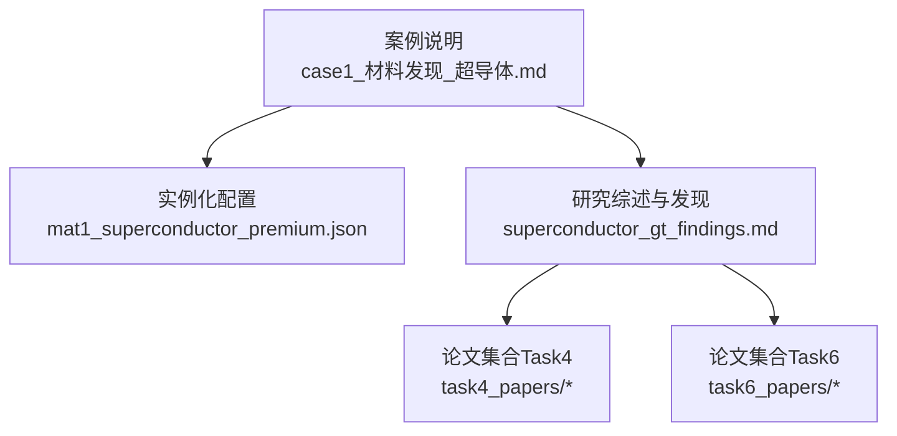
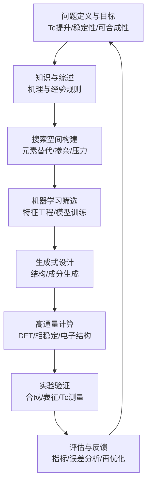
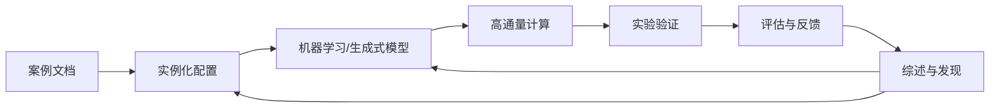

# 超导体发现与优化

<cite>
**本文引用的文件**   
- [longhorizon/case1_材料发现_超导体.md](file://longhorizon/case1_材料发现_超导体.md)
- [longhorizon/instantiate/instances/mat1_superconductor_premium.json](file://longhorizon/instantiate/instances/mat1_superconductor_premium.json)
- [docs/search/superconductor_gt_findings.md](file://docs/search/superconductor_gt_findings.md)
- [task4/papers/2304.05376.xml](file://docs/prd/task4_papers/2304.05376.xml)
- [task4/papers/2310.03302.xml](file://docs/prd/task4_papers/2310.03302.xml)
- [task4/papers/2310.10632.html](file://docs/prd/task4_papers/2310.10632.html)
- [task4/papers/2405.16205.xml](file://docs/prd/task4_papers/2405.16205.xml)
- [task4/papers/2407.01725.html](file://docs/prd/task4_papers/2407.01725.html)
- [task4/papers/2407.10362.xml](file://docs/prd/task4_papers/2407.10362.xml)
- [task4/papers/2410.05080.html](file://docs/prd/task4_papers/2410.05080.html)
- [task4/papers/2412.14161.html](file://docs/prd/task4_papers/2412.14161.html)
- [task4/papers/2501.14654.xml](file://docs/prd/task4_papers/2501.14654.xml)
- [task6/papers/2308.14920.xml](file://docs/prd/task6_papers/2308.14920.xml)
- [task6/papers/2310.19796.xml](file://docs/prd/task6_papers/2310.19796.xml)
- [task6/papers/2401.13178.xml](file://docs/prd/task6_papers/2401.13178.xml)
- [task6/papers/2409.07314.xml](file://docs/prd/task6_papers/2409.07314.xml)
- [task6/papers/2411.00177.xml](file://docs/prd/task6_papers/2411.00177.xml)
- [task6/papers/2505.23802.xml](file://docs/prd/task6_papers/2505.23802.xml)
- [task6/papers/2512.13930.xml](file://docs/prd/task6_papers/2512.13930.xml)
- [task6/papers/2601.21800.xml](file://docs/prd/task6_papers/2601.21800.xml)
- [task6/papers/2602.00663.xml](file://docs/prd/task6_papers/2602.00663.xml)
- [task6/papers/2604.27470.xml](file://docs/prd/task6_papers/2604.27470.xml)
- [task6/papers/2605.00803.xml](file://docs/prd/task6_papers/2605.00803.xml)
- [task6/papers/2605.15461.xml](file://docs/prd/task6_papers/2605.15461.xml)
- [task6/papers/2605.15766.xml](file://docs/prd/task6_papers/2605.15766.xml)
</cite>

## 目录
1. [引言](#引言)
2. [项目结构](#项目结构)
3. [核心组件](#核心组件)
4. [架构总览](#架构总览)
5. [详细组件分析](#详细组件分析)
6. [依赖关系分析](#依赖关系分析)
7. [性能考量](#性能考量)
8. [故障排查指南](#故障排查指南)
9. [结论](#结论)
10. [附录](#附录)

## 引言
本文件面向“超导体发现与优化”任务，结合仓库中的案例、实例配置与论文资料，系统梳理从理论到实验的端到端流程。内容涵盖：
- 超导体的基本物理原理与临界温度(Tc)影响因素
- 高性能超导材料的晶体结构设计原则、元素替代策略与压力效应
- 机器学习辅助筛选、生成式分子设计与多目标优化技术
- 超导性能预测模型、BCS理论与非常规超导机制
- 高通量计算平台集成、DFT参数设置与收敛性检查
- 从理论预测到实验合成的全流程案例展示

## 项目结构
围绕超导体主题，仓库中与任务直接相关的资源主要包括：
- 案例说明与流程文档：用于定义问题、步骤与评估要点
- 实例化配置：描述具体材料体系与搜索空间
- 文献集合：覆盖BCS理论、非常规超导、机器学习与高通量计算等方向

图表来源
- [longhorizon/case1_材料发现_超导体.md](file://longhorizon/case1_材料发现_超导体.md)
- [longhorizon/instantiate/instances/mat1_superconductor_premium.json](file://longhorizon/instantiate/instances/mat1_superconductor_premium.json)
- [docs/search/superconductor_gt_findings.md](file://docs/search/superconductor_gt_findings.md)

章节来源
- [longhorizon/case1_材料发现_超导体.md](file://longhorizon/case1_材料发现_超导体.md)
- [longhorizon/instantiate/instances/mat1_superconductor_premium.json](file://longhorizon/instantiate/instances/mat1_superconductor_premium.json)
- [docs/search/superconductor_gt_findings.md](file://docs/search/superconductor_gt_findings.md)

## 核心组件
- 案例与工作流编排：通过案例文档定义任务目标、阶段划分与产出物，指导后续实例化与执行
- 实例化与搜索空间：以JSON形式定义材料体系、候选元素替换范围、约束条件与目标属性
- 知识检索与综述：汇总领域关键发现，为模型选择、特征工程与实验设计提供依据
- 文献支撑：覆盖基础理论、方法学与前沿进展，形成方法论闭环

章节来源
- [longhorizon/case1_材料发现_超导体.md](file://longhorizon/case1_材料发现_超导体.md)
- [longhorizon/instantiate/instances/mat1_superconductor_premium.json](file://longhorizon/instantiate/instances/mat1_superconductor_premium.json)
- [docs/search/superconductor_gt_findings.md](file://docs/search/superconductor_gt_findings.md)

## 架构总览
下图展示了从“问题定义—数据与知识—模型与算法—计算与实验—评估与迭代”的整体架构。

[此图为概念性流程图，不直接映射具体源码文件]

## 详细组件分析

### 组件A：案例与工作流编排
- 作用：明确任务边界、阶段里程碑、输入输出规范与评估标准
- 关键点：
  - 将“理论预测—计算验证—实验合成—性能评估”串联为可复现实验流程
  - 定义阶段性决策点（如是否进入下一轮优化）
  - 统一记录与版本化管理过程产物

章节来源
- [longhorizon/case1_材料发现_超导体.md](file://longhorizon/case1_材料发现_超导体.md)

### 组件B：实例化与搜索空间
- 作用：以结构化方式定义材料体系、候选元素集、替代位点、化学计量比范围、压力区间与目标函数
- 关键点：
  - 元素替代策略：同族/邻近元素替换、价态匹配、离子半径容忍度
  - 压力效应：静水压/非静水压对晶格常数与电子态密度的影响
  - 约束条件：热力学稳定性、合成可行性、成本与毒性限制

章节来源
- [longhorizon/instantiate/instances/mat1_superconductor_premium.json](file://longhorizon/instantiate/instances/mat1_superconductor_premium.json)

### 组件C：知识检索与综述
- 作用：汇聚关键发现，指导特征选择、模型选择与实验设计
- 关键点：
  - Tc影响因素：电子态密度、声子谱、库珀对配对通道、自旋涨落
  - 结构基元：层状/铁基/铜基/氢化物等典型骨架
  - 机器学习范式：图神经网络、描述符驱动、主动学习、贝叶斯优化

章节来源
- [docs/search/superconductor_gt_findings.md](file://docs/search/superconductor_gt_findings.md)

### 组件D：文献支撑与方法论
- 基础理论：BCS理论、强关联与非常规超导机制
- 计算方法：DFT参数设置、收敛性检查、声子谱与电子-声子耦合
- 数据与模型：数据集构建、交叉验证、不确定性量化
- 实验对接：合成路线、表征手段、Tc测量与误差来源

章节来源
- [docs/prd/task4_papers/2304.05376.xml](file://docs/prd/task4_papers/2304.05376.xml)
- [docs/prd/task4_papers/2310.03302.xml](file://docs/prd/task4_papers/2310.03302.xml)
- [docs/prd/task4_papers/2310.10632.html](file://docs/prd/task4_papers/2310.10632.html)
- [docs/prd/task4_papers/2405.16205.xml](file://docs/prd/task4_papers/2405.16205.xml)
- [docs/prd/task4_papers/2407.01725.html](file://docs/prd/task4_papers/2407.01725.html)
- [docs/prd/task4_papers/2407.10362.xml](file://docs/prd/task4_papers/2407.10362.xml)
- [docs/prd/task4_papers/2410.05080.html](file://docs/prd/task4_papers/2410.05080.html)
- [docs/prd/task4_papers/2412.14161.html](file://docs/prd/task4_papers/2412.14161.html)
- [docs/prd/task4_papers/2501.14654.xml](file://docs/prd/task4_papers/2501.14654.xml)
- [docs/prd/task6_papers/2308.14920.xml](file://docs/prd/task6_papers/2308.14920.xml)
- [docs/prd/task6_papers/2310.19796.xml](file://docs/prd/task6_papers/2310.19796.xml)
- [docs/prd/task6_papers/2401.13178.xml](file://docs/prd/task6_papers/2401.13178.xml)
- [docs/prd/task6_papers/2409.07314.xml](file://docs/prd/task6_papers/2409.07314.xml)
- [docs/prd/task6_papers/2411.00177.xml](file://docs/prd/task6_papers/2411.00177.xml)
- [docs/prd/task6_papers/2505.23802.xml](file://docs/prd/task6_papers/2505.23802.xml)
- [docs/prd/task6_papers/2512.13930.xml](file://docs/prd/task6_papers/2512.13930.xml)
- [docs/prd/task6_papers/2601.21800.xml](file://docs/prd/task6_papers/2601.21800.xml)
- [docs/prd/task6_papers/2602.00663.xml](file://docs/prd/task6_papers/2602.00663.xml)
- [docs/prd/task6_papers/2604.27470.xml](file://docs/prd/task6_papers/2604.27470.xml)
- [docs/prd/task6_papers/2605.00803.xml](file://docs/prd/task6_papers/2605.00803.xml)
- [docs/prd/task6_papers/2605.15461.xml](file://docs/prd/task6_papers/2605.15461.xml)
- [docs/prd/task6_papers/2605.15766.xml](file://docs/prd/task6_papers/2605.15766.xml)

## 依赖关系分析
- 案例文档驱动实例化配置：确保搜索空间与目标一致
- 综述与文献为模型与计算提供先验与基准
- 实例化配置作为输入，驱动机器学习筛选与生成式设计
- 计算与实验结果回灌至综述与模型，实现持续改进

[此图为概念性依赖图，不直接映射具体源码文件]

## 性能考量
- 计算效率：优先使用低成本代理模型进行初筛，再对Top候选进行高精度DFT计算
- 并行与调度：批处理与任务队列管理，避免I/O瓶颈
- 收敛性与稳定性：严格检查能量、力、电荷与声子谱收敛；关注虚频与软模
- 数据质量：去重、异常值检测、标签一致性校验
- 不确定性量化：对预测结果给出置信区间，指导主动学习与采样

[本节为通用指导，无需特定文件引用]

## 故障排查指南
- 计算发散或收敛缓慢
  - 检查截断能、k点网格、赝势与泛函选择
  - 调整混合参数、阻尼与电子步收敛阈值
  - 对金属体系启用展宽并检查费米面附近态密度
- 结构不稳定或出现虚频
  - 重新进行结构弛豫与对称性检查
  - 考虑掺杂/应变/压力诱导的稳定化路径
- 模型预测偏差大
  - 核查特征工程与数据泄漏
  - 引入域外样本与不确定性阈值过滤
- 实验不可合成
  - 评估热力学稳定性与动力学障碍
  - 调整合成条件（温度、压力、气氛）与退火工艺

[本节为通用指导，无需特定文件引用]

## 结论
通过将“案例编排—实例化—知识检索—模型与计算—实验验证—评估反馈”整合为闭环工作流，可在保证科学严谨性的同时显著提升超导体发现与优化的效率。建议在实际项目中：
- 以综述与文献为先导，明确机理与经验规则
- 用实例化配置固化搜索空间与约束
- 采用“代理模型+高精度计算”的分层筛选策略
- 强化不确定性与可解释性，指导主动学习与实验设计

[本节为总结性内容，无需特定文件引用]

## 附录

### 附录A：超导基础与Tc影响因素（概念性概述）
- BCS框架：电子-声子耦合、库珀对、能隙与Tc的关系
- 非常规超导：自旋涨落、轨道序、拓扑与强关联效应
- 结构要素：层状结构、配位多面体、载流子浓度与维度效应
- 外部调控：压力、应变、电场/磁场、界面与异质结

[本节为概念性内容，无需特定文件引用]

### 附录B：机器学习与生成式设计（概念性概述）
- 特征工程：晶体描述符、图表示、成分向量与微观结构特征
- 模型选择：回归/分类、多任务学习、迁移学习与小样本学习
- 生成式方法：基于规则的枚举、扩散/自回归生成、强化学习优化
- 多目标优化：Pareto前沿、效用函数、主动学习与贝叶斯优化

[本节为概念性内容，无需特定文件引用]

### 附录C：高通量计算与DFT实践（概念性概述）
- 参数设置：截断能、k点密度、交换关联泛函、赝势类型
- 收敛性检查：能量/力/应力/电荷收敛曲线与阈值
- 性质计算：带隙/态密度、声子谱、电子-声子耦合、弹性常数
- 稳定性判据：形成能、分解反应、动态稳定性（无虚频）

[本节为概念性内容，无需特定文件引用]