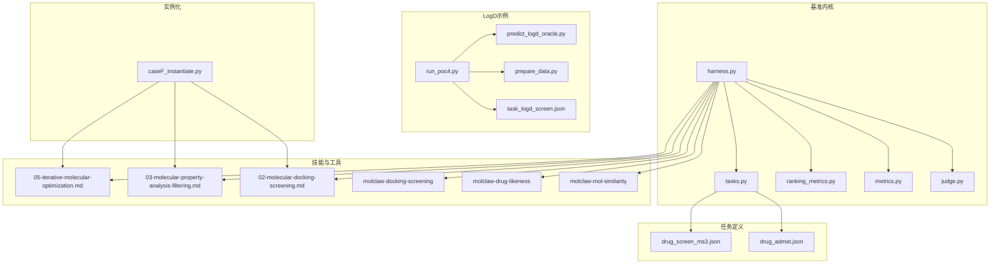
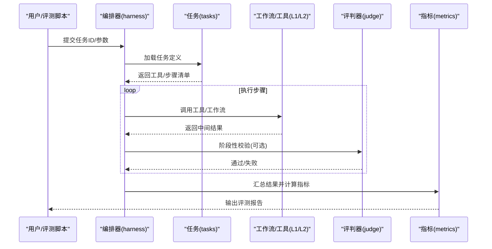
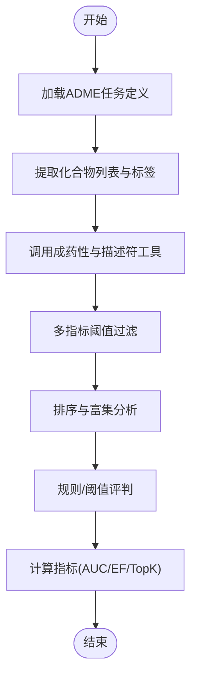
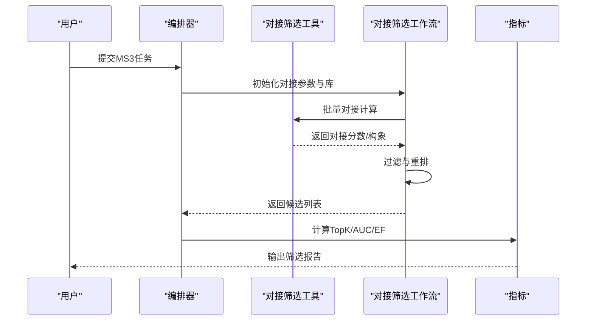
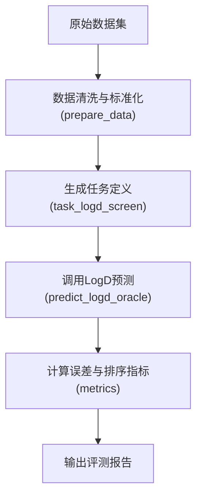
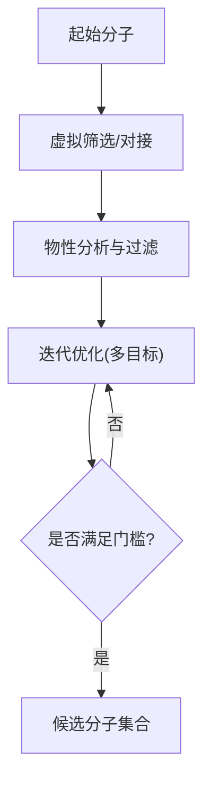
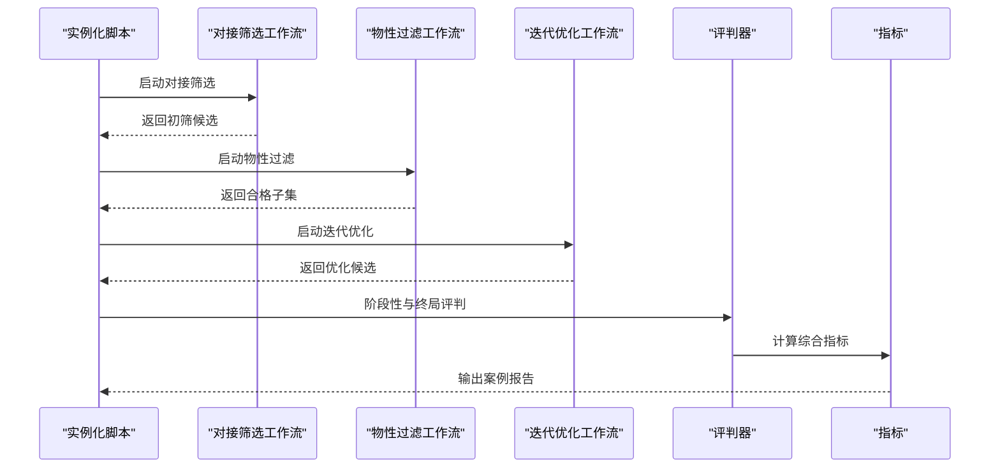
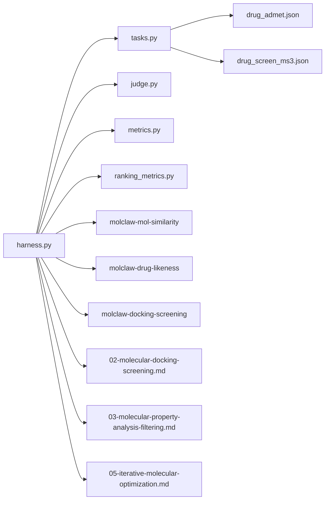

# PharmaBench药物研发基准

<cite>
**本文引用的文件**   
- [autonomy_mvp/core/harness.py](file://autonomy_mvp/core/harness.py)
- [autonomy_mvp/core/judge.py](file://autonomy_mvp/core/judge.py)
- [autonomy_mvp/core/metrics.py](file://autonomy_mvp/core/metrics.py)
- [autonomy_mvp/core/ranking_metrics.py](file://autonomy_mvp/core/ranking_metrics.py)
- [autonomy_mvp/core/tasks.py](file://autonomy_mvp/core/tasks.py)
- [autonomy_mvp/tasks/drug_admet.json](file://autonomy_mvp/tasks/drug_admet.json)
- [autonomy_mvp/tasks/drug_screen_ms3.json](file://autonomy_mvp/tasks/drug_screen_ms3.json)
- [task7/poc4_pharmabench/run_poc4.py](file://task7/poc4_pharmabench/run_poc4.py)
- [task7/poc4_pharmabench/tools/predict_logd_oracle.py](file://task7/poc4_pharmabench/tools/predict_logd_oracle.py)
- [task7/poc4_pharmabench/data/prepare_data.py](file://task7/poc4_pharmabench/data/prepare_data.py)
- [task7/poc4_pharmabench/task_logd_screen.json](file://task7/poc4_pharmabench/task_logd_screen.json)
- [docs/prd/molbench_repo/skills/L1_tools/molclaw-mol-similarity/tool.md](file://docs/prd/molbench_repo/skills/L1_tools/molclaw-mol-similarity/tool.md)
- [docs/prd/molbench_repo/skills/L1_tools/molclaw-drug-likeness/tool.md](file://docs/prd/molbench_repo/skills/L1_tools/molclaw-drug-likeness/tool.md)
- [docs/prd/molbench_repo/skills/L1_tools/molclaw-docking-screening/tool.md](file://docs/prd/molbench_repo/skills/L1_tools/molclaw-docking-screening/tool.md)
- [docs/prd/molbench_repo/skills/L2_workflows/02-molecular-docking-screening.md](file://docs/prd/molbench_repo/skills/L2_workflows/02-molecular-docking-screening.md)
- [docs/prd/molbench_repo/skills/L2_workflows/03-molecular-property-analysis-filtering.md](file://docs/prd/molbench_repo/skills/L2_workflows/03-molecular-property-analysis-filtering.md)
- [docs/prd/molbench_repo/skills/L2_workflows/05-iterative-molecular-optimization.md](file://docs/prd/molbench_repo/skills/L2_workflows/05-iterative-molecular-optimization.md)
- [longhorizon/instantiate/caseF_instantiate.py](file://longhorizon/instantiate/caseF_instantiate.py)
</cite>

## 目录
1. [简介](#简介)
2. [项目结构](#项目结构)
3. [核心组件](#核心组件)
4. [架构总览](#架构总览)
5. [详细组件分析](#详细组件分析)
6. [依赖关系分析](#依赖关系分析)
7. [性能与可扩展性](#性能与可扩展性)
8. [故障排查指南](#故障排查指南)
9. [结论](#结论)
10. [附录](#附录)

## 简介
PharmaBench是一个面向药物研发的自动化基准，覆盖药物性质预测、ADME特性评估与安全性分析等关键任务。其目标是通过可复现的评测框架、工具链与工作流，支撑从化合物筛选、活性优化到毒性评估的端到端流程，并对接真实药物发现案例与监管合规要求。本仓库同时提供：
- 通用评测编排与评分能力（harness、judge、metrics）
- 针对药物ADME与高通量筛选的任务定义
- LogD值预测模型与分子描述符计算、药物相似性分析的工具化封装
- 多步工作流（分子对接筛选、物性分析与过滤、迭代优化）
- 真实靶点验证与候选优化的实例化脚本

## 项目结构
仓库采用“基准内核 + 任务定义 + 技能工具 + 工作流 + 实例化脚本”的分层组织方式：
- 基准内核：统一的任务执行、评判与指标计算
- 任务定义：以JSON形式描述ADME与筛选任务
- 技能工具：L1原子工具（如分子相似性、成药性、对接筛选）与L2工作流（对接筛选、物性过滤、迭代优化）
- 实例化脚本：将具体研究问题实例化为可运行的评测用例

图表来源
- [autonomy_mvp/core/harness.py](file://autonomy_mvp/core/harness.py)
- [autonomy_mvp/core/judge.py](file://autonomy_mvp/core/judge.py)
- [autonomy_mvp/core/metrics.py](file://autonomy_mvp/core/metrics.py)
- [autonomy_mvp/core/ranking_metrics.py](file://autonomy_mvp/core/ranking_metrics.py)
- [autonomy_mvp/core/tasks.py](file://autonomy_mvp/core/tasks.py)
- [autonomy_mvp/tasks/drug_admet.json](file://autonomy_mvp/tasks/drug_admet.json)
- [autonomy_mvp/tasks/drug_screen_ms3.json](file://autonomy_mvp/tasks/drug_screen_ms3.json)
- [docs/prd/molbench_repo/skills/L1_tools/molclaw-mol-similarity/tool.md](file://docs/prd/molbench_repo/skills/L1_tools/molclaw-mol-similarity/tool.md)
- [docs/prd/molbench_repo/skills/L1_tools/molclaw-drug-likeness/tool.md](file://docs/prd/molbench_repo/skills/L1_tools/molclaw-drug-likeness/tool.md)
- [docs/prd/molbench_repo/skills/L1_tools/molclaw-docking-screening/tool.md](file://docs/prd/molbench_repo/skills/L1_tools/molclaw-docking-screening/tool.md)
- [docs/prd/molbench_repo/skills/L2_workflows/02-molecular-docking-screening.md](file://docs/prd/molbench_repo/skills/L2_workflows/02-molecular-docking-screening.md)
- [docs/prd/molbench_repo/skills/L2_workflows/03-molecular-property-analysis-filtering.md](file://docs/prd/molbench_repo/skills/L2_workflows/03-molecular-property-analysis-filtering.md)
- [docs/prd/molbench_repo/skills/L2_workflows/05-iterative-molecular-optimization.md](file://docs/prd/molbench_repo/skills/L2_workflows/05-iterative-molecular-optimization.md)
- [task7/poc4_pharmabench/run_poc4.py](file://task7/poc4_pharmabench/run_poc4.py)
- [task7/poc4_pharmabench/tools/predict_logd_oracle.py](file://task7/poc4_pharmabench/tools/predict_logd_oracle.py)
- [task7/poc4_pharmabench/data/prepare_data.py](file://task7/poc4_pharmabench/data/prepare_data.py)
- [task7/poc4_pharmabench/task_logd_screen.json](file://task7/poc4_pharmabench/task_logd_screen.json)
- [longhorizon/instantiate/caseF_instantiate.py](file://longhorizon/instantiate/caseF_instantiate.py)

章节来源
- [autonomy_mvp/core/harness.py](file://autonomy_mvp/core/harness.py)
- [autonomy_mvp/core/judge.py](file://autonomy_mvp/core/judge.py)
- [autonomy_mvp/core/metrics.py](file://autonomy_mvp/core/metrics.py)
- [autonomy_mvp/core/ranking_metrics.py](file://autonomy_mvp/core/ranking_metrics.py)
- [autonomy_mvp/core/tasks.py](file://autonomy_mvp/core/tasks.py)
- [autonomy_mvp/tasks/drug_admet.json](file://autonomy_mvp/tasks/drug_admet.json)
- [autonomy_mvp/tasks/drug_screen_ms3.json](file://autonomy_mvp/tasks/drug_screen_ms3.json)
- [task7/poc4_pharmabench/run_poc4.py](file://task7/poc4_pharmabench/run_poc4.py)
- [task7/poc4_pharmabench/tools/predict_logd_oracle.py](file://task7/poc4_pharmabench/tools/predict_logd_oracle.py)
- [task7/poc4_pharmabench/data/prepare_data.py](file://task7/poc4_pharmabench/data/prepare_data.py)
- [task7/poc4_pharmabench/task_logd_screen.json](file://task7/poc4_pharmabench/task_logd_screen.json)
- [docs/prd/molbench_repo/skills/L1_tools/molclaw-mol-similarity/tool.md](file://docs/prd/molbench_repo/skills/L1_tools/molclaw-mol-similarity/tool.md)
- [docs/prd/molbench_repo/skills/L1_tools/molclaw-drug-likeness/tool.md](file://docs/prd/molbench_repo/skills/L1_tools/molclaw-drug-likeness/tool.md)
- [docs/prd/molbench_repo/skills/L1_tools/molclaw-docking-screening/tool.md](file://docs/prd/molbench_repo/skills/L1_tools/molclaw-docking-screening/tool.md)
- [docs/prd/molbench_repo/skills/L2_workflows/02-molecular-docking-screening.md](file://docs/prd/molbench_repo/skills/L2_workflows/02-molecular-docking-screening.md)
- [docs/prd/molbench_repo/skills/L2_workflows/03-molecular-property-analysis-filtering.md](file://docs/prd/molbench_repo/skills/L2_workflows/03-molecular-property-analysis-filtering.md)
- [docs/prd/molbench_repo/skills/L2_workflows/05-iterative-molecular-optimization.md](file://docs/prd/molbench_repo/skills/L2_workflows/05-iterative-molecular-optimization.md)
- [longhorizon/instantiate/caseF_instantiate.py](file://longhorizon/instantiate/caseF_instantiate.py)

## 核心组件
- 基准编排器（Harness）
  - 负责加载任务、调度工具/工作流、收集中间结果与最终输出
  - 与评判器与指标模块协作，完成端到端评测闭环
- 评判器（Judge）
  - 对模型或Agent的输出进行规则校验、阈值判定与一致性检查
- 指标与排序指标（Metrics & Ranking Metrics）
  - 提供回归误差、分类准确率、AUC、富集因子、Top-K命中率等常用指标
  - 支持按任务类型选择合适的评价函数
- 任务定义（Tasks）
  - 通过JSON声明式定义任务输入、工具调用序列、期望输出与评分标准
  - 包含ADME评估与MS3筛选两类典型任务

章节来源
- [autonomy_mvp/core/harness.py](file://autonomy_mvp/core/harness.py)
- [autonomy_mvp/core/judge.py](file://autonomy_mvp/core/judge.py)
- [autonomy_mvp/core/metrics.py](file://autonomy_mvp/core/metrics.py)
- [autonomy_mvp/core/ranking_metrics.py](file://autonomy_mvp/core/ranking_metrics.py)
- [autonomy_mvp/core/tasks.py](file://autonomy_mvp/core/tasks.py)
- [autonomy_mvp/tasks/drug_admet.json](file://autonomy_mvp/tasks/drug_admet.json)
- [autonomy_mvp/tasks/drug_screen_ms3.json](file://autonomy_mvp/tasks/drug_screen_ms3.json)

## 架构总览
PharmaBench采用“任务驱动+工具编排”的架构：任务JSON描述需要调用的工具与工作流；编排器根据任务配置依次执行；评判器与指标模块对过程与结果进行量化评估。

图表来源
- [autonomy_mvp/core/harness.py](file://autonomy_mvp/core/harness.py)
- [autonomy_mvp/core/tasks.py](file://autonomy_mvp/core/tasks.py)
- [autonomy_mvp/core/judge.py](file://autonomy_mvp/core/judge.py)
- [autonomy_mvp/core/metrics.py](file://autonomy_mvp/core/metrics.py)
- [docs/prd/molbench_repo/skills/L2_workflows/02-molecular-docking-screening.md](file://docs/prd/molbench_repo/skills/L2_workflows/02-molecular-docking-screening.md)
- [docs/prd/molbench_repo/skills/L2_workflows/03-molecular-property-analysis-filtering.md](file://docs/prd/molbench_repo/skills/L2_workflows/03-molecular-property-analysis-filtering.md)
- [docs/prd/molbench_repo/skills/L2_workflows/05-iterative-molecular-optimization.md](file://docs/prd/molbench_repo/skills/L2_workflows/05-iterative-molecular-optimization.md)

## 详细组件分析

### 任务一：ADME特性评估
- 任务目标
  - 基于化合物结构与上下文信息，预测吸收、分布、代谢、排泄等关键属性，并进行综合评估与排序
- 数据与输入
  - 使用任务JSON定义输入字段（如SMILES、靶点、实验条件等）
- 工具与工作流
  - L1工具：成药性打分、分子描述符计算
  - L2工作流：物性分析与过滤（多指标阈值筛选）
- 评判与指标
  - 回归误差（如MAE/RMSE）、分类准确率、AUC、富集因子等
- 参考实现路径
  - 任务定义：[drug_admet.json](file://autonomy_mvp/tasks/drug_admet.json)
  - 指标与排序：[metrics.py](file://autonomy_mvp/core/metrics.py)、[ranking_metrics.py](file://autonomy_mvp/core/ranking_metrics.py)
  - 工作流：[03-molecular-property-analysis-filtering.md](file://docs/prd/molbench_repo/skills/L2_workflows/03-molecular-property-analysis-filtering.md)

图表来源
- [autonomy_mvp/tasks/drug_admet.json](file://autonomy_mvp/tasks/drug_admet.json)
- [autonomy_mvp/core/metrics.py](file://autonomy_mvp/core/metrics.py)
- [autonomy_mvp/core/ranking_metrics.py](file://autonomy_mvp/core/ranking_metrics.py)
- [docs/prd/molbench_repo/skills/L1_tools/molclaw-drug-likeness/tool.md](file://docs/prd/molbench_repo/skills/L1_tools/molclaw-drug-likeness/tool.md)
- [docs/prd/molbench_repo/skills/L2_workflows/03-molecular-property-analysis-filtering.md](file://docs/prd/molbench_repo/skills/L2_workflows/03-molecular-property-analysis-filtering.md)

章节来源
- [autonomy_mvp/tasks/drug_admet.json](file://autonomy_mvp/tasks/drug_admet.json)
- [autonomy_mvp/core/metrics.py](file://autonomy_mvp/core/metrics.py)
- [autonomy_mvp/core/ranking_metrics.py](file://autonomy_mvp/core/ranking_metrics.py)
- [docs/prd/molbench_repo/skills/L1_tools/molclaw-drug-likeness/tool.md](file://docs/prd/molbench_repo/skills/L1_tools/molclaw-drug-likeness/tool.md)
- [docs/prd/molbench_repo/skills/L2_workflows/03-molecular-property-analysis-filtering.md](file://docs/prd/molbench_repo/skills/L2_workflows/03-molecular-property-analysis-filtering.md)

### 任务二：高通量筛选（MS3）
- 任务目标
  - 在大规模化合物库中进行虚拟筛选，结合对接评分与物性约束快速定位潜在活性分子
- 工具与工作流
  - L1工具：分子对接筛选
  - L2工作流：对接筛选后处理与排序
- 评判与指标
  - Top-K命中率、富集因子、AUC、ROC-AUC等
- 参考实现路径
  - 任务定义：[drug_screen_ms3.json](file://autonomy_mvp/tasks/drug_screen_ms3.json)
  - 工具：[molclaw-docking-screening/tool.md](file://docs/prd/molbench_repo/skills/L1_tools/molclaw-docking-screening/tool.md)
  - 工作流：[02-molecular-docking-screening.md](file://docs/prd/molbench_repo/skills/L2_workflows/02-molecular-docking-screening.md)

图表来源
- [autonomy_mvp/tasks/drug_screen_ms3.json](file://autonomy_mvp/tasks/drug_screen_ms3.json)
- [docs/prd/molbench_repo/skills/L1_tools/molclaw-docking-screening/tool.md](file://docs/prd/molbench_repo/skills/L1_tools/molclaw-docking-screening/tool.md)
- [docs/prd/molbench_repo/skills/L2_workflows/02-molecular-docking-screening.md](file://docs/prd/molbench_repo/skills/L2_workflows/02-molecular-docking-screening.md)
- [autonomy_mvp/core/metrics.py](file://autonomy_mvp/core/metrics.py)

章节来源
- [autonomy_mvp/tasks/drug_screen_ms3.json](file://autonomy_mvp/tasks/drug_screen_ms3.json)
- [docs/prd/molbench_repo/skills/L1_tools/molclaw-docking-screening/tool.md](file://docs/prd/molbench_repo/skills/L1_tools/molclaw-docking-screening/tool.md)
- [docs/prd/molbench_repo/skills/L2_workflows/02-molecular-docking-screening.md](file://docs/prd/molbench_repo/skills/L2_workflows/02-molecular-docking-screening.md)
- [autonomy_mvp/core/metrics.py](file://autonomy_mvp/core/metrics.py)

### LogD值预测与分子相似性分析
- LogD预测
  - 通过Oracle模型对LogD进行预测，配合数据准备与任务定义完成端到端评测
  - 参考路径：
    - 运行入口：[run_poc4.py](file://task7/poc4_pharmabench/run_poc4.py)
    - 预测工具：[predict_logd_oracle.py](file://task7/poc4_pharmabench/tools/predict_logd_oracle.py)
    - 数据准备：[prepare_data.py](file://task7/poc4_pharmabench/data/prepare_data.py)
    - 任务定义：[task_logd_screen.json](file://task7/poc4_pharmabench/task_logd_screen.json)
- 分子相似性
  - 基于指纹/图核等方法计算分子间相似度，用于聚类、去重与检索
  - 参考路径：[molclaw-mol-similarity/tool.md](file://docs/prd/molbench_repo/skills/L1_tools/molclaw-mol-similarity/tool.md)

图表来源
- [task7/poc4_pharmabench/run_poc4.py](file://task7/poc4_pharmabench/run_poc4.py)
- [task7/poc4_pharmabench/tools/predict_logd_oracle.py](file://task7/poc4_pharmabench/tools/predict_logd_oracle.py)
- [task7/poc4_pharmabench/data/prepare_data.py](file://task7/poc4_pharmabench/data/prepare_data.py)
- [task7/poc4_pharmabench/task_logd_screen.json](file://task7/poc4_pharmabench/task_logd_screen.json)
- [autonomy_mvp/core/metrics.py](file://autonomy_mvp/core/metrics.py)

章节来源
- [task7/poc4_pharmabench/run_poc4.py](file://task7/poc4_pharmabench/run_poc4.py)
- [task7/poc4_pharmabench/tools/predict_logd_oracle.py](file://task7/poc4_pharmabench/tools/predict_logd_oracle.py)
- [task7/poc4_pharmabench/data/prepare_data.py](file://task7/poc4_pharmabench/data/prepare_data.py)
- [task7/poc4_pharmabench/task_logd_screen.json](file://task7/poc4_pharmabench/task_logd_screen.json)
- [docs/prd/molbench_repo/skills/L1_tools/molclaw-mol-similarity/tool.md](file://docs/prd/molbench_repo/skills/L1_tools/molclaw-mol-similarity/tool.md)

### 迭代分子优化与候选优化
- 目标
  - 在保持活性的前提下优化多项性质（如溶解度、渗透性、毒性风险），形成可落地的候选分子
- 工作流
  - 对接筛选 → 物性分析与过滤 → 迭代优化（多目标权衡）
- 参考路径
  - 工作流文档：
    - [02-molecular-docking-screening.md](file://docs/prd/molbench_repo/skills/L2_workflows/02-molecular-docking-screening.md)
    - [03-molecular-property-analysis-filtering.md](file://docs/prd/molbench_repo/skills/L2_workflows/03-molecular-property-analysis-filtering.md)
    - [05-iterative-molecular-optimization.md](file://docs/prd/molbench_repo/skills/L2_workflows/05-iterative-molecular-optimization.md)

图表来源
- [docs/prd/molbench_repo/skills/L2_workflows/02-molecular-docking-screening.md](file://docs/prd/molbench_repo/skills/L2_workflows/02-molecular-docking-screening.md)
- [docs/prd/molbench_repo/skills/L2_workflows/03-molecular-property-analysis-filtering.md](file://docs/prd/molbench_repo/skills/L2_workflows/03-molecular-property-analysis-filtering.md)
- [docs/prd/molbench_repo/skills/L2_workflows/05-iterative-molecular-optimization.md](file://docs/prd/molbench_repo/skills/L2_workflows/05-iterative-molecular-optimization.md)

章节来源
- [docs/prd/molbench_repo/skills/L2_workflows/02-molecular-docking-screening.md](file://docs/prd/molbench_repo/skills/L2_workflows/02-molecular-docking-screening.md)
- [docs/prd/molbench_repo/skills/L2_workflows/03-molecular-property-analysis-filtering.md](file://docs/prd/molbench_repo/skills/L2_workflows/03-molecular-property-analysis-filtering.md)
- [docs/prd/molbench_repo/skills/L2_workflows/05-iterative-molecular-optimization.md](file://docs/prd/molbench_repo/skills/L2_workflows/05-iterative-molecular-optimization.md)

### 真实药物发现案例：从靶点到候选优化
- 案例说明
  - 通过实例化脚本将特定疾病/靶点场景转化为可执行的评测任务，串联对接筛选、物性过滤与迭代优化
- 参考路径
  - 实例化脚本：[caseF_instantiate.py](file://longhorizon/instantiate/caseF_instantiate.py)
  - 相关L2工作流：见上文“迭代分子优化与候选优化”

图表来源
- [longhorizon/instantiate/caseF_instantiate.py](file://longhorizon/instantiate/caseF_instantiate.py)
- [docs/prd/molbench_repo/skills/L2_workflows/02-molecular-docking-screening.md](file://docs/prd/molbench_repo/skills/L2_workflows/02-molecular-docking-screening.md)
- [docs/prd/molbench_repo/skills/L2_workflows/03-molecular-property-analysis-filtering.md](file://docs/prd/molbench_repo/skills/L2_workflows/03-molecular-property-analysis-filtering.md)
- [docs/prd/molbench_repo/skills/L2_workflows/05-iterative-molecular-optimization.md](file://docs/prd/molbench_repo/skills/L2_workflows/05-iterative-molecular-optimization.md)
- [autonomy_mvp/core/judge.py](file://autonomy_mvp/core/judge.py)
- [autonomy_mvp/core/metrics.py](file://autonomy_mvp/core/metrics.py)

章节来源
- [longhorizon/instantiate/caseF_instantiate.py](file://longhorizon/instantiate/caseF_instantiate.py)
- [docs/prd/molbench_repo/skills/L2_workflows/02-molecular-docking-screening.md](file://docs/prd/molbench_repo/skills/L2_workflows/02-molecular-docking-screening.md)
- [docs/prd/molbench_repo/skills/L2_workflows/03-molecular-property-analysis-filtering.md](file://docs/prd/molbench_repo/skills/L2_workflows/03-molecular-property-analysis-filtering.md)
- [docs/prd/molbench_repo/skills/L2_workflows/05-iterative-molecular-optimization.md](file://docs/prd/molbench_repo/skills/L2_workflows/05-iterative-molecular-optimization.md)
- [autonomy_mvp/core/judge.py](file://autonomy_mvp/core/judge.py)
- [autonomy_mvp/core/metrics.py](file://autonomy_mvp/core/metrics.py)

## 依赖关系分析
- 组件耦合
  - 编排器依赖任务定义、工具与工作流；评判器与指标模块为横切关注点
  - 任务JSON作为契约，解耦了业务逻辑与执行引擎
- 外部集成点
  - L1工具（分子相似性、成药性、对接筛选）与L2工作流构成外部能力边界
  - LogD Oracle作为专用预测服务被调用
- 循环依赖
  - 当前结构无直接循环依赖；通过JSON与接口抽象降低耦合

图表来源
- [autonomy_mvp/core/harness.py](file://autonomy_mvp/core/harness.py)
- [autonomy_mvp/core/tasks.py](file://autonomy_mvp/core/tasks.py)
- [autonomy_mvp/core/judge.py](file://autonomy_mvp/core/judge.py)
- [autonomy_mvp/core/metrics.py](file://autonomy_mvp/core/metrics.py)
- [autonomy_mvp/core/ranking_metrics.py](file://autonomy_mvp/core/ranking_metrics.py)
- [autonomy_mvp/tasks/drug_admet.json](file://autonomy_mvp/tasks/drug_admet.json)
- [autonomy_mvp/tasks/drug_screen_ms3.json](file://autonomy_mvp/tasks/drug_screen_ms3.json)
- [docs/prd/molbench_repo/skills/L1_tools/molclaw-mol-similarity/tool.md](file://docs/prd/molbench_repo/skills/L1_tools/molclaw-mol-similarity/tool.md)
- [docs/prd/molbench_repo/skills/L1_tools/molclaw-drug-likeness/tool.md](file://docs/prd/molbench_repo/skills/L1_tools/molclaw-drug-likeness/tool.md)
- [docs/prd/molbench_repo/skills/L1_tools/molclaw-docking-screening/tool.md](file://docs/prd/molbench_repo/skills/L1_tools/molclaw-docking-screening/tool.md)
- [docs/prd/molbench_repo/skills/L2_workflows/02-molecular-docking-screening.md](file://docs/prd/molbench_repo/skills/L2_workflows/02-molecular-docking-screening.md)
- [docs/prd/molbench_repo/skills/L2_workflows/03-molecular-property-analysis-filtering.md](file://docs/prd/molbench_repo/skills/L2_workflows/03-molecular-property-analysis-filtering.md)
- [docs/prd/molbench_repo/skills/L2_workflows/05-iterative-molecular-optimization.md](file://docs/prd/molbench_repo/skills/L2_workflows/05-iterative-molecular-optimization.md)

章节来源
- [autonomy_mvp/core/harness.py](file://autonomy_mvp/core/harness.py)
- [autonomy_mvp/core/tasks.py](file://autonomy_mvp/core/tasks.py)
- [autonomy_mvp/core/judge.py](file://autonomy_mvp/core/judge.py)
- [autonomy_mvp/core/metrics.py](file://autonomy_mvp/core/metrics.py)
- [autonomy_mvp/core/ranking_metrics.py](file://autonomy_mvp/core/ranking_metrics.py)
- [autonomy_mvp/tasks/drug_admet.json](file://autonomy_mvp/tasks/drug_admet.json)
- [autonomy_mvp/tasks/drug_screen_ms3.json](file://autonomy_mvp/tasks/drug_screen_ms3.json)
- [docs/prd/molbench_repo/skills/L1_tools/molclaw-mol-similarity/tool.md](file://docs/prd/molbench_repo/skills/L1_tools/molclaw-mol-similarity/tool.md)
- [docs/prd/molbench_repo/skills/L1_tools/molclaw-drug-likeness/tool.md](file://docs/prd/molbench_repo/skills/L1_tools/molclaw-drug-likeness/tool.md)
- [docs/prd/molbench_repo/skills/L1_tools/molclaw-docking-screening/tool.md](file://docs/prd/molbench_repo/skills/L1_tools/molclaw-docking-screening/tool.md)
- [docs/prd/molbench_repo/skills/L2_workflows/02-molecular-docking-screening.md](file://docs/prd/molbench_repo/skills/L2_workflows/02-molecular-docking-screening.md)
- [docs/prd/molbench_repo/skills/L2_workflows/03-molecular-property-analysis-filtering.md](file://docs/prd/molbench_repo/skills/L2_workflows/03-molecular-property-analysis-filtering.md)
- [docs/prd/molbench_repo/skills/L2_workflows/05-iterative-molecular-optimization.md](file://docs/prd/molbench_repo/skills/L2_workflows/05-iterative-molecular-optimization.md)

## 性能与可扩展性
- 并行与批处理
  - 对接筛选与描述符计算适合批处理；建议按批次分片与并发执行以提升吞吐
- 缓存与复用
  - 对稳定的中间结果（如描述符、构象）进行缓存，避免重复计算
- 资源管理
  - 对接与MD类任务需GPU/CPU配额控制；建议设置超时与重试策略
- 可扩展性
  - 新增任务只需扩展任务JSON与相应工具/工作流；编排器无需改动
- 指标稳定性
  - 对随机性较强的步骤（如采样）应固定随机种子并多次重复取均值

## 故障排查指南
- 常见错误
  - 任务JSON字段缺失或类型不匹配：检查任务定义与输入格式
  - 工具调用失败：确认环境依赖、输入文件路径与权限
  - 指标计算异常：核对标签对齐、空值与异常值处理
- 定位方法
  - 启用详细日志，记录每一步输入输出
  - 使用评判器进行阶段性断言，尽早暴露问题
- 恢复策略
  - 失败重试与断点续跑；对耗时步骤增加幂等设计

章节来源
- [autonomy_mvp/core/judge.py](file://autonomy_mvp/core/judge.py)
- [autonomy_mvp/core/metrics.py](file://autonomy_mvp/core/metrics.py)
- [autonomy_mvp/core/harness.py](file://autonomy_mvp/core/harness.py)

## 结论
PharmaBench通过统一的编排与评测框架，将药物性质预测、ADME评估、安全性分析与高通量筛选整合为可复现实验。借助L1工具与L2工作流的组合，可实现从靶点识别到候选优化的完整闭环，并为监管与审批流程提供数字化支撑。未来可在更多靶点与适应症上扩展实例化案例，持续完善指标体系与工具生态。

## 附录
- 术语
  - LogD：表观分配系数，反映分子在两相中的分配行为
  - ADME：吸收、分布、代谢、排泄
  - EF：富集因子，衡量筛选早期富集活性分子的能力
- 最佳实践
  - 明确任务契约（JSON）与工具接口
  - 建立基线与对照实验，确保可比性
  - 对不确定性进行量化与敏感性分析