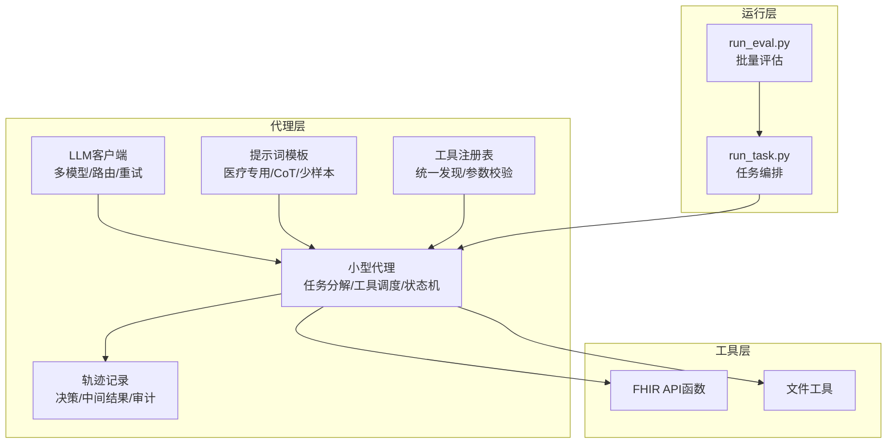
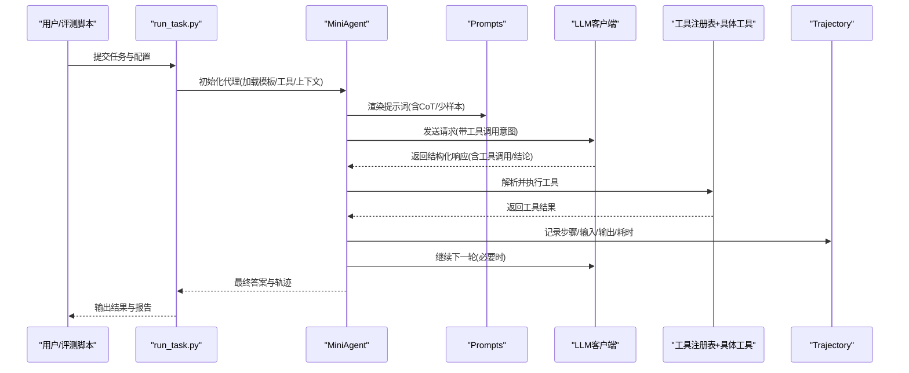
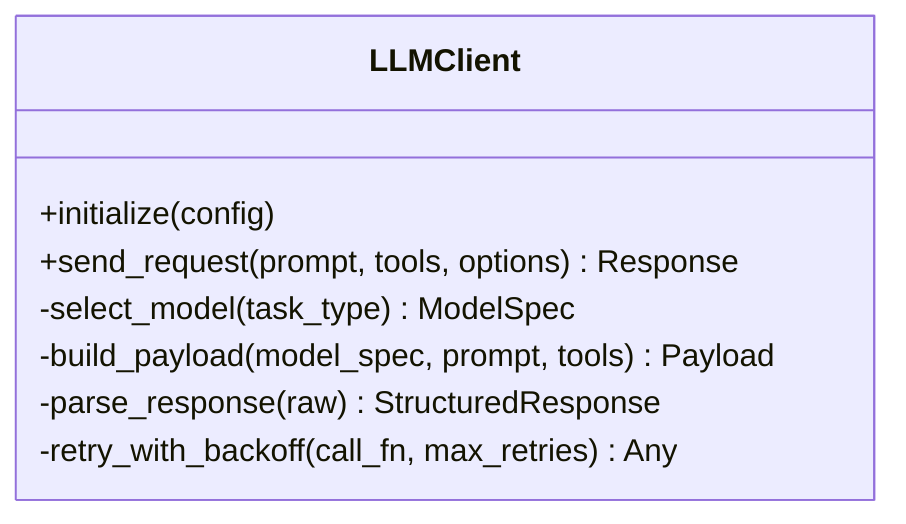
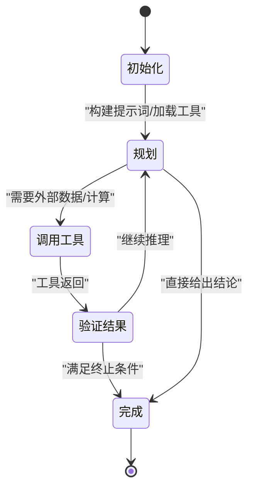
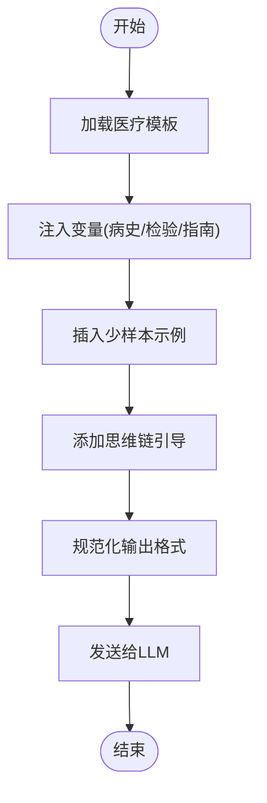
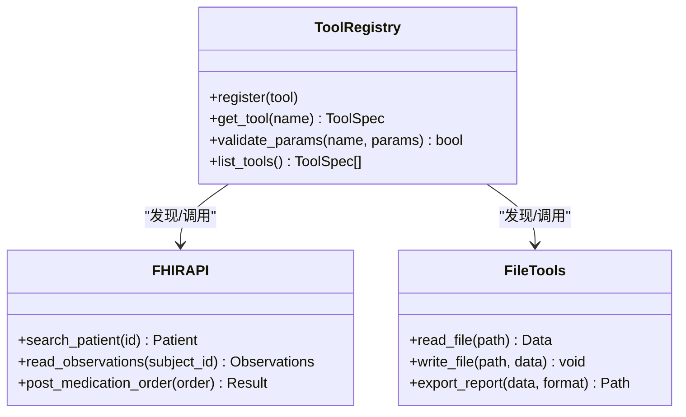
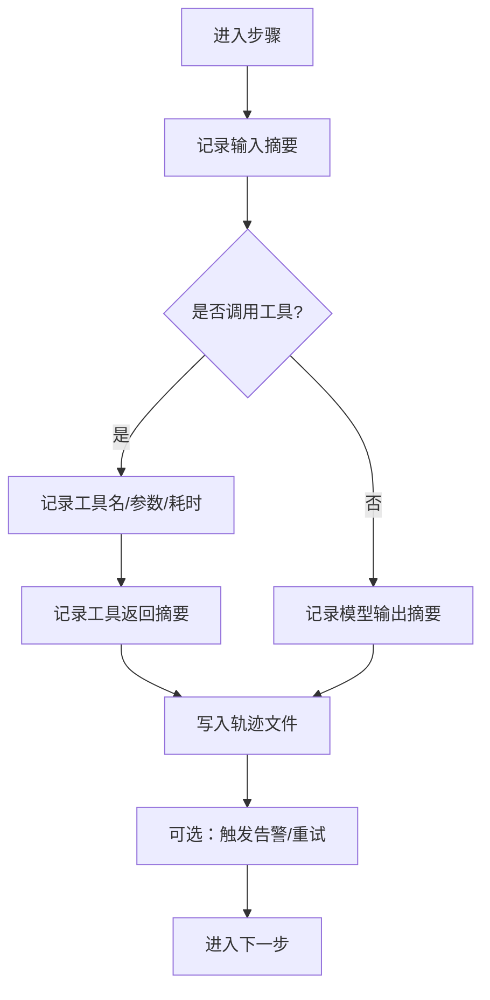
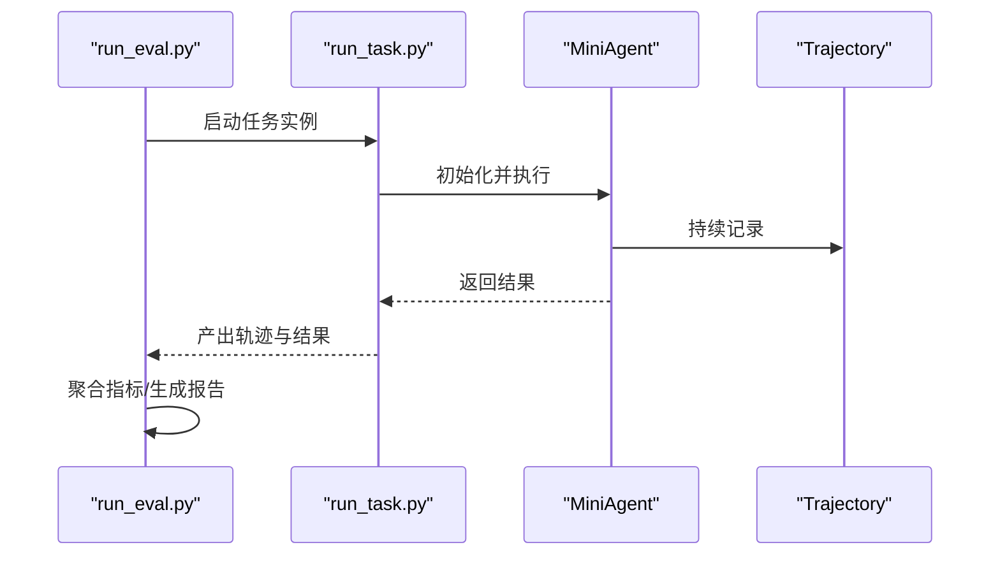
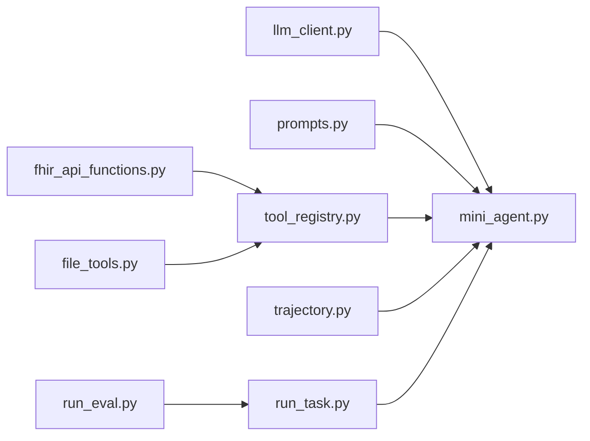

# AI代理系统

<cite>
**本文引用的文件**   
- [agent/llm_client.py](file://task7/poc3_physicianbench/PhysicianBench/agent/llm_client.py)
- [agent/mini_agent.py](file://task7/poc3_physicianbench/PhysicianBench/agent/mini_agent.py)
- [agent/prompts.py](file://task7/poc3_physicianbench/PhysicianBench/agent/prompts.py)
- [agent/tool_registry.py](file://task7/poc3_physicianbench/PhysicianBench/agent/tool_registry.py)
- [agent/trajectory.py](file://task7/poc3_physicianbench/PhysicianBench/agent/trajectory.py)
- [tools/fhir_api_functions.py](file://task7/poc3_physicianbench/PhysicianBench/tools/fhir_api_functions.py)
- [tools/file_tools.py](file://task7/poc3_physicianbench/PhysicianBench/tools/file_tools.py)
- [scripts/run_task.py](file://task7/poc3_physicianbench/PhysicianBench/scripts/run_task.py)
- [scripts/run_eval.py](file://task7/poc3_physicianbench/PhysicianBench/scripts/run_eval.py)
- [pyproject.toml](file://task7/poc3_physicianbench/PhysicianBench/pyproject.toml)
</cite>

## 目录
1. [简介](#简介)
2. [项目结构](#项目结构)
3. [核心组件](#核心组件)
4. [架构总览](#架构总览)
5. [详细组件分析](#详细组件分析)
6. [依赖关系分析](#依赖关系分析)
7. [性能与优化](#性能与优化)
8. [故障排查指南](#故障排查指南)
9. [结论](#结论)
10. [附录：自定义代理开发指南](#附录自定义代理开发指南)

## 简介
本技术文档面向PhysicianBench的AI代理系统，聚焦以下目标：
- 大语言模型客户端实现：多模型支持、请求路由与响应处理
- 小型代理架构：任务分解、工具调用与状态管理
- 提示词工程最佳实践：医疗领域专用模板、思维链推理与少样本学习
- 轨迹记录与调试机制：决策过程追踪、中间结果保存与分析工具
- 代理性能优化：缓存策略与错误恢复机制
- 扩展接口与自定义代理开发指南

## 项目结构
PhysicianBench子项目的关键代码位于 task7/poc3_physicianbench/PhysicianBench 下，核心模块包括：
- agent：LLM客户端、小型代理、提示词模板、工具注册表、轨迹记录
- tools：FHIR API封装与通用文件工具
- scripts：任务运行与评估脚本
- tasks/v1：按临床场景划分的任务定义与评测配置
- website：前端展示（与本技术文档关联度较低）

图表来源
- [agent/llm_client.py](file://task7/poc3_physicianbench/PhysicianBench/agent/llm_client.py)
- [agent/mini_agent.py](file://task7/poc3_physicianbench/PhysicianBench/agent/mini_agent.py)
- [agent/prompts.py](file://task7/poc3_physicianbench/PhysicianBench/agent/prompts.py)
- [agent/tool_registry.py](file://task7/poc3_physicianbench/PhysicianBench/agent/tool_registry.py)
- [agent/trajectory.py](file://task7/poc3_physicianbench/PhysicianBench/agent/trajectory.py)
- [tools/fhir_api_functions.py](file://task7/poc3_physicianbench/PhysicianBench/tools/fhir_api_functions.py)
- [tools/file_tools.py](file://task7/poc3_physicianbench/PhysicianBench/tools/file_tools.py)
- [scripts/run_task.py](file://task7/poc3_physicianbench/PhysicianBench/scripts/run_task.py)
- [scripts/run_eval.py](file://task7/poc3_physicianbench/PhysicianBench/scripts/run_eval.py)

章节来源
- [pyproject.toml](file://task7/poc3_physicianbench/PhysicianBench/pyproject.toml)

## 核心组件
- 大语言模型客户端：抽象多后端接入，提供统一的请求构造、路由选择、重试与超时控制、结构化响应解析。
- 小型代理：基于状态机的任务执行器，负责将复杂问题拆解为子步骤，动态选择并调用工具，维护会话上下文与中间产物。
- 提示词工程：集中管理医疗领域提示模板，支持思维链引导与少样本示例注入，保证输出格式稳定。
- 工具注册表：统一声明工具元数据、参数契约与权限范围，提供运行时发现与校验能力。
- 轨迹记录：持久化每一步的输入、工具调用、返回结果与模型思考摘要，便于回溯与评估。

章节来源
- [agent/llm_client.py](file://task7/poc3_physicianbench/PhysicianBench/agent/llm_client.py)
- [agent/mini_agent.py](file://task7/poc3_physicianbench/PhysicianBench/agent/mini_agent.py)
- [agent/prompts.py](file://task7/poc3_physicianbench/PhysicianBench/agent/prompts.py)
- [agent/tool_registry.py](file://task7/poc3_physicianbench/PhysicianBench/agent/tool_registry.py)
- [agent/trajectory.py](file://task7/poc3_physicianbench/PhysicianBench/agent/trajectory.py)

## 架构总览
整体采用“代理-工具-模型”三层解耦设计：
- 代理层通过提示词模板生成结构化指令，驱动LLM进行推理与规划
- 工具层以注册表为中心，暴露FHIR查询、文件读写等能力
- 运行层通过脚本编排任务生命周期，聚合轨迹与评测指标

图表来源
- [scripts/run_task.py](file://task7/poc3_physicianbench/PhysicianBench/scripts/run_task.py)
- [agent/mini_agent.py](file://task7/poc3_physicianbench/PhysicianBench/agent/mini_agent.py)
- [agent/prompts.py](file://task7/poc3_physicianbench/PhysicianBench/agent/prompts.py)
- [agent/llm_client.py](file://task7/poc3_physicianbench/PhysicianBench/agent/llm_client.py)
- [agent/tool_registry.py](file://task7/poc3_physicianbench/PhysicianBench/agent/tool_registry.py)
- [agent/trajectory.py](file://task7/poc3_physicianbench/PhysicianBench/agent/trajectory.py)

## 详细组件分析

### 大语言模型客户端（多模型支持与请求路由）
- 多模型适配：通过统一接口抽象不同后端，内部根据配置选择模型、端点与鉴权方式
- 请求路由：依据任务类型或提示词标签动态选择模型；支持回退策略
- 响应处理：对文本、结构化JSON、工具调用标记进行解析与标准化
- 可靠性：内置指数退避重试、超时控制、限流与熔断开关
- 可观测性：记录请求ID、耗时、令牌用量与错误码

图表来源
- [agent/llm_client.py](file://task7/poc3_physicianbench/PhysicianBench/agent/llm_client.py)

章节来源
- [agent/llm_client.py](file://task7/poc3_physicianbench/PhysicianBench/agent/llm_client.py)

### 小型代理（任务分解、工具调用与状态管理）
- 任务分解：将复杂临床问题拆分为诊断、检查、治疗建议等子任务
- 工具调度：从注册表发现可用工具，按参数契约组装调用
- 状态机：维护当前阶段、已用工具、中间结果与终止条件
- 安全边界：限制工具调用次数、敏感操作二次确认、输出白名单

图表来源
- [agent/mini_agent.py](file://task7/poc3_physicianbench/PhysicianBench/agent/mini_agent.py)
- [agent/tool_registry.py](file://task7/poc3_physicianbench/PhysicianBench/agent/tool_registry.py)

章节来源
- [agent/mini_agent.py](file://task7/poc3_physicianbench/PhysicianBench/agent/mini_agent.py)
- [agent/tool_registry.py](file://task7/poc3_physicianbench/PhysicianBench/agent/tool_registry.py)

### 提示词工程（医疗专用模板、思维链与少样本）
- 模板分层：系统角色、任务说明、约束与输出格式分离
- 思维链：显式引导分步推理，减少幻觉与跳跃式结论
- 少样本：在提示中嵌入典型病例与标准回答片段，提升一致性
- 变量注入：患者特征、检查结果、指南引用等动态填充
- 安全合规：避免泄露隐私、强调不确定性表达与转诊建议

图表来源
- [agent/prompts.py](file://task7/poc3_physicianbench/PhysicianBench/agent/prompts.py)

章节来源
- [agent/prompts.py](file://task7/poc3_physicianbench/PhysicianBench/agent/prompts.py)

### 工具注册表与具体工具（FHIR与文件）
- 注册表职责：声明工具名称、描述、参数Schema、权限与版本；提供查找与校验
- FHIR工具：封装常用FHIR资源访问（如患者、观察值、用药），统一认证与分页
- 文件工具：读写本地/云端文件，支持CSV/JSON/PDF等常见格式
- 错误映射：将底层异常转换为统一错误对象，便于代理容错

图表来源
- [agent/tool_registry.py](file://task7/poc3_physicianbench/PhysicianBench/agent/tool_registry.py)
- [tools/fhir_api_functions.py](file://task7/poc3_physicianbench/PhysicianBench/tools/fhir_api_functions.py)
- [tools/file_tools.py](file://task7/poc3_physicianbench/PhysicianBench/tools/file_tools.py)

章节来源
- [agent/tool_registry.py](file://task7/poc3_physicianbench/PhysicianBench/agent/tool_registry.py)
- [tools/fhir_api_functions.py](file://task7/poc3_physicianbench/PhysicianBench/tools/fhir_api_functions.py)
- [tools/file_tools.py](file://task7/poc3_physicianbench/PhysicianBench/tools/file_tools.py)

### 轨迹记录与调试机制
- 节点化记录：每步包含时间戳、动作类型（推理/工具/判断）、输入摘要、输出摘要、耗时与错误信息
- 中间结果：缓存工具返回、模型中间态与置信度，支持断点续跑
- 可视化：导出JSON/Markdown，便于人工审查与自动化评测
- 审计：记录模型版本、提示词哈希、工具版本，确保可复现

图表来源
- [agent/trajectory.py](file://task7/poc3_physicianbench/PhysicianBench/agent/trajectory.py)

章节来源
- [agent/trajectory.py](file://task7/poc3_physicianbench/PhysicianBench/agent/trajectory.py)

### 运行与评估（任务编排与批量评测）
- run_task.py：加载任务配置、初始化代理、执行单例任务、落盘轨迹与结果
- run_eval.py：遍历任务集、并行执行、汇总指标、生成对比报告

图表来源
- [scripts/run_task.py](file://task7/poc3_physicianbench/PhysicianBench/scripts/run_task.py)
- [scripts/run_eval.py](file://task7/poc3_physicianbench/PhysicianBench/scripts/run_eval.py)

章节来源
- [scripts/run_task.py](file://task7/poc3_physicianbench/PhysicianBench/scripts/run_task.py)
- [scripts/run_eval.py](file://task7/poc3_physicianbench/PhysicianBench/scripts/run_eval.py)

## 依赖关系分析
- 模块内聚：agent层高内聚，工具层低耦合，通过注册表松耦合集成
- 外部依赖：FHIR服务端、文件系统、LLM后端服务
- 潜在循环：避免在工具中反向导入代理逻辑，保持单向依赖
- 版本管理：通过pyproject.toml锁定依赖版本，确保可复现

图表来源
- [agent/llm_client.py](file://task7/poc3_physicianbench/PhysicianBench/agent/llm_client.py)
- [agent/mini_agent.py](file://task7/poc3_physicianbench/PhysicianBench/agent/mini_agent.py)
- [agent/prompts.py](file://task7/poc3_physicianbench/PhysicianBench/agent/prompts.py)
- [agent/tool_registry.py](file://task7/poc3_physicianbench/PhysicianBench/agent/tool_registry.py)
- [agent/trajectory.py](file://task7/poc3_physicianbench/PhysicianBench/agent/trajectory.py)
- [tools/fhir_api_functions.py](file://task7/poc3_physicianbench/PhysicianBench/tools/fhir_api_functions.py)
- [tools/file_tools.py](file://task7/poc3_physicianbench/PhysicianBench/tools/file_tools.py)
- [scripts/run_task.py](file://task7/poc3_physicianbench/PhysicianBench/scripts/run_task.py)
- [scripts/run_eval.py](file://task7/poc3_physicianbench/PhysicianBench/scripts/run_eval.py)

章节来源
- [pyproject.toml](file://task7/poc3_physicianbench/PhysicianBench/pyproject.toml)

## 性能与优化
- 模型侧
  - 多模型路由：简单任务走轻量模型，复杂推理走强模型，降低延迟与成本
  - 并发与批处理：对独立子任务并行调用，合并结果后继续推理
  - 缓存策略：对相同参数组合的工具调用结果进行缓存，命中则跳过重复请求
- 代理侧
  - 早停与预算：设置最大步数与token上限，防止无限循环
  - 增量更新：仅传递必要上下文，减少提示长度
- 工具侧
  - 连接池与复用：FHIR客户端复用连接，减少握手开销
  - 失败快速返回：非关键工具失败时降级为默认值或跳过
- 可观测性
  - 指标采集：QPS、P95延迟、错误率、缓存命中率
  - 采样日志：对慢请求与异常路径采样记录，辅助定位瓶颈

[本节为通用指导，不直接分析具体文件]

## 故障排查指南
- 常见问题
  - LLM超时/限流：检查重试与退避配置，适当提高超时阈值或切换备用模型
  - 工具参数校验失败：核对注册表中参数Schema与实际传入值
  - FHIR鉴权失败：确认凭据与环境变量，检查网络连通性与证书
  - 轨迹缺失：确认轨迹写入权限与磁盘空间
- 定位方法
  - 查看最近一次任务的轨迹文件，定位最后成功步骤
  - 开启更详细的日志级别，捕获完整请求/响应头
  - 使用最小可复现用例隔离问题

章节来源
- [agent/trajectory.py](file://task7/poc3_physicianbench/PhysicianBench/agent/trajectory.py)
- [agent/llm_client.py](file://task7/poc3_physicianbench/PhysicianBench/agent/llm_client.py)
- [tools/fhir_api_functions.py](file://task7/poc3_physicianbench/PhysicianBench/tools/fhir_api_functions.py)

## 结论
PhysicianBench的AI代理系统通过清晰的层次划分与松耦合设计，实现了多模型适配、灵活的任务编排与完善的可观测性。结合医疗专用提示模板与严格的工具契约，系统在准确性、稳定性与可维护性方面具备良好基础。后续可在缓存、并发与评测体系上进一步演进，以提升吞吐与可解释性。

[本节为总结性内容，不直接分析具体文件]

## 附录：自定义代理开发指南
- 新增模型后端
  - 在LLM客户端中注册新后端配置，实现统一接口
  - 在路由策略中添加匹配规则与回退逻辑
- 扩展工具
  - 在工具注册表中声明工具元数据与参数Schema
  - 实现具体工具函数，统一异常映射与返回值结构
- 定制提示词
  - 在提示词模板库中新增模板，遵循分层与变量注入规范
  - 为特定任务增加少样本示例与思维链引导
- 增强轨迹
  - 在关键步骤追加自定义字段（如置信度、证据来源）
  - 提供导出器以适配下游分析工具
- 测试与回归
  - 为新增功能编写单元测试与端到端用例
  - 在评估脚本中加入对应指标与报告模板

章节来源
- [agent/llm_client.py](file://task7/poc3_physicianbench/PhysicianBench/agent/llm_client.py)
- [agent/tool_registry.py](file://task7/poc3_physicianbench/PhysicianBench/agent/tool_registry.py)
- [agent/prompts.py](file://task7/poc3_physicianbench/PhysicianBench/agent/prompts.py)
- [agent/trajectory.py](file://task7/poc3_physicianbench/PhysicianBench/agent/trajectory.py)
- [scripts/run_eval.py](file://task7/poc3_physicianbench/PhysicianBench/scripts/run_eval.py)