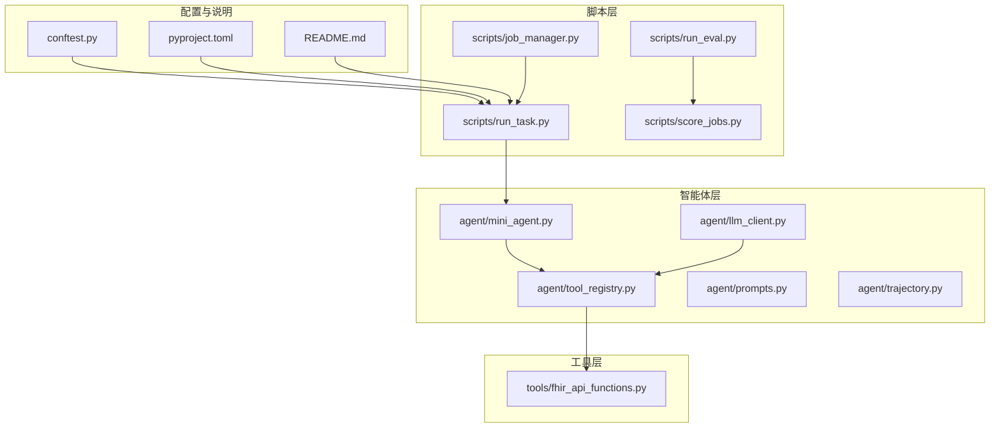
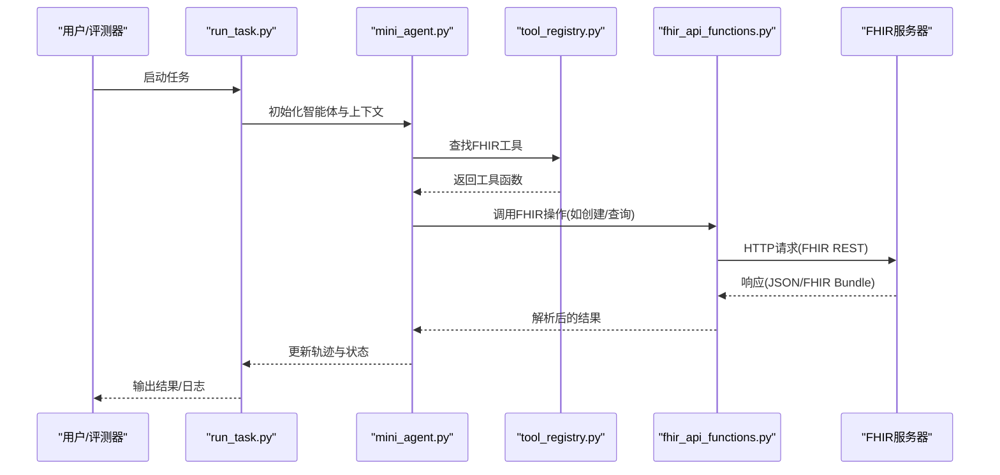
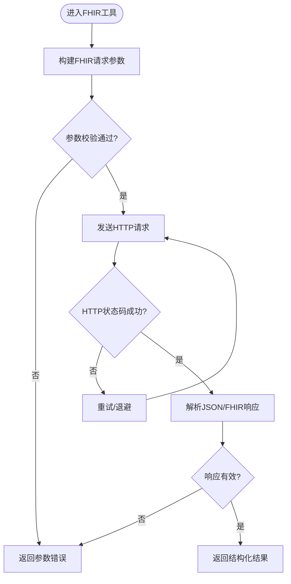
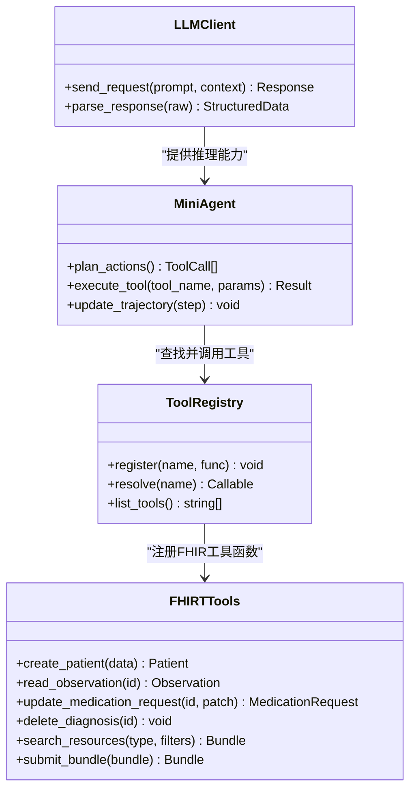
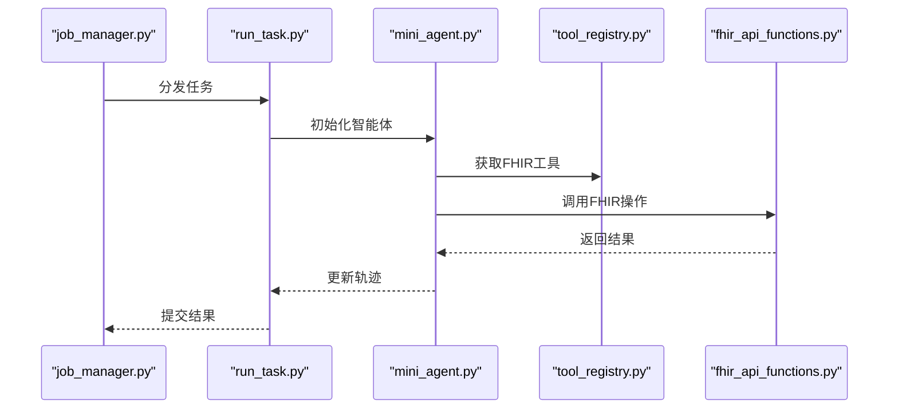
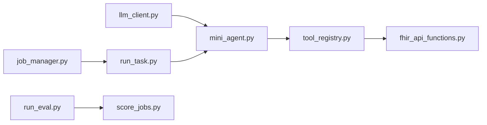

# FHIR标准集成

<cite>
**本文引用的文件**   
- [fhir_api_functions.py](file://task7/poc3_physicianbench/PhysicianBench/tools/fhir_api_functions.py)
- [README.md](file://task7/poc3_physicianbench/PhysicianBench/README.md)
- [pyproject.toml](file://task7/poc3_physicianbench/PhysicianBench/pyproject.toml)
- [conftest.py](file://task7/poc3_physicianbench/PhysicianBench/conftest.py)
- [run_task.py](file://task7/poc3_physicianbench/PhysicianBench/scripts/run_task.py)
- [run_eval.py](file://task7/poc3_physicianbench/PhysicianBench/scripts/run_eval.py)
- [job_manager.py](file://task7/poc3_physicianbench/PhysicianBench/scripts/job_manager.py)
- [score_jobs.py](file://task7/poc3_physicianbench/PhysicianBench/scripts/score_jobs.py)
- [llm_client.py](file://task7/poc3_physicianbench/PhysicianBench/agent/llm_client.py)
- [mini_agent.py](file://task7/poc3_physicianbench/PhysicianBench/agent/mini_agent.py)
- [tool_registry.py](file://task7/poc3_physicianbench/PhysicianBench/agent/tool_registry.py)
- [prompts.py](file://task7/poc3_physicianbench/PhysicianBench/agent/prompts.py)
- [trajectory.py](file://task7/poc3_physicianbench/PhysicianBench/agent/trajectory.py)
</cite>

## 目录
1. [简介](#简介)
2. [项目结构](#项目结构)
3. [核心组件](#核心组件)
4. [架构总览](#架构总览)
5. [详细组件分析](#详细组件分析)
6. [依赖关系分析](#依赖关系分析)
7. [性能考虑](#性能考虑)
8. [故障排查指南](#故障排查指南)
9. [结论](#结论)
10. [附录](#附录)

## 简介
本技术文档面向PhysicianBench的FHIR（Fast Healthcare Interoperability Resources）标准集成，聚焦以下目标：
- 说明FHIR资源类型在系统中的定义与使用方式，包括Patient、Observation、MedicationRequest、Diagnosis等。
- 解释FHIR API接口的调用方法，涵盖RESTful操作、查询语法与批量处理。
- 提供电子病历数据的CRUD示例路径，覆盖患者信息管理、检验检查结果录入、处方管理与诊断记录。
- 说明医疗术语标准化映射（SNOMED CT、LOINC、ICD-10）的使用策略。
- 给出数据验证规则、错误处理与性能优化建议。

该文档以代码仓库中的实际实现为依据，结合工具层与任务执行脚本进行系统性梳理，帮助读者快速理解并正确使用FHIR能力。

## 项目结构
PhysicianBench中FHIR相关能力主要位于poc3_physicianbench子项目中，关键目录与职责如下：
- tools/fhir_api_functions.py：封装FHIR REST API调用、查询与批量处理逻辑。
- agent/*：智能体与LLM客户端、提示词、轨迹记录与工具注册，驱动FHIR工具调用。
- scripts/*：任务运行、评估、评分与作业管理脚本，串联端到端流程。
- README.md：项目说明与使用说明。
- pyproject.toml：依赖声明与构建配置。
- conftest.py：测试夹具与共享配置。

图表来源
- [fhir_api_functions.py](file://task7/poc3_physicianbench/PhysicianBench/tools/fhir_api_functions.py)
- [llm_client.py](file://task7/poc3_physicianbench/PhysicianBench/agent/llm_client.py)
- [mini_agent.py](file://task7/poc3_physicianbench/PhysicianBench/agent/mini_agent.py)
- [tool_registry.py](file://task7/poc3_physicianbench/PhysicianBench/agent/tool_registry.py)
- [prompts.py](file://task7/poc3_physicianbench/PhysicianBench/agent/prompts.py)
- [trajectory.py](file://task7/poc3_physicianbench/PhysicianBench/agent/trajectory.py)
- [run_task.py](file://task7/poc3_physicianbench/PhysicianBench/scripts/run_task.py)
- [run_eval.py](file://task7/poc3_physicianbench/PhysicianBench/scripts/run_eval.py)
- [job_manager.py](file://task7/poc3_physicianbench/PhysicianBench/scripts/job_manager.py)
- [score_jobs.py](file://task7/poc3_physicianbench/PhysicianBench/scripts/score_jobs.py)
- [README.md](file://task7/poc3_physicianbench/PhysicianBench/README.md)
- [pyproject.toml](file://task7/poc3_physicianbench/PhysicianBench/pyproject.toml)
- [conftest.py](file://task7/poc3_physicianbench/PhysicianBench/conftest.py)

章节来源
- [README.md](file://task7/poc3_physicianbench/PhysicianBench/README.md)
- [pyproject.toml](file://task7/poc3_physicianbench/PhysicianBench/pyproject.toml)
- [conftest.py](file://task7/poc3_physicianbench/PhysicianBench/conftest.py)

## 核心组件
- FHIR API工具函数
  - 负责构造HTTP请求、发送FHIR REST调用、解析响应、统一错误处理与重试策略。
  - 支持常见资源类型的CRUD操作与批量Bundle处理。
- 智能体与工具注册
  - LLM客户端与MiniAgent通过工具注册表发现并调用FHIR工具函数。
  - 提示词模板引导模型生成符合FHIR规范的请求参数。
  - 轨迹记录保存每次调用的输入输出，便于审计与评估。
- 任务与评估脚本
  - run_task.py驱动任务执行，编排智能体与FHIR工具交互。
  - run_eval.py与score_jobs.py对结果进行评估与打分。
  - job_manager.py管理作业生命周期与并发控制。

章节来源
- [fhir_api_functions.py](file://task7/poc3_physicianbench/PhysicianBench/tools/fhir_api_functions.py)
- [llm_client.py](file://task7/poc3_physicianbench/PhysicianBench/agent/llm_client.py)
- [mini_agent.py](file://task7/poc3_physicianbench/PhysicianBench/agent/mini_agent.py)
- [tool_registry.py](file://task7/poc3_physicianbench/PhysicianBench/agent/tool_registry.py)
- [prompts.py](file://task7/poc3_physicianbench/PhysicianBench/agent/prompts.py)
- [trajectory.py](file://task7/poc3_physicianbench/PhysicianBench/agent/trajectory.py)
- [run_task.py](file://task7/poc3_physicianbench/PhysicianBench/scripts/run_task.py)
- [run_eval.py](file://task7/poc3_physicianbench/PhysicianBench/scripts/run_eval.py)
- [job_manager.py](file://task7/poc3_physicianbench/PhysicianBench/scripts/job_manager.py)

## 架构总览
整体架构采用“智能体驱动 + 工具封装 + 脚本编排”的分层设计：
- 智能体层：LLM客户端与MiniAgent根据提示词生成FHIR操作意图，并通过工具注册表调用具体工具。
- 工具层：FHIR API函数统一封装HTTP通信、参数校验、错误处理与重试。
- 脚本层：任务运行与评估脚本协调智能体与工具，完成端到端工作流。

图表来源
- [run_task.py](file://task7/poc3_physicianbench/PhysicianBench/scripts/run_task.py)
- [mini_agent.py](file://task7/poc3_physicianbench/PhysicianBench/agent/mini_agent.py)
- [tool_registry.py](file://task7/poc3_physicianbench/PhysicianBench/agent/tool_registry.py)
- [fhir_api_functions.py](file://task7/poc3_physicianbench/PhysicianBench/tools/fhir_api_functions.py)

## 详细组件分析

### FHIR API工具函数
- 功能要点
  - 封装FHIR RESTful接口：GET/POST/PATCH/DELETE等基础操作。
  - 资源类型支持：Patient、Observation、MedicationRequest、Diagnosis等。
  - 查询语法：支持按ID、标签、日期范围、编码系统等进行过滤。
  - 批量处理：支持Bundle资源提交与解析。
  - 错误处理：统一捕获网络异常、HTTP状态码、JSON解析错误，并提供重试与退避策略。
- 数据结构与复杂度
  - 请求/响应对象为轻量字典或FHIR资源模型，时间复杂度主要受网络IO与JSON序列化影响。
  - 批量Bundle处理时，注意内存占用与分片大小控制。
- 依赖链
  - 被工具注册表暴露给智能体；被任务脚本间接调用。
- 优化机会
  - 连接池复用、请求去重、分页游标缓存、批量合并提交。

图表来源
- [fhir_api_functions.py](file://task7/poc3_physicianbench/PhysicianBench/tools/fhir_api_functions.py)

章节来源
- [fhir_api_functions.py](file://task7/poc3_physicianbench/PhysicianBench/tools/fhir_api_functions.py)

### 智能体与工具注册
- 功能要点
  - LLM客户端负责与外部大模型交互，将自然语言意图转换为FHIR操作参数。
  - MiniAgent维护会话状态、上下文与工具调用计划。
  - 工具注册表集中管理可用工具及其元信息，供智能体动态发现。
  - 提示词模板约束输出格式，确保生成的FHIR参数可被工具函数正确解析。
  - 轨迹记录保存每次调用的输入、输出与中间状态，用于审计与评估。
- 类关系图

图表来源
- [llm_client.py](file://task7/poc3_physicianbench/PhysicianBench/agent/llm_client.py)
- [mini_agent.py](file://task7/poc3_physicianbench/PhysicianBench/agent/mini_agent.py)
- [tool_registry.py](file://task7/poc3_physicianbench/PhysicianBench/agent/tool_registry.py)
- [fhir_api_functions.py](file://task7/poc3_physicianbench/PhysicianBench/tools/fhir_api_functions.py)

章节来源
- [llm_client.py](file://task7/poc3_physicianbench/PhysicianBench/agent/llm_client.py)
- [mini_agent.py](file://task7/poc3_physicianbench/PhysicianBench/agent/mini_agent.py)
- [tool_registry.py](file://task7/poc3_physicianbench/PhysicianBench/agent/tool_registry.py)
- [prompts.py](file://task7/poc3_physicianbench/PhysicianBench/agent/prompts.py)
- [trajectory.py](file://task7/poc3_physicianbench/PhysicianBench/agent/trajectory.py)

### 任务与评估脚本
- 功能要点
  - run_task.py：加载任务配置，初始化智能体，循环执行工具调用，记录轨迹与结果。
  - run_eval.py：读取任务输出，对照评估标准进行打分。
  - score_jobs.py：汇总多个作业的评分结果，生成报告。
  - job_manager.py：管理作业队列、并发度与失败重试。
- 序列图（任务执行）

图表来源
- [job_manager.py](file://task7/poc3_physicianbench/PhysicianBench/scripts/job_manager.py)
- [run_task.py](file://task7/poc3_physicianbench/PhysicianBench/scripts/run_task.py)
- [mini_agent.py](file://task7/poc3_physicianbench/PhysicianBench/agent/mini_agent.py)
- [tool_registry.py](file://task7/poc3_physicianbench/PhysicianBench/agent/tool_registry.py)
- [fhir_api_functions.py](file://task7/poc3_physicianbench/PhysicianBench/tools/fhir_api_functions.py)

章节来源
- [run_task.py](file://task7/poc3_physicianbench/PhysicianBench/scripts/run_task.py)
- [run_eval.py](file://task7/poc3_physicianbench/PhysicianBench/scripts/run_eval.py)
- [score_jobs.py](file://task7/poc3_physicianbench/PhysicianBench/scripts/score_jobs.py)
- [job_manager.py](file://task7/poc3_physicianbench/PhysicianBench/scripts/job_manager.py)

### FHIR资源类型与CRUD示例路径
- 资源类型
  - Patient：患者基本信息管理（创建、读取、更新、删除）。
  - Observation：检验检查结果录入（创建、读取、批量提交）。
  - MedicationRequest：处方管理（创建、更新、撤销）。
  - Diagnosis：诊断记录（创建、读取、关联到Patient）。
- CRUD示例路径（以文件引用代替代码片段）
  - 患者信息管理
    - 创建患者：[fhir_api_functions.py](file://task7/poc3_physicianbench/PhysicianBench/tools/fhir_api_functions.py)
    - 读取患者：[fhir_api_functions.py](file://task7/poc3_physicianbench/PhysicianBench/tools/fhir_api_functions.py)
    - 更新患者：[fhir_api_functions.py](file://task7/poc3_physicianbench/PhysicianBench/tools/fhir_api_functions.py)
    - 删除患者：[fhir_api_functions.py](file://task7/poc3_physicianbench/PhysicianBench/tools/fhir_api_functions.py)
  - 检验检查结果录入
    - 创建观察值：[fhir_api_functions.py](file://task7/poc3_physicianbench/PhysicianBench/tools/fhir_api_functions.py)
    - 批量提交Bundle：[fhir_api_functions.py](file://task7/poc3_physicianbench/PhysicianBench/tools/fhir_api_functions.py)
  - 处方管理
    - 创建处方：[fhir_api_functions.py](file://task7/poc3_physicianbench/PhysicianBench/tools/fhir_api_functions.py)
    - 更新处方：[fhir_api_functions.py](file://task7/poc3_physicianbench/PhysicianBench/tools/fhir_api_functions.py)
    - 撤销处方：[fhir_api_functions.py](file://task7/poc3_physicianbench/PhysicianBench/tools/fhir_api_functions.py)
  - 诊断记录
    - 创建诊断：[fhir_api_functions.py](file://task7/poc3_physicianbench/PhysicianBench/tools/fhir_api_functions.py)
    - 读取诊断：[fhir_api_functions.py](file://task7/poc3_physicianbench/PhysicianBench/tools/fhir_api_functions.py)
    - 删除诊断：[fhir_api_functions.py](file://task7/poc3_physicianbench/PhysicianBench/tools/fhir_api_functions.py)

章节来源
- [fhir_api_functions.py](file://task7/poc3_physicianbench/PhysicianBench/tools/fhir_api_functions.py)

### 医疗术语标准化映射（SNOMED CT、LOINC、ICD-10）
- 映射策略
  - SNOMED CT：用于临床概念与诊断描述的标准编码，建议在Diagnosis与Observation的编码系统中使用。
  - LOINC：用于实验室检验项目的标准编码，建议在Observation的code字段中使用。
  - ICD-10：用于疾病分类与统计，建议在Diagnosis的编码系统中使用。
- 使用建议
  - 在FHIR资源的Coding系统中明确指定system与code，确保跨系统互操作性。
  - 建立本地术语库与映射表，支持从自由文本到标准编码的转换。
  - 在数据入库前进行术语有效性校验，避免无效编码导致下游问题。

章节来源
- [fhir_api_functions.py](file://task7/poc3_physicianbench/PhysicianBench/tools/fhir_api_functions.py)

## 依赖关系分析
- 组件耦合
  - 智能体层与工具层通过工具注册表松耦合，便于扩展新工具。
  - 任务脚本与智能体解耦，便于替换执行策略。
- 外部依赖
  - FHIR服务器：提供RESTful API服务。
  - LLM服务：提供推理能力（由LLM客户端抽象）。
- 潜在循环依赖
  - 当前分层清晰，未见直接循环依赖；需关注工具注册表与工具函数的双向导入风险。

图表来源
- [llm_client.py](file://task7/poc3_physicianbench/PhysicianBench/agent/llm_client.py)
- [mini_agent.py](file://task7/poc3_physicianbench/PhysicianBench/agent/mini_agent.py)
- [tool_registry.py](file://task7/poc3_physicianbench/PhysicianBench/agent/tool_registry.py)
- [fhir_api_functions.py](file://task7/poc3_physicianbench/PhysicianBench/tools/fhir_api_functions.py)
- [run_task.py](file://task7/poc3_physicianbench/PhysicianBench/scripts/run_task.py)
- [run_eval.py](file://task7/poc3_physicianbench/PhysicianBench/scripts/run_eval.py)
- [score_jobs.py](file://task7/poc3_physicianbench/PhysicianBench/scripts/score_jobs.py)
- [job_manager.py](file://task7/poc3_physicianbench/PhysicianBench/scripts/job_manager.py)

章节来源
- [pyproject.toml](file://task7/poc3_physicianbench/PhysicianBench/pyproject.toml)
- [conftest.py](file://task7/poc3_physicianbench/PhysicianBench/conftest.py)

## 性能考虑
- 网络与I/O
  - 使用连接池与超时设置，减少握手开销。
  - 对频繁查询的资源进行本地缓存，降低重复请求。
- 批量处理
  - 合理拆分Bundle大小，避免单次请求过大导致超时或内存溢出。
  - 对批量写入实施幂等性设计与去重策略。
- 并发与限流
  - 通过job_manager控制并发度，避免对FHIR服务器造成压力。
  - 实施指数退避与熔断机制，提升鲁棒性。
- 序列化与解析
  - 使用高效JSON库，避免不必要的深度拷贝。
  - 对大型Bundle进行流式解析，降低峰值内存。

## 故障排查指南
- 常见问题
  - 网络连接失败：检查FHIR服务器地址、端口与认证配置。
  - 参数校验错误：核对FHIR资源必填字段与数据类型。
  - 术语编码无效：确认SNOMED CT、LOINC、ICD-10编码在系统中存在。
  - 批量提交失败：检查Bundle结构与资源引用完整性。
- 定位步骤
  - 查看轨迹记录，定位失败调用与错误消息。
  - 启用调试日志，打印请求与响应详情。
  - 使用最小化用例复现问题，逐步缩小范围。
- 恢复策略
  - 自动重试与退避，必要时人工介入修正参数。
  - 对部分失败的批量操作进行分片重试。

章节来源
- [fhir_api_functions.py](file://task7/poc3_physicianbench/PhysicianBench/tools/fhir_api_functions.py)
- [trajectory.py](file://task7/poc3_physicianbench/PhysicianBench/agent/trajectory.py)

## 结论
PhysicianBench的FHIR集成通过清晰的层次化设计与统一的工具封装，实现了智能体驱动的FHIR资源操作。依托FHIR RESTful API与标准术语编码，系统能够支持患者信息管理、检验检查结果录入、处方管理与诊断记录等核心业务场景。通过合理的性能优化与错误处理策略，系统在稳定性与可扩展性方面具备良好基础。后续可在术语映射自动化、批量处理优化与监控告警方面持续改进。

## 附录
- 参考文件
  - [README.md](file://task7/poc3_physicianbench/PhysicianBench/README.md)
  - [pyproject.toml](file://task7/poc3_physicianbench/PhysicianBench/pyproject.toml)
  - [conftest.py](file://task7/poc3_physicianbench/PhysicianBench/conftest.py)
- 术语与标准
  - FHIR R4规范
  - SNOMED CT、LOINC、ICD-10编码体系