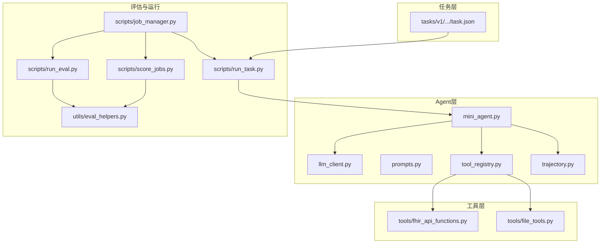
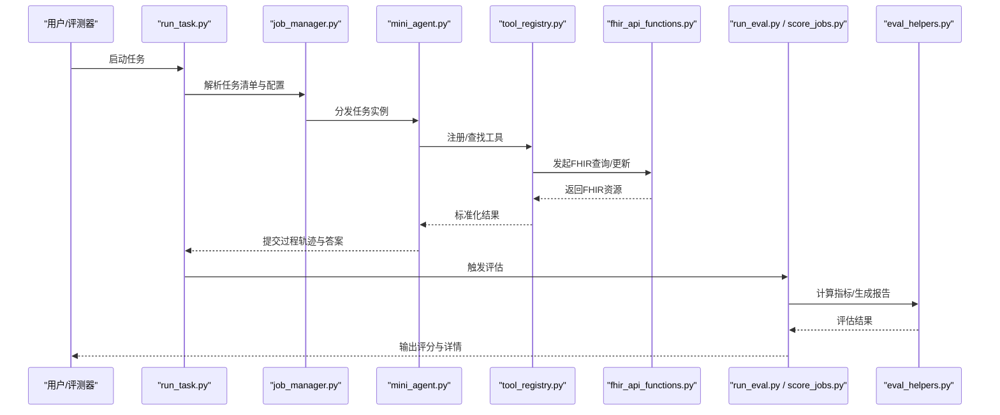
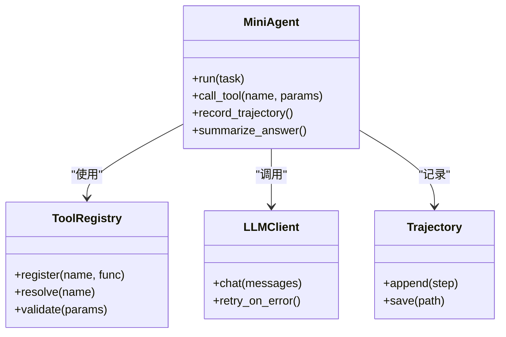
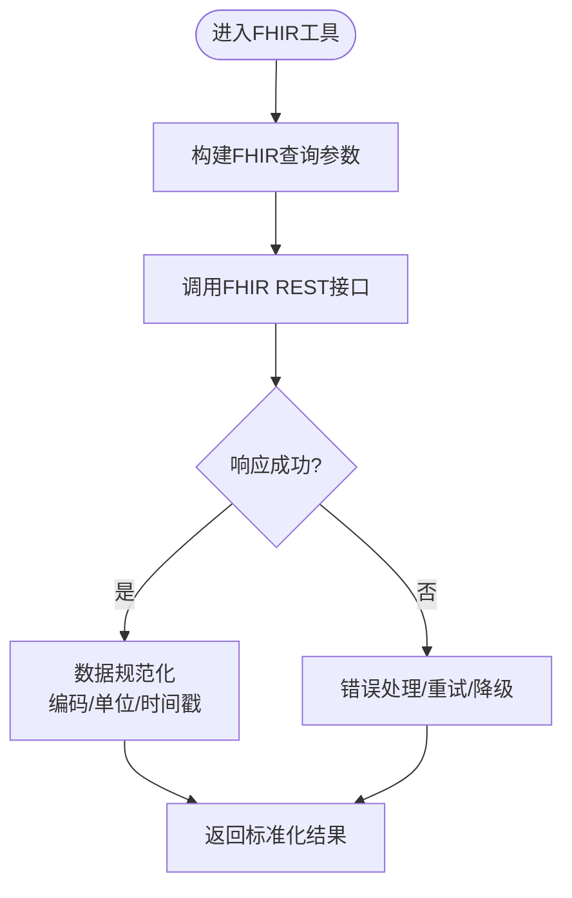
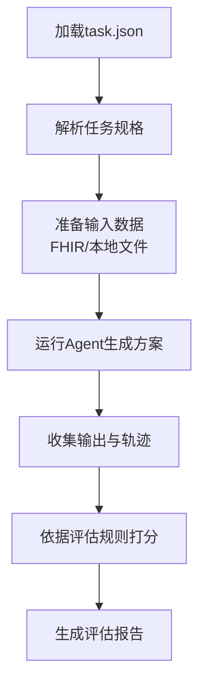
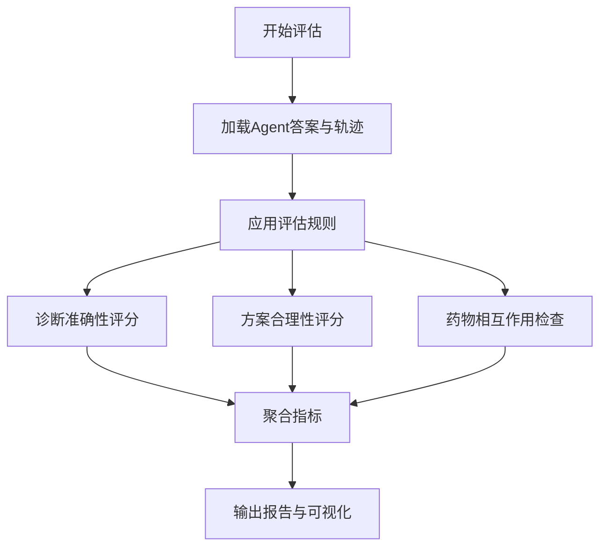
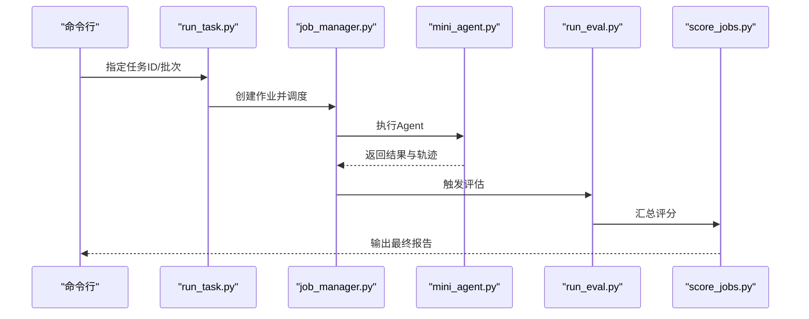
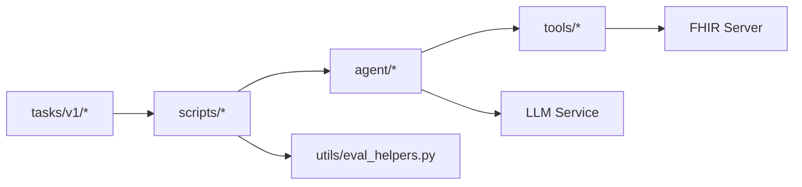

# PhysicianBench医疗诊断基准

<cite>
**本文引用的文件**   
- [README.md](file://task7/poc3_physicianbench/PhysicianBench/README.md)
- [pyproject.toml](file://task7/poc3_physicianbench/PhysicianBench/pyproject.toml)
- [conftest.py](file://task7/poc3_physicianbench/PhysicianBench/conftest.py)
- [fhir_api_functions.py](file://task7/poc3_physicianbench/PhysicianBench/tools/fhir_api_functions.py)
- [file_tools.py](file://task7/poc3_physicianbench/PhysicianBench/tools/file_tools.py)
- [eval_helpers.py](file://task7/poc3_physicianbench/PhysicianBench/utils/eval_helpers.py)
- [llm_client.py](file://task7/poc3_physicianbench/PhysicianBench/agent/llm_client.py)
- [mini_agent.py](file://task7/poc3_physicianbench/PhysicianBench/agent/mini_agent.py)
- [prompts.py](file://task7/poc3_physicianbench/PhysicianBench/agent/prompts.py)
- [tool_registry.py](file://task7/poc3_physicianbench/PhysicianBench/agent/tool_registry.py)
- [trajectory.py](file://task7/poc3_physicianbench/PhysicianBench/agent/trajectory.py)
- [run_task.py](file://task7/poc3_physicianbench/PhysicianBench/scripts/run_task.py)
- [run_eval.py](file://task7/poc3_physicianbench/PhysicianBench/scripts/run_eval.py)
- [score_jobs.py](file://task7/poc3_physicianbench/PhysicianBench/scripts/score_jobs.py)
- [job_manager.py](file://task7/poc3_physicianbench/PhysicianBench/scripts/job_manager.py)
- [task_taxonomy_v1.json](file://task7/poc3_physicianbench/PhysicianBench/scripts/task_taxonomy_v1.json)
- [abnormal_uterine_bleeding/task.json](file://task7/poc3_physicianbench/PhysicianBench/tasks/v1/abnormal_uterine_bleeding/task.json)
- [diabetes_a1c_improvement/task.json](file://task7/poc3_physicianbench/PhysicianBench/tasks/v1/diabetes_a1c_improvement/task.json)
- [adrenal_insufficiency_symptoms/task.json](file://task7/poc3_physicianbench/PhysicianBench/tasks/v1/adrenal_insufficiency_symptoms/task.json)
</cite>

## 目录
1. [简介](#简介)
2. [项目结构](#项目结构)
3. [核心组件](#核心组件)
4. [架构总览](#架构总览)
5. [详细组件分析](#详细组件分析)
6. [依赖关系分析](#依赖关系分析)
7. [性能与可扩展性](#性能与可扩展性)
8. [故障排查指南](#故障排查指南)
9. [结论](#结论)
10. [附录](#附录)

## 简介
本文件为 PhysicianBench 医疗诊断基准的权威技术文档。该基准围绕 FHIR 标准构建，提供标准化的电子病历数据模型、临床术语映射与可复现的评估流程，覆盖多类典型临床场景（如肾上腺功能不全症状、糖尿病 A1C 改善、异常子宫出血等）。其目标是为医疗 AI 代理提供统一的评测框架，衡量诊断准确性、治疗方案合理性、药物相互作用检查等关键指标，并给出基于 FHIR API 的数据访问与结果验证方法。同时，文档强调隐私保护与 HIPAA 合规要求，并提供数据安全最佳实践建议。

## 项目结构
PhysicianBench 采用“任务驱动 + 工具化 + 评估流水线”的组织方式：
- agent：LLM 客户端、提示词模板、工具注册表、轨迹记录等
- tools：FHIR API 封装与通用文件工具
- tasks/v1：按疾病场景划分的任务定义与元数据
- utils：评估辅助函数
- scripts：任务运行、批量评估、评分与作业管理脚本
- website：可选的前端展示（与本基准核心逻辑解耦）

图表来源
- [mini_agent.py](file://task7/poc3_physicianbench/PhysicianBench/agent/mini_agent.py)
- [llm_client.py](file://task7/poc3_physicianbench/PhysicianBench/agent/llm_client.py)
- [tool_registry.py](file://task7/poc3_physicianbench/PhysicianBench/agent/tool_registry.py)
- [trajectory.py](file://task7/poc3_physicianbench/PhysicianBench/agent/trajectory.py)
- [fhir_api_functions.py](file://task7/poc3_physicianbench/PhysicianBench/tools/fhir_api_functions.py)
- [file_tools.py](file://task7/poc3_physicianbench/PhysicianBench/tools/file_tools.py)
- [run_task.py](file://task7/poc3_physicianbench/PhysicianBench/scripts/run_task.py)
- [run_eval.py](file://task7/poc3_physicianbench/PhysicianBench/scripts/run_eval.py)
- [score_jobs.py](file://task7/poc3_physicianbench/PhysicianBench/scripts/score_jobs.py)
- [job_manager.py](file://task7/poc3_physicianbench/PhysicianBench/scripts/job_manager.py)
- [eval_helpers.py](file://task7/poc3_physicianbench/PhysicianBench/utils/eval_helpers.py)
- [abnormal_uterine_bleeding/task.json](file://task7/poc3_physicianbench/PhysicianBench/tasks/v1/abnormal_uterine_bleeding/task.json)

章节来源
- [README.md](file://task7/poc3_physicianbench/PhysicianBench/README.md)
- [pyproject.toml](file://task7/poc3_physicianbench/PhysicianBench/pyproject.toml)
- [conftest.py](file://task7/poc3_physicianbench/PhysicianBench/conftest.py)

## 核心组件
- LLM 客户端与代理
  - llm_client.py：封装对外部大模型的调用接口，负责请求构造、重试与错误处理
  - mini_agent.py：编排 Agent 的主循环，协调提示词生成、工具调用、轨迹记录与结果汇总
  - prompts.py：维护任务相关的系统提示词与对话模板
  - tool_registry.py：统一注册与发现工具（如 FHIR API、文件工具），实现参数校验与路由
  - trajectory.py：持久化 Agent 的交互轨迹，便于审计与回溯

- 工具层
  - fhir_api_functions.py：对 FHIR RESTful API 进行封装，提供资源查询、搜索、更新等操作
  - file_tools.py：提供本地文件读写、归档与日志落盘能力

- 任务与评估
  - tasks/v1/*：每个疾病场景一个子目录，包含 task.json 描述任务目标、输入输出规范、评估规则等
  - eval_helpers.py：评估辅助函数，用于解析答案、计算指标、生成报告
  - run_task.py / run_eval.py / score_jobs.py / job_manager.py：端到端运行、评估、评分与批处理调度

章节来源
- [llm_client.py](file://task7/poc3_physicianbench/PhysicianBench/agent/llm_client.py)
- [mini_agent.py](file://task7/poc3_physicianbench/PhysicianBench/agent/mini_agent.py)
- [prompts.py](file://task7/poc3_physicianbench/PhysicianBench/agent/prompts.py)
- [tool_registry.py](file://task7/poc3_physicianbench/PhysicianBench/agent/tool_registry.py)
- [trajectory.py](file://task7/poc3_physicianbench/PhysicianBench/agent/trajectory.py)
- [fhir_api_functions.py](file://task7/poc3_physicianbench/PhysicianBench/tools/fhir_api_functions.py)
- [file_tools.py](file://task7/poc3_physicianbench/PhysicianBench/tools/file_tools.py)
- [eval_helpers.py](file://task7/poc3_physicianbench/PhysicianBench/utils/eval_helpers.py)
- [run_task.py](file://task7/poc3_physicianbench/PhysicianBench/scripts/run_task.py)
- [run_eval.py](file://task7/poc3_physicianbench/PhysicianBench/scripts/run_eval.py)
- [score_jobs.py](file://task7/poc3_physicianbench/PhysicianBench/scripts/score_jobs.py)
- [job_manager.py](file://task7/poc3_physicianbench/PhysicianBench/scripts/job_manager.py)

## 架构总览
下图展示了从任务定义到评估输出的整体流程：任务 JSON 被加载，Agent 通过工具层访问 FHIR 资源，结合提示词与大模型推理，最终由评估模块产出结构化结果。

图表来源
- [run_task.py](file://task7/poc3_physicianbench/PhysicianBench/scripts/run_task.py)
- [job_manager.py](file://task7/poc3_physicianbench/PhysicianBench/scripts/job_manager.py)
- [mini_agent.py](file://task7/poc3_physicianbench/PhysicianBench/agent/mini_agent.py)
- [tool_registry.py](file://task7/poc3_physicianbench/PhysicianBench/agent/tool_registry.py)
- [fhir_api_functions.py](file://task7/poc3_physicianbench/PhysicianBench/tools/fhir_api_functions.py)
- [run_eval.py](file://task7/poc3_physicianbench/PhysicianBench/scripts/run_eval.py)
- [score_jobs.py](file://task7/poc3_physicianbench/PhysicianBench/scripts/score_jobs.py)
- [eval_helpers.py](file://task7/poc3_physicianbench/PhysicianBench/utils/eval_helpers.py)

## 详细组件分析

### 组件A：Agent 与工具注册
Agent 是任务执行的核心编排者，负责：
- 根据任务上下文生成提示词
- 选择并调用工具（如 FHIR 查询）
- 记录完整交互轨迹
- 汇总最终答案

工具注册表统一管理可用工具，确保参数校验、错误传播与可观测性。

图表来源
- [mini_agent.py](file://task7/poc3_physicianbench/PhysicianBench/agent/mini_agent.py)
- [tool_registry.py](file://task7/poc3_physicianbench/PhysicianBench/agent/tool_registry.py)
- [llm_client.py](file://task7/poc3_physicianbench/PhysicianBench/agent/llm_client.py)
- [trajectory.py](file://task7/poc3_physicianbench/PhysicianBench/agent/trajectory.py)

章节来源
- [mini_agent.py](file://task7/poc3_physicianbench/PhysicianBench/agent/mini_agent.py)
- [tool_registry.py](file://task7/poc3_physicianbench/PhysicianBench/agent/tool_registry.py)
- [llm_client.py](file://task7/poc3_physicianbench/PhysicianBench/agent/llm_client.py)
- [trajectory.py](file://task7/poc3_physicianbench/PhysicianBench/agent/trajectory.py)

### 组件B：FHIR API 封装与数据处理
FHIR API 封装提供对 FHIR 资源的标准化访问，包括：
- 资源检索（Patient、Observation、MedicationRequest 等）
- 条件查询与分页
- 错误码处理与重试策略
- 数据规范化（字段映射、单位换算、编码标准化）

图表来源
- [fhir_api_functions.py](file://task7/poc3_physicianbench/PhysicianBench/tools/fhir_api_functions.py)

章节来源
- [fhir_api_functions.py](file://task7/poc3_physicianbench/PhysicianBench/tools/fhir_api_functions.py)
- [file_tools.py](file://task7/poc3_physicianbench/PhysicianBench/tools/file_tools.py)

### 组件C：任务设计与疾病场景
任务以 JSON 形式定义，包含：
- 任务目标与约束
- 输入数据源（FHIR 资源引用或本地文件）
- 期望输出格式（诊断、治疗计划、用药建议等）
- 评估规则（匹配度、安全性、一致性）

典型场景示例（路径参考）：
- 异常子宫出血：[abnormal_uterine_bleeding/task.json](file://task7/poc3_physicianbench/PhysicianBench/tasks/v1/abnormal_uterine_bleeding/task.json)
- 糖尿病 A1C 改善：[diabetes_a1c_improvement/task.json](file://task7/poc3_physicianbench/PhysicianBench/tasks/v1/diabetes_a1c_improvement/task.json)
- 肾上腺功能不全症状：[adrenal_insufficiency_symptoms/task.json](file://task7/poc3_physicianbench/PhysicianBench/tasks/v1/adrenal_insufficiency_symptoms/task.json)

图表来源
- [abnormal_uterine_bleeding/task.json](file://task7/poc3_physicianbench/PhysicianBench/tasks/v1/abnormal_uterine_bleeding/task.json)
- [diabetes_a1c_improvement/task.json](file://task7/poc3_physicianbench/PhysicianBench/tasks/v1/diabetes_a1c_improvement/task.json)
- [adrenal_insufficiency_symptoms/task.json](file://task7/poc3_physicianbench/PhysicianBench/tasks/v1/adrenal_insufficiency_symptoms/task.json)
- [run_task.py](file://task7/poc3_physicianbench/PhysicianBench/scripts/run_task.py)
- [run_eval.py](file://task7/poc3_physicianbench/PhysicianBench/scripts/run_eval.py)

章节来源
- [abnormal_uterine_bleeding/task.json](file://task7/poc3_physicianbench/PhysicianBench/tasks/v1/abnormal_uterine_bleeding/task.json)
- [diabetes_a1c_improvement/task.json](file://task7/poc3_physicianbench/PhysicianBench/tasks/v1/diabetes_a1c_improvement/task.json)
- [adrenal_insufficiency_symptoms/task.json](file://task7/poc3_physicianbench/PhysicianBench/tasks/v1/adrenal_insufficiency_symptoms/task.json)
- [run_task.py](file://task7/poc3_physicianbench/PhysicianBench/scripts/run_task.py)
- [run_eval.py](file://task7/poc3_physicianbench/PhysicianBench/scripts/run_eval.py)

### 组件D：评估框架与指标
评估模块聚焦以下核心指标：
- 诊断准确性：与参考答案或临床指南的一致性
- 治疗方案合理性：是否符合指南与患者特征
- 药物相互作用检查：是否存在禁忌或高风险组合
- 数据完整性与可追溯性：是否充分引用相关 FHIR 资源

图表来源
- [run_eval.py](file://task7/poc3_physicianbench/PhysicianBench/scripts/run_eval.py)
- [score_jobs.py](file://task7/poc3_physicianbench/PhysicianBench/scripts/score_jobs.py)
- [eval_helpers.py](file://task7/poc3_physicianbench/PhysicianBench/utils/eval_helpers.py)

章节来源
- [run_eval.py](file://task7/poc3_physicianbench/PhysicianBench/scripts/run_eval.py)
- [score_jobs.py](file://task7/poc3_physicianbench/PhysicianBench/scripts/score_jobs.py)
- [eval_helpers.py](file://task7/poc3_physicianbench/PhysicianBench/utils/eval_helpers.py)

### 组件E：运行与批处理
- run_task.py：单任务运行入口，解析任务、初始化环境、执行 Agent
- job_manager.py：作业管理器，支持并发、重试、状态跟踪
- run_eval.py / score_jobs.py：评估与评分流水线，支持批量作业汇总

图表来源
- [run_task.py](file://task7/poc3_physicianbench/PhysicianBench/scripts/run_task.py)
- [job_manager.py](file://task7/poc3_physicianbench/PhysicianBench/scripts/job_manager.py)
- [run_eval.py](file://task7/poc3_physicianbench/PhysicianBench/scripts/run_eval.py)
- [score_jobs.py](file://task7/poc3_physicianbench/PhysicianBench/scripts/score_jobs.py)

章节来源
- [run_task.py](file://task7/poc3_physicianbench/PhysicianBench/scripts/run_task.py)
- [job_manager.py](file://task7/poc3_physicianbench/PhysicianBench/scripts/job_manager.py)
- [run_eval.py](file://task7/poc3_physicianbench/PhysicianBench/scripts/run_eval.py)
- [score_jobs.py](file://task7/poc3_physicianbench/PhysicianBench/scripts/score_jobs.py)

## 依赖关系分析
- 内部依赖
  - Agent 依赖 LLM 客户端与工具注册表
  - 工具层依赖 FHIR API 封装与文件工具
  - 评估模块依赖评估辅助函数
- 外部依赖
  - FHIR 服务器（RESTful API）
  - 大模型服务（HTTP/gRPC）
  - 文件系统（本地存储）

图表来源
- [mini_agent.py](file://task7/poc3_physicianbench/PhysicianBench/agent/mini_agent.py)
- [fhir_api_functions.py](file://task7/poc3_physicianbench/PhysicianBench/tools/fhir_api_functions.py)
- [eval_helpers.py](file://task7/poc3_physicianbench/PhysicianBench/utils/eval_helpers.py)
- [run_task.py](file://task7/poc3_physicianbench/PhysicianBench/scripts/run_task.py)
- [abnormal_uterine_bleeding/task.json](file://task7/poc3_physicianbench/PhysicianBench/tasks/v1/abnormal_uterine_bleeding/task.json)

章节来源
- [pyproject.toml](file://task7/poc3_physicianbench/PhysicianBench/pyproject.toml)
- [conftest.py](file://task7/poc3_physicianbench/PhysicianBench/conftest.py)

## 性能与可扩展性
- 并行与批处理：通过 job_manager.py 实现并发执行与重试，提升吞吐
- 缓存与去重：可在 FHIR 查询层引入缓存以减少重复请求
- 流式输出：在 Agent 侧支持流式轨迹记录，降低内存占用
- 模块化扩展：新增疾病场景仅需添加任务 JSON 与必要评估规则

[本节为通用指导，不直接分析具体文件]

## 故障排查指南
常见问题与定位要点：
- FHIR 连接失败：检查网络连通性与认证凭据；查看 fhir_api_functions.py 的错误处理分支
- 工具未注册：确认 tool_registry.py 中是否正确注册对应工具
- 评估结果为空：检查 run_eval.py 与 eval_helpers.py 的输出路径与格式
- 轨迹缺失：核查 trajectory.py 的保存路径与权限

章节来源
- [fhir_api_functions.py](file://task7/poc3_physicianbench/PhysicianBench/tools/fhir_api_functions.py)
- [tool_registry.py](file://task7/poc3_physicianbench/PhysicianBench/agent/tool_registry.py)
- [run_eval.py](file://task7/poc3_physicianbench/PhysicianBench/scripts/run_eval.py)
- [eval_helpers.py](file://task7/poc3_physicianbench/PhysicianBench/utils/eval_helpers.py)
- [trajectory.py](file://task7/poc3_physicianbench/PhysicianBench/agent/trajectory.py)

## 结论
PhysicianBench 提供了以 FHIR 为核心的医疗诊断基准平台，具备清晰的任务定义、强大的工具链与完善的评估体系。通过标准化数据模型与评估指标，能够有效衡量医疗 AI 代理的诊断准确性、方案合理性与用药安全性。建议在部署时严格遵循隐私保护与 HIPAA 合规要求，并结合缓存、并发与流式处理优化性能。

[本节为总结性内容，不直接分析具体文件]

## 附录

### FHIR API 调用示例（概念性步骤）
- 获取患者基本信息：使用 Patient 资源查询
- 获取实验室检验结果：使用 Observation 资源并按编码过滤
- 获取用药处方：使用 MedicationRequest 资源并关联患者 ID
- 更新医嘱：使用 PUT/PATCH 更新相关资源

[本节为概念性说明，不直接分析具体文件]

### 医疗数据处理流程（概念性步骤）
- 数据接入：从 FHIR 服务器拉取资源
- 数据清洗：去除冗余、标准化编码与单位
- 数据整合：跨资源关联（患者、观察值、处方）
- 数据导出：生成评估所需的中间结构与最终报告

[本节为概念性说明，不直接分析具体文件]

### 结果验证方法（概念性步骤）
- 答案对齐：将 Agent 输出与参考答案进行结构化比对
- 规则校验：依据任务 JSON 中的评估规则逐项打分
- 一致性检查：对比不同运行次数的稳定性与方差
- 报告生成：汇总指标并输出可视化图表

[本节为概念性说明，不直接分析具体文件]

### 隐私保护与 HIPAA 合规
- 最小化数据原则：仅采集与任务必需的数据
- 脱敏与匿名化：移除可直接识别信息
- 传输加密：使用 HTTPS/TLS 保障通信安全
- 访问控制：基于角色的权限管理与审计日志
- 数据存储：加密静态数据，定期备份与销毁策略

[本节为通用指导，不直接分析具体文件]

### 任务分类参考
- 任务分类清单：[task_taxonomy_v1.json](file://task7/poc3_physicianbench/PhysicianBench/scripts/task_taxonomy_v1.json)

章节来源
- [task_taxonomy_v1.json](file://task7/poc3_physicianbench/PhysicianBench/scripts/task_taxonomy_v1.json)