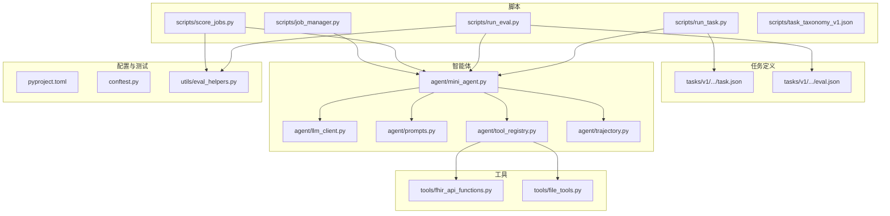
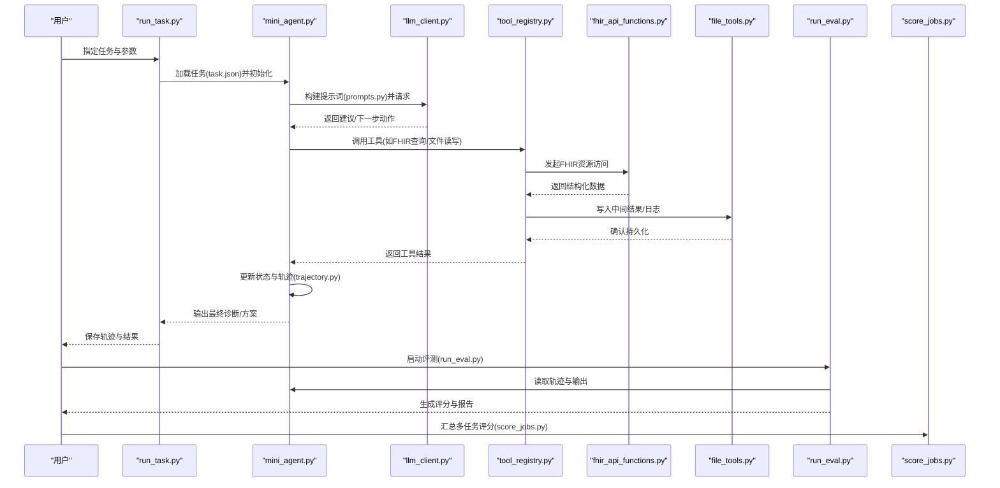
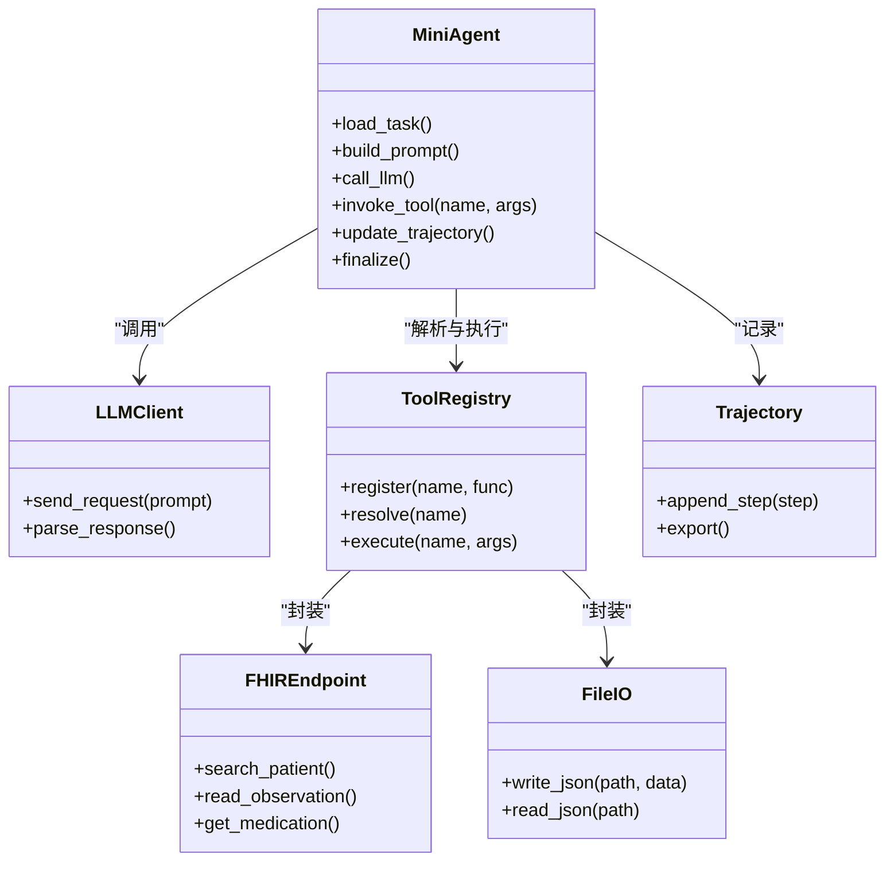
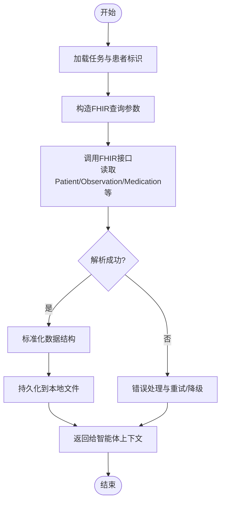
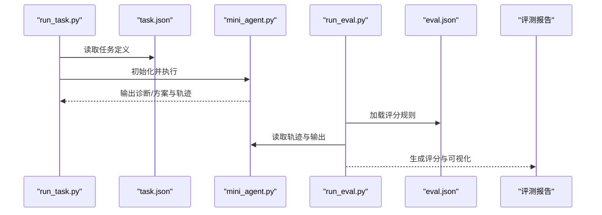
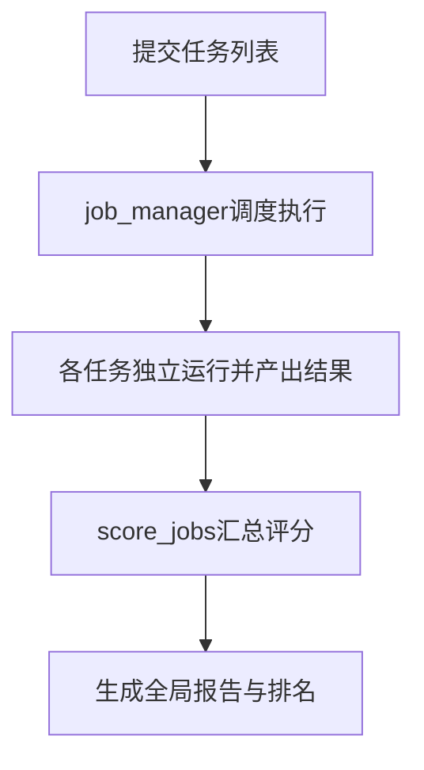
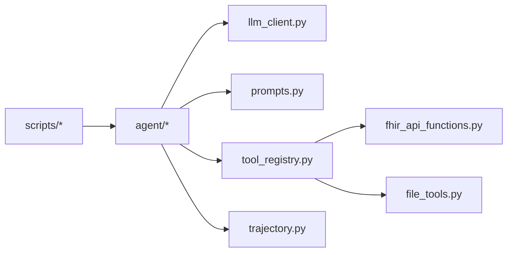

# PhysicianBench概述与架构

<cite>
**本文引用的文件**   
- [task7/poc3_physicianbench/PhysicianBench/README.md](file://task7/poc3_physicianbench/PhysicianBench/README.md)
- [task7/poc3_physicianbench/PhysicianBench/pyproject.toml](file://task7/poc3_physicianbench/PhysicianBench/pyproject.toml)
- [task7/poc3_physicianbench/PhysicianBench/conftest.py](file://task7/poc3_physicianbench/PhysicianBench/conftest.py)
- [task7/poc3_physicianbench/PhysicianBench/scripts/run_task.py](file://task7/poc3_physicianbench/PhysicianBench/scripts/run_task.py)
- [task7/poc3_physicianbench/PhysicianBench/scripts/run_eval.py](file://task7/poc3_physicianbench/PhysicianBench/scripts/run_eval.py)
- [task7/poc3_physicianbench/PhysicianBench/scripts/score_jobs.py](file://task7/poc3_physicianbench/PhysicianBench/scripts/score_jobs.py)
- [task7/poc3_physicianbench/PhysicianBench/scripts/job_manager.py](file://task7/poc3_physicianbench/PhysicianBench/scripts/job_manager.py)
- [task7/poc3_physicianbench/PhysicianBench/scripts/task_taxonomy_v1.json](file://task7/poc3_physicianbench/PhysicianBench/scripts/task_taxonomy_v1.json)
- [task7/poc3_physicianbench/PhysicianBench/agent/llm_client.py](file://task7/poc3_physicianbench/PhysicianBench/agent/llm_client.py)
- [task7/poc3_physicianbench/PhysicianBench/agent/mini_agent.py](file://task7/poc3_physicianbench/PhysicianBench/agent/mini_agent.py)
- [task7/poc3_physicianbench/PhysicianBench/agent/prompts.py](file://task7/poc3_physicianbench/PhysicianBench/agent/prompts.py)
- [task7/poc3_physicianbench/PhysicianBench/agent/tool_registry.py](file://task7/poc3_physicianbench/PhysicianBench/agent/tool_registry.py)
- [task7/poc3_physicianbench/PhysicianBench/agent/trajectory.py](file://task7/poc3_physicianbench/PhysicianBench/agent/trajectory.py)
- [task7/poc3_physicianbench/PhysicianBench/tools/fhir_api_functions.py](file://task7/poc3_physicianbench/PhysicianBench/tools/fhir_api_functions.py)
- [task7/poc3_physicianbench/PhysicianBench/tools/file_tools.py](file://task7/poc3_physicianbench/PhysicianBench/tools/file_tools.py)
- [task7/poc3_physicianbench/PhysicianBench/tasks/v1/abnormal_uterine_bleeding/task.json](file://task7/poc3_physicianbench/PhysicianBench/tasks/v1/abnormal_uterine_bleeding/task.json)
- [task7/poc3_physicianbench/PhysicianBench/tasks/v1/abnormal_uterine_bleeding/eval.json](file://task7/poc3_physicianbench/PhysicianBench/tasks/v1/abnormal_uterine_bleeding/eval.json)
- [task7/poc3_physicianbench/PhysicianBench/utils/eval_helpers.py](file://task7/poc3_physicianbench/PhysicianBench/utils/eval_helpers.py)
</cite>

## 目录
1. [简介](#简介)
2. [项目结构](#项目结构)
3. [核心组件](#核心组件)
4. [架构总览](#架构总览)
5. [详细组件分析](#详细组件分析)
6. [依赖关系分析](#依赖关系分析)
7. [性能考量](#性能考量)
8. [故障排查指南](#故障排查指南)
9. [结论](#结论)
10. [附录](#附录)

## 简介
PhysicianBench是一个面向临床诊断推理的基准评测框架，旨在以标准化、可复现的方式评估智能体在真实医疗场景中的表现。其核心目标包括：
- 基于FHIR标准的结构化电子病历数据与工具接口，支撑多轮问诊、检查与处方决策流程
- 统一的评估体系，覆盖诊断准确性、治疗方案合理性、药物相互作用检查等关键指标
- 可扩展的任务编排与评测脚本，支持批量任务执行、轨迹记录与结果评分

本概述文档从系统架构、数据流、核心组件与使用方式等方面，帮助读者快速理解并上手PhysicianBench。

## 项目结构
PhysicianBench采用“任务-智能体-工具-评测”的分层组织方式：
- tasks：按疾病或场景划分的任务定义（含任务描述、初始患者信息、评估标准）
- agent：智能体核心逻辑（LLM客户端、提示词模板、工具注册、轨迹记录）
- tools：外部能力封装（如FHIR API调用、文件读写）
- scripts：运行与评测脚本（任务执行、作业管理、评分汇总）
- utils：通用辅助函数（评测辅助、数据处理）

图示来源
- [task7/poc3_physicianbench/PhysicianBench/scripts/run_task.py](file://task7/poc3_physicianbench/PhysicianBench/scripts/run_task.py)
- [task7/poc3_physicianbench/PhysicianBench/scripts/run_eval.py](file://task7/poc3_physicianbench/PhysicianBench/scripts/run_eval.py)
- [task7/poc3_physicianbench/PhysicianBench/scripts/score_jobs.py](file://task7/poc3_physicianbench/PhysicianBench/scripts/score_jobs.py)
- [task7/poc3_physicianbench/PhysicianBench/scripts/job_manager.py](file://task7/poc3_physicianbench/PhysicianBench/scripts/job_manager.py)
- [task7/poc3_physicianbench/PhysicianBench/agent/mini_agent.py](file://task7/poc3_physicianbench/PhysicianBench/agent/mini_agent.py)
- [task7/poc3_physicianbench/PhysicianBench/agent/llm_client.py](file://task7/poc3_physicianbench/PhysicianBench/agent/llm_client.py)
- [task7/poc3_physicianbench/PhysicianBench/agent/prompts.py](file://task7/poc3_physicianbench/PhysicianBench/agent/prompts.py)
- [task7/poc3_physicianbench/PhysicianBench/agent/tool_registry.py](file://task7/poc3_physicianbench/PhysicianBench/agent/tool_registry.py)
- [task7/poc3_physicianbench/PhysicianBench/agent/trajectory.py](file://task7/poc3_physicianbench/PhysicianBench/agent/trajectory.py)
- [task7/poc3_physicianbench/PhysicianBench/tools/fhir_api_functions.py](file://task7/poc3_physicianbench/PhysicianBench/tools/fhir_api_functions.py)
- [task7/poc3_physicianbench/PhysicianBench/tools/file_tools.py](file://task7/poc3_physicianbench/PhysicianBench/tools/file_tools.py)
- [task7/poc3_physicianbench/PhysicianBench/tasks/v1/abnormal_uterine_bleeding/task.json](file://task7/poc3_physicianbench/PhysicianBench/tasks/v1/abnormal_uterine_bleeding/task.json)
- [task7/poc3_physicianbench/PhysicianBench/tasks/v1/abnormal_uterine_bleeding/eval.json](file://task7/poc3_physicianbench/PhysicianBench/tasks/v1/abnormal_uterine_bleeding/eval.json)
- [task7/poc3_physicianbench/PhysicianBench/utils/eval_helpers.py](file://task7/poc3_physicianbench/PhysicianBench/utils/eval_helpers.py)

章节来源
- [task7/poc3_physicianbench/PhysicianBench/README.md](file://task7/poc3_physicianbench/PhysicianBench/README.md)
- [task7/poc3_physicianbench/PhysicianBench/pyproject.toml](file://task7/poc3_physicianbench/PhysicianBench/pyproject.toml)
- [task7/poc3_physicianbench/PhysicianBench/conftest.py](file://task7/poc3_physicianbench/PhysicianBench/conftest.py)

## 核心组件
- 任务定义与评测规范
  - task.json：描述任务背景、初始患者信息、约束条件与期望输出格式
  - eval.json：定义评估维度、评分规则与自动化校验逻辑
- 智能体核心
  - mini_agent.py：编排对话循环、工具调用与状态更新
  - llm_client.py：统一封装大模型客户端调用
  - prompts.py：维护提示词模板与上下文组装策略
  - tool_registry.py：注册与路由工具（如FHIR查询、文件操作）
  - trajectory.py：记录交互轨迹（消息、工具调用、中间结果）
- 工具层
  - fhir_api_functions.py：基于FHIR的资源访问与查询封装
  - file_tools.py：本地文件读写与数据持久化
- 运行与评测脚本
  - run_task.py：加载任务、驱动智能体执行、保存轨迹
  - run_eval.py：读取任务与评测规范，计算指标并生成报告
  - score_jobs.py：聚合多任务/多实例评分结果
  - job_manager.py：作业调度与并发控制
- 辅助与配置
  - eval_helpers.py：评测辅助函数（指标计算、格式化）
  - pyproject.toml：依赖与环境配置
  - conftest.py：测试夹具与共享配置
  - task_taxonomy_v1.json：任务分类与元数据索引

章节来源
- [task7/poc3_physicianbench/PhysicianBench/agent/mini_agent.py](file://task7/poc3_physicianbench/PhysicianBench/agent/mini_agent.py)
- [task7/poc3_physicianbench/PhysicianBench/agent/llm_client.py](file://task7/poc3_physicianbench/PhysicianBench/agent/llm_client.py)
- [task7/poc3_physicianbench/PhysicianBench/agent/prompts.py](file://task7/poc3_physicianbench/PhysicianBench/agent/prompts.py)
- [task7/poc3_physicianbench/PhysicianBench/agent/tool_registry.py](file://task7/poc3_physicianbench/PhysicianBench/agent/tool_registry.py)
- [task7/poc3_physicianbench/PhysicianBench/agent/trajectory.py](file://task7/poc3_physicianbench/PhysicianBench/agent/trajectory.py)
- [task7/poc3_physicianbench/PhysicianBench/tools/fhir_api_functions.py](file://task7/poc3_physicianbench/PhysicianBench/tools/fhir_api_functions.py)
- [task7/poc3_physicianbench/PhysicianBench/tools/file_tools.py](file://task7/poc3_physicianbench/PhysicianBench/tools/file_tools.py)
- [task7/poc3_physicianbench/PhysicianBench/scripts/run_task.py](file://task7/poc3_physicianbench/PhysicianBench/scripts/run_task.py)
- [task7/poc3_physicianbench/PhysicianBench/scripts/run_eval.py](file://task7/poc3_physicianbench/PhysicianBench/scripts/run_eval.py)
- [task7/poc3_physicianbench/PhysicianBench/scripts/score_jobs.py](file://task7/poc3_physicianbench/PhysicianBench/scripts/score_jobs.py)
- [task7/poc3_physicianbench/PhysicianBench/scripts/job_manager.py](file://task7/poc3_physicianbench/PhysicianBench/scripts/job_manager.py)
- [task7/poc3_physicianbench/PhysicianBench/utils/eval_helpers.py](file://task7/poc3_physicianbench/PhysicianBench/utils/eval_helpers.py)
- [task7/poc3_physicianbench/PhysicianBench/pyproject.toml](file://task7/poc3_physicianbench/PhysicianBench/pyproject.toml)
- [task7/poc3_physicianbench/PhysicianBench/conftest.py](file://task7/poc3_physicianbench/PhysicianBench/conftest.py)
- [task7/poc3_physicianbench/PhysicianBench/scripts/task_taxonomy_v1.json](file://task7/poc3_physicianbench/PhysicianBench/scripts/task_taxonomy_v1.json)

## 架构总览
PhysicianBench的整体架构围绕“任务驱动的智能体工作流”，通过工具层对接FHIR资源与文件系统，并以脚本层完成执行与评测。

图示来源
- [task7/poc3_physicianbench/PhysicianBench/scripts/run_task.py](file://task7/poc3_physicianbench/PhysicianBench/scripts/run_task.py)
- [task7/poc3_physicianbench/PhysicianBench/agent/mini_agent.py](file://task7/poc3_physicianbench/PhysicianBench/agent/mini_agent.py)
- [task7/poc3_physicianbench/PhysicianBench/agent/llm_client.py](file://task7/poc3_physicianbench/PhysicianBench/agent/llm_client.py)
- [task7/poc3_physicianbench/PhysicianBench/agent/prompts.py](file://task7/poc3_physicianbench/PhysicianBench/agent/prompts.py)
- [task7/poc3_physicianbench/PhysicianBench/agent/tool_registry.py](file://task7/poc3_physicianbench/PhysicianBench/agent/tool_registry.py)
- [task7/poc3_physicianbench/PhysicianBench/tools/fhir_api_functions.py](file://task7/poc3_physicianbench/PhysicianBench/tools/fhir_api_functions.py)
- [task7/poc3_physicianbench/PhysicianBench/tools/file_tools.py](file://task7/poc3_physicianbench/PhysicianBench/tools/file_tools.py)
- [task7/poc3_physicianbench/PhysicianBench/scripts/run_eval.py](file://task7/poc3_physicianbench/PhysicianBench/scripts/run_eval.py)
- [task7/poc3_physicianbench/PhysicianBench/scripts/score_jobs.py](file://task7/poc3_physicianbench/PhysicianBench/scripts/score_jobs.py)

## 详细组件分析

### 智能体与工具编排
智能体负责将任务上下文与大模型交互结合，并通过工具注册表动态选择与调用工具（如FHIR查询、文件操作），同时维护完整的交互轨迹以供评测。

图示来源
- [task7/poc3_physicianbench/PhysicianBench/agent/mini_agent.py](file://task7/poc3_physicianbench/PhysicianBench/agent/mini_agent.py)
- [task7/poc3_physicianbench/PhysicianBench/agent/llm_client.py](file://task7/poc3_physicianbench/PhysicianBench/agent/llm_client.py)
- [task7/poc3_physicianbench/PhysicianBench/agent/tool_registry.py](file://task7/poc3_physicianbench/PhysicianBench/agent/tool_registry.py)
- [task7/poc3_physicianbench/PhysicianBench/tools/fhir_api_functions.py](file://task7/poc3_physicianbench/PhysicianBench/tools/fhir_api_functions.py)
- [task7/poc3_physicianbench/PhysicianBench/tools/file_tools.py](file://task7/poc3_physicianbench/PhysicianBench/tools/file_tools.py)
- [task7/poc3_physicianbench/PhysicianBench/agent/trajectory.py](file://task7/poc3_physicianbench/PhysicianBench/agent/trajectory.py)

章节来源
- [task7/poc3_physicianbench/PhysicianBench/agent/mini_agent.py](file://task7/poc3_physicianbench/PhysicianBench/agent/mini_agent.py)
- [task7/poc3_physicianbench/PhysicianBench/agent/tool_registry.py](file://task7/poc3_physicianbench/PhysicianBench/agent/tool_registry.py)
- [task7/poc3_physicianbench/PhysicianBench/agent/trajectory.py](file://task7/poc3_physicianbench/PhysicianBench/agent/trajectory.py)

### FHIR数据框架与工具集成
FHIR工具模块提供对标准资源的访问能力，用于检索患者基本信息、检验检查结果、用药记录等，从而支撑诊断推理与方案制定。

图示来源
- [task7/poc3_physicianbench/PhysicianBench/tools/fhir_api_functions.py](file://task7/poc3_physicianbench/PhysicianBench/tools/fhir_api_functions.py)
- [task7/poc3_physicianbench/PhysicianBench/tools/file_tools.py](file://task7/poc3_physicianbench/PhysicianBench/tools/file_tools.py)

章节来源
- [task7/poc3_physicianbench/PhysicianBench/tools/fhir_api_functions.py](file://task7/poc3_physicianbench/PhysicianBench/tools/fhir_api_functions.py)
- [task7/poc3_physicianbench/PhysicianBench/tools/file_tools.py](file://task7/poc3_physicianbench/PhysicianBench/tools/file_tools.py)

### 任务与评测流程
任务定义包含初始信息与期望输出，评测脚本依据eval.json进行指标计算与报告生成。

图示来源
- [task7/poc3_physicianbench/PhysicianBench/scripts/run_task.py](file://task7/poc3_physicianbench/PhysicianBench/scripts/run_task.py)
- [task7/poc3_physicianbench/PhysicianBench/tasks/v1/abnormal_uterine_bleeding/task.json](file://task7/poc3_physicianbench/PhysicianBench/tasks/v1/abnormal_uterine_bleeding/task.json)
- [task7/poc3_physicianbench/PhysicianBench/agent/mini_agent.py](file://task7/poc3_physicianbench/PhysicianBench/agent/mini_agent.py)
- [task7/poc3_physicianbench/PhysicianBench/scripts/run_eval.py](file://task7/poc3_physicianbench/PhysicianBench/scripts/run_eval.py)
- [task7/poc3_physicianbench/PhysicianBench/tasks/v1/abnormal_uterine_bleeding/eval.json](file://task7/poc3_physicianbench/PhysicianBench/tasks/v1/abnormal_uterine_bleeding/eval.json)

章节来源
- [task7/poc3_physicianbench/PhysicianBench/scripts/run_task.py](file://task7/poc3_physicianbench/PhysicianBench/scripts/run_task.py)
- [task7/poc3_physicianbench/PhysicianBench/scripts/run_eval.py](file://task7/poc3_physicianbench/PhysicianBench/scripts/run_eval.py)
- [task7/poc3_physicianbench/PhysicianBench/tasks/v1/abnormal_uterine_bleeding/task.json](file://task7/poc3_physicianbench/PhysicianBench/tasks/v1/abnormal_uterine_bleeding/task.json)
- [task7/poc3_physicianbench/PhysicianBench/tasks/v1/abnormal_uterine_bleeding/eval.json](file://task7/poc3_physicianbench/PhysicianBench/tasks/v1/abnormal_uterine_bleeding/eval.json)

### 作业管理与评分汇总
job_manager.py负责作业调度与并发控制；score_jobs.py聚合多任务/多实例的评分结果，便于横向对比与趋势分析。

图示来源
- [task7/poc3_physicianbench/PhysicianBench/scripts/job_manager.py](file://task7/poc3_physicianbench/PhysicianBench/scripts/job_manager.py)
- [task7/poc3_physicianbench/PhysicianBench/scripts/score_jobs.py](file://task7/poc3_physicianbench/PhysicianBench/scripts/score_jobs.py)

章节来源
- [task7/poc3_physicianbench/PhysicianBench/scripts/job_manager.py](file://task7/poc3_physicianbench/PhysicianBench/scripts/job_manager.py)
- [task7/poc3_physicianbench/PhysicianBench/scripts/score_jobs.py](file://task7/poc3_physicianbench/PhysicianBench/scripts/score_jobs.py)

## 依赖关系分析
- 内部依赖
  - 脚本层依赖智能体与工具模块
  - 智能体依赖LLM客户端、提示词模板、工具注册表与轨迹记录
  - 工具层依赖FHIR接口与文件系统
- 外部依赖
  - 大模型服务（通过llm_client.py抽象）
  - FHIR服务器（通过fhir_api_functions.py访问）
  - 本地存储（通过file_tools.py持久化）

图示来源
- [task7/poc3_physicianbench/PhysicianBench/scripts/run_task.py](file://task7/poc3_physicianbench/PhysicianBench/scripts/run_task.py)
- [task7/poc3_physicianbench/PhysicianBench/scripts/run_eval.py](file://task7/poc3_physicianbench/PhysicianBench/scripts/run_eval.py)
- [task7/poc3_physicianbench/PhysicianBench/agent/mini_agent.py](file://task7/poc3_physicianbench/PhysicianBench/agent/mini_agent.py)
- [task7/poc3_physicianbench/PhysicianBench/agent/llm_client.py](file://task7/poc3_physicianbench/PhysicianBench/agent/llm_client.py)
- [task7/poc3_physicianbench/PhysicianBench/agent/prompts.py](file://task7/poc3_physicianbench/PhysicianBench/agent/prompts.py)
- [task7/poc3_physicianbench/PhysicianBench/agent/tool_registry.py](file://task7/poc3_physicianbench/PhysicianBench/agent/tool_registry.py)
- [task7/poc3_physicianbench/PhysicianBench/agent/trajectory.py](file://task7/poc3_physicianbench/PhysicianBench/agent/trajectory.py)
- [task7/poc3_physicianbench/PhysicianBench/tools/fhir_api_functions.py](file://task7/poc3_physicianbench/PhysicianBench/tools/fhir_api_functions.py)
- [task7/poc3_physicianbench/PhysicianBench/tools/file_tools.py](file://task7/poc3_physicianbench/PhysicianBench/tools/file_tools.py)

章节来源
- [task7/poc3_physicianbench/PhysicianBench/pyproject.toml](file://task7/poc3_physicianbench/PhysicianBench/pyproject.toml)
- [task7/poc3_physicianbench/PhysicianBench/conftest.py](file://task7/poc3_physicianbench/PhysicianBench/conftest.py)

## 性能考量
- 并发与批处理：通过作业管理器实现并行任务执行，提升吞吐
- 缓存与复用：对FHIR查询结果进行本地缓存，减少重复网络开销
- 轨迹压缩：按需导出关键步骤，降低I/O压力
- 提示词优化：精简上下文长度，提高LLM响应速度
- 评测阶段：指标计算尽量向量化与增量式更新，避免全量重算

[本节为通用指导，不直接分析具体文件]

## 故障排查指南
- 常见问题
  - FHIR连接失败：检查服务端地址、认证与权限；查看工具层的错误处理与重试逻辑
  - 任务加载异常：核对task.json字段完整性与格式；参考评测辅助函数的校验流程
  - 评测指标缺失：确认eval.json评分规则与输出字段匹配；检查eval_helpers的计算路径
- 定位方法
  - 启用详细日志：在脚本与智能体中增加日志输出
  - 检查轨迹文件：通过trajectory导出内容定位断点
  - 隔离问题：单任务最小化复现，逐步引入工具与外部依赖

章节来源
- [task7/poc3_physicianbench/PhysicianBench/utils/eval_helpers.py](file://task7/poc3_physicianbench/PhysicianBench/utils/eval_helpers.py)
- [task7/poc3_physicianbench/PhysicianBench/agent/trajectory.py](file://task7/poc3_physicianbench/PhysicianBench/agent/trajectory.py)
- [task7/poc3_physicianbench/PhysicianBench/tools/fhir_api_functions.py](file://task7/poc3_physicianbench/PhysicianBench/tools/fhir_api_functions.py)

## 结论
PhysicianBench以FHIR为核心数据基座，结合智能体与工具链，构建了可复现、可扩展的临床诊断评测环境。通过清晰的架构分层与完善的脚本生态，既满足研究者的灵活定制需求，也便于工程化的批量评测与持续迭代。

[本节为总结性内容，不直接分析具体文件]

## 附录

### 安装与配置
- 环境准备
  - 使用Python虚拟环境并安装依赖（详见pyproject.toml）
- 配置项
  - FHIR服务端地址与认证信息（在工具层配置）
  - 大模型客户端密钥与端点（在llm_client.py或环境变量中设置）
  - 任务与评测规范路径（在脚本参数中指定）
- 验证安装
  - 运行最小任务示例，确认轨迹与评测报告生成正常

章节来源
- [task7/poc3_physicianbench/PhysicianBench/pyproject.toml](file://task7/poc3_physicianbench/PhysicianBench/pyproject.toml)
- [task7/poc3_physicianbench/PhysicianBench/agent/llm_client.py](file://task7/poc3_physicianbench/PhysicianBench/agent/llm_client.py)
- [task7/poc3_physicianbench/PhysicianBench/tools/fhir_api_functions.py](file://task7/poc3_physicianbench/PhysicianBench/tools/fhir_api_functions.py)

### 基本使用示例
- 运行单个任务
  - 使用run_task.py加载任务定义并执行，输出轨迹与结果
- 执行评测
  - 使用run_eval.py读取任务与评测规范，生成评分与报告
- 批量作业与汇总
  - 使用job_manager.py提交任务队列，使用score_jobs.py汇总评分

章节来源
- [task7/poc3_physicianbench/PhysicianBench/scripts/run_task.py](file://task7/poc3_physicianbench/PhysicianBench/scripts/run_task.py)
- [task7/poc3_physicianbench/PhysicianBench/scripts/run_eval.py](file://task7/poc3_physicianbench/PhysicianBench/scripts/run_eval.py)
- [task7/poc3_physicianbench/PhysicianBench/scripts/job_manager.py](file://task7/poc3_physicianbench/PhysicianBench/scripts/job_manager.py)
- [task7/poc3_physicianbench/PhysicianBench/scripts/score_jobs.py](file://task7/poc3_physicianbench/PhysicianBench/scripts/score_jobs.py)