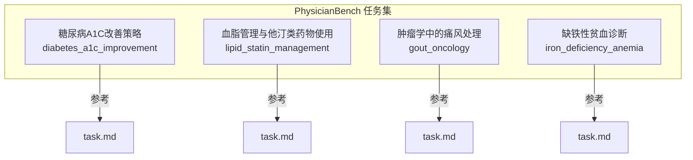
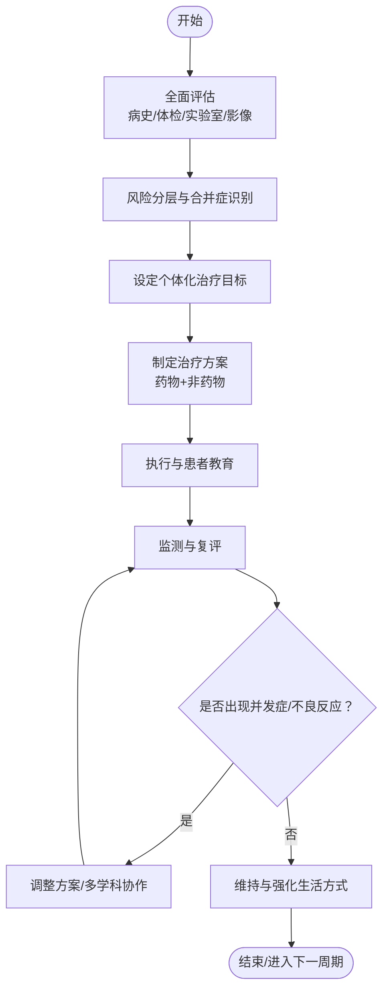
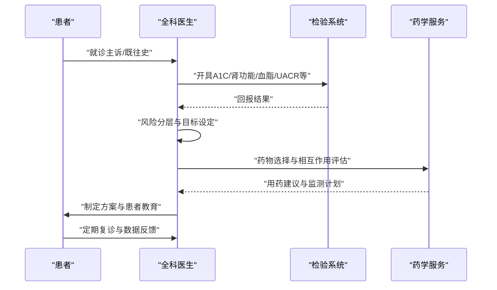
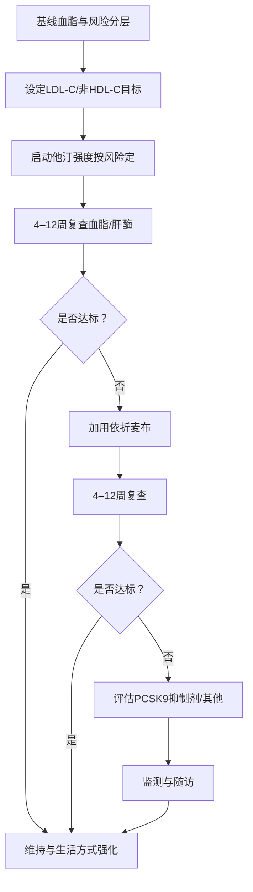
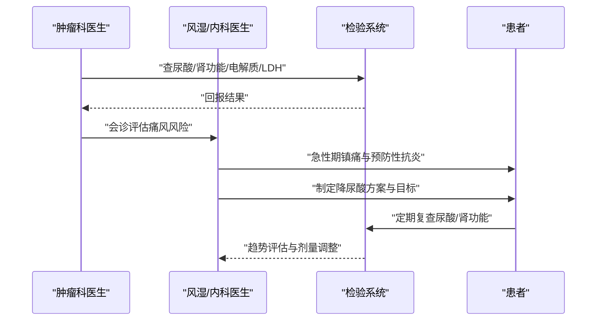
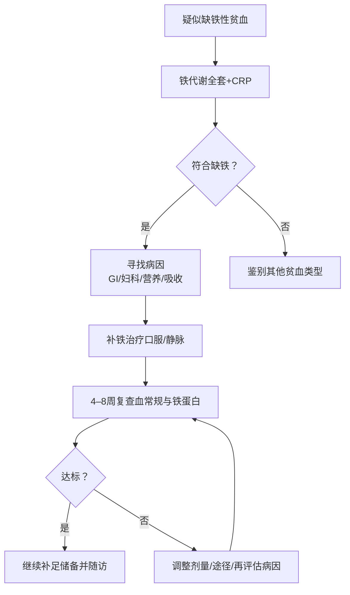
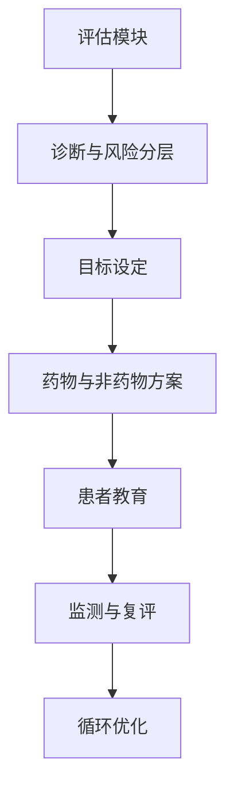

# 代谢性疾病

<cite>
**本文引用的文件**   
- [ PhysicianBench/tasks/v1/diabetes_a1c_improvement/task.md](file://task7/poc3_physicianbench/PhysicianBench/tasks/v1/diabetes_a1c_improvement/task.md)
- [ PhysicianBench/tasks/v1/lipid_statin_management/task.md](file://task7/poc3_physicianbench/PhysicianBench/tasks/v1/lipid_statin_management/task.md)
- [ PhysicianBench/tasks/v1/gout_oncology/task.md](file://task7/poc3_physicianbench/PhysicianBench/tasks/v1/gout_oncology/task.md)
- [ PhysicianBench/tasks/v1/iron_deficiency_anemia/task.md](file://task7/poc3_physicianbench/PhysicianBench/tasks/v1/iron_deficiency_anemia/task.md)
</cite>

## 目录
1. [引言](#引言)
2. [项目结构](#项目结构)
3. [核心组件](#核心组件)
4. [架构总览](#架构总览)
5. [详细组件分析](#详细组件分析)
6. [依赖分析](#依赖分析)
7. [性能考虑](#性能考虑)
8. [故障排查指南](#故障排查指南)
9. [结论](#结论)
10. [附录](#附录)

## 引言
本文件围绕代谢性疾病相关临床任务，聚焦以下常见场景：糖尿病A1C改善策略、血脂管理与他汀类药物使用、肿瘤学背景下的痛风处理、缺铁性贫血诊断。文档从病理生理机制、临床表现与实验室检查意义出发，阐述治疗目标设定、药物选择原则与非药物治疗措施；并给出并发症筛查、风险评估与长期管理策略，以及用药指导、生活方式干预与患者教育要点。内容以仓库中 PhysicianBench 的四个具体任务为锚点，确保建议与实践可追溯至真实任务定义。

## 项目结构
本项目在 PhysicianBench 下提供多个标准化临床任务，每个任务包含任务描述与评估材料，便于构建与评测临床推理智能体。本次文档重点涉及以下四个任务目录及其任务说明文件：
- 糖尿病A1C改善策略
- 血脂管理与他汀类药物使用
- 肿瘤学中的痛风处理
- 缺铁性贫血诊断

图表来源
- [ PhysicianBench/tasks/v1/diabetes_a1c_improvement/task.md](file://task7/poc3_physicianbench/PhysicianBench/tasks/v1/diabetes_a1c_improvement/task.md)
- [ PhysicianBench/tasks/v1/lipid_statin_management/task.md](file://task7/poc3_physicianbench/PhysicianBench/tasks/v1/lipid_statin_management/task.md)
- [ PhysicianBench/tasks/v1/gout_oncology/task.md](file://task7/poc3_physicianbench/PhysicianBench/tasks/v1/gout_oncology/task.md)
- [ PhysicianBench/tasks/v1/iron_deficiency_anemia/task.md](file://task7/poc3_physicianbench/PhysicianBench/tasks/v1/iron_deficiency_anemia/task.md)

章节来源
- [ PhysicianBench/tasks/v1/diabetes_a1c_improvement/task.md](file://task7/poc3_physicianbench/PhysicianBench/tasks/v1/diabetes_a1c_improvement/task.md)
- [ PhysicianBench/tasks/v1/lipid_statin_management/task.md](file://task7/poc3_physicianbench/PhysicianBench/tasks/v1/lipid_statin_management/task.md)
- [ PhysicianBench/tasks/v1/gout_oncology/task.md](file://task7/poc3_physicianbench/PhysicianBench/tasks/v1/gout_oncology/task.md)
- [ PhysicianBench/tasks/v1/iron_deficiency_anemia/task.md](file://task7/poc3_physicianbench/PhysicianBench/tasks/v1/iron_deficiency_anemia/task.md)

## 核心组件
- 糖尿病A1C改善策略：围绕A1C达标路径，整合生活方式干预、口服降糖药与注射类药物的阶梯式选择，强调个体化目标与低血糖风险管控。
- 血脂管理与他汀类药物使用：基于心血管总体风险分层，确定LDL-C等靶标，规范他汀强度与联合用药（如依折麦布、PCSK9抑制剂）的时机与监测。
- 肿瘤学中的痛风处理：在化疗、靶向或免疫治疗背景下，兼顾肾功能、药物相互作用与肿瘤进展，制定急性期与长期降尿酸策略。
- 缺铁性贫血诊断：通过病史、体格检查与铁代谢指标（血清铁蛋白、转铁蛋白饱和度、CRP等）进行病因分型与定位，指导补铁途径与随访。

章节来源
- [ PhysicianBench/tasks/v1/diabetes_a1c_improvement/task.md](file://task7/poc3_physicianbench/PhysicianBench/tasks/v1/diabetes_a1c_improvement/task.md)
- [ PhysicianBench/tasks/v1/lipid_statin_management/task.md](file://task7/poc3_physicianbench/PhysicianBench/tasks/v1/lipid_statin_management/task.md)
- [ PhysicianBench/tasks/v1/gout_oncology/task.md](file://task7/poc3_physicianbench/PhysicianBench/tasks/v1/gout_oncology/task.md)
- [ PhysicianBench/tasks/v1/iron_deficiency_anemia/task.md](file://task7/poc3_physicianbench/PhysicianBench/tasks/v1/iron_deficiency_anemia/task.md)

## 架构总览
下图展示四类代谢性任务的统一工作流：从初始评估到目标设定、方案制定、执行与随访，贯穿并发症筛查与风险管理。

[此图为概念性工作流示意，不直接映射具体源码文件]

## 详细组件分析

### 糖尿病A1C改善策略
- 病理生理要点
  - 胰岛素抵抗与胰岛β细胞功能进行性下降共同驱动高血糖。
  - 微血管与大血管并发症风险随A1C升高而增加。
- 临床表现特征
  - 多饮、多尿、体重变化、乏力；部分患者无症状。
  - 需关注低血糖症状与自主神经病变表现。
- 实验室检查意义
  - A1C反映近2–3个月平均血糖水平，用于诊断与疗效评估。
  - 空腹与餐后血糖、肾功能、肝功能、血脂谱、尿白蛋白/肌酐比值（UACR）用于综合评估。
- 治疗目标设定
  - 一般成人A1C目标常以约≤7%为参考，老年、合并症多者应放宽；年轻、病程短者可更严格。
  - 合并ASCVD、心衰或CKD者优先选择具有心肾获益的药物。
- 药物选择原则
  - 一线常用二甲双胍；若未达标或存在心肾高风险，优先GLP-1受体激动剂或SGLT2抑制剂。
  - 避免或谨慎使用易致低血糖或体重增加的药物组合。
- 非药物治疗措施
  - 医学营养治疗、规律运动、体重管理、戒烟限酒、睡眠与压力管理。
- 并发症筛查与长期管理
  - 眼底检查、足部神经与血管评估、肾脏与心血管风险年度筛查。
  - 血压、血脂达标与抗血小板策略按风险分层实施。
- 用药指导与患者教育
  - 低血糖识别与自救、自我血糖监测频率、药物副作用提示、饮食与运动处方。

图表来源
- [ PhysicianBench/tasks/v1/diabetes_a1c_improvement/task.md](file://task7/poc3_physicianbench/PhysicianBench/tasks/v1/diabetes_a1c_improvement/task.md)

章节来源
- [ PhysicianBench/tasks/v1/diabetes_a1c_improvement/task.md](file://task7/poc3_physicianbench/PhysicianBench/tasks/v1/diabetes_a1c_improvement/task.md)

### 血脂管理与他汀类药物使用
- 病理生理要点
  - LDL颗粒致动脉粥样硬化，HDL与甘油三酯参与风险修饰。
  - 炎症与内皮功能障碍加速斑块形成与不稳定。
- 临床表现特征
  - 多数无症状；严重高TG可见黄色瘤、胰腺炎风险。
- 实验室检查意义
  - 总胆固醇、LDL-C、HDL-C、TG、非HDL-C；必要时载脂蛋白B、脂蛋白(a)。
  - 肝酶与肌酸激酶用于安全性监测。
- 治疗目标设定
  - 依据总体心血管风险分层确定LDL-C或非HDL-C目标值。
  - 极高危人群需更积极降脂。
- 药物选择原则
  - 首选中等至高剂量他汀；未达标加用依折麦布；仍不达标或不耐受考虑PCSK9抑制剂。
  - 高TG时考虑纯EPA制剂或贝特类（注意与他汀联用的肌病风险）。
- 非药物治疗措施
  - 地中海/DASH饮食、减少饱和脂肪与反式脂肪、增加膳食纤维、规律有氧与阻力训练。
- 并发症筛查与长期管理
  - 定期复查血脂与肝酶；评估肌肉症状；合并糖尿病者同步控糖。
- 用药指导与患者教育
  - 服药时间一致性、肌肉酸痛与黑尿警示、避免葡萄柚汁、坚持长期用药。

图表来源
- [ PhysicianBench/tasks/v1/lipid_statin_management/task.md](file://task7/poc3_physicianbench/PhysicianBench/tasks/v1/lipid_statin_management/task.md)

章节来源
- [ PhysicianBench/tasks/v1/lipid_statin_management/task.md](file://task7/poc3_physicianbench/PhysicianBench/tasks/v1/lipid_statin_management/task.md)

### 肿瘤学中的痛风处理
- 病理生理要点
  - 肿瘤溶解综合征与放化疗导致嘌呤大量分解，尿酸生成增多。
  - 肾功能受损与脱水进一步降低尿酸排泄。
- 临床表现特征
  - 急性关节红肿热痛；慢性期可见痛风石、关节破坏。
- 实验室检查意义
  - 血尿酸、肾功能、电解质、乳酸脱氢酶、磷酸盐、钙磷代谢；必要时关节液偏振光显微镜检见尿酸盐结晶。
- 治疗目标设定
  - 急性期快速镇痛消炎；长期将血尿酸降至目标（通常<6 mg/dL，有痛风石者<5 mg/dL）。
- 药物选择原则
  - 急性期：NSAIDs、秋水仙碱或糖皮质激素（根据肾功能与禁忌选择）。
  - 降尿酸：别嘌醇起始低剂量并缓慢滴定；非布司他用于别嘌醇不耐受或特定人群；促尿酸排泄药在肾功能允许时使用。
  - 预防性抗炎：启动降尿酸治疗初期给予小剂量秋水仙碱或NSAIDs预防发作。
- 非药物治疗措施
  - 充足水化、限制酒精与高嘌呤食物、控制体重、避免利尿剂诱发因素。
- 并发症筛查与长期管理
  - 肾功能与尿酸长期监测；皮肤痛风石评估；合并高血压、CKD、心血管疾病时的药物相互作用管理。
- 用药指导与患者教育
  - 别嘌醇超敏反应预警（皮疹、发热）、持续降尿酸的重要性、急性发作早期用药窗口。

图表来源
- [ PhysicianBench/tasks/v1/gout_oncology/task.md](file://task7/poc3_physicianbench/PhysicianBench/tasks/v1/gout_oncology/task.md)

章节来源
- [ PhysicianBench/tasks/v1/gout_oncology/task.md](file://task7/poc3_physicianbench/PhysicianBench/tasks/v1/gout_oncology/task.md)

### 缺铁性贫血诊断
- 病理生理要点
  - 铁摄入不足、吸收障碍或慢性失血导致铁储备耗竭，血红蛋白合成受限。
- 临床表现特征
  - 乏力、心悸、头晕、异食癖、匙状甲、脱发；儿童发育迟缓。
- 实验室检查意义
  - 血常规（MCV↓、MCH↓）、网织红细胞、血清铁蛋白（最敏感）、转铁蛋白饱和度、总铁结合力、CRP（排除炎症干扰）。
  - 粪便隐血、胃肠镜、妇科评估寻找失血源。
- 治疗目标设定
  - 纠正贫血并补足铁储备（铁蛋白恢复至正常范围）。
- 药物选择原则
  - 首选口服铁剂（元素铁剂量与频次优化），不耐受或吸收障碍考虑静脉铁。
  - 针对病因治疗（如消化道出血、月经过多、幽门螺杆菌感染等）。
- 非药物治疗措施
  - 富含血红素铁与维生素C的饮食；避免茶/咖啡与钙同服影响吸收。
- 并发症筛查与长期管理
  - 复查血常规与铁代谢指标；对高危人群进行肿瘤与慢性失血筛查。
- 用药指导与患者教育
  - 铁剂胃肠道副作用应对、正确服用时间与疗程、复诊与指标解读。

图表来源
- [ PhysicianBench/tasks/v1/iron_deficiency_anemia/task.md](file://task7/poc3_physicianbench/PhysicianBench/tasks/v1/iron_deficiency_anemia/task.md)

章节来源
- [ PhysicianBench/tasks/v1/iron_deficiency_anemia/task.md](file://task7/poc3_physicianbench/PhysicianBench/tasks/v1/iron_deficiency_anemia/task.md)

## 依赖分析
上述四类任务相互独立但共享通用临床流程与评估工具（检验系统、药学服务、多学科协作）。在智能体工作流中，它们均依赖统一的“评估—目标—方案—执行—监测”闭环。

[此图为概念性依赖关系示意，不直接映射具体源码文件]

## 性能考虑
- 指标采集与随访频率需平衡准确性与患者负担，避免过度检测。
- 药物相互作用与不良反应监测应前置，减少住院与急诊事件。
- 多学科协作与远程随访有助于提高依从性与长期结局。

## 故障排查指南
- 糖尿病
  - 低血糖频繁：核查用药剂量、进食与运动一致性、肾功能变化。
  - A1C不降：评估依从性、饮食与运动、药物选择与联合是否合理。
- 血脂管理
  - 他汀不耐受：区分肌痛与肌病，必要时换药或减量，评估甲状腺与维生素D状态。
  - 未达标：确认剂量与联合策略，排查继发性原因（甲状腺功能减退、肾病综合征等）。
- 肿瘤学痛风
  - 急性期无效：评估肾功能与NSAIDs禁忌，改用秋水仙碱或糖皮质激素。
  - 降尿酸失败：检查依从性、起始剂量与滴定速度、药物相互作用与肾功能。
- 缺铁性贫血
  - 补铁无效：复核诊断（炎症性贫血、地中海贫血等）、查找隐匿失血、评估吸收障碍。

章节来源
- [ PhysicianBench/tasks/v1/diabetes_a1c_improvement/task.md](file://task7/poc3_physicianbench/PhysicianBench/tasks/v1/diabetes_a1c_improvement/task.md)
- [ PhysicianBench/tasks/v1/lipid_statin_management/task.md](file://task7/poc3_physicianbench/PhysicianBench/tasks/v1/lipid_statin_management/task.md)
- [ PhysicianBench/tasks/v1/gout_oncology/task.md](file://task7/poc3_physicianbench/PhysicianBench/tasks/v1/gout_oncology/task.md)
- [ PhysicianBench/tasks/v1/iron_deficiency_anemia/task.md](file://task7/poc3_physicianbench/PhysicianBench/tasks/v1/iron_deficiency_anemia/task.md)

## 结论
通过对糖尿病A1C改善、血脂与他汀管理、肿瘤学痛风与缺铁性贫血四项任务的系统化梳理，可形成以风险分层为导向、以目标管理为核心、以多学科协作为支撑的长期管理模式。结合生活方式干预与精准用药，配合规范的监测与患者教育，能够显著改善代谢性疾病的短期与长期结局。

## 附录
- 术语速览
  - A1C：糖化血红蛋白，反映近2–3个月平均血糖。
  - LDL-C：低密度脂蛋白胆固醇，动脉粥样硬化主要致病因子。
  - UACR：尿白蛋白/肌酐比值，早期肾脏损伤标志。
  - CRP：C反应蛋白，炎症标志物，影响铁代谢指标解读。
- 推荐随访节奏（示例）
  - 糖尿病：每3个月复查A1C，每年眼底/足部/肾脏评估。
  - 血脂：启动或调整治疗后4–12周复查，稳定后每6–12个月。
  - 痛风：急性期后4–6周复查尿酸与肾功能，稳定后每3–6个月。
  - 缺铁性贫血：补铁后4–8周复查血常规与铁蛋白，达标后继续补足储备并随访。