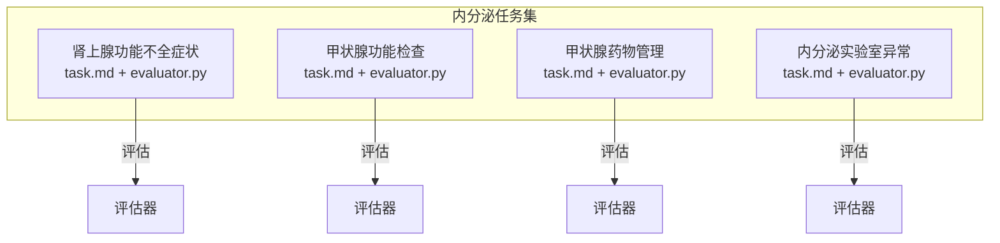
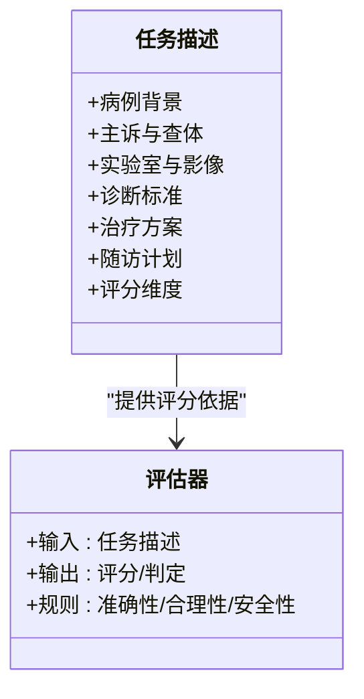
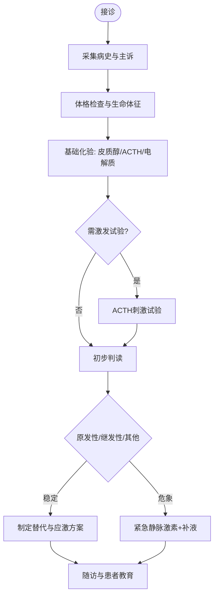
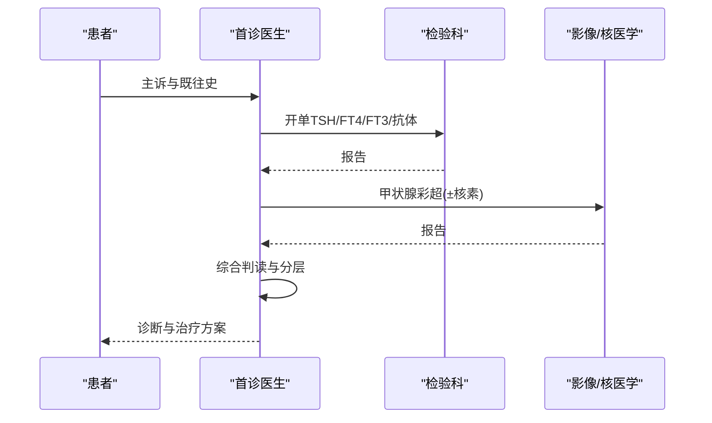
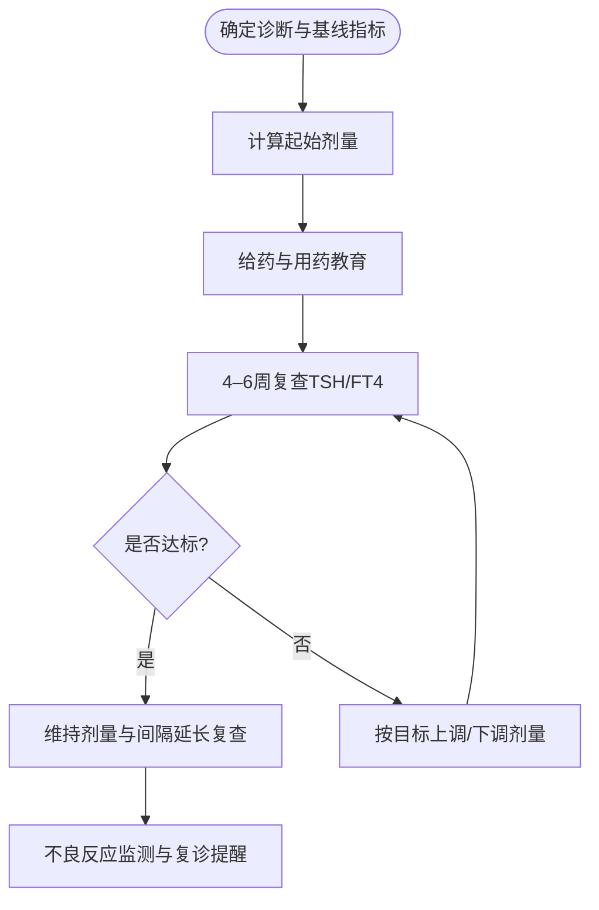
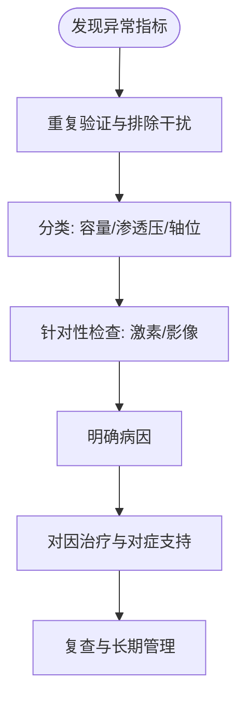
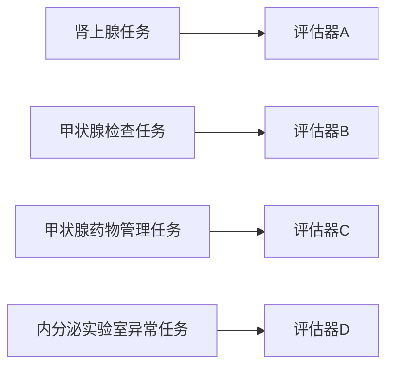

# 内分泌系统疾病

<cite>
**本文引用的文件**   
- [adrenal_insufficiency_symptoms/task.md](file://task7/poc3_physicianbench/PhysicianBench/tasks/v1/adrenal_insufficiency_symptoms/task.md)
- [adrenal_insufficiency_symptoms/evaluator.py](file://task7/poc3_physicianbench/PhysicianBench/tasks/v1/adrenal_insufficiency_symptoms/evaluator.py)
- [thyroid_function_workup/task.md](file://task7/poc3_physicianbench/PhysicianBench/tasks/v1/thyroid_function_workup/task.md)
- [thyroid_function_workup/evaluator.py](file://task7/poc3_physicianbench/PhysicianBench/tasks/v1/thyroid_function_workup/evaluator.py)
- [thyroid_medication_management/task.md](file://task7/poc3_physicianbench/PhysicianBench/tasks/v1/thyroid_medication_management/task.md)
- [thyroid_medication_management/evaluator.py](file://task7/poc3_physicianbench/PhysicianBench/tasks/v1/thyroid_medication_management/evaluator.py)
- [endocrine_lab_abnormality/task.md](file://task7/poc3_physicianbench/PhysicianBench/tasks/v1/endocrine_lab_abnormality/task.md)
- [endocrine_lab_abnormality/evaluator.py](file://task7/poc3_physicianbench/PhysicianBench/tasks/v1/endocrine_lab_abnormality/evaluator.py)
</cite>

## 目录
1. [简介](#简介)
2. [项目结构](#项目结构)
3. [核心组件](#核心组件)
4. [架构总览](#架构总览)
5. [详细组件分析](#详细组件分析)
6. [依赖关系分析](#依赖关系分析)
7. [性能与可用性考量](#性能与可用性考量)
8. [故障排查指南](#故障排查指南)
9. [结论](#结论)
10. [附录](#附录)

## 简介
本文件围绕内分泌系统疾病相关任务，聚焦以下四类临床场景：肾上腺功能不全症状诊断、甲状腺功能检查、甲状腺药物管理、内分泌实验室异常。文档从病例背景、主诉与查体、实验室与影像学发现入手，阐述诊断标准、鉴别诊断要点与治疗策略；并提供激素水平解读、药物剂量调整与随访计划制定建议。同时给出评估指标与评分框架，涵盖诊断准确性、治疗合理性与患者安全性。

## 项目结构
本项目在 PhysicianBench v1 任务集中包含四个内分泌子任务，每个子任务由“任务描述”和“评估器”两部分组成：
- 任务描述（task.md）：定义病例背景、关键信息、预期输出与评分维度。
- 评估器（evaluator.py）：实现自动化或半自动化的评分逻辑与判定规则。

图表来源
- [adrenal_insufficiency_symptoms/task.md](file://task7/poc3_physicianbench/PhysicianBench/tasks/v1/adrenal_insufficiency_symptoms/task.md)
- [adrenal_insufficiency_symptoms/evaluator.py](file://task7/poc3_physicianbench/PhysicianBench/tasks/v1/adrenal_insufficiency_symptoms/evaluator.py)
- [thyroid_function_workup/task.md](file://task7/poc3_physicianbench/PhysicianBench/tasks/v1/thyroid_function_workup/task.md)
- [thyroid_function_workup/evaluator.py](file://task7/poc3_physicianbench/PhysicianBench/tasks/v1/thyroid_function_workup/evaluator.py)
- [thyroid_medication_management/task.md](file://task7/poc3_physicianbench/PhysicianBench/tasks/v1/thyroid_medication_management/task.md)
- [thyroid_medication_management/evaluator.py](file://task7/poc3_physicianbench/PhysicianBench/tasks/v1/thyroid_medication_management/evaluator.py)
- [endocrine_lab_abnormality/task.md](file://task7/poc3_physicianbench/PhysicianBench/tasks/v1/endocrine_lab_abnormality/task.md)
- [endocrine_lab_abnormality/evaluator.py](file://task7/poc3_physicianbench/PhysicianBench/tasks/v1/endocrine_lab_abnormality/evaluator.py)

章节来源
- [adrenal_insufficiency_symptoms/task.md](file://task7/poc3_physicianbench/PhysicianBench/tasks/v1/adrenal_insufficiency_symptoms/task.md)
- [thyroid_function_workup/task.md](file://task7/poc3_physicianbench/PhysicianBench/tasks/v1/thyroid_function_workup/task.md)
- [thyroid_medication_management/task.md](file://task7/poc3_physicianbench/PhysicianBench/tasks/v1/thyroid_medication_management/task.md)
- [endocrine_lab_abnormality/task.md](file://task7/poc3_physicianbench/PhysicianBench/tasks/v1/endocrine_lab_abnormality/task.md)

## 核心组件
- 肾上腺功能不全症状诊断
  - 目标：基于症状、体征与基础化验，识别原发性/继发性肾上腺皮质功能不全，并给出紧急处理与长期替代方案。
  - 关键评估点：是否完成促肾上腺皮质激素（ACTH）刺激试验或清晨皮质醇评估；是否排除急性危象；糖皮质激素与盐皮质激素替代是否合理。
- 甲状腺功能检查
  - 目标：通过TSH、FT4/FT3及抗体检测，区分甲亢、甲减、亚临床状态与非甲状腺疾病综合征（NTIS）。
  - 关键评估点：是否按指南分层检测；是否结合超声与核素显像进行病因学定位；是否避免过度治疗。
- 甲状腺药物管理
  - 目标：根据TSH与症状调整左甲状腺素（L-T4）或抗甲状腺药物（ATD），并监测不良反应。
  - 关键评估点：起始剂量与滴定策略；妊娠/老年/合并症人群的特殊考量；药物相互作用与依从性教育。
- 内分泌实验室异常
  - 目标：对高钙血症、低钠血症、泌乳素升高、性腺轴异常等常见异常进行系统性分析与处置。
  - 关键评估点：是否遵循“先排除假性异常—再定位轴位—最后明确病因”的流程；是否考虑药物与合并症影响。

章节来源
- [adrenal_insufficiency_symptoms/evaluator.py](file://task7/poc3_physicianbench/PhysicianBench/tasks/v1/adrenal_insufficiency_symptoms/evaluator.py)
- [thyroid_function_workup/evaluator.py](file://task7/poc3_physicianbench/PhysicianBench/tasks/v1/thyroid_function_workup/evaluator.py)
- [thyroid_medication_management/evaluator.py](file://task7/poc3_physicianbench/PhysicianBench/tasks/v1/thyroid_medication_management/evaluator.py)
- [endocrine_lab_abnormality/evaluator.py](file://task7/poc3_physicianbench/PhysicianBench/tasks/v1/endocrine_lab_abnormality/evaluator.py)

## 架构总览
四个子任务共享统一的“任务描述+评估器”模式，便于标准化评测与结果对比。

图表来源
- [adrenal_insufficiency_symptoms/task.md](file://task7/poc3_physicianbench/PhysicianBench/tasks/v1/adrenal_insufficiency_symptoms/task.md)
- [adrenal_insufficiency_symptoms/evaluator.py](file://task7/poc3_physicianbench/PhysicianBench/tasks/v1/adrenal_insufficiency_symptoms/evaluator.py)
- [thyroid_function_workup/task.md](file://task7/poc3_physicianbench/PhysicianBench/tasks/v1/thyroid_function_workup/task.md)
- [thyroid_function_workup/evaluator.py](file://task7/poc3_physicianbench/PhysicianBench/tasks/v1/thyroid_function_workup/evaluator.py)
- [thyroid_medication_management/task.md](file://task7/poc3_physicianbench/PhysicianBench/tasks/v1/thyroid_medication_management/task.md)
- [thyroid_medication_management/evaluator.py](file://task7/poc3_physicianbench/PhysicianBench/tasks/v1/thyroid_medication_management/evaluator.py)
- [endocrine_lab_abnormality/task.md](file://task7/poc3_physicianbench/PhysicianBench/tasks/v1/endocrine_lab_abnormality/task.md)
- [endocrine_lab_abnormality/evaluator.py](file://task7/poc3_physicianbench/PhysicianBench/tasks/v1/endocrine_lab_abnormality/evaluator.py)

## 详细组件分析

### 肾上腺功能不全症状诊断
- 临床背景与主诉
  - 常见表现：乏力、体重下降、食欲减退、恶心呕吐、低血压、皮肤色素沉着（原发性）、低钠高钾等。
  - 诱因：感染、手术、创伤、停用糖皮质激素后出现危象。
- 体格检查
  - 低血压、脱水征、皮肤黏膜色素加深（原发性）、腹部压痛（危象时）。
- 实验室与影像学
  - 基础：清晨血皮质醇、ACTH、电解质、血糖。
  - 激发：ACTH刺激试验（短程/长程）；必要时垂体MRI与肾上腺CT。
- 诊断标准与鉴别
  - 原发性：ACTH升高、皮质醇低；继发性：ACTH低或正常、皮质醇低；第三级（下丘脑）少见。
  - 鉴别：败血症休克、消化道失液、药物性抑制、嗜铬细胞瘤危象等。
- 治疗方案
  - 危象：静脉氢化可的松、补液、纠正电解质，随后过渡至口服维持。
  - 长期：糖皮质激素替代（如氢化可的松分次），必要时加用氟氢可的松；应激剂量指导。
- 随访与安全
  - 定期评估症状、体重、血压、电解质；建立“病危卡”与应急用药指导。

图表来源
- [adrenal_insufficiency_symptoms/task.md](file://task7/poc3_physicianbench/PhysicianBench/tasks/v1/adrenal_insufficiency_symptoms/task.md)
- [adrenal_insufficiency_symptoms/evaluator.py](file://task7/poc3_physicianbench/PhysicianBench/tasks/v1/adrenal_insufficiency_symptoms/evaluator.py)

章节来源
- [adrenal_insufficiency_symptoms/task.md](file://task7/poc3_physicianbench/PhysicianBench/tasks/v1/adrenal_insufficiency_symptoms/task.md)
- [adrenal_insufficiency_symptoms/evaluator.py](file://task7/poc3_physicianbench/PhysicianBench/tasks/v1/adrenal_insufficiency_symptoms/evaluator.py)

### 甲状腺功能检查
- 临床背景与主诉
  - 甲亢：心悸、怕热、多汗、体重下降、手抖、突眼。
  - 甲减：畏寒、乏力、便秘、体重增加、抑郁、月经紊乱。
- 体格检查
  - 甲状腺肿大/结节、心动过速或缓慢性心律失常、反射延迟、黏液性水肿。
- 实验室与影像学
  - TSH、FT4、FT3；TRAb、TPOAb、TgAb；甲状腺彩超；必要时核素扫描。
- 诊断标准与鉴别
  - 典型甲亢：TSH降低、FT4/FT3升高；亚临床：TSH异常而FT4/FT3正常。
  - NTIS：非甲状腺疾病导致的TSH/FT4轻度异常，通常不治疗原发病即可恢复。
  - 鉴别：Graves病、毒性结节、甲状腺炎、药物影响（碘、胺碘酮、锂剂）。
- 治疗方案
  - 甲亢：ATD（甲巯咪唑/丙硫氧嘧啶）、放射性碘、手术；桥本甲亢期多为自限。
  - 甲减：左甲状腺素起始与滴定；特殊人群（妊娠、老年、冠心病）谨慎。
- 随访与安全
  - 每4–6周复查TSH直至达标；注意ATD肝损与粒细胞减少警示症状。

图表来源
- [thyroid_function_workup/task.md](file://task7/poc3_physicianbench/PhysicianBench/tasks/v1/thyroid_function_workup/task.md)
- [thyroid_function_workup/evaluator.py](file://task7/poc3_physicianbench/PhysicianBench/tasks/v1/thyroid_function_workup/evaluator.py)

章节来源
- [thyroid_function_workup/task.md](file://task7/poc3_physicianbench/PhysicianBench/tasks/v1/thyroid_function_workup/task.md)
- [thyroid_function_workup/evaluator.py](file://task7/poc3_physicianbench/PhysicianBench/tasks/v1/thyroid_function_workup/evaluator.py)

### 甲状腺药物管理
- 临床背景与主诉
  - L-T4替代：甲减术后/放疗后/自身免疫性甲减。
  - ATD治疗：Graves病初治或复发者。
- 体格检查与监测
  - 心率、体重、甲状腺体积变化；ATD期间关注皮疹、咽痛、黄疸。
- 实验室与影像学
  - TSH为主调药指标；必要时FT4/FT3；超声随访结节/血流。
- 诊断标准与鉴别
  - 以TSH目标区间为依据；区分中枢性甲减（需结合FT4与临床表现）。
- 治疗方案
  - L-T4：空腹整片吞服，避免与钙铁制剂同服；起始剂量按体重与年龄调整。
  - ATD：首选甲巯咪唑（非妊娠）；PTU用于妊娠早期或甲状腺危象。
- 随访与安全
  - 每4–6周复查TSH；出现发热咽痛立即查血常规；肝功能异常及时停药评估。

图表来源
- [thyroid_medication_management/task.md](file://task7/poc3_physicianbench/PhysicianBench/tasks/v1/thyroid_medication_management/task.md)
- [thyroid_medication_management/evaluator.py](file://task7/poc3_physicianbench/PhysicianBench/tasks/v1/thyroid_medication_management/evaluator.py)

章节来源
- [thyroid_medication_management/task.md](file://task7/poc3_physicianbench/PhysicianBench/tasks/v1/thyroid_medication_management/task.md)
- [thyroid_medication_management/evaluator.py](file://task7/poc3_physicianbench/PhysicianBench/tasks/v1/thyroid_medication_management/evaluator.py)

### 内分泌实验室异常
- 临床背景与主诉
  - 高钙血症：骨痛、肾结石、便秘、意识改变。
  - 低钠血症：头痛、恶心、抽搐、昏迷。
  - 高泌乳素血症：溢乳、闭经、不育、性欲下降。
  - 性腺轴异常：月经紊乱、性功能减退、骨质疏松。
- 体格检查
  - 脱水/水肿、神经系统体征、第二性征变化、甲状腺/肾上腺体征。
- 实验室与影像学
  - 钙磷PTH、肾功能；渗透压/尿钠；泌乳素、性激素；垂体/肾上腺/甲状旁腺影像。
- 诊断标准与鉴别
  - 高钙：先排除维生素D过量/噻嗪类；再测PTH判断PTH依赖性。
  - 低钠：评估容量状态与尿渗透压，区分SIADH、心衰、肝硬化、肾上腺功能不全。
  - 高泌乳素：排除药物（多巴胺拮抗剂）、甲减、垂体微腺瘤。
- 治疗方案
  - 针对病因：补钙/降钙/双膦酸盐；补液与去氨加压素选择；溴隐亭/卡麦角林；性激素替代。
- 随访与安全
  - 动态复查电解质与靶器官功能；警惕药物副作用与药物相互作用。

图表来源
- [endocrine_lab_abnormality/task.md](file://task7/poc3_physicianbench/PhysicianBench/tasks/v1/endocrine_lab_abnormality/task.md)
- [endocrine_lab_abnormality/evaluator.py](file://task7/poc3_physicianbench/PhysicianBench/tasks/v1/endocrine_lab_abnormality/evaluator.py)

章节来源
- [endocrine_lab_abnormality/task.md](file://task7/poc3_physicianbench/PhysicianBench/tasks/v1/endocrine_lab_abnormality/task.md)
- [endocrine_lab_abnormality/evaluator.py](file://task7/poc3_physicianbench/PhysicianBench/tasks/v1/endocrine_lab_abnormality/evaluator.py)

## 依赖关系分析
- 任务间耦合度低，各自独立评估；评估器均依赖对应task.md中的评分维度与阈值。
- 共同依赖：内分泌指南共识、参考范围、药物说明书与安全性警示。

图表来源
- [adrenal_insufficiency_symptoms/task.md](file://task7/poc3_physicianbench/PhysicianBench/tasks/v1/adrenal_insufficiency_symptoms/task.md)
- [adrenal_insufficiency_symptoms/evaluator.py](file://task7/poc3_physicianbench/PhysicianBench/tasks/v1/adrenal_insufficiency_symptoms/evaluator.py)
- [thyroid_function_workup/task.md](file://task7/poc3_physicianbench/PhysicianBench/tasks/v1/thyroid_function_workup/task.md)
- [thyroid_function_workup/evaluator.py](file://task7/poc3_physicianbench/PhysicianBench/tasks/v1/thyroid_function_workup/evaluator.py)
- [thyroid_medication_management/task.md](file://task7/poc3_physicianbench/PhysicianBench/tasks/v1/thyroid_medication_management/task.md)
- [thyroid_medication_management/evaluator.py](file://task7/poc3_physicianbench/PhysicianBench/tasks/v1/thyroid_medication_management/evaluator.py)
- [endocrine_lab_abnormality/task.md](file://task7/poc3_physicianbench/PhysicianBench/tasks/v1/endocrine_lab_abnormality/task.md)
- [endocrine_lab_abnormality/evaluator.py](file://task7/poc3_physicianbench/PhysicianBench/tasks/v1/endocrine_lab_abnormality/evaluator.py)

## 性能与可用性考量
- 评估一致性：确保各任务评分维度清晰、阈值明确，减少主观偏差。
- 数据完整性：鼓励补充关键阴性结果与时间序列指标，提升判别力。
- 可扩展性：新增内分泌子任务可采用相同“任务描述+评估器”模板快速接入。

## 故障排查指南
- 评分不一致
  - 核对任务描述中的评分细则与阈值；确认评估器版本与输入数据一致。
- 指标缺失导致误判
  - 优先补齐关键指标（如TSH/FT4、ACTH/皮质醇、电解质）；必要时采用条件分支降级评分。
- 药物安全事件未捕获
  - 检查评估器是否纳入不良反应关键词与实验室预警规则。

章节来源
- [adrenal_insufficiency_symptoms/evaluator.py](file://task7/poc3_physicianbench/PhysicianBench/tasks/v1/adrenal_insufficiency_symptoms/evaluator.py)
- [thyroid_function_workup/evaluator.py](file://task7/poc3_physicianbench/PhysicianBench/tasks/v1/thyroid_function_workup/evaluator.py)
- [thyroid_medication_management/evaluator.py](file://task7/poc3_physicianbench/PhysicianBench/tasks/v1/thyroid_medication_management/evaluator.py)
- [endocrine_lab_abnormality/evaluator.py](file://task7/poc3_physicianbench/PhysicianBench/tasks/v1/endocrine_lab_abnormality/evaluator.py)

## 结论
本套内分泌任务以统一的结构组织病例与评估规则，覆盖从诊断到治疗与随访的全流程。通过明确的评分维度与可操作性强的流程图，有助于提升诊断准确性、治疗合理性与患者安全性。建议在后续迭代中持续完善阈值与边界案例，增强对复杂共病与药物相互作用的鲁棒性。

## 附录
- 术语简表
  - ACTH：促肾上腺皮质激素
  - FT4/FT3：游离甲状腺素/三碘甲状腺原氨酸
  - TRAb/TPOAb/TgAb：甲状腺自身抗体
  - L-T4：左甲状腺素
  - ATD：抗甲状腺药物
  - NTIS：非甲状腺疾病综合征
  - SIADH：抗利尿激素分泌不当综合征