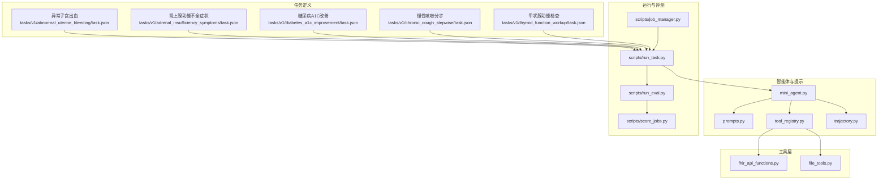
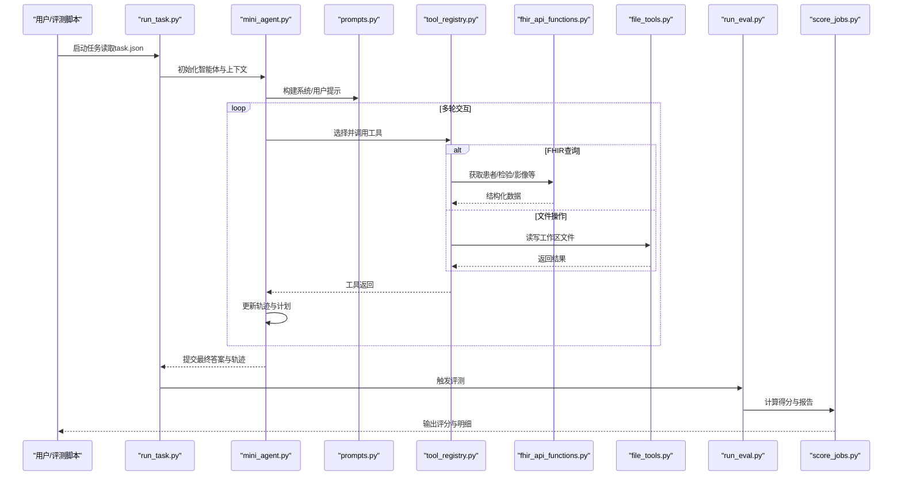
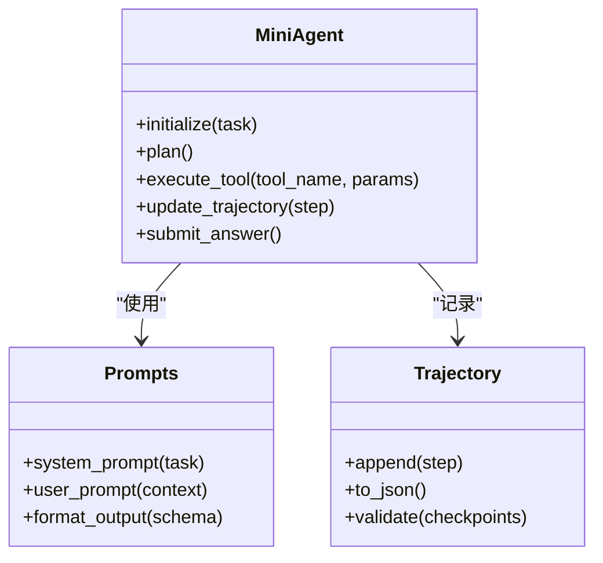
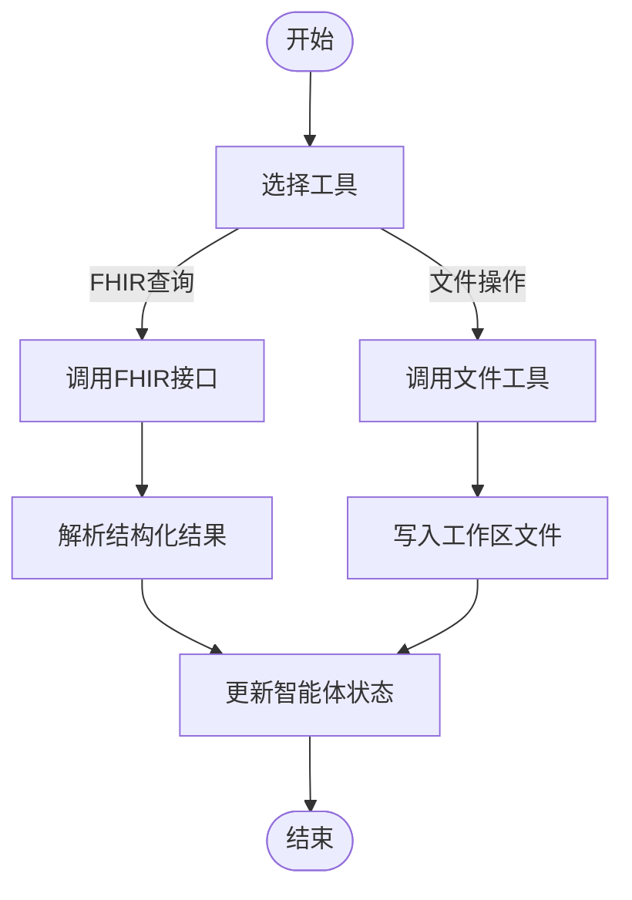
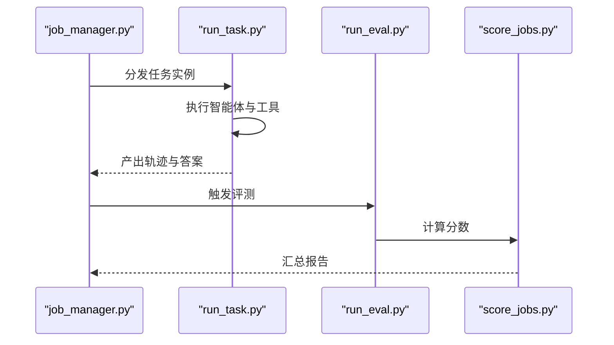
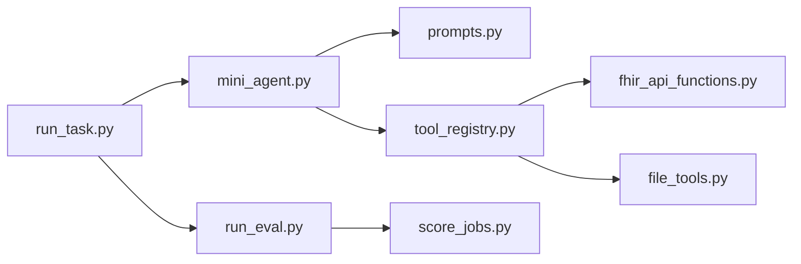

# 医疗任务场景

<cite>
**本文引用的文件**   
- [README.md](file://task7/poc3_physicianbench/PhysicianBench/README.md)
- [pyproject.toml](file://task7/poc3_physicianbench/PhysicianBench/pyproject.toml)
- [conftest.py](file://task7/poc3_physicianbench/PhysicianBench/conftest.py)
- [run_task.py](file://task7/poc3_physicianbench/PhysicianBench/scripts/run_task.py)
- [run_eval.py](file://task7/poc3_physicianbench/PhysicianBench/scripts/run_eval.py)
- [score_jobs.py](file://task7/poc3_physicianbench/PhysicianBench/scripts/score_jobs.py)
- [job_manager.py](file://task7/poc3_physicianbench/PhysicianBench/scripts/job_manager.py)
- [mini_agent.py](file://task7/poc3_physicianbench/PhysicianBench/agent/mini_agent.py)
- [llm_client.py](file://task7/poc3_physicianbench/PhysicianBench/agent/llm_client.py)
- [prompts.py](file://task7/poc3_physicianbench/PhysicianBench/agent/prompts.py)
- [tool_registry.py](file://task7/poc3_physicianbench/PhysicianBench/agent/tool_registry.py)
- [trajectory.py](file://task7/poc3_physicianbench/PhysicianBench/agent/trajectory.py)
- [fhir_api_functions.py](file://task7/poc3_physicianbench/PhysicianBench/tools/fhir_api_functions.py)
- [file_tools.py](file://task7/poc3_physicianbench/PhysicianBench/tools/file_tools.py)
- [eval_helpers.py](file://task7/poc3_physicianbench/PhysicianBench/utils/eval_helpers.py)
- [abnormal_uterine_bleeding/task.json](file://task7/poc3_physicianbench/PhysicianBench/tasks/v1/abnormal_uterine_bleeding/task.json)
- [adrenal_insufficiency_symptoms/task.json](file://task7/poc3_physicianbench/PhysicianBench/tasks/v1/adrenal_insufficiency_symptoms/task.json)
- [diabetes_a1c_improvement/task.json](file://task7/poc3_physicianbench/PhysicianBench/tasks/v1/diabetes_a1c_improvement/task.json)
- [chronic_cough_stepwise/task.json](file://task7/poc3_physicianbench/PhysicianBench/tasks/v1/chronic_cough_stepwise/task.json)
- [thyroid_function_workup/task.json](file://task7/poc3_physicianbench/PhysicianBench/tasks/v1/thyroid_function_workup/task.json)
</cite>

## 目录
1. [简介](#简介)
2. [项目结构](#项目结构)
3. [核心组件](#核心组件)
4. [架构总览](#架构总览)
5. [详细组件分析](#详细组件分析)
6. [依赖关系分析](#依赖关系分析)
7. [性能与资源约束](#性能与资源约束)
8. [故障排查指南](#故障排查指南)
9. [结论](#结论)
10. [附录](#附录)

## 简介
本文件面向PhysicianBench的医疗任务场景，聚焦于真实临床病例的任务设计与评测体系。文档覆盖以下典型疾病场景：肾上腺功能不全症状、糖尿病A1C改善、异常子宫出血、慢性咳嗽（分步与老年）、甲状腺功能障碍等。每个任务包含临床背景、患者信息、诊断要求、治疗目标与评估标准；并说明难度分级、时间限制与资源约束。同时给出任务执行流程、中间结果验证与最终评分机制，以及真实临床案例的数据格式与标注规范，便于研究者快速上手与扩展新任务。

## 项目结构
PhysicianBench采用“任务定义 + 智能体 + 工具 + 评测脚本”的分层组织方式。任务以JSON描述，智能体负责规划与调用工具，工具封装FHIR数据访问与文件操作，评测脚本对轨迹进行校验与打分。

图表来源
- [run_task.py](file://task7/poc3_physicianbench/PhysicianBench/scripts/run_task.py)
- [run_eval.py](file://task7/poc3_physicianbench/PhysicianBench/scripts/run_eval.py)
- [score_jobs.py](file://task7/poc3_physicianbench/PhysicianBench/scripts/score_jobs.py)
- [job_manager.py](file://task7/poc3_physicianbench/PhysicianBench/scripts/job_manager.py)
- [mini_agent.py](file://task7/poc3_physicianbench/PhysicianBench/agent/mini_agent.py)
- [prompts.py](file://task7/poc3_physicianbench/PhysicianBench/agent/prompts.py)
- [tool_registry.py](file://task7/poc3_physicianbench/PhysicianBench/agent/tool_registry.py)
- [trajectory.py](file://task7/poc3_physicianbench/PhysicianBench/agent/trajectory.py)
- [fhir_api_functions.py](file://task7/poc3_physicianbench/PhysicianBench/tools/fhir_api_functions.py)
- [file_tools.py](file://task7/poc3_physicianbench/PhysicianBench/tools/file_tools.py)
- [abnormal_uterine_bleeding/task.json](file://task7/poc3_physicianbench/PhysicianBench/tasks/v1/abnormal_uterine_bleeding/task.json)
- [adrenal_insufficiency_symptoms/task.json](file://task7/poc3_physicianbench/PhysicianBench/tasks/v1/adrenal_insufficiency_symptoms/task.json)
- [diabetes_a1c_improvement/task.json](file://task7/poc3_physicianbench/PhysicianBench/tasks/v1/diabetes_a1c_improvement/task.json)
- [chronic_cough_stepwise/task.json](file://task7/poc3_physicianbench/PhysicianBench/tasks/v1/chronic_cough_stepwise/task.json)
- [thyroid_function_workup/task.json](file://task7/poc3_physicianbench/PhysicianBench/tasks/v1/thyroid_function_workup/task.json)

章节来源
- [README.md](file://task7/poc3_physicianbench/PhysicianBench/README.md)
- [pyproject.toml](file://task7/poc3_physicianbench/PhysicianBench/pyproject.toml)
- [conftest.py](file://task7/poc3_physicianbench/PhysicianBench/conftest.py)

## 核心组件
- 任务定义（JSON）：描述临床背景、患者信息、诊断要求、治疗目标、评估标准、难度、时间限制、资源约束、输入输出与中间检查点。
- 智能体（Agent）：基于提示工程与工具注册表，驱动多轮交互，生成诊疗计划、查询FHIR数据、记录轨迹。
- 工具层（Tools）：封装FHIR API函数与文件读写，提供标准化数据访问能力。
- 运行与评测（Scripts）：任务编排、评测执行、作业管理与评分汇总。

章节来源
- [mini_agent.py](file://task7/poc3_physicianbench/PhysicianBench/agent/mini_agent.py)
- [prompts.py](file://task7/poc3_physicianbench/PhysicianBench/agent/prompts.py)
- [tool_registry.py](file://task7/poc3_physicianbench/PhysicianBench/agent/tool_registry.py)
- [fhir_api_functions.py](file://task7/poc3_physicianbench/PhysicianBench/tools/fhir_api_functions.py)
- [file_tools.py](file://task7/poc3_physicianbench/PhysicianBench/tools/file_tools.py)
- [run_task.py](file://task7/poc3_physicianbench/PhysicianBench/scripts/run_task.py)
- [run_eval.py](file://task7/poc3_physicianbench/PhysicianBench/scripts/run_eval.py)
- [score_jobs.py](file://task7/poc3_physicianbench/PhysicianBench/scripts/score_jobs.py)
- [job_manager.py](file://task7/poc3_physicianbench/PhysicianBench/scripts/job_manager.py)

## 架构总览
下图展示从任务加载到评测打分的端到端流程，包括智能体规划、工具调用、轨迹记录与评分器校验。

图表来源
- [run_task.py](file://task7/poc3_physicianbench/PhysicianBench/scripts/run_task.py)
- [mini_agent.py](file://task7/poc3_physicianbench/PhysicianBench/agent/mini_agent.py)
- [prompts.py](file://task7/poc3_physicianbench/PhysicianBench/agent/prompts.py)
- [tool_registry.py](file://task7/poc3_physicianbench/PhysicianBench/agent/tool_registry.py)
- [fhir_api_functions.py](file://task7/poc3_physicianbench/PhysicianBench/tools/fhir_api_functions.py)
- [file_tools.py](file://task7/poc3_physicianbench/PhysicianBench/tools/file_tools.py)
- [run_eval.py](file://task7/poc3_physicianbench/PhysicianBench/scripts/run_eval.py)
- [score_jobs.py](file://task7/poc3_physicianbench/PhysicianBench/scripts/score_jobs.py)

## 详细组件分析

### 任务定义与数据结构
- 字段建议（依据仓库中各任务JSON的结构约定）：
  - 基本信息：任务ID、名称、版本、难度等级、时间限制、资源约束
  - 临床背景：疾病概述、指南参考、关键鉴别诊断
  - 患者信息：人口学特征、主诉、现病史、既往史、用药、过敏史、家族史
  - 初始数据：已提供的FHIR资源片段或文件路径
  - 诊断要求：必须完成的检查、排除条件、诊断标准
  - 治疗目标：短期与长期目标、禁忌与注意事项
  - 评估标准：步骤级检查点、最终答案判定规则、容错阈值
  - 输入输出：输入模板、输出格式、中间产物清单
- 示例任务（仅列出路径，不展示内容）：
  - [异常子宫出血](file://task7/poc3_physicianbench/PhysicianBench/tasks/v1/abnormal_uterine_bleeding/task.json)
  - [肾上腺功能不全症状](file://task7/poc3_physicianbench/PhysicianBench/tasks/v1/adrenal_insufficiency_symptoms/task.json)
  - [糖尿病A1C改善](file://task7/poc3_physicianbench/PhysicianBench/tasks/v1/diabetes_a1c_improvement/task.json)
  - [慢性咳嗽（分步）](file://task7/poc3_physicianbench/PhysicianBench/tasks/v1/chronic_cough_stepwise/task.json)
  - [甲状腺功能检查](file://task7/poc3_physicianbench/PhysicianBench/tasks/v1/thyroid_function_workup/task.json)

章节来源
- [abnormal_uterine_bleeding/task.json](file://task7/poc3_physicianbench/PhysicianBench/tasks/v1/abnormal_uterine_bleeding/task.json)
- [adrenal_insufficiency_symptoms/task.json](file://task7/poc3_physicianbench/PhysicianBench/tasks/v1/adrenal_insufficiency_symptoms/task.json)
- [diabetes_a1c_improvement/task.json](file://task7/poc3_physicianbench/PhysicianBench/tasks/v1/diabetes_a1c_improvement/task.json)
- [chronic_cough_stepwise/task.json](file://task7/poc3_physicianbench/PhysicianBench/tasks/v1/chronic_cough_stepwise/task.json)
- [thyroid_function_workup/task.json](file://task7/poc3_physicianbench/PhysicianBench/tasks/v1/thyroid_function_workup/task.json)

### 智能体与提示工程
- mini_agent：维护会话状态、解析任务、生成下一步动作、管理工具调用与轨迹记录。
- prompts：提供系统提示与用户提示模板，确保模型遵循任务约束与输出格式。
- trajectory：持久化每一步决策、工具调用与返回，用于后续可解释性与审计。

图表来源
- [mini_agent.py](file://task7/poc3_physicianbench/PhysicianBench/agent/mini_agent.py)
- [prompts.py](file://task7/poc3_physicianbench/PhysicianBench/agent/prompts.py)
- [trajectory.py](file://task7/poc3_physicianbench/PhysicianBench/agent/trajectory.py)

章节来源
- [mini_agent.py](file://task7/poc3_physicianbench/PhysicianBench/agent/mini_agent.py)
- [prompts.py](file://task7/poc3_physicianbench/PhysicianBench/agent/prompts.py)
- [trajectory.py](file://task7/poc3_physicianbench/PhysicianBench/agent/trajectory.py)

### 工具层与FHIR集成
- tool_registry：统一注册与路由工具，屏蔽具体实现细节。
- fhir_api_functions：封装FHIR资源的查询与过滤，如患者、观察值、诊断、处方等。
- file_tools：支持工作区内文件的读写与导出，便于保存中间结果与报告。

图表来源
- [tool_registry.py](file://task7/poc3_physicianbench/PhysicianBench/agent/tool_registry.py)
- [fhir_api_functions.py](file://task7/poc3_physicianbench/PhysicianBench/tools/fhir_api_functions.py)
- [file_tools.py](file://task7/poc3_physicianbench/PhysicianBench/tools/file_tools.py)

章节来源
- [tool_registry.py](file://task7/poc3_physicianbench/PhysicianBench/agent/tool_registry.py)
- [fhir_api_functions.py](file://task7/poc3_physicianbench/PhysicianBench/tools/fhir_api_functions.py)
- [file_tools.py](file://task7/poc3_physicianbench/PhysicianBench/tools/file_tools.py)

### 运行与评测流程
- run_task：加载任务JSON，初始化智能体，执行多轮交互，收集轨迹与答案。
- run_eval：根据任务定义的评估标准，对轨迹与答案进行校验。
- score_jobs：汇总多个作业的运行结果，生成评分与报告。
- job_manager：批量调度与管理任务作业。

图表来源
- [job_manager.py](file://task7/poc3_physicianbench/PhysicianBench/scripts/job_manager.py)
- [run_task.py](file://task7/poc3_physicianbench/PhysicianBench/scripts/run_task.py)
- [run_eval.py](file://task7/poc3_physicianbench/PhysicianBench/scripts/run_eval.py)
- [score_jobs.py](file://task7/poc3_physicianbench/PhysicianBench/scripts/score_jobs.py)

章节来源
- [run_task.py](file://task7/poc3_physicianbench/PhysicianBench/scripts/run_task.py)
- [run_eval.py](file://task7/poc3_physicianbench/PhysicianBench/scripts/run_eval.py)
- [score_jobs.py](file://task7/poc3_physicianbench/PhysicianBench/scripts/score_jobs.py)
- [job_manager.py](file://task7/poc3_physicianbench/PhysicianBench/scripts/job_manager.py)

### 典型病例任务设计要点
- 肾上腺功能不全症状
  - 临床背景：急慢性肾上腺危象识别、激素替代策略
  - 诊断要求：皮质醇节律、ACTH刺激试验、电解质紊乱评估
  - 治疗目标：稳定血流动力学、纠正低钠高钾、糖皮质激素补充
  - 评估标准：关键检查是否完成、药物剂量与时机是否合理、并发症预防
- 糖尿病A1C改善
  - 临床背景：生活方式干预、口服降糖药与胰岛素联合方案
  - 诊断要求：A1C基线与随访、肾功能与心血管风险评估
  - 治疗目标：A1C达标、低血糖风险最小化、体重管理
  - 评估标准：A1C变化幅度、不良反应监测、依从性指标
- 异常子宫出血
  - 临床背景：PALM-COEIN分类、妊娠相关排除
  - 诊断要求：超声、内膜活检、凝血与内分泌检查
  - 治疗目标：止血、纠正贫血、病因治疗
  - 评估标准：出血控制时间、血红蛋白恢复、复发率
- 慢性咳嗽（分步）
  - 临床背景：上气道咳嗽综合征、胃食管反流、哮喘、ACEI药物
  - 诊断要求：胸片、肺功能、呼出气一氧化氮、24小时pH监测
  - 治疗目标：针对病因治疗、症状缓解
  - 评估标准：咳嗽评分下降、诱因规避、复诊间隔
- 甲状腺功能障碍
  - 临床背景：甲亢/甲减鉴别、桥本氏病、亚急性甲状腺炎
  - 诊断要求：TSH、FT4、TPOAb/TgAb、甲状腺超声
  - 治疗目标：激素水平正常化、症状控制
  - 评估标准：复查周期、药物调整合理性、副作用管理

章节来源
- [abnormal_uterine_bleeding/task.json](file://task7/poc3_physicianbench/PhysicianBench/tasks/v1/abnormal_uterine_bleeding/task.json)
- [adrenal_insufficiency_symptoms/task.json](file://task7/poc3_physicianbench/PhysicianBench/tasks/v1/adrenal_insufficiency_symptoms/task.json)
- [diabetes_a1c_improvement/task.json](file://task7/poc3_physicianbench/PhysicianBench/tasks/v1/diabetes_a1c_improvement/task.json)
- [chronic_cough_stepwise/task.json](file://task7/poc3_physicianbench/PhysicianBench/tasks/v1/chronic_cough_stepwise/task.json)
- [thyroid_function_workup/task.json](file://task7/poc3_physicianbench/PhysicianBench/tasks/v1/thyroid_function_workup/task.json)

## 依赖关系分析
- 模块耦合
  - run_task依赖mini_agent与prompts，通过tool_registry协调fhir_api_functions与file_tools。
  - run_eval与score_jobs依赖任务定义中的评估标准与轨迹数据。
- 外部依赖
  - FHIR服务器与认证配置（由工具层抽象）。
  - 文件系统权限与工作区隔离。
- 潜在循环依赖
  - 当前分层清晰，未见直接循环导入；建议在新增工具时保持单向依赖。

图表来源
- [run_task.py](file://task7/poc3_physicianbench/PhysicianBench/scripts/run_task.py)
- [mini_agent.py](file://task7/poc3_physicianbench/PhysicianBench/agent/mini_agent.py)
- [prompts.py](file://task7/poc3_physicianbench/PhysicianBench/agent/prompts.py)
- [tool_registry.py](file://task7/poc3_physicianbench/PhysicianBench/agent/tool_registry.py)
- [fhir_api_functions.py](file://task7/poc3_physicianbench/PhysicianBench/tools/fhir_api_functions.py)
- [file_tools.py](file://task7/poc3_physicianbench/PhysicianBench/tools/file_tools.py)
- [run_eval.py](file://task7/poc3_physicianbench/PhysicianBench/scripts/run_eval.py)
- [score_jobs.py](file://task7/poc3_physicianbench/PhysicianBench/scripts/score_jobs.py)

章节来源
- [pyproject.toml](file://task7/poc3_physicianbench/PhysicianBench/pyproject.toml)
- [conftest.py](file://task7/poc3_physicianbench/PhysicianBench/conftest.py)

## 性能与资源约束
- 时间限制
  - 单任务最大运行时长（分钟），超时自动终止并记录。
- 工具调用次数
  - 每轮交互限制FHIR查询与文件操作上限，防止无限循环。
- 并发与并行
  - job_manager支持多作业并行，需考虑FHIR限流与磁盘IO瓶颈。
- 内存与存储
  - 轨迹与中间结果按任务隔离，避免跨任务污染。
- 成本优化
  - 缓存常用FHIR查询结果；复用相似任务的提示模板。

[本节为通用指导，无需特定文件引用]

## 故障排查指南
- 常见问题
  - FHIR连接失败：检查网络、认证令牌与服务端可用性。
  - 工具未注册：确认tool_registry中已声明对应工具名与参数。
  - 轨迹不完整：检查trajectory.append与validate逻辑是否被调用。
  - 评测失败：核对任务JSON中的评估标准与输出格式一致性。
- 日志与调试
  - 启用详细日志输出至工作区logs目录。
  - 使用run_eval的中间检查点定位失败步骤。
- 回滚与重试
  - 支持断点续跑，从最近检查点继续执行。

章节来源
- [run_eval.py](file://task7/poc3_physicianbench/PhysicianBench/scripts/run_eval.py)
- [score_jobs.py](file://task7/poc3_physicianbench/PhysicianBench/scripts/score_jobs.py)
- [trajectory.py](file://task7/poc3_physicianbench/PhysicianBench/agent/trajectory.py)
- [tool_registry.py](file://task7/poc3_physicianbench/PhysicianBench/agent/tool_registry.py)

## 结论
PhysicianBench通过标准化的任务定义、模块化智能体与工具层、完善的评测与评分机制，构建了可复现、可扩展的医疗任务评测平台。典型病例覆盖了内分泌、妇科、呼吸等多学科场景，具备清晰的难度分级与资源约束。建议在新任务开发中严格遵循JSON结构与评估标准，并在工具层增加必要的错误处理与日志记录，以提升鲁棒性与可解释性。

[本节为总结性内容，无需特定文件引用]

## 附录
- 数据格式与标注规范
  - 患者信息：人口学、主诉、现病史、既往史、用药、过敏、家族史
  - 检查结果：FHIR观察值类型、单位、参考范围、采集时间
  - 诊断与治疗：ICD编码、药物名称、剂量、频次、疗程
  - 中间产物：检查申请单、影像报告、实验室结果、随访记录
- 评估标准模板
  - 步骤级检查点：必须完成的检查项与顺序
  - 最终答案判定：诊断正确性、治疗方案合理性、安全性考量
  - 容错阈值：数值型指标的允许偏差范围

[本节为概念性内容，无需特定文件引用]