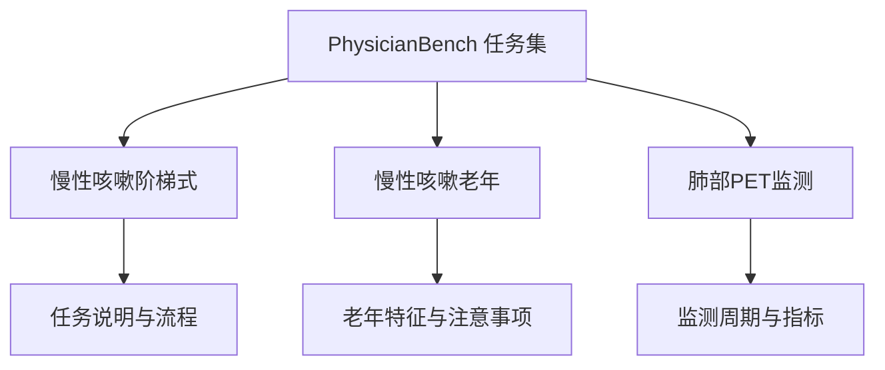
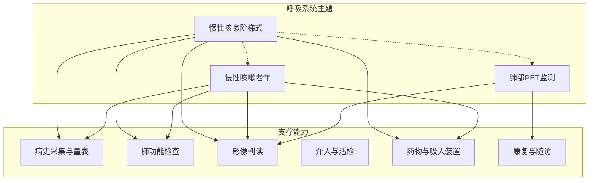
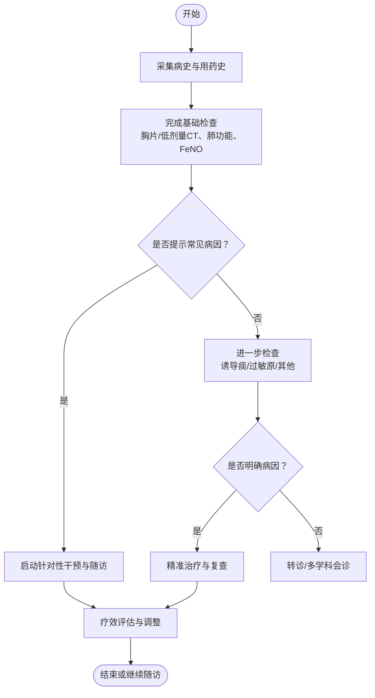
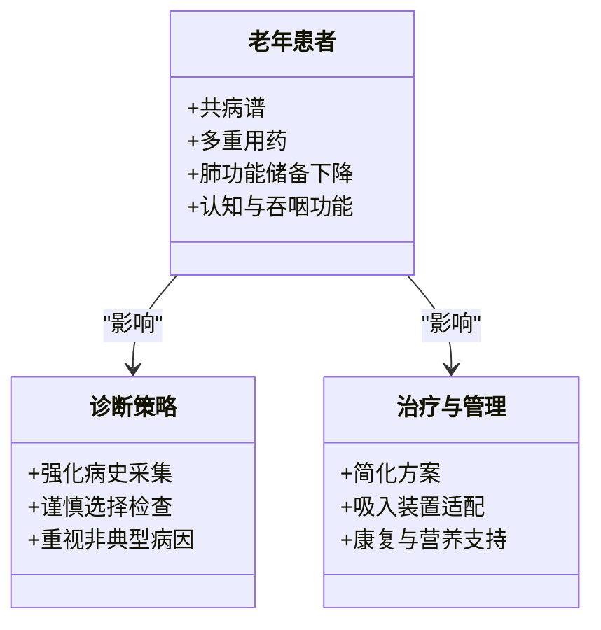
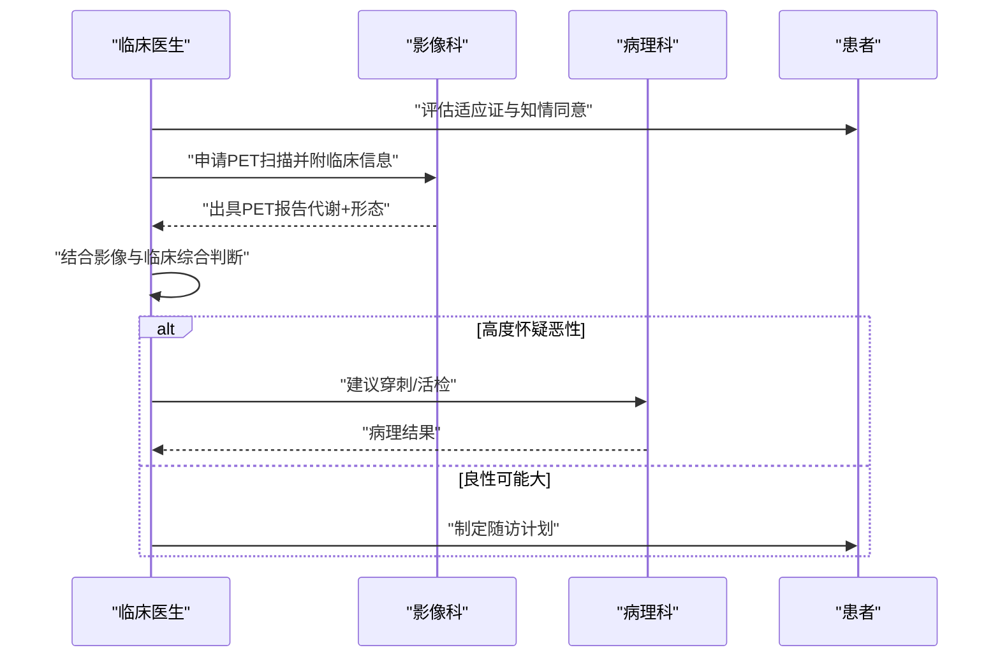
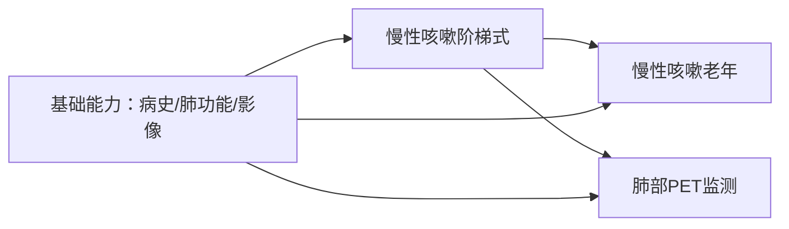

# 呼吸系统疾病

<cite>
**本文引用的文件**   
- [chronic_cough_stepwise.md](file://task7/poc3_physicianbench/PhysicianBench/tasks/v1/chronic_cough_stepwise/task.md)
- [chronic_cough_geriatric.md](file://task7/poc3_physicianbench/PhysicianBench/tasks/v1/chronic_cough_geriatric/task.md)
- [pulmonary_pet_surveillance.md](file://task7/poc3_physicianbench/PhysicianBench/tasks/v1/pulmonary_pet_surveillance/task.md)
</cite>

## 目录
1. [引言](#引言)
2. [项目结构](#项目结构)
3. [核心组件](#核心组件)
4. [架构总览](#架构总览)
5. [详细组件分析](#详细组件分析)
6. [依赖分析](#依赖分析)
7. [性能与可维护性考虑](#性能与可维护性考虑)
8. [故障排查指南](#故障排查指南)
9. [结论](#结论)
10. [附录](#附录)

## 引言
本文件面向临床与科研场景，围绕呼吸系统疾病相关任务构建系统化、可操作的实践文档。重点覆盖：
- 慢性咳嗽的阶梯式诊断路径
- 老年患者慢性咳嗽的特点与差异化策略
- 肺部PET扫描在随访与监测中的应用要点
- 呼吸道解剖结构与肺功能检查基础
- 影像学判读要点（含结节与肿块评估）
- 咳嗽病因分类与鉴别诊断（哮喘与COPD）
- 肺癌筛查策略与高危人群管理
- 支气管镜检查指征与流程要点
- 肺功能测试结果解读与趋势分析
- 呼吸康复指导与依从性提升
- 抗生素合理使用原则、吸入装置正确使用方法与不良反应监测

## 项目结构
本项目以“任务卡片”形式组织各临床主题，每个主题包含任务说明、评估标准与参考材料，便于统一训练、评测与复现。针对呼吸系统主题，相关文件位于 PhysicianBench 的任务目录中，分别对应“慢性咳嗽阶梯式诊断”“老年慢性咳嗽”和“肺部PET监测”。

[本节为概念性结构说明，不直接分析具体文件，故无章节来源]

## 核心组件
围绕呼吸系统主题，核心内容按三大任务展开：
- 慢性咳嗽阶梯式诊断：提供从初筛到分层干预的标准化路径，强调常见病因优先排除与试验性治疗顺序。
- 老年慢性咳嗽：聚焦老年患者的共病、用药史、非典型表现与合并症对诊断与治疗的影响。
- 肺部PET监测：明确适应证、扫描时机、结果解读与后续决策节点。

上述三个任务均提供结构化任务说明与评估维度，便于在真实或模拟场景中执行与打分。

**章节来源**
- [chronic_cough_stepwise.md](file://task7/poc3_physicianbench/PhysicianBench/tasks/v1/chronic_cough_stepwise/task.md)
- [chronic_cough_geriatric.md](file://task7/poc3_physicianbench/PhysicianBench/tasks/v1/chronic_cough_geriatric/task.md)
- [pulmonary_pet_surveillance.md](file://task7/poc3_physicianbench/PhysicianBench/tasks/v1/pulmonary_pet_surveillance/task.md)

## 架构总览
下图展示呼吸系统主题在任务体系中的位置与交互关系，体现“任务—流程—评估”的整体闭环。

[本节为概念性架构图，不直接映射具体代码文件，故无图表来源]

## 详细组件分析

### 组件A：慢性咳嗽阶梯式诊断
- 目标：建立可重复的阶梯式诊断路径，提高常见病因检出率并减少不必要检查。
- 关键步骤（概述）：
  - 初筛：症状学评估、危险因素与既往用药史梳理
  - 一线检查：胸片/低剂量CT、肺功能（含支气管舒张试验）、呼出气一氧化氮（FeNO）等
  - 分层干预：根据证据进行经验性治疗与再评估（如气道高反应、胃食管反流、上气道咳嗽综合征等）
  - 进阶检查：诱导痰嗜酸粒细胞计数、过敏原检测、必要时支气管镜
  - 转诊与多学科协作：疑难病例进入专科路径
- 评估要点：路径完整性、循证依据、风险收益权衡、患者教育与依从性

[本节为概念流程图，不直接映射具体代码文件，故无图表来源]

**章节来源**
- [chronic_cough_stepwise.md](file://task7/poc3_physicianbench/PhysicianBench/tasks/v1/chronic_cough_stepwise/task.md)

### 组件B：老年患者慢性咳嗽特点
- 目标：识别老年群体在慢性咳嗽中的特殊性与高风险因素，优化诊断与治疗策略。
- 关注点（概述）：
  - 多病共存与多重用药导致的咳嗽诱因
  - 非典型表现与隐匿性感染、心衰、间质性肺病等
  - 肺功能储备下降与合并症对治疗的限制
  - 认知与吞咽功能对吸入装置使用的影响
  - 跌倒、营养不良与生活质量的综合管理
- 评估要点：老年综合评估、药物相互作用审查、个体化目标设定

[本节为概念类图，不直接映射具体代码文件，故无图表来源]

**章节来源**
- [chronic_cough_geriatric.md](file://task7/poc3_physicianbench/PhysicianBench/tasks/v1/chronic_cough_geriatric/task.md)

### 组件C：肺部PET扫描监测
- 目标：规范肺部病变的PET监测流程，明确适应证、时机与结果解读，避免过度或不足检查。
- 关键要素（概述）：
  - 适应证：可疑恶性结节的代谢活性评估、治疗后残留病灶的活性判断、复发监测
  - 扫描时机：与手术/放化疗的时间间隔、炎症干扰规避
  - 结果解读：SUV值、形态学结合、假阳性与假阴性考量
  - 后续决策：穿刺活检、短期复查、观察随访或手术切除
- 评估要点：适应证把握、报告质量、跨学科沟通与患者知情同意

[本节为概念时序图，不直接映射具体代码文件，故无图表来源]

**章节来源**
- [pulmonary_pet_surveillance.md](file://task7/poc3_physicianbench/PhysicianBench/tasks/v1/pulmonary_pet_surveillance/task.md)

## 依赖分析
- 任务间依赖：
  - 老年慢性咳嗽与阶梯式诊断存在交叉，前者更强调共病与用药审查
  - PET监测常作为阶梯式诊断的进阶手段之一，用于疑难或疑似恶性病变
- 能力依赖：
  - 病史采集与量表工具贯穿所有任务
  - 肺功能检查与影像判读为基础能力
  - 介入与活检、药物与吸入装置、康复与随访为支撑模块

[本节为概念依赖图，不直接映射具体代码文件，故无图表来源]

**章节来源**
- [chronic_cough_stepwise.md](file://task7/poc3_physicianbench/PhysicianBench/tasks/v1/chronic_cough_stepwise/task.md)
- [chronic_cough_geriatric.md](file://task7/poc3_physicianbench/PhysicianBench/tasks/v1/chronic_cough_geriatric/task.md)
- [pulmonary_pet_surveillance.md](file://task7/poc3_physicianbench/PhysicianBench/tasks/v1/pulmonary_pet_surveillance/task.md)

## 性能与可维护性考虑
- 标准化与可复用：通过统一的任务模板与评估维度，确保不同场景下的一致性
- 可扩展性：新增呼吸系统子主题时，沿用现有结构，降低集成成本
- 数据质量：强调结构化记录与关键指标采集，便于后续分析与改进
- 安全与合规：涉及影像与侵入性操作时，严格遵循伦理与知情同意要求

[本节为通用指导，不直接分析具体文件，故无章节来源]

## 故障排查指南
- 诊断路径未达预期：
  - 核查是否遗漏关键病史与用药史
  - 确认基础检查是否完整（胸片/低剂量CT、肺功能、FeNO）
  - 评估是否存在非典型病因或合并症干扰
- 老年患者治疗困难：
  - 重新审视药物相互作用与副作用
  - 调整吸入装置类型与技巧培训
  - 加强康复与营养支持
- PET监测结果不确定：
  - 复核扫描时机与炎症状态
  - 结合形态学与临床信息进行二次评估
  - 必要时安排短期复查或组织学验证

[本节为通用指导，不直接分析具体文件，故无章节来源]

## 结论
本文件系统梳理了呼吸系统疾病相关任务的框架与实践要点，围绕慢性咳嗽的阶梯式诊断、老年患者特殊性以及肺部PET监测形成闭环。通过标准化流程、清晰的能力依赖与评估维度，可在真实或模拟场景中高效执行与持续改进。

[本节为总结性内容，不直接分析具体文件，故无章节来源]

## 附录
- 术语速览：
  - FeNO：呼出气一氧化氮，反映气道嗜酸性炎症
  - SUV：标准摄取值，PET常用定量指标
  - 低剂量CT：用于肺癌筛查与小结节随访
- 建议阅读与参考：
  - 各任务文件中的“任务说明”“评估标准”与“参考材料”部分

[本节为补充信息，不直接分析具体文件，故无章节来源]