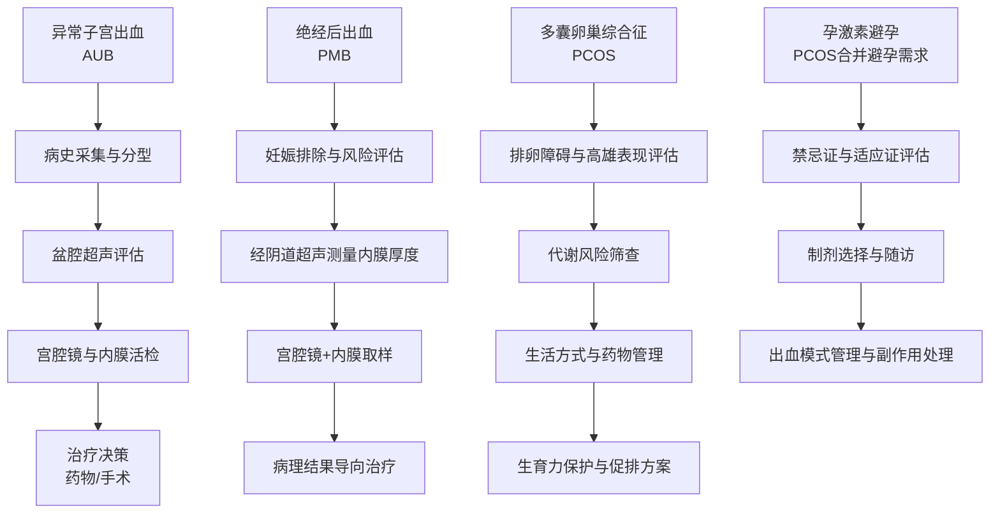
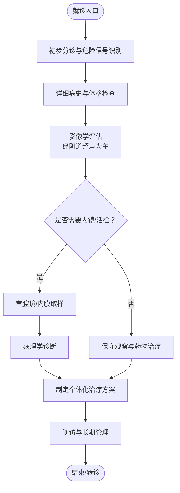
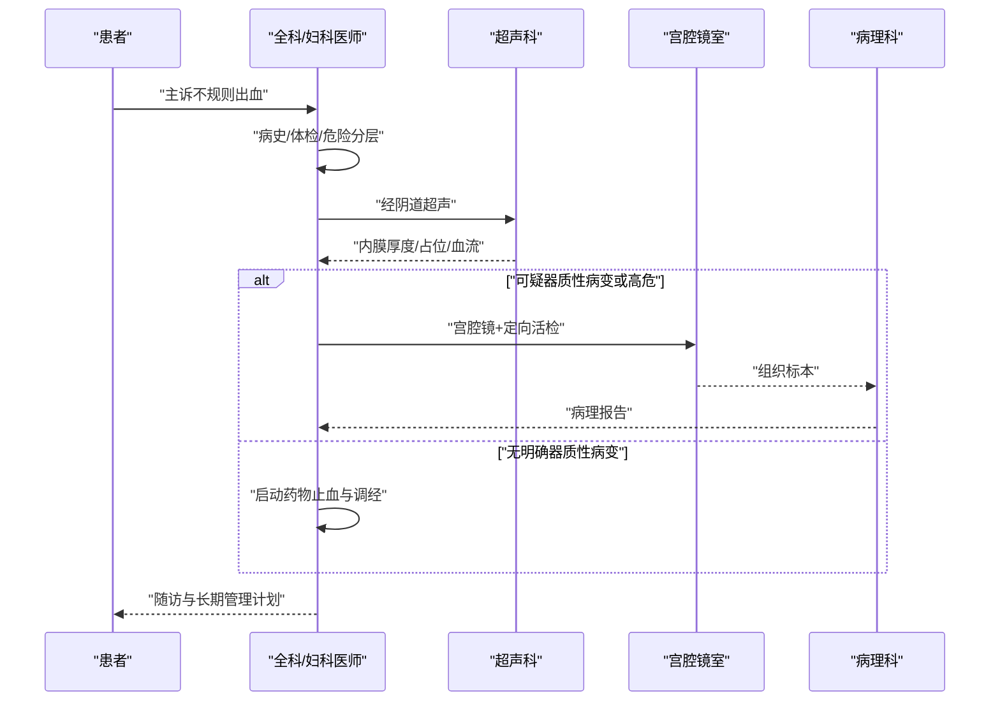
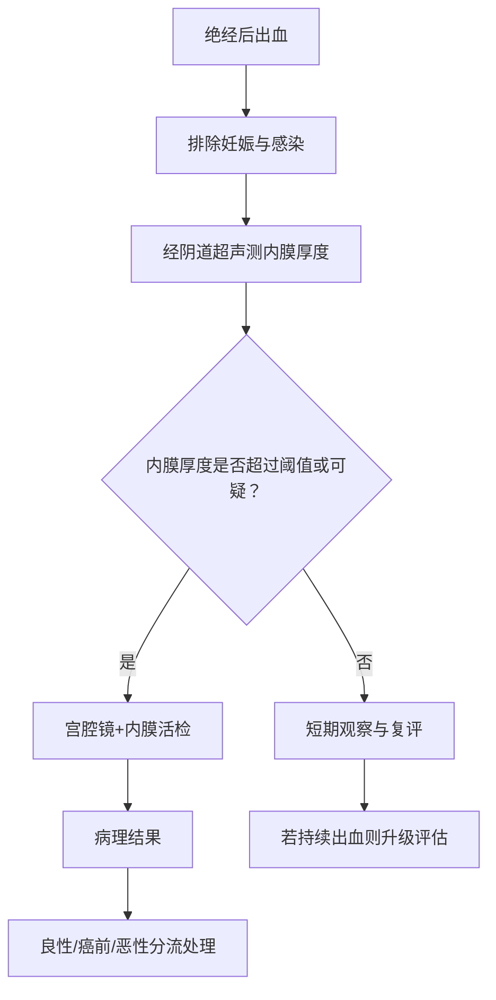
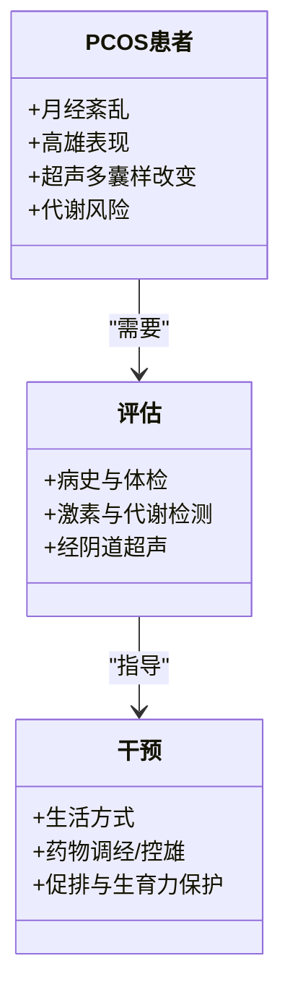
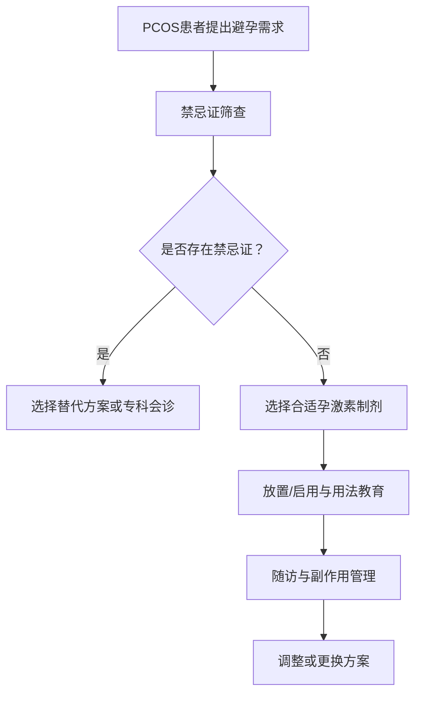
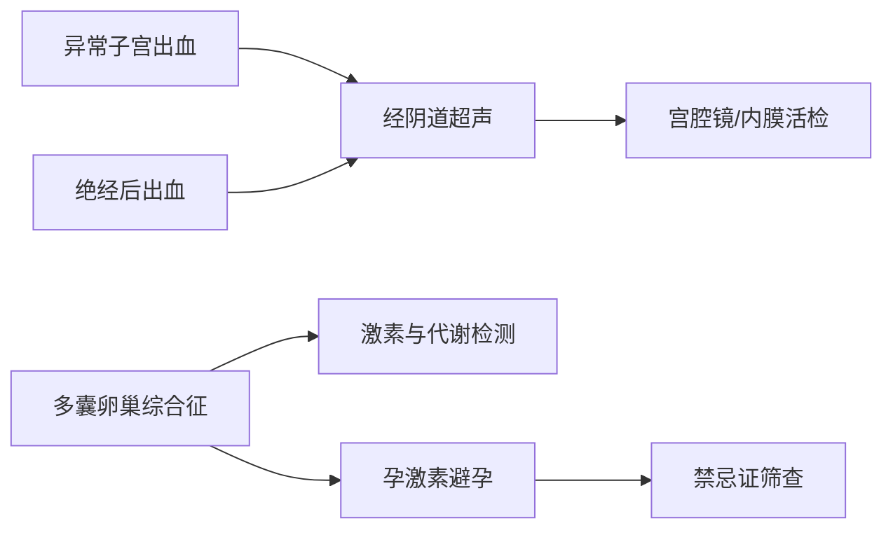

# 妇科疾病

<cite>
**本文引用的文件**   
- [abnormal_uterine_bleeding.md](file://task7/poc3_physicianbench/PhysicianBench/tasks/v1/abnormal_uterine_bleeding/task.md)
- [postmenopausal_bleeding.md](file://task7/poc3_physicianbench/PhysicianBench/tasks/v1/postmenopausal_bleeding/task.md)
- [progestin_contraceptive_pcos.md](file://task7/poc3_physicianbench/PhysicianBench/tasks/v1/progestin_contraceptive_pcos/task.md)
- [oligomenorrhea_pcos.md](file://task7/poc3_physicianbench/PhysicianBench/tasks/v1/oligomenorrhea_pcos/task.md)
</cite>

## 目录
1. [引言](#引言)
2. [项目结构](#项目结构)
3. [核心组件](#核心组件)
4. [架构总览](#架构总览)
5. [详细组件分析](#详细组件分析)
6. [依赖分析](#依赖分析)
7. [性能考虑](#性能考虑)
8. [故障排查指南](#故障排查指南)
9. [结论](#结论)
10. [附录](#附录)

## 引言
本文件围绕妇科常见临床任务，系统梳理异常子宫出血（AUB）、多囊卵巢综合征（PCOS）、绝经后出血（PMB）与孕激素避孕等主题。内容涵盖女性生殖系统解剖生理、月经周期调节机制与激素作用原理；阐述各类出血的鉴别诊断思路、子宫内膜病变筛查与恶性肿瘤排除策略；并给出生育力保护、避孕方法选择与更年期管理的实践要点。同时提供超声检查解读要点、宫腔镜操作指征及手术治疗决策依据，帮助读者建立从评估到干预的闭环路径。

## 项目结构
本项目在 PhysicianBench 的任务集合中提供了若干与妇科相关的任务定义与说明文档，包括：
- 异常子宫出血（AUB）
- 绝经后出血（PMB）
- 多囊卵巢综合征（PCOS）相关：寡月经与孕激素避孕

这些任务文档为构建结构化诊疗流程、知识图谱与智能辅助工具提供了基础素材。

[无图表来源，因为该图为概念性流程图，不直接映射具体源码文件]

## 核心组件
本节聚焦四个关键任务模块，分别对应 AUB、PMB、PCOS 与孕激素避孕。每个模块包含目标人群、关键评估步骤、常用检查与典型处置路径。

- 异常子宫出血（AUB）
  - 重点：按 PALM-COEIN 分类进行病因学定位；结合年龄与生育意愿分层管理；优先排除器质性病变与恶性可能。
  - 评估：病史与体检、经阴道超声、必要时宫腔镜与内膜组织学评估。
  - 处置：止血与调经药物、针对病因的手术或介入、长期管理计划。

- 绝经后出血（PMB）
  - 重点：任何绝经后出血均需先排除子宫内膜癌与癌前病变。
  - 评估：经阴道超声测量内膜厚度；对内膜增厚或可疑病灶行宫腔镜下定向活检。
  - 处置：根据病理结果决定保守观察、药物或手术切除。

- 多囊卵巢综合征（PCOS）
  - 重点：基于鹿特丹标准进行诊断；关注代谢并发症与心血管风险。
  - 评估：月经史与排卵功能、雄激素相关体征与实验室指标、超声形态学特征。
  - 处置：生活方式干预、周期性孕激素或复方口服避孕药、胰岛素增敏剂、促排卵与生育力保护。

- 孕激素避孕（PCOS合并避孕需求）
  - 重点：在无禁忌证前提下，单孕激素制剂可安全用于 PCOS 患者，有助于控制不规则出血与高雄症状。
  - 评估：禁忌证筛查（如血栓高风险、严重肝病等）、个体化制剂选择。
  - 处置：长效可逆避孕（LARC）优先；定期随访与不良反应管理。

**章节来源**
- [abnormal_uterine_bleeding.md](file://task7/poc3_physicianbench/PhysicianBench/tasks/v1/abnormal_uterine_bleeding/task.md)
- [postmenopausal_bleeding.md](file://task7/poc3_physicianbench/PhysicianBench/tasks/v1/postmenopausal_bleeding/task.md)
- [progestin_contraceptive_pcos.md](file://task7/poc3_physicianbench/PhysicianBench/tasks/v1/progestin_contraceptive_pcos/task.md)
- [oligomenorrhea_pcos.md](file://task7/poc3_physicianbench/PhysicianBench/tasks/v1/oligomenorrhea_pcos/task.md)

## 架构总览
下图展示从“症状/主诉”到“诊断与处置”的整体工作流，强调以证据为导向的分层评估与多学科协作。

[无图表来源，因为该图为概念性流程图，不直接映射具体源码文件]

## 详细组件分析

### 异常子宫出血（AUB）
- 解剖与生理要点
  - 子宫内膜受雌激素与孕激素周期性调控；排卵障碍导致无对抗雌激素暴露，易出现增生与不规则脱落。
- 鉴别诊断框架
  - 结构性原因（PALM）：息肉、腺肌病、平滑肌瘤、恶变/增生。
  - 非结构性原因（COEIN）：凝血异常、卵巢功能异常、子宫内膜局部因素、医源性、未分类。
- 评估路径
  - 首选经阴道超声；对高危人群或持续异常者行宫腔镜与内膜活检。
  - 实验室检查：血常规、铁蛋白、甲状腺功能、妊娠试验、必要时凝血功能。
- 治疗策略
  - 急性期止血：短期高剂量激素或抗纤溶药物；必要时急诊刮宫。
  - 长期管理：周期性孕激素、复方口服避孕药、左炔诺孕酮宫内系统（LNG-IUS）。
  - 手术指征：明确器质性病变、药物无效或存在恶性风险。

[无图表来源，因为该图为概念性流程图，不直接映射具体源码文件]

**章节来源**
- [abnormal_uterine_bleeding.md](file://task7/poc3_physicianbench/PhysicianBench/tasks/v1/abnormal_uterine_bleeding/task.md)

### 绝经后出血（PMB）
- 解剖与生理要点
  - 绝经后雌激素水平下降，内膜萎缩；任何出血均应警惕内膜癌与癌前病变。
- 评估路径
  - 经阴道超声测量内膜厚度；阈值常以≤4mm作为低风险参考，但需结合临床综合判断。
  - 对内膜增厚、局灶性病变或持续出血者行宫腔镜下活检。
- 治疗策略
  - 良性病变：观察或药物对症。
  - 癌前/恶性：按肿瘤分期与病理类型制定手术与辅助治疗方案。

[无图表来源，因为该图为概念性流程图，不直接映射具体源码文件]

**章节来源**
- [postmenopausal_bleeding.md](file://task7/poc3_physicianbench/PhysicianBench/tasks/v1/postmenopausal_bleeding/task.md)

### 多囊卵巢综合征（PCOS）
- 诊断要点
  - 鹿特丹标准：排卵障碍、高雄激素临床表现或生化证据、超声多囊样改变（满足任意两项）。
- 评估路径
  - 月经与排卵功能评估；雄激素相关体征与实验室检测；代谢风险筛查（糖耐量、血脂、血压、体重指数）。
- 治疗策略
  - 生活方式干预（减重、运动、饮食）为基础。
  - 无生育需求：周期性孕激素或复方口服避孕药调经与控雄。
  - 有生育需求：一线促排（来曲唑），必要时二线/三线方案与辅助生殖。
  - 合并胰岛素抵抗：考虑二甲双胍等胰岛素增敏剂。

[无图表来源，因为该图为概念性类图，不直接映射具体源码文件]

**章节来源**
- [oligomenorrhea_pcos.md](file://task7/poc3_physicianbench/PhysicianBench/tasks/v1/oligomenorrhea_pcos/task.md)

### 孕激素避孕（PCOS合并避孕需求）
- 适用性与安全性
  - 在无禁忌证情况下，单孕激素制剂可用于 PCOS 患者，有助于减少不规则出血与改善高雄症状。
- 禁忌证筛查
  - 血栓高风险、严重肝病、未控制的高血压、乳腺癌等。
- 制剂选择与随访
  - 长效可逆避孕（LARC）优先；短效口服、皮下植入、注射等按需选择。
  - 定期随访评估出血模式、副作用与代谢指标。

[无图表来源，因为该图为概念性流程图，不直接映射具体源码文件]

**章节来源**
- [progestin_contraceptive_pcos.md](file://task7/poc3_physicianbench/PhysicianBench/tasks/v1/progestin_contraceptive_pcos/task.md)

## 依赖分析
- 任务间关系
  - AUB 与 PMB 共享“经阴道超声→宫腔镜/活检”的核心评估链路，区别在于风险分层与阈值设定。
  - PCOS 与孕激素避孕存在交叉：PCOS 患者常因排卵障碍与高雄症状需要避孕与调经管理。
- 外部依赖
  - 影像学与病理学支持：经阴道超声、宫腔镜、内膜组织学。
  - 实验室检测：激素谱、代谢指标、凝血功能、妊娠试验。

[无图表来源，因为该图为概念性依赖图，不直接映射具体源码文件]

## 性能考虑
- 评估效率
  - 采用标准化路径与阈值（如 PMB 内膜厚度）可减少不必要的侵入性检查。
- 资源利用
  - 将 LARC 作为一线避孕方案可降低长期随访成本与失败率。
- 风险控制
  - 对高危人群（肥胖、糖尿病、家族史）加强代谢与肿瘤风险筛查，避免漏诊。

[本节为通用指导，不涉及具体文件分析]

## 故障排查指南
- 常见误区
  - 仅凭一次超声结果即排除内膜病变，忽视动态变化与临床症状。
  - 对 PCOS 患者未进行代谢风险评估，导致远期并发症未被早期发现。
- 补救措施
  - 对持续或反复出血者升级评估（宫腔镜+多点活检）。
  - 对 PCOS 患者建立长期随访档案，定期复查血糖、血脂与血压。

[本节为通用指导，不涉及具体文件分析]

## 结论
通过以证据为导向的分层评估与多学科协作，可在保障安全的前提下提升妇科常见病的诊断准确性与治疗有效性。AUB 与 PMB 的关键在于及时排除器质性病变与恶性可能；PCOS 的管理需兼顾生殖与代谢健康；孕激素避孕在无禁忌证时可为 PCOS 患者提供安全有效的选择。建议结合本地资源与指南更新，持续优化路径与随访策略。

[本节为总结性内容，不涉及具体文件分析]

## 附录
- 术语速览
  - AUB：异常子宫出血
  - PMB：绝经后出血
  - PCOS：多囊卵巢综合征
  - LNG-IUS：左炔诺孕酮宫内系统
  - LARC：长效可逆避孕
- 推荐检查清单
  - 经阴道超声、宫腔镜、内膜活检、激素谱、代谢指标、凝血功能、妊娠试验

[本节为补充信息，不涉及具体文件分析]