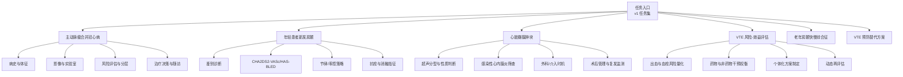
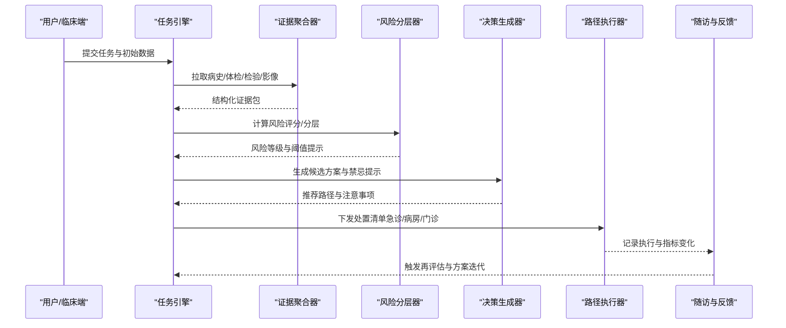
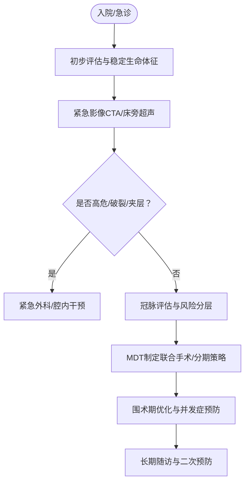
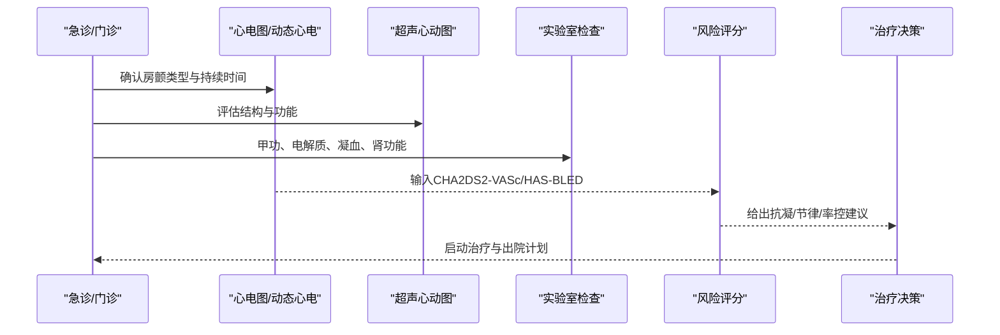
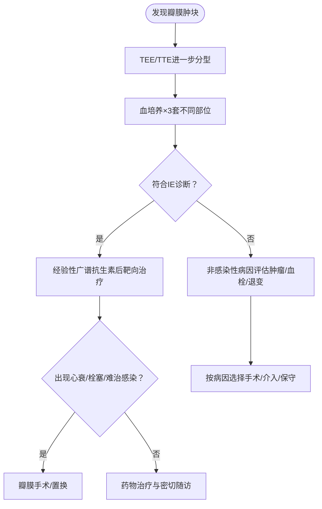
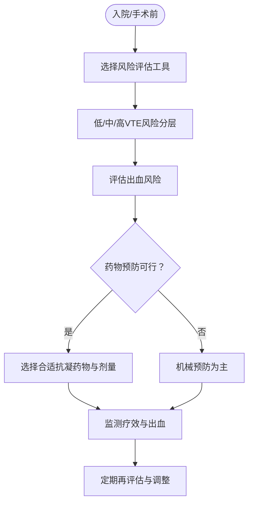
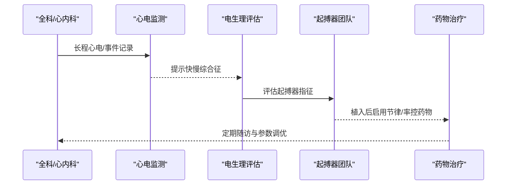
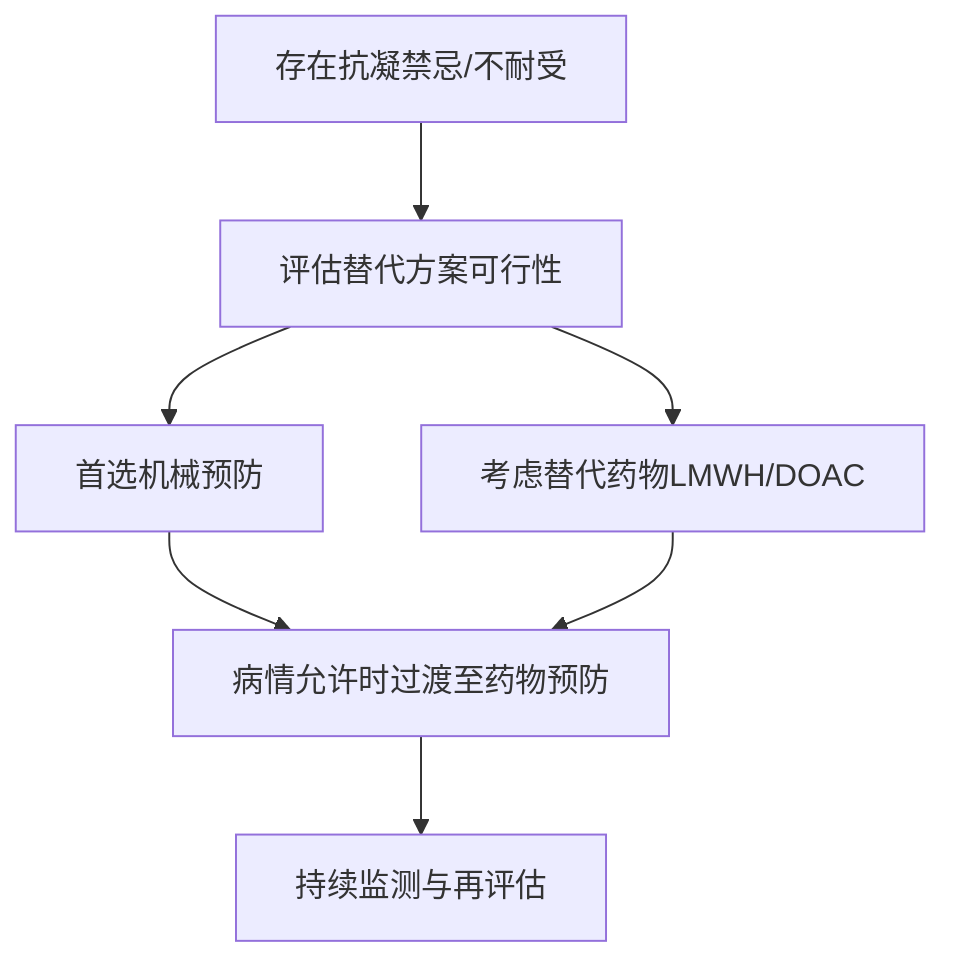
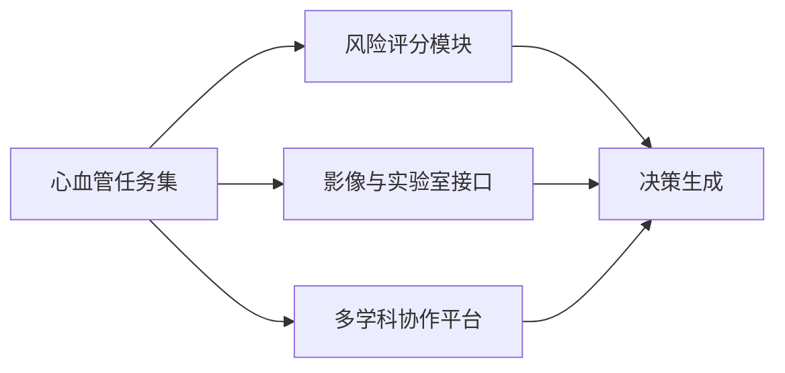

# 心血管疾病

<cite>
**本文引用的文件**   
- [task7/poc3_physicianbench/PhysicianBench/tasks/v1/aortic_aneurysm_cad/task.md](file://task7/poc3_physicianbench/PhysicianBench/tasks/v1/aortic_aneurysm_cad/task.md)
- [task7/poc3_physicianbench/PhysicianBench/tasks/v1/new_onset_afib_young/task.md](file://task7/poc3_physicianbench/PhysicianBench/tasks/v1/new_onset_afib_young/task.md)
- [task7/poc3_physicianbench/PhysicianBench/tasks/v1/cardiac_valve_mass/task.md](file://task7/poc3_physicianbench/PhysicianBench/tasks/v1/cardiac_valve_mass/task.md)
- [task7/poc3_physicianbench/PhysicianBench/tasks/v1/vte_risk_benefit/task.md](file://task7/poc3_physicianbench/PhysicianBench/tasks/v1/vte_risk_benefit/task.md)
- [task7/poc3_physicianbench/PhysicianBench/tasks/v1/afib_tachy_brady_elderly/task.md](file://task7/poc3_physicianbench/PhysicianBench/tasks/v1/afib_tachy_brady_elderly/task.md)
- [task7/poc3_physicianbench/PhysicianBench/tasks/v1/vte_prophylaxis_substitution/task.md](file://task7/poc3_physicianbench/PhysicianBench/tasks/v1/vte_prophylaxis_substitution/task.md)
</cite>

## 目录
1. [引言](#引言)
2. [项目结构](#项目结构)
3. [核心组件](#核心组件)
4. [架构总览](#架构总览)
5. [详细组件分析](#详细组件分析)
6. [依赖分析](#依赖分析)
7. [性能与可用性考量](#性能与可用性考量)
8. [故障排查指南](#故障排查指南)
9. [结论](#结论)
10. [附录](#附录)

## 引言
本文件面向心血管急重症与常见复杂场景的临床决策支持，围绕以下主题提供系统化、可操作的指导：主动脉瘤合并冠心病、年轻患者新发房颤、心脏瓣膜肿块、静脉血栓栓塞（VTE）风险-效益评估；并覆盖心血管系统生理基础、心电图判读要点、经胸/经食管超声检查策略、心律失常分类、抗凝治疗选择、介入手术适应证、心功能评估、危险因素控制与二级预防、急救处理流程、监护室管理要点以及康复训练指导。内容以任务化方式组织，便于在临床路径中快速检索与应用。

## 项目结构
本项目将典型心血管临床问题抽象为“任务”，每个任务包含病例背景、关键信息、评估步骤与输出要求等结构化要素，便于标准化教学、评测与智能体工作流编排。

[此图为概念性结构示意，不直接映射具体源码文件]

## 核心组件
- 任务定义与边界：明确主诉、既往史、用药、合并症、检查结果与目标问题，确保评估聚焦且可执行。
- 证据整合：将病史、体检、心电图、超声、实验室与影像学结果进行交叉验证，形成统一证据链。
- 风险分层与决策：基于公认评分与指南阈值，完成危险分层与治疗强度选择。
- 路径化处置：从急诊到病房再到门诊的连续照护路径，强调时间窗与优先级。
- 闭环反馈：对疗效与安全性指标进行周期性复评，动态调整方案。

章节来源
- [task7/poc3_physicianbench/PhysicianBench/tasks/v1/aortic_aneurysm_cad/task.md](file://task7/poc3_physicianbench/PhysicianBench/tasks/v1/aortic_aneurysm_cad/task.md)
- [task7/poc3_physicianbench/PhysicianBench/tasks/v1/new_onset_afib_young/task.md](file://task7/poc3_physicianbench/PhysicianBench/tasks/v1/new_onset_afib_young/task.md)
- [task7/poc3_physicianbench/PhysicianBench/tasks/v1/cardiac_valve_mass/task.md](file://task7/poc3_physicianbench/PhysicianBench/tasks/v1/cardiac_valve_mass/task.md)
- [task7/poc3_physicianbench/PhysicianBench/tasks/v1/vte_risk_benefit/task.md](file://task7/poc3_physicianbench/PhysicianBench/tasks/v1/vte_risk_benefit/task.md)

## 架构总览
下图展示从“任务输入”到“评估-决策-处置-随访”的整体流程，适用于各心血管子任务的通用框架。

[此图为概念性流程示意，不直接映射具体源码文件]

## 详细组件分析

### 主动脉瘤合并冠心病
- 临床要点
  - 症状学：胸痛、背痛、搏动性包块、缺血症状；警惕破裂或夹层征象。
  - 影像优先：CTA/MRA用于直径、部位、形态与分支受累评估；必要时行冠脉造影。
  - 风险分层：动脉瘤尺寸、增长速率、症状、合并症与手术风险综合评估。
  - 治疗策略：择期开放/腔内修复（根据解剖与合并CAD），同步血运重建策略需多学科讨论。
  - 围术期管理：血压/心率控制、抗血小板/抗凝平衡、肾功能保护与容量管理。
- 关键流程

章节来源
- [task7/poc3_physicianbench/PhysicianBench/tasks/v1/aortic_aneurysm_cad/task.md](file://task7/poc3_physicianbench/PhysicianBench/tasks/v1/aortic_aneurysm_cad/task.md)

### 年轻患者新发房颤
- 临床要点
  - 鉴别诊断：结构性心脏病、甲亢、酒精/兴奋剂、睡眠呼吸暂停、心肌炎等。
  - 风险评估：CHA2DS2-VASc与HAS-BLED用于卒中与出血风险量化；年轻人群常低CHA2DS2-VASc但需结合其他因素。
  - 节律/率控：首次发作<48小时可考虑复律；长期策略依据症状、复发频率与合并症决定。
  - 抗凝选择：根据卒中风险与出血风险选择DOAC或华法林；关注肝肾功能与药物相互作用。
  - 消融指征：症状明显、复发频繁、药物不耐受或拒绝长期用药者。
- 关键流程

章节来源
- [task7/poc3_physicianbench/PhysicianBench/tasks/v1/new_onset_afib_young/task.md](file://task7/poc3_physicianbench/PhysicianBench/tasks/v1/new_onset_afib_young/task.md)

### 心脏瓣膜肿块
- 临床要点
  - 超声分型：赘生物（感染性心内膜炎）、黏液瘤、血栓、纤维弹性瘤等；经胸/经食管超声互补。
  - 感染性心内膜炎筛查：改良Duke标准（血培养、超声、发热、血管/免疫现象）。
  - 外科/介入时机：栓塞风险、心衰程度、感染控制情况与瓣膜破坏程度。
  - 术后管理：抗生素疗程、抗凝策略、心功能恢复与复发监测。
- 关键流程

章节来源
- [task7/poc3_physicianbench/PhysicianBench/tasks/v1/cardiac_valve_mass/task.md](file://task7/poc3_physicianbench/PhysicianBench/tasks/v1/cardiac_valve_mass/task.md)

### 静脉血栓栓塞风险-效益评估
- 临床要点
  - 风险评估：Caprini、Padua、Wells等工具用于住院/门急诊分层。
  - 出血风险：ISTH/BAT、HAS-BLED（房颤）等辅助决策。
  - 干预选择：机械预防（间歇充气加压、梯度压力袜）与药物预防（LMWH、UFH、DOAC）权衡。
  - 特殊人群：妊娠、肿瘤、骨科/普外大手术、ICU、肾肝功能不全、高龄与肥胖。
  - 动态再评估：随病情变化与操作节点更新风险与方案。
- 关键流程

章节来源
- [task7/poc3_physicianbench/PhysicianBench/tasks/v1/vte_risk_benefit/task.md](file://task7/poc3_physicianbench/PhysicianBench/tasks/v1/vte_risk_benefit/task.md)

### 老年房颤快慢综合征
- 临床要点
  - 特征：阵发性房颤伴显著窦缓/窦停，常需起搏器支持后再行节律/率控药物。
  - 评估：长程心电监测、Holter、事件记录仪；排除可逆诱因（药物、代谢异常）。
  - 治疗：起搏器植入+β受体阻滞剂/钙通道阻滞剂/胺碘酮等节律/率控；抗凝依卒中风险。
  - 随访：起搏器程控、药物副作用与心功能监测。
- 关键流程

章节来源
- [task7/poc3_physicianbench/PhysicianBench/tasks/v1/afib_tachy_brady_elderly/task.md](file://task7/poc3_physicianbench/PhysicianBench/tasks/v1/afib_tachy_brady_elderly/task.md)

### VTE预防替代方案
- 临床要点
  - 当标准抗凝禁忌或不适用时，采用机械预防或替代药物（如低分子肝素替代普通肝素、DOAC替代华法林）。
  - 关注肾功能、体重、药物相互作用与费用可及性。
  - 过渡期管理：桥接策略与停药窗口。
- 关键流程

章节来源
- [task7/poc3_physicianbench/PhysicianBench/tasks/v1/vte_prophylaxis_substitution/task.md](file://task7/poc3_physicianbench/PhysicianBench/tasks/v1/vte_prophylaxis_substitution/task.md)

## 依赖分析
- 任务间共性依赖
  - 风险评估工具：CHA2DS2-VASc、HAS-BLED、Caprini、Padua、Wells等在各任务中被反复调用。
  - 影像与实验室：心电图、超声、CTA/MRA、血培养、凝血与生化指标构成证据基础。
  - 多学科协作：心内科、心外科、影像科、麻醉与ICU在复杂病例中协同决策。
- 外部集成点
  - 电子病历与检验信息系统：用于自动抓取与结构化数据。
  - 决策支持系统：嵌入评分与阈值提示，减少遗漏与偏差。

[此图为概念性依赖示意，不直接映射具体源码文件]

## 性能与可用性考量
- 时效性：急性胸痛、疑似夹层/破裂、血流动力学不稳定者优先级最高，遵循“先救命、后治病”。
- 准确性：多模态证据交叉验证，避免单一检查误判；必要时重复或升级检查。
- 可解释性：所有决策应附带风险评分、证据来源与备选方案说明，便于医患沟通与审计。
- 可扩展性：新增病种或指南更新可通过任务模板快速扩展，保持体系一致性。

## 故障排查指南
- 常见问题
  - 评分缺失或错误：核对数据来源与计算逻辑，确保最新指南版本。
  - 影像质量不足：更换设备或检查方式（如TTE转TEE），必要时复查。
  - 药物相互作用未识别：使用药物数据库复核，重点关注肝肾功能与CYP酶影响。
  - 路径执行延迟：建立预警与提醒机制，明确责任人与时限。
- 改进措施
  - 引入自动化校验与双人复核。
  - 设置关键节点里程碑与超时告警。
  - 定期培训与案例复盘，提升团队一致性。

## 结论
通过将复杂心血管问题拆解为标准化的任务与流程，可在保证安全性的前提下提高诊疗效率与一致性。建议在真实临床环境中逐步落地，结合电子病历与决策支持系统实现闭环管理，并通过持续的数据反馈优化路径与阈值。

## 附录
- 术语速查
  - CHA2DS2-VASc：心力衰竭、高血压、年龄≥75岁、糖尿病、卒中/TIA/血栓栓塞、血管疾病、年龄65-74岁、性别类别
  - HAS-BLED：高血压、肝肾功能异常、卒中、出血史/易出血、INR不稳定、老年、药物/酗酒
  - Caprini/Padua/Wells：VTE风险评估常用量表
- 参考路径
  - 急诊胸痛路径、房颤初诊路径、瓣膜病外科评估路径、VTE预防路径