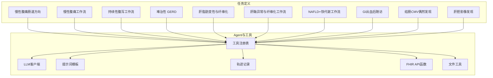
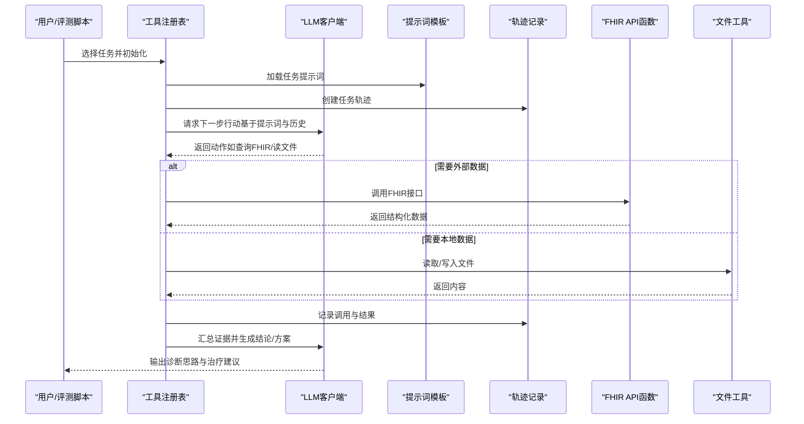
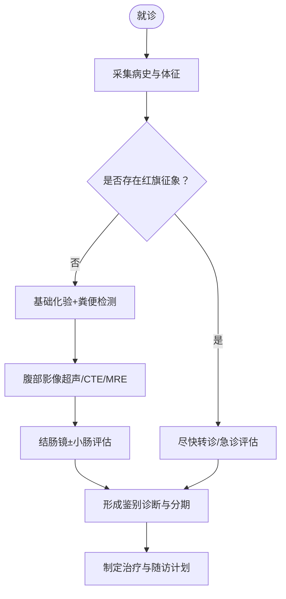
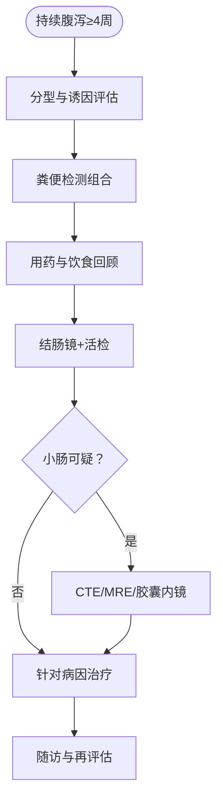
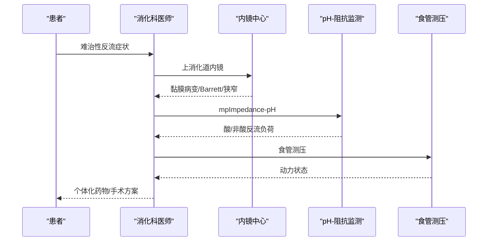
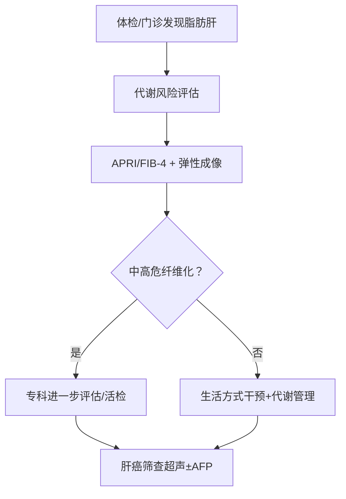
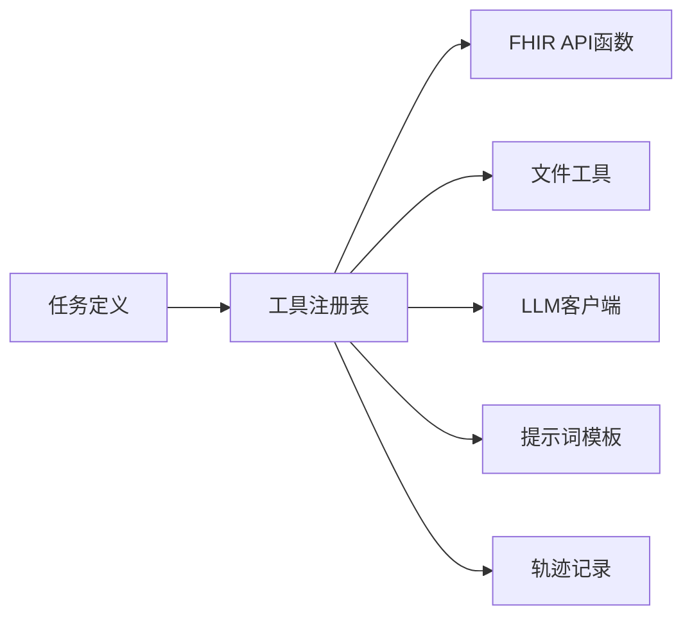

# 消化系统疾病

<cite>
**本文引用的文件**   
- [ PhysicianBench/tasks/v1/chronic_abdominal_pain_bowel/task.md](file://task7/poc3_physicianbench/PhysicianBench/tasks/v1/chronic_abdominal_pain_bowel/task.md)
- [ PhysicianBench/tasks/v1/chronic_abdominal_workup/task.md](file://task7/poc3_physicianbench/PhysicianBench/tasks/v1/chronic_abdominal_workup/task.md)
- [ PhysicianBench/tasks/v1/persistent_diarrhea_workup/task.md](file://task7/poc3_physicianbench/PhysicianBench/tasks/v1/persistent_diarrhea_workup/task.md)
- [ PhysicianBench/tasks/v1/refractory_gerd/task.md](file://task7/poc3_physicianbench/PhysicianBench/tasks/v1/refractory_gerd/task.md)
- [ PhysicianBench/tasks/v1/hepatic_steatosis_fibrosis/task.md](file://task7/poc3_physicianbench/PhysicianBench/tasks/v1/hepatic_steatosis_fibrosis/task.md)
- [ PhysicianBench/tasks/v1/liver_enzymes_fibrosis_workup/task.md](file://task7/poc3_physicianbench/PhysicianBench/tasks/v1/liver_enzymes_fibrosis_workup/task.md)
- [ PhysicianBench/tasks/v1/nafld_ferritin_workup/task.md](file://task7/poc3_physicianbench/PhysicianBench/tasks/v1/nafld_ferritin_workup/task.md)
- [ PhysicianBench/tasks/v1/post_gi_bleed_followup/task.md](file://task7/poc3_physicianbench/PhysicianBench/tasks/v1/post_gi_bleed_followup/task.md)
- [ PhysicianBench/tasks/v1/incidental_cmv_colon/task.md](file://task7/poc3_physicianbench/PhysicianBench/tasks/v1/incidental_cmv_colon/task.md)
- [ PhysicianBench/tasks/v1/liver_gallbladder_findings/task.md](file://task7/poc3_physicianbench/PhysicianBench/tasks/v1/liver_gallbladder_findings/task.md)
- [ PhysicianBench/tools/fhir_api_functions.py](file://task7/poc3_physicianbench/PhysicianBench/tools/fhir_api_functions.py)
- [ PhysicianBench/tools/file_tools.py](file://task7/poc3_physicianbench/PhysicianBench/tools/file_tools.py)
- [ PhysicianBench/agent/tool_registry.py](file://task7/poc3_physicianbench/PhysicianBench/agent/tool_registry.py)
- [ PhysicianBench/agent/llm_client.py](file://task7/poc3_physicianbench/PhysicianBench/agent/llm_client.py)
- [ PhysicianBench/agent/prompts.py](file://task7/poc3_physicianbench/PhysicianBench/agent/prompts.py)
- [ PhysicianBench/agent/trajectory.py](file://task7/poc3_physicianbench/PhysicianBench/agent/trajectory.py)
- [ PhysicianBench/scripts/run_task.py](file://task7/poc3_physicianbench/PhysicianBench/scripts/run_task.py)
</cite>

## 目录
1. [引言](#引言)
2. [项目结构](#项目结构)
3. [核心组件](#核心组件)
4. [架构总览](#架构总览)
5. [详细组件分析](#详细组件分析)
6. [依赖关系分析](#依赖关系分析)
7. [性能与可用性考量](#性能与可用性考量)
8. [故障排查指南](#故障排查指南)
9. [结论](#结论)
10. [附录](#附录)

## 引言
本文件面向“消化系统疾病”相关任务，聚焦以下临床主题：慢性腹痛检查、持续性腹泻诊断、难治性胃食管反流病（GERD）、非酒精性脂肪肝（NAFLD）纤维化评估与肝癌筛查策略。文档在保持医学严谨性的同时，结合代码仓库中的任务定义与工具链，提供从解剖生理到内镜技术、从鉴别诊断到治疗路径的系统化说明，并给出可操作的流程与排障建议。

## 项目结构
本项目围绕 PhysicianBench 的消化领域子集展开，包含若干以“任务描述”为核心的 Markdown 文件，以及用于调用外部数据源（FHIR）和读写文件的工具模块，配合 Agent 层进行推理与编排。

图示来源
- [ PhysicianBench/tasks/v1/chronic_abdominal_pain_bowel/task.md](file://task7/poc3_physicianbench/PhysicianBench/tasks/v1/chronic_abdominal_pain_bowel/task.md)
- [ PhysicianBench/tasks/v1/chronic_abdominal_workup/task.md](file://task7/poc3_physicianbench/PhysicianBench/tasks/v1/chronic_abdominal_workup/task.md)
- [ PhysicianBench/tasks/v1/persistent_diarrhea_workup/task.md](file://task7/poc3_physicianbench/PhysicianBench/tasks/v1/persistent_diarrhea_workup/task.md)
- [ PhysicianBench/tasks/v1/refractory_gerd/task.md](file://task7/poc3_physicianbench/PhysicianBench/tasks/v1/refractory_gerd/task.md)
- [ PhysicianBench/tasks/v1/hepatic_steatosis_fibrosis/task.md](file://task7/poc3_physicianbench/PhysicianBench/tasks/v1/hepatic_steatosis_fibrosis/task.md)
- [ PhysicianBench/tasks/v1/liver_enzymes_fibrosis_workup/task.md](file://task7/poc3_physicianbench/PhysicianBench/tasks/v1/liver_enzymes_fibrosis_workup/task.md)
- [ PhysicianBench/tasks/v1/nafld_ferritin_workup/task.md](file://task7/poc3_physicianbench/PhysicianBench/tasks/v1/nafld_ferritin_workup/task.md)
- [ PhysicianBench/tasks/v1/post_gi_bleed_followup/task.md](file://task7/poc3_physicianbench/PhysicianBench/tasks/v1/post_gi_bleed_followup/task.md)
- [ PhysicianBench/tasks/v1/incidental_cmv_colon/task.md](file://task7/poc3_physicianbench/PhysicianBench/tasks/v1/incidental_cmv_colon/task.md)
- [ PhysicianBench/tasks/v1/liver_gallbladder_findings/task.md](file://task7/poc3_physicianbench/PhysicianBench/tasks/v1/liver_gallbladder_findings/task.md)
- [ PhysicianBench/agent/tool_registry.py](file://task7/poc3_physicianbench/PhysicianBench/agent/tool_registry.py)
- [ PhysicianBench/tools/fhir_api_functions.py](file://task7/poc3_physicianbench/PhysicianBench/tools/fhir_api_functions.py)
- [ PhysicianBench/tools/file_tools.py](file://task7/poc3_physicianbench/PhysicianBench/tools/file_tools.py)

章节来源
- [ PhysicianBench/agent/tool_registry.py](file://task7/poc3_physicianbench/PhysicianBench/agent/tool_registry.py)
- [ PhysicianBench/tools/fhir_api_functions.py](file://task7/poc3_physicianbench/PhysicianBench/tools/fhir_api_functions.py)
- [ PhysicianBench/tools/file_tools.py](file://task7/poc3_physicianbench/PhysicianBench/tools/file_tools.py)

## 核心组件
- 任务定义（Markdown）：每个消化领域问题以独立任务文件呈现，明确主诉、关键病史、目标输出与约束条件，便于 Agent 按步骤执行。
- 工具层：
  - FHIR API 函数：封装对标准化健康数据的查询能力，支持患者信息、检验结果、影像报告等结构化检索。
  - 文件工具：用于读取/写入本地数据或中间产物，辅助证据整理与报告生成。
- Agent 层：
  - 工具注册表：集中管理可用工具及其参数契约，驱动选择与调用。
  - LLM 客户端：负责与语言模型交互，完成推理、计划与解释。
  - 提示词模板：为不同任务提供结构化输入上下文与输出格式约束。
  - 轨迹记录：保存每一步决策、调用与结果，便于审计与复现。

章节来源
- [ PhysicianBench/agent/tool_registry.py](file://task7/poc3_physicianbench/PhysicianBench/agent/tool_registry.py)
- [ PhysicianBench/agent/llm_client.py](file://task7/poc3_physicianbench/PhysicianBench/agent/llm_client.py)
- [ PhysicianBench/agent/prompts.py](file://task7/poc3_physicianbench/PhysicianBench/agent/prompts.py)
- [ PhysicianBench/agent/trajectory.py](file://task7/poc3_physicianbench/PhysicianBench/agent/trajectory.py)
- [ PhysicianBench/tools/fhir_api_functions.py](file://task7/poc3_physicianbench/PhysicianBench/tools/fhir_api_functions.py)
- [ PhysicianBench/tools/file_tools.py](file://task7/poc3_physicianbench/PhysicianBench/tools/file_tools.py)

## 架构总览
下图展示从任务入口到工具调用与数据回流的端到端流程。

图示来源
- [ PhysicianBench/agent/tool_registry.py](file://task7/poc3_physicianbench/PhysicianBench/agent/tool_registry.py)
- [ PhysicianBench/agent/llm_client.py](file://task7/poc3_physicianbench/PhysicianBench/agent/llm_client.py)
- [ PhysicianBench/agent/prompts.py](file://task7/poc3_physicianbench/PhysicianBench/agent/prompts.py)
- [ PhysicianBench/agent/trajectory.py](file://task7/poc3_physicianbench/PhysicianBench/agent/trajectory.py)
- [ PhysicianBench/tools/fhir_api_functions.py](file://task7/poc3_physicianbench/PhysicianBench/tools/fhir_api_functions.py)
- [ PhysicianBench/tools/file_tools.py](file://task7/poc3_physicianbench/PhysicianBench/tools/file_tools.py)

## 详细组件分析

### 慢性腹痛检查（肠道方向）
- 要点
  - 症状分型：绞痛/隐痛/胀痛；部位（右下腹、脐周、全腹）；与进食/排便的关系。
  - 红旗征象：体重下降、夜间痛醒、便血、发热、贫血、家族史。
  - 初步评估：血常规、CRP/ESR、粪便钙卫蛋白、粪常规+培养/寄生虫、乳糜泻血清学（tTG-IgA）。
  - 影像学：腹部超声/CTE/MRE；必要时小肠镜。
  - 内镜：结肠镜+回肠末端活检；怀疑小肠病变时胶囊内镜或小肠镜。
  - 鉴别：IBS、IBD（克罗恩/溃疡性结肠炎）、感染性肠炎、乳糖不耐受、微细淋巴细胞性结肠炎、肿瘤。
- 流程图（概念）

章节来源
- [ PhysicianBench/tasks/v1/chronic_abdominal_pain_bowel/task.md](file://task7/poc3_physicianbench/PhysicianBench/tasks/v1/chronic_abdominal_pain_bowel/task.md)
- [ PhysicianBench/tasks/v1/chronic_abdominal_workup/task.md](file://task7/poc3_physicianbench/PhysicianBench/tasks/v1/chronic_abdominal_workup/task.md)

### 持续性腹泻工作流
- 要点
  - 分型：渗透性/分泌性/渗出性/动力性；是否夜间腹泻、是否与食物相关。
  - 初筛：粪便常规、隐血、白细胞/钙卫蛋白、艰难梭菌毒素/核酸、细菌培养、寄生虫卵/抗原、甲状腺功能、乳糜泻抗体。
  - 药物与补充剂回顾：含镁制剂、二甲双胍、PPI、NSAIDs、GLP-1RA、益生菌/中草药。
  - 内镜：结肠镜+多点活检（包括右半结肠），必要时小肠评估。
  - 特殊：胆汁酸性腹泻试验性治疗、小肠细菌过度生长呼气试验、胰腺外分泌功能评估。
- 流程图（概念）

章节来源
- [ PhysicianBench/tasks/v1/persistent_diarrhea_workup/task.md](file://task7/poc3_physicianbench/PhysicianBench/tasks/v1/persistent_diarrhea_workup/task.md)

### 难治性胃食管反流病（GERD）
- 要点
  - 定义：标准剂量PPI足疗程仍症状控制不佳或反复复发。
  - 评估：上消化道内镜排除嗜酸性粒细胞性食管炎/Barrett/狭窄；24小时多通道腔内阻抗-pH监测（mpImpedance-pH）区分酸/非酸反流；食管测压评估动力。
  - 生活方式：减重、抬高床头、避免睡前进食、减少高脂/辛辣/咖啡因/酒精。
  - 药物优化：调整PPI给药时机（餐前30–60分钟）、换用更强效PPI、短期加用藻酸盐/抗酸剂；谨慎长期促动力药。
  - 手术/介入：Nissen/部分胃底折叠术、LINX磁环、经口无切开的胃底成形术（TIF）需严格适应证评估。
- 序列图（概念）

章节来源
- [ PhysicianBench/tasks/v1/refractory_gerd/task.md](file://task7/poc3_physicianbench/PhysicianBench/tasks/v1/refractory_gerd/task.md)

### 非酒精性脂肪肝（NAFLD）与肝纤维化
- 要点
  - 风险分层：结合BMI/腰围、糖尿病/代谢综合征、ALT/AST、血小板、APRI/FIB-4、肝脏弹性成像（FibroScan）。
  - 影像：超声/CT/MRI-PDFF评估脂肪变性；弹性成像评估硬度（纤维化程度）。
  - 实验室：肝功能、血脂、糖化血红蛋白、铁代谢（铁蛋白/转铁蛋白饱和度）、病毒学、自身免疫标志物按需。
  - 病理：当无创指标不一致或高风险时考虑肝穿刺活检（NASH评分、纤维化分期）。
  - 肝癌筛查：肝硬化或高危人群每6个月肝脏超声±AFP。
- 流程图（概念）

章节来源
- [ PhysicianBench/tasks/v1/hepatic_steatosis_fibrosis/task.md](file://task7/poc3_physicianbench/PhysicianBench/tasks/v1/hepatic_steatosis_fibrosis/task.md)
- [ PhysicianBench/tasks/v1/liver_enzymes_fibrosis_workup/task.md](file://task7/poc3_physicianbench/PhysicianBench/tasks/v1/liver_enzymes_fibrosis_workup/task.md)
- [ PhysicianBench/tasks/v1/nafld_ferritin_workup/task.md](file://task7/poc3_physicianbench/PhysicianBench/tasks/v1/nafld_ferritin_workup/task.md)

### GI出血后随访与结肠CMV偶然发现
- GI出血后随访
  - 稳定期复查血常规、铁代谢；根据出血原因安排内镜复查与二级预防（如PPI、抗栓药物策略）。
- 结肠CMV偶然发现
  - 免疫抑制背景下的意义评估；局部病灶 vs 弥漫性炎症；是否需要抗病毒治疗取决于症状、组织学活动度与免疫状态。

章节来源
- [ PhysicianBench/tasks/v1/post_gi_bleed_followup/task.md](file://task7/poc3_physicianbench/PhysicianBench/tasks/v1/post_gi_bleed_followup/task.md)
- [ PhysicianBench/tasks/v1/incidental_cmv_colon/task.md](file://task7/poc3_physicianbench/PhysicianBench/tasks/v1/incidental_cmv_colon/task.md)

### 肝胆影像发现
- 常见发现解读：囊肿、血管瘤、局灶性结节增生、腺瘤、HCC可疑病灶；结合增强CT/MRI特征与肿瘤标志物综合判断。
- 随访策略：依据大小、形态、增长速率与风险因素决定观察间隔或进一步活检/切除。

章节来源
- [ PhysicianBench/tasks/v1/liver_gallbladder_findings/task.md](file://task7/poc3_physicianbench/PhysicianBench/tasks/v1/liver_gallbladder_findings/task.md)

## 依赖关系分析
- 任务文件与工具
  - 各任务通过工具注册表选择合适工具（FHIR/文件），由LLM驱动执行，轨迹记录全程可追溯。
- 外部依赖
  - FHIR服务器可达性与权限配置直接影响数据获取成功率。
  - 文件工具依赖本地路径与权限。

图示来源
- [ PhysicianBench/agent/tool_registry.py](file://task7/poc3_physicianbench/PhysicianBench/agent/tool_registry.py)
- [ PhysicianBench/tools/fhir_api_functions.py](file://task7/poc3_physicianbench/PhysicianBench/tools/fhir_api_functions.py)
- [ PhysicianBench/tools/file_tools.py](file://task7/poc3_physicianbench/PhysicianBench/tools/file_tools.py)
- [ PhysicianBench/agent/llm_client.py](file://task7/poc3_physicianbench/PhysicianBench/agent/llm_client.py)
- [ PhysicianBench/agent/prompts.py](file://task7/poc3_physicianbench/PhysicianBench/agent/prompts.py)
- [ PhysicianBench/agent/trajectory.py](file://task7/poc3_physicianbench/PhysicianBench/agent/trajectory.py)

章节来源
- [ PhysicianBench/agent/tool_registry.py](file://task7/poc3_physicianbench/PhysicianBench/agent/tool_registry.py)
- [ PhysicianBench/tools/fhir_api_functions.py](file://task7/poc3_physicianbench/PhysicianBench/tools/fhir_api_functions.py)
- [ PhysicianBench/tools/file_tools.py](file://task7/poc3_physicianbench/PhysicianBench/tools/file_tools.py)

## 性能与可用性考量
- 并行与批处理
  - 对于多任务批量运行，可通过脚本并行调度以提升吞吐，但需注意外部API限流与并发安全。
- 缓存与去重
  - 对重复查询（如常用检验项）增加缓存以减少延迟与成本。
- 错误重试与熔断
  - 对外部服务调用实现指数退避重试与熔断保护，避免雪崩。
- 可观测性
  - 利用轨迹记录与日志聚合，定位慢调用与失败根因。

[本节为通用指导，不直接分析具体文件]

## 故障排查指南
- FHIR连接失败
  - 检查网络连通性、认证凭据、资源ID与访问范围。
  - 查看轨迹记录中的调用栈与响应码，确认是否为超时或鉴权错误。
- 文件读写异常
  - 校验路径存在性与读写权限；确保编码一致与分隔符正确。
- LLM输出不稳定
  - 检查提示词模板是否完整、约束是否清晰；适当增加示例与边界条件说明。
- 任务执行中断
  - 使用轨迹恢复点；对长耗时操作拆分步骤并落盘中间结果。

章节来源
- [ PhysicianBench/agent/trajectory.py](file://task7/poc3_physicianbench/PhysicianBench/agent/trajectory.py)
- [ PhysicianBench/tools/fhir_api_functions.py](file://task7/poc3_physicianbench/PhysicianBench/tools/fhir_api_functions.py)
- [ PhysicianBench/tools/file_tools.py](file://task7/poc3_physicianbench/PhysicianBench/tools/file_tools.py)
- [ PhysicianBench/agent/prompts.py](file://task7/poc3_physicianbench/PhysicianBench/agent/prompts.py)

## 结论
本仓库以“任务即文档”的方式将消化系统常见问题的评估路径、检查组合与处置策略结构化呈现，并通过Agent与工具链实现可执行的诊疗工作流。借助FHIR与文件工具，系统可在真实数据环境下验证与迭代，提升临床推理的可重复性与可审计性。

[本节为总结性内容，不直接分析具体文件]

## 附录
- 术语速查
  - IBS：肠易激综合征
  - IBD：炎症性肠病（UC/Crohn）
  - NAFLD/NASH：非酒精性脂肪性肝病/非酒精性脂肪性肝炎
  - APRI/FIB-4：无创纤维化评分
  - mpImpedance-pH：多通道腔内阻抗-pH监测
- 参考实践
  - 任务脚本入口与运行方式参见运行脚本文件。

章节来源
- [ PhysicianBench/scripts/run_task.py](file://task7/poc3_physicianbench/PhysicianBench/scripts/run_task.py)