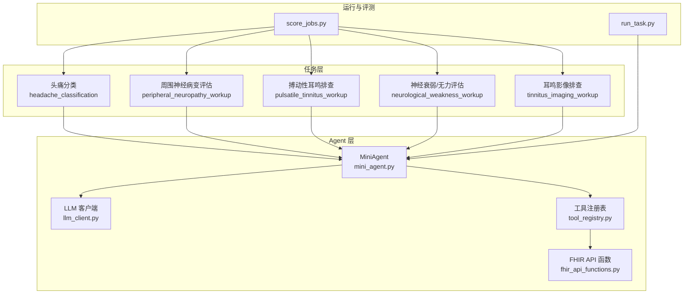
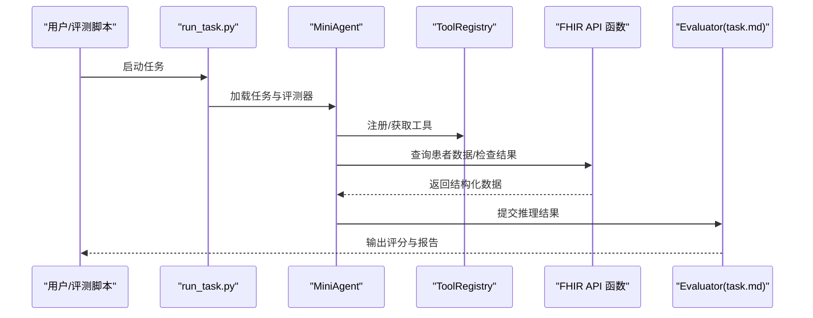
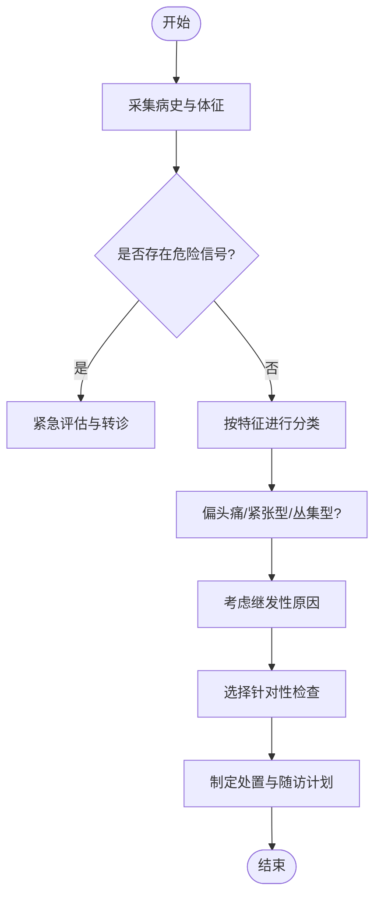
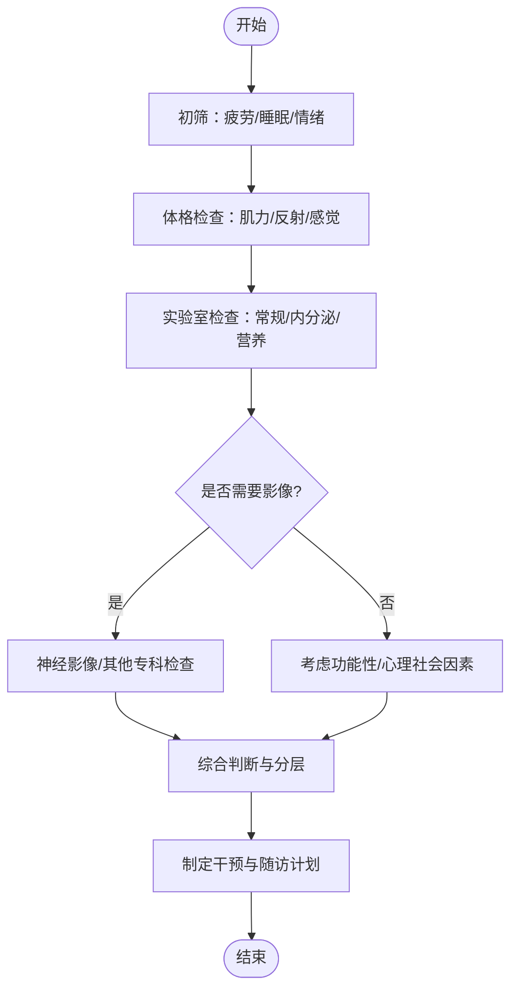
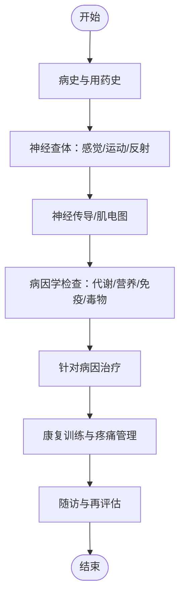
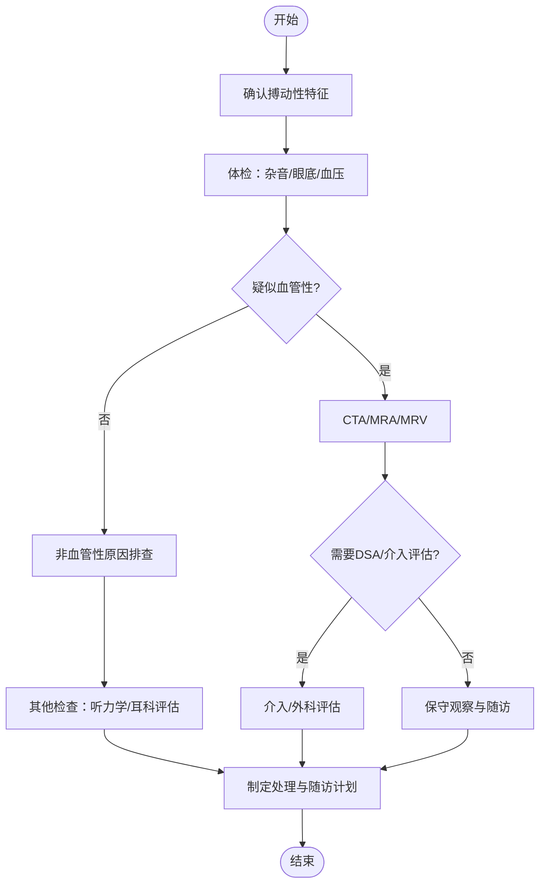
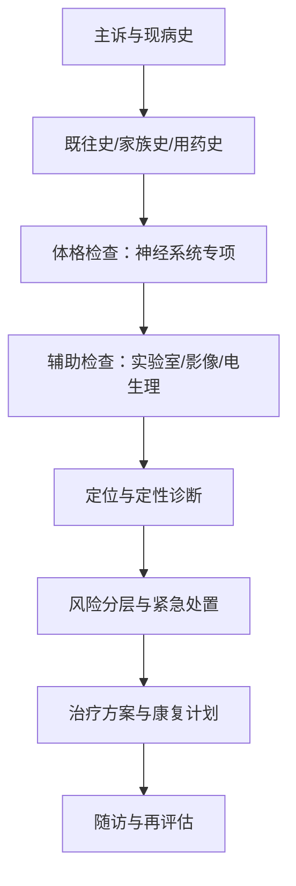
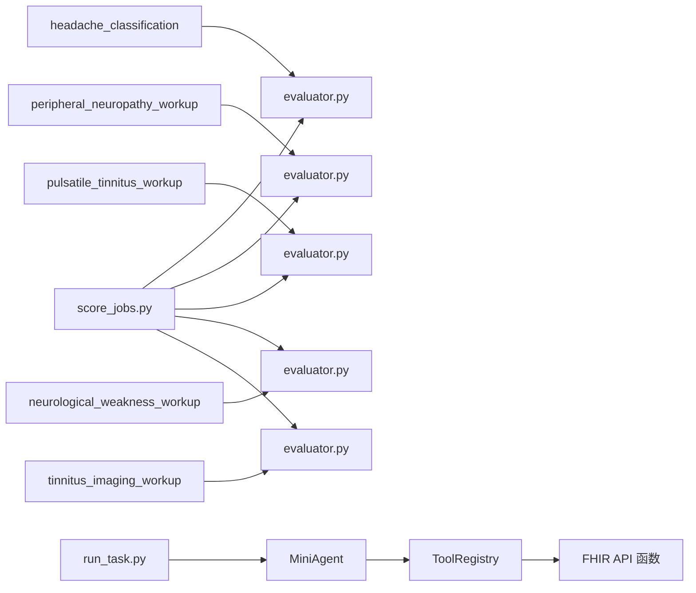

# 神经系统疾病

<cite>
**本文引用的文件**   
- [ PhysicianBench/agent/prompts.py](file://task7/poc3_physicianbench/PhysicianBench/agent/prompts.py)
- [ PhysicianBench/agent/tool_registry.py](file://task7/poc3_physicianbench/PhysicianBench/agent/tool_registry.py)
- [ PhysicianBench/agent/llm_client.py](file://task7/poc3_physicianbench/PhysicianBench/agent/llm_client.py)
- [ PhysicianBench/agent/mini_agent.py](file://task7/poc3_physicianbench/PhysicianBench/agent/mini_agent.py)
- [ PhysicianBench/tools/fhir_api_functions.py](file://task7/poc3_physicianbench/PhysicianBench/tools/fhir_api_functions.py)
- [ PhysicianBench/tasks/v1/headache_classification/task.md](file://task7/poc3_physicianbench/PhysicianBench/tasks/v1/headache_classification/task.md)
- [ PhysicianBench/tasks/v1/headache_classification/evaluator.py](file://task7/poc3_physicianbench/PhysicianBench/tasks/v1/headache_classification/evaluator.py)
- [ PhysicianBench/tasks/v1/peripheral_neuropathy_workup/task.md](file://task7/poc3_physicianbench/PhysicianBench/tasks/v1/peripheral_neuropathy_workup/task.md)
- [ PhysicianBench/tasks/v1/peripheral_neuropathy_workup/evaluator.py](file://task7/poc3_physicianbench/PhysicianBench/tasks/v1/peripheral_neuropathy_workup/evaluator.py)
- [ PhysicianBench/tasks/v1/pulsatile_tinnitus_workup/task.md](file://task7/poc3_physicianbench/PhysicianBench/tasks/v1/pulsatile_tinnitus_workup/task.md)
- [ PhysicianBench/tasks/v1/pulsatile_tinnitus_workup/evaluator.py](file://task7/poc3_physicianbench/PhysicianBench/tasks/v1/pulsatile_tinnitus_workup/evaluator.py)
- [ PhysicianBench/tasks/v1/neurological_weakness_workup/task.md](file://task7/poc3_physicianbench/PhysicianBench/tasks/v1/neurological_weakness_workup/task.md)
- [ PhysicianBench/tasks/v1/neurological_weakness_workup/evaluator.py](file://task7/poc3_physicianbench/PhysicianBench/tasks/v1/neurological_weakness_workup/evaluator.py)
- [ PhysicianBench/tasks/v1/tinnitus_imaging_workup/task.md](file://task7/poc3_physicianbench/PhysicianBench/tasks/v1/tinnitus_imaging_workup/task.md)
- [ PhysicianBench/tasks/v1/tinnitus_imaging_workup/evaluator.py](file://task7/poc3_physicianbench/PhysicianBench/tasks/v1/tinnitus_imaging_workup/evaluator.py)
- [ PhysicianBench/scripts/run_task.py](file://task7/poc3_physicianbench/PhysicianBench/scripts/run_task.py)
- [ PhysicianBench/scripts/score_jobs.py](file://task7/poc3_physicianbench/PhysicianBench/scripts/score_jobs.py)
</cite>

## 目录
1. [简介](#简介)
2. [项目结构](#项目结构)
3. [核心组件](#核心组件)
4. [架构总览](#架构总览)
5. [详细组件分析](#详细组件分析)
6. [依赖关系分析](#依赖关系分析)
7. [性能与可扩展性](#性能与可扩展性)
8. [故障排查指南](#故障排查指南)
9. [结论](#结论)
10. [附录](#附录)

## 简介
本文件围绕神经系统疾病相关任务，系统化梳理头痛分类诊断、神经衰弱检查、周围神经病变评估、搏动性耳鸣排查等主题。内容涵盖中枢与周围神经系统解剖要点、神经传导通路、脑脊液循环基础；阐述各类头痛的鉴别诊断思路、肌力分级标准与神经电生理检查要点；提供脑血管意外预警信号、癫痫发作识别与认知功能障碍筛查建议；并给出镇痛药物使用原则、神经营养治疗与康复训练指导。文档同时结合代码库中的任务定义与评测脚本，说明如何在系统中组织与执行这些临床场景。

## 项目结构
本项目在 PhysicianBench 中为多个神经系统相关任务提供了任务描述与评测器，并通过 Agent 框架（LLM 客户端、工具注册表、最小代理）驱动任务执行与评分。关键路径包括：
- 任务定义与评测：tasks/v1/<task_name>/task.md 与 evaluator.py
- Agent 运行时：agent/*.py
- 外部数据接口：tools/fhir_api_functions.py
- 任务运行与评分：scripts/run_task.py、scripts/score_jobs.py

图表来源
- [ PhysicianBench/tasks/v1/headache_classification/task.md](file://task7/poc3_physicianbench/PhysicianBench/tasks/v1/headache_classification/task.md)
- [ PhysicianBench/tasks/v1/peripheral_neuropathy_workup/task.md](file://task7/poc3_physicianbench/PhysicianBench/tasks/v1/peripheral_neuropathy_workup/task.md)
- [ PhysicianBench/tasks/v1/pulsatile_tinnitus_workup/task.md](file://task7/poc3_physicianbench/PhysicianBench/tasks/v1/pulsatile_tinnitus_workup/task.md)
- [ PhysicianBench/tasks/v1/neurological_weakness_workup/task.md](file://task7/poc3_physicianbench/PhysicianBench/tasks/v1/neurological_weakness_workup/task.md)
- [ PhysicianBench/tasks/v1/tinnitus_imaging_workup/task.md](file://task7/poc3_physicianbench/PhysicianBench/tasks/v1/tinnitus_imaging_workup/task.md)
- [ PhysicianBench/agent/mini_agent.py](file://task7/poc3_physicianbench/PhysicianBench/agent/mini_agent.py)
- [ PhysicianBench/agent/llm_client.py](file://task7/poc3_physicianbench/PhysicianBench/agent/llm_client.py)
- [ PhysicianBench/agent/tool_registry.py](file://task7/poc3_physicianbench/PhysicianBench/agent/tool_registry.py)
- [ PhysicianBench/tools/fhir_api_functions.py](file://task7/poc3_physicianbench/PhysicianBench/tools/fhir_api_functions.py)
- [ PhysicianBench/scripts/run_task.py](file://task7/poc3_physicianbench/PhysicianBench/scripts/run_task.py)
- [ PhysicianBench/scripts/score_jobs.py](file://task7/poc3_physicianbench/PhysicianBench/scripts/score_jobs.py)

章节来源
- [ PhysicianBench/agent/mini_agent.py](file://task7/poc3_physicianbench/PhysicianBench/agent/mini_agent.py)
- [ PhysicianBench/agent/llm_client.py](file://task7/poc3_physicianbench/PhysicianBench/agent/llm_client.py)
- [ PhysicianBench/agent/tool_registry.py](file://task7/poc3_physicianbench/PhysicianBench/agent/tool_registry.py)
- [ PhysicianBench/tools/fhir_api_functions.py](file://task7/poc3_physicianbench/PhysicianBench/tools/fhir_api_functions.py)
- [ PhysicianBench/scripts/run_task.py](file://task7/poc3_physicianbench/PhysicianBench/scripts/run_task.py)
- [ PhysicianBench/scripts/score_jobs.py](file://task7/poc3_physicianbench/PhysicianBench/scripts/score_jobs.py)

## 核心组件
- 任务定义与评测器
  - 每个任务包含 task.md（任务目标、输入输出规范、评分维度）与 evaluator.py（自动化评分逻辑）。
  - 示例任务：头痛分类、周围神经病变评估、搏动性耳鸣排查、神经衰弱/无力评估、耳鸣影像排查。
- Agent 运行时
  - MiniAgent 负责编排任务流程、调用工具与 LLM 客户端。
  - ToolRegistry 管理可用工具（如 FHIR API 查询），供 Agent 动态调用。
  - LLMClient 封装大模型交互，用于生成推理步骤、结构化输出与决策辅助。
- 外部数据接口
  - FHIR API 函数提供对电子病历、检验、影像等数据的标准化访问能力，支撑真实世界数据驱动的评估。

章节来源
- [ PhysicianBench/tasks/v1/headache_classification/task.md](file://task7/poc3_physicianbench/PhysicianBench/tasks/v1/headache_classification/task.md)
- [ PhysicianBench/tasks/v1/headache_classification/evaluator.py](file://task7/poc3_physicianbench/PhysicianBench/tasks/v1/headache_classification/evaluator.py)
- [ PhysicianBench/tasks/v1/peripheral_neuropathy_workup/task.md](file://task7/poc3_physicianbench/PhysicianBench/tasks/v1/peripheral_neuropathy_workup/task.md)
- [ PhysicianBench/tasks/v1/peripheral_neuropathy_workup/evaluator.py](file://task7/poc3_physicianbench/PhysicianBench/tasks/v1/peripheral_neuropathy_workup/evaluator.py)
- [ PhysicianBench/tasks/v1/pulsatile_tinnitus_workup/task.md](file://task7/poc3_physicianbench/PhysicianBench/tasks/v1/pulsatile_tinnitus_workup/task.md)
- [ PhysicianBench/tasks/v1/pulsatile_tinnitus_workup/evaluator.py](file://task7/poc3_physicianbench/PhysicianBench/tasks/v1/pulsatile_tinnitus_workup/evaluator.py)
- [ PhysicianBench/tasks/v1/neurological_weakness_workup/task.md](file://task7/poc3_physicianbench/PhysicianBench/tasks/v1/neurological_weakness_workup/task.md)
- [ PhysicianBench/tasks/v1/neurological_weakness_workup/evaluator.py](file://task7/poc3_physicianbench/PhysicianBench/tasks/v1/neurological_weakness_workup/evaluator.py)
- [ PhysicianBench/tasks/v1/tinnitus_imaging_workup/task.md](file://task7/poc3_physicianbench/PhysicianBench/tasks/v1/tinnitus_imaging_workup/task.md)
- [ PhysicianBench/tasks/v1/tinnitus_imaging_workup/evaluator.py](file://task7/poc3_physicianbench/PhysicianBench/tasks/v1/tinnitus_imaging_workup/evaluator.py)
- [ PhysicianBench/agent/mini_agent.py](file://task7/poc3_physicianbench/PhysicianBench/agent/mini_agent.py)
- [ PhysicianBench/agent/tool_registry.py](file://task7/poc3_physicianbench/PhysicianBench/agent/tool_registry.py)
- [ PhysicianBench/agent/llm_client.py](file://task7/poc3_physicianbench/PhysicianBench/agent/llm_client.py)
- [ PhysicianBench/tools/fhir_api_functions.py](file://task7/poc3_physicianbench/PhysicianBench/tools/fhir_api_functions.py)

## 架构总览
下图展示从任务到 Agent、工具与外部数据接口的端到端流程，以及评测脚本如何驱动任务执行与打分。

图表来源
- [ PhysicianBench/scripts/run_task.py](file://task7/poc3_physicianbench/PhysicianBench/scripts/run_task.py)
- [ PhysicianBench/agent/mini_agent.py](file://task7/poc3_physicianbench/PhysicianBench/agent/mini_agent.py)
- [ PhysicianBench/agent/tool_registry.py](file://task7/poc3_physicianbench/PhysicianBench/agent/tool_registry.py)
- [ PhysicianBench/tools/fhir_api_functions.py](file://task7/poc3_physicianbench/PhysicianBench/tools/fhir_api_functions.py)
- [ PhysicianBench/tasks/v1/headache_classification/evaluator.py](file://task7/poc3_physicianbench/PhysicianBench/tasks/v1/headache_classification/evaluator.py)
- [ PhysicianBench/tasks/v1/peripheral_neuropathy_workup/evaluator.py](file://task7/poc3_physicianbench/PhysicianBench/tasks/v1/peripheral_neuropathy_workup/evaluator.py)
- [ PhysicianBench/tasks/v1/pulsatile_tinnitus_workup/evaluator.py](file://task7/poc3_physicianbench/PhysicianBench/tasks/v1/pulsatile_tinnitus_workup/evaluator.py)
- [ PhysicianBench/tasks/v1/neurological_weakness_workup/evaluator.py](file://task7/poc3_physicianbench/PhysicianBench/tasks/v1/neurological_weakness_workup/evaluator.py)
- [ PhysicianBench/tasks/v1/tinnitus_imaging_workup/evaluator.py](file://task7/poc3_physicianbench/PhysicianBench/tasks/v1/tinnitus_imaging_workup/evaluator.py)

## 详细组件分析

### 头痛分类诊断
- 任务目标
  - 基于主诉、伴随症状、体征与必要检查，完成头痛类型学分类与危险信号排除，形成初步诊断与下一步检查建议。
- 关键要素
  - 头痛特征：部位、性质、强度、持续时间、诱发/缓解因素、昼夜节律。
  - 危险信号：突发“雷击样”头痛、进行性加重、伴局灶神经功能缺损、发热颈强直、新发老年头痛、妊娠相关头痛等。
  - 常见类型：偏头痛、紧张型头痛、丛集性头痛、继发性头痛（感染、出血、占位、高血压危象等）。
  - 检查策略：必要时头颅影像、实验室指标、眼底检查、血压监测。
- 评估维度
  - 鉴别诊断完整性、危险信号识别、检查选择合理性、处置建议安全性。
- 参考实现
  - 任务定义与评测器位于对应任务目录。

章节来源
- [ PhysicianBench/tasks/v1/headache_classification/task.md](file://task7/poc3_physicianbench/PhysicianBench/tasks/v1/headache_classification/task.md)
- [ PhysicianBench/tasks/v1/headache_classification/evaluator.py](file://task7/poc3_physicianbench/PhysicianBench/tasks/v1/headache_classification/evaluator.py)

### 神经衰弱检查（神经衰弱/无力评估）
- 任务目标
  - 系统评估乏力、疲劳、睡眠障碍、情绪与认知症状，区分功能性问题与器质性病因，提出分层干预方案。
- 关键要素
  - 量表与问卷：疲劳量表、抑郁/焦虑筛查、睡眠评估。
  - 体格检查：肌力、反射、感觉、步态与协调。
  - 实验室与影像：血常规、甲状腺功能、维生素B12、铁代谢、炎症标志物、必要时神经影像。
- 评估维度
  - 症状多维评估、器质性与功能性鉴别、干预方案的循证性与可执行性。
- 参考实现
  - 任务定义与评测器位于对应任务目录。

章节来源
- [ PhysicianBench/tasks/v1/neurological_weakness_workup/task.md](file://task7/poc3_physicianbench/PhysicianBench/tasks/v1/neurological_weakness_workup/task.md)
- [ PhysicianBench/tasks/v1/neurological_weakness_workup/evaluator.py](file://task7/poc3_physicianbench/PhysicianBench/tasks/v1/neurological_weakness_workup/evaluator.py)

### 周围神经病变评估
- 任务目标
  - 明确周围神经病变的定位与定性诊断，识别可逆或需紧急处理的病因，制定个体化治疗与康复计划。
- 关键要素
  - 定位：对称远端为主还是单神经/多神经？感觉/运动/自主神经受累情况。
  - 定性：代谢性（糖尿病）、营养性（B族维生素缺乏）、中毒性（酒精、化疗药）、免疫性（CIDP、血管炎）、遗传性（CMT）、压迫性（腕管综合征）。
  - 检查：神经传导速度/肌电图、血糖/HbA1c、甲状腺功能、B12/叶酸、免疫指标、必要时神经超声/影像。
- 评估维度
  - 定位定性准确性、检查选择的必要性、病因治疗的优先级、康复与生活方式干预。
- 参考实现
  - 任务定义与评测器位于对应任务目录。

章节来源
- [ PhysicianBench/tasks/v1/peripheral_neuropathy_workup/task.md](file://task7/poc3_physicianbench/PhysicianBench/tasks/v1/peripheral_neuropathy_workup/task.md)
- [ PhysicianBench/tasks/v1/peripheral_neuropathy_workup/evaluator.py](file://task7/poc3_physicianbench/PhysicianBench/tasks/v1/peripheral_neuropathy_workup/evaluator.py)

### 搏动性耳鸣排查
- 任务目标
  - 区分搏动性耳鸣的血管性与非血管性原因，优先排除高危病变（动静脉瘘、静脉窦狭窄、颅内高压等），完善影像与介入评估。
- 关键要素
  - 病史：是否与心跳同步、体位影响、单侧/双侧、伴随听力下降或眩晕。
  - 体检：听诊杂音、眼底视乳头水肿、颈动脉触诊。
  - 检查：头颈部CTA/MRA、MRV/DSA、眼底检查、血压与颅内压评估。
- 评估维度
  - 危险信号识别、影像学选择合理性、多学科协作与转诊时机。
- 参考实现
  - 任务定义与评测器位于对应任务目录。

章节来源
- [ PhysicianBench/tasks/v1/pulsatile_tinnitus_workup/task.md](file://task7/poc3_physicianbench/PhysicianBench/tasks/v1/pulsatile_tinnitus_workup/task.md)
- [ PhysicianBench/tasks/v1/pulsatile_tinnitus_workup/evaluator.py](file://task7/poc3_physicianbench/PhysicianBench/tasks/v1/pulsatile_tinnitus_workup/evaluator.py)

### 耳鸣影像排查（通用）
- 任务目标
  - 针对持续性耳鸣，依据类型与伴随症状选择合适的影像与听力学检查，排除占位、内耳病变与血管异常。
- 关键要素
  - 单侧/不对称耳鸣优先MRI内听道；高频听力下降考虑噪声暴露与年龄因素；突发性聋需急诊处理。
- 评估维度
  - 检查指征把握、结果解读与后续处置衔接。
- 参考实现
  - 任务定义与评测器位于对应任务目录。

章节来源
- [ PhysicianBench/tasks/v1/tinnitus_imaging_workup/task.md](file://task7/poc3_physicianbench/PhysicianBench/tasks/v1/tinnitus_imaging_workup/task.md)
- [ PhysicianBench/tasks/v1/tinnitus_imaging_workup/evaluator.py](file://task7/poc3_physicianbench/PhysicianBench/tasks/v1/tinnitus_imaging_workup/evaluator.py)

### 概念总览（不绑定具体源码）
以下图示为概念性工作流程，帮助理解神经系统问题的整体评估路径。

[此图为概念流程图，无需图表来源]

## 依赖关系分析
- 任务与评测器
  - 各任务的 task.md 与 evaluator.py 构成独立模块，便于扩展与维护。
- Agent 与工具
  - MiniAgent 通过 ToolRegistry 动态获取工具能力，FHIR API 函数作为数据源接入。
- 运行与评分
  - run_task.py 负责任务实例化与执行，score_jobs.py 汇总评分与产出报告。

图表来源
- [ PhysicianBench/tasks/v1/headache_classification/evaluator.py](file://task7/poc3_physicianbench/PhysicianBench/tasks/v1/headache_classification/evaluator.py)
- [ PhysicianBench/tasks/v1/peripheral_neuropathy_workup/evaluator.py](file://task7/poc3_physicianbench/PhysicianBench/tasks/v1/peripheral_neuropathy_workup/evaluator.py)
- [ PhysicianBench/tasks/v1/pulsatile_tinnitus_workup/evaluator.py](file://task7/poc3_physicianbench/PhysicianBench/tasks/v1/pulsatile_tinnitus_workup/evaluator.py)
- [ PhysicianBench/tasks/v1/neurological_weakness_workup/evaluator.py](file://task7/poc3_physicianbench/PhysicianBench/tasks/v1/neurological_weakness_workup/evaluator.py)
- [ PhysicianBench/tasks/v1/tinnitus_imaging_workup/evaluator.py](file://task7/poc3_physicianbench/PhysicianBench/tasks/v1/tinnitus_imaging_workup/evaluator.py)
- [ PhysicianBench/agent/mini_agent.py](file://task7/poc3_physicianbench/PhysicianBench/agent/mini_agent.py)
- [ PhysicianBench/agent/tool_registry.py](file://task7/poc3_physicianbench/PhysicianBench/agent/tool_registry.py)
- [ PhysicianBench/tools/fhir_api_functions.py](file://task7/poc3_physicianbench/PhysicianBench/tools/fhir_api_functions.py)
- [ PhysicianBench/scripts/run_task.py](file://task7/poc3_physicianbench/PhysicianBench/scripts/run_task.py)
- [ PhysicianBench/scripts/score_jobs.py](file://task7/poc3_physicianbench/PhysicianBench/scripts/score_jobs.py)

章节来源
- [ PhysicianBench/agent/mini_agent.py](file://task7/poc3_physicianbench/PhysicianBench/agent/mini_agent.py)
- [ PhysicianBench/agent/tool_registry.py](file://task7/poc3_physicianbench/PhysicianBench/agent/tool_registry.py)
- [ PhysicianBench/tools/fhir_api_functions.py](file://task7/poc3_physicianbench/PhysicianBench/tools/fhir_api_functions.py)
- [ PhysicianBench/scripts/run_task.py](file://task7/poc3_physicianbench/PhysicianBench/scripts/run_task.py)
- [ PhysicianBench/scripts/score_jobs.py](file://task7/poc3_physicianbench/PhysicianBench/scripts/score_jobs.py)

## 性能与可扩展性
- 模块化设计
  - 任务与评测器解耦，新增神经系统子领域任务只需添加 task.md 与 evaluator.py。
- 工具扩展
  - ToolRegistry 支持动态注册新工具（如更多 FHIR 资源或第三方服务），提升数据获取能力。
- 并行与批处理
  - 通过 run_task.py 与 score_jobs.py 可实现批量任务执行与集中评分，适合大规模评测与回归测试。
- 数据集成
  - FHIR API 函数提供标准化接口，便于对接不同机构的电子健康记录与检查系统。

[本节为一般性指导，无需章节来源]

## 故障排查指南
- 任务未找到或路径错误
  - 检查 tasks/v1 下对应任务目录是否存在，确保 task.md 与 evaluator.py 命名一致。
- 工具不可用
  - 确认 ToolRegistry 已正确注册所需工具，FHIR API 函数配置有效且网络可达。
- 评分异常
  - 核查 evaluator.py 的评分逻辑与输入格式是否符合 task.md 的约定。
- 运行失败
  - 查看 run_task.py 的日志输出，确认任务参数与环境变量设置正确。

章节来源
- [ PhysicianBench/agent/tool_registry.py](file://task7/poc3_physicianbench/PhysicianBench/agent/tool_registry.py)
- [ PhysicianBench/tools/fhir_api_functions.py](file://task7/poc3_physicianbench/PhysicianBench/tools/fhir_api_functions.py)
- [ PhysicianBench/scripts/run_task.py](file://task7/poc3_physicianbench/PhysicianBench/scripts/run_task.py)
- [ PhysicianBench/scripts/score_jobs.py](file://task7/poc3_physicianbench/PhysicianBench/scripts/score_jobs.py)

## 结论
本文件以 PhysicianBench 的神经系统相关任务为基础，构建了从头痛分类、神经衰弱评估、周围神经病变到搏动性耳鸣排查的系统化知识体系与实践路径。通过任务定义、Agent 编排与评测器的协同，既保证了临床逻辑的严谨性，也提升了可重复性与可扩展性。未来可在现有基础上进一步丰富工具生态与数据源，增强复杂病例的多学科协作能力。

[本节为总结性内容，无需章节来源]

## 附录
- 术语与标准
  - 肌力分级：采用常用 0–5 级分级法，便于统一记录与比较。
  - 神经电生理：神经传导速度与肌电图为核心手段，用于定位与定性周围神经病变。
  - 脑脊液循环：了解脑室系统与蛛网膜下腔循环有助于解释颅内压变化与相关症状。
- 安全提示
  - 出现突发剧烈头痛、进行性神经功能缺损、意识改变等危险信号时，应优先紧急评估与转诊。
  - 镇痛药物使用遵循阶梯原则与个体化原则，注意不良反应与相互作用。
  - 神经营养治疗需基于明确缺乏或证据支持，避免滥用。
  - 康复训练应在专业指导下进行，循序渐进并定期评估效果。

[本节为补充信息，无需章节来源]