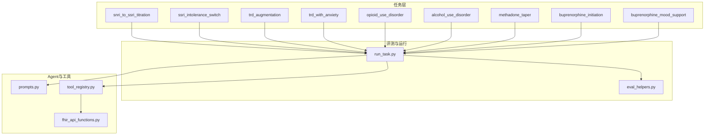
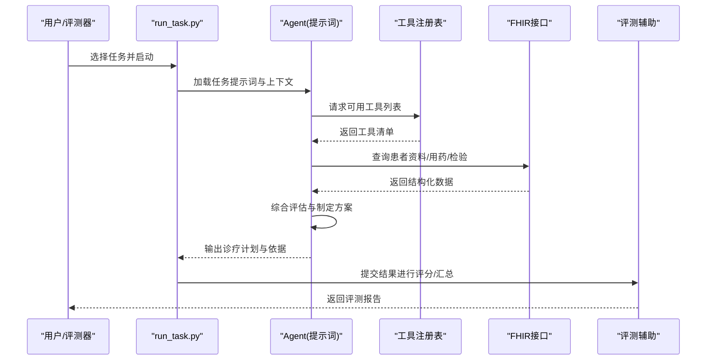
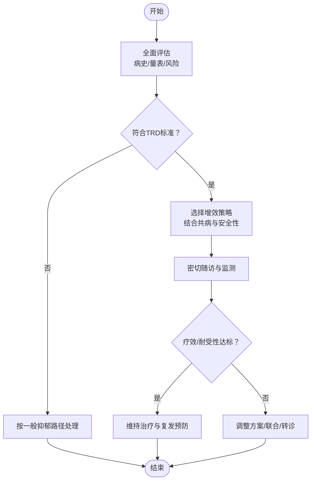
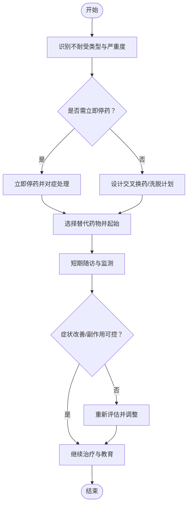
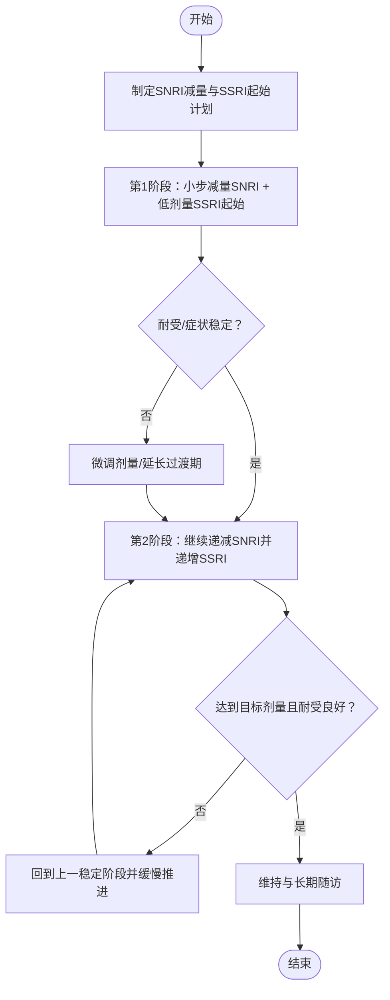
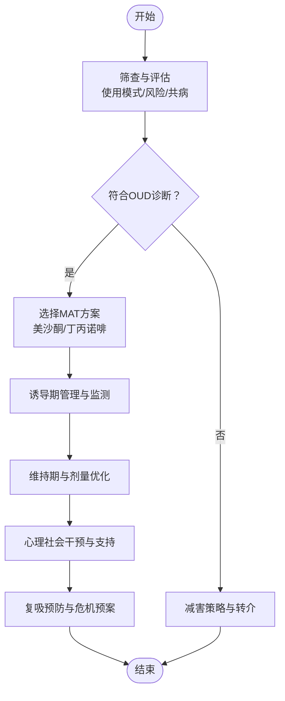
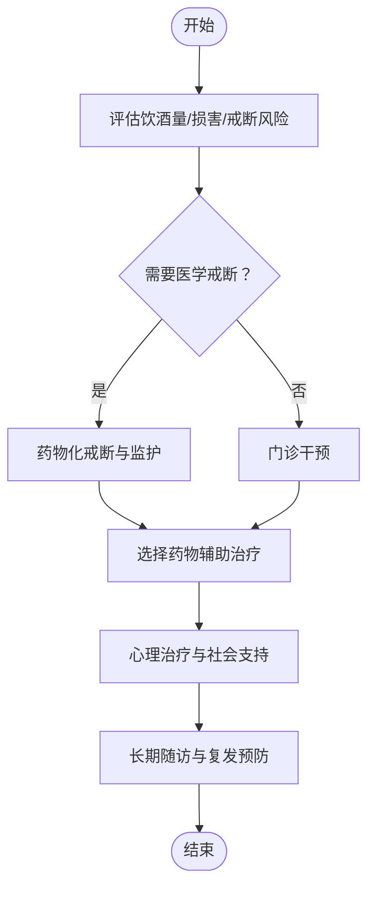
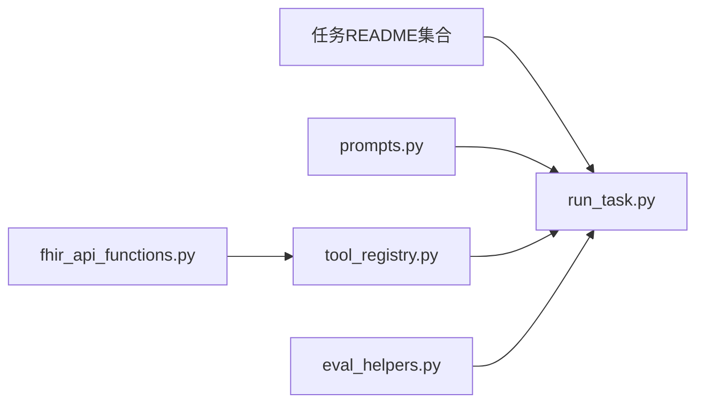

# 精神心理疾病

<cite>
**本文引用的文件**   
- [ PhysicianBench/tasks/v1/snri_to_ssri_titration/README.md](file://task7/poc3_physicianbench/PhysicianBench/tasks/v1/snri_to_ssri_titration/README.md)
- [ PhysicianBench/tasks/v1/ssri_intolerance_switch/README.md](file://task7/poc3_physicianbench/PhysicianBench/tasks/v1/ssri_intolerance_switch/README.md)
- [ PhysicianBench/tasks/v1/trd_augmentation/README.md](file://task7/poc3_physicianbench/PhysicianBench/tasks/v1/trd_augmentation/README.md)
- [ PhysicianBench/tasks/v1/trd_with_anxiety/README.md](file://task7/poc3_physicianbench/PhysicianBench/tasks/v1/trd_with_anxiety/README.md)
- [ PhysicianBench/tasks/v1/opioid_use_disorder/README.md](file://task7/poc3_physicianbench/PhysicianBench/tasks/v1/opioid_use_disorder/README.md)
- [ PhysicianBench/tasks/v1/alcohol_use_disorder/README.md](file://task7/poc3_physicianbench/PhysicianBench/tasks/v1/alcohol_use_disorder/README.md)
- [ PhysicianBench/tasks/v1/methadone_taper/README.md](file://task7/poc3_physicianbench/PhysicianBench/tasks/v1/methadone_taper/README.md)
- [ PhysicianBench/tasks/v1/buprenorphine_initiation/README.md](file://task7/poc3_physicianbench/PhysicianBench/tasks/v1/buprenorphine_initiation/README.md)
- [ PhysicianBench/tasks/v1/buprenorphine_mood_support/README.md](file://task7/poc3_physicianbench/PhysicianBench/tasks/v1/buprenorphine_mood_support/README.md)
- [ PhysicianBench/tasks/v1/eval_helpers.py](file://task7/poc3_physicianbench/PhysicianBench/utils/eval_helpers.py)
- [ PhysicianBench/scripts/run_task.py](file://task7/poc3_physicianbench/PhysicianBench/scripts/run_task.py)
- [ PhysicianBench/agent/prompts.py](file://task7/poc3_physicianbench/PhysicianBench/agent/prompts.py)
- [ PhysicianBench/agent/tool_registry.py](file://task7/poc3_physicianbench/PhysicianBench/agent/tool_registry.py)
- [ PhysicianBench/tools/fhir_api_functions.py](file://task7/poc3_physicianbench/PhysicianBench/tools/fhir_api_functions.py)
</cite>

## 目录
1. [引言](#引言)
2. [项目结构](#项目结构)
3. [核心组件](#核心组件)
4. [架构总览](#架构总览)
5. [详细组件分析](#详细组件分析)
6. [依赖分析](#依赖分析)
7. [性能与可用性考量](#性能与可用性考量)
8. [故障排查指南](#故障排查指南)
9. [结论](#结论)
10. [附录](#附录)

## 引言
本文件围绕精神心理疾病相关临床任务，聚焦以下主题：难治性抑郁症（TRD）增效治疗、SSRI不耐受换药、SNRI到SSRI滴定、阿片类药物使用障碍（OUD）等。文档从系统实现角度梳理评估工具、量表应用、鉴别诊断思路、药物治疗原则、心理治疗技术与危机干预策略，并给出不良反应监测、自杀风险评估与家属支持指导的落地建议。内容既面向临床工作者，也便于工程与数据团队理解评测框架与任务编排方式。

## 项目结构
该仓库包含一个以“医师能力评测”为核心的子项目（PhysicianBench），其中针对精神心理领域提供了若干标准化任务定义与评测脚本。关键路径包括：
- 任务定义：每个任务以独立目录组织，包含README说明与评测所需材料
- 评测辅助：统一的评测辅助函数与任务运行脚本
- Agent与工具：提示词模板、工具注册表、FHIR接口封装

图表来源
- [ PhysicianBench/scripts/run_task.py](file://task7/poc3_physicianbench/PhysicianBench/scripts/run_task.py)
- [ PhysicianBench/utils/eval_helpers.py](file://task7/poc3_physicianbench/PhysicianBench/utils/eval_helpers.py)
- [ PhysicianBench/agent/prompts.py](file://task7/poc3_physicianbench/PhysicianBench/agent/prompts.py)
- [ PhysicianBench/agent/tool_registry.py](file://task7/poc3_physicianbench/PhysicianBench/agent/tool_registry.py)
- [ PhysicianBench/tools/fhir_api_functions.py](file://task7/poc3_physicianbench/PhysicianBench/tools/fhir_api_functions.py)

章节来源
- [ PhysicianBench/scripts/run_task.py](file://task7/poc3_physicianbench/PhysicianBench/scripts/run_task.py)
- [ PhysicianBench/utils/eval_helpers.py](file://task7/poc3_physicianbench/PhysicianBench/utils/eval_helpers.py)
- [ PhysicianBench/agent/prompts.py](file://task7/poc3_physicianbench/PhysicianBench/agent/prompts.py)
- [ PhysicianBench/agent/tool_registry.py](file://task7/poc3_physicianbench/PhysicianBench/agent/tool_registry.py)
- [ PhysicianBench/tools/fhir_api_functions.py](file://task7/poc3_physicianbench/PhysicianBench/tools/fhir_api_functions.py)

## 核心组件
- 任务定义与说明：各精神心理任务的README提供病例背景、目标、约束与期望输出格式，用于统一评测口径
- 评测辅助：提供评分、结果汇总与一致性检查等通用能力
- Agent提示词：为不同任务定制结构化提示，引导模型按临床流程生成方案
- 工具注册与调用：将外部工具（如FHIR查询）纳入Agent工作流，增强可解释性与可验证性
- FHIR接口封装：通过标准医疗数据接口获取患者信息、用药史、检验结果等，支撑决策闭环

章节来源
- [ PhysicianBench/tasks/v1/snri_to_ssri_titration/README.md](file://task7/poc3_physicianbench/PhysicianBench/tasks/v1/snri_to_ssri_titration/README.md)
- [ PhysicianBench/tasks/v1/ssri_intolerance_switch/README.md](file://task7/poc3_physicianbench/PhysicianBench/tasks/v1/ssri_intolerance_switch/README.md)
- [ PhysicianBench/tasks/v1/trd_augmentation/README.md](file://task7/poc3_physicianbench/PhysicianBench/tasks/v1/trd_augmentation/README.md)
- [ PhysicianBench/tasks/v1/trd_with_anxiety/README.md](file://task7/poc3_physicianbench/PhysicianBench/tasks/v1/trd_with_anxiety/README.md)
- [ PhysicianBench/tasks/v1/opioid_use_disorder/README.md](file://task7/poc3_physicianbench/PhysicianBench/tasks/v1/opioid_use_disorder/README.md)
- [ PhysicianBench/tasks/v1/alcohol_use_disorder/README.md](file://task7/poc3_physicianbench/PhysicianBench/tasks/v1/alcohol_use_disorder/README.md)
- [ PhysicianBench/tasks/v1/methadone_taper/README.md](file://task7/poc3_physicianbench/PhysicianBench/tasks/v1/methadone_taper/README.md)
- [ PhysicianBench/tasks/v1/buprenorphine_initiation/README.md](file://task7/poc3_physicianbench/PhysicianBench/tasks/v1/buprenorphine_initiation/README.md)
- [ PhysicianBench/tasks/v1/buprenorphine_mood_support/README.md](file://task7/poc3_physicianbench/PhysicianBench/tasks/v1/buprenorphine_mood_support/README.md)
- [ PhysicianBench/utils/eval_helpers.py](file://task7/poc3_physicianbench/PhysicianBench/utils/eval_helpers.py)
- [ PhysicianBench/agent/prompts.py](file://task7/poc3_physicianbench/PhysicianBench/agent/prompts.py)
- [ PhysicianBench/agent/tool_registry.py](file://task7/poc3_physicianbench/PhysicianBench/agent/tool_registry.py)
- [ PhysicianBench/tools/fhir_api_functions.py](file://task7/poc3_physicianbench/PhysicianBench/tools/fhir_api_functions.py)

## 架构总览
下图展示从任务入口到Agent执行、工具调用与数据回流的端到端流程。

图表来源
- [ PhysicianBench/scripts/run_task.py](file://task7/poc3_physicianbench/PhysicianBench/scripts/run_task.py)
- [ PhysicianBench/agent/prompts.py](file://task7/poc3_physicianbench/PhysicianBench/agent/prompts.py)
- [ PhysicianBench/agent/tool_registry.py](file://task7/poc3_physicianbench/PhysicianBench/agent/tool_registry.py)
- [ PhysicianBench/tools/fhir_api_functions.py](file://task7/poc3_physicianbench/PhysicianBench/tools/fhir_api_functions.py)
- [ PhysicianBench/utils/eval_helpers.py](file://task7/poc3_physicianbench/PhysicianBench/utils/eval_helpers.py)

## 详细组件分析

### 难治性抑郁症（TRD）增效治疗
- 临床要点
  - 明确TRD定义与既往足量足疗程抗抑郁治疗失败情况
  - 评估共病（焦虑、躯体症状）、风险因素（自杀意念、物质滥用）
  - 选择增效策略：非典型抗精神病药、锂盐、甲状腺素、安非他酮、米氮平、文拉法辛等；必要时考虑物理治疗或转诊
  - 关注药物相互作用、代谢与心电图影响
- 评估与量表
  - 抑郁量表：PHQ-9、HAM-D、MADRS
  - 功能评估：WHODAS 2.0
  - 风险筛查：C-SSRS、SAD PERSONS
- 流程图（概念）

章节来源
- [ PhysicianBench/tasks/v1/trd_augmentation/README.md](file://task7/poc3_physicianbench/PhysicianBench/tasks/v1/trd_augmentation/README.md)
- [ PhysicianBench/tasks/v1/trd_with_anxiety/README.md](file://task7/poc3_physicianbench/PhysicianBench/tasks/v1/trd_with_anxiety/README.md)

### SSRI不耐受换药
- 临床要点
  - 区分副作用类型（胃肠道、性功能障碍、失眠/嗜睡、体重变化、QT间期延长等）
  - 选择替代药物：同属内换药、跨类换药（SNRI、NaSSA、NDRI、多靶点等）
  - 交叉换药与洗脱策略，避免撤药综合征与血清素综合征
- 评估与量表
  - PHQ-9跟踪疗效
  - 不良事件记录与严重程度分级
- 流程图（概念）

章节来源
- [ PhysicianBench/tasks/v1/ssri_intolerance_switch/README.md](file://task7/poc3_physicianbench/PhysicianBench/tasks/v1/ssri_intolerance_switch/README.md)

### SNRI到SSRI滴定
- 临床要点
  - 滴定目标：在控制抑郁的同时降低SNRI相关副作用（如血压升高、出汗、性功能障碍）
  - 逐步减量SNRI并同步起始SSRI，注意半衰期差异与撤药反应
  - 合并心血管风险时优先选择对血压/心率影响较小的SSRI
- 评估与量表
  - PHQ-9、血压/心率监测、肝功能与电解质复查
- 流程图（概念）

章节来源
- [ PhysicianBench/tasks/v1/snri_to_ssri_titration/README.md](file://task7/poc3_physicianbench/PhysicianBench/tasks/v1/snri_to_ssri_titration/README.md)

### 阿片类药物使用障碍（OUD）
- 临床要点
  - 识别与诊断：DSM-5标准、成瘾行为特征、戒断症状
  - 药物治疗：美沙酮、丁丙诺啡（含纳洛酮复方）诱导与维持；疼痛管理中的谨慎使用
  - 心理社会干预：动机访谈、认知行为疗法、同伴支持、家庭参与
  - 危机与安全：过量风险评估、纳洛酮配备、复吸预防
- 评估与量表
  - DAST-10、ASSIST、CIWA-Ar（戒断评估）、C-SSRS（自杀风险）
- 流程图（概念）

章节来源
- [ PhysicianBench/tasks/v1/opioid_use_disorder/README.md](file://task7/poc3_physicianbench/PhysicianBench/tasks/v1/opioid_use_disorder/README.md)
- [ PhysicianBench/tasks/v1/methadone_taper/README.md](file://task7/poc3_physicianbench/PhysicianBench/tasks/v1/methadone_taper/README.md)
- [ PhysicianBench/tasks/v1/buprenorphine_initiation/README.md](file://task7/poc3_physicianbench/PhysicianBench/tasks/v1/buprenorphine_initiation/README.md)
- [ PhysicianBench/tasks/v1/buprenorphine_mood_support/README.md](file://task7/poc3_physicianbench/PhysicianBench/tasks/v1/buprenorphine_mood_support/README.md)

### 酒精使用障碍（AUD）
- 临床要点
  - 识别饮酒模式与损害，评估戒断风险与并发症（肝病、神经病变、营养不良）
  - 药物辅助：纳曲酮、阿坎酸、双硫仑等；戒断期苯二氮卓类短程管理
  - 心理治疗：动机访谈、CBT、家庭治疗
- 评估与量表
  - AUDIT、CAGE、CIWA-Ar
- 流程图（概念）

章节来源
- [ PhysicianBench/tasks/v1/alcohol_use_disorder/README.md](file://task7/poc3_physicianbench/PhysicianBench/tasks/v1/alcohol_use_disorder/README.md)

### 评估工具与量表应用（通用）
- 抑郁与焦虑
  - PHQ-9、GAD-7、HAM-D、MADRS、HAMA
- 风险与危机
  - C-SSRS、SAD PERSONS、自杀计划与手段可及性评估
- 物质使用
  - DAST-10、AUDIT、ASSIST、CIWA-Ar
- 功能与生活质量
  - WHODAS 2.0、SF-12/SF-36

章节来源
- [ PhysicianBench/utils/eval_helpers.py](file://task7/poc3_physicianbench/PhysicianBench/utils/eval_helpers.py)
- [ PhysicianBench/agent/prompts.py](file://task7/poc3_physicianbench/PhysicianBench/agent/prompts.py)

### 鉴别诊断与分型要点
- 抑郁障碍分型
  - 单相抑郁、双相抑郁、伴焦虑痛苦、伴精神病性特征、季节性模式、围产期抑郁
- 焦虑症鉴别
  - 广泛性焦虑、惊恐障碍、社交焦虑、创伤后应激障碍、强迫症
- 物质相关障碍
  - 使用障碍 vs 有害使用；戒断与中毒状态；共病精神障碍识别

章节来源
- [ PhysicianBench/tasks/v1/trd_with_anxiety/README.md](file://task7/poc3_physicianbench/PhysicianBench/tasks/v1/trd_with_anxiety/README.md)
- [ PhysicianBench/tasks/v1/opioid_use_disorder/README.md](file://task7/poc3_physicianbench/PhysicianBench/tasks/v1/opioid_use_disorder/README.md)

### 药物治疗原则与注意事项
- 个体化与循证：基于证据选择一线药物，结合共病、年龄、性别、妊娠/哺乳、肝肾功能
- 起始与滴定：低起始、慢滴定，定期评估疗效与不良反应
- 相互作用与禁忌：CYP450相互作用、QT间期延长、5-羟色胺综合征风险
- 特殊人群：老年、青少年、孕产妇、慢性病患者

章节来源
- [ PhysicianBench/tasks/v1/ssri_intolerance_switch/README.md](file://task7/poc3_physicianbench/PhysicianBench/tasks/v1/ssri_intolerance_switch/README.md)
- [ PhysicianBench/tasks/v1/snri_to_ssri_titration/README.md](file://task7/poc3_physicianbench/PhysicianBench/tasks/v1/snri_to_ssri_titration/README.md)
- [ PhysicianBench/tasks/v1/trd_augmentation/README.md](file://task7/poc3_physicianbench/PhysicianBench/tasks/v1/trd_augmentation/README.md)

### 心理治疗技术与危机干预
- 心理治疗
  - CBT、IPT、DBT技能训练、动机访谈、正念减压
- 危机干预
  - 安全计划、限制致命手段、紧急转介、家属参与与资源链接

章节来源
- [ PhysicianBench/tasks/v1/opioid_use_disorder/README.md](file://task7/poc3_physicianbench/PhysicianBench/tasks/v1/opioid_use_disorder/README.md)
- [ PhysicianBench/tasks/v1/trd_with_anxiety/README.md](file://task7/poc3_physicianbench/PhysicianBench/tasks/v1/trd_with_anxiety/README.md)

### 不良反应监测与随访
- 常见不良反应
  - 胃肠道不适、失眠/嗜睡、体重变化、性功能问题、血压/心率异常、QT间期延长
- 监测计划
  - 基线与定期实验室检查（肝肾功能、血脂、血糖）、心电图、生命体征
- 随访节奏
  - 起始与滴定期高频随访，稳定期延长间隔，复发预警信号教育

章节来源
- [ PhysicianBench/tasks/v1/ssri_intolerance_switch/README.md](file://task7/poc3_physicianbench/PhysicianBench/tasks/v1/ssri_intolerance_switch/README.md)
- [ PhysicianBench/tasks/v1/snri_to_ssri_titration/README.md](file://task7/poc3_physicianbench/PhysicianBench/tasks/v1/snri_to_ssri_titration/README.md)

### 自杀风险评估与家属支持
- 风险评估
  - 使用C-SSRS结构化评估，关注意念强度、计划、手段可及性、保护因素
- 家属支持
  - 教育与沟通技巧、安全环境布置、危机联络清单、照护者负担评估

章节来源
- [ PhysicianBench/tasks/v1/trd_augmentation/README.md](file://task7/poc3_physicianbench/PhysicianBench/tasks/v1/trd_augmentation/README.md)
- [ PhysicianBench/tasks/v1/opioid_use_disorder/README.md](file://task7/poc3_physicianbench/PhysicianBench/tasks/v1/opioid_use_disorder/README.md)

## 依赖分析
- 任务到运行器的依赖：各任务README作为输入被run_task.py读取与编排
- Agent到工具的依赖：prompts.py提供结构化提示，tool_registry.py注册工具，fhir_api_functions.py提供数据访问
- 评测辅助：eval_helpers.py为评分与汇总提供通用能力

图表来源
- [ PhysicianBench/scripts/run_task.py](file://task7/poc3_physicianbench/PhysicianBench/scripts/run_task.py)
- [ PhysicianBench/agent/prompts.py](file://task7/poc3_physicianbench/PhysicianBench/agent/prompts.py)
- [ PhysicianBench/agent/tool_registry.py](file://task7/poc3_physicianbench/PhysicianBench/agent/tool_registry.py)
- [ PhysicianBench/tools/fhir_api_functions.py](file://task7/poc3_physicianbench/PhysicianBench/tools/fhir_api_functions.py)
- [ PhysicianBench/utils/eval_helpers.py](file://task7/poc3_physicianbench/PhysicianBench/utils/eval_helpers.py)

章节来源
- [ PhysicianBench/scripts/run_task.py](file://task7/poc3_physicianbench/PhysicianBench/scripts/run_task.py)
- [ PhysicianBench/agent/prompts.py](file://task7/poc3_physicianbench/PhysicianBench/agent/prompts.py)
- [ PhysicianBench/agent/tool_registry.py](file://task7/poc3_physicianbench/PhysicianBench/agent/tool_registry.py)
- [ PhysicianBench/tools/fhir_api_functions.py](file://task7/poc3_physicianbench/PhysicianBench/tools/fhir_api_functions.py)
- [ PhysicianBench/utils/eval_helpers.py](file://task7/poc3_physicianbench/PhysicianBench/utils/eval_helpers.py)

## 性能与可用性考量
- 任务并行与批处理：通过run_task.py批量调度多个精神心理任务，提高评测效率
- 工具调用开销：FHIR查询可能引入网络延迟，建议在评测中缓存必要数据或设置超时与重试策略
- 提示词稳定性：prompts.py的结构化提示有助于减少输出波动，提升评测一致性
- 评测指标：利用eval_helpers.py统一评分维度，确保跨任务可比性

[本节为通用指导，不直接分析具体文件]

## 故障排查指南
- 任务未找到或路径错误
  - 检查run_task.py的任务参数与README路径是否正确
- 工具不可用或权限不足
  - 确认tool_registry.py已正确注册fhir_api_functions.py提供的工具，并配置访问凭证
- 数据缺失或不一致
  - 使用eval_helpers.py进行数据校验与缺失值处理
- 输出格式不符合评测要求
  - 对照prompts.py的模板规范，确保输出字段完整与顺序一致

章节来源
- [ PhysicianBench/scripts/run_task.py](file://task7/poc3_physicianbench/PhysicianBench/scripts/run_task.py)
- [ PhysicianBench/agent/tool_registry.py](file://task7/poc3_physicianbench/PhysicianBench/agent/tool_registry.py)
- [ PhysicianBench/tools/fhir_api_functions.py](file://task7/poc3_physicianbench/PhysicianBench/tools/fhir_api_functions.py)
- [ PhysicianBench/utils/eval_helpers.py](file://task7/poc3_physicianbench/PhysicianBench/utils/eval_helpers.py)
- [ PhysicianBench/agent/prompts.py](file://task7/poc3_physicianbench/PhysicianBench/agent/prompts.py)

## 结论
本文件基于PhysicianBench的精神心理任务集合，构建了从评估、诊断、治疗到随访与危机干预的系统化知识图谱，并结合工程实现展示了任务编排、工具集成与评测流程。通过标准化的任务定义与统一的评测辅助，可为临床教学、研究与自动化决策支持提供可靠基础。

[本节为总结性内容，不直接分析具体文件]

## 附录
- 术语表
  - TRD：难治性抑郁症
  - OUD：阿片类药物使用障碍
  - AUD：酒精使用障碍
  - MAT：药物辅助治疗
  - C-SSRS：哥伦比亚自杀严重程度评定量表
- 参考任务清单
  - 难治性抑郁症增效治疗
  - SSRI不耐受换药
  - SNRI到SSRI滴定
  - 阿片类药物使用障碍
  - 酒精使用障碍
  - 美沙酮减量
  - 丁丙诺啡诱导与情绪支持

章节来源
- [ PhysicianBench/tasks/v1/trd_augmentation/README.md](file://task7/poc3_physicianbench/PhysicianBench/tasks/v1/trd_augmentation/README.md)
- [ PhysicianBench/tasks/v1/ssri_intolerance_switch/README.md](file://task7/poc3_physicianbench/PhysicianBench/tasks/v1/ssri_intolerance_switch/README.md)
- [ PhysicianBench/tasks/v1/snri_to_ssri_titration/README.md](file://task7/poc3_physicianbench/PhysicianBench/tasks/v1/snri_to_ssri_titration/README.md)
- [ PhysicianBench/tasks/v1/opioid_use_disorder/README.md](file://task7/poc3_physicianbench/PhysicianBench/tasks/v1/opioid_use_disorder/README.md)
- [ PhysicianBench/tasks/v1/alcohol_use_disorder/README.md](file://task7/poc3_physicianbench/PhysicianBench/tasks/v1/alcohol_use_disorder/README.md)
- [ PhysicianBench/tasks/v1/methadone_taper/README.md](file://task7/poc3_physicianbench/PhysicianBench/tasks/v1/methadone_taper/README.md)
- [ PhysicianBench/tasks/v1/buprenorphine_initiation/README.md](file://task7/poc3_physicianbench/PhysicianBench/tasks/v1/buprenorphine_initiation/README.md)
- [ PhysicianBench/tasks/v1/buprenorphine_mood_support/README.md](file://task7/poc3_physicianbench/PhysicianBench/tasks/v1/buprenorphine_mood_support/README.md)