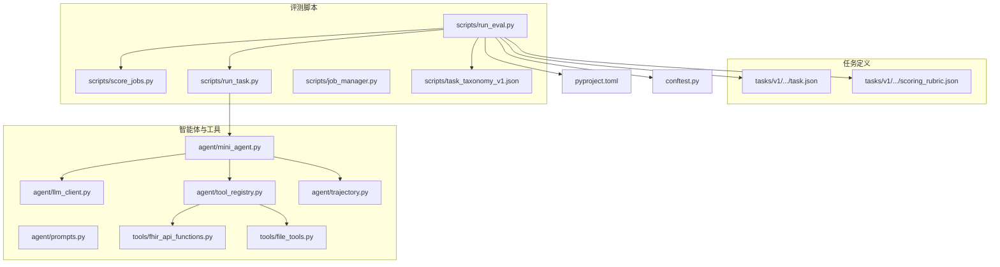
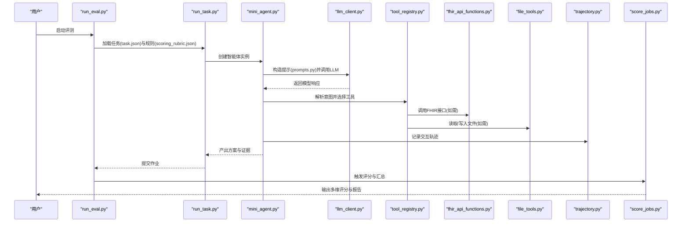
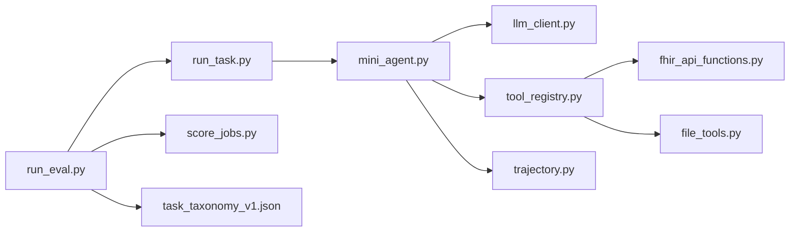

# 评估框架与指标

<cite>
**本文引用的文件**   
- [README.md](file://task7/poc3_physicianbench/PhysicianBench/README.md)
- [pyproject.toml](file://task7/poc3_physicianbench/PhysicianBench/pyproject.toml)
- [conftest.py](file://task7/poc3_physicianbench/PhysicianBench/conftest.py)
- [run_eval.py](file://task7/poc3_physicianbench/PhysicianBench/scripts/run_eval.py)
- [score_jobs.py](file://task7/poc3_physicianbench/PhysicianBench/scripts/score_jobs.py)
- [run_task.py](file://task7/poc3_physicianbench/PhysicianBench/scripts/run_task.py)
- [job_manager.py](file://task7/poc3_physicianbench/PhysicianBench/scripts/job_manager.py)
- [llm_client.py](file://task7/poc3_physicianbench/PhysicianBench/agent/llm_client.py)
- [mini_agent.py](file://task7/poc3_physicianbench/PhysicianBench/agent/mini_agent.py)
- [prompts.py](file://task7/poc3_physicianbench/PhysicianBench/agent/prompts.py)
- [tool_registry.py](file://task7/poc3_physicianbench/PhysicianBench/agent/tool_registry.py)
- [trajectory.py](file://task7/poc3_physicianbench/PhysicianBench/agent/trajectory.py)
- [fhir_api_functions.py](file://task7/poc3_physicianbench/PhysicianBench/tools/fhir_api_functions.py)
- [file_tools.py](file://task7/poc3_physicianbench/PhysicianBench/tools/file_tools.py)
- [eval_helpers.py](file://task7/poc3_physicianbench/PhysicianBench/utils/eval_helpers.py)
- [abnormal_uterine_bleeding/task.json](file://task7/poc3_physicianbench/PhysicianBench/tasks/v1/abnormal_uterine_bleeding/task.json)
- [abnormal_uterine_bleeding/scoring_rubric.json](file://task7/poc3_physicianbench/PhysicianBench/tasks/v1/abnormal_uterine_bleeding/scoring_rubric.json)
- [task_taxonomy_v1.json](file://task7/poc3_physicianbench/PhysicianBench/scripts/task_taxonomy_v1.json)
</cite>

## 目录
1. [简介](#简介)
2. [项目结构](#项目结构)
3. [核心组件](#核心组件)
4. [架构总览](#架构总览)
5. [详细组件分析](#详细组件分析)
6. [依赖关系分析](#依赖关系分析)
7. [性能考量](#性能考量)
8. [故障排查指南](#故障排查指南)
9. [结论](#结论)
10. [附录](#附录)

## 简介
本文件面向PhysicianBench的评估框架，系统化阐述多维度评估指标体系、自动化评分算法、测试用例设计原则、结果分析与可视化、以及性能基准与并发能力评估方法。文档同时给出关键流程的时序图与数据流图，帮助读者快速理解从任务执行到评分报告生成的完整链路。

## 项目结构
PhysicianBench采用“任务定义 + 智能体工具 + 评测脚本”的分层组织方式：
- 任务定义位于 tasks/v1/<疾病或场景>/ 下，包含 task.json（任务描述、输入输出规范）与 scoring_rubric.json（评分细则）。
- 智能体与工具位于 agent/ 与 tools/ 目录，负责调用外部API（如FHIR）、读写文件、管理轨迹等。
- 评测入口与批处理脚本位于 scripts/，包括运行任务、评分汇总、作业管理等。
- 配置与元信息位于根级 pyproject.toml、conftest.py 及 scripts/task_taxonomy_v1.json。

图表来源
- [run_eval.py](file://task7/poc3_physicianbench/PhysicianBench/scripts/run_eval.py)
- [run_task.py](file://task7/poc3_physicianbench/PhysicianBench/scripts/run_task.py)
- [score_jobs.py](file://task7/poc3_physicianbench/PhysicianBench/scripts/score_jobs.py)
- [job_manager.py](file://task7/poc3_physicianbench/PhysicianBench/scripts/job_manager.py)
- [mini_agent.py](file://task7/poc3_physicianbench/PhysicianBench/agent/mini_agent.py)
- [llm_client.py](file://task7/poc3_physicianbench/PhysicianBench/agent/llm_client.py)
- [prompts.py](file://task7/poc3_physicianbench/PhysicianBench/agent/prompts.py)
- [tool_registry.py](file://task7/poc3_physicianbench/PhysicianBench/agent/tool_registry.py)
- [fhir_api_functions.py](file://task7/poc3_physicianbench/PhysicianBench/tools/fhir_api_functions.py)
- [file_tools.py](file://task7/poc3_physicianbench/PhysicianBench/tools/file_tools.py)
- [trajectory.py](file://task7/poc3_physicianbench/PhysicianBench/agent/trajectory.py)
- [task.json](file://task7/poc3_physicianbench/PhysicianBench/tasks/v1/abnormal_uterine_bleeding/task.json)
- [scoring_rubric.json](file://task7/poc3_physicianbench/PhysicianBench/tasks/v1/abnormal_uterine_bleeding/scoring_rubric.json)
- [task_taxonomy_v1.json](file://task7/poc3_physicianbench/PhysicianBench/scripts/task_taxonomy_v1.json)
- [pyproject.toml](file://task7/poc3_physicianbench/PhysicianBench/pyproject.toml)
- [conftest.py](file://task7/poc3_physicianbench/PhysicianBench/conftest.py)

章节来源
- [README.md](file://task7/poc3_physicianbench/PhysicianBench/README.md)
- [pyproject.toml](file://task7/poc3_physicianbench/PhysicianBench/pyproject.toml)
- [conftest.py](file://task7/poc3_physicianbench/PhysicianBench/conftest.py)

## 核心组件
- 任务与评分规则
  - task.json：定义任务目标、输入上下文、期望输出格式与约束条件。
  - scoring_rubric.json：定义维度权重、评分项、阈值与判定逻辑，支撑多维度量化评分。
- 智能体与工具
  - mini_agent.py：编排LLM调用、工具选择与轨迹记录。
  - llm_client.py：封装大模型客户端，统一请求与重试策略。
  - tool_registry.py：注册并路由工具函数（如FHIR查询、文件操作）。
  - fhir_api_functions.py / file_tools.py：具体工具实现。
  - trajectory.py：持久化交互轨迹，便于审计与回溯。
- 评测与批处理
  - run_eval.py：评测主入口，加载任务与评分规则，驱动任务执行与评分。
  - score_jobs.py：对已完成的作业进行批量评分与汇总。
  - job_manager.py：作业调度与状态管理。
  - run_task.py：单任务执行器，供评测流程调用。
  - task_taxonomy_v1.json：任务分类与标签，用于分组统计与可视化。

章节来源
- [task.json](file://task7/poc3_physicianbench/PhysicianBench/tasks/v1/abnormal_uterine_bleeding/task.json)
- [scoring_rubric.json](file://task7/poc3_physicianbench/PhysicianBench/tasks/v1/abnormal_uterine_bleeding/scoring_rubric.json)
- [mini_agent.py](file://task7/poc3_physicianbench/PhysicianBench/agent/mini_agent.py)
- [llm_client.py](file://task7/poc3_physicianbench/PhysicianBench/agent/llm_client.py)
- [tool_registry.py](file://task7/poc3_physicianbench/PhysicianBench/agent/tool_registry.py)
- [fhir_api_functions.py](file://task7/poc3_physicianbench/PhysicianBench/tools/fhir_api_functions.py)
- [file_tools.py](file://task7/poc3_physicianbench/PhysicianBench/tools/file_tools.py)
- [trajectory.py](file://task7/poc3_physicianbench/PhysicianBench/agent/trajectory.py)
- [run_eval.py](file://task7/poc3_physicianbench/PhysicianBench/scripts/run_eval.py)
- [score_jobs.py](file://task7/poc3_physicianbench/PhysicianBench/scripts/score_jobs.py)
- [job_manager.py](file://task7/poc3_physicianbench/PhysicianBench/scripts/job_manager.py)
- [run_task.py](file://task7/poc3_physicianbench/PhysicianBench/scripts/run_task.py)
- [task_taxonomy_v1.json](file://task7/poc3_physicianbench/PhysicianBench/scripts/task_taxonomy_v1.json)

## 架构总览
下图展示从评测入口到评分报告的端到端流程，涵盖任务加载、智能体执行、工具调用、轨迹记录与评分汇总。

图表来源
- [run_eval.py](file://task7/poc3_physicianbench/PhysicianBench/scripts/run_eval.py)
- [run_task.py](file://task7/poc3_physicianbench/PhysicianBench/scripts/run_task.py)
- [mini_agent.py](file://task7/poc3_physicianbench/PhysicianBench/agent/mini_agent.py)
- [llm_client.py](file://task7/poc3_physicianbench/PhysicianBench/agent/llm_client.py)
- [prompts.py](file://task7/poc3_physicianbench/PhysicianBench/agent/prompts.py)
- [tool_registry.py](file://task7/poc3_physicianbench/PhysicianBench/agent/tool_registry.py)
- [fhir_api_functions.py](file://task7/poc3_physicianbench/PhysicianBench/tools/fhir_api_functions.py)
- [file_tools.py](file://task7/poc3_physicianbench/PhysicianBench/tools/file_tools.py)
- [trajectory.py](file://task7/poc3_physicianbench/PhysicianBench/agent/trajectory.py)
- [score_jobs.py](file://task7/poc3_physicianbench/PhysicianBench/scripts/score_jobs.py)

## 详细组件分析

### 多维度评估指标体系
- 诊断准确性
  - 依据任务输入与标准答案/参考路径，比对最终诊断结论与关键鉴别点覆盖度。
  - 可结合自然语言处理技术抽取结构化要素（症状、体征、检验），并与参考答案对齐。
- 治疗方案合理性
  - 基于临床指南与专家规则，检查治疗路径是否遵循推荐等级、禁忌症与剂量范围。
  - 通过评分规则中的维度权重与阈值进行量化打分。
- 药物安全性
  - 利用药物知识库与相互作用检测工具，评估用药组合的安全性风险。
  - 对高风险组合进行扣分或一票否决。
- 临床指南遵循度
  - 将指南条目映射为可判定的规则项，逐项匹配智能体输出，计算遵循比例。
- 综合得分
  - 按各维度权重加权求和，并结合惩罚项（如严重安全违规）生成最终分数。

章节来源
- [scoring_rubric.json](file://task7/poc3_physicianbench/PhysicianBench/tasks/v1/abnormal_uterine_bleeding/scoring_rubric.json)
- [task.json](file://task7/poc3_physicianbench/PhysicianBench/tasks/v1/abnormal_uterine_bleeding/task.json)

### 自动化评分算法
- 自然语言处理在医疗文本分析中的应用
  - 实体识别：抽取诊断、药物、检查项目等实体，构建结构化表示。
  - 语义相似度：比较智能体建议与参考答案的语义一致性。
  - 规则抽取：从指南与评分规则中解析判定条件，形成可执行的规则集。
- 专家规则引擎
  - 将评分规则转化为条件判断与权重分配，支持阈值、优先级与冲突消解。
  - 提供可解释的评分明细，便于审计与改进。
- 机器学习模型
  - 可选用轻量分类或回归模型辅助相似度打分或异常检测。
  - 模型需与规则引擎融合，确保可解释性与稳定性。

章节来源
- [eval_helpers.py](file://task7/poc3_physicianbench/PhysicianBench/utils/eval_helpers.py)
- [scoring_rubric.json](file://task7/poc3_physicianbench/PhysicianBench/tasks/v1/abnormal_uterine_bleeding/scoring_rubric.json)

### 测试用例设计原则
- 边界条件测试
  - 极端患者画像（高龄、多病共存、多重用药）验证系统鲁棒性。
  - 缺失或不一致输入（缺关键检验、矛盾主诉）评估容错与澄清能力。
- 异常场景处理
  - 工具不可用（FHIR服务超时、权限不足）时的降级策略与回退路径。
  - 模型输出异常（格式错误、内容不完整）的修复与重试机制。
- 回归测试策略
  - 以历史案例作为基线，确保新版本不降低关键维度得分。
  - 针对高频失败模式建立专项用例集，持续监控回归风险。

章节来源
- [conftest.py](file://task7/poc3_physicianbench/PhysicianBench/conftest.py)
- [run_eval.py](file://task7/poc3_physicianbench/PhysicianBench/scripts/run_eval.py)

### 评估结果的分析方法与可视化展示
- 分析方法
  - 分维度聚合统计（均值、方差、分布），识别薄弱环节。
  - 按任务类别（见任务分类表）对比表现差异，定位领域特定问题。
  - 关联分析：将工具调用次数、轨迹长度与得分相关性进行分析。
- 可视化展示
  - 雷达图呈现多维度得分；柱状图对比不同任务类别；折线图跟踪回归趋势。
  - 热力图展示规则命中情况与误判热点。

章节来源
- [task_taxonomy_v1.json](file://task7/poc3_physicianbench/PhysicianBench/scripts/task_taxonomy_v1.json)
- [score_jobs.py](file://task7/poc3_physicianbench/PhysicianBench/scripts/score_jobs.py)

### 性能基准测试、压力测试与并发处理能力评估
- 性能基准
  - 单任务时延：从任务加载到评分输出的端到端耗时。
  - 吞吐率：单位时间内完成的任务数。
- 压力测试
  - 高并发作业队列：模拟大量并行任务，观察资源占用与稳定性。
  - 外部依赖压力：FHIR服务限流、网络抖动下的恢复能力。
- 并发处理能力评估
  - 作业管理器并发度调优与锁竞争分析。
  - 智能体并行推理的资源隔离与配额控制。

章节来源
- [job_manager.py](file://task7/poc3_physicianbench/PhysicianBench/scripts/job_manager.py)
- [run_eval.py](file://task7/poc3_physicianbench/PhysicianBench/scripts/run_eval.py)

### 评估结果的解读与报告生成机制
- 结果解读
  - 结合评分细则说明扣分原因与改进建议。
  - 区分系统性偏差与偶发错误，指导后续优化方向。
- 报告生成
  - 自动汇总各任务得分、维度明细与关键证据。
  - 输出结构化报告（JSON/Markdown），便于归档与分享。

章节来源
- [score_jobs.py](file://task7/poc3_physicianbench/PhysicianBench/scripts/score_jobs.py)
- [run_eval.py](file://task7/poc3_physicianbench/PhysicianBench/scripts/run_eval.py)

## 依赖关系分析
- 模块耦合
  - run_eval.py 依赖 run_task.py、score_jobs.py、任务与评分规则、任务分类表。
  - mini_agent.py 依赖 llm_client.py、tool_registry.py、trajectory.py。
  - tool_registry.py 依赖 fhir_api_functions.py、file_tools.py。
- 外部依赖
  - FHIR API：健康数据访问的关键外部服务。
  - 大模型服务：智能体推理的核心依赖。
- 潜在循环依赖
  - 当前结构未见明显循环导入；建议在新增模块时保持单向依赖。

图表来源
- [run_eval.py](file://task7/poc3_physicianbench/PhysicianBench/scripts/run_eval.py)
- [run_task.py](file://task7/poc3_physicianbench/PhysicianBench/scripts/run_task.py)
- [score_jobs.py](file://task7/poc3_physicianbench/PhysicianBench/scripts/score_jobs.py)
- [mini_agent.py](file://task7/poc3_physicianbench/PhysicianBench/agent/mini_agent.py)
- [llm_client.py](file://task7/poc3_physicianbench/PhysicianBench/agent/llm_client.py)
- [tool_registry.py](file://task7/poc3_physicianbench/PhysicianBench/agent/tool_registry.py)
- [fhir_api_functions.py](file://task7/poc3_physicianbench/PhysicianBench/tools/fhir_api_functions.py)
- [file_tools.py](file://task7/poc3_physicianbench/PhysicianBench/tools/file_tools.py)
- [trajectory.py](file://task7/poc3_physicianbench/PhysicianBench/agent/trajectory.py)
- [task_taxonomy_v1.json](file://task7/poc3_physicianbench/PhysicianBench/scripts/task_taxonomy_v1.json)

## 性能考量
- 缓存与复用
  - 对频繁使用的工具结果（如药品相互作用库）进行本地缓存，减少重复调用。
- 异步与批处理
  - 使用异步I/O提升外部服务调用效率；批处理合并小任务以降低开销。
- 资源限制
  - 设置并发上限与超时时间，避免资源耗尽与服务雪崩。
- 可观测性
  - 增加关键指标埋点（延迟、错误率、吞吐量），便于性能分析与容量规划。

## 故障排查指南
- 常见问题
  - 大模型调用失败：检查网络连通、鉴权令牌与速率限制。
  - FHIR接口异常：确认服务可用性、权限与查询参数合法性。
  - 评分不一致：核对评分规则版本与任务定义的一致性。
- 调试手段
  - 启用详细日志与轨迹回放，定位问题步骤。
  - 使用最小复现用例隔离问题，逐步缩小范围。
- 恢复策略
  - 自动重试与指数退避；失败降级至保守策略或人工复核。

章节来源
- [llm_client.py](file://task7/poc3_physicianbench/PhysicianBench/agent/llm_client.py)
- [fhir_api_functions.py](file://task7/poc3_physicianbench/PhysicianBench/tools/fhir_api_functions.py)
- [trajectory.py](file://task7/poc3_physicianbench/PhysicianBench/agent/trajectory.py)

## 结论
PhysicianBench评估框架通过清晰的任务与评分规则定义、模块化智能体与工具、完善的评测与批处理脚本，实现了多维度、可解释、可扩展的医疗决策评估。结合NLP、专家规则与可选机器学习模型，既能保证评分的可解释性，又能提升自动化程度。通过系统的测试设计与性能评估，框架具备在生产环境中稳定运行的基础。

## 附录
- 术语表
  - 智能体：协调LLM与工具完成复杂任务的程序实体。
  - 轨迹：智能体与工具交互的历史记录，用于审计与分析。
  - 评分规则：定义维度、权重与判定条件的配置文件。
- 扩展建议
  - 引入更多外部知识库（药物、指南）以提升安全性与合规性。
  - 增强可视化与交互式报告，便于非技术人员理解结果。