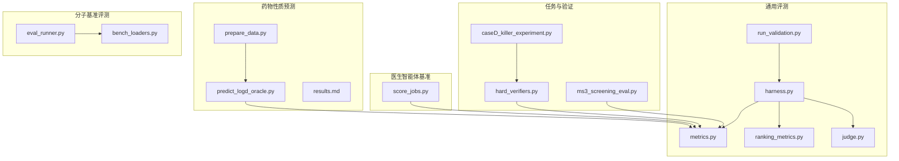
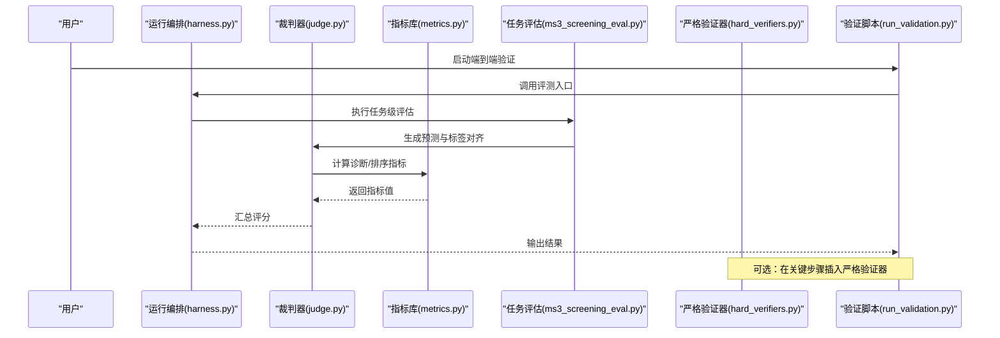
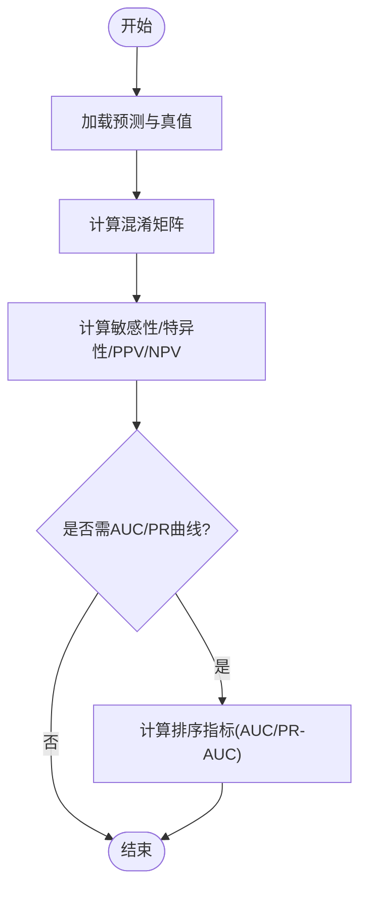
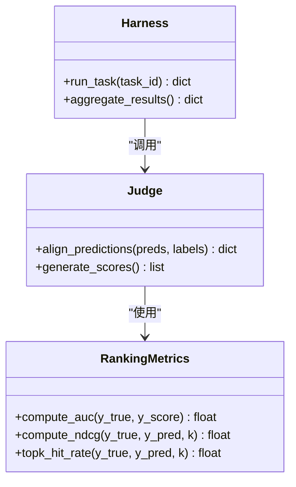
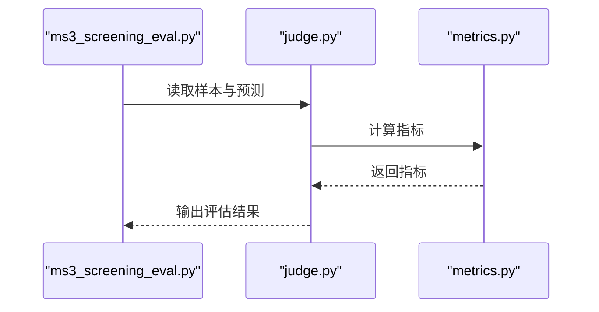
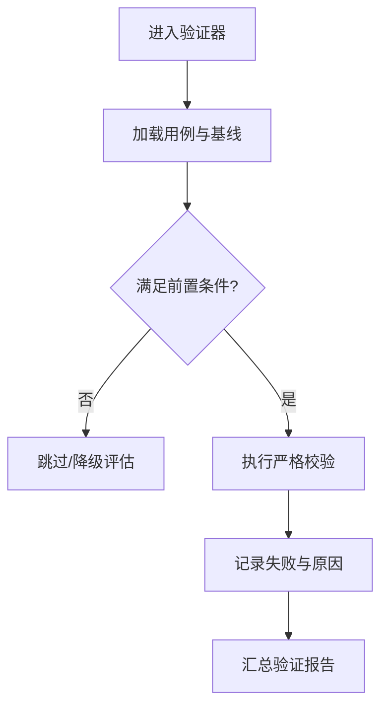
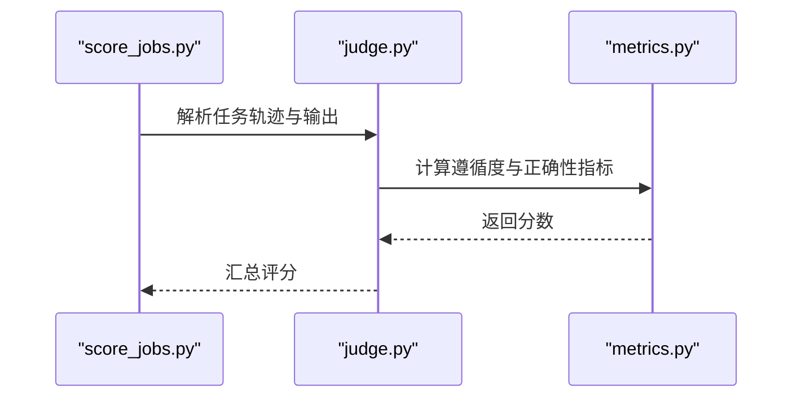
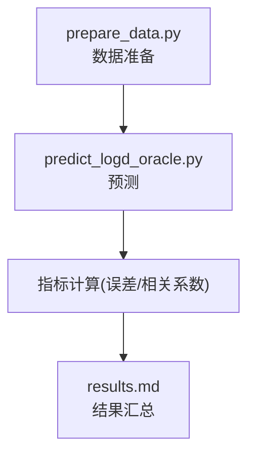
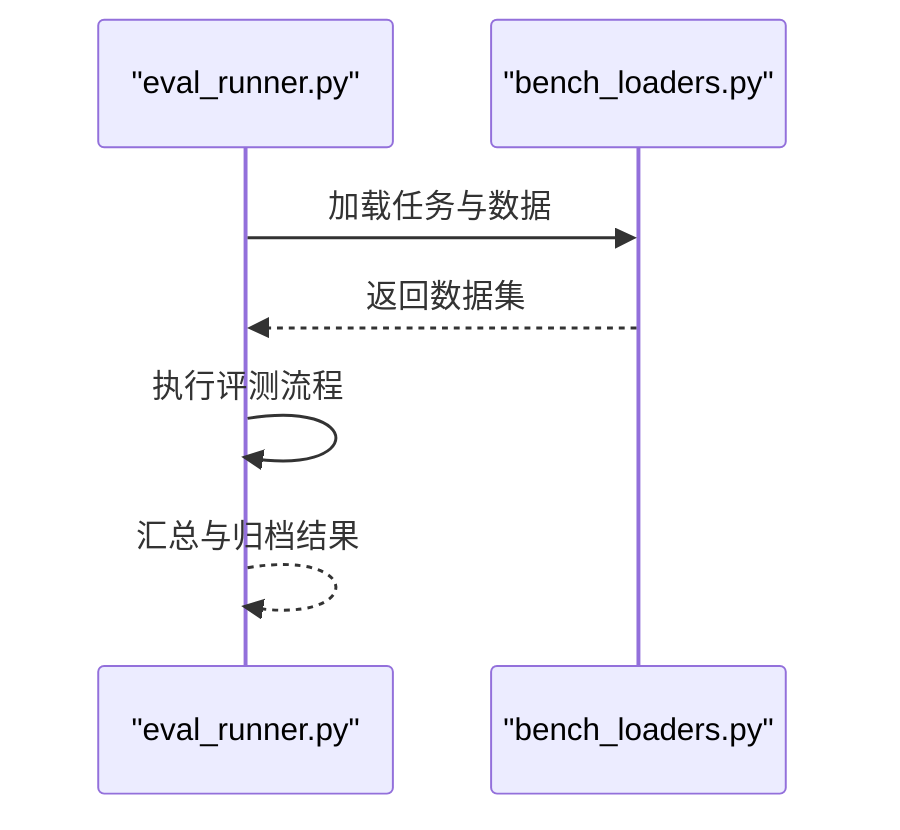
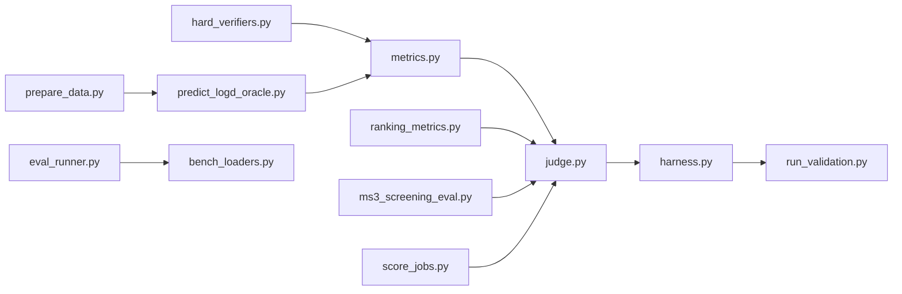

# 临床评估指标与方法论

<cite>
**本文引用的文件**   
- [autonomy_mvp/core/metrics.py](file://autonomy_mvp/core/metrics.py)
- [autonomy_mvp/core/ranking_metrics.py](file://autonomy_mvp/core/ranking_metrics.py)
- [autonomy_mvp/core/judge.py](file://autonomy_mvp/core/judge.py)
- [autonomy_mvp/core/harness.py](file://autonomy_mvp/core/harness.py)
- [autonomy_mvp/run_validation.py](file://autonomy_mvp/run_validation.py)
- [task3/B_ms3_screening_prototype/ms3_screening_eval.py](file://task3/B_ms3_screening_prototype/ms3_screening_eval.py)
- [longhorizon/instantiate/caseD_killer_experiment.py](file://longhorizon/instantiate/caseD_killer_experiment.py)
- [longhorizon/verifiers/hard_verifiers.py](file://longhorizon/verifiers/hard_verifiers.py)
- [task7/poc3_physicianbench/scripts/score_jobs.py](file://task7/poc3_physicianbench/scripts/score_jobs.py)
- [task7/poc4_pharmabench/tools/predict_logd_oracle.py](file://task7/poc4_pharmabench/tools/predict_logd_oracle.py)
- [task7/poc4_pharmabench/data/prepare_data.py](file://task7/poc4_pharmabench/data/prepare_data.py)
- [task7/poc4_pharmabench/results.md](file://task7/poc4_pharmabench/results.md)
- [docs/prd/molbench_repo/eval/eval_runner.py](file://docs/prd/molbench_repo/eval/eval_runner.py)
- [docs/prd/molbench_repo/eval/bench_loaders.py](file://docs/prd/molbench_repo/eval/bench_loaders.py)
</cite>

## 目录
1. [引言](#引言)
2. [项目结构](#项目结构)
3. [核心组件](#核心组件)
4. [架构总览](#架构总览)
5. [详细组件分析](#详细组件分析)
6. [依赖关系分析](#依赖关系分析)
7. [性能与统计考量](#性能与统计考量)
8. [故障排查指南](#故障排查指南)
9. [结论](#结论)
10. [附录](#附录)

## 引言
本文件面向医疗AI系统的临床评估，构建一套可落地的指标与方法论框架。围绕诊断敏感性、特异性、阳性预测值（PPV）、阴性预测值（NPV）等核心指标，结合随机对照试验（RCT）、队列研究与真实世界证据收集方法，形成从数据准备、模型评分到统计推断的完整闭环。同时覆盖药物研发项目的药效学参数、药代动力学指标与安全性评价终点，并给出多中心临床试验的数据整合、Meta分析与系统评价方法，以及临床指南遵循度评估、预后模型验证与质量改进指标的量化路径。

## 项目结构
仓库包含多个与评估相关的子模块：
- 通用评测工具链：指标计算、排序指标、裁判器、运行编排与验证脚本
- 质谱筛选原型评估：针对MS3筛选任务的评估实现
- 长周期案例与验证器：用于复杂场景下的严格验证
- 医生智能体基准：任务评分与结果汇总
- 药物性质预测（logD）：预测工具、数据处理与结果报告
- 分子基准评测：评测运行器与数据集加载器

图表来源
- [autonomy_mvp/core/metrics.py](file://autonomy_mvp/core/metrics.py)
- [autonomy_mvp/core/ranking_metrics.py](file://autonomy_mvp/core/ranking_metrics.py)
- [autonomy_mvp/core/judge.py](file://autonomy_mvp/core/judge.py)
- [autonomy_mvp/core/harness.py](file://autonomy_mvp/core/harness.py)
- [autonomy_mvp/run_validation.py](file://autonomy_mvp/run_validation.py)
- [task3/B_ms3_screening_prototype/ms3_screening_eval.py](file://task3/B_ms3_screening_prototype/ms3_screening_eval.py)
- [longhorizon/verifiers/hard_verifiers.py](file://longhorizon/verifiers/hard_verifiers.py)
- [longhorizon/instantiate/caseD_killer_experiment.py](file://longhorizon/instantiate/caseD_killer_experiment.py)
- [task7/poc3_physicianbench/scripts/score_jobs.py](file://task7/poc3_physicianbench/scripts/score_jobs.py)
- [task7/poc4_pharmabench/tools/predict_logd_oracle.py](file://task7/poc4_pharmabench/tools/predict_logd_oracle.py)
- [task7/poc4_pharmabench/data/prepare_data.py](file://task7/poc4_pharmabench/data/prepare_data.py)
- [docs/prd/molbench_repo/eval/eval_runner.py](file://docs/prd/molbench_repo/eval/eval_runner.py)
- [docs/prd/molbench_repo/eval/bench_loaders.py](file://docs/prd/molbench_repo/eval/bench_loaders.py)

章节来源
- [autonomy_mvp/core/metrics.py](file://autonomy_mvp/core/metrics.py)
- [autonomy_mvp/core/ranking_metrics.py](file://autonomy_mvp/core/ranking_metrics.py)
- [autonomy_mvp/core/judge.py](file://autonomy_mvp/core/judge.py)
- [autonomy_mvp/core/harness.py](file://autonomy_mvp/core/harness.py)
- [autonomy_mvp/run_validation.py](file://autonomy_mvp/run_validation.py)
- [task3/B_ms3_screening_prototype/ms3_screening_eval.py](file://task3/B_ms3_screening_prototype/ms3_screening_eval.py)
- [longhorizon/verifiers/hard_verifiers.py](file://longhorizon/verifiers/hard_verifiers.py)
- [longhorizon/instantiate/caseD_killer_experiment.py](file://longhorizon/instantiate/caseD_killer_experiment.py)
- [task7/poc3_physicianbench/scripts/score_jobs.py](file://task7/poc3_physicianbench/scripts/score_jobs.py)
- [task7/poc4_pharmabench/tools/predict_logd_oracle.py](file://task7/poc4_pharmabench/tools/predict_logd_oracle.py)
- [task7/poc4_pharmabench/data/prepare_data.py](file://task7/poc4_pharmabench/data/prepare_data.py)
- [docs/prd/molbench_repo/eval/eval_runner.py](file://docs/prd/molbench_repo/eval/eval_runner.py)
- [docs/prd/molbench_repo/eval/bench_loaders.py](file://docs/prd/molbench_repo/eval/bench_loaders.py)

## 核心组件
- 指标计算模块：提供二分类与排序类指标的实现，支撑敏感性、特异性、PPV、NPV、AUC等常用评估维度
- 排序指标模块：面向排名型任务（如候选化合物排序）的评估能力
- 裁判器：将模型输出与标准答案进行比对，生成结构化评分
- 运行编排：统一调度评测流程，聚合各任务结果
- 验证脚本：端到端执行验证，输出标准化结果
- 任务特定评估：如MS3筛选评估、严格验证器、医生智能体评分、logD预测与数据处理
- 分子基准评测：评测运行器与数据集加载器，支持大规模基准任务

章节来源
- [autonomy_mvp/core/metrics.py](file://autonomy_mvp/core/metrics.py)
- [autonomy_mvp/core/ranking_metrics.py](file://autonomy_mvp/core/ranking_metrics.py)
- [autonomy_mvp/core/judge.py](file://autonomy_mvp/core/judge.py)
- [autonomy_mvp/core/harness.py](file://autonomy_mvp/core/harness.py)
- [autonomy_mvp/run_validation.py](file://autonomy_mvp/run_validation.py)
- [task3/B_ms3_screening_prototype/ms3_screening_eval.py](file://task3/B_ms3_screening_prototype/ms3_screening_eval.py)
- [longhorizon/verifiers/hard_verifiers.py](file://longhorizon/verifiers/hard_verifiers.py)
- [task7/poc3_physicianbench/scripts/score_jobs.py](file://task7/poc3_physicianbench/scripts/score_jobs.py)
- [task7/poc4_pharmabench/tools/predict_logd_oracle.py](file://task7/poc4_pharmabench/tools/predict_logd_oracle.py)
- [task7/poc4_pharmabench/data/prepare_data.py](file://task7/poc4_pharmabench/data/prepare_data.py)
- [docs/prd/molbench_repo/eval/eval_runner.py](file://docs/prd/molbench_repo/eval/eval_runner.py)
- [docs/prd/molbench_repo/eval/bench_loaders.py](file://docs/prd/molbench_repo/eval/bench_loaders.py)

## 架构总览
整体架构以“指标库+裁判器+运行编排”为核心，向上对接具体任务评估（如MS3筛选、医生智能体、logD预测），向下由基准加载器提供数据输入，最终通过验证脚本输出统一格式的结果。

图表来源
- [autonomy_mvp/core/harness.py](file://autonomy_mvp/core/harness.py)
- [autonomy_mvp/core/judge.py](file://autonomy_mvp/core/judge.py)
- [autonomy_mvp/core/metrics.py](file://autonomy_mvp/core/metrics.py)
- [task3/B_ms3_screening_prototype/ms3_screening_eval.py](file://task3/B_ms3_screening_prototype/ms3_screening_eval.py)
- [longhorizon/verifiers/hard_verifiers.py](file://longhorizon/verifiers/hard_verifiers.py)
- [autonomy_mvp/run_validation.py](file://autonomy_mvp/run_validation.py)

## 详细组件分析

### 诊断性指标与阈值选择
- 目标：基于混淆矩阵计算敏感性、特异性、PPV、NPV，并支持ROC/AUC等排序型指标
- 关键点：阈值策略（固定阈值、Youden指数、成本敏感优化）、类别不平衡处理（加权、重采样）
- 适用场景：筛查与诊断任务（如疾病检测、异常识别）

图表来源
- [autonomy_mvp/core/metrics.py](file://autonomy_mvp/core/metrics.py)
- [autonomy_mvp/core/ranking_metrics.py](file://autonomy_mvp/core/ranking_metrics.py)

章节来源
- [autonomy_mvp/core/metrics.py](file://autonomy_mvp/core/metrics.py)
- [autonomy_mvp/core/ranking_metrics.py](file://autonomy_mvp/core/ranking_metrics.py)

### 排序与召回型评估（候选物筛选）
- 目标：对候选化合物或治疗方案的排序进行评估，关注Top-K命中率、NDCG、AUC等
- 关键点：正样本稀疏时的稳健性、分层抽样与交叉验证
- 适用场景：高通量筛选、虚拟筛选、推荐式决策

图表来源
- [autonomy_mvp/core/ranking_metrics.py](file://autonomy_mvp/core/ranking_metrics.py)
- [autonomy_mvp/core/judge.py](file://autonomy_mvp/core/judge.py)
- [autonomy_mvp/core/harness.py](file://autonomy_mvp/core/harness.py)

章节来源
- [autonomy_mvp/core/ranking_metrics.py](file://autonomy_mvp/core/ranking_metrics.py)
- [autonomy_mvp/core/judge.py](file://autonomy_mvp/core/judge.py)
- [autonomy_mvp/core/harness.py](file://autonomy_mvp/core/harness.py)

### 任务特定评估：MS3筛选
- 目标：针对质谱筛选任务的专用评估流程，包括数据预处理、预测对齐与指标计算
- 关键点：批次一致性、缺失值处理、阈值校准
- 适用场景：药物发现早期筛选、表型筛选

图表来源
- [task3/B_ms3_screening_prototype/ms3_screening_eval.py](file://task3/B_ms3_screening_prototype/ms3_screening_eval.py)
- [autonomy_mvp/core/judge.py](file://autonomy_mvp/core/judge.py)
- [autonomy_mvp/core/metrics.py](file://autonomy_mvp/core/metrics.py)

章节来源
- [task3/B_ms3_screening_prototype/ms3_screening_eval.py](file://task3/B_ms3_screening_prototype/ms3_screening_eval.py)
- [autonomy_mvp/core/judge.py](file://autonomy_mvp/core/judge.py)
- [autonomy_mvp/core/metrics.py](file://autonomy_mvp/core/metrics.py)

### 严格验证器与长周期案例
- 目标：在复杂场景中引入强约束验证，确保评估结果的可靠性与可复现性
- 关键点：边界条件检查、反例注入、鲁棒性测试
- 适用场景：高风险决策、闭环优化、机理模拟

图表来源
- [longhorizon/verifiers/hard_verifiers.py](file://longhorizon/verifiers/hard_verifiers.py)
- [longhorizon/instantiate/caseD_killer_experiment.py](file://longhorizon/instantiate/caseD_killer_experiment.py)

章节来源
- [longhorizon/verifiers/hard_verifiers.py](file://longhorizon/verifiers/hard_verifiers.py)
- [longhorizon/instantiate/caseD_killer_experiment.py](file://longhorizon/instantiate/caseD_killer_experiment.py)

### 医生智能体基准评分
- 目标：对医生智能体的任务完成度进行评分，涵盖诊断建议、处方合理性、指南遵循度等
- 关键点：评分量表设计、专家一致性、自动化评分规则
- 适用场景：临床决策支持系统评估、教学与培训

图表来源
- [task7/poc3_physicianbench/scripts/score_jobs.py](file://task7/poc3_physicianbench/scripts/score_jobs.py)
- [autonomy_mvp/core/judge.py](file://autonomy_mvp/core/judge.py)
- [autonomy_mvp/core/metrics.py](file://autonomy_mvp/core/metrics.py)

章节来源
- [task7/poc3_physicianbench/scripts/score_jobs.py](file://task7/poc3_physicianbench/scripts/score_jobs.py)
- [autonomy_mvp/core/judge.py](file://autonomy_mvp/core/judge.py)
- [autonomy_mvp/core/metrics.py](file://autonomy_mvp/core/metrics.py)

### 药物性质预测：logD
- 目标：预测化合物的logD（分配系数），评估回归误差与相关性
- 关键点：数据清洗、特征工程、外部验证集、置信区间估计
- 适用场景：ADMET初筛、构效关系研究

图表来源
- [task7/poc4_pharmabench/data/prepare_data.py](file://task7/poc4_pharmabench/data/prepare_data.py)
- [task7/poc4_pharmabench/tools/predict_logd_oracle.py](file://task7/poc4_pharmabench/tools/predict_logd_oracle.py)
- [task7/poc4_pharmabench/results.md](file://task7/poc4_pharmabench/results.md)

章节来源
- [task7/poc4_pharmabench/data/prepare_data.py](file://task7/poc4_pharmabench/data/prepare_data.py)
- [task7/poc4_pharmabench/tools/predict_logd_oracle.py](file://task7/poc4_pharmabench/tools/predict_logd_oracle.py)
- [task7/poc4_pharmabench/results.md](file://task7/poc4_pharmabench/results.md)

### 分子基准评测运行器
- 目标：统一加载基准数据集并执行评测，输出标准化结果
- 关键点：多任务并行、配置驱动、结果归档
- 适用场景：大规模基准评测、跨任务对比

图表来源
- [docs/prd/molbench_repo/eval/eval_runner.py](file://docs/prd/molbench_repo/eval/eval_runner.py)
- [docs/prd/molbench_repo/eval/bench_loaders.py](file://docs/prd/molbench_repo/eval/bench_loaders.py)

章节来源
- [docs/prd/molbench_repo/eval/eval_runner.py](file://docs/prd/molbench_repo/eval/eval_runner.py)
- [docs/prd/molbench_repo/eval/bench_loaders.py](file://docs/prd/molbench_repo/eval/bench_loaders.py)

## 依赖关系分析
- 低耦合高内聚：指标库独立于任务逻辑，裁判器负责对齐与打分，运行编排负责调度
- 外部依赖最小化：主要依赖数值计算与基础数据结构，便于移植与扩展
- 潜在循环依赖：应避免在指标库中直接引用任务特定逻辑，保持单向依赖

图表来源
- [autonomy_mvp/core/metrics.py](file://autonomy_mvp/core/metrics.py)
- [autonomy_mvp/core/ranking_metrics.py](file://autonomy_mvp/core/ranking_metrics.py)
- [autonomy_mvp/core/judge.py](file://autonomy_mvp/core/judge.py)
- [autonomy_mvp/core/harness.py](file://autonomy_mvp/core/harness.py)
- [autonomy_mvp/run_validation.py](file://autonomy_mvp/run_validation.py)
- [task3/B_ms3_screening_prototype/ms3_screening_eval.py](file://task3/B_ms3_screening_prototype/ms3_screening_eval.py)
- [longhorizon/verifiers/hard_verifiers.py](file://longhorizon/verifiers/hard_verifiers.py)
- [task7/poc3_physicianbench/scripts/score_jobs.py](file://task7/poc3_physicianbench/scripts/score_jobs.py)
- [task7/poc4_pharmabench/tools/predict_logd_oracle.py](file://task7/poc4_pharmabench/tools/predict_logd_oracle.py)
- [task7/poc4_pharmabench/data/prepare_data.py](file://task7/poc4_pharmabench/data/prepare_data.py)
- [docs/prd/molbench_repo/eval/eval_runner.py](file://docs/prd/molbench_repo/eval/eval_runner.py)
- [docs/prd/molbench_repo/eval/bench_loaders.py](file://docs/prd/molbench_repo/eval/bench_loaders.py)

章节来源
- [autonomy_mvp/core/metrics.py](file://autonomy_mvp/core/metrics.py)
- [autonomy_mvp/core/ranking_metrics.py](file://autonomy_mvp/core/ranking_metrics.py)
- [autonomy_mvp/core/judge.py](file://autonomy_mvp/core/judge.py)
- [autonomy_mvp/core/harness.py](file://autonomy_mvp/core/harness.py)
- [autonomy_mvp/run_validation.py](file://autonomy_mvp/run_validation.py)
- [task3/B_ms3_screening_prototype/ms3_screening_eval.py](file://task3/B_ms3_screening_prototype/ms3_screening_eval.py)
- [longhorizon/verifiers/hard_verifiers.py](file://longhorizon/verifiers/hard_verifiers.py)
- [task7/poc3_physicianbench/scripts/score_jobs.py](file://task7/poc3_physicianbench/scripts/score_jobs.py)
- [task7/poc4_pharmabench/tools/predict_logd_oracle.py](file://task7/poc4_pharmabench/tools/predict_logd_oracle.py)
- [task7/poc4_pharmabench/data/prepare_data.py](file://task7/poc4_pharmabench/data/prepare_data.py)
- [docs/prd/molbench_repo/eval/eval_runner.py](file://docs/prd/molbench_repo/eval/eval_runner.py)
- [docs/prd/molbench_repo/eval/bench_loaders.py](file://docs/prd/molbench_repo/eval/bench_loaders.py)

## 性能与统计考量
- 诊断性指标
  - 敏感性/特异性：受患病率影响较小，适合筛查场景；注意阈值选择与代价函数
  - PPV/NPV：受患病率影响显著，需在目标人群上评估
  - AUC/PR-AUC：排序型指标，适用于类别不平衡
- 置信区间与假设检验
  - DeLong法用于AUC比较；Bootstrap用于PPV/NPV与回归误差的置信区间
  - 配对检验（McNemar）用于分类模型对比；t检验/Wilcoxon用于连续指标
- 多中心与Meta分析
  - 分层抽样与随机效应模型；异质性检验（I²）；发表偏倚评估（漏斗图）
- 临床指南遵循度
  - 定义遵循条目清单；采用Kappa一致性；按指南版本更新维护
- 预后模型验证
  - 区分度（C-index/AUC）、校准度（Hosmer-Lemeshow/校准曲线）、临床效用（DCA）
- 质量改进指标
  - 过程指标（等待时间、依从率）、结果指标（再入院率、并发症率）、结构指标（设备/人员配置）

[本节为通用指导，不直接分析具体文件]

## 故障排查指南
- 指标计算异常
  - 检查预测与真值的对齐方式与标签编码
  - 确认阈值策略与类别权重设置
- 排序指标不稳定
  - 增加重复实验次数与交叉验证
  - 检查Top-K截断与缺失值处理
- 任务评估失败
  - 核对输入数据格式与字段映射
  - 查看裁判器日志与错误堆栈
- 严格验证器报错
  - 检查前置条件与边界用例
  - 定位失败分支并补充容错逻辑
- 医生智能体评分不一致
  - 统一评分量表与标注规范
  - 进行标注者间一致性检验
- logD预测问题
  - 核查数据清洗与特征有效性
  - 验证外部验证集分布偏移

章节来源
- [autonomy_mvp/core/judge.py](file://autonomy_mvp/core/judge.py)
- [autonomy_mvp/core/metrics.py](file://autonomy_mvp/core/metrics.py)
- [task3/B_ms3_screening_prototype/ms3_screening_eval.py](file://task3/B_ms3_screening_prototype/ms3_screening_eval.py)
- [longhorizon/verifiers/hard_verifiers.py](file://longhorizon/verifiers/hard_verifiers.py)
- [task7/poc3_physicianbench/scripts/score_jobs.py](file://task7/poc3_physicianbench/scripts/score_jobs.py)
- [task7/poc4_pharmabench/tools/predict_logd_oracle.py](file://task7/poc4_pharmabench/tools/predict_logd_oracle.py)

## 结论
本框架以模块化指标库与裁判器为核心，结合运行编排与任务特定评估，形成从数据到指标的完整链路。通过严格的验证器与统一的评测运行器，保障评估的可复现性与可扩展性。在方法论层面，强调诊断性指标、排序型指标、置信区间与假设检验的综合应用，并覆盖多中心数据整合、Meta分析与系统评价，以及指南遵循度、预后模型验证与质量改进指标的量化路径。

[本节为总结性内容，不直接分析具体文件]

## 附录
- 术语表
  - 敏感性：真阳性率；特异性：真阴性率；PPV：阳性预测值；NPV：阴性预测值
  - AUC：曲线下面积；PR-AUC：精确率-召回率曲线下面积
  - C-index：一致性指数；DCA：决策曲线分析
- 最佳实践
  - 明确评估目标与人群，选择合适的阈值与指标组合
  - 使用外部验证集与跨中心数据进行泛化性评估
  - 报告置信区间与不确定性，避免过度解读点估计
  - 建立版本化的评分量表与数据字典，保证长期可比性

[本节为补充信息，不直接分析具体文件]