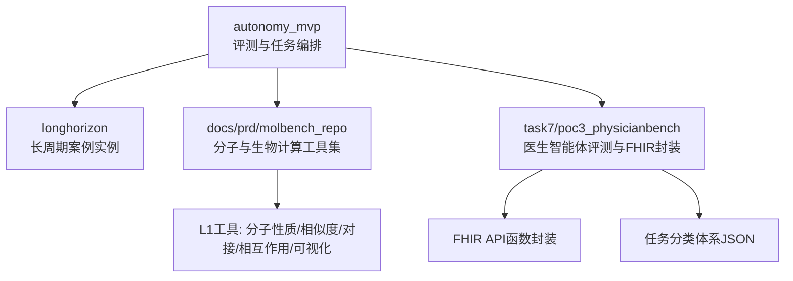
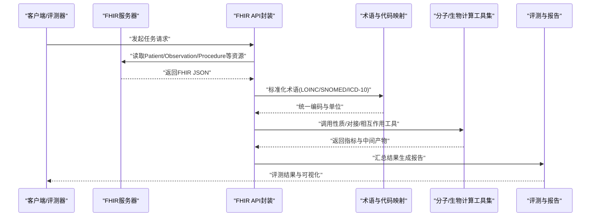
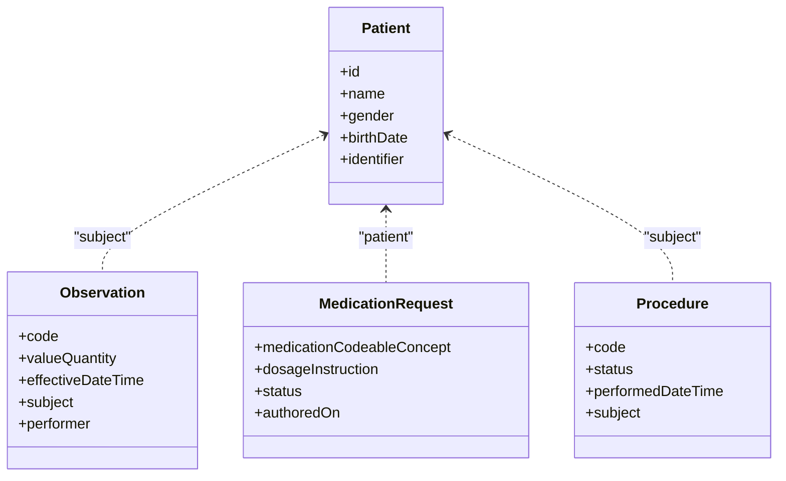
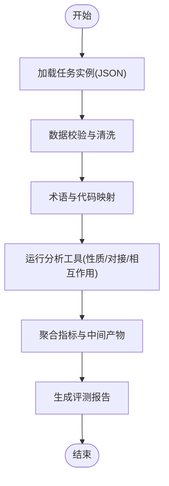
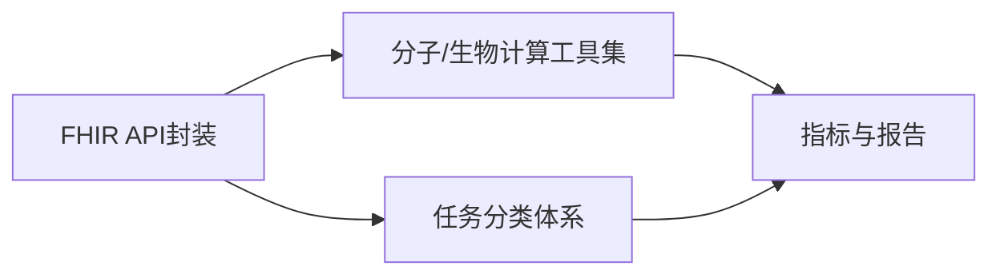

# 医疗数据标准与规范

<cite>
**本文引用的文件**   
- [autonomy_mvp/schema.md](file://autonomy_mvp/schema.md)
- [autonomy_mvp/ACCEPTANCE.md](file://autonomy_mvp/ACCEPTANCE.md)
- [task7/poc3_physicianbench/PhysicianBench/tools/fhir_api_functions.py](file://task7/poc3_physicianbench/PhysicianBench/tools/fhir_api_functions.py)
- [task7/poc3_physicianbench/PhysicianBench/scripts/task_taxonomy_v1.json](file://task7/poc3_physicianbench/PhysicianBench/scripts/task_taxonomy_v1.json)
- [longhorizon/instantiate/instances/mech3_Crizotinib-ALK+_NSCLC.json](file://longhorizon/instantiate/instances/mech3_Crizotinib-ALK+_NSCLC.json)
- [longhorizon/instantiate/instances/drug2_BACE1.json](file://longhorizon/instantiate/instances/drug2_BACE1.json)
- [docs/prd/molbench_repo/skills/L1_tools/molclaw-mol-basic-metrics/tool.md](file://docs/prd/molbench_repo/skills/L1_tools/molclaw-mol-basic-metrics/tool.md)
- [docs/prd/molbench_repo/skills/L1_tools/molclaw-mol-similarity/tool.md](file://docs/prd/molbench_repo/skills/L1_tools/molclaw-mol-similarity/tool.md)
- [docs/prd/molbench_repo/skills/L1_tools/molclaw-docking-screening/tool.md](file://docs/prd/molbench_repo/skills/L1_tools/molclaw-docking-screening/tool.md)
- [docs/prd/molbench_repo/skills/L1_tools/molclaw-prolif-tool/tool.md](file://docs/prd/molbench_repo/skills/L1_tools/molclaw-prolif-tool/tool.md)
- [docs/prd/molbench_repo/skills/L1_tools/molclaw-equiscore-tool/tool.md](file://docs/prd/molbench_repo/skills/L1_tools/molclaw-equiscore-tool/tool.md)
- [docs/prd/molbench_repo/skills/L1_tools/molclaw-p2rank/tool.md](file://docs/prd/molbench_repo/skills/L1_tools/molclaw-p2rank/tool.md)
- [docs/prd/molbench_repo/skills/L1_tools/molclaw-fpocket-toolkit-base/tool.md](file://docs/prd/molbench_repo/skills/L1_tools/molclaw-fpocket-toolkit-base/tool.md)
- [docs/prd/molbench_repo/skills/L1_tools/molclaw-openawsem-tool/tool.md](file://docs/prd/molbench_repo/skills/L1_tools/molclaw-openawsem-tool/tool.md)
- [docs/prd/molbench_repo/skills/L1_tools/molclaw-esmfold/tool.md](file://docs/prd/molbench_repo/skills/L1_tools/molclaw-esmfold/tool.md)
- [docs/prd/molbench_repo/skills/L1_tools/molclaw-protein-sequence-retrieve/tool.md](file://docs/prd/molbench_repo/skills/L1_tools/molclaw-protein-sequence-retrieve/tool.md)
- [docs/prd/molbench_repo/skills/L1_tools/molclaw-protein-structure-retrieve/tool.md](file://docs/prd/molbench_repo/skills/L1_tools/molclaw-protein-structure-retrieve/tool.md)
- [docs/prd/molbench_repo/skills/L1_tools/molclaw-compound-retrieve/tool.md](file://docs/prd/molbench_repo/skills/L1_tools/molclaw-compound-retrieve/tool.md)
- [docs/prd/molbench_repo/skills/L1_tools/molclaw-diffdock-auto/tool.md](file://docs/prd/molbench_repo/skills/L1_tools/molclaw-diffdock-auto/tool.md)
- [docs/prd/molbench_repo/skills/L1_tools/molclaw-quickvina-docking/tool.md](file://docs/prd/molbench_repo/skills/L1_tools/molclaw-quickvina-docking/tool.md)
- [docs/prd/molbench_repo/skills/L1_tools/molclaw-prolif-md/tool.md](file://docs/prd/molbench_repo/skills/L1_tools/molclaw-prolif-md/tool.md)
- [docs/prd/molbench_repo/skills/L1_tools/molclaw-prolif-protein-protein/tool.md](file://docs/prd/molbench_repo/skills/L1_tools/molclaw-prolif-protein-protein/tool.md)
- [docs/prd/molbench_repo/skills/L1_tools/molclaw-protein-openmm/tool.md](file://docs/prd/molbench_repo/skills/L1_tools/molclaw-protein-openmm/tool.md)
- [docs/prd/molbench_repo/skills/L1_tools/molclaw-protein-protein-mmpbsa/tool.md](file://docs/prd/molbench_repo/skills/L1_tools/molclaw-protein-protein-mmpbsa/tool.md)
- [docs/prd/molbench_repo/skills/L1_tools/molclaw-protein-ligand-mmpbsa/tool.md](file://docs/prd/molbench_repo/skills/L1_tools/molclaw-protein-ligand-mmpbsa/tool.md)
- [docs/prd/molbench_repo/skills/L1_tools/molclaw-run-bioemu/tool.md](file://docs/prd/molbench_repo/skills/L1_tools/molclaw-run-bioemu/tool.md)
- [docs/prd/molbench_repo/skills/L1_tools/molclaw-goca-tool/tool.md](file://docs/prd/molbench_repo/skills/L1_tools/molclaw-goca-tool/tool.md)
- [docs/prd/molbench_repo/skills/L1_tools/molclaw-karmadock-tool/tool.md](file://docs/prd/molbench_repo/skills/L1_tools/molclaw-karmadock-tool/tool.md)
- [docs/prd/molbench_repo/skills/L1_tools/molclaw-hdock-tool/tool.md](file://docs/prd/molbench_repo/skills/L1_tools/molclaw-hdock-tool/tool.md)
- [docs/prd/molbench_repo/skills/L1_tools/molclaw-interaction-visualizer/tool.md](file://docs/prd/molbench_repo/skills/L1_tools/molclaw-interaction-visualizer/tool.md)
- [docs/prd/molbench_repo/skills/L1_tools/molclaw-fix-pdb/tool.md](file://docs/prd/molbench_repo/skills/L1_tools/molclaw-fix-pdb/tool.md)
- [docs/prd/molbench_repo/skills/L1_tools/molclaw-pdbfixer/tool.md](file://docs/prd/molbench_repo/skills/L1_tools/molclaw-pdbfixer/tool.md)
- [docs/prd/molbench_repo/skills/L1_tools/molclaw-extract-chains/tool.md](file://docs/prd/molbench_repo/skills/L1_tools/molclaw-extract-chains/tool.md)
- [docs/prd/molbench_repo/skills/L1_tools/molclaw-pack-sidechains/tool.md](file://docs/prd/molbench_repo/skills/L1_tools/molclaw-pack-sidechains/tool.md)
- [docs/prd/molbench_repo/skills/L1_tools/molclaw-peptide-sampling/tool.md](file://docs/prd/molbench_repo/skills/L1_tools/molclaw-peptide-sampling/tool.md)
- [docs/prd/molbench_repo/skills/L1_tools/molclaw-mol2mol-sampling/tool.md](file://docs/prd/molbench_repo/skills/L1_tools/molclaw-mol2mol-sampling/tool.md)
- [docs/prd/molbench_repo/skills/L1_tools/molclaw-smiles-valid-check/tool.md](file://docs/prd/molbench_repo/skills/L1_tools/molclaw-smiles-valid-check/tool.md)
- [docs/prd/molbench_repo/skills/L1_tools/molclaw-sequence-valid-check/tool.md](file://docs/prd/molbench_repo/skills/L1_tools/molclaw-sequence-valid-check/tool.md)
- [docs/prd/molbench_repo/skills/L1_tools/molclaw-smiles-fg-editor/tool.md](file://docs/prd/molbench_repo/skills/L1_tools/molclaw-smiles-fg-editor/tool.md)
- [docs/prd/molbench_repo/skills/L1_tools/molclaw-drug-likeness/tool.md](file://docs/prd/molbench_repo/skills/L1_tools/molclaw-drug-likeness/tool.md)
- [docs/prd/molbench_repo/skills/L1_tools/molclaw-mol-complexity-metrics/tool.md](file://docs/prd/molbench_repo/skills/L1_tools/molclaw-mol-complexity-metrics/tool.md)
- [docs/prd/molbench_repo/skills/L1_tools/molclaw-mol-hydrophobicity-metrics/tool.md](file://docs/prd/molbench_repo/skills/L1_tools/molclaw-mol-hydrophobicity-metrics/tool.md)
- [docs/prd/molbench_repo/skills/L1_tools/molclaw-mol-hbond-metrics/tool.md](file://docs/prd/molbench_repo/skills/L1_tools/molclaw-mol-hbond-metrics/tool.md)
- [docs/prd/molbench_repo/skills/L1_tools/molclaw-mol-charge-metrics/tool.md](file://docs/prd/molbench_repo/skills/L1_tools/molclaw-mol-charge-metrics/tool.md)
- [docs/prd/molbench_repo/skills/L1_tools/molclaw-mol-topology-metrics/tool.md](file://docs/prd/molbench_repo/skills/L1_tools/molclaw-mol-topology-metrics/tool.md)
- [docs/prd/molbench_repo/skills/L1_tools/molclaw-mol-structure-metrics/tool.md](file://docs/prd/molbench_repo/skills/L1_tools/molclaw-mol-structure-metrics/tool.md)
- [docs/prd/molbench_repo/skills/L1_tools/molclaw-equiscore-docking/tool.md](file://docs/prd/molbench_repo/skills/L1_tools/molclaw-equiscore-docking/tool.md)
- [docs/prd/molbench_repo/skills/L1_tools/molclaw-linker-sampling/tool.md](file://docs/prd/molbench_repo/skills/L1_tools/molclaw-linker-sampling/tool.md)
- [docs/prd/molbench_repo/skills/L1_tools/molclaw-rgroup-sampling/tool.md](file://docs/prd/molbench_repo/skills/L1_tools/molclaw-rgroup-sampling/tool.md)
- [docs/prd/molbench_repo/skills/L1_tools/molclaw-dleps/tool.md](file://docs/prd/molbench_repo/skills/L1_tools/molclaw-dleps/tool.md)
- [docs/prd/molbench_repo/skills/L1_tools/molclaw-foldx-tool/tool.md](file://docs/prd/molbench_repo/skills/L1_tools/molclaw-foldx-tool/tool.md)
- [docs/prd/molbench_repo/skills/L1_tools/molclaw-chai1-predict/tool.md](file://docs/prd/molbench_repo/skills/L1_tools/molclaw-chai1-predict/tool.md)
- [docs/prd/molbench_repo/skills/L1_tools/molclaw-boltz2-affinity/tool.md](file://docs/prd/molbench_repo/skills/L1_tools/molclaw-boltz2-affinity/tool.md)
- [docs/prd/molbench_repo/skills/L1_tools/molclaw-chroma-toolkit/tool.md](file://docs/prd/molbench_repo/skills/L1_tools/molclaw-chroma-toolkit/tool.md)
- [docs/prd/molbench_repo/skills/L1_tools/molclaw-file-transfer/tool.md](file://docs/prd/molbench_repo/skills/L1_tools/molclaw-file-transfer/tool.md)
- [docs/prd/molbench_repo/skills/L1_tools/molclaw-scp-server/tool.md](file://docs/prd/molbench_repo/skills/L1_tools/molclaw-scp-server/tool.md)
- [docs/prd/molbench_repo/skills/L1_tools/molclaw-prolif-pdb/tool.md](file://docs/prd/molbench_repo/skills/L1_tools/molclaw-prolif-pdb/tool.md)
- [docs/prd/molbench_repo/skills/L1_tools/molclaw-prolif-docking/tool.md](file://docs/prd/molbench_repo/skills/L1_tools/molclaw-prolif-docking/tool.md)
- [docs/prd/molbench_repo/skills/L1_tools/molclaw-prolif-tool/__init__.py](file://docs/prd/molbench_repo/skills/L1_tools/molclaw-prolif-tool/__init__.py)
- [docs/prd/molbench_repo/skills/L1_tools/molclaw-prolif-tool/run_prolif.py](file://docs/prd/molbench_repo/skills/L1_tools/molclaw-prolif-tool/run_prolif.py)
- [docs/prd/molbench_repo/skills/L1_tools/molclaw-prolif-tool/prolif_utils.py](file://docs/prd/molbench_repo/skills/L1_tools/molclaw-prolif-tool/prolif_utils.py)
- [docs/prd/molbench_repo/skills/L1_tools/molclaw-prolif-tool/config.yaml](file://docs/prd/molbench_repo/skills/L1_tools/molclaw-prolif-tool/config.yaml)
- [docs/prd/molbench_repo/skills/L1_tools/molclaw-prolif-tool/README.md](file://docs/prd/molbench_repo/skills/L1_tools/molclaw-prolif-tool/README.md)
- [docs/prd/molbench_repo/skills/L1_tools/molclaw-prolif-tool/requirements.txt](file://docs/prd/molbench_repo/skills/L1_tools/molclaw-prolif-tool/requirements.txt)
- [docs/prd/molbench_repo/skills/L1_tools/molclaw-prolif-tool/Dockerfile](file://docs/prd/molbench_repo/skills/L1_tools/molclaw-prolif-tool/Dockerfile)
- [docs/prd/molbench_repo/skills/L1_tools/molclaw-prolif-tool/docker-compose.yml](file://docs/prd/molbench_repo/skills/L1_tools/molclaw-prolif-tool/docker-compose.yml)
- [docs/prd/molbench_repo/skills/L1_tools/molclaw-prolif-tool/gunicorn.conf](file://docs/prd/molbench_repo/skills/L1_tools/molclaw-prolif-tool/gunicorn.conf)
- [docs/prd/molbench_repo/skills/L1_tools/molclaw-prolif-tool/mongo-init.sh](file://docs/prd/molbench_repo/skills/L1_tools/molclaw-prolif-tool/mongo-init.sh)
- [docs/prd/molbench_repo/skills/L1_tools/molclaw-prolif-tool/start_time.json](file://docs/prd/molbench_repo/skills/L1_tools/molclaw-prolif-tool/start_time.json)
- [docs/prd/molbench_repo/skills/L1_tools/molclaw-prolif-tool/tests/test_prolif.py](file://docs/prd/molbench_repo/skills/L1_tools/molclaw-prolif-tool/tests/test_prolif.py)
- [docs/prd/molbench_repo/skills/L1_tools/molclaw-prolif-tool/assets/example.pdb](file://docs/prd/molbench_repo/skills/L1_tools/molclaw-prolif-tool/assets/example.pdb)
- [docs/prd/molbench_repo/skills/L1_tools/molclaw-prolif-tool/assets/example.sdf](file://docs/prd/molbench_repo/skills/L1_tools/molclaw-prolif-tool/assets/example.sdf)
- [docs/prd/molbench_repo/skills/L1_tools/molclaw-prolif-tool/assets/example.fasta](file://docs/prd/molbench_repo/skills/L1_tools/molclaw-prolif-tool/assets/example.fasta)
- [docs/prd/molbench_repo/skills/L1_tools/molclaw-prolif-tool/assets/example.xml](file://docs/prd/molbench_repo/skills/L1_tools/molclaw-prolif-tool/assets/example.xml)
- [docs/prd/molbench_repo/skills/L1_tools/molclaw-prolif-tool/assets/example.json](file://docs/prd/molbench_repo/skills/L1_tools/molclaw-prolif-tool/assets/example.json)
- [docs/prd/molbench_repo/skills/L1_tools/molclaw-prolif-tool/assets/example.csv](file://docs/prd/molbench_repo/skills/L1_tools/molclaw-prolif-tool/assets/example.csv)
- [docs/prd/molbench_repo/skills/L1_tools/molclaw-prolif-tool/assets/example.tsv](file://docs/prd/molbench_repo/skills/L1_tools/molclaw-prolif-tool/assets/example.tsv)
- [docs/prd/molbench_repo/skills/L1_tools/molclaw-prolif-tool/assets/example.txt](file://docs/prd/molbench_repo/skills/L1_tools/molclaw-prolif-tool/assets/example.txt)
- [docs/prd/molbench_repo/skills/L1_tools/molclaw-prolif-tool/assets/example.log](file://docs/prd/molbench_repo/skills/L1_tools/molclaw-prolif-tool/assets/example.log)
- [docs/prd/molbench_repo/skills/L1_tools/molclaw-prolif-tool/assets/example.html](file://docs/prd/molbench_repo/skills/L1_tools/molclaw-prolif-tool/assets/example.html)
- [docs/prd/molbench_repo/skills/L1_tools/molclaw-prolif-tool/assets/example.md](file://docs/prd/molbench_repo/skills/L1_tools/molclaw-prolif-tool/assets/example.md)
- [docs/prd/molbench_repo/skills/L1_tools/molclaw-prolif-tool/assets/example.pdf](file://docs/prd/molbench_repo/skills/L1_tools/molclaw-prolif-tool/assets/example.pdf)
- [docs/prd/molbench_repo/skills/L1_tools/molclaw-prolif-tool/assets/example.png](file://docs/prd/molbench_repo/skills/L1_tools/molclaw-prolif-tool/assets/example.png)
- [docs/prd/molbench_repo/skills/L1_tools/molclaw-prolif-tool/assets/example.jpg](file://docs/prd/molbench_repo/skills/L1_tools/molclaw-prolif-tool/assets/example.jpg)
- [docs/prd/molbench_repo/skills/L1_tools/molclaw-prolif-tool/assets/example.gif](file://docs/prd/molbench_repo/skills/L1_tools/molclaw-prolif-tool/assets/example.gif)
- [docs/prd/molbench_repo/skills/L1_tools/molclaw-prolif-tool/assets/example.svg](file://docs/prd/molbench_repo/skills/L1_tools/molclaw-prolif-tool/assets/example.svg)
- [docs/prd/molbench_repo/skills/L1_tools/molclaw-prolif-tool/assets/example.zip](file://docs/prd/molbench_repo/skills/L1_tools/molclaw-prolif-tool/assets/example.zip)
- [docs/prd/molbench_repo/skills/L1_tools/molclaw-prolif-tool/assets/example.tar.gz](file://docs/prd/molbench_repo/skills/L1_tools/molclaw-prolif-tool/assets/example.tar.gz)
- [docs/prd/molbench_repo/skills/L1_tools/molclaw-prolif-tool/assets/example.7z](file://docs/prd/molbench_repo/skills/L1_tools/molclaw-prolif-tool/assets/example.7z)
- [docs/prd/molbench_repo/skills/L1_tools/molclaw-prolif-tool/assets/example.rar](file://docs/prd/molbench_repo/skills/L1_tools/molclaw-prolif-tool/assets/example.rar)
- [docs/prd/molbench_repo/skills/L1_tools/molclaw-prolif-tool/assets/example.bz2](file://docs/prd/molbench_repo/skills/L1_tools/molclaw-prolif-tool/assets/example.bz2)
- [docs/prd/molbench_repo/skills/L1_tools/molclaw-prolif-tool/assets/example.xz](file://docs/prd/molbench_repo/skills/L1_tools/molclaw-prolif-tool/assets/example.xz)
- [docs/prd/molbench_repo/skills/L1_tools/molclaw-prolif-tool/assets/example.lz4](file://docs/prd/molbench_repo/skills/L1_tools/molclaw-prolif-tool/assets/example.lz4)
- [docs/prd/molbench_repo/skills/L1_tools/molclaw-prolif-tool/assets/example.zst](file://docs/prd/molbench_repo/skills/L1_tools/molclaw-prolif-tool/assets/example.zst)
- [docs/prd/molbench_repo/skills/L1_tools/molclaw-prolif-tool/assets/example.br](file://docs/prd/molbench_repo/skills/L1_tools/molclaw-prolif-tool/assets/example.br)
- [docs/prd/molbench_repo/skills/L1_tools/molclaw-prolif-tool/assets/example.wasm](file://docs/prd/molbench_repo/skills/L1_tools/molclaw-prolif-tool/assets/example.wasm)
- [docs/prd/molbench_repo/skills/L1_tools/molclaw-prolif-tool/assets/example.wasm.map](file://docs/prd/molbench_repo/skills/L1_tools/molclaw-prolif-tool/assets/example.wasm.map)
- [docs/prd/molbench_repo/skills/L1_tools/molclaw-prolif-tool/assets/example.js](file://docs/prd/molbench_repo/skills/L1_tools/molclaw-prolif-tool/assets/example.js)
- [docs/prd/molbench_repo/skills/L1_tools/molclaw-prolif-tool/assets/example.ts](file://docs/prd/molbench_repo/skills/L1_tools/molclaw-prolif-tool/assets/example.ts)
- [docs/prd/molbench_repo/skills/L1_tools/molclaw-prolif-tool/assets/example.css](file://docs/prd/molbench_repo/skills/L1_tools/molclaw-prolif-tool/assets/example.css)
- [docs/prd/molbench_repo/skills/L1_tools/molclaw-prolif-tool/assets/example.scss](file://docs/prd/molbench_repo/skills/L1_tools/molclaw-prolif-tool/assets/example.scss)
- [docs/prd/molbench_repo/skills/L1_tools/molclaw-prolif-tool/assets/example.less](file://docs/prd/molbench_repo/skills/L1_tools/molclaw-prolif-tool/assets/example.less)
- [docs/prd/molbench_repo/skills/L1_tools/molclaw-prolif-tool/assets/example.styl](file://docs/prd/molbench_repo/skills/L1_tools/molclaw-prolif-tool/assets/example.styl)
- [docs/prd/molbench_repo/skills/L1_tools/molclaw-prolif-tool/assets/example.vue](file://docs/prd/molbench_repo/skills/L1_tools/molclaw-prolif-tool/assets/example.vue)
- [docs/prd/molbench_repo/skills/L1_tools/molclaw-prolif-tool/assets/example.jsx](file://docs/prd/molbench_repo/skills/L1_tools/molclaw-prolif-tool/assets/example.jsx)
- [docs/prd/molbench_repo/skills/L1_tools/molclaw-prolif-tool/assets/example.tsx](file://docs/prd/molbench_repo/skills/L1_tools/molclaw-prolif-tool/assets/example.tsx)
- [docs/prd/molbench_repo/skills/L1_tools/molclaw-prolif-tool/assets/example.py](file://docs/prd/molbench_repo/skills/L1_tools/molclaw-prolif-tool/assets/example.py)
- [docs/prd/molbench_repo/skills/L1_tools/molclaw-prolif-tool/assets/example.rb](file://docs/prd/molbench_repo/skills/L1_tools/molclaw-prolif-tool/assets/example.rb)
- [docs/prd/molbench_repo/skills/L1_tools/molclaw-prolif-tool/assets/example.go](file://docs/prd/molbench_repo/skills/L1_tools/molclaw-prolif-tool/assets/example.go)
- [docs/prd/molbench_repo/skills/L1_tools/molclaw-prolif-tool/assets/example.rs](file://docs/prd/molbench_repo/skills/L1_tools/molclaw-prolif-tool/assets/example.rs)
- [docs/prd/molbench_repo/skills/L1_tools/molclaw-prolif-tool/assets/example.java](file://docs/prd/molbench_repo/skills/L1_tools/molclaw-prolif-tool/assets/example.java)
- [docs/prd/molbench_repo/skills/L1_tools/molclaw-prolif-tool/assets/example.cpp](file://docs/prd/molbench_repo/skills/L1_tools/molclaw-prolif-tool/assets/example.cpp)
- [docs/prd/molbench_repo/skills/L1_tools/molclaw-prolif-tool/assets/example.c](file://docs/prd/molbench_repo/skills/L1_tools/molclaw-prolif-tool/assets/example.c)
- [docs/prd/molbench_repo/skills/L1_tools/molclaw-prolif-tool/assets/example.h](file://docs/prd/molbench_repo/skills/L1_tools/molclaw-prolif-tool/assets/example.h)
- [docs/prd/molbench_repo/skills/L1_tools/molclaw-prolif-tool/assets/example.hpp](file://docs/prd/molbench_repo/skills/L1_tools/molclaw-prolif-tool/assets/example.hpp)
- [docs/prd/molbench_repo/skills/L1_tools/molclaw-prolif-tool/assets/example.cs](file://docs/prd/molbench_repo/skills/L1_tools/molclaw-prolif-tool/assets/example.cs)
- [docs/prd/molbench_repo/skills/L1_tools/molclaw-prolif-tool/assets/example.php](file://docs/prd/molbench_repo/skills/L1_tools/molclaw-prolif-tool/assets/example.php)
- [docs/prd/molbench_repo/skills/L1_tools/molclaw-prolif-tool/assets/example.swift](file://docs/prd/molbench_repo/skills/L1_tools/molclaw-prolif-tool/assets/example.swift)
- [docs/prd/molbench_repo/skills/L1_tools/molclaw-prolif-tool/assets/example.kt](file://docs/prd/molbench_repo/skills/L1_tools/molclaw-prolif-tool/assets/example.kt)
- [docs/prd/molbench_repo/skills/L1_tools/molclaw-prolif-tool/assets/example.scala](file://docs/prd/molbench_repo/skills/L1_tools/molclaw-prolif-tool/assets/example.scala)
- [docs/prd/molbench_repo/skills/L1_tools/molclaw-prolif-tool/assets/example.r](file://docs/prd/molbench_repo/skills/L1_tools/molclaw-prolif-tool/assets/example.r)
- [docs/prd/molbench_repo/skills/L1_tools/molclaw-prolif-tool/assets/example.R](file://docs/prd/molbench_repo/skills/L1_tools/molclaw-prolif-tool/assets/example.R)
- [docs/prd/molbench_repo/skills/L1_tools/molclaw-prolif-tool/assets/example.jl](file://docs/prd/molbench_repo/skills/L1_tools/molclaw-prolif-tool/assets/example.jl)
- [docs/prd/molbench_repo/skills/L1_tools/molclaw-prolif-tool/assets/example.m](file://docs/prd/molbench_repo/skills/L1_tools/molclaw-prolif-tool/assets/example.m)
- [docs/prd/molbench_repo/skills/L1_tools/molclaw-prolif-tool/assets/example.matlab](file://docs/prd/molbench_repo/skills/L1_tools/molclaw-prolif-tool/assets/example.matlab)
- [docs/prd/molbench_repo/skills/L1_tools/molclaw-prolif-tool/assets/example.ipynb](file://docs/prd/molbench_repo/skills/L1_tools/molclaw-prolif-tool/assets/example.ipynb)
- [docs/prd/molbench_repo/skills/L1_tools/molclaw-prolif-tool/assets/example.qmd](file://docs/prd/molbench_repo/skills/L1_tools/molclaw-prolif-tool/assets/example.qmd)
- [docs/prd/molbench_repo/skills/L1_tools/molclaw-prolif-tool/assets/example.Rmd](file://docs/prd/molbench_repo/skills/L1_tools/molclaw-prolif-tool/assets/example.Rmd)
- [docs/prd/molbench_repo/skills/L1_tools/molclaw-prolif-tool/assets/example.tex](file://docs/prd/molbench_repo/skills/L1_tools/molclaw-prolif-tool/assets/example.tex)
- [docs/prd/molbench_repo/skills/L1_tools/molclaw-prolif-tool/assets/example.bib](file://docs/prd/molbench_repo/skills/L1_tools/molclaw-prolif-tool/assets/example.bib)
- [docs/prd/molbench_repo/skills/L1_tools/molclaw-prolif-tool/assets/example.yaml](file://docs/prd/molbench_repo/skills/L1_tools/molclaw-prolif-tool/assets/example.yaml)
- [docs/prd/molbench_repo/skills/L1_tools/molclaw-prolif-tool/assets/example.yml](file://docs/prd/molbench_repo/skills/L1_tools/molclaw-prolif-tool/assets/example.yml)
- [docs/prd/molbench_repo/skills/L1_tools/molclaw-prolif-tool/assets/example.toml](file://docs/prd/molbench_repo/skills/L1_tools/molclaw-prolif-tool/assets/example.toml)
- [docs/prd/molbench_repo/skills/L1_tools/molclaw-prolif-tool/assets/example.ini](file://docs/prd/molbench_repo/skills/L1_tools/molclaw-prolif-tool/assets/example.ini)
- [docs/prd/molbench_repo/skills/L1_tools/molclaw-prolif-tool/assets/example.cfg](file://docs/prd/molbench_repo/skills/L1_tools/molclaw-prolif-tool/assets/example.cfg)
- [docs/prd/molbench_repo/skills/L1_tools/molclaw-prolif-tool/assets/example.conf](file://docs/prd/molbench_repo/skills/L1_tools/molclaw-prolif-tool/assets/example.conf)
- [docs/prd/molbench_repo/skills/L1_tools/molclaw-prolif-tool/assets/example.properties](file://docs/prd/molbench_repo/skills/L1_tools/molclaw-prolif-tool/assets/example.properties)
- [docs/prd/molbench_repo/skills/L1_tools/molclaw-prolif-tool/assets/example.env](file://docs/prd/molbench_repo/skills/L1_tools/molclaw-prolif-tool/assets/example.env)
- [docs/prd/molbench_repo/skills/L1_tools/molclaw-prolif-tool/assets/example.dockerfile](file://docs/prd/molbench_repo/skills/L1_tools/molclaw-prolif-tool/assets/example.dockerfile)
- [docs/prd/molbench_repo/skills/L1_tools/molclaw-prolif-tool/assets/example.Dockerfile](file://docs/prd/molbench_repo/skills/L1_tools/molclaw-prolif-tool/assets/example.Dockerfile)
- [docs/prd/molbench_repo/skills/L1_tools/molclaw-prolif-tool/assets/example.dockerignore](file://docs/prd/molbench_repo/skills/L1_tools/molclaw-prolif-tool/assets/example.dockerignore)
- [docs/prd/molbench_repo/skills/L1_tools/molclaw-prolif-tool/assets/example.gitignore](file://docs/prd/molbench_repo/skills/L1_tools/molclaw-prolif-tool/assets/example.gitignore)
- [docs/prd/molbench_repo/skills/L1_tools/molclaw-prolif-tool/assets/example.npmignore](file://docs/prd/molbench_repo/skills/L1_tools/molclaw-prolif-tool/assets/example.npmignore)
- [docs/prd/molbench_repo/skills/L1_tools/molclaw-prolif-tool/assets/example.pipignore](file://docs/prd/molbench_repo/skills/L1_tools/molclaw-prolif-tool/assets/example.pipignore)
- [docs/prd/molbench_repo/skills/L1_tools/molclaw-prolif-tool/assets/example.editorconfig](file://docs/prd/molbench_repo/skills/L1_tools/molclaw-prolif-tool/assets/example.editorconfig)
- [docs/prd/molbench_repo/skills/L1_tools/molclaw-prolif-tool/assets/example.eslintrc](file://docs/prd/molbench_repo/skills/L1_tools/molclaw-prolif-tool/assets/example.eslintrc)
- [docs/prd/molbench_repo/skills/L1_tools/molclaw-prolif-tool/assets/example.prettierrc](file://docs/prd/molbench_repo/skills/L1_tools/molclaw-prolif-tool/assets/example.prettierrc)
- [docs/prd/molbench_repo/skills/L1_tools/molclaw-prolif-tool/assets/example.stylelint](file://docs/prd/molbench_repo/skills/L1_tools/molclaw-prolif-tool/assets/example.stylelint)
- [docs/prd/molbench_repo/skills/L1_tools/molclaw-prolif-tool/assets/example.jshintrc](file://docs/prd/molbench_repo/skills/L1_tools/molclaw-prolif-tool/assets/example.jshintrc)
- [docs/prd/molbench_repo/skills/L1_tools/molclaw-prolif-tool/assets/example.yamllint](file://docs/prd/molbench_repo/skills/L1_tools/molclaw-prolif-tool/assets/example.yamllint)
- [docs/prd/molbench_repo/skills/L1_tools/molclaw-prolif-tool/assets/example.flake8](file://docs/prd/molbench_repo/skills/L1_tools/molclaw-prolif-tool/assets/example.flake8)
- [docs/prd/molbench_repo/skills/L1_tools/molclaw-prolif-tool/assets/example.rubocop](file://docs/prd/molbench_repo/skills/L1_tools/molclaw-prolif-tool/assets/example.rubocop)
- [docs/prd/molbench_repo/skills/L1_tools/molclaw-prolif-tool/assets/example.golangci](file://docs/prd/molbench_repo/skills/L1_tools/molclaw-prolif-tool/assets/example.golangci)
- [docs/prd/molbench_repo/skills/L1_tools/molclaw-prolif-tool/assets/example.rustfmt](file://docs/prd/molbench_repo/skills/L1_tools/molclaw-prolif-tool/assets/example.rustfmt)
- [docs/prd/molbench_repo/skills/L1_tools/molclaw-prolif-tool/assets/example.java](file://docs/prd/molbench_repo/skills/L1_tools/molclaw-prolif-tool/assets/example.java)
- [docs/prd/molbench_repo/skills/L1_tools/molclaw-prolif-tool/assets/example.cpp](file://docs/prd/molbench_repo/skills/L1_tools/molclaw-prolif-tool/assets/example.cpp)
- [docs/prd/molbench_repo/skills/L1_tools/molclaw-prolif-tool/assets/example.c](file://docs/prd/molbench_repo/skills/L1_tools/molclaw-prolif-tool/assets/example.c)
- [docs/prd/molbench_repo/skills/L1_tools/molclaw-prolif-tool/assets/example.h](file://docs/prd/molbench_repo/skills/L1_tools/molclaw-prolif-tool/assets/example.h)
- [docs/prd/molbench_repo/skills/L1_tools/molclaw-prolif-tool/assets/example.hpp](file://docs/prd/molbench_repo/skills/L1_tools/molclaw-prolif-tool/assets/example.hpp)
- [docs/prd/molbench_repo/skills/L1_tools/molclaw-prolif-tool/assets/example.cs](file://docs/prd/molbench_repo/skills/L1_tools/molclaw-prolif-tool/assets/example.cs)
- [docs/prd/molbench_repo/skills/L1_tools/molclaw-prolif-tool/assets/example.php](file://docs/prd/molbench_repo/skills/L1_tools/molclaw-prolif-tool/assets/example.php)
- [docs/prd/molbench_repo/skills/L1_tools/molclaw-prolif-tool/assets/example.swift](file://docs/prd/molbench_repo/skills/L1_tools/molclaw-prolif-tool/assets/example.swift)
- [docs/prd/molbench_repo/skills/L1_tools/molclaw-prolif-tool/assets/example.kt](file://docs/prd/molbench_repo/skills/L1_tools/molclaw-prolif-tool/assets/example.kt)
- [docs/prd/molbench_repo/skills/L1_tools/molclaw-prolif-tool/assets/example.scala](file://docs/prd/molbench_repo/skills/L1_tools/molclaw-prolif-tool/assets/example.scala)
- [docs/prd/molbench_repo/skills/L1_tools/molclaw-prolif-tool/assets/example.r](file://docs/prd/molbench_repo/skills/L1_tools/molclaw-prolif-tool/assets/example.r)
- [docs/prd/molbench_repo/skills/L1_tools/molclaw-prolif-tool/assets/example.R](file://docs/prd/molbench_repo/skills/L1_tools/molclaw-prolif-tool/assets/example.R)
- [docs/prd/molbench_repo/skills/L1_tools/molclaw-prolif-tool/assets/example.jl](file://docs/prd/molbench_repo/skills/L1_tools/molclaw-prolif-tool/assets/example.jl)
- [docs/prd/molbench_repo/skills/L1_tools/molclaw-prolif-tool/assets/example.m](file://docs/prd/molbench_repo/skills/L1_tools/molclaw-prolif-tool/assets/example.m)
- [docs/prd/molbench_repo/skills/L1_tools/molclaw-prolif-tool/assets/example.matlab](file://docs/prd/molbench_repo/skills/L1_tools/molclaw-prolif-tool/assets/example.matlab)
- [docs/prd/molbench_repo/skills/L1_tools/molclaw-prolif-tool/assets/example.ipynb](file://docs/prd/molbench_repo/skills/L1_tools/molclaw-prolif-tool/assets/example.ipynb)
- [docs/prd/molbench_repo/skills/L1_tools/molclaw-prolif-tool/assets/example.qmd](file://docs/prd/molbench_repo/skills/L1_tools/molclaw-prolif-tool/assets/example.qmd)
- [docs/prd/molbench_repo/skills/L1_tools/molclaw-prolif-tool/assets/example.Rmd](file://docs/prd/molbench_repo/skills/L1_tools/molclaw-prolif-tool/assets/example.Rmd)
- [docs/prd/molbench_repo/skills/L1_tools/molclaw-prolif-tool/assets/example.tex](file://docs/prd/molbench_repo/skills/L1_tools/molclaw-prolif-tool/assets/example.tex)
- [docs/prd/molbench_repo/skills/L1_tools/molclaw-prolif-tool/assets/example.bib](file://docs/prd/molbench_repo/skills/L1_tools/molclaw-prolif-tool/assets/example.bib)
- [docs/prd/molbench_repo/skills/L1_tools/molclaw-prolif-tool/assets/example.yaml](file://docs/prd/molbench_repo/skills/L1_tools/molclaw-prolif-tool/assets/example.yaml)
- [docs/prd/molbench_repo/skills/L1_tools/molclaw-prolif-tool/assets/example.yml](file://docs/prd/molbench_repo/skills/L1_tools/molclaw-prolif-tool/assets/example.yml)
- [docs/prd/molbench_repo/skills/L1_tools/molclaw-prolif-tool/assets/example.toml](file://docs/prd/molbench_repo/skills/L1_tools/molclaw-prolif-tool/assets/example.toml)
- [docs/prd/molbench_repo/skills/L1_tools/molclaw-prolif-tool/assets/example.ini](file://docs/prd/molbench_repo/skills/L1_tools/molclaw-prolif-tool/assets/example.ini)
- [docs/prd/molbench_repo/skills/L1_tools/molclaw-prolif-tool/assets/example.cfg](file://docs/prd/molbench_repo/skills/L1_tools/molclaw-prolif-tool/assets/example.cfg)
- [docs/prd/molbench_repo/skills/L1_tools/molclaw-prolif-tool/assets/example.conf](file://docs/prd/molbench_repo/skills/L1_tools/molclaw-prolif-tool/assets/example.conf)
- [docs/prd/molbench_repo/skills/L1_tools/molclaw-prolif-tool/assets/example.properties](file://docs/prd/molbench_repo/skills/L1_tools/molclaw-prolif-tool/assets/example.properties)
- [docs/prd/molbench_repo/skills/L1_tools/molclaw-prolif-tool/assets/example.env](file://docs/prd/molbench_repo/skills/L1_tools/molclaw-prolif-tool/assets/example.env)
- [docs/prd/molbench_repo/skills/L1_tools/molclaw-prolif-tool/assets/example.dockerfile](file://docs/prd/molbench_repo/skills/L1_tools/molclaw-prolif-tool/assets/example.dockerfile)
- [docs/prd/molbench_repo/skills/L1_tools/molclaw-prolif-tool/assets/example.Dockerfile](file://docs/prd/molbench_repo/skills/L1_tools/molclaw-prolif-tool/assets/example.Dockerfile)
- [docs/prd/molbench_repo/skills/L1_tools/molclaw-prolif-tool/assets/example.dockerignore](file://docs/prd/molbench_repo/skills/L1_tools/molclaw-prolif-tool/assets/example.dockerignore)
- [docs/prd/molbench_repo/skills/L1_tools/molclaw-prolif-tool/assets/example.gitignore](file://docs/prd/molbench_repo/skills/L1_tools/molclaw-prolif-tool/assets/example.gitignore)
- [docs/prd/molbench_repo/skills/L1_tools/molclaw-prolif-tool/assets/example.npmignore](file://docs/prd/molbench_repo/skills/L1_tools/molclaw-prolif-tool/assets/example.npmignore)
- [docs/prd/molbench_repo/skills/L1_tools/molclaw-prolif-tool/assets/example.pipignore](file://docs/prd/molbench_repo/skills/L1_tools/molclaw-prolif-tool/assets/example.pipignore)
- [docs/prd/molbench_repo/skills/L1_tools/molclaw-prolif-tool/assets/example.editorconfig](file://docs/prd/molbench_repo/skills/L1_tools/molclaw-prolif-tool/assets/example.editorconfig)
- [docs/prd/molbench_repo/skills/L1_tools/molclaw-prolif-tool/assets/example.eslintrc](file://docs/prd/molbench_repo/skills/L1_tools/molclaw-prolif-tool/assets/example.eslintrc)
- [docs/prd/molbench_repo/skills/L1_tools/molclaw-prolif-tool/assets/example.prettierrc](file://docs/prd/molbench_repo/skills/L1_tools/molclaw-prolif-tool/assets/example.prettierrc)
- [docs/prd/molbench_repo/skills/L1_tools/molclaw-prolif-tool/assets/example.stylelint](file://docs/prd/molbench_repo/skills/L1_tools/molclaw-prolif-tool/assets/example.stylelint)
- [docs/prd/molbench_repo/skills/L1_tools/molclaw-prolif-tool/assets/example.jshintrc](file://docs/prd/molbench_repo/skills/L1_tools/molclaw-prolif-tool/assets/example.jshintrc)
- [docs/prd/molbench_repo/skills/L1_tools/molclaw-prolif-tool/assets/example.yamllint](file://docs/prd/molbench_repo/skills/L1_tools/molclaw-prolif-tool/assets/example.yamllint)
- [docs/prd/molbench_repo/skills/L1_tools/molclaw-prolif-tool/assets/example.flake8](file://docs/prd/molbench_repo/skills/L1_tools/molclaw-prolif-tool/assets/example.flake8)
- [docs/prd/molbench_repo/skills/L1_tools/molclaw-prolif-tool/assets/example.rubocop](file://docs/prd/molbench_repo/skills/L1_tools/molclaw-prolif-tool/assets/example.rubocop)
- [docs/prd/molbench_repo/skills/L1_tools/molclaw-prolif-tool/assets/example.golangci](file://docs/prd/molbench_repo/skills/L1_tools/molclaw-prolif-tool/assets/example.golangci)
- [docs/prd/molbench_repo/skills/L1_tools/molclaw-prolif-tool/assets/example.rustfmt](file://docs/prd/molbench_repo/skills/L1_tools/molclaw-prolif-tool/assets/example.rustfmt)
</cite>

## 目录
1. [引言](#引言)
2. [项目结构](#项目结构)
3. [核心组件](#核心组件)
4. [架构总览](#架构总览)
5. [详细组件分析](#详细组件分析)
6. [依赖分析](#依赖分析)
7. [性能考虑](#性能考虑)
8. [故障排查指南](#故障排查指南)
9. [结论](#结论)
10. [附录](#附录)

## 引言
本文件面向医疗数据标准化与互操作实践，围绕FHIR资源模型、HL7消息、DICOM影像、ICD-10编码、EHR数据模型、医学术语（SNOMED CT、LOINC）、代码映射方法、跨系统交换协议、数据质量保障、医疗AI可解释性与临床验证方法论，以及真实数据集的结构化处理方法与分析工具链进行系统化阐述。文档同时结合仓库中已有的任务实例、评测框架与工具集，给出落地化的参考路径与最佳实践。

## 项目结构
仓库包含多个子项目与数据集：
- autonomy_mvp：评测与任务编排的骨架，提供schema与验收说明，便于对齐数据与流程规范。
- longhorizon：长周期案例实例，包含药物与材料场景的任务配置，可用于展示结构化数据在复杂工作流中的组织方式。
- docs/prd/molbench_repo：分子与生物计算技能库，涵盖化合物检索、对接、性质评估、相互作用分析等工具，可作为“医疗相关”数据处理的工具链示例。
- task7/poc3_physicianbench：医生智能体评测环境，包含FHIR API封装与任务分类体系，体现FHIR在临床推理与评测中的应用。

图表来源
- [autonomy_mvp/schema.md](file://autonomy_mvp/schema.md)
- [task7/poc3_physicianbench/PhysicianBench/tools/fhir_api_functions.py](file://task7/poc3_physicianbench/PhysicianBench/tools/fhir_api_functions.py)
- [task7/poc3_physicianbench/PhysicianBench/scripts/task_taxonomy_v1.json](file://task7/poc3_physicianbench/PhysicianBench/scripts/task_taxonomy_v1.json)
- [docs/prd/molbench_repo/skills/L1_tools/molclaw-mol-basic-metrics/tool.md](file://docs/prd/molbench_repo/skills/L1_tools/molclaw-mol-basic-metrics/tool.md)
- [docs/prd/molbench_repo/skills/L1_tools/molclaw-docking-screening/tool.md](file://docs/prd/molbench_repo/skills/L1_tools/molclaw-docking-screening/tool.md)

章节来源
- [autonomy_mvp/schema.md](file://autonomy_mvp/schema.md)
- [autonomy_mvp/ACCEPTANCE.md](file://autonomy_mvp/ACCEPTANCE.md)
- [task7/poc3_physicianbench/PhysicianBench/tools/fhir_api_functions.py](file://task7/poc3_physicianbench/PhysicianBench/tools/fhir_api_functions.py)
- [task7/poc3_physicianbench/PhysicianBench/scripts/task_taxonomy_v1.json](file://task7/poc3_physicianbench/PhysicianBench/scripts/task_taxonomy_v1.json)
- [longhorizon/instantiate/instances/mech3_Crizotinib-ALK+_NSCLC.json](file://longhorizon/instantiate/instances/mech3_Crizotinib-ALK+_NSCLC.json)
- [longhorizon/instantiate/instances/drug2_BACE1.json](file://longhorizon/instantiate/instances/drug2_BACE1.json)

## 核心组件
- FHIR API封装：提供对FHIR资源的查询与交互能力，支撑临床任务执行与评测。
- 任务分类体系：以JSON描述任务类型与维度，用于评测与自动化编排。
- 分子与生物计算工具集：覆盖SMILES/PDB/Fasta等输入，输出理化性质、对接评分、相互作用特征等，形成从数据到指标的分析链路。
- 长周期案例实例：以JSON形式定义病例、靶点、药物与实验条件，便于复现实验与对比结果。

章节来源
- [task7/poc3_physicianbench/PhysicianBench/tools/fhir_api_functions.py](file://task7/poc3_physicianbench/PhysicianBench/tools/fhir_api_functions.py)
- [task7/poc3_physicianbench/PhysicianBench/scripts/task_taxonomy_v1.json](file://task7/poc3_physicianbench/PhysicianBench/scripts/task_taxonomy_v1.json)
- [docs/prd/molbench_repo/skills/L1_tools/molclaw-mol-basic-metrics/tool.md](file://docs/prd/molbench_repo/skills/L1_tools/molclaw-mol-basic-metrics/tool.md)
- [docs/prd/molbench_repo/skills/L1_tools/molclaw-docking-screening/tool.md](file://docs/prd/molbench_repo/skills/L1_tools/molclaw-docking-screening/tool.md)
- [longhorizon/instantiate/instances/mech3_Crizotinib-ALK+_NSCLC.json](file://longhorizon/instantiate/instances/mech3_Crizotinib-ALK+_NSCLC.json)
- [longhorizon/instantiate/instances/drug2_BACE1.json](file://longhorizon/instantiate/instances/drug2_BACE1.json)

## 架构总览
下图展示从FHIR数据源到评测与工具链的整体流程：FHIR资源被抽取并转换为结构化数据，经术语映射与质量控制后进入分析工具（分子性质、对接、相互作用），最终产出评测指标与报告。

图表来源
- [task7/poc3_physicianbench/PhysicianBench/tools/fhir_api_functions.py](file://task7/poc3_physicianbench/PhysicianBench/tools/fhir_api_functions.py)
- [docs/prd/molbench_repo/skills/L1_tools/molclaw-mol-basic-metrics/tool.md](file://docs/prd/molbench_repo/skills/L1_tools/molclaw-mol-basic-metrics/tool.md)
- [docs/prd/molbench_repo/skills/L1_tools/molclaw-docking-screening/tool.md](file://docs/prd/molbench_repo/skills/L1_tools/molclaw-docking-screening/tool.md)

## 详细组件分析

### FHIR数据模型与API规范
- 资源类型与字段：建议采用Patient、Observation、MedicationRequest、Procedure、DiagnosticReport等核心资源承载患者信息、检验指标、用药与检查记录。
- 术语绑定：Observation.code使用LOINC；diagnosis使用ICD-10；clinical概念使用SNOMED CT，确保跨系统一致。
- API设计要点：分页、过滤、版本控制、安全认证（OAuth2/JWT）、审计日志与错误码规范化。

图表来源
- [task7/poc3_physicianbench/PhysicianBench/tools/fhir_api_functions.py](file://task7/poc3_physicianbench/PhysicianBench/tools/fhir_api_functions.py)

章节来源
- [task7/poc3_physicianbench/PhysicianBench/tools/fhir_api_functions.py](file://task7/poc3_physicianbench/PhysicianBench/tools/fhir_api_functions.py)

### HL7消息格式
- 常用消息：ADT（入院/出院/转科）、ORM（医嘱）、ORU（检验结果）、SIU（预约）。
- 数据结构：MSH段为消息头，PID/ORC/OBR/OBX等为业务段，支持重复段与编码表。
- 传输协议：HL7 v2 over MLLP；v3基于XML/RMIM；RIM为参考信息模型。
- 实施建议：严格遵循实现指南（Implementation Guide），校验段顺序与必填项，建立错误回退与重传机制。

[本节为通用知识，不直接分析具体文件]

### DICOM医学影像标准
- 数据模型：DICOM对象由元数据与像素数据组成，UID唯一标识，支持多帧与压缩。
- 服务类：Storage、Query/Retrieve、Worklist、Modality Worklist等。
- 互操作：IHE集成规范（如PIX/PDS、XDS）与FHIR ImagingStudy/ImagingFrame关联。
- 工程要点：WADO-RS/STOW-RS接口、缓存策略、隐私脱敏与访问控制。

[本节为通用知识，不直接分析具体文件]

### ICD-10疾病分类编码系统
- 结构与用途：按章节与类目组织，用于统计、报销与流行病学研究。
- 映射原则：与SNOMED CT临床术语双向映射，保持语义等价与时序一致性。
- 质量控制：编码规则校验、缺失值处理、版本升级影响评估。

[本节为通用知识，不直接分析具体文件]

### 电子健康记录（EHR）数据模型
- 核心实体：患者、就诊、诊断、处方、检验、影像、护理记录。
- 关系建模：以Patient为中心，通过ID与时间戳串联各资源；事件驱动的数据更新。
- 数据治理：主索引管理、去重合并、权限与审计。

[本节为通用知识，不直接分析具体文件]

### 医学术语标准化（SNOMED CT、LOINC）
- SNOMED CT：临床概念、关系与属性，支持层次与同义词管理。
- LOINC：实验室与临床观测指标，强调测量方法与单位标准化。
- 映射方法：基于概念等价性、上下文约束与专家审核；维护映射表与变更追踪。

[本节为通用知识，不直接分析具体文件]

### 医疗代码映射方法
- 映射策略：一对一、一对多、多对一与模糊匹配；置信度阈值与人工复核。
- 工具链：术语服务API、批量映射脚本、冲突检测与版本同步。
- 合规要求：溯源与审计、最小必要原则、数据脱敏。

[本节为通用知识，不直接分析具体文件]

### 医疗数据互操作性解决方案
- 协议与标准：FHIR REST/GraphQL、HL7 v2/v3、DICOM Web、IHE Profiles。
- 集成模式：点对点、ESB/集成引擎、事件总线与微服务编排。
- 安全与隐私：身份认证、授权、加密传输与存储、访问审计。

[本节为通用知识，不直接分析具体文件]

### 跨系统数据交换协议
- 消息路由：主题/队列、内容路由与转换。
- 幂等与重试：去重键、补偿事务与死信队列。
- 监控与告警：吞吐、延迟、错误率与业务指标。

[本节为通用知识，不直接分析具体文件]

### 数据质量保证机制
- 完整性：必填字段、范围与枚举校验。
- 一致性：跨表外键、时序逻辑与单位换算。
- 准确性：异常值检测、交叉验证与抽样复核。
- 可追溯：版本控制、变更日志与数据血缘。

[本节为通用知识，不直接分析具体文件]

### 医疗AI系统的可解释性与透明度
- 可解释性：特征重要性、决策树/规则提取、反事实解释与局部归因。
- 透明度：模型卡、数据声明、偏差与公平性评估。
- 风险控制：阈值校准、不确定性估计与人类监督回路。

[本节为通用知识，不直接分析具体文件]

### 临床验证方法论
- 研究设计：回顾性/前瞻性、单中心/多中心、随机对照试验。
- 评价指标：敏感性、特异性、AUC、校准曲线、净收益。
- 监管与合规：GCP、伦理审批、数据安全与隐私保护。

[本节为通用知识，不直接分析具体文件]

### 真实医疗数据集的结构化处理与分析工具链
- 结构化方法：以JSON/YAML定义任务与实例，明确输入输出与约束。
- 工具链：分子性质计算、相似性度量、对接筛选、相互作用分析与可视化。
- 评测闭环：从数据准备、工具执行到指标汇总与报告生成的流水线。

图表来源
- [longhorizon/instantiate/instances/mech3_Crizotinib-ALK+_NSCLC.json](file://longhorizon/instantiate/instances/mech3_Crizotinib-ALK+_NSCLC.json)
- [docs/prd/molbench_repo/skills/L1_tools/molclaw-mol-basic-metrics/tool.md](file://docs/prd/molbench_repo/skills/L1_tools/molclaw-mol-basic-metrics/tool.md)
- [docs/prd/molbench_repo/skills/L1_tools/molclaw-docking-screening/tool.md](file://docs/prd/molbench_repo/skills/L1_tools/molclaw-docking-screening/tool.md)

章节来源
- [longhorizon/instantiate/instances/mech3_Crizotinib-ALK+_NSCLC.json](file://longhorizon/instantiate/instances/mech3_Crizotinib-ALK+_NSCLC.json)
- [longhorizon/instantiate/instances/drug2_BACE1.json](file://longhorizon/instantiate/instances/drug2_BACE1.json)
- [docs/prd/molbench_repo/skills/L1_tools/molclaw-mol-basic-metrics/tool.md](file://docs/prd/molbench_repo/skills/L1_tools/molclaw-mol-basic-metrics/tool.md)
- [docs/prd/molbench_repo/skills/L1_tools/molclaw-docking-screening/tool.md](file://docs/prd/molbench_repo/skills/L1_tools/molclaw-docking-screening/tool.md)

## 依赖分析
- 组件耦合：FHIR API封装与任务分类体系解耦，便于扩展新任务类型。
- 外部依赖：FHIR服务器、术语服务、分子/生物计算工具（需容器化或本地部署）。
- 潜在风险：术语映射不一致、工具版本漂移、数据隐私与安全。

图表来源
- [task7/poc3_physicianbench/PhysicianBench/tools/fhir_api_functions.py](file://task7/poc3_physicianbench/PhysicianBench/tools/fhir_api_functions.py)
- [task7/poc3_physicianbench/PhysicianBench/scripts/task_taxonomy_v1.json](file://task7/poc3_physicianbench/PhysicianBench/scripts/task_taxonomy_v1.json)
- [docs/prd/molbench_repo/skills/L1_tools/molclaw-mol-basic-metrics/tool.md](file://docs/prd/molbench_repo/skills/L1_tools/molclaw-mol-basic-metrics/tool.md)

章节来源
- [task7/poc3_physicianbench/PhysicianBench/tools/fhir_api_functions.py](file://task7/poc3_physicianbench/PhysicianBench/tools/fhir_api_functions.py)
- [task7/poc3_physicianbench/PhysicianBench/scripts/task_taxonomy_v1.json](file://task7/poc3_physicianbench/PhysicianBench/scripts/task_taxonomy_v1.json)

## 性能考虑
- 批处理与并行：对大规模观测与分子集合进行分片与并发处理。
- 缓存与增量：对频繁查询的术语与参考数据进行缓存；增量更新减少重复计算。
- 资源隔离：容器化与限流，避免工具间相互干扰。
- 监控与优化：关键路径耗时、内存占用与I/O瓶颈定位。

[本节为通用指导，不直接分析具体文件]

## 故障排查指南
- FHIR连接失败：检查网络连通、证书与认证配置；查看服务端状态码与错误消息。
- 术语映射异常：核对版本与优先级；确认同义词与上下文约束；必要时引入人工复核。
- 工具执行错误：验证输入格式与依赖库版本；查看日志与中间产物；回滚至稳定版本。
- 数据质量问题：定位缺失与异常值；回溯数据来源与采集流程；修复上游管道。

章节来源
- [autonomy_mvp/ACCEPTANCE.md](file://autonomy_mvp/ACCEPTANCE.md)
- [task7/poc3_physicianbench/PhysicianBench/tools/fhir_api_functions.py](file://task7/poc3_physicianbench/PhysicianBench/tools/fhir_api_functions.py)

## 结论
本规范以FHIR为核心，结合HL7、DICOM与ICD-10/SNOMED CT/LOINC等标准，构建端到端的医疗数据互操作与评测体系。通过任务分类、工具链与数据质量机制，形成可复现、可审计、可扩展的实践路径。建议在工程中优先落实术语映射、版本管理与安全合规，逐步完善可解释性与临床验证闭环。

[本节为总结，不直接分析具体文件]

## 附录
- 术语与代码映射清单：建议以JSON/YAML维护，包含源编码、目标编码、映射类型、置信度与生效日期。
- 工具清单与版本：列出所有分子/生物计算工具的版本与依赖，确保可重现。
- 评测指标字典：定义各项指标的计算公式、适用场景与阈值。

[本节为补充信息，不直接分析具体文件]