# 生物医学基准测试

<cite>
**本文引用的文件**   
- [autonomy_mvp/core/harness.py](file://autonomy_mvp/core/harness.py)
- [autonomy_mvp/core/judge.py](file://autonomy_mvp/core/judge.py)
- [autonomy_mvp/core/metrics.py](file://autonomy_mvp/core/metrics.py)
- [autonomy_mvp/core/ranking_metrics.py](file://autonomy_mvp/core/ranking_metrics.py)
- [autonomy_mvp/core/tasks.py](file://autonomy_mvp/core/tasks.py)
- [autonomy_mvp/core/interruption.py](file://autonomy_mvp/core/interruption.py)
- [autonomy_mvp/core/sim_agents.py](file://autonomy_mvp/core/sim_agents.py)
- [autonomy_mvp/run_validation.py](file://autonomy_mvp/run_validation.py)
- [autonomy_mvp/ACCEPTANCE.md](file://autonomy_mvp/ACCEPTANCE.md)
- [autonomy_mvp/schema.md](file://autonomy_mvp/schema.md)
- [longhorizon/instantiate/case3_instantiate.py](file://longhorizon/instantiate/case3_instantiate.py)
- [longhorizon/instantiate/caseD_instantiate.py](file://longhorizon/instantiate/caseD_instantiate.py)
- [longhorizon/instantiate/caseE_instantiate.py](file://longhorizon/instantiate/caseE_instantiate.py)
- [longhorizon/instantiate/caseF_instantiate.py](file://longhorizon/instantiate/caseF_instantiate.py)
- [longhorizon/instantiate/batch_caseD.py](file://longhorizon/instantiate/batch_caseD.py)
- [longhorizon/verifiers/hard_verifiers.py](file://longhorizon/verifiers/hard_verifiers.py)
- [task1/runner.py](file://task1/runner.py)
- [task1/analyze.py](file://task1/analyze.py)
- [task1/verify6.py](file://task1/verify6.py)
- [task2/goal.md](file://task2/goal.md)
- [task3/B_ms3_screening_prototype/ms3_screening_eval.py](file://task3/B_ms3_screening_prototype/ms3_screening_eval.py)
- [task4/goal.md](file://task4/goal.md)
- [task5/runner.py](file://task5/runner.py)
- [task6/README.md](file://task6/README.md)
- [task6/result.md](file://task6/result.md)
- [task7/poc3_physicianbench/PhysicianBench/tools/fhir_api_functions.py](file://task7/poc3_physicianbench/PhysicianBench/tools/fhir_api_functions.py)
- [task7/poc3_physicianbench/PhysicianBench/scripts/run_task.py](file://task7/poc3_physicianbench/PhysicianBench/scripts/run_task.py)
- [task7/poc3_physicianbench/PhysicianBench/scripts/run_eval.py](file://task7/poc3_physicianbench/PhysicianBench/scripts/run_eval.py)
- [task7/poc3_physicianbench/PhysicianBench/scripts/task_taxonomy_v1.json](file://task7/poc3_physicianbench/PhysicianBench/scripts/task_taxonomy_v1.json)
- [task7/poc3_physicianbench/PhysicianBench/agent/tool_registry.py](file://task7/poc3_physicianbench/PhysicianBench/agent/tool_registry.py)
- [task7/poc3_physicianbench/PhysicianBench/agent/llm_client.py](file://task7/poc3_physicianbench/PhysicianBench/agent/llm_client.py)
- [task7/poc3_physicianbench/PhysicianBench/agent/prompts.py](file://task7/poc3_physicianbench/PhysicianBench/agent/prompts.py)
- [task7/poc3_physicianbench/PhysicianBench/agent/trajectory.py](file://task7/poc3_physicianbench/PhysicianBench/agent/trajectory.py)
- [task7/poc3_physicianbench/PhysicianBench/utils/eval_helpers.py](file://task7/poc3_physicianbench/PhysicianBench/utils/eval_helpers.py)
- [task7/poc4_pharmabench/run_poc4.py](file://task7/poc4_pharmabench/run_poc4.py)
- [task7/poc4_pharmabench/method.md](file://task7/poc4_pharmabench/method.md)
- [task7/poc4_pharmabench/data/prepare_data.py](file://task7/poc4_pharmabench/data/prepare_data.py)
- [task7/poc4_pharmabench/tools/predict_logd_oracle.py](file://task7/poc4_pharmabench/tools/predict_logd_oracle.py)
- [docs/prd/molbench_repo/eval/eval_runner.py](file://docs/prd/molbench_repo/eval/eval_runner.py)
- [docs/prd/molbench_repo/eval/bench_loaders.py](file://docs/prd/molbench_repo/eval/bench_loaders.py)
- [docs/prd/molbench_repo/eval/run_eval_bench.py](file://docs/prd/molbench_repo/eval/run_eval_bench.py)
- [docs/prd/molbench_repo/skills/L1_tools/molclaw-chroma-toolkit/molclaw_chroma_toolkit.py](file://docs/prd/molbench_repo/skills/L1_tools/molclaw-chroma-toolkit/molclaw_chroma_toolkit.py)
- [docs/prd/molbench_repo/skills/L1_tools/molclaw-docking-screening/molclaw_docking_screening.py](file://docs/prd/molbench_repo/skills/L1_tools/molclaw-docking-screening/molclaw_docking_screening.py)
- [docs/prd/molbench_repo/skills/L1_tools/molclaw-prolif-tool/molclaw_prolif_tool.py](file://docs/prd/molbench_repo/skills/L1_tools/molclaw-prolif-tool/molclaw_prolif_tool.py)
- [docs/prd/molbench_repo/skills/L1_tools/molclaw-mol-basic-metrics/molclaw_mol_basic_metrics.py](file://docs/prd/molbench_repo/skills/L1_tools/molclaw-mol-basic-metrics/molclaw_mol_basic_metrics.py)
- [docs/prd/molbench_repo/skills/L1_tools/molclaw-interaction-visualizer/molclaw_interaction_visualizer.py](file://docs/prd/molbench_repo/skills/L1_tools/molclaw-interaction-visualizer/molclaw_interaction_visualizer.py)
- [docs/prd/molbench_repo/config/baseline_molbench-ms-1.yaml](file://docs/prd/molbench_repo/config/baseline_molbench-ms-1.yaml)
- [docs/prd/molbench_repo/config/baseline_molbench-ms-2.yaml](file://docs/prd/molbench_repo/config/baseline_molbench-ms-2.yaml)
- [docs/prd/molbench_repo/config/baseline_molbench-ms-3.yaml](file://docs/prd/molbench_repo/config/baseline_molbench-ms-3.yaml)
- [docs/prd/molbench_repo/data_full/molbench-mo/manifest.json](file://docs/prd/molbench_repo/data_full/molbench-mo/manifest.json)
</cite>

## 目录
1. [引言](#引言)
2. [项目结构](#项目结构)
3. [核心组件](#核心组件)
4. [架构总览](#架构总览)
5. [详细组件分析](#详细组件分析)
6. [依赖关系分析](#依赖关系分析)
7. [性能与可扩展性](#性能与可扩展性)
8. [故障排查指南](#故障排查指南)
9. [结论](#结论)
10. [附录](#附录)

## 引言
本文件面向生物医学基准测试的构建、运行与评估，覆盖医疗诊断辅助、临床试验设计、药物相互作用分析等核心任务；阐述FHIR医疗数据标准、电子病历数据结构与分析方法；提供临床决策支持系统评估、医学知识图谱构建与循证证据整合思路；包含药物基因组学分析、个性化治疗方案推荐与药物安全性评估方法；并讨论医疗AI系统的伦理、隐私保护与监管合规要求。文档同时给出真实临床场景案例、多模态数据处理与结果可视化方法，帮助读者快速理解并落地实施。

## 项目结构
仓库采用“任务驱动 + 模块化评测”的组织方式：
- autonomy_mvp：通用评测框架（编排、裁判、指标、中断与模拟代理）
- longhorizon：长周期复杂任务实例化与验证器
- task1~task7：分阶段任务与实验记录（对话式评测、质谱筛选原型、平台工具可用性、论文检索、并行策略、综述与结果汇总、医生智能体与药代基准）
- docs/prd/molbench_repo：分子基准与技能工具集（对接化学信息学工具链）
- task7/poc3_physicianbench：基于FHIR的医生智能体评测
- task7/poc4_pharmabench：药代性质预测基准（如logD）

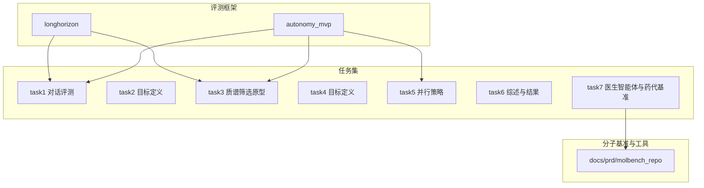

图表来源
- [autonomy_mvp/core/harness.py](file://autonomy_mvp/core/harness.py)
- [longhorizon/instantiate/case3_instantiate.py](file://longhorizon/instantiate/case3_instantiate.py)
- [task3/B_ms3_screening_prototype/ms3_screening_eval.py](file://task3/B_ms3_screening_prototype/ms3_screening_eval.py)
- [docs/prd/molbench_repo/eval/eval_runner.py](file://docs/prd/molbench_repo/eval/eval_runner.py)

章节来源
- [autonomy_mvp/core/harness.py](file://autonomy_mvp/core/harness.py)
- [autonomy_mvp/core/judge.py](file://autonomy_mvp/core/judge.py)
- [autonomy_mvp/core/metrics.py](file://autonomy_mvp/core/metrics.py)
- [autonomy_mvp/core/ranking_metrics.py](file://autonomy_mvp/core/ranking_metrics.py)
- [autonomy_mvp/core/tasks.py](file://autonomy_mvp/core/tasks.py)
- [autonomy_mvp/core/interruption.py](file://autonomy_mvp/core/interruption.py)
- [autonomy_mvp/core/sim_agents.py](file://autonomy_mvp/core/sim_agents.py)
- [autonomy_mvp/run_validation.py](file://autonomy_mvp/run_validation.py)
- [autonomy_mvp/ACCEPTANCE.md](file://autonomy_mvp/ACCEPTANCE.md)
- [autonomy_mvp/schema.md](file://autonomy_mvp/schema.md)
- [longhorizon/instantiate/case3_instantiate.py](file://longhorizon/instantiate/case3_instantiate.py)
- [longhorizon/instantiate/caseD_instantiate.py](file://longhorizon/instantiate/caseD_instantiate.py)
- [longhorizon/instantiate/caseE_instantiate.py](file://longhorizon/instantiate/caseE_instantiate.py)
- [longhorizon/instantiate/caseF_instantiate.py](file://longhorizon/instantiate/caseF_instantiate.py)
- [longhorizon/instantiate/batch_caseD.py](file://longhorizon/instantiate/batch_caseD.py)
- [longhorizon/verifiers/hard_verifiers.py](file://longhorizon/verifiers/hard_verifiers.py)
- [task1/runner.py](file://task1/runner.py)
- [task1/analyze.py](file://task1/analyze.py)
- [task1/verify6.py](file://task1/verify6.py)
- [task2/goal.md](file://task2/goal.md)
- [task3/B_ms3_screening_prototype/ms3_screening_eval.py](file://task3/B_ms3_screening_prototype/ms3_screening_eval.py)
- [task4/goal.md](file://task4/goal.md)
- [task5/runner.py](file://task5/runner.py)
- [task6/README.md](file://task6/README.md)
- [task6/result.md](file://task6/result.md)
- [task7/poc3_physicianbench/PhysicianBench/tools/fhir_api_functions.py](file://task7/poc3_physicianbench/PhysicianBench/tools/fhir_api_functions.py)
- [task7/poc3_physicianbench/PhysicianBench/scripts/run_task.py](file://task7/poc3_physicianbench/PhysicianBench/scripts/run_task.py)
- [task7/poc3_physicianbench/PhysicianBench/scripts/run_eval.py](file://task7/poc3_physicianbench/PhysicianBench/scripts/run_eval.py)
- [task7/poc3_physicianbench/PhysicianBench/scripts/task_taxonomy_v1.json](file://task7/poc3_physicianbench/PhysicianBench/scripts/tasktaxonomy_v1.json)
- [task7/poc3_physicianbench/PhysicianBench/agent/tool_registry.py](file://task7/poc3_physicianbench/PhysicianBench/agent/tool_registry.py)
- [task7/poc3_physicianbench/PhysicianBench/agent/llm_client.py](file://task7/poc3_physicianbench/PhysicianBench/agent/llm_client.py)
- [task7/poc3_physicianbench/PhysicianBench/agent/prompts.py](file://task7/poc3_physicianbench/PhysicianBench/agent/prompts.py)
- [task7/poc3_physicianbench/PhysicianBench/agent/trajectory.py](file://task7/poc3_physicianbench/PhysicianBench/agent/trajectory.py)
- [task7/poc3_physicianbench/PhysicianBench/utils/eval_helpers.py](file://task7/poc3_physicianbench/PhysicianBench/utils/eval_helpers.py)
- [task7/poc4_pharmabench/run_poc4.py](file://task7/poc4_pharmabench/run_poc4.py)
- [task7/poc4_pharmabench/method.md](file://task7/poc4_pharmabench/method.md)
- [task7/poc4_pharmabench/data/prepare_data.py](file://task7/poc4_pharmabench/data/prepare_data.py)
- [task7/poc4_pharmabench/tools/predict_logd_oracle.py](file://task7/poc4_pharmabench/tools/predict_logd_oracle.py)
- [docs/prd/molbench_repo/eval/eval_runner.py](file://docs/prd/molbench_repo/eval/eval_runner.py)
- [docs/prd/molbench_repo/eval/bench_loaders.py](file://docs/prd/molbench_repo/eval/bench_loaders.py)
- [docs/prd/molbench_repo/eval/run_eval_bench.py](file://docs/prd/molbench_repo/eval/run_eval_bench.py)
- [docs/prd/molbench_repo/skills/L1_tools/molclaw-chroma-toolkit/molclaw_chroma_toolkit.py](file://docs/prd/molbench_repo/skills/L1_tools/molclaw-chroma-toolkit/molclaw_chroma_toolkit.py)
- [docs/prd/molbench_repo/skills/L1_tools/molclaw-docking-screening/molclaw_docking_screening.py](file://docs/prd/molbench_repo/skills/L1_tools/molclaw-docking-screening/molclaw_docking_screening.py)
- [docs/prd/molbench_repo/skills/L1_tools/molclaw-prolif-tool/molclaw_prolif_tool.py](file://docs/prd/molbench_repo/skills/L1_tools/molclaw-prolif-tool/molclaw_prolif_tool.py)
- [docs/prd/molbench_repo/skills/L1_tools/molclaw-mol-basic-metrics/molclaw_mol_basic_metrics.py](file://docs/prd/molbench_repo/skills/L1_tools/molclaw-mol-basic-metrics/molclaw_mol_basic_metrics.py)
- [docs/prd/molbench_repo/skills/L1_tools/molclaw-interaction-visualizer/molclaw_interaction_visualizer.py](file://docs/prd/molbench_repo/skills/L1_tools/molclaw-interaction-visualizer/molclaw_interaction_visualizer.py)
- [docs/prd/molbench_repo/config/baseline_molbench-ms-1.yaml](file://docs/prd/molbench_repo/config/baseline_molbench-ms-1.yaml)
- [docs/prd/molbench_repo/config/baseline_molbench-ms-2.yaml](file://docs/prd/molbench_repo/config/baseline_molbench-ms-2.yaml)
- [docs/prd/molbench_repo/config/baseline_molbench-ms-3.yaml](file://docs/prd/molbench_repo/config/baseline_molbench-ms-3.yaml)
- [docs/prd/molbench_repo/data_full/molbench-mo/manifest.json](file://docs/prd/molbench_repo/data_full/molbench-mo/manifest.json)

## 核心组件
- 评测编排与执行
  - 统一入口与任务调度：通过编排脚本加载任务配置、启动Agent、收集轨迹与结果。
  - 断点与中断：支持长时间运行的任务中断与恢复，保障稳定性。
  - 裁判与评分：内置规则型与模型型裁判，结合排名指标进行综合评估。
- 长周期任务实例化
  - 针对机理模拟、闭环优化、逆合成、靶点验证等场景生成可执行的子任务与检查点。
  - 硬验证器用于关键步骤的强约束校验。
- 任务集与评测脚本
  - 对话式评测：多轮交互、提示模板、一致性检查与结果渲染。
  - 质谱筛选原型：MS3筛选流程与评估脚本。
  - 并行策略对比：单跑与并行跑的对比报告生成。
- 医生智能体与FHIR集成
  - 基于FHIR API函数调用读取患者数据、生成诊疗建议，并提供任务分类与评估辅助。
- 分子基准与工具链
  - 分子属性计算、对接筛选、相互作用可视化、基础度量等技能工具，配合基准加载器与评测运行器形成端到端流水线。

章节来源
- [autonomy_mvp/core/harness.py](file://autonomy_mvp/core/harness.py)
- [autonomy_mvp/core/judge.py](file://autonomy_mvp/core/judge.py)
- [autonomy_mvp/core/metrics.py](file://autonomy_mvp/core/metrics.py)
- [autonomy_mvp/core/ranking_metrics.py](file://autonomy_mvp/core/ranking_metrics.py)
- [autonomy_mvp/core/interruption.py](file://autonomy_mvp/core/interruption.py)
- [autonomy_mvp/core/sim_agents.py](file://autonomy_mvp/core/sim_agents.py)
- [autonomy_mvp/run_validation.py](file://autonomy_mvp/run_validation.py)
- [autonomy_mvp/ACCEPTANCE.md](file://autonomy_mvp/ACCEPTANCE.md)
- [autonomy_mvp/schema.md](file://autonomy_mvp/schema.md)
- [longhorizon/instantiate/case3_instantiate.py](file://longhorizon/instantiate/case3_instantiate.py)
- [longhorizon/instantiate/caseD_instantiate.py](file://longhorizon/instantiate/caseD_instantiate.py)
- [longhorizon/instantiate/caseE_instantiate.py](file://longhorizon/instantiate/caseE_instantiate.py)
- [longhorizon/instantiate/caseF_instantiate.py](file://longhorizon/instantiate/caseF_instantiate.py)
- [longhorizon/instantiate/batch_caseD.py](file://longhorizon/instantiate/batch_caseD.py)
- [longhorizon/verifiers/hard_verifiers.py](file://longhorizon/verifiers/hard_verifiers.py)
- [task1/runner.py](file://task1/runner.py)
- [task1/analyze.py](file://task1/analyze.py)
- [task1/verify6.py](file://task1/verify6.py)
- [task3/B_ms3_screening_prototype/ms3_screening_eval.py](file://task3/B_ms3_screening_prototype/ms3_screening_eval.py)
- [task5/runner.py](file://task5/runner.py)
- [task7/poc3_physicianbench/PhysicianBench/tools/fhir_api_functions.py](file://task7/poc3_physicianbench/PhysicianBench/tools/fhir_api_functions.py)
- [task7/poc3_physicianbench/PhysicianBench/scripts/run_task.py](file://task7/poc3_physicianbench/PhysicianBench/scripts/run_task.py)
- [task7/poc3_physicianbench/PhysicianBench/scripts/run_eval.py](file://task7/poc3_physicianbench/PhysicianBench/scripts/run_eval.py)
- [task7/poc3_physicianbench/PhysicianBench/scripts/task_taxonomy_v1.json](file://task7/poc3_physicianbench/PhysicianBench/scripts/task_taxonomy_v1.json)
- [task7/poc3_physicianbench/PhysicianBench/agent/tool_registry.py](file://task7/poc3_physicianbench/PhysicianBench/agent/tool_registry.py)
- [task7/poc3_physicianbench/PhysicianBench/agent/llm_client.py](file://task7/poc3_physicianbench/PhysicianBench/agent/llm_client.py)
- [task7/poc3_physicianbench/PhysicianBench/agent/prompts.py](file://task7/poc3_physicianbench/PhysicianBench/agent/prompts.py)
- [task7/poc3_physicianbench/PhysicianBench/agent/trajectory.py](file://task7/poc3_physicianbench/PhysicianBench/agent/trajectory.py)
- [task7/poc3_physicianbench/PhysicianBench/utils/eval_helpers.py](file://task7/poc3_physicianbench/PhysicianBench/utils/eval_helpers.py)
- [task7/poc4_pharmabench/run_poc4.py](file://task7/poc4_pharmabench/run_poc4.py)
- [task7/poc4_pharmabench/method.md](file://task7/poc4_pharmabench/method.md)
- [task7/poc4_pharmabench/data/prepare_data.py](file://task7/poc4_pharmabench/data/prepare_data.py)
- [task7/poc4_pharmabench/tools/predict_logd_oracle.py](file://task7/poc4_pharmabench/tools/predict_logd_oracle.py)
- [docs/prd/molbench_repo/eval/eval_runner.py](file://docs/prd/molbench_repo/eval/eval_runner.py)
- [docs/prd/molbench_repo/eval/bench_loaders.py](file://docs/prd/molbench_repo/eval/bench_loaders.py)
- [docs/prd/molbench_repo/eval/run_eval_bench.py](file://docs/prd/molbench_repo/eval/run_eval_bench.py)
- [docs/prd/molbench_repo/skills/L1_tools/molclaw-chroma-toolkit/molclaw_chroma_toolkit.py](file://docs/prd/molbench_repo/skills/L1_tools/molclaw-chroma-toolkit/molclaw_chroma_toolkit.py)
- [docs/prd/molbench_repo/skills/L1_tools/molclaw-docking-screening/molclaw_docking_screening.py](file://docs/prd/molbench_repo/skills/L1_tools/molclaw-docking-screening/molclaw_docking_screening.py)
- [docs/prd/molbench_repo/skills/L1_tools/molclaw-prolif-tool/molclaw_prolif_tool.py](file://docs/prd/molbench_repo/skills/L1_tools/molclaw-prolif-tool/molclaw_prolif_tool.py)
- [docs/prd/molbench_repo/skills/L1_tools/molclaw-mol-basic-metrics/molclaw_mol_basic_metrics.py](file://docs/prd/molbench_repo/skills/L1_tools/molclaw-mol-basic-metrics/molclaw_mol_basic_metrics.py)
- [docs/prd/molbench_repo/skills/L1_tools/molclaw-interaction-visualizer/molclaw_interaction_visualizer.py](file://docs/prd/molbench_repo/skills/L1_tools/molclaw-interaction-visualizer/molclaw_interaction_visualizer.py)
- [docs/prd/molbench_repo/config/baseline_molbench-ms-1.yaml](file://docs/prd/molbench_repo/config/baseline_molbench-ms-1.yaml)
- [docs/prd/molbench_repo/config/baseline_molbench-ms-2.yaml](file://docs/prd/molbench_repo/config/baseline_molbench-ms-2.yaml)
- [docs/prd/molbench_repo/config/baseline_molbench-ms-3.yaml](file://docs/prd/molbench_repo/config/baseline_molbench-ms-3.yaml)
- [docs/prd/molbench_repo/data_full/molbench-mo/manifest.json](file://docs/prd/molbench_repo/data_full/molbench-mo/manifest.json)

## 架构总览
整体架构由“评测编排层 + 任务执行层 + 工具与数据层”构成：
- 编排层：负责任务加载、并发控制、中断恢复、结果聚合与报告生成。
- 执行层：Agent根据提示与工具选择策略执行动作，产出轨迹与中间产物。
- 工具与数据层：FHIR接口、分子工具链、基准数据集与可视化模块。

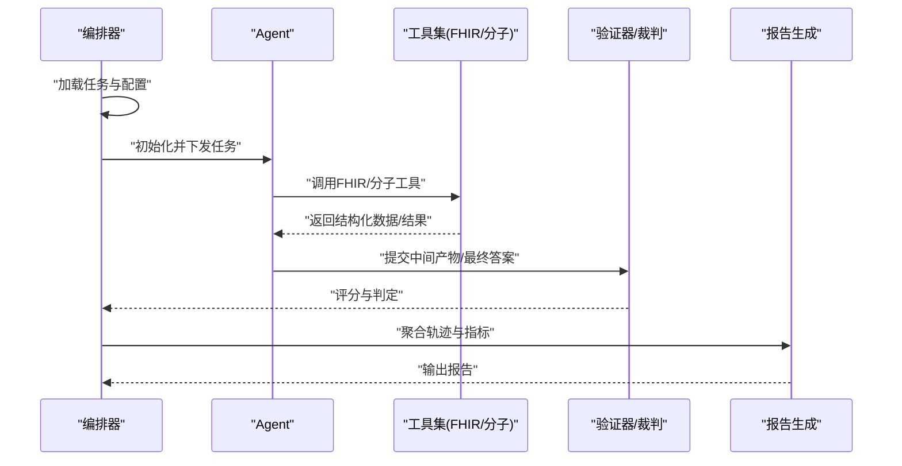

图表来源
- [autonomy_mvp/core/harness.py](file://autonomy_mvp/core/harness.py)
- [task7/poc3_physicianbench/PhysicianBench/tools/fhir_api_functions.py](file://task7/poc3_physicianbench/PhysicianBench/tools/fhir_api_functions.py)
- [docs/prd/molbench_repo/eval/eval_runner.py](file://docs/prd/molbench_repo/eval/eval_runner.py)
- [longhorizon/verifiers/hard_verifiers.py](file://longhorizon/verifiers/hard_verifiers.py)

## 详细组件分析

### 编排与评测核心（autonomy_mvp）
- 职责划分
  - 编排器：统一入口、任务生命周期管理、并发与资源控制。
  - 裁判：规则与模型双轨评分，支持细粒度打分与综合排名。
  - 指标：准确率、召回率、AUC、排序指标等。
  - 中断：长时间任务的可恢复执行。
  - 模拟代理：在缺少真实环境时提供仿真行为。
- 典型流程
  - 解析任务清单 → 启动Agent → 执行动作 → 采集轨迹 → 裁判评分 → 指标聚合 → 输出报告。

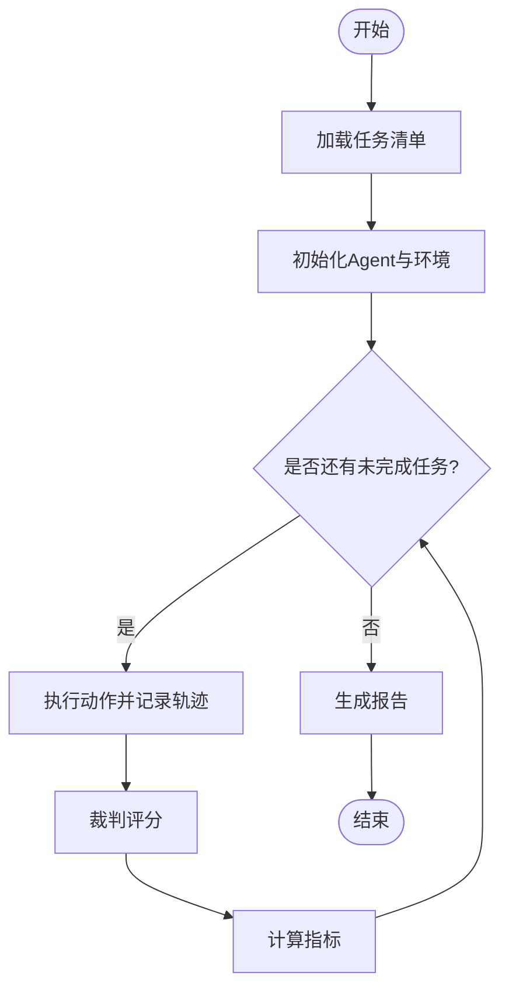

图表来源
- [autonomy_mvp/core/harness.py](file://autonomy_mvp/core/harness.py)
- [autonomy_mvp/core/judge.py](file://autonomy_mvp/core/judge.py)
- [autonomy_mvp/core/metrics.py](file://autonomy_mvp/core/metrics.py)
- [autonomy_mvp/core/ranking_metrics.py](file://autonomy_mvp/core/ranking_metrics.py)
- [autonomy_mvp/core/interruption.py](file://autonomy_mvp/core/interruption.py)
- [autonomy_mvp/core/sim_agents.py](file://autonomy_mvp/core/sim_agents.py)

章节来源
- [autonomy_mvp/core/harness.py](file://autonomy_mvp/core/harness.py)
- [autonomy_mvp/core/judge.py](file://autonomy_mvp/core/judge.py)
- [autonomy_mvp/core/metrics.py](file://autonomy_mvp/core/metrics.py)
- [autonomy_mvp/core/ranking_metrics.py](file://autonomy_mvp/core/ranking_metrics.py)
- [autonomy_mvp/core/interruption.py](file://autonomy_mvp/core/interruption.py)
- [autonomy_mvp/core/sim_agents.py](file://autonomy_mvp/core/sim_agents.py)
- [autonomy_mvp/run_validation.py](file://autonomy_mvp/run_validation.py)
- [autonomy_mvp/ACCEPTANCE.md](file://autonomy_mvp/ACCEPTANCE.md)
- [autonomy_mvp/schema.md](file://autonomy_mvp/schema.md)

### 长周期任务实例化与验证（longhorizon）
- 实例化脚本
  - case3：机理模拟任务实例化（如药物-靶点作用机制）。
  - caseD：材料闭环优化任务实例化（可迁移至药物配方优化）。
  - caseE：逆合成路径规划实例化（适用于先导化合物设计）。
  - caseF：靶点验证任务实例化（结合文献与数据库证据）。
- 批量执行与验证器
  - 批量任务调度脚本，支撑大规模实验。
  - 硬验证器对关键步骤进行强约束校验，确保科学严谨性。

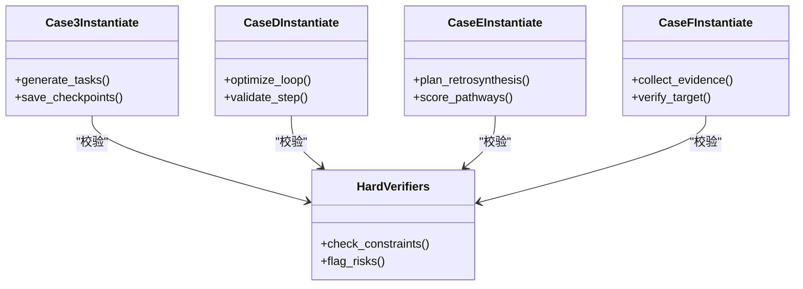

图表来源
- [longhorizon/instantiate/case3_instantiate.py](file://longhorizon/instantiate/case3_instantiate.py)
- [longhorizon/instantiate/caseD_instantiate.py](file://longhorizon/instantiate/caseD_instantiate.py)
- [longhorizon/instantiate/caseE_instantiate.py](file://longhorizon/instantiate/caseE_instantiate.py)
- [longhorizon/instantiate/caseF_instantiate.py](file://longhorizon/instantiate/caseF_instantiate.py)
- [longhorizon/instantiate/batch_caseD.py](file://longhorizon/instantiate/batch_caseD.py)
- [longhorizon/verifiers/hard_verifiers.py](file://longhorizon/verifiers/hard_verifiers.py)

章节来源
- [longhorizon/instantiate/case3_instantiate.py](file://longhorizon/instantiate/case3_instantiate.py)
- [longhorizon/instantiate/caseD_instantiate.py](file://longhorizon/instantiate/caseD_instantiate.py)
- [longhorizon/instantiate/caseE_instantiate.py](file://longhorizon/instantiate/caseE_instantiate.py)
- [longhorizon/instantiate/caseF_instantiate.py](file://longhorizon/instantiate/caseF_instantiate.py)
- [longhorizon/instantiate/batch_caseD.py](file://longhorizon/instantiate/batch_caseD.py)
- [longhorizon/verifiers/hard_verifiers.py](file://longhorizon/verifiers/hard_verifiers.py)

### 对话式评测与一致性检查（task1）
- 功能要点
  - 多轮对话评测：提示模板、逐步推理、结果渲染。
  - 一致性检查：跨轮次逻辑一致性与事实核查。
  - 验证脚本：对关键结论进行二次核验。
- 适用场景
  - 临床问答、用药指导、诊断辅助对话系统评估。

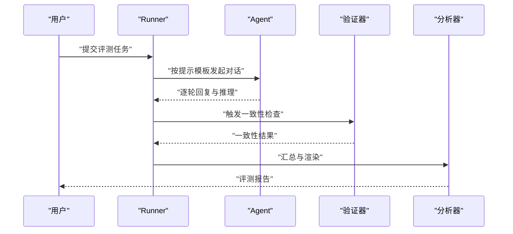

图表来源
- [task1/runner.py](file://task1/runner.py)
- [task1/analyze.py](file://task1/analyze.py)
- [task1/verify6.py](file://task1/verify6.py)

章节来源
- [task1/runner.py](file://task1/runner.py)
- [task1/analyze.py](file://task1/analyze.py)
- [task1/verify6.py](file://task1/verify6.py)

### 质谱筛选原型（task3）
- 功能要点
  - MS3筛选流程：样本准备、谱图处理、候选物筛选与评估。
  - 评估脚本：对筛选结果进行定量分析与可视化。
- 适用场景
  - 高通量药物筛选、代谢产物鉴定、毒理学标志物发现。

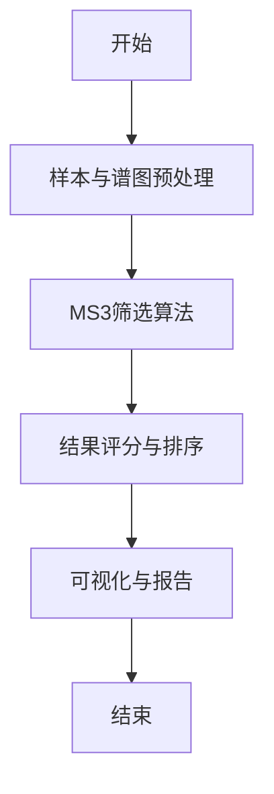

图表来源
- [task3/B_ms3_screening_prototype/ms3_screening_eval.py](file://task3/B_ms3_screening_prototype/ms3_screening_eval.py)

章节来源
- [task3/B_ms3_screening_prototype/ms3_screening_eval.py](file://task3/B_ms3_screening_prototype/ms3_screening_eval.py)

### 并行策略与平台工具可用性（task5）
- 功能要点
  - 单跑与并行策略对比：吞吐、延迟、错误率与资源占用。
  - 平台工具可用性：外部服务稳定性与容错能力。
- 适用场景
  - 大规模评测、高并发Agent部署、云端工具集成。

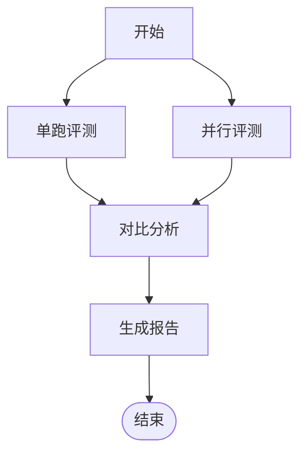

图表来源
- [task5/runner.py](file://task5/runner.py)

章节来源
- [task5/runner.py](file://task5/runner.py)

### 医生智能体与FHIR集成（task7/poc3）
- 功能要点
  - FHIR API函数：读取患者数据、访问临床记录、生成结构化建议。
  - 任务执行与评估：任务分类、执行脚本、评估辅助工具。
  - Agent组件：LLM客户端、提示工程、工具注册表、轨迹记录。
- 适用场景
  - 临床决策支持、个性化治疗建议、药物相互作用预警。

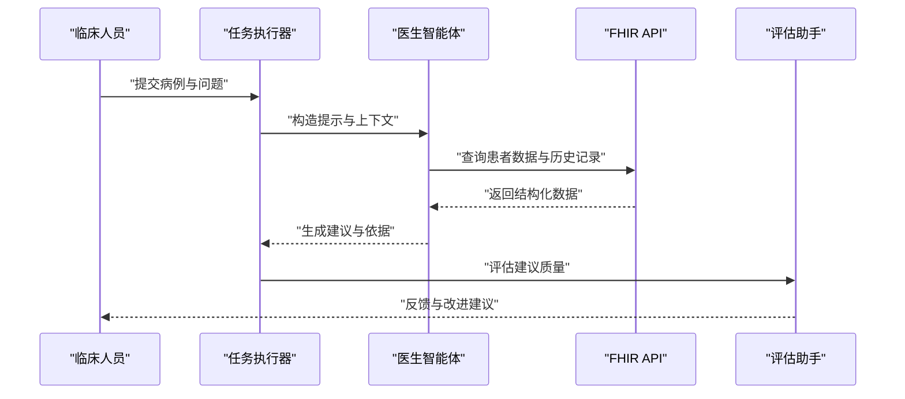

图表来源
- [task7/poc3_physicianbench/PhysicianBench/tools/fhir_api_functions.py](file://task7/poc3_physicianbench/PhysicianBench/tools/fhir_api_functions.py)
- [task7/poc3_physicianbench/PhysicianBench/scripts/run_task.py](file://task7/poc3_physicianbench/PhysicianBench/scripts/run_task.py)
- [task7/poc3_physicianbench/PhysicianBench/scripts/run_eval.py](file://task7/poc3_physicianbench/PhysicianBench/scripts/run_eval.py)
- [task7/poc3_physicianbench/PhysicianBench/agent/tool_registry.py](file://task7/poc3_physicianbench/PhysicianBench/agent/tool_registry.py)
- [task7/poc3_physicianbench/PhysicianBench/agent/llm_client.py](file://task7/poc3_physicianbench/PhysicianBench/agent/llm_client.py)
- [task7/poc3_physicianbench/PhysicianBench/agent/prompts.py](file://task7/poc3_physicianbench/PhysicianBench/agent/prompts.py)
- [task7/poc3_physicianbench/PhysicianBench/agent/trajectory.py](file://task7/poc3_physicianbench/PhysicianBench/agent/trajectory.py)
- [task7/poc3_physicianbench/PhysicianBench/utils/eval_helpers.py](file://task7/poc3_physicianbench/PhysicianBench/utils/eval_helpers.py)
- [task7/poc3_physicianbench/PhysicianBench/scripts/task_taxonomy_v1.json](file://task7/poc3_physicianbench/PhysicianBench/scripts/task_taxonomy_v1.json)

章节来源
- [task7/poc3_physicianbench/PhysicianBench/tools/fhir_api_functions.py](file://task7/poc3_physicianbench/PhysicianBench/tools/fhir_api_functions.py)
- [task7/poc3_physicianbench/PhysicianBench/scripts/run_task.py](file://task7/poc3_physicianbench/PhysicianBench/scripts/run_task.py)
- [task7/poc3_physicianbench/PhysicianBench/scripts/run_eval.py](file://task7/poc3_physicianbench/PhysicianBench/scripts/run_eval.py)
- [task7/poc3_physicianbench/PhysicianBench/scripts/task_taxonomy_v1.json](file://task7/poc3_physicianbench/PhysicianBench/scripts/task_taxonomy_v1.json)
- [task7/poc3_physicianbench/PhysicianBench/agent/tool_registry.py](file://task7/poc3_physicianbench/PhysicianBench/agent/tool_registry.py)
- [task7/poc3_physicianbench/PhysicianBench/agent/llm_client.py](file://task7/poc3_physicianbench/PhysicianBench/agent/llm_client.py)
- [task7/poc3_physicianbench/PhysicianBench/agent/prompts.py](file://task7/poc3_physicianbench/PhysicianBench/agent/prompts.py)
- [task7/poc3_physicianbench/PhysicianBench/agent/trajectory.py](file://task7/poc3_physicianbench/PhysicianBench/agent/trajectory.py)
- [task7/poc3_physicianbench/PhysicianBench/utils/eval_helpers.py](file://task7/poc3_physicianbench/PhysicianBench/utils/eval_helpers.py)

### 药代性质预测基准（task7/poc4）
- 功能要点
  - 数据准备：原始数据清洗与特征工程。
  - 预测工具：logD等性质的Oracle预测。
  - 运行脚本：端到端评测流程与结果汇总。
- 适用场景
  - 药物ADMET早期筛选、候选分子优先级排序。

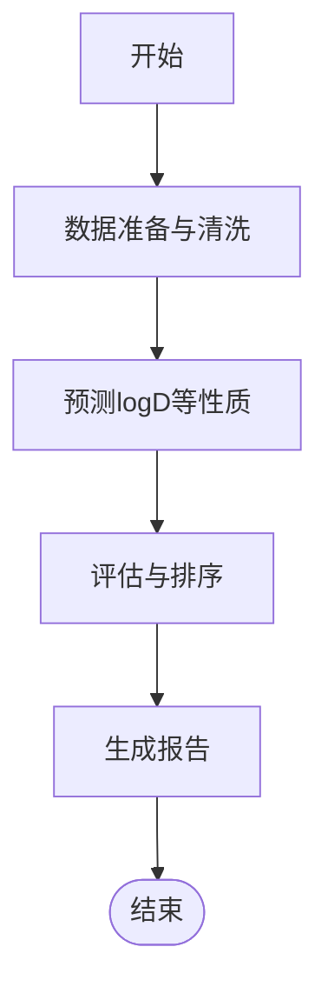

图表来源
- [task7/poc4_pharmabench/run_poc4.py](file://task7/poc4_pharmabench/run_poc4.py)
- [task7/poc4_pharmabench/method.md](file://task7/poc4_pharmabench/method.md)
- [task7/poc4_pharmabench/data/prepare_data.py](file://task7/poc4_pharmabench/data/prepare_data.py)
- [task7/poc4_pharmabench/tools/predict_logd_oracle.py](file://task7/poc4_pharmabench/tools/predict_logd_oracle.py)

章节来源
- [task7/poc4_pharmabench/run_poc4.py](file://task7/poc4_pharmabench/run_poc4.py)
- [task7/poc4_pharmabench/method.md](file://task7/poc4_pharmabench/method.md)
- [task7/poc4_pharmabench/data/prepare_data.py](file://task7/poc4_pharmabench/data/prepare_data.py)
- [task7/poc4_pharmabench/tools/predict_logd_oracle.py](file://task7/poc4_pharmabench/tools/predict_logd_oracle.py)

### 分子基准与工具链（molbench）
- 功能要点
  - 基准加载器：统一加载分子数据集与元数据。
  - 评测运行器：串联工具链、执行评估、汇总结果。
  - 技能工具：分子属性、对接筛选、相互作用可视化、基础度量。
  - 配置文件：不同基准任务的参数与流水线设置。
- 适用场景
  - 分子设计与筛选、构效关系研究、可视化解释。

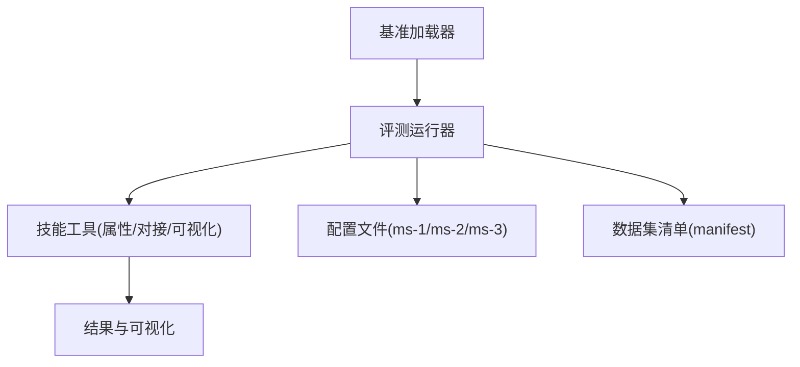

图表来源
- [docs/prd/molbench_repo/eval/bench_loaders.py](file://docs/prd/molbench_repo/eval/bench_loaders.py)
- [docs/prd/molbench_repo/eval/eval_runner.py](file://docs/prd/molbench_repo/eval/eval_runner.py)
- [docs/prd/molbench_repo/eval/run_eval_bench.py](file://docs/prd/molbench_repo/eval/run_eval_bench.py)
- [docs/prd/molbench_repo/skills/L1_tools/molclaw-chroma-toolkit/molclaw_chroma_toolkit.py](file://docs/prd/molbench_repo/skills/L1_tools/molclaw-chroma-toolkit/molclaw_chroma_toolkit.py)
- [docs/prd/molbench_repo/skills/L1_tools/molclaw-docking-screening/molclaw_docking_screening.py](file://docs/prd/molbench_repo/skills/L1_tools/molclaw-docking-screening/molclaw_docking_screening.py)
- [docs/prd/molbench_repo/skills/L1_tools/molclaw-prolif-tool/molclaw_prolif_tool.py](file://docs/prd/molbench_repo/skills/L1_tools/molclaw-prolif-tool/molclaw_prolif_tool.py)
- [docs/prd/molbench_repo/skills/L1_tools/molclaw-mol-basic-metrics/molclaw_mol_basic_metrics.py](file://docs/prd/molbench_repo/skills/L1_tools/molclaw-mol-basic-metrics/molclaw_mol_basic_metrics.py)
- [docs/prd/molbench_repo/skills/L1_tools/molclaw-interaction-visualizer/molclaw_interaction_visualizer.py](file://docs/prd/molbench_repo/skills/L1_tools/molclaw-interaction-visualizer/molclaw_interaction_visualizer.py)
- [docs/prd/molbench_repo/config/baseline_molbench-ms-1.yaml](file://docs/prd/molbench_repo/config/baseline_molbench-ms-1.yaml)
- [docs/prd/molbench_repo/config/baseline_molbench-ms-2.yaml](file://docs/prd/molbench_repo/config/baseline_molbench-ms-2.yaml)
- [docs/prd/molbench_repo/config/baseline_molbench-ms-3.yaml](file://docs/prd/molbench_repo/config/baseline_molbench-ms-3.yaml)
- [docs/prd/molbench_repo/data_full/molbench-mo/manifest.json](file://docs/prd/molbench_repo/data_full/molbench-mo/manifest.json)

章节来源
- [docs/prd/molbench_repo/eval/bench_loaders.py](file://docs/prd/molbench_repo/eval/bench_loaders.py)
- [docs/prd/molbench_repo/eval/eval_runner.py](file://docs/prd/molbench_repo/eval/eval_runner.py)
- [docs/prd/molbench_repo/eval/run_eval_bench.py](file://docs/prd/molbench_repo/eval/run_eval_bench.py)
- [docs/prd/molbench_repo/skills/L1_tools/molclaw-chroma-toolkit/molclaw_chroma_toolkit.py](file://docs/prd/molbench_repo/skills/L1_tools/molclaw-chroma-toolkit/molclaw_chroma_toolkit.py)
- [docs/prd/molbench_repo/skills/L1_tools/molclaw-docking-screening/molclaw_docking_screening.py](file://docs/prd/molbench_repo/skills/L1_tools/molclaw-docking-screening/molclaw_docking_screening.py)
- [docs/prd/molbench_repo/skills/L1_tools/molclaw-prolif-tool/molclaw_prolif_tool.py](file://docs/prd/molbench_repo/skills/L1_tools/molclaw-prolif-tool/molclaw_prolif_tool.py)
- [docs/prd/molbench_repo/skills/L1_tools/molclaw-mol-basic-metrics/molclaw_mol_basic_metrics.py](file://docs/prd/molbench_repo/skills/L1_tools/molclaw-mol-basic-metrics/molclaw_mol_basic_metrics.py)
- [docs/prd/molbench_repo/skills/L1_tools/molclaw-interaction-visualizer/molclaw_interaction_visualizer.py](file://docs/prd/molbench_repo/skills/L1_tools/molclaw-interaction-visualizer/molclaw_interaction_visualizer.py)
- [docs/prd/molbench_repo/config/baseline_molbench-ms-1.yaml](file://docs/prd/molbench_repo/config/baseline_molbench-ms-1.yaml)
- [docs/prd/molbench_repo/config/baseline_molbench-ms-2.yaml](file://docs/prd/molbench_repo/config/baseline_molbench-ms-2.yaml)
- [docs/prd/molbench_repo/config/baseline_molbench-ms-3.yaml](file://docs/prd/molbench_repo/config/baseline_molbench-ms-3.yaml)
- [docs/prd/molbench_repo/data_full/molbench-mo/manifest.json](file://docs/prd/molbench_repo/data_full/molbench-mo/manifest.json)

## 依赖关系分析
- 组件耦合
  - 编排器与裁判/指标低耦合，便于替换评分策略。
  - 长周期任务实例化与硬验证器解耦，支持扩展新任务类型。
  - 医生智能体与FHIR接口通过工具注册表抽象，降低外部依赖影响。
- 外部依赖
  - FHIR服务器、分子工具链（对接、动力学、可视化）、LLM服务。
- 潜在循环依赖
  - 当前结构以单向调用为主，未见明显循环依赖。

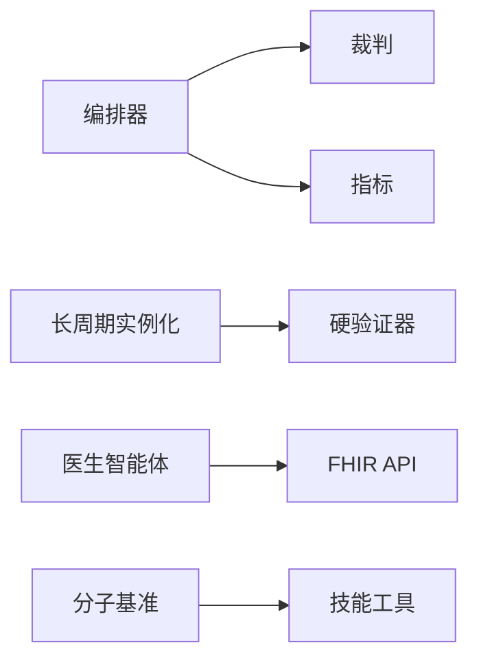

图表来源
- [autonomy_mvp/core/harness.py](file://autonomy_mvp/core/harness.py)
- [autonomy_mvp/core/judge.py](file://autonomy_mvp/core/judge.py)
- [autonomy_mvp/core/metrics.py](file://autonomy_mvp/core/metrics.py)
- [longhorizon/instantiate/case3_instantiate.py](file://longhorizon/instantiate/case3_instantiate.py)
- [longhorizon/verifiers/hard_verifiers.py](file://longhorizon/verifiers/hard_verifiers.py)
- [task7/poc3_physicianbench/PhysicianBench/tools/fhir_api_functions.py](file://task7/poc3_physicianbench/PhysicianBench/tools/fhir_api_functions.py)
- [docs/prd/molbench_repo/eval/eval_runner.py](file://docs/prd/molbench_repo/eval/eval_runner.py)

章节来源
- [autonomy_mvp/core/harness.py](file://autonomy_mvp/core/harness.py)
- [autonomy_mvp/core/judge.py](file://autonomy_mvp/core/judge.py)
- [autonomy_mvp/core/metrics.py](file://autonomy_mvp/core/metrics.py)
- [longhorizon/instantiate/case3_instantiate.py](file://longhorizon/instantiate/case3_instantiate.py)
- [longhorizon/verifiers/hard_verifiers.py](file://longhorizon/verifiers/hard_verifiers.py)
- [task7/poc3_physicianbench/PhysicianBench/tools/fhir_api_functions.py](file://task7/poc3_physicianbench/PhysicianBench/tools/fhir_api_functions.py)
- [docs/prd/molbench_repo/eval/eval_runner.py](file://docs/prd/molbench_repo/eval/eval_runner.py)

## 性能与可扩展性
- 并发与吞吐
  - 并行评测提升吞吐，需关注外部工具限流与错误重试。
- 资源与内存
  - 分子对接与动力学计算消耗较大，建议批处理与缓存。
- 可扩展性
  - 通过工具注册表与配置驱动，新增任务与工具成本低。
- 监控与日志
  - 轨迹记录与中间产物保存有助于定位瓶颈与复现实验。

[本节为一般性指导，不直接分析具体文件]

## 故障排查指南
- 常见问题
  - 外部API不可用：检查网络、认证与配额；增加重试与降级策略。
  - 任务挂起：启用中断恢复，检查死锁与超时配置。
  - 评分不一致：核对裁判规则与输入格式，确保版本一致。
- 调试建议
  - 使用轨迹回放与中间产物快照定位问题。
  - 对关键步骤添加断言与边界条件检查。

章节来源
- [autonomy_mvp/core/interruption.py](file://autonomy_mvp/core/interruption.py)
- [autonomy_mvp/core/judge.py](file://autonomy_mvp/core/judge.py)
- [task1/verify6.py](file://task1/verify6.py)
- [task7/poc3_physicianbench/PhysicianBench/utils/eval_helpers.py](file://task7/poc3_physicianbench/PhysicianBench/utils/eval_helpers.py)

## 结论
本项目构建了覆盖对话式评测、长周期任务、质谱筛选、医生智能体与分子基准的综合体系。通过统一的编排与裁判机制，结合FHIR与分子工具链，实现了从数据到决策的多模态评测闭环。建议在后续迭代中强化隐私保护、可解释性与监管合规，完善可视化与报告自动化，以提升临床可用性与科研可重复性。

[本节为总结性内容，不直接分析具体文件]

## 附录
- 相关目标与说明
  - 任务目标与范围定义、采样说明与结果汇总。
- 参考实现
  - 各任务脚本与工具链的具体实现路径见“引用文件”。

章节来源
- [task2/goal.md](file://task2/goal.md)
- [task4/goal.md](file://task4/goal.md)
- [task6/README.md](file://task6/README.md)
- [task6/result.md](file://task6/result.md)