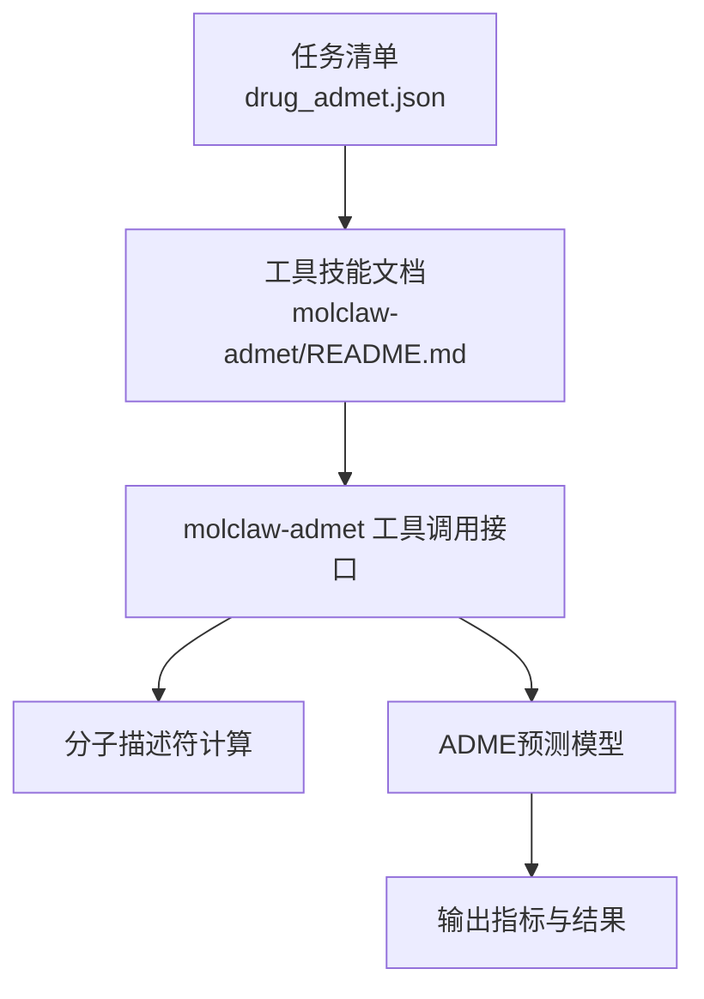
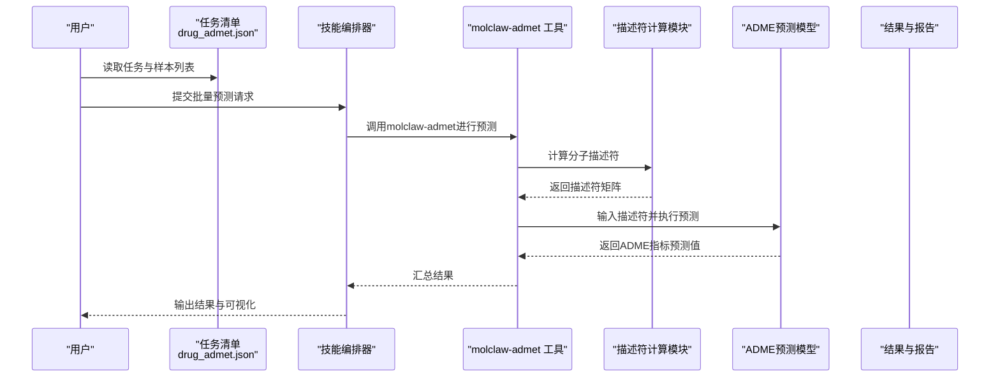
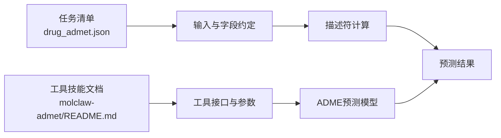

# ADME性质预测

<cite>
**本文引用的文件**   
- [autonomy_mvp/tasks/drug_admet.json](file://autonomy_mvp/tasks/drug_admet.json)
- [docs/molbench_repo/skills/L1_tools/molclaw-admet/README.md](file://docs/molbench_repo/skills/L1_tools/molclaw-admet/README.md)
</cite>

## 目录
1. [简介](#简介)
2. [项目结构](#项目结构)
3. [核心组件](#核心组件)
4. [架构总览](#架构总览)
5. [详细组件分析](#详细组件分析)
6. [依赖关系分析](#依赖关系分析)
7. [性能考虑](#性能考虑)
8. [故障排查指南](#故障排查指南)
9. [结论](#结论)
10. [附录](#附录)

## 简介
本文件面向ADME（吸收、分布、代谢、排泄）性质预测任务，系统性梳理相关计算方法与模型要点，包括：
- 关键参数：Caco-2渗透性、血浆蛋白结合率、肝脏代谢稳定性等
- 分子描述符计算与QSAR建模流程
- 机器学习算法在ADME中的应用范式
- 药物可开发性评分标准与毒性预测思路
- 药代动力学参数估算方法
- 基于molclaw-admet工具的批量预测与优化实践示例

说明：本节为概念性概述，不直接分析具体代码文件。

## 项目结构
仓库中与ADME相关的资源主要分布在以下位置：
- 任务定义与数据清单：autonomy_mvp/tasks/drug_admet.json
- 工具技能文档：docs/molbench_repo/skills/L1_tools/molclaw-admet/README.md

图表来源
- [autonomy_mvp/tasks/drug_admet.json](file://autonomy_mvp/tasks/drug_admet.json)
- [docs/molbench_repo/skills/L1_tools/molclaw-admet/README.md](file://docs/molbench_repo/skills/L1_tools/molclaw-admet/README.md)

章节来源
- [autonomy_mvp/tasks/drug_admet.json](file://autonomy_mvp/tasks/drug_admet.json)
- [docs/molbench_repo/skills/L1_tools/molclaw-admet/README.md](file://docs/molbench_repo/skills/L1_tools/molclaw-admet/README.md)

## 核心组件
围绕ADME预测的核心组件通常包括：
- 输入层：SMILES或分子结构文件、批次元信息、可选的理化约束
- 描述符层：分子指纹、拓扑/几何/电子类描述符、构象集合
- 模型层：QSAR回归/分类模型、深度学习模型、集成学习策略
- 评估层：MAE/RMSE、R²、AUC、准确率、阈值敏感指标
- 输出层：各ADME指标预测值、置信区间、解释性特征贡献

说明：本节为通用框架说明，不直接分析具体代码文件。

## 架构总览
下图展示从任务清单到工具调用的端到端流程，以及预测结果的汇总与评估路径。

图表来源
- [autonomy_mvp/tasks/drug_admet.json](file://autonomy_mvp/tasks/drug_admet.json)
- [docs/molbench_repo/skills/L1_tools/molclaw-admet/README.md](file://docs/molbench_repo/skills/L1_tools/molclaw-admet/README.md)

## 详细组件分析

### 任务清单与数据组织（drug_admet.json）
- 作用：集中管理ADME任务的样本清单、字段约定与批处理配置
- 典型字段（概念性说明）：
  - 样本标识：如SMILES、InChI或文件路径
  - 目标属性：Caco-2渗透性、血浆蛋白结合率、肝脏代谢稳定性等
  - 元数据：来源、实验条件、单位、备注
  - 批处理参数：并发度、重试策略、输出格式
- 使用建议：
  - 统一单位与缺失值标记
  - 对多源数据做一致性校验
  - 将评估指标与阈值纳入任务定义以便自动化筛选

章节来源
- [autonomy_mvp/tasks/drug_admet.json](file://autonomy_mvp/tasks/drug_admet.json)

### molclaw-admet 工具技能（README.md）
- 定位：提供molclaw-admet工具的调用方式、输入输出规范与最佳实践
- 关键内容（概念性说明）：
  - 输入：SMILES列表、描述符选项、模型选择、并行设置
  - 输出：结构化JSON/CSV，包含各ADME指标预测值与质量标志
  - 错误处理：无效SMILES、模型加载失败、资源不足等异常分支
  - 性能：批大小、GPU/CPU切换、缓存策略
- 使用建议：
  - 先小批量验证输入格式与模型可用性
  - 对大规模任务启用分片与断点续跑
  - 记录运行日志与随机种子以保证可复现性

章节来源
- [docs/molbench_repo/skills/L1_tools/molclaw-admet/README.md](file://docs/molbench_repo/skills/L1_tools/molclaw-admet/README.md)

### 分子描述符计算
- 常用类别：
  - 拓扑描述符：分子量、LogP、氢键供体/受体数、旋转键数、环数等
  - 指纹：ECFP/Morgan、MACCS、PubChem指纹等
  - 几何/量子化学：偶极矩、HOMO-LUMO能隙、表面电荷分布（需构象采样）
- 复杂度与性能：
  - 指纹计算通常为O(N_atoms)至O(N_bonds)，适合大批量
  - 量子化学描述符成本高，建议按需计算或预生成
- 工程化建议：
  - 构建描述符缓存与去重机制
  - 对大分子采用分层计算与超时保护

说明：本节为通用方法论，不直接分析具体代码文件。

### QSAR模型构建与机器学习应用
- 数据准备：
  - 清洗与归一化、异常值检测、标签分布分析
  - 训练/验证/测试集划分（时间切分或分层抽样）
- 模型选择：
  - 传统ML：随机森林、梯度提升、支持向量机
  - 深度学习：图神经网络、Transformer变体
- 评估指标：
  - 回归：MAE、RMSE、R²、决定系数调整
  - 分类：AUC、ROC、PR-AUC、F1、准确率
- 可解释性：
  - 特征重要性、SHAP值、注意力权重可视化
- 部署：
  - 模型序列化、API封装、版本管理与回滚策略

说明：本节为通用方法论，不直接分析具体代码文件。

### 关键ADME参数的预测方法与评估
- Caco-2渗透性
  - 原理：基于跨肠上皮细胞单层模型的表观渗透系数，常以logP、极性表面积、氢键能力等描述符驱动
  - 输入：SMILES/描述符；输出：渗透系数或对数形式
  - 评估：MAE/RMSE、R²、与体外实验的相关性
- 血浆蛋白结合率（PPB）
  - 原理：药物与白蛋白/α1-酸性糖蛋白的结合平衡，受疏水性、电荷、空间位阻影响
  - 输入：SMILES/描述符；输出：结合百分比或自由分数
  - 评估：分类阈值下的准确率、连续值的误差指标
- 肝脏代谢稳定性
  - 原理：肝微粒体或肝细胞清除率，关注CYP450亚型代谢热点
  - 输入：SMILES/描述符；输出：半衰期、清除率或稳定等级
  - 评估：回归误差、分类混淆矩阵、临床相关性

说明：本节为通用方法论，不直接分析具体代码文件。

### 药物可开发性评分与毒性预测
- 可开发性评分
  - 常见规则：Lipinski五规则、Veber规则、Ghose过滤等
  - 综合评分：加权打分、主成分降维、聚类筛选
- 毒性预测
  - 终点：Ames致突变、hERG抑制、肝毒性、皮肤刺激等
  - 模型：分类模型+不确定性估计；外部验证与领域适用域界定
- 实践建议：
  - 将可开发性与毒性作为早期过滤器
  - 结合多模型共识降低假阳性

说明：本节为通用方法论，不直接分析具体代码文件。

### 药代动力学参数估算
- 常用参数：口服生物利用度、表观分布容积、清除率、半衰期、暴露量（AUC）
- 估算方法：
  - 经验公式与PBPK简化模型
  - 基于描述符的QSAR映射
  - 结合体外数据（溶解度、渗透性、代谢稳定性）的多变量回归
- 注意事项：
  - 物种差异与生理参数校准
  - 非线性动力学与饱和效应

说明：本节为通用方法论，不直接分析具体代码文件。

### 实际代码示例：使用molclaw-admet进行批量预测与优化
- 步骤概览（概念性说明）：
  - 准备输入：SMILES列表与任务配置
  - 调用工具：通过molclaw-admet接口发起批量预测
  - 解析输出：提取各ADME指标与质量标志
  - 后处理：排序、过滤、可视化与报告生成
  - 优化循环：根据预测结果指导结构修饰与再预测
- 参考路径：
  - 任务清单与字段约定：[autonomy_mvp/tasks/drug_admet.json](file://autonomy_mvp/tasks/drug_admet.json)
  - 工具调用与参数说明：[docs/molbench_repo/skills/L1_tools/molclaw-admet/README.md](file://docs/molbench_repo/skills/L1_tools/molclaw-admet/README.md)

章节来源
- [autonomy_mvp/tasks/drug_admet.json](file://autonomy_mvp/tasks/drug_admet.json)
- [docs/molbench_repo/skills/L1_tools/molclaw-admet/README.md](file://docs/molbench_repo/skills/L1_tools/molclaw-admet/README.md)

## 依赖关系分析
- 任务清单与工具技能的耦合：
  - drug_admet.json定义数据与任务语义
  - molclaw-admet/README.md定义工具接口与约束
- 内部依赖链：
  - 输入→描述符→模型→评估→输出
- 外部依赖：
  - 分子计算库、模型权重、日志与存储后端

图表来源
- [autonomy_mvp/tasks/drug_admet.json](file://autonomy_mvp/tasks/drug_admet.json)
- [docs/molbench_repo/skills/L1_tools/molclaw-admet/README.md](file://docs/molbench_repo/skills/L1_tools/molclaw-admet/README.md)

章节来源
- [autonomy_mvp/tasks/drug_admet.json](file://autonomy_mvp/tasks/drug_admet.json)
- [docs/molbench_repo/skills/L1_tools/molclaw-admet/README.md](file://docs/molbench_repo/skills/L1_tools/molclaw-admet/README.md)

## 性能考虑
- 批处理与并发：合理设置批大小与线程/进程数，避免内存溢出
- 描述符缓存：对重复分子复用已计算结果
- 模型推理加速：GPU优先、混合精度、模型量化
- 容错与重试：网络/IO异常的重试与退避策略
- 监控与度量：吞吐、延迟、错误率与资源占用

说明：本节为通用指导，不直接分析具体代码文件。

## 故障排查指南
- 常见问题：
  - SMILES无效或立体化学不一致：检查规范化与价态
  - 模型未加载或权重缺失：确认路径与权限
  - 内存不足：减小批大小或启用CPU降级
  - 输出格式不符：对照工具文档的字段约定
- 诊断手段：
  - 启用详细日志与堆栈跟踪
  - 最小化复现实例与隔离环境
  - 逐步验证输入→描述符→模型→输出的链路

说明：本节为通用指导，不直接分析具体代码文件。

## 结论
通过任务清单与工具技能的协同，可实现ADME性质的标准化批量预测与迭代优化。建议在工程中重视数据质量、模型可解释性与性能监控，并结合可开发性与毒性评估形成闭环筛选流程。

## 附录
- 术语速查：
  - ADME：吸收、分布、代谢、排泄
  - QSAR：定量构效关系
  - PPB：血浆蛋白结合率
  - PBPK：生理药代动力学建模
- 推荐工作流：
  - 数据治理→描述符工程→模型训练→外部验证→部署与监控→持续优化