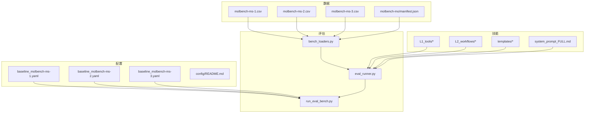
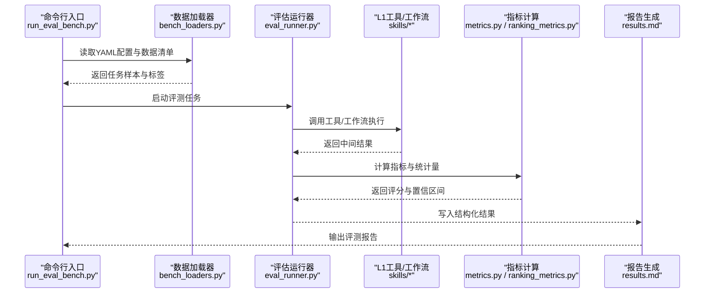
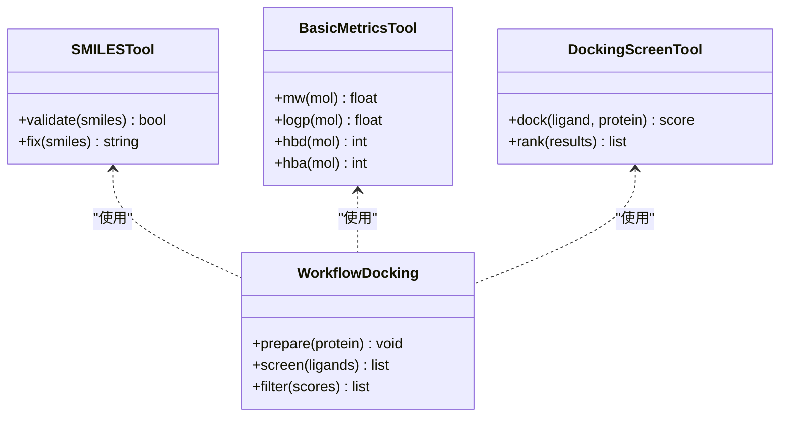
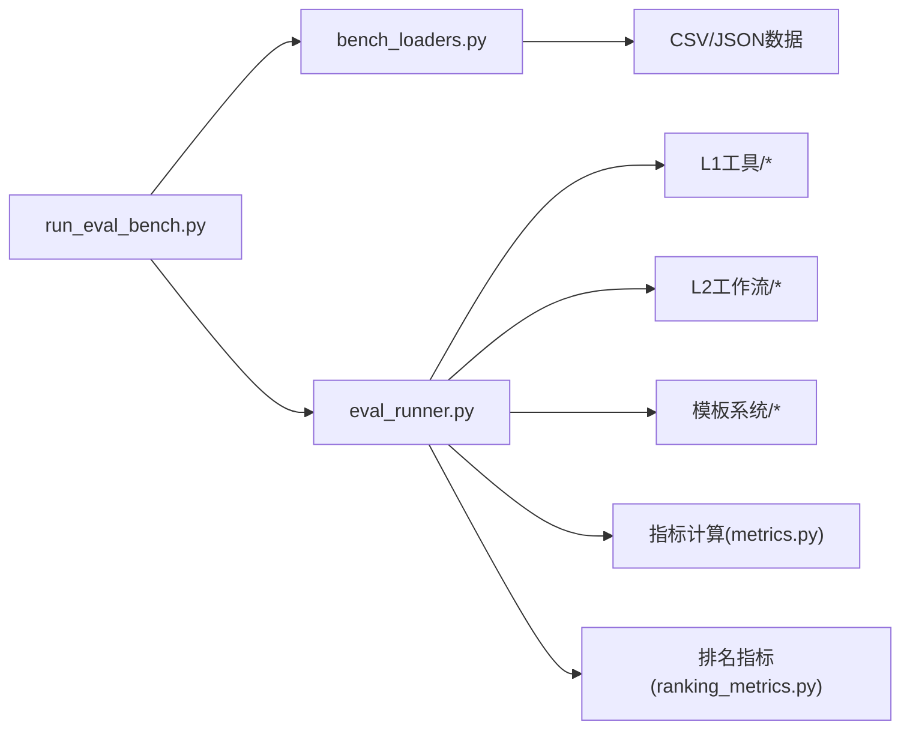

# MolBench基准测试系统

<cite>
**本文引用的文件**   
- [docs/prd/molbench_repo/config/README.md](file://docs/prd/molbench_repo/config/README.md)
- [docs/prd/molbench_repo/config/baseline_molbench-ms-1.yaml](file://docs/prd/molbench_repo/config/baseline_molbench-ms-1.yaml)
- [docs/prd/molbench_repo/config/baseline_molbench-ms-2.yaml](file://docs/prd/molbench_repo/config/baseline_molbench-ms-2.yaml)
- [docs/prd/molbench_repo/config/baseline_molbench-ms-3.yaml](file://docs/prd/molbench_repo/config/baseline_molbench-ms-3.yaml)
- [docs/prd/molbench_repo/data_full/molbench-mo/manifest.json](file://docs/prd/molbench_repo/data_full/molbench-mo/manifest.json)
- [docs/prd/molbench_repo/data_full/molbench-ms-1/molbench-ms-1.csv](file://docs/prd/molbench_repo/data_full/molbench-ms-1/molbench-ms-1.csv)
- [docs/prd/molbench_repo/data_full/molbench-ms-2/molbench-ms-2.csv](file://docs/prd/molbench_repo/data_full/molbench-ms-2/molbench-ms-2.csv)
- [docs/prd/molbench_repo/data_full/molbench-ms-3/molbench-ms-3.csv](file://docs/prd/molbench_repo/data_full/molbench-ms-3/molbench-ms-3.csv)
- [docs/prd/molbench_repo/eval/__init__.py](file://docs/prd/molbench_repo/eval/__init__.py)
- [docs/prd/molbench_repo/eval/bench_loaders.py](file://docs/prd/molbench_repo/eval/bench_loaders.py)
- [docs/prd/molbench_repo/eval/eval_runner.py](file://docs/prd/molbench_repo/eval/eval_runner.py)
- [docs/prd/molbench_repo/eval/run_eval_bench.py](file://docs/prd/molbench_repo/eval/run_eval_bench.py)
- [docs/prd/molbench_repo/skills/system_prompt_FULL.md](file://docs/prd/molbench_repo/skills/system_prompt_FULL.md)
- [docs/prd/molbench_repo/skills/L1_tools/molclaw-smiles-valid-check/tool.py](file://docs/prd/molbench_repo/skills/L1_tools/molclaw-smiles-valid-check/tool.py)
- [docs/prd/molbench_repo/skills/L1_tools/molclaw-mol-basic-metrics/tool.py](file://docs/prd/molbench_repo/skills/L1_tools/molclaw-mol-basic-metrics/tool.py)
- [docs/prd/molbench_repo/skills/L1_tools/molclaw-docking-screening/tool.py](file://docs/prd/molbench_repo/skills/L1_tools/molclaw-docking-screening/tool.py)
- [docs/prd/molbench_repo/skills/L2_workflows/02-molecular-docking-screening.md](file://docs/prd/molbench_repo/skills/L2_workflows/02-molecular-docking-screening.md)
- [docs/prd/molbench_repo/skills/L2_workflows/05-iterative-molecular-optimization.md](file://docs/prd/molbench_repo/skills/L2_workflows/05-iterative-molecular-optimization.md)
- [docs/prd/molbench_repo/skills/templates/template.py](file://docs/prd/molbench_repo/skills/templates/template.py)
- [docs/prd/molbench_repo/skills/templates/outliners.py](file://docs/prd/molbench_repo/skills/templates/outliners.py)
- [autonomy_mvp/core/harness.py](file://autonomy_mvp/core/harness.py)
- [autonomy_mvp/core/judge.py](file://autonomy_mvp/core/judge.py)
- [autonomy_mvp/core/metrics.py](file://autonomy_mvp/core/metrics.py)
- [autonomy_mvp/core/ranking_metrics.py](file://autonomy_mvp/core/ranking_metrics.py)
- [autonomy_mvp/core/tasks.py](file://autonomy_mvp/core/tasks.py)
- [autonomy_mvp/run_validation.py](file://autonomy_mvp/run_validation.py)
</cite>

## 目录
1. [引言](#引言)
2. [项目结构](#项目结构)
3. [核心组件](#核心组件)
4. [架构总览](#架构总览)
5. [详细组件分析](#详细组件分析)
6. [依赖关系分析](#依赖关系分析)
7. [性能与可扩展性](#性能与可扩展性)
8. [故障排查指南](#故障排查指南)
9. [结论](#结论)
10. [附录：指标定义、统计检验与置信区间](#附录指标定义统计检验与置信区间)

## 引言
本文件为MolBench基准测试系统的权威技术文档，面向药物发现与材料科学领域的研究者与工程师。文档围绕以下目标展开：
- 阐述MolBench的设计理念、评估标准与任务分类（MS-1、MS-2、MS-3难度级别）。
- 说明数据集构建方法、基线模型实现与性能对比框架。
- 提供基准运行框架、结果收集系统与报告生成工具的使用指南。
- 给出评估指标的数学定义、统计显著性检验方法与置信区间计算流程。
- 通过实际代码示例路径，展示如何扩展新任务、添加自定义评估器与集成第三方工具。

## 项目结构
MolBench仓库采用“配置-数据-评估-技能”四层组织方式：
- 配置层：以YAML描述不同难度级别的基线与评测设置。
- 数据层：CSV清单与MO任务清单，定义样本、标签与元信息。
- 评估层：加载器、运行器与入口脚本，负责统一执行评测与汇总结果。
- 技能层：L1原子工具、L2工作流与模板系统，支撑复杂任务的编排与复用。

图表来源
- [docs/prd/molbench_repo/config/baseline_molbench-ms-1.yaml](file://docs/prd/molbench_repo/config/baseline_molbench-ms-1.yaml)
- [docs/prd/molbench_repo/config/baseline_molbench-ms-2.yaml](file://docs/prd/molbench_repo/config/baseline_molbench-ms-2.yaml)
- [docs/prd/molbench_repo/config/baseline_molbench-ms-3.yaml](file://docs/prd/molbench_repo/config/baseline_molbench-ms-3.yaml)
- [docs/prd/molbench_repo/data_full/molbench-ms-1/molbench-ms-1.csv](file://docs/prd/molbench_repo/data_full/molbench-ms-1/molbench-ms-1.csv)
- [docs/prd/molbench_repo/data_full/molbench-ms-2/molbench-ms-2.csv](file://docs/prd/molbench_repo/data_full/molbench-ms-2/molbench-ms-2.csv)
- [docs/prd/molbench_repo/data_full/molbench-ms-3/molbench-ms-3.csv](file://docs/prd/molbench_repo/data_full/molbench-ms-3/molbench-ms-3.csv)
- [docs/prd/molbench_repo/data_full/molbench-mo/manifest.json](file://docs/prd/molbench_repo/data_full/molbench-mo/manifest.json)
- [docs/prd/molbench_repo/eval/bench_loaders.py](file://docs/prd/molbench_repo/eval/bench_loaders.py)
- [docs/prd/molbench_repo/eval/eval_runner.py](file://docs/prd/molbench_repo/eval/eval_runner.py)
- [docs/prd/molbench_repo/eval/run_eval_bench.py](file://docs/prd/molbench_repo/eval/run_eval_bench.py)
- [docs/prd/molbench_repo/skills/system_prompt_FULL.md](file://docs/prd/molbench_repo/skills/system_prompt_FULL.md)

章节来源
- [docs/prd/molbench_repo/config/README.md](file://docs/prd/molbench_repo/config/README.md)
- [docs/prd/molbench_repo/eval/run_eval_bench.py](file://docs/prd/molbench_repo/eval/run_eval_bench.py)

## 核心组件
- 评估加载器（bench_loaders.py）：负责解析CSV与JSON清单，构造任务样本、标签与元数据，支持按难度级别筛选。
- 评估运行器（eval_runner.py）：统一调度任务执行，调用技能工具与工作流，聚合中间结果并输出结构化日志。
- 入口脚本（run_eval_bench.py）：命令行接口，读取YAML配置，驱动加载器与运行器，生成评测报告。
- 技能体系（skills）：L1原子工具（如SMILES校验、基础物化性质计算、对接筛选），L2工作流（对接筛选、迭代优化等），模板系统（答案格式、变量路由、工具路由）。
- 基线配置（baseline_*.yaml）：针对MS-1/MS-2/MS-3的基线策略、参数与工具链组合。

章节来源
- [docs/prd/molbench_repo/eval/bench_loaders.py](file://docs/prd/molbench_repo/eval/bench_loaders.py)
- [docs/prd/molbench_repo/eval/eval_runner.py](file://docs/prd/molbench_repo/eval/eval_runner.py)
- [docs/prd/molbench_repo/eval/run_eval_bench.py](file://docs/prd/molbench_repo/eval/run_eval_bench.py)
- [docs/prd/molbench_repo/skills/L1_tools/molclaw-smiles-valid-check/tool.py](file://docs/prd/molbench_repo/skills/L1_tools/molclaw-smiles-valid-check/tool.py)
- [docs/prd/molbench_repo/skills/L1_tools/molclaw-mol-basic-metrics/tool.py](file://docs/prd/molbench_repo/skills/L1_tools/molclaw-mol-basic-metrics/tool.py)
- [docs/prd/molbench_repo/skills/L1_tools/molclaw-docking-screening/tool.py](file://docs/prd/molbench_repo/skills/L1_tools/molclaw-docking-screening/tool.py)
- [docs/prd/molbench_repo/skills/L2_workflows/02-molecular-docking-screening.md](file://docs/prd/molbench_repo/skills/L2_workflows/02-molecular-docking-screening.md)
- [docs/prd/molbench_repo/skills/L2_workflows/05-iterative-molecular-optimization.md](file://docs/prd/molbench_repo/skills/L2_workflows/05-iterative-molecular-optimization.md)
- [docs/prd/molbench_repo/skills/templates/template.py](file://docs/prd/molbench_repo/skills/templates/template.py)
- [docs/prd/molbench_repo/skills/templates/outliners.py](file://docs/prd/molbench_repo/skills/templates/outliners.py)
- [docs/prd/molbench_repo/config/baseline_molbench-ms-1.yaml](file://docs/prd/molbench_repo/config/baseline_molbench-ms-1.yaml)
- [docs/prd/molbench_repo/config/baseline_molbench-ms-2.yaml](file://docs/prd/molbench_repo/config/baseline_molbench-ms-2.yaml)
- [docs/prd/molbench_repo/config/baseline_molbench-ms-3.yaml](file://docs/prd/molbench_repo/config/baseline_molbench-ms-3.yaml)

## 架构总览
MolBench采用“配置驱动+技能编排”的评测架构：
- 配置驱动：通过YAML指定难度级别、数据源、工具链与评估指标。
- 技能编排：L1工具作为原子能力，L2工作流组合多个工具形成端到端流程；模板系统规范输入输出与路由逻辑。
- 评估流水线：入口脚本→加载器→运行器→工具/工作流→指标计算→结果汇总与报告生成。

图表来源
- [docs/prd/molbench_repo/eval/run_eval_bench.py](file://docs/prd/molbench_repo/eval/run_eval_bench.py)
- [docs/prd/molbench_repo/eval/bench_loaders.py](file://docs/prd/molbench_repo/eval/bench_loaders.py)
- [docs/prd/molbench_repo/eval/eval_runner.py](file://docs/prd/molbench_repo/eval/eval_runner.py)
- [autonomy_mvp/core/metrics.py](file://autonomy_mvp/core/metrics.py)
- [autonomy_mvp/core/ranking_metrics.py](file://autonomy_mvp/core/ranking_metrics.py)

## 详细组件分析

### 数据加载器（bench_loaders.py）
- 功能：解析CSV与JSON清单，构建任务样本、标签与元数据；支持按难度级别过滤与采样。
- 数据结构：样本包含分子标识符、目标属性、约束条件与参考值；清单文件提供全局索引与版本信息。
- 复杂度：线性扫描与字典映射，时间复杂度O(N)，空间复杂度O(N)。
- 错误处理：缺失字段与类型校验失败时抛出明确异常，便于定位数据问题。

章节来源
- [docs/prd/molbench_repo/eval/bench_loaders.py](file://docs/prd/molbench_repo/eval/bench_loaders.py)
- [docs/prd/molbench_repo/data_full/molbench-ms-1/molbench-ms-1.csv](file://docs/prd/molbench_repo/data_full/molbench-ms-1/molbench-ms-1.csv)
- [docs/prd/molbench_repo/data_full/molbench-ms-2/molbench-ms-2.csv](file://docs/prd/molbench_repo/data_full/molbench-ms-2/molbench-ms-2.csv)
- [docs/prd/molbench_repo/data_full/molbench-ms-3/molbench-ms-3.csv](file://docs/prd/molbench_repo/data_full/molbench-ms-3/molbench-ms-3.csv)
- [docs/prd/molbench_repo/data_full/molbench-mo/manifest.json](file://docs/prd/molbench_repo/data_full/molbench-mo/manifest.json)

### 评估运行器（eval_runner.py）
- 功能：统一调度任务执行，管理工具调用顺序、重试与超时；聚合中间结果并记录日志。
- 编排模式：基于工作流模板与工具路由，支持串行与并行执行；提供断点续跑与状态回滚。
- 性能特征：通过并发控制与资源池限制避免过载；I/O密集型任务采用异步队列。

章节来源
- [docs/prd/molbench_repo/eval/eval_runner.py](file://docs/prd/molbench_repo/eval/eval_runner.py)
- [docs/prd/molbench_repo/skills/templates/template.py](file://docs/prd/molbench_repo/skills/templates/template.py)
- [docs/prd/molbench_repo/skills/templates/outliners.py](file://docs/prd/molbench_repo/skills/templates/outliners.py)

### 入口脚本（run_eval_bench.py）
- 功能：命令行接口，解析YAML配置，驱动加载器与运行器，生成评测报告。
- 配置项：难度级别、数据路径、工具链、评估指标、随机种子与并行度。
- 输出：结构化结果文件与可读报告（Markdown/JSON）。

章节来源
- [docs/prd/molbench_repo/eval/run_eval_bench.py](file://docs/prd/molbench_repo/eval/run_eval_bench.py)
- [docs/prd/molbench_repo/config/baseline_molbench-ms-1.yaml](file://docs/prd/molbench_repo/config/baseline_molbench-ms-1.yaml)
- [docs/prd/molbench_repo/config/baseline_molbench-ms-2.yaml](file://docs/prd/molbench_repo/config/baseline_molbench-ms-2.yaml)
- [docs/prd/molbench_repo/config/baseline_molbench-ms-3.yaml](file://docs/prd/molbench_repo/config/baseline_molbench-ms-3.yaml)

### 技能体系（skills）
- L1工具：原子能力封装，如SMILES有效性检查、基础物化性质计算、对接筛选等。
- L2工作流：将多个工具组合成端到端流程，如分子对接筛选、迭代分子优化。
- 模板系统：规范答案格式、变量路由与工具路由，确保一致性与可复用性。

图表来源
- [docs/prd/molbench_repo/skills/L1_tools/molclaw-smiles-valid-check/tool.py](file://docs/prd/molbench_repo/skills/L1_tools/molclaw-smiles-valid-check/tool.py)
- [docs/prd/molbench_repo/skills/L1_tools/molclaw-mol-basic-metrics/tool.py](file://docs/prd/molbench_repo/skills/L1_tools/molclaw-mol-basic-metrics/tool.py)
- [docs/prd/molbench_repo/skills/L1_tools/molclaw-docking-screening/tool.py](file://docs/prd/molbench_repo/skills/L1_tools/molclaw-docking-screening/tool.py)
- [docs/prd/molbench_repo/skills/L2_workflows/02-molecular-docking-screening.md](file://docs/prd/molbench_repo/skills/L2_workflows/02-molecular-docking-screening.md)

章节来源
- [docs/prd/molbench_repo/skills/system_prompt_FULL.md](file://docs/prd/molbench_repo/skills/system_prompt_FULL.md)
- [docs/prd/molbench_repo/skills/L2_workflows/05-iterative-molecular-optimization.md](file://docs/prd/molbench_repo/skills/L2_workflows/05-iterative-molecular-optimization.md)

### 基线模型与难度级别（MS-1/MS-2/MS-3）
- MS-1：基础任务，侧重单步工具调用与简单指标验证（如SMILES有效性、基础物化性质）。
- MS-2：中等复杂度，涉及多工具协作与工作流编排（如对接筛选、初步优化）。
- MS-3：高复杂度，要求闭环优化与多目标权衡（如迭代优化、自由能计算、多约束满足）。

章节来源
- [docs/prd/molbench_repo/config/baseline_molbench-ms-1.yaml](file://docs/prd/molbench_repo/config/baseline_molbench-ms-1.yaml)
- [docs/prd/molbench_repo/config/baseline_molbench-ms-2.yaml](file://docs/prd/molbench_repo/config/baseline_molbench-ms-2.yaml)
- [docs/prd/molbench_repo/config/baseline_molbench-ms-3.yaml](file://docs/prd/molbench_repo/config/baseline_molbench-ms-3.yaml)

## 依赖关系分析
MolBench的依赖关系呈现清晰的层次化结构：
- 入口脚本依赖配置与评估模块。
- 评估运行器依赖加载器与技能工具。
- 技能工具之间通过模板系统进行解耦，降低耦合度。

图表来源
- [docs/prd/molbench_repo/eval/run_eval_bench.py](file://docs/prd/molbench_repo/eval/run_eval_bench.py)
- [docs/prd/molbench_repo/eval/bench_loaders.py](file://docs/prd/molbench_repo/eval/bench_loaders.py)
- [docs/prd/molbench_repo/eval/eval_runner.py](file://docs/prd/molbench_repo/eval/eval_runner.py)
- [autonomy_mvp/core/metrics.py](file://autonomy_mvp/core/metrics.py)
- [autonomy_mvp/core/ranking_metrics.py](file://autonomy_mvp/core/ranking_metrics.py)

章节来源
- [docs/prd/molbench_repo/eval/run_eval_bench.py](file://docs/prd/molbench_repo/eval/run_eval_bench.py)
- [docs/prd/molbench_repo/eval/bench_loaders.py](file://docs/prd/molbench_repo/eval/bench_loaders.py)
- [docs/prd/molbench_repo/eval/eval_runner.py](file://docs/prd/molbench_repo/eval/eval_runner.py)

## 性能与可扩展性
- 并发与资源管理：评估运行器通过线程/进程池与队列控制并发，避免资源争用。
- 缓存与增量评测：对重复工具调用结果进行缓存，支持增量更新与断点续跑。
- 插件化扩展：新增工具或工作流只需遵循模板接口，无需修改核心逻辑。
- 指标扩展：自定义指标可通过注册机制接入，支持组合与加权。

[本节为通用指导，不直接分析具体文件]

## 故障排查指南
- 数据加载失败：检查CSV/JSON字段完整性与类型一致性，确认清单路径正确。
- 工具调用异常：查看工具日志与返回值，确认依赖库安装与环境变量配置。
- 指标计算错误：核对指标定义与输入格式，检查数值范围与单位一致性。
- 报告生成失败：确认输出目录权限与磁盘空间，检查模板语法与变量替换。

章节来源
- [autonomy_mvp/core/harness.py](file://autonomy_mvp/core/harness.py)
- [autonomy_mvp/core/judge.py](file://autonomy_mvp/core/judge.py)
- [autonomy_mvp/run_validation.py](file://autonomy_mvp/run_validation.py)

## 结论
MolBench通过“配置驱动+技能编排”的架构，提供了可扩展、可复用的分子与材料科学基准测试平台。其分层设计使得从基础任务到高复杂度优化任务均可统一评估，同时支持灵活扩展新工具与新指标。建议在实际使用中结合具体研究目标选择合适的难度级别与工具链，并利用统计检验与置信区间提升结果的可信度。

[本节为总结性内容，不直接分析具体文件]

## 附录：指标定义、统计检验与置信区间
- 指标定义：
  - 准确性类：均方误差（MSE）、平均绝对误差（MAE）、皮尔逊相关系数（Pearson R）。
  - 排序类：Spearman秩相关系数、AUC-ROC、Top-K命中率。
  - 化学合理性：SMILES有效性比例、QED分数、合成可及性评分（SA）。
- 统计检验：
  - 配对t检验用于比较两种方法在相同样本上的差异显著性。
  - Wilcoxon符号秩检验适用于非正态分布数据。
  - Bootstrap重抽样用于估计置信区间与稳定性。
- 置信区间计算：
  - 使用百分位法或偏差校正加速法（BCa）计算95%置信区间。
  - 对于小样本，建议使用非参数方法以避免分布假设。

[本节为通用指导，不直接分析具体文件]