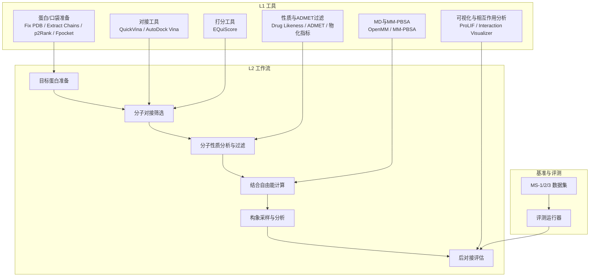
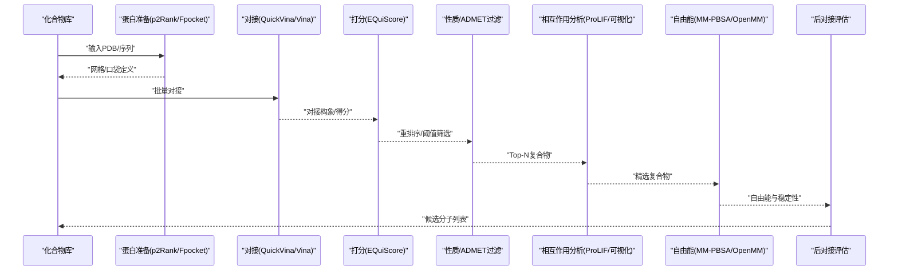
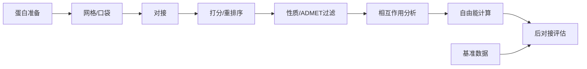

# 分子对接与虚拟筛选

<cite>
**本文引用的文件**   
- [docs/molbench_repo/skills/L1_tools/molclaw-docking-screening/README.md](file://docs/molbench_repo/skills/L1_tools/molclaw-docking-screening/README.md)
- [docs/molbench_repo/skills/L1_tools/molclaw-equiscore-tool/README.md](file://docs/molbench_repo/skills/L1_tools/molclaw-equiscore-tool/README.md)
- [docs/molbench_repo/skills/L1_tools/molclaw-quickvina-docking/README.md](file://docs/molbench_repo/skills/L1_tools/molclaw-quickvina-docking/README.md)
- [docs/molbench_repo/skills/L2_workflows/02-molecular-docking-screening.md](file://docs/molbench_repo/skills/L2_workflows/02-molecular-docking-screening.md)
- [docs/molbench_repo/skills/L2_workflows/08-post-docking-evaluation.md](file://docs/molbench_repo/skills/L2_workflows/08-post-docking-evaluation.md)
- [docs/molbench_repo/skills/L2_workflows/06-binding-free-energy-calculation.md](file://docs/molbench_repo/skills/L2_workflows/06-binding-free-energy-calculation.md)
- [docs/molbench_repo/skills/L2_workflows/07-conformational-sampling-analysis.md](file://docs/molbench_repo/skills/L2_workflows/07-conformational-sampling-analysis.md)
- [docs/molbench_repo/skills/L2_workflows/03-molecular-property-analysis-filtering.md](file://docs/molbench_repo/skills/L2_workflows/03-molecular-property-analysis-filtering.md)
- [docs/molbench_repo/skills/L2_workflows/01-target-protein-preparation.md](file://docs/molbench_repo/skills/L2_workflows/01-target-protein-preparation.md)
- [docs/molbench_repo/skills/L1_tools/molclaw-interaction-visualizer/README.md](file://docs/molbench_repo/skills/L1_tools/molclaw-interaction-visualizer/README.md)
- [docs/molbench_repo/skills/L1_tools/molclaw-fpocket-toolkit-base/README.md](file://docs/molbench_repo/skills/L1_tools/molclaw-fpocket-toolkit-base/README.md)
- [docs/molbench_repo/skills/L1_tools/molclaw-p2rank/README.md](file://docs/molbench_repo/skills/L1_tools/molclaw-p2rank/README.md)
- [docs/molbench_repo/skills/L1_tools/molclaw-fix-pdb/README.md](file://docs/molbench_repo/skills/L1_tools/molclaw-fix-pdb/README.md)
- [docs/molbench_repo/skills/L1_tools/molclaw-extract-chains/README.md](file://docs/molbench_repo/skills/L1_tools/molclaw-extract-chains/README.md)
- [docs/molbench_repo/skills/L1_tools/molclaw-pack-sidechains/README.md](file://docs/molbench_repo/skills/L1_tools/molclaw-pack-sidechains/README.md)
- [docs/molbench_repo/skills/L1_tools/molclaw-prolif-tool/README.md](file://docs/molbench_repo/skills/L1_tools/molclaw-prolif-tool/README.md)
- [docs/molbench_repo/skills/L1_tools/molclaw-prolif-docking/README.md](file://docs/molbench_repo/skills/L1_tools/molclaw-prolif-docking/README.md)
- [docs/molbench_repo/skills/L1_tools/molclaw-prolif-md/README.md](file://docs/molbench_repo/skills/L1_tools/molclaw-prolif-md/README.md)
- [docs/molbench_repo/skills/L1_tools/molclaw-prolif-pdb/README.md](file://docs/molbench_repo/skills/L1_tools/molclaw-prolif-pdb/README.md)
- [docs/molbench_repo/skills/L1_tools/molclaw-prolif-protein-protein/README.md](file://docs/molbench_repo/skills/L1_tools/molclaw-prolif-protein-protein/README.md)
- [docs/molbench_repo/skills/L1_tools/molclaw-protein-ligand-mmpbsa/README.md](file://docs/molbench_repo/skills/L1_tools/molclaw-protein-ligand-mmpbsa/README.md)
- [docs/molbench_repo/skills/L1_tools/molclaw-protein-openmm/README.md](file://docs/molbench_repo/skills/L1_tools/molclaw-protein-openmm/README.md)
- [docs/molbench_repo/skills/L1_tools/molclaw-foldx-tool/README.md](file://docs/molbench_repo/skills/L1_tools/molclaw-foldx-tool/README.md)
- [docs/molbench_repo/skills/L1_tools/molclaw-goca-tool/README.md](file://docs/molbench_repo/skills/L1_tools/molclaw-goca-tool/README.md)
- [docs/molbench_repo/skills/L1_tools/molclaw-hdock-tool/README.md](file://docs/molbench_repo/skills/L1_tools/molclaw-hdock-tool/README.md)
- [docs/molbench_repo/skills/L1_tools/molclaw-karmadock-tool/README.md](file://docs/molbench_repo/skills/L1_tools/molclaw-karmadock-tool/README.md)
- [docs/molbench_repo/skills/L1_tools/molclaw-diffdock-auto/README.md](file://docs/molbench_repo/skills/L1_tools/molclaw-diffdock-auto/README.md)
- [docs/molbench_repo/skills/L1_tools/molclaw-evobind-tool/README.md](file://docs/molbench_repo/skills/L1_tools/molclaw-evobind-tool/README.md)
- [docs/molbench_repo/skills/L1_tools/molclaw-esmfold/README.md](file://docs/molbench_repo/skills/L1_tools/molclaw-esmfold/README.md)
- [docs/molbench_repo/skills/L1_tools/molclaw-boltz2-affinity/README.md](file://docs/molbench_repo/skills/L1_tools/molclaw-boltz2-affinity/README.md)
- [docs/molbench_repo/skills/L1_tools/molclaw-compound-retrieve/README.md](file://docs/molbench_repo/skills/L1_tools/molclaw-compound-retrieve/README.md)
- [docs/molbench_repo/skills/L1_tools/molclaw-dlenovo-sampling/README.md](file://docs/molbench_repo/skills/L1_tools/molclaw-dlenovo-sampling/README.md)
- [docs/molbench_repo/skills/L1_tools/molclaw-smiles-valid-check/README.md](file://docs/molbench_repo/skills/L1_tools/molclaw-smiles-valid-check/README.md)
- [docs/molbench_repo/skills/L1_tools/molclaw-sequence-valid-check/README.md](file://docs/molbench_repo/skills/L1_tools/molclaw-sequence-valid-check/README.md)
- [docs/molbench_repo/skills/L1_tools/molclaw-drug-likeness/README.md](file://docs/molbench_repo/skills/L1_tools/molclaw-drug-likeness/README.md)
- [docs/molbench_repo/skills/L1_tools/molclaw-mol-basic-metrics/README.md](file://docs/molbench_repo/skills/L1_tools/molclaw-mol-basic-metrics/README.md)
- [docs/molbench_repo/skills/L1_tools/molclaw-mol-charge-metrics/README.md](file://docs/molbench_repo/skills/L1_tools/molclaw-mol-charge-metrics/README.md)
- [docs/molbench_repo/skills/L1_tools/molclaw-mol-complexity-metrics/README.md](file://docs/molbench_repo/skills/L1_tools/molclaw-mol-complexity-metrics/README.md)
- [docs/molbench_repo/skills/L1_tools/molclaw-mol-hbond-metrics/README.md](file://docs/molbench_repo/skills/L1_tools/molclaw-mol-hbond-metrics/README.md)
- [docs/molbench_repo/skills/L1_tools/molclaw-mol-hydrophobicity-metrics/README.md](file://docs/molbench_repo/skills/L1_tools/molclaw-mol-hydrophobicity-metrics/README.md)
- [docs/molbench_repo/skills/L1_tools/molclaw-mol-opt-physchem/README.md](file://docs/molbench_repo/skills/L1_tools/molclaw-mol-opt-physchem/README.md)
- [docs/molbench_repo/skills/L1_tools/molclaw-mol-similarity/README.md](file://docs/molbench_repo/skills/L1_tools/molclaw-mol-similarity/README.md)
- [docs/molbench_repo/skills/L1_tools/molclaw-mol-structure-metrics/README.md](file://docs/molbench_repo/skills/L1_tools/molclaw-mol-structure-metrics/README.md)
- [docs/molbench_repo/skills/L1_tools/molclaw-mol-topology-metrics/README.md](file://docs/molbench_repo/skills/L1_tools/molclaw-mol-topology-metrics/README.md)
- [docs/molbench_repo/skills/L1_tools/molclaw-mol2mol-sampling/README.md](file://docs/molbench_repo/skills/L1_tools/molclaw-mol2mol-sampling/README.md)
- [docs/molbench_repo/skills/L1_tools/molclaw-linker-sampling/README.md](file://docs/molbench_repo/skills/L1_tools/molclaw-linker-sampling/README.md)
- [docs/molbench_repo/skills/L1_tools/molclaw-rgroup-sampling/README.md](file://docs/molbench_repo/skills/L1_tools/molclaw-rgroup-sampling/README.md)
- [docs/molbench_repo/skills/L1_tools/molclaw-peptide-sampling/README.md](file://docs/molbench_repo/skills/L1_tools/molclaw-peptide-sampling/README.md)
- [docs/molbench_repo/skills/L1_tools/molclaw-protein-sequence-retrieve/README.md](file://docs/molbench_repo/skills/L1_tools/molclaw-protein-sequence-retrieve/README.md)
- [docs/molbench_repo/skills/L1_tools/molclaw-protein-structure-retrieve/README.md](file://docs/molbench_repo/skills/L1_tools/molclaw-protein-structure-retrieve/README.md)
- [docs/molbench_repo/skills/L1_tools/molclaw-pulchura-rebuild/README.md](file://docs/molbench_repo/skills/L1_tools/molclaw-pulchura-rebuild/README.md)
- [docs/molbench_repo/skills/L1_tools/molclaw-run-bioemu/README.md](file://docs/molbench_repo/skills/L1_tools/molclaw-run-bioemu/README.md)
- [docs/molbench_repo/skills/L1_tools/molclaw-scp-server/README.md](file://docs/molbench_repo/skills/L1_tools/molclaw-scp-server/README.md)
- [docs/molbench_repo/skills/L1_tools/molclaw-file-transfer/README.md](file://docs/molbench_repo/skills/L1_tools/molclaw-file-transfer/README.md)
- [docs/molbench_repo/skills/L1_tools/molclaw-skill-template-writer/README.md](file://docs/molbench_repo/skills/L1_tools/molclaw-skill-template-writer/README.md)
- [docs/molbench_repo/skills/L1_tools/molclaw-chai1-predict/README.md](file://docs/molbench_repo/skills/L1_tools/molclaw-chai1-predict/README.md)
- [docs/molbench_repo/skills/L1_tools/molclaw-chroma-toolkit/README.md](file://docs/molbench_repo/skills/L1_tools/molclaw-chroma-toolkit/README.md)
- [docs/molbench_repo/skills/L1_tools/molclaw-dleps/README.md](file://docs/molbench_repo/skills/L1_tools/molclaw-dleps/README.md)
- [docs/molbench_repo/skills/L1_tools/molclaw-openawsem-tool/README.md](file://docs/molbench_repo/skills/L1_tools/molclaw-openawsem-tool/README.md)
- [docs/molbench_repo/skills/L1_tools/molclaw-admet/README.md](file://docs/molbench_repo/skills/L1_tools/molclaw-admet/README.md)
- [docs/molbench_repo/config/baseline_molbench-ms-1.yaml](file://docs/molbench_repo/config/baseline_molbench-ms-1.yaml)
- [docs/molbench_repo/config/baseline_molbench-ms-2.yaml](file://docs/molbench_repo/config/baseline_molbench-ms-2.yaml)
- [docs/molbench_repo/config/baseline_molbench-ms-3.yaml](file://docs/molbench_repo/config/baseline_molbench-ms-3.yaml)
- [docs/molbench_repo/data_full/molbench-ms-1/molbench-ms-1.csv](file://docs/molbench_repo/data_full/molbench-ms-1/molbench-ms-1.csv)
- [docs/molbench_repo/data_full/molbench-ms-2/molbench-ms-2.csv](file://docs/molbench_repo/data_full/molbench-ms-2/molbench-ms-2.csv)
- [docs/molbench_repo/data_full/molbench-ms-3/molbench-ms-3.csv](file://docs/molbench_repo/data_full/molbench-ms-3/molbench-ms-3.csv)
- [docs/molbench_repo/eval/eval_runner.py](file://docs/molbench_repo/eval/eval_runner.py)
- [docs/molbench_repo/eval/bench_loaders.py](file://docs/molbench_repo/eval/bench_loaders.py)
- [docs/molbench_repo/eval/run_eval_bench.py](file://docs/molbench_repo/eval/run_eval_bench.py)
</cite>

## 目录
1. [引言](#引言)
2. [项目结构](#项目结构)
3. [核心组件](#核心组件)
4. [架构总览](#架构总览)
5. [详细组件分析](#详细组件分析)
6. [依赖关系分析](#依赖关系分析)
7. [性能考量](#性能考量)
8. [故障排查指南](#故障排查指南)
9. [结论](#结论)
10. [附录](#附录)

## 引言
本文件面向“分子对接与虚拟筛选”任务，系统梳理从靶点准备、配体库构建、对接网格设置、对接执行、结果分析与富集评估到结合自由能计算与构象采样的完整工作流。文档重点覆盖以下方面：
- 分子对接原理与蛋白质-配体相互作用分析
- 结合亲和力预测方法与打分函数选择策略
- QuickVina、AutoDock Vina、EQuiScore等工具的使用要点与参数配置思路
- 高通量虚拟筛选工作流设计与实现（从化合物库到候选分子）
- 结合模式可视化、相互作用分析与构象优化技术
- 富集因子计算方法与评估指标

## 项目结构
本项目围绕“技能（Skills）+ 工作流（Workflows）+ 基准数据与评测”组织，形成可复用的模块化能力集合：
- L1 工具层：提供单步能力封装，如对接、打分、可视化和前处理等
- L2 工作流层：将多个L1工具编排为端到端流程，如“分子对接筛选”、“后对接评估”、“结合自由能计算”等
- 基准与评测：包含多套MS系列数据集与评测脚本，用于衡量不同方法或参数的筛选效果

图表来源
- [docs/molbench_repo/skills/L2_workflows/02-molecular-docking-screening.md](file://docs/molbench_repo/skills/L2_workflows/02-molecular-docking-screening.md)
- [docs/molbench_repo/skills/L2_workflows/08-post-docking-evaluation.md](file://docs/molbench_repo/skills/L2_workflows/08-post-docking-evaluation.md)
- [docs/molbench_repo/skills/L2_workflows/06-binding-free-energy-calculation.md](file://docs/molbench_repo/skills/L2_workflows/06-binding-free-energy-calculation.md)
- [docs/molbench_repo/skills/L2_workflows/07-conformational-sampling-analysis.md](file://docs/molbench_repo/skills/L2_workflows/07-conformational-sampling-analysis.md)
- [docs/molbench_repo/skills/L2_workflows/03-molecular-property-analysis-filtering.md](file://docs/molbench_repo/skills/L2_workflows/03-molecular-property-analysis-filtering.md)
- [docs/molbench_repo/skills/L2_workflows/01-target-protein-preparation.md](file://docs/molbench_repo/skills/L2_workflows/01-target-protein-preparation.md)
- [docs/molbench_repo/skills/L1_tools/molclaw-docking-screening/README.md](file://docs/molbench_repo/skills/L1_tools/molclaw-docking-screening/README.md)
- [docs/molbench_repo/skills/L1_tools/molclaw-equiscore-tool/README.md](file://docs/molbench_repo/skills/L1_tools/molclaw-equiscore-tool/README.md)
- [docs/molbench_repo/skills/L1_tools/molclaw-quickvina-docking/README.md](file://docs/molbench_repo/skills/L1_tools/molclaw-quickvina-docking/README.md)
- [docs/molbench_repo/skills/L1_tools/molclaw-interaction-visualizer/README.md](file://docs/molbench_repo/skills/L1_tools/molclaw-interaction-visualizer/README.md)
- [docs/molbench_repo/skills/L1_tools/molclaw-fpocket-toolkit-base/README.md](file://docs/molbench_repo/skills/L1_tools/molclaw-fpocket-toolkit-base/README.md)
- [docs/molbench_repo/skills/L1_tools/molclaw-p2rank/README.md](file://docs/molbench_repo/skills/L1_tools/molclaw-p2rank/README.md)
- [docs/molbench_repo/skills/L1_tools/molclaw-fix-pdb/README.md](file://docs/molbench_repo/skills/L1_tools/molclaw-fix-pdb/README.md)
- [docs/molbench_repo/skills/L1_tools/molclaw-extract-chains/README.md](file://docs/molbench_repo/skills/L1_tools/molclaw-extract-chains/README.md)
- [docs/molbench_repo/skills/L1_tools/molclaw-pack-sidechains/README.md](file://docs/molbench_repo/skills/L1_tools/molclaw-pack-sidechains/README.md)
- [docs/molbench_repo/skills/L1_tools/molclaw-prolif-tool/README.md](file://docs/molbench_repo/skills/L1_tools/molclaw-prolif-tool/README.md)
- [docs/molbench_repo/skills/L1_tools/molclaw-prolif-docking/README.md](file://docs/molbench_repo/skills/L1_tools/molclaw-prolif-docking/README.md)
- [docs/molbench_repo/skills/L1_tools/molclaw-prolif-md/README.md](file://docs/molbench_repo/skills/L1_tools/molclaw-prolif-md/README.md)
- [docs/molbench_repo/skills/L1_tools/molclaw-prolif-pdb/README.md](file://docs/molbench_repo/skills/L1_tools/molclaw-prolif-pdb/README.md)
- [docs/molbench_repo/skills/L1_tools/molclaw-prolif-protein-protein/README.md](file://docs/molbench_repo/skills/L1_tools/molclaw-prolif-protein-protein/README.md)
- [docs/molbench_repo/skills/L1_tools/molclaw-protein-ligand-mmpbsa/README.md](file://docs/molbench_repo/skills/L1_tools/molclaw-protein-ligand-mmpbsa/README.md)
- [docs/molbench_repo/skills/L1_tools/molclaw-protein-openmm/README.md](file://docs/molbench_repo/skills/L1_tools/molclaw-protein-openmm/README.md)
- [docs/molbench_repo/skills/L1_tools/molclaw-admet/README.md](file://docs/molbench_repo/skills/L1_tools/molclaw-admet/README.md)
- [docs/molbench_repo/skills/L1_tools/molclaw-drug-likeness/README.md](file://docs/molbench_repo/skills/L1_tools/molclaw-drug-likeness/README.md)
- [docs/molbench_repo/skills/L1_tools/molclaw-mol-basic-metrics/README.md](file://docs/molbench_repo/skills/L1_tools/molclaw-mol-basic-metrics/README.md)
- [docs/molbench_repo/skills/L1_tools/molclaw-mol-charge-metrics/README.md](file://docs/molbench_repo/skills/L1_tools/molclaw-mol-charge-metrics/README.md)
- [docs/molbench_repo/skills/L1_tools/molclaw-mol-complexity-metrics/README.md](file://docs/molbench_repo/skills/L1_tools/molclaw-mol-complexity-metrics/README.md)
- [docs/molbench_repo/skills/L1_tools/molclaw-mol-hbond-metrics/README.md](file://docs/molbench_repo/skills/L1_tools/molclaw-mol-hbond-metrics/README.md)
- [docs/molbench_repo/skills/L1_tools/molclaw-mol-hydrophobicity-metrics/README.md](file://docs/molbench_repo/skills/L1_tools/molclaw-mol-hydrophobicity-metrics/README.md)
- [docs/molbench_repo/skills/L1_tools/molclaw-mol-opt-physchem/README.md](file://docs/molbench_repo/skills/L1_tools/molclaw-mol-opt-physchem/README.md)
- [docs/molbench_repo/skills/L1_tools/molclaw-mol-similarity/README.md](file://docs/molbench_repo/skills/L1_tools/molclaw-mol-similarity/README.md)
- [docs/molbench_repo/skills/L1_tools/molclaw-mol-structure-metrics/README.md](file://docs/molbench_repo/skills/L1_tools/molclaw-mol-structure-metrics/README.md)
- [docs/molbench_repo/skills/L1_tools/molclaw-mol-topology-metrics/README.md](file://docs/molbench_repo/skills/L1_tools/molclaw-mol-topology-metrics/README.md)
- [docs/molbench_repo/skills/L1_tools/molclaw-mol2mol-sampling/README.md](file://docs/molbench_repo/skills/L1_tools/molclaw-mol2mol-sampling/README.md)
- [docs/molbench_repo/skills/L1_tools/molclaw-linker-sampling/README.md](file://docs/molbench_repo/skills/L1_tools/molclaw-linker-sampling/README.md)
- [docs/molbench_repo/skills/L1_tools/molclaw-rgroup-sampling/README.md](file://docs/molbench_repo/skills/L1_tools/molclaw-rgroup-sampling/README.md)
- [docs/molbench_repo/skills/L1_tools/molclaw-peptide-sampling/README.md](file://docs/molbench_repo/skills/L1_tools/molclaw-peptide-sampling/README.md)
- [docs/molbench_repo/skills/L1_tools/molclaw-protein-sequence-retrieve/README.md](file://docs/molbench_repo/skills/L1_tools/molclaw-protein-sequence-retrieve/README.md)
- [docs/molbench_repo/skills/L1_tools/molclaw-protein-structure-retrieve/README.md](file://docs/molbench_repo/skills/L1_tools/molclaw-protein-structure-retrieve/README.md)
- [docs/molbench_repo/skills/L1_tools/molclaw-pulchura-rebuild/README.md](file://docs/molbench_repo/skills/L1_tools/molclaw-pulchura-rebuild/README.md)
- [docs/molbench_repo/skills/L1_tools/molclaw-run-bioemu/README.md](file://docs/molbench_repo/skills/L1_tools/molclaw-run-bioemu/README.md)
- [docs/molbench_repo/skills/L1_tools/molclaw-scp-server/README.md](file://docs/molbench_repo/skills/L1_tools/molclaw-scp-server/README.md)
- [docs/molbench_repo/skills/L1_tools/molclaw-file-transfer/README.md](file://docs/molbench_repo/skills/L1_tools/molclaw-file-transfer/README.md)
- [docs/molbench_repo/skills/L1_tools/molclaw-skill-template-writer/README.md](file://docs/molbench_repo/skills/L1_tools/molclaw-skill-template-writer/README.md)
- [docs/molbench_repo/skills/L1_tools/molclaw-chai1-predict/README.md](file://docs/molbench_repo/skills/L1_tools/molclaw-chai1-predict/README.md)
- [docs/molbench_repo/skills/L1_tools/molclaw-chroma-toolkit/README.md](file://docs/molbench_repo/skills/L1_tools/molclaw-chroma-toolkit/README.md)
- [docs/molbench_repo/skills/L1_tools/molclaw-dleps/README.md](file://docs/molbench_repo/skills/L1_tools/molclaw-dleps/README.md)
- [docs/molbench_repo/skills/L1_tools/molclaw-openawsem-tool/README.md](file://docs/molbench_repo/skills/L1_tools/molclaw-openawsem-tool/README.md)
- [docs/molbench_repo/skills/L1_tools/molclaw-foldx-tool/README.md](file://docs/molbench_repo/skills/L1_tools/molclaw-foldx-tool/README.md)
- [docs/molbench_repo/skills/L1_tools/molclaw-goca-tool/README.md](file://docs/molbench_repo/skills/L1_tools/molclaw-goca-tool/README.md)
- [docs/molbench_repo/skills/L1_tools/molclaw-hdock-tool/README.md](file://docs/molbench_repo/skills/L1_tools/molclaw-hdock-tool/README.md)
- [docs/molbench_repo/skills/L1_tools/molclaw-karmadock-tool/README.md](file://docs/molbench_repo/skills/L1_tools/molclaw-karmadock-tool/README.md)
- [docs/molbench_repo/skills/L1_tools/molclaw-diffdock-auto/README.md](file://docs/molbench_repo/skills/L1_tools/molclaw-diffdock-auto/README.md)
- [docs/molbench_repo/skills/L1_tools/molclaw-evobind-tool/README.md](file://docs/molbench_repo/skills/L1_tools/molclaw-evobind-tool/README.md)
- [docs/molbench_repo/skills/L1_tools/molclaw-esmfold/README.md](file://docs/molbench_repo/skills/L1_tools/molclaw-esmfold/README.md)
- [docs/molbench_repo/skills/L1_tools/molclaw-boltz2-affinity/README.md](file://docs/molbench_repo/skills/L1_tools/molclaw-boltz2-affinity/README.md)
- [docs/molbench_repo/skills/L1_tools/molclaw-compound-retrieve/README.md](file://docs/molbench_repo/skills/L1_tools/molclaw-compound-retrieve/README.md)
- [docs/molbench_repo/skills/L1_tools/molclaw-dlenovo-sampling/README.md](file://docs/molbench_repo/skills/L1_tools/molclaw-dlenovo-sampling/README.md)
- [docs/molbench_repo/skills/L1_tools/molclaw-smiles-valid-check/README.md](file://docs/molbench_repo/skills/L1_tools/molclaw-smiles-valid-check/README.md)
- [docs/molbench_repo/skills/L1_tools/molclaw-sequence-valid-check/README.md](file://docs/molbench_repo/skills/L1_tools/molclaw-sequence-valid-check/README.md)
- [docs/molbench_repo/data_full/molbench-ms-1/molbench-ms-1.csv](file://docs/molbench_repo/data_full/molbench-ms-1/molbench-ms-1.csv)
- [docs/molbench_repo/data_full/molbench-ms-2/molbench-ms-2.csv](file://docs/molbench_repo/data_full/molbench-ms-2/molbench-ms-2.csv)
- [docs/molbench_repo/data_full/molbench-ms-3/molbench-ms-3.csv](file://docs/molbench_repo/data_full/molbench-ms-3/molbench-ms-3.csv)
- [docs/molbench_repo/eval/eval_runner.py](file://docs/molbench_repo/eval/eval_runner.py)
- [docs/molbench_repo/eval/bench_loaders.py](file://docs/molbench_repo/eval/bench_loaders.py)
- [docs/molbench_repo/eval/run_eval_bench.py](file://docs/molbench_repo/eval/run_eval_bench.py)

章节来源
- [docs/molbench_repo/skills/L2_workflows/02-molecular-docking-screening.md](file://docs/molbench_repo/skills/L2_workflows/02-molecular-docking-screening.md)
- [docs/molbench_repo/skills/L2_workflows/08-post-docking-evaluation.md](file://docs/molbench_repo/skills/L2_workflows/08-post-docking-evaluation.md)
- [docs/molbench_repo/skills/L2_workflows/06-binding-free-energy-calculation.md](file://docs/molbench_repo/skills/L2_workflows/06-binding-free-energy-calculation.md)
- [docs/molbench_repo/skills/L2_workflows/07-conformational-sampling-analysis.md](file://docs/molbench_repo/skills/L2_workflows/07-conformational-sampling-analysis.md)
- [docs/molbench_repo/skills/L2_workflows/03-molecular-property-analysis-filtering.md](file://docs/molbench_repo/skills/L2_workflows/03-molecular-property-analysis-filtering.md)
- [docs/molbench_repo/skills/L2_workflows/01-target-protein-preparation.md](file://docs/molbench_repo/skills/L2_workflows/01-target-protein-preparation.md)

## 核心组件
- 对接工具
  - QuickVina：基于快速搜索的对接引擎，适合大规模筛选；关注搜索空间、迭代次数与并行度等关键参数
  - AutoDock Vina：经典对接引擎，广泛验证；注意网格中心、尺寸、柔性残基与能量输出格式
  - EQuiScore：经验/知识驱动的打分工具，常用于对接后重排序与结合亲和力估计
- 蛋白与口袋准备
  - Fix PDB：修复缺失原子、加氢、分配电荷等
  - Extract Chains：提取目标链与辅因子
  - p2Rank/Fpocket：自动识别潜在结合口袋并生成网格
- 相互作用分析与可视化
  - ProLIF系列：检测氢键、疏水、π-π、盐桥等相互作用，支持对接轨迹与MD轨迹
  - Interaction Visualizer：交互式可视化结合模式
- 结合自由能与构象采样
  - OpenMM + MM-PBSA：基于MD轨迹的自由能估算
  - FoldX/GOCa/HDOCK/KarMAdock/DiffDock/EvoBind：辅助建模、突变效应与替代对接策略
- 性质与ADMET过滤
  - Drug Likeness、ADMET、基础物化指标、相似性与拓扑度量等

章节来源
- [docs/molbench_repo/skills/L1_tools/molclaw-docking-screening/README.md](file://docs/molbench_repo/skills/L1_tools/molclaw-docking-screening/README.md)
- [docs/molbench_repo/skills/L1_tools/molclaw-equiscore-tool/README.md](file://docs/molbench_repo/skills/L1_tools/molclaw-equiscore-tool/README.md)
- [docs/molbench_repo/skills/L1_tools/molclaw-quickvina-docking/README.md](file://docs/molbench_repo/skills/L1_tools/molclaw-quickvina-docking/README.md)
- [docs/molbench_repo/skills/L1_tools/molclaw-interaction-visualizer/README.md](file://docs/molbench_repo/skills/L1_tools/molclaw-interaction-visualizer/README.md)
- [docs/molbench_repo/skills/L1_tools/molclaw-fpocket-toolkit-base/README.md](file://docs/molbench_repo/skills/L1_tools/molclaw-fpocket-toolkit-base/README.md)
- [docs/molbench_repo/skills/L1_tools/molclaw-p2rank/README.md](file://docs/molbench_repo/skills/L1_tools/molclaw-p2rank/README.md)
- [docs/molbench_repo/skills/L1_tools/molclaw-fix-pdb/README.md](file://docs/molbench_repo/skills/L1_tools/molclaw-fix-pdb/README.md)
- [docs/molbench_repo/skills/L1_tools/molclaw-extract-chains/README.md](file://docs/molbench_repo/skills/L1_tools/molclaw-extract-chains/README.md)
- [docs/molbench_repo/skills/L1_tools/molclaw-pack-sidechains/README.md](file://docs/molbench_repo/skills/L1_tools/molclaw-pack-sidechains/README.md)
- [docs/molbench_repo/skills/L1_tools/molclaw-prolif-tool/README.md](file://docs/molbench_repo/skills/L1_tools/molclaw-prolif-tool/README.md)
- [docs/molbench_repo/skills/L1_tools/molclaw-prolif-docking/README.md](file://docs/molbench_repo/skills/L1_tools/molclaw-prolif-docking/README.md)
- [docs/molbench_repo/skills/L1_tools/molclaw-prolif-md/README.md](file://docs/molbench_repo/skills/L1_tools/molclaw-prolif-md/README.md)
- [docs/molbench_repo/skills/L1_tools/molclaw-prolif-pdb/README.md](file://docs/molbench_repo/skills/L1_tools/molclaw-prolif-pdb/README.md)
- [docs/molbench_repo/skills/L1_tools/molclaw-prolif-protein-protein/README.md](file://docs/molbench_repo/skills/L1_tools/molclaw-prolif-protein-protein/README.md)
- [docs/molbench_repo/skills/L1_tools/molclaw-protein-ligand-mmpbsa/README.md](file://docs/molbench_repo/skills/L1_tools/molclaw-protein-ligand-mmpbsa/README.md)
- [docs/molbench_repo/skills/L1_tools/molclaw-protein-openmm/README.md](file://docs/molbench_repo/skills/L1_tools/molclaw-protein-openmm/README.md)
- [docs/molbench_repo/skills/L1_tools/molclaw-admet/README.md](file://docs/molbench_repo/skills/L1_tools/molclaw-admet/README.md)
- [docs/molbench_repo/skills/L1_tools/molclaw-drug-likeness/README.md](file://docs/molbench_repo/skills/L1_tools/molclaw-drug-likeness/README.md)
- [docs/molbench_repo/skills/L1_tools/molclaw-mol-basic-metrics/README.md](file://docs/molbench_repo/skills/L1_tools/molclaw-mol-basic-metrics/README.md)
- [docs/molbench_repo/skills/L1_tools/molclaw-mol-charge-metrics/README.md](file://docs/molbench_repo/skills/L1_tools/molclaw-mol-charge-metrics/README.md)
- [docs/molbench_repo/skills/L1_tools/molclaw-mol-complexity-metrics/README.md](file://docs/molbench_repo/skills/L1_tools/molclaw-mol-complexity-metrics/README.md)
- [docs/molbench_repo/skills/L1_tools/molclaw-mol-hbond-metrics/README.md](file://docs/molbench_repo/skills/L1_tools/molclaw-mol-hbond-metrics/README.md)
- [docs/molbench_repo/skills/L1_tools/molclaw-mol-hydrophobicity-metrics/README.md](file://docs/molbench_repo/skills/L1_tools/molclaw-mol-hydrophobicity-metrics/README.md)
- [docs/molbench_repo/skills/L1_tools/molclaw-mol-opt-physchem/README.md](file://docs/molbench_repo/skills/L1_tools/molclaw-mol-opt-physchem/README.md)
- [docs/molbench_repo/skills/L1_tools/molclaw-mol-similarity/README.md](file://docs/molbench_repo/skills/L1_tools/molclaw-mol-similarity/README.md)
- [docs/molbench_repo/skills/L1_tools/molclaw-mol-structure-metrics/README.md](file://docs/molbench_repo/skills/L1_tools/molclaw-mol-structure-metrics/README.md)
- [docs/molbench_repo/skills/L1_tools/molclaw-mol-topology-metrics/README.md](file://docs/molbench_repo/skills/L1_tools/molclaw-mol-topology-metrics/README.md)
- [docs/molbench_repo/skills/L1_tools/molclaw-mol2mol-sampling/README.md](file://docs/molbench_repo/skills/L1_tools/molclaw-mol2mol-sampling/README.md)
- [docs/molbench_repo/skills/L1_tools/molclaw-linker-sampling/README.md](file://docs/molbench_repo/skills/L1_tools/molclaw-linker-sampling/README.md)
- [docs/molbench_repo/skills/L1_tools/molclaw-rgroup-sampling/README.md](file://docs/molbench_repo/skills/L1_tools/molclaw-rgroup-sampling/README.md)
- [docs/molbench_repo/skills/L1_tools/molclaw-peptide-sampling/README.md](file://docs/molbench_repo/skills/L1_tools/molclaw-peptide-sampling/README.md)
- [docs/molbench_repo/skills/L1_tools/molclaw-protein-sequence-retrieve/README.md](file://docs/molbench_repo/skills/L1_tools/molclaw-protein-sequence-retrieve/README.md)
- [docs/molbench_repo/skills/L1_tools/molclaw-protein-structure-retrieve/README.md](file://docs/molbench_repo/skills/L1_tools/molclaw-protein-structure-retrieve/README.md)
- [docs/molbench_repo/skills/L1_tools/molclaw-pulchura-rebuild/README.md](file://docs/molbench_repo/skills/L1_tools/molclaw-pulchura-rebuild/README.md)
- [docs/molbench_repo/skills/L1_tools/molclaw-run-bioemu/README.md](file://docs/molbench_repo/skills/L1_tools/molclaw-run-bioemu/README.md)
- [docs/molbench_repo/skills/L1_tools/molclaw-scp-server/README.md](file://docs/molbench_repo/skills/L1_tools/molclaw-scp-server/README.md)
- [docs/molbench_repo/skills/L1_tools/molclaw-file-transfer/README.md](file://docs/molbench_repo/skills/L1_tools/molclaw-file-transfer/README.md)
- [docs/molbench_repo/skills/L1_tools/molclaw-skill-template-writer/README.md](file://docs/molbench_repo/skills/L1_tools/molclaw-skill-template-writer/README.md)
- [docs/molbench_repo/skills/L1_tools/molclaw-chai1-predict/README.md](file://docs/molbench_repo/skills/L1_tools/molclaw-chai1-predict/README.md)
- [docs/molbench_repo/skills/L1_tools/molclaw-chroma-toolkit/README.md](file://docs/molbench_repo/skills/L1_tools/molclaw-chroma-toolkit/README.md)
- [docs/molbench_repo/skills/L1_tools/molclaw-dleps/README.md](file://docs/molbench_repo/skills/L1_tools/molclaw-dleps/README.md)
- [docs/molbench_repo/skills/L1_tools/molclaw-openawsem-tool/README.md](file://docs/molbench_repo/skills/L1_tools/molclaw-openawsem-tool/README.md)
- [docs/molbench_repo/skills/L1_tools/molclaw-foldx-tool/README.md](file://docs/molbench_repo/skills/L1_tools/molclaw-foldx-tool/README.md)
- [docs/molbench_repo/skills/L1_tools/molclaw-goca-tool/README.md](file://docs/molbench_repo/skills/L1_tools/molclaw-goca-tool/README.md)
- [docs/molbench_repo/skills/L1_tools/molclaw-hdock-tool/README.md](file://docs/molbench_repo/skills/L1_tools/molclaw-hdock-tool/README.md)
- [docs/molbench_repo/skills/L1_tools/molclaw-karmadock-tool/README.md](file://docs/molbench_repo/skills/L1_tools/molclaw-karmadock-tool/README.md)
- [docs/molbench_repo/skills/L1_tools/molclaw-diffdock-auto/README.md](file://docs/molbench_repo/skills/L1_tools/molclaw-diffdock-auto/README.md)
- [docs/molbench_repo/skills/L1_tools/molclaw-evobind-tool/README.md](file://docs/molbench_repo/skills/L1_tools/molclaw-evobind-tool/README.md)
- [docs/molbench_repo/skills/L1_tools/molclaw-esmfold/README.md](file://docs/molbench_repo/skills/L1_tools/molclaw-esmfold/README.md)
- [docs/molbench_repo/skills/L1_tools/molclaw-boltz2-affinity/README.md](file://docs/molbench_repo/skills/L1_tools/molclaw-boltz2-affinity/README.md)
- [docs/molbench_repo/skills/L1_tools/molclaw-compound-retrieve/README.md](file://docs/molbench_repo/skills/L1_tools/molclaw-compound-retrieve/README.md)
- [docs/molbench_repo/skills/L1_tools/molclaw-dlenovo-sampling/README.md](file://docs/molbench_repo/skills/L1_tools/molclaw-dlenovo-sampling/README.md)
- [docs/molbench_repo/skills/L1_tools/molclaw-smiles-valid-check/README.md](file://docs/molbench_repo/skills/L1_tools/molclaw-smiles-valid-check/README.md)
- [docs/molbench_repo/skills/L1_tools/molclaw-sequence-valid-check/README.md](file://docs/molbench_repo/skills/L1_tools/molclaw-sequence-valid-check/README.md)

## 架构总览
下图展示从“化合物库”到“候选分子”的高通量筛选流水线，以及各阶段使用的工具与工作流模块。

图表来源
- [docs/molbench_repo/skills/L2_workflows/02-molecular-docking-screening.md](file://docs/molbench_repo/skills/L2_workflows/02-molecular-docking-screening.md)
- [docs/molbench_repo/skills/L2_workflows/08-post-docking-evaluation.md](file://docs/molbench_repo/skills/L2_workflows/08-post-docking-evaluation.md)
- [docs/molbench_repo/skills/L2_workflows/06-binding-free-energy-calculation.md](file://docs/molbench_repo/skills/L2_workflows/06-binding-free-energy-calculation.md)
- [docs/molbench_repo/skills/L2_workflows/07-conformational-sampling-analysis.md](file://docs/molbench_repo/skills/L2_workflows/07-conformational-sampling-analysis.md)
- [docs/molbench_repo/skills/L2_workflows/03-molecular-property-analysis-filtering.md](file://docs/molbench_repo/skills/L2_workflows/03-molecular-property-analysis-filtering.md)
- [docs/molbench_repo/skills/L2_workflows/01-target-protein-preparation.md](file://docs/molbench_repo/skills/L2_workflows/01-target-protein-preparation.md)
- [docs/molbench_repo/skills/L1_tools/molclaw-docking-screening/README.md](file://docs/molbench_repo/skills/L1_tools/molclaw-docking-screening/README.md)
- [docs/molbench_repo/skills/L1_tools/molclaw-equiscore-tool/README.md](file://docs/molbench_repo/skills/L1_tools/molclaw-equiscore-tool/README.md)
- [docs/molbench_repo/skills/L1_tools/molclaw-quickvina-docking/README.md](file://docs/molbench_repo/skills/L1_tools/molclaw-quickvina-docking/README.md)
- [docs/molbench_repo/skills/L1_tools/molclaw-interaction-visualizer/README.md](file://docs/molbench_repo/skills/L1_tools/molclaw-interaction-visualizer/README.md)
- [docs/molbench_repo/skills/L1_tools/molclaw-fpocket-toolkit-base/README.md](file://docs/molbench_repo/skills/L1_tools/molclaw-fpocket-toolkit-base/README.md)
- [docs/molbench_repo/skills/L1_tools/molclaw-p2rank/README.md](file://docs/molbench_repo/skills/L1_tools/molclaw-p2rank/README.md)
- [docs/molbench_repo/skills/L1_tools/molclaw-prolif-tool/README.md](file://docs/molbench_repo/skills/L1_tools/molclaw-prolif-tool/README.md)
- [docs/molbench_repo/skills/L1_tools/molclaw-protein-ligand-mmpbsa/README.md](file://docs/molbench_repo/skills/L1_tools/molclaw-protein-ligand-mmpbsa/README.md)
- [docs/molbench_repo/skills/L1_tools/molclaw-protein-openmm/README.md](file://docs/molbench_repo/skills/L1_tools/molclaw-protein-openmm/README.md)

## 详细组件分析

### 分子对接原理与打分函数
- 对接原理
  - 构象搜索：平移、旋转、扭转角采样
  - 评分函数：力场项、经验项、统计项、机器学习项
  - 柔性处理：侧链柔性、诱导契合近似、全柔性对接
- 常用打分函数
  - AutoDock Vina：半经验力场，兼顾速度与精度
  - QuickVina：在Vina基础上优化搜索效率
  - EQuiScore：基于知识与经验的打分，常用于重排序
- 选择建议
  - 初筛：QuickVina/Vina快速打分
  - 精排：EQuiScore或MM-PBSA
  - 复杂体系：考虑DiffDock/KarMAdock/EvoBind等AI/物理混合方法

章节来源
- [docs/molbench_repo/skills/L1_tools/molclaw-docking-screening/README.md](file://docs/molbench_repo/skills/L1_tools/molclaw-docking-screening/README.md)
- [docs/molbench_repo/skills/L1_tools/molclaw-equiscore-tool/README.md](file://docs/molbench_repo/skills/L1_tools/molclaw-equiscore-tool/README.md)
- [docs/molbench_repo/skills/L1_tools/molclaw-quickvina-docking/README.md](file://docs/molbench_repo/skills/L1_tools/molclaw-quickvina-docking/README.md)
- [docs/molbench_repo/skills/L1_tools/molclaw-diffdock-auto/README.md](file://docs/molbench_repo/skills/L1_tools/molclaw-diffdock-auto/README.md)
- [docs/molbench_repo/skills/L1_tools/molclaw-karmadock-tool/README.md](file://docs/molbench_repo/skills/L1_tools/molclaw-karmadock-tool/README.md)
- [docs/molbench_repo/skills/L1_tools/molclaw-evobind-tool/README.md](file://docs/molbench_repo/skills/L1_tools/molclaw-evobind-tool/README.md)

### 蛋白质结构准备与口袋识别
- 结构修复与加氢：Fix PDB
- 链提取与辅因子处理：Extract Chains
- 侧链重建：Pack Sidechains
- 口袋识别与网格生成：p2Rank、Fpocket
- 推荐流程
  - 清洗PDB → 加氢/分配电荷 → 提取目标链 → 口袋识别 → 生成网格

章节来源
- [docs/molbench_repo/skills/L1_tools/molclaw-fix-pdb/README.md](file://docs/molbench_repo/skills/L1_tools/molclaw-fix-pdb/README.md)
- [docs/molbench_repo/skills/L1_tools/molclaw-extract-chains/README.md](file://docs/molbench_repo/skills/L1_tools/molclaw-extract-chains/README.md)
- [docs/molbench_repo/skills/L1_tools/molclaw-pack-sidechains/README.md](file://docs/molbench_repo/skills/L1_tools/molclaw-pack-sidechains/README.md)
- [docs/molbench_repo/skills/L1_tools/molclaw-p2rank/README.md](file://docs/molbench_repo/skills/L1_tools/molclaw-p2rank/README.md)
- [docs/molbench_repo/skills/L1_tools/molclaw-fpocket-toolkit-base/README.md](file://docs/molbench_repo/skills/L1_tools/molclaw-fpocket-toolkit-base/README.md)
- [docs/molbench_repo/skills/L2_workflows/01-target-protein-preparation.md](file://docs/molbench_repo/skills/L2_workflows/01-target-protein-preparation.md)

### 配体库构建与预处理
- 来源检索：Compound Retrieve
- 有效性检查：SMILES Valid Check
- 三维化与质子化：Chroma Toolkit
- 去重与多样性：Similarity、Topology Metrics
- 建议
  - 统一标准态（质子化、互变异构体枚举）
  - 控制分子量、LogP、HBA/HBD等药代限制

章节来源
- [docs/molbench_repo/skills/L1_tools/molclaw-compound-retrieve/README.md](file://docs/molbench_repo/skills/L1_tools/molclaw-compound-retrieve/README.md)
- [docs/molbench_repo/skills/L1_tools/molclaw-smiles-valid-check/README.md](file://docs/molbench_repo/skills/L1_tools/molclaw-smiles-valid-check/README.md)
- [docs/molbench_repo/skills/L1_tools/molclaw-chroma-toolkit/README.md](file://docs/molbench_repo/skills/L1_tools/molclaw-chroma-toolkit/README.md)
- [docs/molbench_repo/skills/L1_tools/molclaw-mol-similarity/README.md](file://docs/molbench_repo/skills/L1_tools/molclaw-mol-similarity/README.md)
- [docs/molbench_repo/skills/L1_tools/molclaw-mol-topology-metrics/README.md](file://docs/molbench_repo/skills/L1_tools/molclaw-mol-topology-metrics/README.md)

### 对接网格设置与对接执行
- 网格中心与尺寸：以已知配体或p2Rank/Fpocket输出的口袋为中心，尺寸需覆盖结合位点
- 柔性策略：固定受体为主，必要时引入关键侧链柔性
- 搜索深度与并行：根据库规模调整迭代次数与并发数
- 对接执行：使用QuickVina或Vina批量对接，保存构象与得分

章节来源
- [docs/molbench_repo/skills/L1_tools/molclaw-docking-screening/README.md](file://docs/molbench_repo/skills/L1_tools/molclaw-docking-screening/README.md)
- [docs/molbench_repo/skills/L1_tools/molclaw-quickvina-docking/README.md](file://docs/molbench_repo/skills/L1_tools/molclaw-quickvina-docking/README.md)
- [docs/molbench_repo/skills/L2_workflows/02-molecular-docking-screening.md](file://docs/molbench_repo/skills/L2_workflows/02-molecular-docking-screening.md)

### 结果分析与富集评估
- 打分与重排序：Vina/QuickVina原始得分 + EQuiScore重排序
- 相互作用分析：ProLIF检测氢键、疏水、π-π、盐桥等
- 可视化：Interaction Visualizer查看结合模式
- 富集因子计算
  - 定义：在Top-K中活性分子比例相对于随机比例的倍数
  - 步骤：标注活性/非活性 → 按得分排序 → 计算Top-K命中率 → 计算EF
- 评估指标：EF、AUROC、AUPRC、Enrichment at X%

章节来源
- [docs/molbench_repo/skills/L1_tools/molclaw-equiscore-tool/README.md](file://docs/molbench_repo/skills/L1_tools/molclaw-equiscore-tool/README.md)
- [docs/molbench_repo/skills/L1_tools/molclaw-prolif-tool/README.md](file://docs/molbench_repo/skills/L1_tools/molclaw-prolif-tool/README.md)
- [docs/molbench_repo/skills/L1_tools/molclaw-interaction-visualizer/README.md](file://docs/molbench_repo/skills/L1_tools/molclaw-interaction-visualizer/README.md)
- [docs/molbench_repo/skills/L2_workflows/08-post-docking-evaluation.md](file://docs/molbench_repo/skills/L2_workflows/08-post-docking-evaluation.md)

### 结合自由能与构象采样
- MM-PBSA：基于MD轨迹的平均自由能估算
- OpenMM：高效MD模拟，支持周期性边界与显式溶剂
- 构象采样：增强采样或多次独立短MD，提升统计可靠性
- 适用场景：对Top候选进行更精确的相对结合自由能比较

章节来源
- [docs/molbench_repo/skills/L1_tools/molclaw-protein-ligand-mmpbsa/README.md](file://docs/molbench_repo/skills/L1_tools/molclaw-protein-ligand-mmpbsa/README.md)
- [docs/molbench_repo/skills/L1_tools/molclaw-protein-openmm/README.md](file://docs/molbench_repo/skills/L1_tools/molclaw-protein-openmm/README.md)
- [docs/molbench_repo/skills/L2_workflows/06-binding-free-energy-calculation.md](file://docs/molbench_repo/skills/L2_workflows/06-binding-free-energy-calculation.md)
- [docs/molbench_repo/skills/L2_workflows/07-conformational-sampling-analysis.md](file://docs/molbench_repo/skills/L2_workflows/07-conformational-sampling-analysis.md)

### 虚拟筛选策略与打分函数选择
- 两阶段策略
  - 粗筛：QuickVina/Vina快速打分，保留Top百分比
  - 精排：EQuiScore/MM-PBSA进一步区分
- 多打分融合
  - 加权融合或排名聚合（Borda/稳健排序）
- 多样化探索
  - 结合不同口袋或柔性策略，避免单一打分偏差

章节来源
- [docs/molbench_repo/skills/L2_workflows/02-molecular-docking-screening.md](file://docs/molbench_repo/skills/L2_workflows/02-molecular-docking-screening.md)
- [docs/molbench_repo/skills/L2_workflows/08-post-docking-evaluation.md](file://docs/molbench_repo/skills/L2_workflows/08-post-docking-evaluation.md)

### 实际工作流示例（从化合物库到候选分子）
- 步骤概览
  - 蛋白准备 → 口袋识别与网格 → 配体库预处理 → 批量对接 → 打分重排序 → 相互作用分析 → 自由能计算 → 结果汇总与报告
- 参考工作流
  - 目标蛋白准备：[01-target-protein-preparation.md](file://docs/molbench_repo/skills/L2_workflows/01-target-protein-preparation.md)
  - 分子对接筛选：[02-molecular-docking-screening.md](file://docs/molbench_repo/skills/L2_workflows/02-molecular-docking-screening.md)
  - 分子性质分析与过滤：[03-molecular-property-analysis-filtering.md](file://docs/molbench_repo/skills/L2_workflows/03-molecular-property-analysis-filtering.md)
  - 结合自由能计算：[06-binding-free-energy-calculation.md](file://docs/molbench_repo/skills/L2_workflows/06-binding-free-energy-calculation.md)
  - 构象采样与分析：[07-conformational-sampling-analysis.md](file://docs/molbench_repo/skills/L2_workflows/07-conformational-sampling-analysis.md)
  - 后对接评估：[08-post-docking-evaluation.md](file://docs/molbench_repo/skills/L2_workflows/08-post-docking-evaluation.md)

章节来源
- [docs/molbench_repo/skills/L2_workflows/01-target-protein-preparation.md](file://docs/molbench_repo/skills/L2_workflows/01-target-protein-preparation.md)
- [docs/molbench_repo/skills/L2_workflows/02-molecular-docking-screening.md](file://docs/molbench_repo/skills/L2_workflows/02-molecular-docking-screening.md)
- [docs/molbench_repo/skills/L2_workflows/03-molecular-property-analysis-filtering.md](file://docs/molbench_repo/skills/L2_workflows/03-molecular-property-analysis-filtering.md)
- [docs/molbench_repo/skills/L2_workflows/06-binding-free-energy-calculation.md](file://docs/molbench_repo/skills/L2_workflows/06-binding-free-energy-calculation.md)
- [docs/molbench_repo/skills/L2_workflows/07-conformational-sampling-analysis.md](file://docs/molbench_repo/skills/L2_workflows/07-conformational-sampling-analysis.md)
- [docs/molbench_repo/skills/L2_workflows/08-post-docking-evaluation.md](file://docs/molbench_repo/skills/L2_workflows/08-post-docking-evaluation.md)

## 依赖关系分析
- 工具间耦合
  - 对接工具依赖蛋白/口袋准备与网格定义
  - 打分与可视化依赖对接结果（复合物构象）
  - MM-PBSA依赖MD轨迹与稳定复合物
- 外部集成
  - 数据加载与评测：通过评测运行器与基准数据集驱动
- 可能的循环依赖
  - 工作流编排应避免双向强依赖，采用单向数据流

图表来源
- [docs/molbench_repo/eval/eval_runner.py](file://docs/molbench_repo/eval/eval_runner.py)
- [docs/molbench_repo/eval/bench_loaders.py](file://docs/molbench_repo/eval/bench_loaders.py)
- [docs/molbench_repo/eval/run_eval_bench.py](file://docs/molbench_repo/eval/run_eval_bench.py)
- [docs/molbench_repo/skills/L2_workflows/02-molecular-docking-screening.md](file://docs/molbench_repo/skills/L2_workflows/02-molecular-docking-screening.md)
- [docs/molbench_repo/skills/L2_workflows/08-post-docking-evaluation.md](file://docs/molbench_repo/skills/L2_workflows/08-post-docking-evaluation.md)

章节来源
- [docs/molbench_repo/eval/eval_runner.py](file://docs/molbench_repo/eval/eval_runner.py)
- [docs/molbench_repo/eval/bench_loaders.py](file://docs/molbench_repo/eval/bench_loaders.py)
- [docs/molbench_repo/eval/run_eval_bench.py](file://docs/molbench_repo/eval/run_eval_bench.py)

## 性能考量
- 并行与批处理
  - 对接与打分阶段高度并行，合理设置并发数与队列长度
- I/O与存储
  - 大量构象与轨迹文件需分层存储与压缩
- 内存与CPU
  - MM-PBSA与MD阶段对内存敏感，需按节点资源切分任务
- 缓存与复用
  - 蛋白准备与网格生成结果可缓存，避免重复计算

## 故障排查指南
- 常见问题
  - 对接失败：检查网格中心与尺寸、配体质子化状态、受体柔性设置
  - 打分异常：确认打分函数版本与输入格式一致性
  - 轨迹崩溃：检查力场参数、温度/压力耦合、时间步长
- 定位方法
  - 日志解析：记录每个阶段的输入/输出路径与错误码
  - 最小复现：缩小样本量与简化参数，逐步恢复复杂度
- 回退策略
  - 切换打分函数或对接引擎，对比结果稳定性

## 结论
本项目提供了从蛋白准备、口袋识别、配体库构建、对接筛选、相互作用分析到自由能计算的完整能力矩阵。通过L1工具与L2工作流的组合，可实现高通量虚拟筛选与精细化评估。建议在工程实践中重视标准化输入输出、可复现实验与可解释性分析，并结合基准数据集持续校准筛选策略。

## 附录
- 基准数据集与配置文件
  - MS-1/2/3数据集与基线配置：见下方文件
- 评测脚本
  - 评测运行器与数据加载器：见下方文件

章节来源
- [docs/molbench_repo/config/baseline_molbench-ms-1.yaml](file://docs/molbench_repo/config/baseline_molbench-ms-1.yaml)
- [docs/molbench_repo/config/baseline_molbench-ms-2.yaml](file://docs/molbench_repo/config/baseline_molbench-ms-2.yaml)
- [docs/molbench_repo/config/baseline_molbench-ms-3.yaml](file://docs/molbench_repo/config/baseline_molbench-ms-3.yaml)
- [docs/molbench_repo/data_full/molbench-ms-1/molbench-ms-1.csv](file://docs/molbench_repo/data_full/molbench-ms-1/molbench-ms-1.csv)
- [docs/molbench_repo/data_full/molbench-ms-2/molbench-ms-2.csv](file://docs/molbench_repo/data_full/molbench-ms-2/molbench-ms-2.csv)
- [docs/molbench_repo/data_full/molbench-ms-3/molbench-ms-3.csv](file://docs/molbench_repo/data_full/molbench-ms-3/molbench-ms-3.csv)
- [docs/molbench_repo/eval/eval_runner.py](file://docs/molbench_repo/eval/eval_runner.py)
- [docs/molbench_repo/eval/bench_loaders.py](file://docs/molbench_repo/eval/bench_loaders.py)
- [docs/molbench_repo/eval/run_eval_bench.py](file://docs/molbench_repo/eval/run_eval_bench.py)