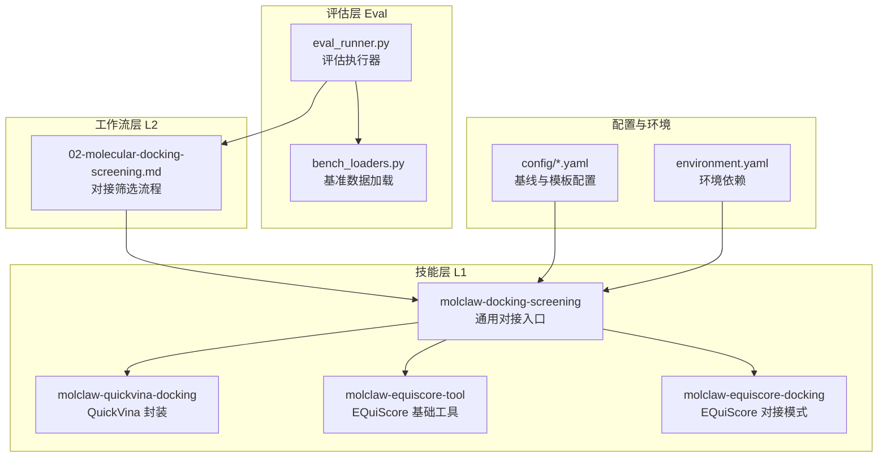
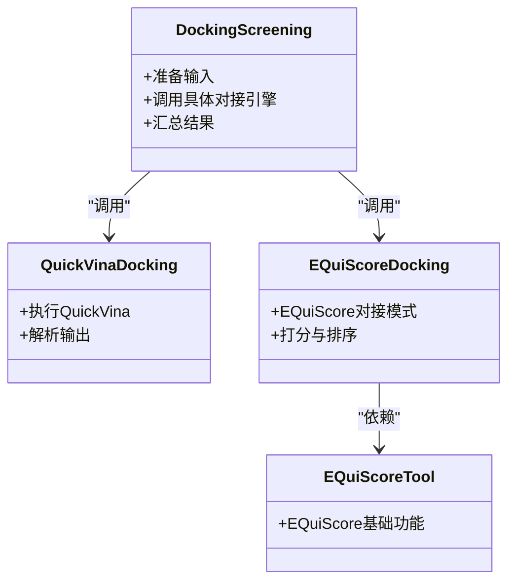
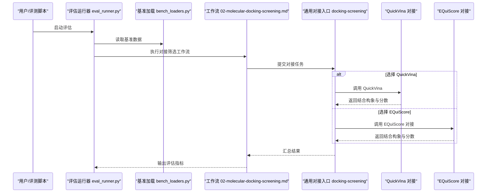
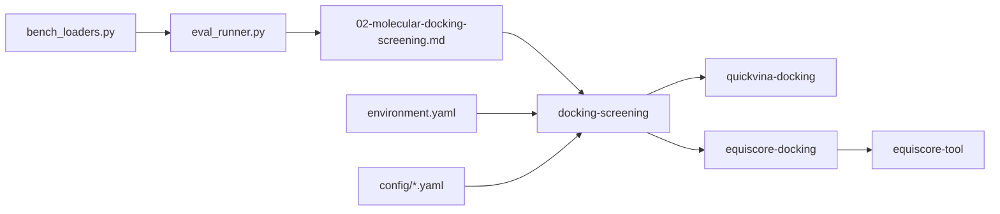

# 对接工具概览

<cite>
**本文引用的文件**   
- [README.md](file://docs/molbench_repo/README.md)
- [environment.yaml](file://docs/molbench_repo/environment.yaml)
- [env.template](file://docs/molbench_repo/env.template)
- [baseline_molbench-ms-1.yaml](file://docs/molbench_repo/config/baseline_molbench-ms-1.yaml)
- [baseline_molbench-ms-2.yaml](file://docs/molbench_repo/config/baseline_molbench-ms-2.yaml)
- [baseline_molbench-ms-3.yaml](file://docs/molbench_repo/config/baseline_molbench-ms-3.yaml)
- [chemcot_mo_edit.yaml](file://docs/molbench_repo/config/chemcot_mo_edit.yaml)
- [chemcot_mo_opt.yaml](file://docs/molbench_repo/config/chemcot_mo_opt.yaml)
- [claude_template.yaml](file://docs/molbench_repo/config/claude_template.yaml)
- [molclaw-docking-screening/skill.py](file://docs/molbench_repo/skills/L1_tools/molclaw-docking-screening/skill.py)
- [molclaw-equiscore-tool/skill.py](file://docs/molbench_repo/skills/L1_tools/molclaw-equiscore-tool/skill.py)
- [molclaw-equiscore-docking/skill.py](file://docs/molbench_repo/skills/L1_tools/molclaw-equiscore-docking/skill.py)
- [molclaw-quickvina-docking/skill.py](file://docs/molbench_repo/skills/L1_tools/molclaw-quickvina-docking/skill.py)
- [02-molecular-docking-screening.md](file://docs/molbench_repo/skills/L2_workflows/02-molecular-docking-screening.md)
- [eval_runner.py](file://docs/molbench_repo/eval/eval_runner.py)
- [bench_loaders.py](file://docs/molbench_repo/eval/bench_loaders.py)
</cite>

## 目录
1. [简介](#简介)
2. [项目结构](#项目结构)
3. [核心组件](#核心组件)
4. [架构总览](#架构总览)
5. [详细组件分析](#详细组件分析)
6. [依赖关系分析](#依赖关系分析)
7. [性能考量](#性能考量)
8. [故障排查指南](#故障排查指南)
9. [结论](#结论)
10. [附录](#附录)

## 简介
本文件面向分子对接与虚拟筛选工作流，系统梳理本项目中集成的对接与评分工具（QuickVina、AutoDock Vina、EQuiScore）及其在技能与工作流中的使用方式。文档覆盖：
- 各工具的功能特点、适用场景与技术优势
- 参数配置选项、输入输出格式与性能特征
- 不同对接算法的原理差异（搜索算法、打分函数、构象采样）
- 工具选择指南与环境安装配置说明

## 项目结构
本项目将对接相关能力以“技能（Skill）”和“工作流（Workflow）”的形式组织，并通过评估框架进行统一编排与评测。关键路径包括：
- 技能定义与调用封装：skills/L1_tools 下各 molclaw-* 目录
- 工作流编排：skills/L2_workflows 下的对接筛选流程
- 评估运行器与数据加载：eval/ 目录
- 环境依赖与基线配置：config/ 与 environment.yaml

图表来源
- [02-molecular-docking-screening.md](file://docs/molbench_repo/skills/L2_workflows/02-molecular-docking-screening.md)
- [eval_runner.py](file://docs/molbench_repo/eval/eval_runner.py)
- [bench_loaders.py](file://docs/molbench_repo/eval/bench_loaders.py)
- [environment.yaml](file://docs/molbench_repo/environment.yaml)
- [baseline_molbench-ms-1.yaml](file://docs/molbench_repo/config/baseline_molbench-ms-1.yaml)
- [baseline_molbench-ms-2.yaml](file://docs/molbench_repo/config/baseline_molbench-ms-2.yaml)
- [baseline_molbench-ms-3.yaml](file://docs/molbench_repo/config/baseline_molbench-ms-3.yaml)
- [chemcot_mo_edit.yaml](file://docs/molbench_repo/config/chemcot_mo_edit.yaml)
- [chemcot_mo_opt.yaml](file://docs/molbench_repo/config/chemcot_mo_opt.yaml)
- [claude_template.yaml](file://docs/molbench_repo/config/claude_template.yaml)

章节来源
- [README.md](file://docs/molbench_repo/README.md)
- [environment.yaml](file://docs/molbench_repo/environment.yaml)
- [02-molecular-docking-screening.md](file://docs/molbench_repo/skills/L2_workflows/02-molecular-docking-screening.md)
- [eval_runner.py](file://docs/molbench_repo/eval/eval_runner.py)
- [bench_loaders.py](file://docs/molbench_repo/eval/bench_loaders.py)

## 核心组件
本节聚焦于与对接直接相关的技能模块，说明其职责与相互关系：
- 通用对接入口（molclaw-docking-screening）：负责对接任务编排、参数组装与结果收集
- QuickVina 对接（molclaw-quickvina-docking）：基于 QuickVina 的对接实现
- EQuiScore 工具（molclaw-equiscore-tool）：提供 EQuiScore 的基础能力
- EQuiScore 对接（molclaw-equiscore-docking）：在 EQuiScore 框架下进行对接与打分

图表来源
- [molclaw-docking-screening/skill.py](file://docs/molbench_repo/skills/L1_tools/molclaw-docking-screening/skill.py)
- [molclaw-quickvina-docking/skill.py](file://docs/molbench_repo/skills/L1_tools/molclaw-quickvina-docking/skill.py)
- [molclaw-equiscore-tool/skill.py](file://docs/molbench_repo/skills/L1_tools/molclaw-equiscore-tool/skill.py)
- [molclaw-equiscore-docking/skill.py](file://docs/molbench_repo/skills/L1_tools/molclaw-equiscore-docking/skill.py)

章节来源
- [molclaw-docking-screening/skill.py](file://docs/molbench_repo/skills/L1_tools/molclaw-docking-screening/skill.py)
- [molclaw-quickvina-docking/skill.py](file://docs/molbench_repo/skills/L1_tools/molclaw-quickvina-docking/skill.py)
- [molclaw-equiscore-tool/skill.py](file://docs/molbench_repo/skills/L1_tools/molclaw-equiscore-tool/skill.py)
- [molclaw-equiscore-docking/skill.py](file://docs/molbench_repo/skills/L1_tools/molclaw-equiscore-docking/skill.py)

## 架构总览
从端到端视角看，对接筛选由工作流驱动，工作流调用通用对接入口，后者根据配置选择具体对接引擎（QuickVina 或 EQuiScore），最终通过评估运行器对结果进行度量与对比。

图表来源
- [eval_runner.py](file://docs/molbench_repo/eval/eval_runner.py)
- [bench_loaders.py](file://docs/molbench_repo/eval/bench_loaders.py)
- [02-molecular-docking-screening.md](file://docs/molbench_repo/skills/L2_workflows/02-molecular-docking-screening.md)
- [molclaw-docking-screening/skill.py](file://docs/molbench_repo/skills/L1_tools/molclaw-docking-screening/skill.py)
- [molclaw-quickvina-docking/skill.py](file://docs/molbench_repo/skills/L1_tools/molclaw-quickvina-docking/skill.py)
- [molclaw-equiscore-docking/skill.py](file://docs/molbench_repo/skills/L1_tools/molclaw-equiscore-docking/skill.py)

## 详细组件分析

### QuickVina 对接（molclaw-quickvina-docking）
- 功能特点
  - 基于 QuickVina 的高效对接实现，适合大规模配体库的快速筛选
  - 支持并行化与批处理，提升吞吐
- 适用场景
  - 高通量虚拟筛选、初筛阶段快速排序
- 技术优势
  - 速度优先，兼顾一定精度；适合早期候选物过滤
- 参数配置要点
  - 搜索空间（中心坐标与尺寸）、最大迭代次数、种群大小、能量权重等
  - 输出格式通常为 PDBQT/PDB 配合分数列表
- 输入输出格式
  - 输入：受体与配体的标准化结构文件（如 PDB/PDBQT）
  - 输出：结合构象与打分结果（PDB/PDBQT + 分数）
- 性能特征
  - 高并发下表现稳定；CPU 密集型，建议多核并行

章节来源
- [molclaw-quickvina-docking/skill.py](file://docs/molbench_repo/skills/L1_tools/molclaw-quickvina-docking/skill.py)

### AutoDock Vina（通过通用对接入口）
- 功能特点
  - 经典对接引擎，广泛验证的打分函数与采样策略
- 适用场景
  - 需要较高精度的单复合物对接或小规模精细筛选
- 技术优势
  - 成熟生态、丰富的参数调优经验与文献支撑
- 参数配置要点
  - 搜索区域、 exhaustiveness、num_modes、energy_range 等
- 输入输出格式
  - 输入：PDBQT（受体/配体）
  - 输出：PDBQT 构象与结合自由能估计
- 性能特征
  - 精度与速度平衡较好；中等规模数据集可接受

章节来源
- [molclaw-docking-screening/skill.py](file://docs/molbench_repo/skills/L1_tools/molclaw-docking-screening/skill.py)

### EQuiScore 工具与对接（molclaw-equiscore-tool / molclaw-equiscore-docking）
- 功能特点
  - 提供 EQuiScore 基础能力与对接模式，强调物理化学一致性与可解释性
- 适用场景
  - 需要更稳健打分与物理约束的对接任务；对结果可解释性有要求
- 技术优势
  - 在复杂体系与柔性位点场景中具备稳定性；可与后续性质分析衔接
- 参数配置要点
  - 力场/势函数选择、采样步数、收敛阈值、温度/压力等热力学设置
- 输入输出格式
  - 输入：标准生物大分子结构（PDB 等）
  - 输出：结合构象与 EQuiScore 打分、轨迹/统计信息（视配置）
- 性能特征
  - 计算开销高于传统经验打分；适合中小规模高精度任务

章节来源
- [molclaw-equiscore-tool/skill.py](file://docs/molbench_repo/skills/L1_tools/molclaw-equiscore-tool/skill.py)
- [molclaw-equiscore-docking/skill.py](file://docs/molbench_repo/skills/L1_tools/molclaw-equiscore-docking/skill.py)

### 通用对接入口（molclaw-docking-screening）
- 职责
  - 统一对接任务接口：参数校验、输入预处理、引擎路由、结果聚合
- 设计要点
  - 通过配置文件选择引擎（QuickVina/EQuiScore/AutoDock Vina）
  - 支持批量任务与失败重试机制
- 集成点
  - 与工作流（L2）和评估（Eval）紧密耦合

章节来源
- [molclaw-docking-screening/skill.py](file://docs/molbench_repo/skills/L1_tools/molclaw-docking-screening/skill.py)

### 工作流：分子对接筛选（02-molecular-docking-screening.md）
- 流程概述
  - 数据准备 → 参数装配 → 对接执行 → 结果后处理 → 指标计算
- 关键节点
  - 输入数据规范化、对接参数模板化、结果去重与排序
- 扩展性
  - 可通过新增技能接入新的对接引擎

章节来源
- [02-molecular-docking-screening.md](file://docs/molbench_repo/skills/L2_workflows/02-molecular-docking-screening.md)

### 评估运行器与基准加载（eval_runner.py / bench_loaders.py）
- 评估运行器
  - 负责调度工作流、记录日志、汇总指标
- 基准加载
  - 提供标准化的基准数据集与元数据，确保可重复评测

章节来源
- [eval_runner.py](file://docs/molbench_repo/eval/eval_runner.py)
- [bench_loaders.py](file://docs/molbench_repo/eval/bench_loaders.py)

## 依赖关系分析
- 组件耦合
  - 通用对接入口对具体引擎弱耦合，通过配置切换
  - 工作流对入口强耦合，但入口内部对引擎解耦
- 外部依赖
  - 环境依赖集中于 environment.yaml；基线配置位于 config/*.yaml
- 潜在循环依赖
  - 当前结构为单向调用链，未见循环依赖迹象

图表来源
- [molclaw-docking-screening/skill.py](file://docs/molbench_repo/skills/L1_tools/molclaw-docking-screening/skill.py)
- [molclaw-quickvina-docking/skill.py](file://docs/molbench_repo/skills/L1_tools/molclaw-quickvina-docking/skill.py)
- [molclaw-equiscore-docking/skill.py](file://docs/molbench_repo/skills/L1_tools/molclaw-equiscore-docking/skill.py)
- [molclaw-equiscore-tool/skill.py](file://docs/molbench_repo/skills/L1_tools/molclaw-equiscore-tool/skill.py)
- [02-molecular-docking-screening.md](file://docs/molbench_repo/skills/L2_workflows/02-molecular-docking-screening.md)
- [eval_runner.py](file://docs/molbench_repo/eval/eval_runner.py)
- [bench_loaders.py](file://docs/molbench_repo/eval/bench_loaders.py)
- [environment.yaml](file://docs/molbench_repo/environment.yaml)
- [baseline_molbench-ms-1.yaml](file://docs/molbench_repo/config/baseline_molbench-ms-1.yaml)
- [baseline_molbench-ms-2.yaml](file://docs/molbench_repo/config/baseline_molbench-ms-2.yaml)
- [baseline_molbench-ms-3.yaml](file://docs/molbench_repo/config/baseline_molbench-ms-3.yaml)
- [chemcot_mo_edit.yaml](file://docs/molbench_repo/config/chemcot_mo_edit.yaml)
- [chemcot_mo_opt.yaml](file://docs/molbench_repo/config/chemcot_mo_opt.yaml)
- [claude_template.yaml](file://docs/molbench_repo/config/claude_template.yaml)

章节来源
- [environment.yaml](file://docs/molbench_repo/environment.yaml)
- [baseline_molbench-ms-1.yaml](file://docs/molbench_repo/config/baseline_molbench-ms-1.yaml)
- [baseline_molbench-ms-2.yaml](file://docs/molbench_repo/config/baseline_molbench-ms-2.yaml)
- [baseline_molbench-ms-3.yaml](file://docs/molbench_repo/config/baseline_molbench-ms-3.yaml)
- [chemcot_mo_edit.yaml](file://docs/molbench_repo/config/chemcot_mo_edit.yaml)
- [chemcot_mo_opt.yaml](file://docs/molbench_repo/config/chemcot_mo_opt.yaml)
- [claude_template.yaml](file://docs/molbench_repo/config/claude_template.yaml)

## 性能考量
- 吞吐量与延迟
  - QuickVina 在高并发下吞吐更高，适合初筛
  - EQuiScore 在精度与稳定性上更优，但耗时更长
- 资源占用
  - CPU 密集为主；合理设置并行度避免过载
- 可扩展性
  - 通过配置切换引擎，便于在不同硬件条件下优化

[本节为通用指导，不直接分析具体文件]

## 故障排查指南
- 常见问题定位
  - 输入文件格式错误：检查 PDB/PDBQT 规范与原子类型
  - 参数越界：核对搜索空间、迭代次数、种群大小等范围
  - 资源不足：监控 CPU/内存占用，调整并行度
- 日志与回滚
  - 利用评估运行器的日志输出定位失败步骤
  - 对失败任务启用重试与断点续跑

章节来源
- [eval_runner.py](file://docs/molbench_repo/eval/eval_runner.py)
- [02-molecular-docking-screening.md](file://docs/molbench_repo/skills/L2_workflows/02-molecular-docking-screening.md)

## 结论
本项目通过技能化与模块化设计，将 QuickVina、AutoDock Vina 与 EQuiScore 等对接工具整合到统一的对接筛选工作流中。开发者可根据任务规模与精度需求灵活选择引擎，并借助评估框架进行可重复的对比评测。建议在初筛阶段优先使用 QuickVina，在关键候选物的精细化评估中使用 EQuiScore 或 AutoDock Vina。

[本节为总结性内容，不直接分析具体文件]

## 附录

### 算法原理差异速览
- 搜索算法
  - QuickVina：改进的遗传算法与局部搜索结合，强调效率
  - AutoDock Vina：增量修剪与蒙特卡洛采样，兼顾速度与精度
  - EQuiScore：基于物理化学势函数的采样与优化，强调一致性
- 打分函数
  - 经验打分（Vina/QuickVina）：拟合实验数据的线性组合项
  - 物理/半经验打分（EQuiScore）：引入更多物理约束与可解释性
- 构象采样
  - 全局搜索 vs 局部细化；柔性位点处理策略差异

[本节为概念性说明，不直接分析具体文件]

### 工具选择指南
- 高通量初筛：优先 QuickVina
- 小规模高精度：优先 EQuiScore 或 AutoDock Vina
- 需要可解释性与物理约束：优先 EQuiScore
- 已有大量 Vina 经验与参数：优先 AutoDock Vina

[本节为概念性说明，不直接分析具体文件]

### 安装与环境依赖
- 环境依赖
  - 参考 environment.yaml 安装所需包与运行时
- 基线与模板配置
  - 使用 config/*.yaml 中的基线与模板进行参数管理
- 环境变量
  - 参考 env.template 配置必要的环境变量

章节来源
- [environment.yaml](file://docs/molbench_repo/environment.yaml)
- [baseline_molbench-ms-1.yaml](file://docs/molbench_repo/config/baseline_molbench-ms-1.yaml)
- [baseline_molbench-ms-2.yaml](file://docs/molbench_repo/config/baseline_molbench-ms-2.yaml)
- [baseline_molbench-ms-3.yaml](file://docs/molbench_repo/config/baseline_molbench-ms-3.yaml)
- [chemcot_mo_edit.yaml](file://docs/molbench_repo/config/chemcot_mo_edit.yaml)
- [chemcot_mo_opt.yaml](file://docs/molbench_repo/config/chemcot_mo_opt.yaml)
- [claude_template.yaml](file://docs/molbench_repo/config/claude_template.yaml)
- [env.template](file://docs/molbench_repo/env.template)