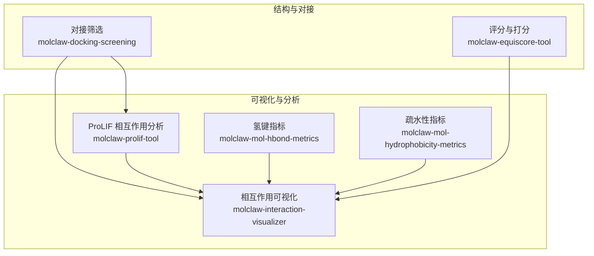
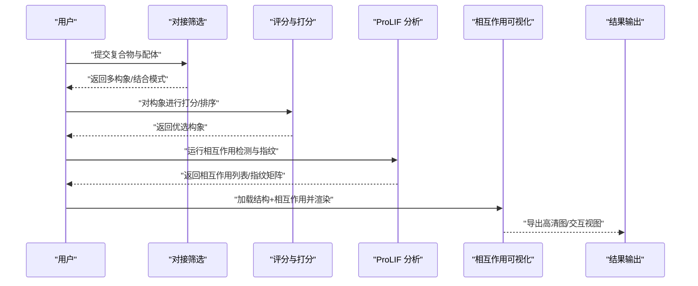
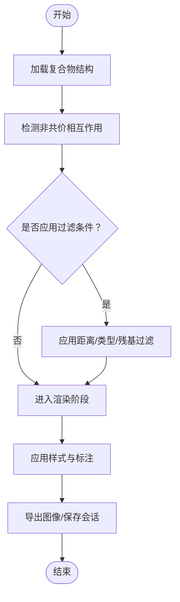
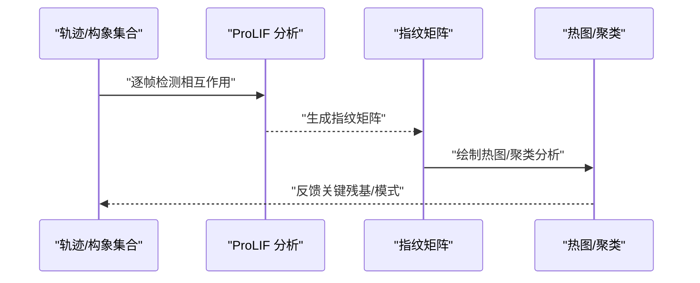
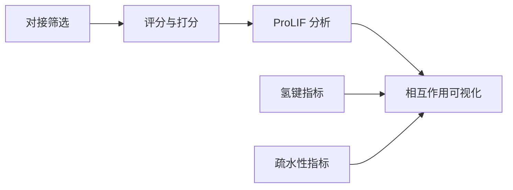
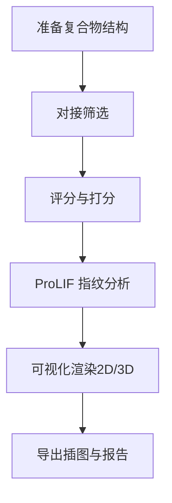

# 相互作用可视化

<cite>
**本文引用的文件**   
- [molclaw-interaction-visualizer/README.md](file://docs/prd/molbench_repo/skills/L1_tools/molclaw-interaction-visualizer/README.md)
- [molclaw-interaction-visualizer/main.py](file://docs/prd/molbench_repo/skills/L1_tools/molclaw-interaction-visualizer/main.py)
- [molclaw-prolif-tool/README.md](file://docs/prd/molbench_repo/skills/L1_tools/molclaw-prolif-tool/README.md)
- [molclaw-prolif-tool/prolif_wrapper.py](file://docs/prd/molbench_repo/skills/L1_tools/molclaw-prolif-tool/prolif_wrapper.py)
- [molclaw-mol-hbond-metrics/README.md](file://docs/prd/molbench_repo/skills/L1_tools/molclaw-mol-hbond-metrics/README.md)
- [molclaw-mol-hydrophobicity-metrics/README.md](file://docs/prd/molbench_repo/skills/L1_tools/molclaw-mol-hydrophobicity-metrics/README.md)
- [molclaw-docking-screening/README.md](file://docs/prd/molbench_repo/skills/L1_tools/molclaw-docking-screening/README.md)
- [molclaw-equiscore-tool/README.md](file://docs/prd/molbench_repo/skills/L1_tools/molclaw-equiscore-tool/README.md)
</cite>

## 目录
1. [简介](#简介)
2. [项目结构](#项目结构)
3. [核心组件](#核心组件)
4. [架构总览](#架构总览)
5. [详细组件分析](#详细组件分析)
6. [依赖关系分析](#依赖关系分析)
7. [性能与质量考量](#性能与质量考量)
8. [故障排查指南](#故障排查指南)
9. [结论](#结论)
10. [附录：示例工作流与脚本开发指南](#附录示例工作流与脚本开发指南)

## 简介
本文件面向“蛋白质-配体相互作用可视化”的完整实践，覆盖氢键、疏水作用、π-π堆积等非共价相互作用的识别与展示；详细说明可视化软件的参数设置、图形定制与交互式分析；解释相互作用指纹分析、结合模式分类与构象变化追踪；并提供高质量插图生成与自定义可视化脚本的开发指南。内容基于仓库中已提供的技能与工具文档进行系统化整理，便于快速上手与扩展。

## 项目结构
围绕相互作用可视化的相关能力主要分布在以下技能（skills）目录中：
- 分子相互作用可视化（molclaw-interaction-visualizer）
- ProLIF 相互作用分析与指纹（molclaw-prolif-tool）
- 氢键指标计算（molclaw-mol-hbond-metrics）
- 疏水性指标计算（molclaw-mol-hydrophobicity-metrics）
- 对接筛选（molclaw-docking-screening）
- 评分与打分（molclaw-equiscore-tool）

图表来源
- [molclaw-interaction-visualizer/README.md](file://docs/prd/molbench_repo/skills/L1_tools/molclaw-interaction-visualizer/README.md)
- [molclaw-prolif-tool/README.md](file://docs/prd/molbench_repo/skills/L1_tools/molclaw-prolif-tool/README.md)
- [molclaw-mol-hbond-metrics/README.md](file://docs/prd/molbench_repo/skills/L1_tools/molclaw-mol-hbond-metrics/README.md)
- [molclaw-mol-hydrophobicity-metrics/README.md](file://docs/prd/molbench_repo/skills/L1_tools/molclaw-mol-hydrophobicity-metrics/README.md)
- [molclaw-docking-screening/README.md](file://docs/prd/molbench_repo/skills/L1_tools/molclaw-docking-screening/README.md)
- [molclaw-equiscore-tool/README.md](file://docs/prd/molbench_repo/skills/L1_tools/molclaw-equiscore-tool/README.md)

章节来源
- [molclaw-interaction-visualizer/README.md](file://docs/prd/molbench_repo/skills/L1_tools/molclaw-interaction-visualizer/README.md)
- [molclaw-prolif-tool/README.md](file://docs/prd/molbench_repo/skills/L1_tools/molclaw-prolif-tool/README.md)
- [molclaw-mol-hbond-metrics/README.md](file://docs/prd/molbench_repo/skills/L1_tools/molclaw-mol-hbond-metrics/README.md)
- [molclaw-mol-hydrophobicity-metrics/README.md](file://docs/prd/molbench_repo/skills/L1_tools/molclaw-mol-hydrophobicity-metrics/README.md)
- [molclaw-docking-screening/README.md](file://docs/prd/molbench_repo/skills/L1_tools/molclaw-docking-screening/README.md)
- [molclaw-equiscore-tool/README.md](file://docs/prd/molbench_repo/skills/L1_tools/molclaw-equiscore-tool/README.md)

## 核心组件
- 相互作用可视化器（Interaction Visualizer）
  - 负责将非共价相互作用（氢键、疏水、π-π等）以二维平面图或三维结构图形式输出，支持高分辨率导出，便于论文插图制作。
  - 典型输入为蛋白-配体复合物结构及相互作用列表；可叠加对接分数、残基标注、距离阈值等。
- ProLIF 相互作用分析（ProLIF Tool）
  - 提供标准化的相互作用检测与指纹构建，包括氢键、盐桥、疏水接触、π-π堆积、卤键、金属配位等。
  - 输出可用于聚类、热图、时间序列分析等下游任务。
- 氢键与疏水性指标（HBond & Hydrophobicity Metrics）
  - 提供针对特定相互作用的量化指标，用于筛选、排序与对比。
- 对接筛选（Docking Screening）
  - 提供批量对接流程，产出多构象与结合模式，供后续可视化与指纹分析使用。
- 评分与打分（Equiscore Tool）
  - 提供多种打分方案，辅助选择代表性构象与结合模式。

章节来源
- [molclaw-interaction-visualizer/README.md](file://docs/prd/molbench_repo/skills/L1_tools/molclaw-interaction-visualizer/README.md)
- [molclaw-prolif-tool/README.md](file://docs/prd/molbench_repo/skills/L1_tools/molclaw-prolif-tool/README.md)
- [molclaw-mol-hbond-metrics/README.md](file://docs/prd/molbench_repo/skills/L1_tools/molclaw-mol-hbond-metrics/README.md)
- [molclaw-mol-hydrophobicity-metrics/README.md](file://docs/prd/molbench_repo/skills/L1_tools/molclaw-mol-hydrophobicity-metrics/README.md)
- [molclaw-docking-screening/README.md](file://docs/prd/molbench_repo/skills/L1_tools/molclaw-docking-screening/README.md)
- [molclaw-equiscore-tool/README.md](file://docs/prd/molbench_repo/skills/L1_tools/molclaw-equiscore-tool/README.md)

## 架构总览
下图展示了从对接到可视化与指纹分析的端到端数据流，以及各模块之间的调用关系。

图表来源
- [molclaw-docking-screening/README.md](file://docs/prd/molbench_repo/skills/L1_tools/molclaw-docking-screening/README.md)
- [molclaw-equiscore-tool/README.md](file://docs/prd/molbench_repo/skills/L1_tools/molclaw-equiscore-tool/README.md)
- [molclaw-prolif-tool/README.md](file://docs/prd/molbench_repo/skills/L1_tools/molclaw-prolif-tool/README.md)
- [molclaw-interaction-visualizer/README.md](file://docs/prd/molbench_repo/skills/L1_tools/molclaw-interaction-visualizer/README.md)

## 详细组件分析

### 相互作用可视化器（Interaction Visualizer）
- 功能要点
  - 支持二维平面图与三维结构图两种呈现方式。
  - 可配置距离阈值、原子类型过滤、残基范围、颜色主题、字体与标注样式。
  - 支持批量导出高分辨率图像，适配论文出版要求。
- 关键参数（概念性说明）
  - 输入：蛋白-配体复合物结构文件、可选的相互作用清单。
  - 阈值：氢键距离/角度、疏水接触半径、π-π面间距与偏移量等。
  - 显示：线条粗细、虚线/实线、标签位置、背景透明度。
  - 输出：矢量图（PDF/SVG）、位图（PNG/TIFF），分辨率与 DPI 可调。
- 交互式分析
  - 在三维视图中旋转、缩放、测量距离、高亮特定相互作用。
  - 按相互作用类型筛选显示，辅助定位关键残基与配体片段。
- 与指纹和对接的衔接
  - 可直接读取 ProLIF 输出的相互作用列表，自动着色与标注。
  - 对接产生的多构象可通过滑动条或批次渲染进行对比。

章节来源
- [molclaw-interaction-visualizer/README.md](file://docs/prd/molbench_repo/skills/L1_tools/molclaw-interaction-visualizer/README.md)
- [molclaw-interaction-visualizer/main.py](file://docs/prd/molbench_repo/skills/L1_tools/molclaw-interaction-visualizer/main.py)

#### 可视化流程图（算法级）

图表来源
- [molclaw-interaction-visualizer/main.py](file://docs/prd/molbench_repo/skills/L1_tools/molclaw-interaction-visualizer/main.py)

### ProLIF 相互作用分析与指纹
- 功能要点
  - 标准化检测氢键、盐桥、疏水接触、π-π堆积、卤键、金属配位等。
  - 输出结构化相互作用清单与指纹矩阵，便于统计与机器学习。
- 关键参数（概念性说明）
  - 距离/角度阈值、原子类型映射、链选择、周期性边界处理。
  - 指纹维度：按相互作用类型×残基×时间步展开。
- 下游用途
  - 热图/树状聚类：比较不同构象或不同配体的结合模式。
  - 时间序列：追踪 MD 轨迹中相互作用的稳定性。
  - 特征工程：作为模型输入进行活性预测或相似性分析。

章节来源
- [molclaw-prolif-tool/README.md](file://docs/prd/molbench_repo/skills/L1_tools/molclaw-prolif-tool/README.md)
- [molclaw-prolif-tool/prolif_wrapper.py](file://docs/prd/molbench_repo/skills/L1_tools/molclaw-prolif-tool/prolif_wrapper.py)

#### 指纹分析时序流程

图表来源
- [molclaw-prolif-tool/README.md](file://docs/prd/molbench_repo/skills/L1_tools/molclaw-prolif-tool/README.md)
- [molclaw-prolif-tool/prolif_wrapper.py](file://docs/prd/molbench_repo/skills/L1_tools/molclaw-prolif-tool/prolif_wrapper.py)

### 氢键与疏水性指标
- 氢键指标
  - 统计氢键数量、平均距离/角度、持久度（时间占比）。
  - 用于筛选稳定构象与关键残基。
- 疏水性指标
  - 统计疏水接触面积、接触残基数、接触强度分布。
  - 用于评估结合口袋的疏水贡献与配体取向。

章节来源
- [molclaw-mol-hbond-metrics/README.md](file://docs/prd/molbench_repo/skills/L1_tools/molclaw-mol-hbond-metrics/README.md)
- [molclaw-mol-hydrophobicity-metrics/README.md](file://docs/prd/molbench_repo/skills/L1_tools/molclaw-mol-hydrophobicity-metrics/README.md)

### 对接筛选与评分
- 对接筛选
  - 批量生成多构象与结合模式，输出 PDB/XYZ 等格式。
  - 提供搜索空间、柔性设置、采样策略等参数。
- 评分与打分
  - 多目标打分（经验项、力场项、知识项），用于排序与去重。
  - 与可视化联动：优先渲染高分构象的关键相互作用。

章节来源
- [molclaw-docking-screening/README.md](file://docs/prd/molbench_repo/skills/L1_tools/molclaw-docking-screening/README.md)
- [molclaw-equiscore-tool/README.md](file://docs/prd/molbench_repo/skills/L1_tools/molclaw-equiscore-tool/README.md)

## 依赖关系分析
- 模块耦合
  - 可视化器依赖相互作用检测结果（可由 ProLIF 或其他方法提供）。
  - 指标模块与可视化器解耦，通过统一的数据接口（如 JSON/CSV）交换信息。
  - 对接与评分位于上游，决定可视化的输入构象集合。
- 外部依赖
  - 分子结构解析库、绘图后端（矢量/位图）、可选的三维交互引擎。
- 潜在循环依赖
  - 建议采用事件/消息总线或中间文件避免直接双向引用。

图表来源
- [molclaw-docking-screening/README.md](file://docs/prd/molbench_repo/skills/L1_tools/molclaw-docking-screening/README.md)
- [molclaw-equiscore-tool/README.md](file://docs/prd/molbench_repo/skills/L1_tools/molclaw-equiscore-tool/README.md)
- [molclaw-prolif-tool/README.md](file://docs/prd/molbench_repo/skills/L1_tools/molclaw-prolif-tool/README.md)
- [molclaw-mol-hbond-metrics/README.md](file://docs/prd/molbench_repo/skills/L1_tools/molclaw-mol-hbond-metrics/README.md)
- [molclaw-mol-hydrophobicity-metrics/README.md](file://docs/prd/molbench_repo/skills/L1_tools/molclaw-mol-hydrophobicity-metrics/README.md)
- [molclaw-interaction-visualizer/README.md](file://docs/prd/molbench_repo/skills/L1_tools/molclaw-interaction-visualizer/README.md)

## 性能与质量考量
- 大规模轨迹
  - 对长轨迹进行降采样或分块处理，减少内存占用与渲染压力。
  - 预计算指纹矩阵并缓存，避免重复检测。
- 渲染优化
  - 矢量图优先用于静态插图；位图用于快速预览。
  - 按需隐藏次要残基，仅保留关键区域，提升可读性与速度。
- 数值稳定性
  - 合理设置距离/角度阈值，避免噪声导致的假阳性相互作用。
  - 对周期性体系注意最小镜像约定与边界处理。

## 故障排查指南
- 常见问题
  - 结构缺失原子/电荷异常：检查预处理步骤与力场分配。
  - 相互作用未检出：调整阈值、确认链选择与异构体状态。
  - 渲染失败：确认绘图后端可用、字体与路径权限。
- 诊断建议
  - 先以单构象验证流程，再扩展到批量。
  - 输出中间文件（相互作用清单、指纹矩阵）以便定位问题。
  - 使用小样本数据集进行回归测试，确保版本升级后行为一致。

## 结论
通过将对接筛选、评分打分、ProLIF 指纹分析与可视化器串联，可以高效完成从结构到洞察的闭环。合理的参数设置与质量控制是获得高质量可视化与可靠结论的关键。借助本仓库中的技能与工具，用户可以快速搭建可复现、可扩展的相互作用可视化流水线，并生成满足学术出版要求的插图。

## 附录：示例工作流与脚本开发指南

### 端到端工作流（概念性）

[此图为概念性流程示意，不直接映射具体源码文件]

### 高质量插图生成要点
- 构图与布局
  - 聚焦结合口袋，裁剪无关区域；保持比例与方向一致性。
- 色彩与标注
  - 使用色盲友好配色；对关键残基与配体片段添加清晰标注。
- 分辨率与格式
  - 矢量图（PDF/SVG）用于印刷；位图（PNG/TIFF）用于在线发布，DPI≥300。

### 自定义可视化脚本开发指南
- 设计原则
  - 输入/输出明确：定义统一的中间数据结构（JSON/CSV）。
  - 模块化：将检测、过滤、渲染拆分为独立函数/类。
  - 可配置：通过配置文件或命令行参数控制阈值与样式。
- 推荐实现步骤
  - 读取结构文件并解析原子坐标与类型。
  - 调用相互作用检测逻辑（可复用 ProLIF 输出）。
  - 应用过滤与聚合规则，生成可视化所需的数据集。
  - 调用绘图后端生成 2D/3D 图像，并写入文件。
- 调试与测试
  - 使用已知基准案例验证阈值与渲染效果。
  - 记录日志与中间产物，便于回溯与对比。

章节来源
- [molclaw-interaction-visualizer/README.md](file://docs/prd/molbench_repo/skills/L1_tools/molclaw-interaction-visualizer/README.md)
- [molclaw-prolif-tool/README.md](file://docs/prd/molbench_repo/skills/L1_tools/molclaw-prolif-tool/README.md)
- [molclaw-mol-hbond-metrics/README.md](file://docs/prd/molbench_repo/skills/L1_tools/molclaw-mol-hbond-metrics/README.md)
- [molclaw-mol-hydrophobicity-metrics/README.md](file://docs/prd/molbench_repo/skills/L1_tools/molclaw-mol-hydrophobicity-metrics/README.md)
- [molclaw-docking-screening/README.md](file://docs/prd/molbench_repo/skills/L1_tools/molclaw-docking-screening/README.md)
- [molclaw-equiscore-tool/README.md](file://docs/prd/molbench_repo/skills/L1_tools/molclaw-equiscore-tool/README.md)