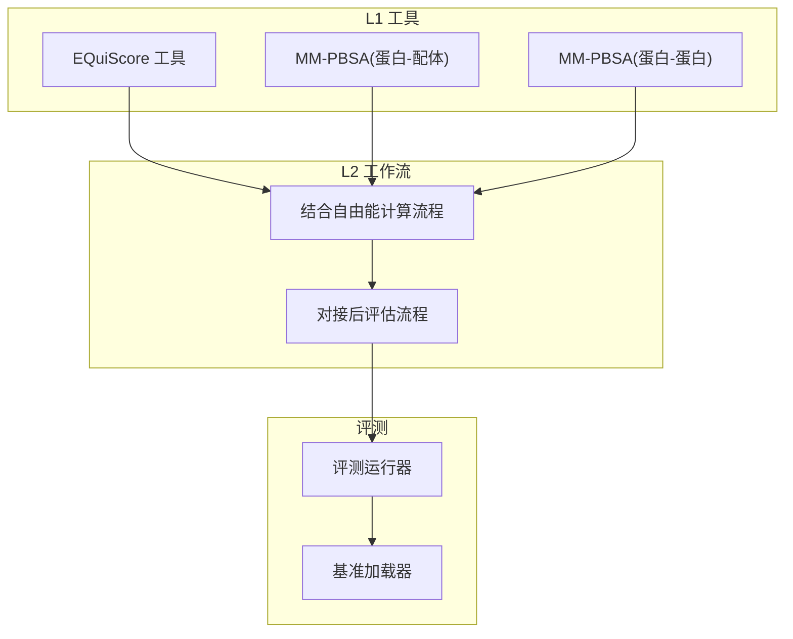
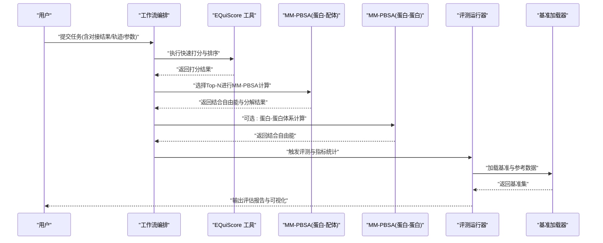
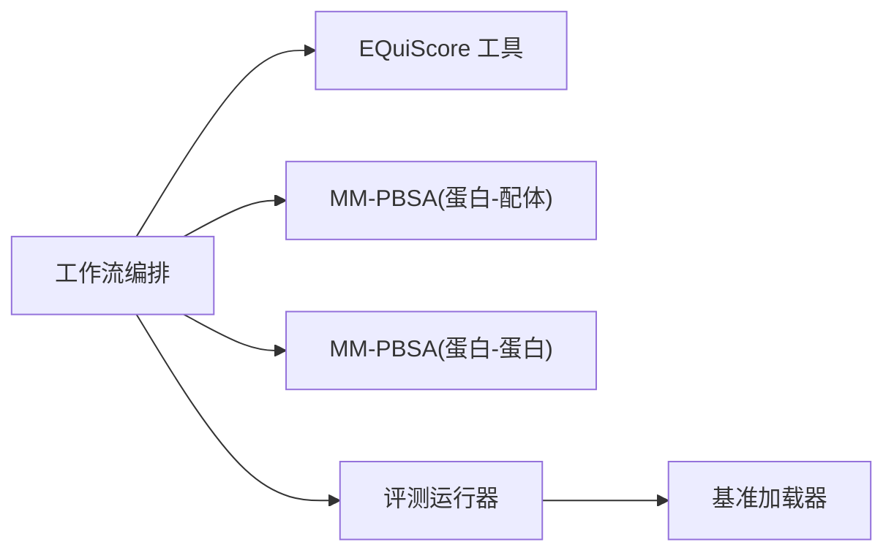

# 结合亲和力分析

<cite>
**本文引用的文件**   
- [molclaw-equiscore-tool](file://docs/prd/molbench_repo/skills/L1_tools/molclaw-equiscore-tool)
- [molclaw-equiscore-docking](file://docs/prd/molbench_repo/skills/L1_tools/molclaw-equiscore-docking)
- [molclaw-protein-ligand-mmpbsa](file://docs/prd/molbench_repo/skills/L1_tools/molclaw-protein-ligand-mmpbsa)
- [molclaw-protein-protein-mmpbsa](file://docs/prd/molbench_repo/skills/L1_tools/molclaw-protein-protein-mmpbsa)
- [06-binding-free-energy-calculation.md](file://docs/prd/molbench_repo/skills/L2_workflows/06-binding-free-energy-calculation.md)
- [08-post-docking-evaluation.md](file://docs/prd/molbench_repo/skills/L2_workflows/08-post-docking-evaluation.md)
- [eval_runner.py](file://docs/prd/molbench_repo/eval/eval_runner.py)
- [bench_loaders.py](file://docs/prd/molbench_repo/eval/bench_loaders.py)
</cite>

## 目录
1. [引言](#引言)
2. [项目结构](#项目结构)
3. [核心组件](#核心组件)
4. [架构总览](#架构总览)
5. [详细组件分析](#详细组件分析)
6. [依赖关系分析](#依赖关系分析)
7. [性能与精度考量](#性能与精度考量)
8. [故障排查指南](#故障排查指南)
9. [结论](#结论)
10. [附录](#附录)

## 引言
本文件面向“蛋白质-配体结合亲和力”的完整计算与分析流程，覆盖从对接结果到自由能计算的端到端方法学与实践。重点包括：
- 经验打分函数、力场方法与自由能计算技术的原理与应用场景
- EQuiScore 与 MM-PBSA 的原理、适用性与注意事项
- 结合自由能分解、残基贡献分析与关键相互作用识别
- 从对接结果到自由能计算的实践流程与验证策略
- 准确性评估方法与实验数据对比分析

## 项目结构
本项目在技能与工作流层面提供了与亲和力相关的工具链与流程文档，主要涉及：
- L1 工具层：EQuiScore 打分、MM-PBSA（蛋白-配体与蛋白-蛋白）等原子级或粗粒度计算工具
- L2 工作流层：结合自由能计算、对接后评估等端到端流程编排
- 评测框架：基准加载与评测运行器，用于一致性评估与结果汇总

图表来源
- [molclaw-equiscore-tool](file://docs/prd/molbench_repo/skills/L1_tools/molclaw-equiscore-tool)
- [molclaw-protein-ligand-mmpbsa](file://docs/prd/molbench_repo/skills/L1_tools/molclaw-protein-ligand-mmpbsa)
- [molclaw-protein-protein-mmpbsa](file://docs/prd/molbench_repo/skills/L1_tools/molclaw-protein-protein-mmpbsa)
- [06-binding-free-energy-calculation.md](file://docs/prd/molbench_repo/skills/L2_workflows/06-binding-free-energy-calculation.md)
- [08-post-docking-evaluation.md](file://docs/prd/molbench_repo/skills/L2_workflows/08-post-docking-evaluation.md)
- [eval_runner.py](file://docs/prd/molbench_repo/eval/eval_runner.py)
- [bench_loaders.py](file://docs/prd/molbench_repo/eval/bench_loaders.py)

章节来源
- [06-binding-free-energy-calculation.md](file://docs/prd/molbench_repo/skills/L2_workflows/06-binding-free-energy-calculation.md)
- [08-post-docking-evaluation.md](file://docs/prd/molbench_repo/skills/L2_workflows/08-post-docking-evaluation.md)
- [eval_runner.py](file://docs/prd/molbench_repo/eval/eval_runner.py)
- [bench_loaders.py](file://docs/prd/molbench_repo/eval/bench_loaders.py)

## 核心组件
- EQuiScore 工具：基于能量项的打分能力，适用于快速排序与初筛；可对接于工作流中作为第一道筛选
- MM-PBSA（蛋白-配体）：基于分子力学与泊松-玻尔兹曼表面积方法的结合自由能估算，适合对候选复合物进行更精细的自由能评估
- MM-PBSA（蛋白-蛋白）：针对蛋白-蛋白复合物的类似自由能估算路径
- 结合自由能计算工作流：将上述工具串联为标准化流程，包含输入准备、轨迹处理、能量计算与结果聚合
- 对接后评估工作流：对对接构象进行质量检查、相互作用分析与排序，衔接自由能计算

章节来源
- [molclaw-equiscore-tool](file://docs/prd/molbench_repo/skills/L1_tools/molclaw-equiscore-tool)
- [molclaw-protein-ligand-mmpbsa](file://docs/prd/molbench_repo/skills/L1_tools/molclaw-protein-ligand-mmpbsa)
- [molclaw-protein-protein-mmpbsa](file://docs/prd/molbench_repo/skills/L1_tools/molclaw-protein-protein-mmpbsa)
- [06-binding-free-energy-calculation.md](file://docs/prd/molbench_repo/skills/L2_workflows/06-binding-free-energy-calculation.md)
- [08-post-docking-evaluation.md](file://docs/prd/molbench_repo/skills/L2_workflows/08-post-docking-evaluation.md)

## 架构总览
下图展示了从对接结果到自由能计算的端到端数据流与控制流，以及各组件之间的调用关系。

图表来源
- [06-binding-free-energy-calculation.md](file://docs/prd/molbench_repo/skills/L2_workflows/06-binding-free-energy-calculation.md)
- [08-post-docking-evaluation.md](file://docs/prd/molbench_repo/skills/L2_workflows/08-post-docking-evaluation.md)
- [eval_runner.py](file://docs/prd/molbench_repo/eval/eval_runner.py)
- [bench_loaders.py](file://docs/prd/molbench_repo/eval/bench_loaders.py)

## 详细组件分析

### EQuiScore 工具
- 目标与定位：提供快速的能量项打分，用于大规模初筛与排序；常作为工作流的第一阶段
- 输入要求：复合物结构、必要的拓扑/参数信息、打分选项
- 输出内容：综合打分、分项能量、排序列表
- 使用建议：配合后续更精确的自由能方法（如 MM-PBSA）进行两级筛选

章节来源
- [molclaw-equiscore-tool](file://docs/prd/molbench_repo/skills/L1_tools/molclaw-equiscore-tool)

### MM-PBSA（蛋白-配体）
- 目标与定位：对蛋白-配体复合物的结合自由能进行估算，支持自由能分解与残基贡献分析
- 输入要求：复合物轨迹、受体/配体分离态轨迹、溶剂模型与介电常数等参数
- 输出内容：结合自由能估计、内能/范德华/静电/极性/非极性贡献、残基分解
- 使用建议：适用于中等规模数据集的精排；注意采样充分性与收敛性

章节来源
- [molclaw-protein-ligand-mmpbsa](file://docs/prd/molbench_repo/skills/L1_tools/molclaw-protein-ligand-mmpbsa)

### MM-PBSA（蛋白-蛋白）
- 目标与定位：对蛋白-蛋白复合物的结合自由能进行估算，方法与蛋白-配体类似但体系更大
- 输入要求：蛋白-蛋白复合物轨迹、单体轨迹、参数配置
- 输出内容：结合自由能估计、贡献分解、稳定性指标
- 使用建议：计算成本较高，需合理控制采样长度与并行策略

章节来源
- [molclaw-protein-protein-mmpbsa](file://docs/prd/molbench_repo/skills/L1_tools/molclaw-protein-protein-mmpbsa)

### 结合自由能计算工作流
- 流程要点：
  - 输入准备：复合物与单体结构/轨迹、参数化、网格与介电设置
  - 预处理：去溶剂化、对齐、去除周期性边界效应
  - 能量计算：按帧计算内能、极性与非极性溶剂化能
  - 结果聚合：平均自由能、误差估计、残基分解汇总
- 质量控制：轨迹收敛性检查、异常帧剔除、参数敏感性分析

章节来源
- [06-binding-free-energy-calculation.md](file://docs/prd/molbench_repo/skills/L2_workflows/06-binding-free-energy-calculation.md)

### 对接后评估工作流
- 流程要点：
  - 构象质量检查：几何合理性、冲突检测、氢键网络完整性
  - 相互作用分析：氢键、盐桥、疏水接触、π-π堆积等
  - 排序与筛选：基于打分函数与初步自由能指标
  - 下游衔接：为自由能计算挑选候选集合

章节来源
- [08-post-docking-evaluation.md](file://docs/prd/molbench_repo/skills/L2_workflows/08-post-docking-evaluation.md)

### 评测与基准
- 评测运行器：负责统一调度、指标计算与结果汇总
- 基准加载器：提供标准数据集与参考值，支撑相关性分析与误差度量

章节来源
- [eval_runner.py](file://docs/prd/molbench_repo/eval/eval_runner.py)
- [bench_loaders.py](file://docs/prd/molbench_repo/eval/bench_loaders.py)

## 依赖关系分析
- 组件耦合：
  - 工作流编排依赖 EQuiScore 与 MM-PBSA 工具接口
  - 评测运行器依赖基准加载器获取数据集与参考值
- 外部集成点：
  - 分子动力学/轨迹格式与参数化后端（由具体工具实现）
  - 可视化与报告生成（由工作流与评测模块驱动）

图表来源
- [06-binding-free-energy-calculation.md](file://docs/prd/molbench_repo/skills/L2_workflows/06-binding-free-energy-calculation.md)
- [08-post-docking-evaluation.md](file://docs/prd/molbench_repo/skills/L2_workflows/08-post-docking-evaluation.md)
- [eval_runner.py](file://docs/prd/molbench_repo/eval/eval_runner.py)
- [bench_loaders.py](file://docs/prd/molbench_repo/eval/bench_loaders.py)

## 性能与精度考量
- 经验打分 vs 自由能方法：
  - 经验打分速度快、适合大规模初筛；绝对精度有限
  - MM-PBSA 更贴近热力学自由能，但计算成本高，需要充分采样
- 采样与收敛：
  - 轨迹长度与帧间隔影响误差估计与残基分解稳定性
  - 建议进行多起点采样与交叉验证
- 参数敏感性：
  - 介电常数、表面张力、离子强度等参数对结果有显著影响
  - 建议进行参数扫描与敏感性分析
- 资源规划：
  - 合理并行化与批处理，避免内存溢出与I/O瓶颈

[本节为通用指导，不直接分析具体文件]

## 故障排查指南
- 常见问题与定位：
  - 输入结构缺失或格式错误：检查复合物与单体文件是否齐全、坐标与拓扑一致
  - 轨迹未收敛或异常帧：检查 RMSD/RMSF、能量漂移与截断条件
  - 参数配置不当：核对介电常数、表面张力、离子强度等
  - 评测失败：确认基准加载器可用、数据集路径正确、参考值格式匹配
- 调试建议：
  - 逐步缩小问题范围（单样本、短轨迹、简化参数）
  - 记录中间产物与日志，便于回溯
  - 使用可视化工具检查关键相互作用与构象合理性

章节来源
- [06-binding-free-energy-calculation.md](file://docs/prd/molbench_repo/skills/L2_workflows/06-binding-free-energy-calculation.md)
- [08-post-docking-evaluation.md](file://docs/prd/molbench_repo/skills/L2_workflows/08-post-docking-evaluation.md)
- [eval_runner.py](file://docs/prd/molbench_repo/eval/eval_runner.py)
- [bench_loaders.py](file://docs/prd/molbench_repo/eval/bench_loaders.py)

## 结论
通过 EQuiScore 的快速打分与 MM-PBSA 的自由能估算相结合，可在保证效率的同时提升亲和力的预测可靠性。结合自由能分解与残基贡献分析有助于理解关键相互作用与优化方向。完善的评测与基准对比是确保方法有效性的关键环节。

[本节为总结性内容，不直接分析具体文件]

## 附录
- 术语说明：
  - 经验打分函数：基于几何与物理化学特征的近似打分
  - 力场方法：基于原子间势能的分子模拟方法
  - 自由能计算：估算结合过程的热力学自由能变化
- 推荐实践：
  - 先经验打分初筛，再对 Top-N 进行 MM-PBSA 精排
  - 进行参数敏感性与采样收敛性检查
  - 与实验数据对比，评估相关性与误差分布

[本节为概念性补充，不直接分析具体文件]