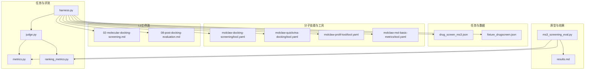
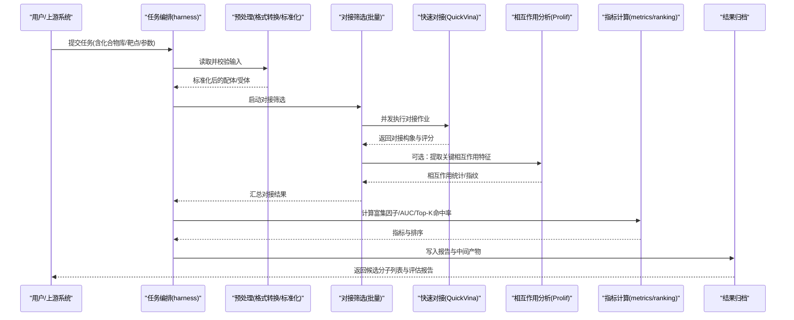
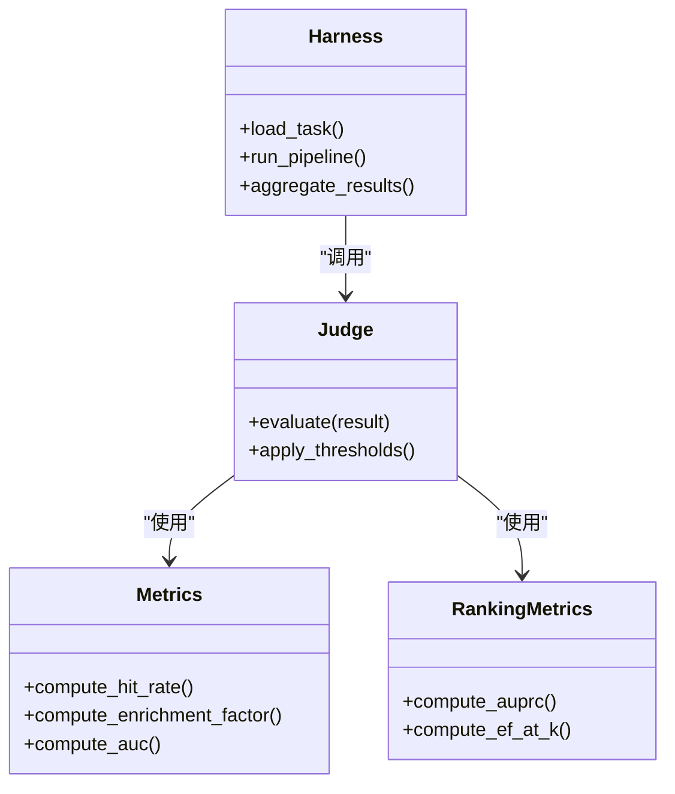
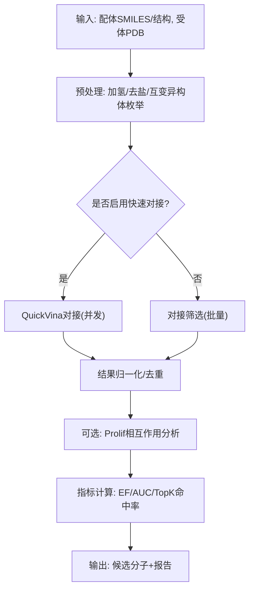
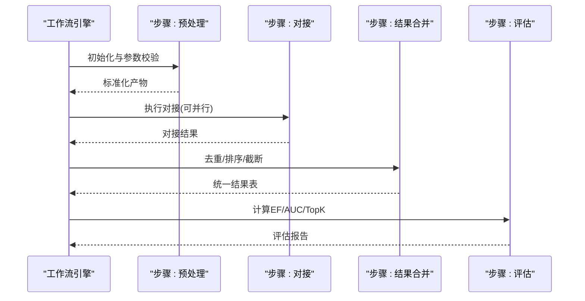
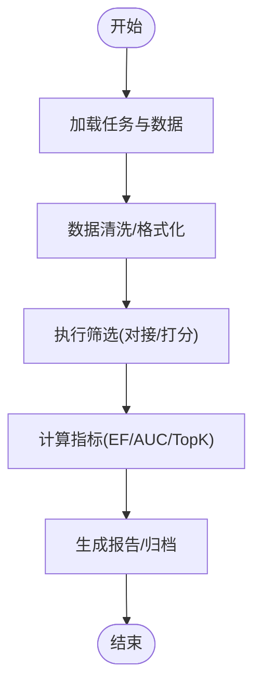
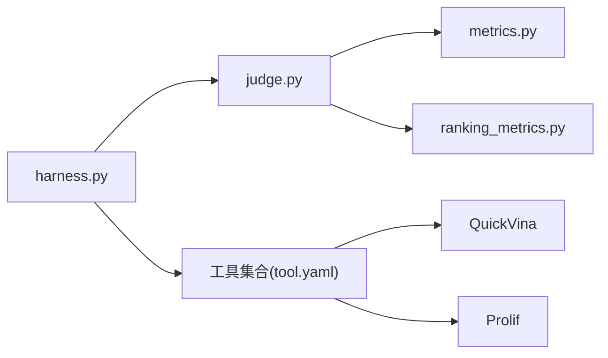

# 虚拟筛选工作流

<cite>
**本文引用的文件**   
- [autonomy_mvp/core/harness.py](file://autonomy_mvp/core/harness.py)
- [autonomy_mvp/core/judge.py](file://autonomy_mvp/core/judge.py)
- [autonomy_mvp/core/metrics.py](file://autonomy_mvp/core/metrics.py)
- [autonomy_mvp/core/ranking_metrics.py](file://autonomy_mvp/core/ranking_metrics.py)
- [autonomy_mvp/tasks/drug_screen_ms3.json](file://autonomy_mvp/tasks/drug_screen_ms3.json)
- [autonomy_mvp/tests/fixtures/fixture_drugscreen.json](file://autonomy_mvp/tests/fixtures/fixture_drugscreen.json)
- [docs/molbench_repo/skills/L1_tools/molclaw-docking-screening/tool.yaml](file://docs/molbench_repo/skills/L1_tools/molclaw-docking-screening/tool.yaml)
- [docs/molbench_repo/skills/L1_tools/molclaw-quickvina-docking/tool.yaml](file://docs/molbench_repo/skills/L1_tools/molclaw-quickvina-docking/tool.yaml)
- [docs/molbench_repo/skills/L1_tools/molclaw-prolif-tool/tool.yaml](file://docs/molbench_repo/skills/L1_tools/molclaw-prolif-tool/tool.yaml)
- [docs/molbench_repo/skills/L1_tools/molclaw-mol-basic-metrics/tool.yaml](file://docs/molbench_repo/skills/L1_tools/molclaw-mol-basic-metrics/tool.yaml)
- [docs/molbench_repo/skills/L2_workflows/02-molecular-docking-screening.md](file://docs/molbench_repo/skills/L2_workflows/02-molecular-docking-screening.md)
- [docs/molbench_repo/skills/L2_workflows/08-post-docking-evaluation.md](file://docs/molbench_repo/skills/L2_workflows/08-post-docking-evaluation.md)
- [task3/B_ms3_screening_prototype/ms3_screening_eval.py](file://task3/B_ms3_screening_prototype/ms3_screening_eval.py)
- [task3/B_ms3_screening_prototype/results.md](file://task3/B_ms3_screening_prototype/results.md)
</cite>

## 目录
1. [简介](#简介)
2. [项目结构](#项目结构)
3. [核心组件](#核心组件)
4. [架构总览](#架构总览)
5. [详细组件分析](#详细组件分析)
6. [依赖关系分析](#依赖关系分析)
7. [性能考虑](#性能考虑)
8. [故障排除指南](#故障排除指南)
9. [结论](#结论)
10. [附录](#附录)

## 简介
本文件面向“虚拟筛选工作流”的端到端实现与使用，覆盖从化合物库准备、格式转换与预处理、对接执行到结果分析与评估的全流程。文档结合仓库中的任务定义、技能工具与工作流说明，给出可落地的自动化管线设计，并补充高通量筛选策略（分库、并行、资源管理）、指标评估（富集因子、ROC曲线）以及性能优化与排障建议。

## 项目结构
围绕虚拟筛选相关能力，仓库主要包含以下层次：
- 任务与评测框架：用于编排任务、驱动执行与评测（harness、judge、metrics、ranking_metrics）。
- 任务定义与样例：MS3药物筛选任务配置与测试夹具。
- 分子技能与工具：对接、构象处理、相互作用分析、理化性质计算等工具包。
- L2工作流：对接筛选与对接后评估的流程说明。
- 原型脚本：MS3筛选原型评估脚本与结果记录。

图示来源
- [autonomy_mvp/core/harness.py](file://autonomy_mvp/core/harness.py)
- [autonomy_mvp/core/judge.py](file://autonomy_mvp/core/judge.py)
- [autonomy_mvp/core/metrics.py](file://autonomy_mvp/core/metrics.py)
- [autonomy_mvp/core/ranking_metrics.py](file://autonomy_mvp/core/ranking_metrics.py)
- [autonomy_mvp/tasks/drug_screen_ms3.json](file://autonomy_mvp/tasks/drug_screen_ms3.json)
- [autonomy_mvp/tests/fixtures/fixture_drugscreen.json](file://autonomy_mvp/tests/fixtures/fixture_drugscreen.json)
- [docs/molbench_repo/skills/L1_tools/molclaw-docking-screening/tool.yaml](file://docs/molbench_repo/skills/L1_tools/molclaw-docking-screening/tool.yaml)
- [docs/molbench_repo/skills/L1_tools/molclaw-quickvina-docking/tool.yaml](file://docs/molbench_repo/skills/L1_tools/molclaw-quickvina-docking/tool.yaml)
- [docs/molbench_repo/skills/L1_tools/molclaw-prolif-tool/tool.yaml](file://docs/molbench_repo/skills/L1_tools/molclaw-prolif-tool/tool.yaml)
- [docs/molbench_repo/skills/L1_tools/molclaw-mol-basic-metrics/tool.yaml](file://docs/molbench_repo/skills/L1_tools/molclaw-mol-basic-metrics/tool.yaml)
- [docs/molbench_repo/skills/L2_workflows/02-molecular-docking-screening.md](file://docs/molbench_repo/skills/L2_workflows/02-molecular-docking-screening.md)
- [docs/molbench_repo/skills/L2_workflows/08-post-docking-evaluation.md](file://docs/molbench_repo/skills/L2_workflows/08-post-docking-evaluation.md)
- [task3/B_ms3_screening_prototype/ms3_screening_eval.py](file://task3/B_ms3_screening_prototype/ms3_screening_eval.py)
- [task3/B_ms3_screening_prototype/results.md](file://task3/B_ms3_screening_prototype/results.md)

章节来源
- [autonomy_mvp/core/harness.py](file://autonomy_mvp/core/harness.py)
- [autonomy_mvp/core/judge.py](file://autonomy_mvp/core/judge.py)
- [autonomy_mvp/core/metrics.py](file://autonomy_mvp/core/metrics.py)
- [autonomy_mvp/core/ranking_metrics.py](file://autonomy_mvp/core/ranking_metrics.py)
- [autonomy_mvp/tasks/drug_screen_ms3.json](file://autonomy_mvp/tasks/drug_screen_ms3.json)
- [autonomy_mvp/tests/fixtures/fixture_drugscreen.json](file://autonomy_mvp/tests/fixtures/fixture_drugscreen.json)
- [docs/molbench_repo/skills/L1_tools/molclaw-docking-screening/tool.yaml](file://docs/molbench_repo/skills/L1_tools/molclaw-docking-screening/tool.yaml)
- [docs/molbench_repo/skills/L1_tools/molclaw-quickvina-docking/tool.yaml](file://docs/molbench_repo/skills/L1_tools/molclaw-quickvina-docking/tool.yaml)
- [docs/molbench_repo/skills/L1_tools/molclaw-prolif-tool/tool.yaml](file://docs/molbench_repo/skills/L1_tools/molclaw-prolif-tool/tool.yaml)
- [docs/molbench_repo/skills/L1_tools/molclaw-mol-basic-metrics/tool.yaml](file://docs/molbench_repo/skills/L1_tools/molclaw-mol-basic-metrics/tool.yaml)
- [docs/molbench_repo/skills/L2_workflows/02-molecular-docking-screening.md](file://docs/molbench_repo/skills/L2_workflows/02-molecular-docking-screening.md)
- [docs/molbench_repo/skills/L2_workflows/08-post-docking-evaluation.md](file://docs/molbench_repo/skills/L2_workflows/08-post-docking-evaluation.md)
- [task3/B_ms3_screening_prototype/ms3_screening_eval.py](file://task3/B_ms3_screening_prototype/ms3_screening_eval.py)
- [task3/B_ms3_screening_prototype/results.md](file://task3/B_ms3_screening_prototype/results.md)

## 核心组件
- 任务编排与执行
  - 负责加载任务定义、解析输入输出、调度工具调用、汇总结果与触发评测。
- 评判与指标
  - 提供通用评测指标与排序类指标，支撑富集因子、AUC等计算。
- 分子技能与工具
  - 对接筛选、快速对接、相互作用分析、基础理化性质计算等原子能力。
- L2工作流
  - 将原子能力组合为“对接筛选”和“对接后评估”的可复用流程。
- 原型评估脚本
  - 针对MS3任务的端到端评估示例，串联数据处理、打分与结果归档。

章节来源
- [autonomy_mvp/core/harness.py](file://autonomy_mvp/core/harness.py)
- [autonomy_mvp/core/judge.py](file://autonomy_mvp/core/judge.py)
- [autonomy_mvp/core/metrics.py](file://autonomy_mvp/core/metrics.py)
- [autonomy_mvp/core/ranking_metrics.py](file://autonomy_mvp/core/ranking_metrics.py)
- [docs/molbench_repo/skills/L1_tools/molclaw-docking-screening/tool.yaml](file://docs/molbench_repo/skills/L1_tools/molclaw-docking-screening/tool.yaml)
- [docs/molbench_repo/skills/L1_tools/molclaw-quickvina-docking/tool.yaml](file://docs/molbench_repo/skills/L1_tools/molclaw-quickvina-docking/tool.yaml)
- [docs/molbench_repo/skills/L1_tools/molclaw-prolif-tool/tool.yaml](file://docs/molbench_repo/skills/L1_tools/molclaw-prolif-tool/tool.yaml)
- [docs/molbench_repo/skills/L1_tools/molclaw-mol-basic-metrics/tool.yaml](file://docs/molbench_repo/skills/L1_tools/molclaw-mol-basic-metrics/tool.yaml)
- [docs/molbench_repo/skills/L2_workflows/02-molecular-docking-screening.md](file://docs/molbench_repo/skills/L2_workflows/02-molecular-docking-screening.md)
- [docs/molbench_repo/skills/L2_workflows/08-post-docking-evaluation.md](file://docs/molbench_repo/skills/L2_workflows/08-post-docking-evaluation.md)
- [task3/B_ms3_screening_prototype/ms3_screening_eval.py](file://task3/B_ms3_screening_prototype/ms3_screening_eval.py)

## 架构总览
下图展示从原始化合物库到候选分子的端到端流水线，包括数据准备、预处理、对接、过滤与评估。

图示来源
- [autonomy_mvp/core/harness.py](file://autonomy_mvp/core/harness.py)
- [docs/molbench_repo/skills/L1_tools/molclaw-docking-screening/tool.yaml](file://docs/molbench_repo/skills/L1_tools/molclaw-docking-screening/tool.yaml)
- [docs/molbench_repo/skills/L1_tools/molclaw-quickvina-docking/tool.yaml](file://docs/molbench_repo/skills/L1_tools/molclaw-quickvina-docking/tool.yaml)
- [docs/molbench_repo/skills/L1_tools/molclaw-prolif-tool/tool.yaml](file://docs/molbench_repo/skills/L1_tools/molclaw-prolif-tool/tool.yaml)
- [autonomy_mvp/core/metrics.py](file://autonomy_mvp/core/metrics.py)
- [autonomy_mvp/core/ranking_metrics.py](file://autonomy_mvp/core/ranking_metrics.py)

## 详细组件分析

### 任务编排与评测（harness/judge/metrics/ranking_metrics）
- 职责划分
  - harness：任务生命周期管理、输入解析、工具调度、结果聚合。
  - judge：判定逻辑与阈值控制，决定通过/失败或降级重试。
  - metrics：通用指标（如命中率、富集因子、AUC等）的实现入口。
  - ranking_metrics：排序类指标（如AUPRC、Enrichment Factor等）的具体计算。
- 典型调用链
  - 编排器加载任务定义→预处理→调用对接工具→收集结果→调用指标模块→生成报告。

图示来源
- [autonomy_mvp/core/harness.py](file://autonomy_mvp/core/harness.py)
- [autonomy_mvp/core/judge.py](file://autonomy_mvp/core/judge.py)
- [autonomy_mvp/core/metrics.py](file://autonomy_mvp/core/metrics.py)
- [autonomy_mvp/core/ranking_metrics.py](file://autonomy_mvp/core/ranking_metrics.py)

章节来源
- [autonomy_mvp/core/harness.py](file://autonomy_mvp/core/harness.py)
- [autonomy_mvp/core/judge.py](file://autonomy_mvp/core/judge.py)
- [autonomy_mvp/core/metrics.py](file://autonomy_mvp/core/metrics.py)
- [autonomy_mvp/core/ranking_metrics.py](file://autonomy_mvp/core/ranking_metrics.py)

### 分子技能与工具（对接、相互作用、理化性质）
- 对接筛选工具
  - 负责批量对接作业的拆分、队列管理与结果合并。
- 快速对接工具
  - 基于QuickVina的快速打分与构象采样，适合初筛阶段的高吞吐。
- 相互作用分析工具
  - 基于Prolif进行氢键、疏水、π-π等相互作用的自动识别与统计。
- 基础理化性质工具
  - 计算分子量、LogP、TPSA、HBA/HBD等常用药化指标，用于前置过滤。

图示来源
- [docs/molbench_repo/skills/L1_tools/molclaw-docking-screening/tool.yaml](file://docs/molbench_repo/skills/L1_tools/molclaw-docking-screening/tool.yaml)
- [docs/molbench_repo/skills/L1_tools/molclaw-quickvina-docking/tool.yaml](file://docs/molbench_repo/skills/L1_tools/molclaw-quickvina-docking/tool.yaml)
- [docs/molbench_repo/skills/L1_tools/molclaw-prolif-tool/tool.yaml](file://docs/molbench_repo/skills/L1_tools/molclaw-prolif-tool/tool.yaml)
- [docs/molbench_repo/skills/L1_tools/molclaw-mol-basic-metrics/tool.yaml](file://docs/molbench_repo/skills/L1_tools/molclaw-mol-basic-metrics/tool.yaml)

章节来源
- [docs/molbench_repo/skills/L1_tools/molclaw-docking-screening/tool.yaml](file://docs/molbench_repo/skills/L1_tools/molclaw-docking-screening/tool.yaml)
- [docs/molbench_repo/skills/L1_tools/molclaw-quickvina-docking/tool.yaml](file://docs/molbench_repo/skills/L1_tools/molclaw-quickvina-docking/tool.yaml)
- [docs/molbench_repo/skills/L1_tools/molclaw-prolif-tool/tool.yaml](file://docs/molbench_repo/skills/L1_tools/molclaw-prolif-tool/tool.yaml)
- [docs/molbench_repo/skills/L1_tools/molclaw-mol-basic-metrics/tool.yaml](file://docs/molbench_repo/skills/L1_tools/molclaw-mol-basic-metrics/tool.yaml)

### L2工作流（对接筛选与对接后评估）
- 对接筛选工作流
  - 将“预处理→对接→结果合并”封装为可复用流程，支持参数化与批量化。
- 对接后评估工作流
  - 在对接结果基础上进行富集分析、ROC/AUC、Top-K命中率、相互作用热图等。

图示来源
- [docs/molbench_repo/skills/L2_workflows/02-molecular-docking-screening.md](file://docs/molbench_repo/skills/L2_workflows/02-molecular-docking-screening.md)
- [docs/molbench_repo/skills/L2_workflows/08-post-docking-evaluation.md](file://docs/molbench_repo/skills/L2_workflows/08-post-docking-evaluation.md)

章节来源
- [docs/molbench_repo/skills/L2_workflows/02-molecular-docking-screening.md](file://docs/molbench_repo/skills/L2_workflows/02-molecular-docking-screening.md)
- [docs/molbench_repo/skills/L2_workflows/08-post-docking-evaluation.md](file://docs/molbench_repo/skills/L2_workflows/08-post-docking-evaluation.md)

### 原型评估脚本（MS3筛选）
- 功能要点
  - 读取任务与数据，执行筛选流程，计算指标，输出结果摘要。
- 与评测框架的关系
  - 复用metrics与ranking_metrics，保证与基准一致的评价口径。

图示来源
- [task3/B_ms3_screening_prototype/ms3_screening_eval.py](file://task3/B_ms3_screening_prototype/ms3_screening_eval.py)
- [task3/B_ms3_screening_prototype/results.md](file://task3/B_ms3_screening_prototype/results.md)

章节来源
- [task3/B_ms3_screening_prototype/ms3_screening_eval.py](file://task3/B_ms3_screening_prototype/ms3_screening_eval.py)
- [task3/B_ms3_screening_prototype/results.md](file://task3/B_ms3_screening_prototype/results.md)

## 依赖关系分析
- 内部依赖
  - harness依赖judge与metrics；judge进一步依赖metrics与ranking_metrics。
  - 工作流与工具通过yaml声明式绑定，便于替换与扩展。
- 外部依赖
  - 对接与相互作用分析依赖第三方工具（QuickVina、Prolif等），由工具yaml描述运行环境与参数。
- 潜在耦合点
  - 输入输出契约需严格对齐（SMILES/PDB/JSON字段），否则会导致下游解析失败。
  - 并发与资源配额需在编排层显式配置，避免资源争用。

图示来源
- [autonomy_mvp/core/harness.py](file://autonomy_mvp/core/harness.py)
- [autonomy_mvp/core/judge.py](file://autonomy_mvp/core/judge.py)
- [autonomy_mvp/core/metrics.py](file://autonomy_mvp/core/metrics.py)
- [autonomy_mvp/core/ranking_metrics.py](file://autonomy_mvp/core/ranking_metrics.py)
- [docs/molbench_repo/skills/L1_tools/molclaw-quickvina-docking/tool.yaml](file://docs/molbench_repo/skills/L1_tools/molclaw-quickvina-docking/tool.yaml)
- [docs/molbench_repo/skills/L1_tools/molclaw-prolif-tool/tool.yaml](file://docs/molbench_repo/skills/L1_tools/molclaw-prolif-tool/tool.yaml)

章节来源
- [autonomy_mvp/core/harness.py](file://autonomy_mvp/core/harness.py)
- [autonomy_mvp/core/judge.py](file://autonomy_mvp/core/judge.py)
- [autonomy_mvp/core/metrics.py](file://autonomy_mvp/core/metrics.py)
- [autonomy_mvp/core/ranking_metrics.py](file://autonomy_mvp/core/ranking_metrics.py)
- [docs/molbench_repo/skills/L1_tools/molclaw-quickvina-docking/tool.yaml](file://docs/molbench_repo/skills/L1_tools/molclaw-quickvina-docking/tool.yaml)
- [docs/molbench_repo/skills/L1_tools/molclaw-prolif-tool/tool.yaml](file://docs/molbench_repo/skills/L1_tools/molclaw-prolif-tool/tool.yaml)

## 性能考虑
- 分库策略
  - 按化学空间或目标蛋白家族对化合物库分片，降低单次作业规模，提升容错与可观测性。
- 并行计算
  - 对接作业采用进程级或容器级并行；根据CPU/GPU与内存上限设置并发度，避免OOM。
- 资源管理
  - 引入任务队列与限流器，监控队列长度、等待时间与失败率；失败任务自动重试与隔离。
- 缓存与去重
  - 对重复SMILES/构象进行哈希去重；对接中间产物持久化，支持断点续跑。
- 早停与两级筛选
  - 先以快速打分（如QuickVina）粗筛，再以高精度方法精筛，减少昂贵计算次数。

[本节为通用指导，不直接分析具体文件]

## 故障排除指南
- 常见问题定位
  - 输入格式错误：检查SMILES有效性、PDB完整性、缺失原子/电荷。
  - 工具不可用：确认环境变量、路径与依赖版本；查看工具yaml中命令与参数。
  - 资源不足：降低并发度、增加超时时间、启用分批执行。
  - 指标异常：核对正负样本标签、阈值设置与排序一致性。
- 排查步骤
  - 最小复现：使用测试夹具缩小范围，逐步放开复杂度。
  - 日志采集：在编排层开启详细日志，记录每步输入输出与耗时。
  - 回滚验证：切换至单核串行模式，确认是否为并发导致的不稳定。

章节来源
- [autonomy_mvp/tests/fixtures/fixture_drugscreen.json](file://autonomy_mvp/tests/fixtures/fixture_drugscreen.json)
- [autonomy_mvp/tasks/drug_screen_ms3.json](file://autonomy_mvp/tasks/drug_screen_ms3.json)

## 结论
本工作流以“编排—工具—评估”三层解耦为核心，结合L2工作流将原子能力组合为可复用的筛选管道。通过分库与并行策略、严格的输入输出契约与完善的指标体系，可在保证质量的前提下显著提升高通量筛选效率。建议在工程落地时强化资源治理与可观测性，持续迭代筛选阈值与模型以提升富集效果。

[本节为总结性内容，不直接分析具体文件]

## 附录
- 实际代码示例路径（不含代码内容）
  - 任务定义与夹具
    - [任务定义](file://autonomy_mvp/tasks/drug_screen_ms3.json)
    - [测试夹具](file://autonomy_mvp/tests/fixtures/fixture_drugscreen.json)
  - 编排与评测
    - [编排器](file://autonomy_mvp/core/harness.py)
    - [评判器](file://autonomy_mvp/core/judge.py)
    - [指标模块](file://autonomy_mvp/core/metrics.py)
    - [排序指标](file://autonomy_mvp/core/ranking_metrics.py)
  - 工具与工作流
    - [对接筛选工具](file://docs/molbench_repo/skills/L1_tools/molclaw-docking-screening/tool.yaml)
    - [快速对接工具](file://docs/molbench_repo/skills/L1_tools/molclaw-quickvina-docking/tool.yaml)
    - [相互作用分析工具](file://docs/molbench_repo/skills/L1_tools/molclaw-prolif-tool/tool.yaml)
    - [基础理化性质工具](file://docs/molbench_repo/skills/L1_tools/molclaw-mol-basic-metrics/tool.yaml)
    - [对接筛选工作流](file://docs/molbench_repo/skills/L2_workflows/02-molecular-docking-screening.md)
    - [对接后评估工作流](file://docs/molbench_repo/skills/L2_workflows/08-post-docking-evaluation.md)
  - 原型评估
    - [MS3筛选评估脚本](file://task3/B_ms3_screening_prototype/ms3_screening_eval.py)
    - [结果记录](file://task3/B_ms3_screening_prototype/results.md)