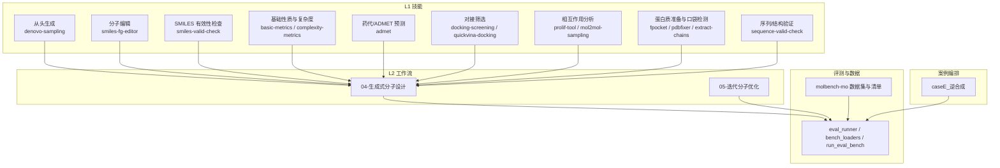
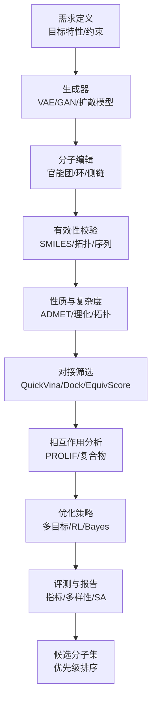
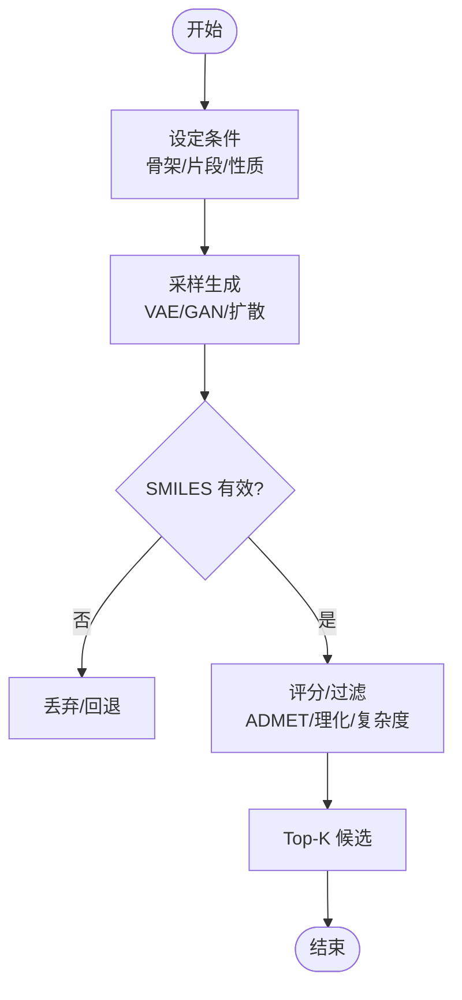
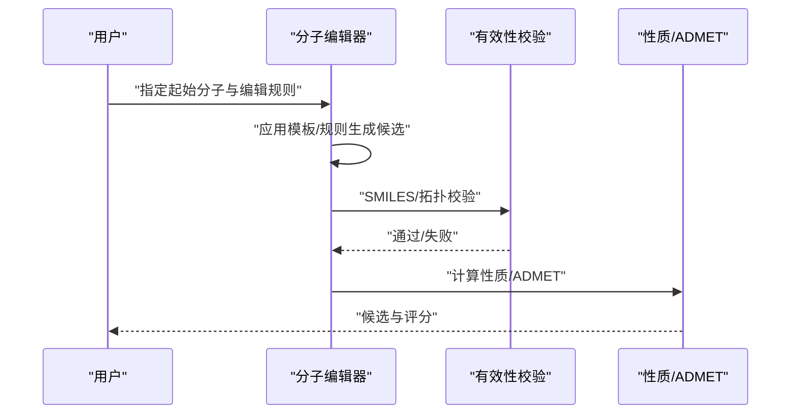
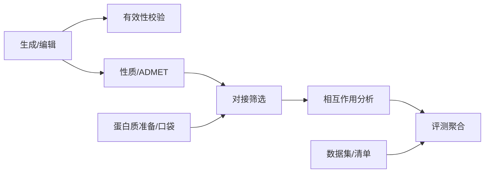

# 生成式分子设计与优化

<cite>
**本文引用的文件**   
- [docs/prd/molbench_repo/skills/L1_tools/molclaw-denovo-sampling/README.md](file://docs/prd/molbench_repo/skills/L1_tools/molclaw-denovo-sampling/README.md)
- [docs/prd/molbench_repo/skills/L1_tools/molclaw-smiles-fg-editor/README.md](file://docs/prd/molbench_repo/skills/L1_tools/molclaw-smiles-fg-editor/README.md)
- [docs/prd/molbench_repo/skills/L1_tools/molclaw-mol-basic-metrics/README.md](file://docs/prd/molbench_repo/skills/L1_tools/molclaw-mol-basic-metrics/README.md)
- [docs/prd/molbench_repo/skills/L1_tools/molclaw-drug-likeness/README.md](file://docs/prd/molbench_repo/skills/L1_tools/molclaw-drug-likeness/README.md)
- [docs/prd/molbench_repo/skills/L1_tools/molclaw-mol-complexity-metrics/README.md](file://docs/prd/molbench_repo/skills/L1_tools/molclaw-mol-complexity-metrics/README.md)
- [docs/prd/molbench_repo/skills/L1_tools/molclaw-mol-hydrophobicity-metrics/README.md](file://docs/prd/molbench_repo/skills/L1_tools/molclaw-mol-hydrophobicity-metrics/README.md)
- [docs/prd/molbench_repo/skills/L1_tools/molclaw-mol-hbond-metrics/README.md](file://docs/prd/molbench_repo/skills/L1_tools/molclaw-mol-hbond-metrics/README.md)
- [docs/prd/molbench_repo/skills/L1_tools/molclaw-mol-opt-physchem/README.md](file://docs/prd/molbench_repo/skills/L1_tools/molclaw-mol-opt-physchem/README.md)
- [docs/prd/molbench_repo/skills/L1_tools/molclaw-mol-similarity/README.md](file://docs/prd/molbench_repo/skills/L1_tools/molclaw-mol-similarity/README.md)
- [docs/prd/molbench_repo/skills/L1_tools/molclaw-mol-structure-metrics/README.md](file://docs/prd/molbench_repo/skills/L1_tools/molclaw-mol-structure-metrics/README.md)
- [docs/prd/molbench_repo/skills/L1_tools/molclaw-mol-topology-metrics/README.md](file://docs/prd/molbench_repo/skills/L1_tools/molclaw-mol-topology-metrics/README.md)
- [docs/prd/molbench_repo/skills/L1_tools/molclaw-mol2mol-sampling/README.md](file://docs/prd/molbench_repo/skills/L1_tools/molclaw-mol2mol-sampling/README.md)
- [docs/prd/molbench_repo/skills/L1_tools/molclaw-docking-screening/README.md](file://docs/prd/molbench_repo/skills/L1_tools/molclaw-docking-screening/README.md)
- [docs/prd/molbench_repo/skills/L1_tools/molclaw-equiscore-tool/README.md](file://docs/prd/molbench_repo/skills/L1_tools/molclaw-equiscore-tool/README.md)
- [docs/prd/molbench_repo/skills/L1_tools/molclaw-prolif-tool/README.md](file://docs/prd/molbench_repo/skills/L1_tools/molclaw-prolif-tool/README.md)
- [docs/prd/molbench_repo/skills/L1_tools/molclaw-quickvina-docking/README.md](file://docs/prd/molbench_repo/skills/L1_tools/molclaw-quickvina-docking/README.md)
- [docs/prd/molbench_repo/skills/L1_tools/molclaw-chai1-predict/README.md](file://docs/prd/molbench_repo/skills/L1_tools/molclaw-chai1-predict/README.md)
- [docs/prd/molbench_repo/skills/L1_tools/molclaw-esmfold/README.md](file://docs/prd/molbench_repo/skills/L1_tools/molclaw-esmfold/README.md)
- [docs/prd/molbench_repo/skills/L1_tools/molclaw-openawsem-tool/README.md](file://docs/prd/molbench_repo/skills/L1_tools/molclaw-openawsem-tool/README.md)
- [docs/prd/molbench_repo/skills/L1_tools/molclaw-protein-openmm/README.md](file://docs/prd/molbench_repo/skills/L1_tools/molclaw-protein-openmm/README.md)
- [docs/prd/molbench_repo/skills/L1_tools/molclaw-prolif-md/README.md](file://docs/prd/molbench_repo/skills/L1_tools/molclaw-prolif-md/README.md)
- [docs/prd/molbench_repo/skills/L1_tools/molclaw-prolif-protein-protein/README.md](file://docs/prd/molbench_repo/skills/L1_tools/molclaw-prolif-protein-protein/README.md)
- [docs/prd/molbench_repo/skills/L1_tools/molclaw-protein-ligand-mmpbsa/README.md](file://docs/prd/molbench_repo/skills/L1_tools/molclaw-protein-ligand-mmpbsa/README.md)
- [docs/prd/molbench_repo/skills/L1_tools/molclaw-protein-protein-mmpbsa/README.md](file://docs/prd/molbench_repo/skills/L1_tools/molclaw-protein-protein-mmpbsa/README.md)
- [docs/prd/molbench_repo/skills/L1_tools/molclaw-linker-sampling/README.md](file://docs/prd/molbench_repo/skills/L1_tools/molclaw-linker-sampling/README.md)
- [docs/prd/molbench_repo/skills/L1_tools/molclaw-rgroup-sampling/README.md](file://docs/prd/molbench_repo/skills/L1_tools/molclaw-rgroup-sampling/README.md)
- [docs/prd/molbench_repo/skills/L1_tools/molclaw-sequence-valid-check/README.md](file://docs/prd/molbench_repo/skills/L1_tools/molclaw-sequence-valid-check/README.md)
- [docs/prd/molbench_repo/skills/L1_tools/molclaw-smiles-valid-check/README.md](file://docs/prd/molbench_repo/skills/L1_tools/molclaw-smiles-valid-check/README.md)
- [docs/prd/molbench_repo/skills/L1_tools/molclaw-fpocket-toolkit-base/README.md](file://docs/prd/molbench_repo/skills/L1_tools/molclaw-fpocket-toolkit-base/README.md)
- [docs/prd/molbench_repo/skills/L1_tools/molclaw-fpocket/README.md](file://docs/prd/molbench_repo/skills/L1_tools/molclaw-fpocket/README.md)
- [docs/prd/molbench_repo/skills/L1_tools/molclaw-goca-tool/README.md](file://docs/prd/molbench_repo/skills/L1_tools/molclaw-goca-tool/README.md)
- [docs/prd/molbench_repo/skills/L1_tools/molclaw-hdock-tool/README.md](file://docs/prd/molbench_repo/skills/L1_tools/molclaw-hdock-tool/README.md)
- [docs/prd/molbench_repo/skills/L1_tools/molclaw-karmadock-tool/README.md](file://docs/prd/molbench_repo/skills/L1_tools/molclaw-karmadock-tool/README.md)
- [docs/prd/molbench_repo/skills/L1_tools/molclaw-interaction-visualizer/README.md](file://docs/prd/molbench_repo/skills/L1_tools/molclaw-interaction-visualizer/README.md)
- [docs/prd/molbench_repo/skills/L1_tools/molclaw-pdbfixer/README.md](file://docs/prd/molbench_repo/skills/L1_tools/molclaw-pdbfixer/README.md)
- [docs/prd/molbench_repo/skills/L1_tools/molclaw-pack-sidechains/README.md](file://docs/prd/molbench_repo/skills/L1_tools/molclaw-pack-sidechains/README.md)
- [docs/prd/molbench_repo/skills/L1_tools/molclaw-p2rank/README.md](file://docs/prd/molbench_repo/skills/L1_tools/molclaw-p2rank/README.md)
- [docs/prd/molbench_repo/skills/L1_tools/molclaw-run-bioemu/README.md](file://docs/prd/molbench_repo/skills/L1_tools/molclaw-run-bioemu/README.md)
- [docs/prd/molbench_repo/skills/L1_tools/molclaw-scp-server/README.md](file://docs/prd/molbench_repo/skills/L1_tools/molclaw-scp-server/README.md)
- [docs/prd/molbench_repo/skills/L1_tools/molclaw-file-transfer/README.md](file://docs/prd/molbench_repo/skills/L1_tools/molclaw-file-transfer/README.md)
- [docs/prd/molbench_repo/skills/L1_tools/molclaw-fix-pdb/README.md](file://docs/prd/molbench_repo/skills/L1_tools/molclaw-fix-pdb/README.md)
- [docs/prd/molbench_repo/skills/L1_tools/molclaw-extract-chains/README.md](file://docs/prd/molbench_repo/skills/L1_tools/molclaw-extract-chains/README.md)
- [docs/prd/molbench_repo/skills/L1_tools/molclaw-prolif-pdb/README.md](file://docs/prd/molbench_repo/skills/L1_tools/molclaw-prolif-pdb/README.md)
- [docs/prd/molbench_repo/skills/L1_tools/molclaw-admet/README.md](file://docs/prd/molbench_repo/skills/L1_tools/molclaw-admet/README.md)
- [docs/prd/molbench_repo/skills/L1_tools/molclaw-compound-retrieve/README.md](file://docs/prd/molbench_repo/skills/L1_tools/molclaw-compound-retrieve/README.md)
- [docs/prd/molbench_repo/skills/L1_tools/molclaw-boltz2-affinity/README.md](file://docs/prd/molbench_repo/skills/L1_tools/molclaw-boltz2-affinity/README.md)
- [docs/prd/molbench_repo/skills/L1_tools/molclaw-evobind-tool/README.md](file://docs/prd/molbench_repo/skills/L1_tools/molclaw-evobind-tool/README.md)
- [docs/prd/molbench_repo/skills/L1_tools/molclaw-dleps/README.md](file://docs/prd/molbench_repo/skills/L1_tools/molclaw-dleps/README.md)
- [docs/prd/molbench_repo/skills/L1_tools/molclaw-diffdock-auto/README.md](file://docs/prd/molbench_repo/skills/L1_tools/molclaw-diffdock-auto/README.md)
- [docs/prd/molbench_repo/skills/L1_tools/molclaw-peptide-sampling/README.md](file://docs/prd/molbench_repo/skills/L1_tools/molclaw-peptide-sampling/README.md)
- [docs/prd/molbench_repo/skills/L1_tools/molclaw-prolif-docking/README.md](file://docs/prd/molbench_repo/skills/L1_tools/molclaw-prolif-docking/README.md)
- [docs/prd/molbench_repo/skills/L1_tools/molclaw-mol2mol-sampling/README.md](file://docs/prd/molbench_repo/skills/L1_tools/molclaw-mol2mol-sampling/README.md)
- [docs/prd/molbench_repo/skills/L2_workflows/04-generative-molecular-design.md](file://docs/prd/molbench_repo/skills/L2_workflows/04-generative-molecular-design.md)
- [docs/prd/molbench_repo/skills/L2_workflows/05-iterative-molecular-optimization.md](file://docs/prd/molbench_repo/skills/L2_workflows/05-iterative-molecular-optimization.md)
- [docs/prd/molbench_repo/config/baseline_molbench-ms-1.yaml](file://docs/prd/molbench_repo/config/baseline_molbench-ms-1.yaml)
- [docs/prd/molbench_repo/config/baseline_molbench-ms-2.yaml](file://docs/prd/molbench_repo/config/baseline_molbench-ms-2.yaml)
- [docs/prd/molbench_repo/config/baseline_molbench-ms-3.yaml](file://docs/prd/molbench_repo/config/baseline_molbench-ms-3.yaml)
- [docs/prd/molbench_repo/config/chemcot_mo_edit.yaml](file://docs/prd/molbench_repo/config/chemcot_mo_edit.yaml)
- [docs/prd/molbench_repo/config/chemcot_mo_opt.yaml](file://docs/prd/molbench_repo/config/chemcot_mo_opt.yaml)
- [docs/prd/molbench_repo/data_full/molbench-mo/manifest.json](file://docs/prd/molbench_repo/data_full/molbench-mo/manifest.json)
- [docs/prd/molbench_repo/data_full/molbench-mo/molbench-mo-edit/README.md](file://docs/prd/molbench_repo/data_full/molbench-mo/molbench-mo-edit/README.md)
- [docs/prd/molbench_repo/data_full/molbench-mo/molbench-mo-opt/README.md](file://docs/prd/molbench_repo/data_full/molbench-mo/molbench-mo-opt/README.md)
- [docs/prd/molbench_repo/eval/eval_runner.py](file://docs/prd/molbench_repo/eval/eval_runner.py)
- [docs/prd/molbench_repo/eval/bench_loaders.py](file://docs/prd/molbench_repo/eval/bench_loaders.py)
- [docs/prd/molbench_repo/eval/run_eval_bench.py](file://docs/prd/molbench_repo/eval/run_eval_bench.py)
- [longhorizon/instantiate/caseE_instantiate.py](file://longhorizon/instantiate/caseE_instantiate.py)
- [longhorizon/instantiate/README_caseE_逆合成.md](file://longhorizon/instantiate/README_caseE_逆合成.md)
</cite>

## 目录
1. [引言](#引言)
2. [项目结构](#项目结构)
3. [核心组件](#核心组件)
4. [架构总览](#架构总览)
5. [详细组件分析](#详细组件分析)
6. [依赖关系分析](#依赖关系分析)
7. [性能与可扩展性](#性能与可扩展性)
8. [故障排查指南](#故障排查指南)
9. [结论](#结论)
10. [附录：端到端工作流示例](#附录端到端工作流示例)

## 引言
本文件面向“生成式分子设计与优化”的科研与工程实践，系统梳理基于深度学习的分子生成算法（变分自编码器 VAE、生成对抗网络 GAN）在药物设计中的应用，并覆盖从头设计（de novo design）与分子编辑（molecular editing）方法。文档进一步阐述多目标优化、强化学习驱动的结构优化与贝叶斯优化策略，提供分子生成质量评估、多样性分析与合成可及性评估方法；解释逆合成规划、反应模板匹配与合成路线设计。最后给出从需求定义到候选分子生成的端到端工作流构建指引，结合仓库中的技能与工作流配置，帮助读者快速落地。

## 项目结构
该仓库围绕“分子计算技能（L1 tools）+ 工作流（L2 workflows）+ 评测基准（eval + data）+ 案例编排（instantiate）”组织，形成“工具—流程—评测—案例”的闭环体系：
- L1 技能层：提供分子生成、性质预测、对接筛选、构象采样、ADMET 等原子能力
- L2 工作流层：将多个 L1 技能组合为端到端任务（如生成式设计、迭代优化）
- 评测层：统一加载数据、执行评测、汇总指标
- 案例层：以 JSON 实例化不同场景（含逆合成案例）

图表来源
- [docs/prd/molbench_repo/skills/L1_tools/molclaw-denovo-sampling/README.md](file://docs/prd/molbench_repo/skills/L1_tools/molclaw-denovo-sampling/README.md)
- [docs/prd/molbench_repo/skills/L1_tools/molclaw-smiles-fg-editor/README.md](file://docs/prd/molbench_repo/skills/L1_tools/molclaw-smiles-fg-editor/README.md)
- [docs/prd/molbench_repo/skills/L1_tools/molclaw-smiles-valid-check/README.md](file://docs/prd/molbench_repo/skills/L1_tools/molclaw-smiles-valid-check/README.md)
- [docs/prd/molbench_repo/skills/L1_tools/molclaw-mol-basic-metrics/README.md](file://docs/prd/molbench_repo/skills/L1_tools/molclaw-mol-basic-metrics/README.md)
- [docs/prd/molbench_repo/skills/L1_tools/molclaw-mol-complexity-metrics/README.md](file://docs/prd/molbench_repo/skills/L1_tools/molclaw-mol-complexity-metrics/README.md)
- [docs/prd/molbench_repo/skills/L1_tools/molclaw-admet/README.md](file://docs/prd/molbench_repo/skills/L1_tools/molclaw-admet/README.md)
- [docs/prd/molbench_repo/skills/L1_tools/molclaw-docking-screening/README.md](file://docs/prd/molbench_repo/skills/L1_tools/molclaw-docking-screening/README.md)
- [docs/prd/molbench_repo/skills/L1_tools/molclaw-prolif-tool/README.md](file://docs/prd/molbench_repo/skills/L1_tools/molclaw-prolif-tool/README.md)
- [docs/prd/molbench_repo/skills/L1_tools/molclaw-fpocket/README.md](file://docs/prd/molbench_repo/skills/L1_tools/molclaw-fpocket/README.md)
- [docs/prd/molbench_repo/skills/L1_tools/molclaw-pdbfixer/README.md](file://docs/prd/molbench_repo/skills/L1_tools/molclaw-pdbfixer/README.md)
- [docs/prd/molbench_repo/skills/L1_tools/molclaw-extract-chains/README.md](file://docs/prd/molbench_repo/skills/L1_tools/molclaw-extract-chains/README.md)
- [docs/prd/molbench_repo/skills/L1_tools/molclaw-sequence-valid-check/README.md](file://docs/prd/molbench_repo/skills/L1_tools/molclaw-sequence-valid-check/README.md)
- [docs/prd/molbench_repo/skills/L2_workflows/04-generative-molecular-design.md](file://docs/prd/molbench_repo/skills/L2_workflows/04-generative-molecular-design.md)
- [docs/prd/molbench_repo/skills/L2_workflows/05-iterative-molecular-optimization.md](file://docs/prd/molbench_repo/skills/L2_workflows/05-iterative-molecular-optimization.md)
- [docs/prd/molbench_repo/eval/eval_runner.py](file://docs/prd/molbench_repo/eval/eval_runner.py)
- [docs/prd/molbench_repo/eval/bench_loaders.py](file://docs/prd/molbench_repo/eval/bench_loaders.py)
- [docs/prd/molbench_repo/eval/run_eval_bench.py](file://docs/prd/molbench_repo/eval/run_eval_bench.py)
- [docs/prd/molbench_repo/data_full/molbench-mo/manifest.json](file://docs/prd/molbench_repo/data_full/molbench-mo/manifest.json)
- [longhorizon/instantiate/caseE_instantiate.py](file://longhorizon/instantiate/caseE_instantiate.py)

章节来源
- [docs/prd/molbench_repo/skills/L2_workflows/04-generative-molecular-design.md](file://docs/prd/molbench_repo/skills/L2_workflows/04-generative-molecular-design.md)
- [docs/prd/molbench_repo/skills/L2_workflows/05-iterative-molecular-optimization.md](file://docs/prd/molbench_repo/skills/L2_workflows/05-iterative-molecular-optimization.md)
- [docs/prd/molbench_repo/eval/eval_runner.py](file://docs/prd/molbench_repo/eval/eval_runner.py)
- [docs/prd/molbench_repo/eval/bench_loaders.py](file://docs/prd/molbench_repo/eval/bench_loaders.py)
- [docs/prd/molbench_repo/eval/run_eval_bench.py](file://docs/prd/molbench_repo/eval/run_eval_bench.py)
- [docs/prd/molbench_repo/data_full/molbench-mo/manifest.json](file://docs/prd/molbench_repo/data_full/molbench-mo/manifest.json)
- [longhorizon/instantiate/caseE_instantiate.py](file://longhorizon/instantiate/caseE_instantiate.py)

## 核心组件
本节聚焦于生成式分子设计的核心能力与关键技能模块，说明其职责与输入输出契约，便于后续组装工作流。

- 从头生成（De Novo Design）
  - 功能：根据约束或种子条件生成新 SMILES/结构
  - 典型输入：目标属性/骨架/片段/口袋信息
  - 典型输出：候选分子列表（SMILES/结构）、评分/过滤结果
  - 参考实现路径：[denovo-sampling README](file://docs/prd/molbench_repo/skills/L1_tools/molclaw-denovo-sampling/README.md)

- 分子编辑（Molecular Editing）
  - 功能：对已有分子进行官能团替换、环修饰、侧链扩展等
  - 典型输入：起始分子、编辑规则/模板、局部环境
  - 典型输出：编辑后的分子集合、编辑轨迹
  - 参考实现路径：[smiles-fg-editor README](file://docs/prd/molbench_repo/skills/L1_tools/molclaw-smiles-fg-editor/README.md)

- 分子有效性与结构校验
  - 功能：SMILES 合法性、价态/拓扑合理性、序列有效性
  - 参考实现路径：
    - [smiles-valid-check README](file://docs/prd/molbench_repo/skills/L1_tools/molclaw-smiles-valid-check/README.md)
    - [sequence-valid-check README](file://docs/prd/molbench_repo/skills/L1_tools/molclaw-sequence-valid-check/README.md)

- 分子性质与复杂度度量
  - 功能：基础理化性质、复杂度、氢键/疏水性等
  - 参考实现路径：
    - [basic-metrics README](file://docs/prd/molbench_repo/skills/L1_tools/molclaw-mol-basic-metrics/README.md)
    - [complexity-metrics README](file://docs/prd/molbench_repo/skills/L1_tools/molclaw-mol-complexity-metrics/README.md)
    - [hydrophobicity-metrics README](file://docs/prd/molbench_repo/skills/L1_tools/molclaw-mol-hydrophobicity-metrics/README.md)
    - [hbond-metrics README](file://docs/prd/molbench_repo/skills/L1_tools/molclaw-mol-hbond-metrics/README.md)

- 药代动力学与 ADMET
  - 功能：吸收、分布、代谢、排泄、毒性预测
  - 参考实现路径：[admet README](file://docs/prd/molbench_repo/skills/L1_tools/molclaw-admet/README.md)

- 对接与相互作用分析
  - 功能：小分子-蛋白对接、相互作用指纹、复合物分析
  - 参考实现路径：
    - [docking-screening README](file://docs/prd/molbench_repo/skills/L1_tools/molclaw-docking-screening/README.md)
    - [quickvina-docking README](file://docs/prd/molbench_repo/skills/L1_tools/molclaw-quickvina-docking/README.md)
    - [prolif-tool README](file://docs/prd/molbench_repo/skills/L1_tools/molclaw-prolif-tool/README.md)
    - [mol2mol-sampling README](file://docs/prd/molbench_repo/skills/L1_tools/molclaw-mol2mol-sampling/README.md)

- 蛋白质准备与口袋检测
  - 功能：PDB 修复、链提取、侧链打包、口袋识别
  - 参考实现路径：
    - [pdbfixer README](file://docs/prd/molbench_repo/skills/L1_tools/molclaw-pdbfixer/README.md)
    - [extract-chains README](file://docs/prd/molbench_repo/skills/L1_tools/molclaw-extract-chains/README.md)
    - [pack-sidechains README](file://docs/prd/molbench_repo/skills/L1_tools/molclaw-pack-sidechains/README.md)
    - [fpocket README](file://docs/prd/molbench_repo/skills/L1_tools/molclaw-fpocket/README.md)

- 其他辅助能力
  - 相似性、拓扑/结构度量、连接子/基团采样、可视化、MD 与自由能估算等
  - 参考实现路径：
    - [mol-similarity README](file://docs/prd/molbench_repo/skills/L1_tools/molclaw-mol-similarity/README.md)
    - [mol-topology-metrics README](file://docs/prd/molbench_repo/skills/L1_tools/molclaw-mol-topology-metrics/README.md)
    - [mol-structure-metrics README](file://docs/prd/molbench_repo/skills/L1_tools/molclaw-mol-structure-metrics/README.md)
    - [linker-sampling README](file://docs/prd/molbench_repo/skills/L1_tools/molclaw-linker-sampling/README.md)
    - [rgroup-sampling README](file://docs/prd/molbench_repo/skills/L1_tools/molclaw-rgroup-sampling/README.md)
    - [interaction-visualizer README](file://docs/prd/molbench_repo/skills/L1_tools/molclaw-interaction-visualizer/README.md)
    - [prolif-md README](file://docs/prd/molbench_repo/skills/L1_tools/molclaw-prolif-md/README.md)
    - [protein-ligand-mmpbsa README](file://docs/prd/molbench_repo/skills/L1_tools/molclaw-protein-ligand-mmpbsa/README.md)
    - [protein-protein-mmpbsa README](file://docs/prd/molbench_repo/skills/L1_tools/molclaw-protein-protein-mmpbsa/README.md)

章节来源
- [docs/prd/molbench_repo/skills/L1_tools/molclaw-denovo-sampling/README.md](file://docs/prd/molbench_repo/skills/L1_tools/molclaw-denovo-sampling/README.md)
- [docs/prd/molbench_repo/skills/L1_tools/molclaw-smiles-fg-editor/README.md](file://docs/prd/molbench_repo/skills/L1_tools/molclaw-smiles-fg-editor/README.md)
- [docs/prd/molbench_repo/skills/L1_tools/molclaw-smiles-valid-check/README.md](file://docs/prd/molbench_repo/skills/L1_tools/molclaw-smiles-valid-check/README.md)
- [docs/prd/molbench_repo/skills/L1_tools/molclaw-mol-basic-metrics/README.md](file://docs/prd/molbench_repo/skills/L1_tools/molclaw-mol-basic-metrics/README.md)
- [docs/prd/molbench_repo/skills/L1_tools/molclaw-mol-complexity-metrics/README.md](file://docs/prd/molbench_repo/skills/L1_tools/molclaw-mol-complexity-metrics/README.md)
- [docs/prd/molbench_repo/skills/L1_tools/molclaw-mol-hydrophobicity-metrics/README.md](file://docs/prd/molbench_repo/skills/L1_tools/molclaw-mol-hydrophobicity-metrics/README.md)
- [docs/prd/molbench_repo/skills/L1_tools/molclaw-mol-hbond-metrics/README.md](file://docs/prd/molbench_repo/skills/L1_tools/molclaw-mol-hbond-metrics/README.md)
- [docs/prd/molbench_repo/skills/L1_tools/molclaw-admet/README.md](file://docs/prd/molbench_repo/skills/L1_tools/molclaw-admet/README.md)
- [docs/prd/molbench_repo/skills/L1_tools/molclaw-docking-screening/README.md](file://docs/prd/molbench_repo/skills/L1_tools/molclaw-docking-screening/README.md)
- [docs/prd/molbench_repo/skills/L1_tools/molclaw-quickvina-docking/README.md](file://docs/prd/molbench_repo/skills/L1_tools/molclaw-quickvina-docking/README.md)
- [docs/prd/molbench_repo/skills/L1_tools/molclaw-prolif-tool/README.md](file://docs/prd/molbench_repo/skills/L1_tools/molclaw-prolif-tool/README.md)
- [docs/prd/molbench_repo/skills/L1_tools/molclaw-mol2mol-sampling/README.md](file://docs/prd/molbench_repo/skills/L1_tools/molclaw-mol2mol-sampling/README.md)
- [docs/prd/molbench_repo/skills/L1_tools/molclaw-fpocket/README.md](file://docs/prd/molbench_repo/skills/L1_tools/molclaw-fpocket/README.md)
- [docs/prd/molbench_repo/skills/L1_tools/molclaw-pdbfixer/README.md](file://docs/prd/molbench_repo/skills/L1_tools/molclaw-pdbfixer/README.md)
- [docs/prd/molbench_repo/skills/L1_tools/molclaw-extract-chains/README.md](file://docs/prd/molbench_repo/skills/L1_tools/molclaw-extract-chains/README.md)
- [docs/prd/molbench_repo/skills/L1_tools/molclaw-sequence-valid-check/README.md](file://docs/prd/molbench_repo/skills/L1_tools/molclaw-sequence-valid-check/README.md)
- [docs/prd/molbench_repo/skills/L1_tools/molclaw-mol-similarity/README.md](file://docs/prd/molbench_repo/skills/L1_tools/molclaw-mol-similarity/README.md)
- [docs/prd/molbench_repo/skills/L1_tools/molclaw-mol-topology-metrics/README.md](file://docs/prd/molbench_repo/skills/L1_tools/molclaw-mol-topology-metrics/README.md)
- [docs/prd/molbench_repo/skills/L1_tools/molclaw-mol-structure-metrics/README.md](file://docs/prd/molbench_repo/skills/L1_tools/molclaw-mol-structure-metrics/README.md)
- [docs/prd/molbench_repo/skills/L1_tools/molclaw-linker-sampling/README.md](file://docs/prd/molbench_repo/skills/L1_tools/molclaw-linker-sampling/README.md)
- [docs/prd/molbench_repo/skills/L1_tools/molclaw-rgroup-sampling/README.md](file://docs/prd/molbench_repo/skills/L1_tools/molclaw-rgroup-sampling/README.md)
- [docs/prd/molbench_repo/skills/L1_tools/molclaw-interaction-visualizer/README.md](file://docs/prd/molbench_repo/skills/L1_tools/molclaw-interaction-visualizer/README.md)
- [docs/prd/molbench_repo/skills/L1_tools/molclaw-prolif-md/README.md](file://docs/prd/molbench_repo/skills/L1_tools/molclaw-prolif-md/README.md)
- [docs/prd/molbench_repo/skills/L1_tools/molclaw-protein-ligand-mmpbsa/README.md](file://docs/prd/molbench_repo/skills/L1_tools/molclaw-protein-ligand-mmpbsa/README.md)
- [docs/prd/molbench_repo/skills/L1_tools/molclaw-protein-protein-mmpbsa/README.md](file://docs/prd/molbench_repo/skills/L1_tools/molclaw-protein-protein-mmpbsa/README.md)

## 架构总览
下图展示“生成式分子设计”端到端架构：从需求定义出发，经生成/编辑、过滤与评估、对接与性质预测、再到优化与产出候选集，最终由评测模块统一打分与排序。

图表来源
- [docs/prd/molbench_repo/skills/L2_workflows/04-generative-molecular-design.md](file://docs/prd/molbench_repo/skills/L2_workflows/04-generative-molecular-design.md)
- [docs/prd/molbench_repo/skills/L2_workflows/05-iterative-molecular-optimization.md](file://docs/prd/molbench_repo/skills/L2_workflows/05-iterative-molecular-optimization.md)
- [docs/prd/molbench_repo/skills/L1_tools/molclaw-denovo-sampling/README.md](file://docs/prd/molbench_repo/skills/L1_tools/molclaw-denovo-sampling/README.md)
- [docs/prd/molbench_repo/skills/L1_tools/molclaw-smiles-fg-editor/README.md](file://docs/prd/molbench_repo/skills/L1_tools/molclaw-smiles-fg-editor/README.md)
- [docs/prd/molbench_repo/skills/L1_tools/molclaw-smiles-valid-check/README.md](file://docs/prd/molbench_repo/skills/L1_tools/molclaw-smiles-valid-check/README.md)
- [docs/prd/molbench_repo/skills/L1_tools/molclaw-mol-basic-metrics/README.md](file://docs/prd/molbench_repo/skills/L1_tools/molclaw-mol-basic-metrics/README.md)
- [docs/prd/molbench_repo/skills/L1_tools/molclaw-admet/README.md](file://docs/prd/molbench_repo/skills/L1_tools/molclaw-admet/README.md)
- [docs/prd/molbench_repo/skills/L1_tools/molclaw-docking-screening/README.md](file://docs/prd/molbench_repo/skills/L1_tools/molclaw-docking-screening/README.md)
- [docs/prd/molbench_repo/skills/L1_tools/molclaw-prolif-tool/README.md](file://docs/prd/molbench_repo/skills/L1_tools/molclaw-prolif-tool/README.md)
- [docs/prd/molbench_repo/eval/eval_runner.py](file://docs/prd/molbench_repo/eval/eval_runner.py)

## 详细组件分析

### 从头设计（De Novo Design）
- 设计要点
  - 模型选择：VAE（隐空间插值/条件生成）、GAN（对抗训练提升多样性）、扩散模型（逐步去噪）
  - 条件控制：骨架引导、片段拼接、活性位点约束、物理化学约束
  - 解码策略：采样温度、束搜索、重加权
- 关键技能
  - 生成：[denovo-sampling](file://docs/prd/molbench_repo/skills/L1_tools/molclaw-denovo-sampling/README.md)
  - 有效性：[smiles-valid-check](file://docs/prd/molbench_repo/skills/L1_tools/molclaw-smiles-valid-check/README.md)
  - 相似度/多样性：[mol-similarity](file://docs/prd/molbench_repo/skills/L1_tools/molclaw-mol-similarity/README.md)
- 流程图（概念）

章节来源
- [docs/prd/molbench_repo/skills/L1_tools/molclaw-denovo-sampling/README.md](file://docs/prd/molbench_repo/skills/L1_tools/molclaw-denovo-sampling/README.md)
- [docs/prd/molbench_repo/skills/L1_tools/molclaw-smiles-valid-check/README.md](file://docs/prd/molbench_repo/skills/L1_tools/molclaw-smiles-valid-check/README.md)
- [docs/prd/molbench_repo/skills/L1_tools/molclaw-mol-similarity/README.md](file://docs/prd/molbench_repo/skills/L1_tools/molclaw-mol-similarity/README.md)

### 分子编辑（Molecular Editing）
- 设计要点
  - 编辑类型：官能团替换、环扩张/收缩、侧链生长、连接子插入
  - 模板与规则：反应模板、SMARTS 规则、局部环境感知
  - 保持活性：保留药效团、维持几何/电子特征
- 关键技能
  - 编辑：[smiles-fg-editor](file://docs/prd/molbench_repo/skills/L1_tools/molclaw-smiles-fg-editor/README.md)
  - 连接子/基团采样：[linker-sampling](file://docs/prd/molbench_repo/skills/L1_tools/molclaw-linker-sampling/README.md)、[rgroup-sampling](file://docs/prd/molbench_repo/skills/L1_tools/molclaw-rgroup-sampling/README.md)
- 序列图（概念）

章节来源
- [docs/prd/molbench_repo/skills/L1_tools/molclaw-smiles-fg-editor/README.md](file://docs/prd/molbench_repo/skills/L1_tools/molclaw-smiles-fg-editor/README.md)
- [docs/prd/molbench_repo/skills/L1_tools/molclaw-linker-sampling/README.md](file://docs/prd/molbench_repo/skills/L1_tools/molclaw-linker-sampling/README.md)
- [docs/prd/molbench_repo/skills/L1_tools/molclaw-rgroup-sampling/README.md](file://docs/prd/molbench_repo/skills/L1_tools/molclaw-rgroup-sampling/README.md)

### 多目标优化与强化学习/贝叶斯优化
- 多目标优化
  - 目标函数：亲和力、选择性、ADMET、合成可及性（SA）、复杂度、溶解度等
  - 策略：帕累托前沿、加权求和、分层筛选
- 强化学习（RL）
  - 状态：当前分子表示；动作：编辑/添加/删除；奖励：性质/对接分数/ADMET
  - 算法：REINFORCE、PPO、Actor-Critic
- 贝叶斯优化（BO）
  - 代理模型：高斯过程/树模型；采集函数：EI/UCB/TPI
  - 适用：昂贵黑盒函数（如实验/高精度模拟）
- 工作流集成
  - 生成/编辑 → 评估 → 优化 → 再采样循环
  - 参考工作流：[04-生成式分子设计](file://docs/prd/molbench_repo/skills/L2_workflows/04-generative-molecular-design.md)、[05-迭代分子优化](file://docs/prd/molbench_repo/skills/L2_workflows/05-iterative-molecular-optimization.md)

章节来源
- [docs/prd/molbench_repo/skills/L2_workflows/04-generative-molecular-design.md](file://docs/prd/molbench_repo/skills/L2_workflows/04-generative-molecular-design.md)
- [docs/prd/molbench_repo/skills/L2_workflows/05-iterative-molecular-optimization.md](file://docs/prd/molbench_repo/skills/L2_workflows/05-iterative-molecular-optimization.md)

### 分子生成质量评估、多样性分析与合成可及性
- 质量评估
  - 结构/拓扑度量：[mol-structure-metrics](file://docs/prd/molbench_repo/skills/L1_tools/molclaw-mol-structure-metrics/README.md)、[mol-topology-metrics](file://docs/prd/molbench_repo/skills/L1_tools/molclaw-mol-topology-metrics/README.md)
  - 基础性质与复杂度：[basic-metrics](file://docs/prd/molbench_repo/skills/L1_tools/molclaw-mol-basic-metrics/README.md)、[complexity-metrics](file://docs/prd/molbench_repo/skills/L1_tools/molclaw-mol-complexity-metrics/README.md)
  - 疏水性与氢键：[hydrophobicity-metrics](file://docs/prd/molbench_repo/skills/L1_tools/molclaw-mol-hydrophobicity-metrics/README.md)、[hbond-metrics](file://docs/prd/molbench_repo/skills/L1_tools/molclaw-mol-hbond-metrics/README.md)
- 多样性分析
  - 相似性矩阵/聚类：[mol-similarity](file://docs/prd/molbench_repo/skills/L1_tools/molclaw-mol-similarity/README.md)
- 合成可及性（SA）
  - 可通过复杂度/拓扑/规则库估计，结合编辑与连接子采样降低 SA 分数
  - 参考：[complexity-metrics](file://docs/prd/molbench_repo/skills/L1_tools/molclaw-mol-complexity-metrics/README.md)、[linker-sampling](file://docs/prd/molbench_repo/skills/L1_tools/molclaw-linker-sampling/README.md)

章节来源
- [docs/prd/molbench_repo/skills/L1_tools/molclaw-mol-structure-metrics/README.md](file://docs/prd/molbench_repo/skills/L1_tools/molclaw-mol-structure-metrics/README.md)
- [docs/prd/molbench_repo/skills/L1_tools/molclaw-mol-topology-metrics/README.md](file://docs/prd/molbench_repo/skills/L1_tools/molclaw-mol-topology-metrics/README.md)
- [docs/prd/molbench_repo/skills/L1_tools/molclaw-mol-basic-metrics/README.md](file://docs/prd/molbench_repo/skills/L1_tools/molclaw-mol-basic-metrics/README.md)
- [docs/prd/molbench_repo/skills/L1_tools/molclaw-mol-complexity-metrics/README.md](file://docs/prd/molbench_repo/skills/L1_tools/molclaw-mol-complexity-metrics/README.md)
- [docs/prd/molbench_repo/skills/L1_tools/molclaw-mol-hydrophobicity-metrics/README.md](file://docs/prd/molbench_repo/skills/L1_tools/molclaw-mol-hydrophobicity-metrics/README.md)
- [docs/prd/molbench_repo/skills/L1_tools/molclaw-mol-hbond-metrics/README.md](file://docs/prd/molbench_repo/skills/L1_tools/molclaw-mol-hbond-metrics/README.md)
- [docs/prd/molbench_repo/skills/L1_tools/molclaw-mol-similarity/README.md](file://docs/prd/molbench_repo/skills/L1_tools/molclaw-mol-similarity/README.md)
- [docs/prd/molbench_repo/skills/L1_tools/molclaw-linker-sampling/README.md](file://docs/prd/molbench_repo/skills/L1_tools/molclaw-linker-sampling/README.md)

### 逆合成规划、反应模板匹配与合成路线设计
- 逆合成规划
  - 基于模板/无模板的策略，结合检索与启发式剪枝
  - 案例编排：[caseE_逆合成](file://longhorizon/instantiate/caseE_instantiate.py)、[README_caseE_逆合成](file://longhorizon/instantiate/README_caseE_逆合成.md)
- 反应模板匹配
  - SMARTS 模板、反应中心识别、产物回溯
- 合成路线设计
  - 多步合成树搜索、成本/可行性评估、并行分支探索
- 相关技能（可选增强）
  - 序列/结构验证、口袋检测、对接与相互作用分析用于验证合成产物的生物活性假设

章节来源
- [longhorizon/instantiate/caseE_instantiate.py](file://longhorizon/instantiate/caseE_instantiate.py)
- [longhorizon/instantiate/README_caseE_逆合成.md](file://longhorizon/instantiate/README_caseE_逆合成.md)

## 依赖关系分析
- 组件耦合
  - 生成/编辑模块强依赖有效性校验与性质度量
  - 对接与相互作用分析依赖蛋白质准备与口袋检测
  - 评测模块统一聚合各技能输出，形成可比指标
- 外部依赖
  - 对接/MD/自由能估算等重型工具作为独立技能调用，避免主流程臃肿
- 潜在循环依赖
  - 通过工作流编排解耦，避免直接代码级循环导入

图表来源
- [docs/prd/molbench_repo/skills/L2_workflows/04-generative-molecular-design.md](file://docs/prd/molbench_repo/skills/L2_workflows/04-generative-molecular-design.md)
- [docs/prd/molbench_repo/skills/L2_workflows/05-iterative-molecular-optimization.md](file://docs/prd/molbench_repo/skills/L2_workflows/05-iterative-molecular-optimization.md)
- [docs/prd/molbench_repo/eval/eval_runner.py](file://docs/prd/molbench_repo/eval/eval_runner.py)
- [docs/prd/molbench_repo/eval/bench_loaders.py](file://docs/prd/molbench_repo/eval/bench_loaders.py)
- [docs/prd/molbench_repo/eval/run_eval_bench.py](file://docs/prd/molbench_repo/eval/run_eval_bench.py)
- [docs/prd/molbench_repo/data_full/molbench-mo/manifest.json](file://docs/prd/molbench_repo/data_full/molbench-mo/manifest.json)

章节来源
- [docs/prd/molbench_repo/eval/eval_runner.py](file://docs/prd/molbench_repo/eval/eval_runner.py)
- [docs/prd/molbench_repo/eval/bench_loaders.py](file://docs/prd/molbench_repo/eval/bench_loaders.py)
- [docs/prd/molbench_repo/eval/run_eval_bench.py](file://docs/prd/molbench_repo/eval/run_eval_bench.py)
- [docs/prd/molbench_repo/data_full/molbench-mo/manifest.json](file://docs/prd/molbench_repo/data_full/molbench-mo/manifest.json)

## 性能与可扩展性
- 并行化
  - 对接、ADMET、性质计算可并行批处理，利用 GPU/CPU 集群
- 缓存与复用
  - 对重复计算的性质/对接结果进行缓存，减少重复开销
- 增量优化
  - 使用 BO/RL 的渐进式采样，避免全量重算
- 资源隔离
  - 重型工具（MD/MM-PBSA）按需启动，避免常驻占用

## 故障排查指南
- 常见问题
  - SMILES 无效：检查价态/环闭合/芳香性；使用 [smiles-valid-check](file://docs/prd/molbench_repo/skills/L1_tools/molclaw-smiles-valid-check/README.md)
  - 对接失败：确认受体预处理（修复/链提取/侧链打包/口袋检测），参考 [pdbfixer](file://docs/prd/molbench_repo/skills/L1_tools/molclaw-pdbfixer/README.md)、[extract-chains](file://docs/prd/molbench_repo/skills/L1_tools/molclaw-extract-chains/README.md)、[pack-sidechains](file://docs/prd/molbench_repo/skills/L1_tools/molclaw-pack-sidechains/README.md)、[fpocket](file://docs/prd/molbench_repo/skills/L1_tools/molclaw-fpocket/README.md)
  - 指标异常：核对输入格式与单位，参考 [basic-metrics](file://docs/prd/molbench_repo/skills/L1_tools/molclaw-mol-basic-metrics/README.md)、[complexity-metrics](file://docs/prd/molbench_repo/skills/L1_tools/molclaw-mol-complexity-metrics/README.md)
- 定位建议
  - 在工作流中增加中间产物落盘与日志
  - 使用评测脚本统一复现实验，参考 [run_eval_bench](file://docs/prd/molbench_repo/eval/run_eval_bench.py)、[eval_runner](file://docs/prd/molbench_repo/eval/eval_runner.py)、[bench_loaders](file://docs/prd/molbench_repo/eval/bench_loaders.py)

章节来源
- [docs/prd/molbench_repo/skills/L1_tools/molclaw-smiles-valid-check/README.md](file://docs/prd/molbench_repo/skills/L1_tools/molclaw-smiles-valid-check/README.md)
- [docs/prd/molbench_repo/skills/L1_tools/molclaw-pdbfixer/README.md](file://docs/prd/molbench_repo/skills/L1_tools/molclaw-pdbfixer/README.md)
- [docs/prd/molbench_repo/skills/L1_tools/molclaw-extract-chains/README.md](file://docs/prd/molbench_repo/skills/L1_tools/molclaw-extract-chains/README.md)
- [docs/prd/molbench_repo/skills/L1_tools/molclaw-pack-sidechains/README.md](file://docs/prd/molbench_repo/skills/L1_tools/molclaw-pack-sidechains/README.md)
- [docs/prd/molbench_repo/skills/L1_tools/molclaw-fpocket/README.md](file://docs/prd/molbench_repo/skills/L1_tools/molclaw-fpocket/README.md)
- [docs/prd/molbench_repo/skills/L1_tools/molclaw-mol-basic-metrics/README.md](file://docs/prd/molbench_repo/skills/L1_tools/molclaw-mol-basic-metrics/README.md)
- [docs/prd/molbench_repo/skills/L1_tools/molclaw-mol-complexity-metrics/README.md](file://docs/prd/molbench_repo/skills/L1_tools/molclaw-mol-complexity-metrics/README.md)
- [docs/prd/molbench_repo/eval/run_eval_bench.py](file://docs/prd/molbench_repo/eval/run_eval_bench.py)
- [docs/prd/molbench_repo/eval/eval_runner.py](file://docs/prd/molbench_repo/eval/eval_runner.py)
- [docs/prd/molbench_repo/eval/bench_loaders.py](file://docs/prd/molbench_repo/eval/bench_loaders.py)

## 结论
本仓库提供了从“生成/编辑—评估—优化—评测”的完整工具链与工作流，支持 VAE/GAN/扩散等多种生成范式，覆盖从头设计与分子编辑两大路径，并通过对接、ADMET、相互作用分析等多维度评估保障候选分子的质量与可开发性。配合逆合成案例与评测基准，可实现从需求到候选分子的端到端自动化工作流。

## 附录：端到端工作流示例
以下示例展示如何基于现有技能与工作流，构建从需求定义到候选分子生成的完整流程。为避免泄露具体实现细节，此处仅给出步骤与对应技能/工作流路径引用。

- 步骤一：需求定义
  - 明确目标靶点、关键性质阈值、合成约束
  - 参考工作流入口：[04-生成式分子设计](file://docs/prd/molbench_repo/skills/L2_workflows/04-generative-molecular-design.md)

- 步骤二：数据与基准准备
  - 加载数据集与清单，确保一致性
  - 参考：[manifest.json](file://docs/prd/molbench_repo/data_full/molbench-mo/manifest.json)、[bench_loaders](file://docs/prd/molbench_repo/eval/bench_loaders.py)

- 步骤三：生成与编辑
  - 使用从头生成或分子编辑产生候选集
  - 参考：[denovo-sampling](file://docs/prd/molbench_repo/skills/L1_tools/molclaw-denovo-sampling/README.md)、[smiles-fg-editor](file://docs/prd/molbench_repo/skills/L1_tools/molclaw-smiles-fg-editor/README.md)

- 步骤四：有效性校验与初步过滤
  - 校验 SMILES/拓扑/序列，剔除非法结构
  - 参考：[smiles-valid-check](file://docs/prd/molbench_repo/skills/L1_tools/molclaw-smiles-valid-check/README.md)、[sequence-valid-check](file://docs/prd/molbench_repo/skills/L1_tools/molclaw-sequence-valid-check/README.md)

- 步骤五：性质与 ADMET 评估
  - 计算基础性质、复杂度、疏水性、氢键、ADMET
  - 参考：[basic-metrics](file://docs/prd/molbench_repo/skills/L1_tools/molclaw-mol-basic-metrics/README.md)、[complexity-metrics](file://docs/prd/molbench_repo/skills/L1_tools/molclaw-mol-complexity-metrics/README.md)、[hydrophobicity-metrics](file://docs/prd/molbench_repo/skills/L1_tools/molclaw-mol-hydrophobicity-metrics/README.md)、[hbond-metrics](file://docs/prd/molbench_repo/skills/L1_tools/molclaw-mol-hbond-metrics/README.md)、[admet](file://docs/prd/molbench_repo/skills/L1_tools/molclaw-admet/README.md)

- 步骤六：对接与相互作用分析
  - 准备受体（修复/链提取/侧链打包/口袋检测），执行对接与相互作用指纹分析
  - 参考：[pdbfixer](file://docs/prd/molbench_repo/skills/L1_tools/molclaw-pdbfixer/README.md)、[extract-chains](file://docs/prd/molbench_repo/skills/L1_tools/molclaw-extract-chains/README.md)、[pack-sidechains](file://docs/prd/molbench_repo/skills/L1_tools/molclaw-pack-sidechains/README.md)、[fpocket](file://docs/prd/molbench_repo/skills/L1_tools/molclaw-fpocket/README.md)、[docking-screening](file://docs/prd/molbench_repo/skills/L1_tools/molclaw-docking-screening/README.md)、[quickvina-docking](file://docs/prd/molbench_repo/skills/L1_tools/molclaw-quickvina-docking/README.md)、[prolif-tool](file://docs/prd/molbench_repo/skills/L1_tools/molclaw-prolif-tool/README.md)

- 步骤七：优化与迭代
  - 多目标优化/RL/BO 驱动的结构优化，返回改进候选
  - 参考：[05-迭代分子优化](file://docs/prd/molbench_repo/skills/L2_workflows/05-iterative-molecular-optimization.md)

- 步骤八：评测与报告
  - 统一运行评测脚本，汇总指标与多样性分析
  - 参考：[run_eval_bench](file://docs/prd/molbench_repo/eval/run_eval_bench.py)、[eval_runner](file://docs/prd/molbench_repo/eval/eval_runner.py)

- 步骤九：逆合成与路线设计（可选）
  - 对优选候选进行逆合成规划与路线评估
  - 参考：[caseE_逆合成](file://longhorizon/instantiate/caseE_instantiate.py)、[README_caseE_逆合成](file://longhorizon/instantiate/README_caseE_逆合成.md)

章节来源
- [docs/prd/molbench_repo/skills/L2_workflows/04-generative-molecular-design.md](file://docs/prd/molbench_repo/skills/L2_workflows/04-generative-molecular-design.md)
- [docs/prd/molbench_repo/skills/L2_workflows/05-iterative-molecular-optimization.md](file://docs/prd/molbench_repo/skills/L2_workflows/05-iterative-molecular-optimization.md)
- [docs/prd/molbench_repo/data_full/molbench-mo/manifest.json](file://docs/prd/molbench_repo/data_full/molbench-mo/manifest.json)
- [docs/prd/molbench_repo/eval/bench_loaders.py](file://docs/prd/molbench_repo/eval/bench_loaders.py)
- [docs/prd/molbench_repo/eval/run_eval_bench.py](file://docs/prd/molbench_repo/eval/run_eval_bench.py)
- [docs/prd/molbench_repo/eval/eval_runner.py](file://docs/prd/molbench_repo/eval/eval_runner.py)
- [docs/prd/molbench_repo/skills/L1_tools/molclaw-denovo-sampling/README.md](file://docs/prd/molbench_repo/skills/L1_tools/molclaw-denovo-sampling/README.md)
- [docs/prd/molbench_repo/skills/L1_tools/molclaw-smiles-fg-editor/README.md](file://docs/prd/molbench_repo/skills/L1_tools/molclaw-smiles-fg-editor/README.md)
- [docs/prd/molbench_repo/skills/L1_tools/molclaw-smiles-valid-check/README.md](file://docs/prd/molbench_repo/skills/L1_tools/molclaw-smiles-valid-check/README.md)
- [docs/prd/molbench_repo/skills/L1_tools/molclaw-sequence-valid-check/README.md](file://docs/prd/molbench_repo/skills/L1_tools/molclaw-sequence-valid-check/README.md)
- [docs/prd/molbench_repo/skills/L1_tools/molclaw-mol-basic-metrics/README.md](file://docs/prd/molbench_repo/skills/L1_tools/molclaw-mol-basic-metrics/README.md)
- [docs/prd/molbench_repo/skills/L1_tools/molclaw-mol-complexity-metrics/README.md](file://docs/prd/molbench_repo/skills/L1_tools/molclaw-mol-complexity-metrics/README.md)
- [docs/prd/molbench_repo/skills/L1_tools/molclaw-mol-hydrophobicity-metrics/README.md](file://docs/prd/molbench_repo/skills/L1_tools/molclaw-mol-hydrophobicity-metrics/README.md)
- [docs/prd/molbench_repo/skills/L1_tools/molclaw-mol-hbond-metrics/README.md](file://docs/prd/molbench_repo/skills/L1_tools/molclaw-mol-hbond-metrics/README.md)
- [docs/prd/molbench_repo/skills/L1_tools/molclaw-admet/README.md](file://docs/prd/molbench_repo/skills/L1_tools/molclaw-admet/README.md)
- [docs/prd/molbench_repo/skills/L1_tools/molclaw-pdbfixer/README.md](file://docs/prd/molbench_repo/skills/L1_tools/molclaw-pdbfixer/README.md)
- [docs/prd/molbench_repo/skills/L1_tools/molclaw-extract-chains/README.md](file://docs/prd/molbench_repo/skills/L1_tools/molclaw-extract-chains/README.md)
- [docs/prd/molbench_repo/skills/L1_tools/molclaw-pack-sidechains/README.md](file://docs/prd/molbench_repo/skills/L1_tools/molclaw-pack-sidechains/README.md)
- [docs/prd/molbench_repo/skills/L1_tools/molclaw-fpocket/README.md](file://docs/prd/molbench_repo/skills/L1_tools/molclaw-fpocket/README.md)
- [docs/prd/molbench_repo/skills/L1_tools/molclaw-docking-screening/README.md](file://docs/prd/molbench_repo/skills/L1_tools/molclaw-docking-screening/README.md)
- [docs/prd/molbench_repo/skills/L1_tools/molclaw-quickvina-docking/README.md](file://docs/prd/molbench_repo/skills/L1_tools/molclaw-quickvina-docking/README.md)
- [docs/prd/molbench_repo/skills/L1_tools/molclaw-prolif-tool/README.md](file://docs/prd/molbench_repo/skills/L1_tools/molclaw-prolif-tool/README.md)
- [longhorizon/instantiate/caseE_instantiate.py](file://longhorizon/instantiate/caseE_instantiate.py)
- [longhorizon/instantiate/README_caseE_逆合成.md](file://longhorizon/instantiate/README_caseE_逆合成.md)