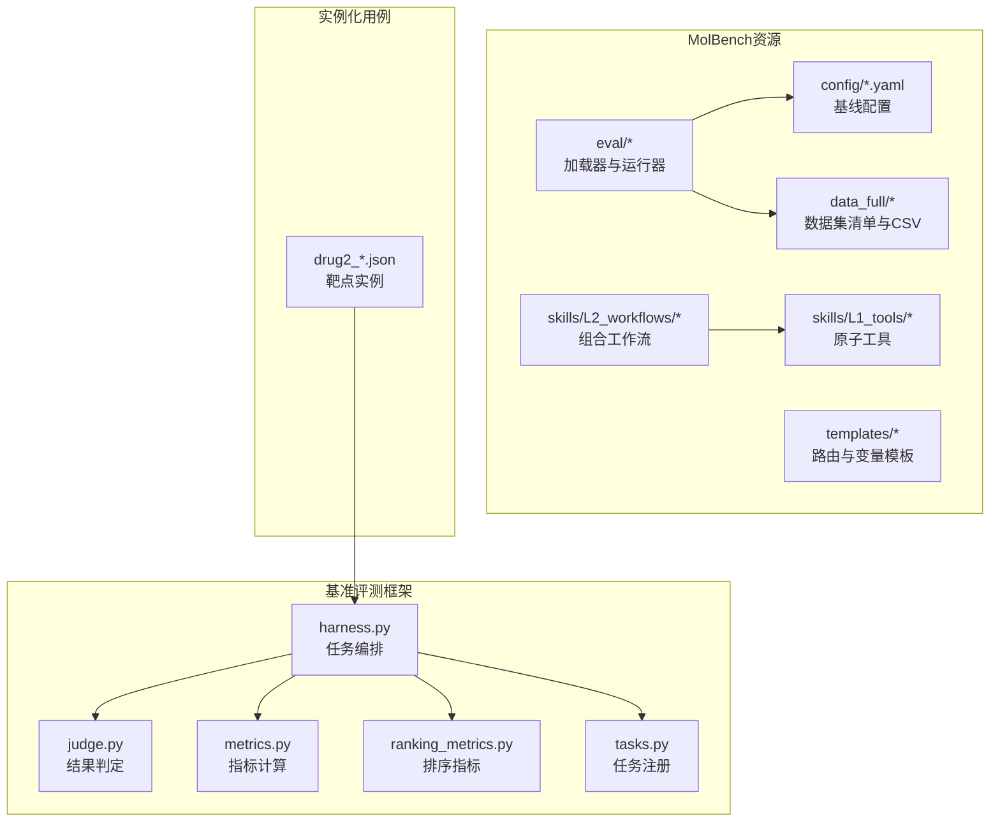
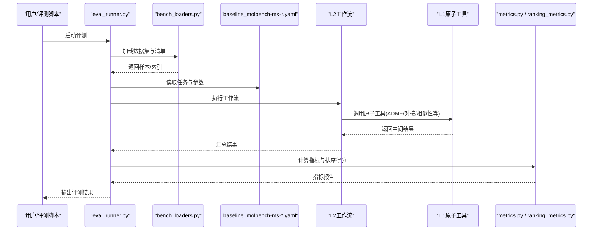
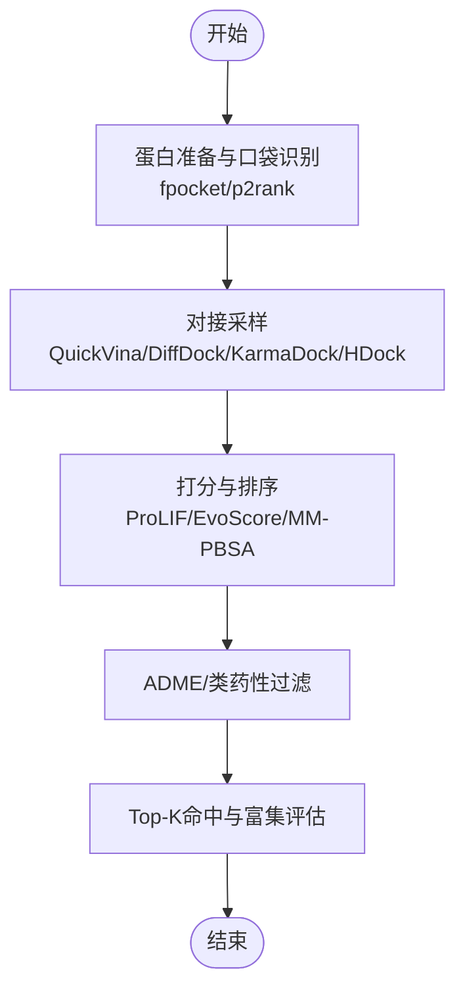
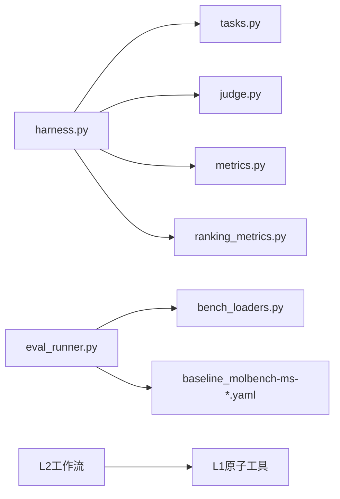

# 药物发现基准测试

<cite>
**本文引用的文件**   
- [autonomy_mvp/core/harness.py](file://autonomy_mvp/core/harness.py)
- [autonomy_mvp/core/judge.py](file://autonomy_mvp/core/judge.py)
- [autonomy_mvp/core/metrics.py](file://autonomy_mvp/core/metrics.py)
- [autonomy_mvp/core/ranking_metrics.py](file://autonomy_mvp/core/ranking_metrics.py)
- [autonomy_mvp/core/tasks.py](file://autonomy_mvp/core/tasks.py)
- [autonomy_mvp/tasks/drug_admet.json](file://autonomy_mvp/tasks/drug_admet.json)
- [autonomy_mvp/tasks/drug_screen_ms3.json](file://autonomy_mvp/tasks/drug_screen_ms3.json)
- [docs/prd/molbench_repo/README.md](file://docs/prd/molbench_repo/README.md)
- [docs/prd/molbench_repo/config/baseline_molbench-ms-1.yaml](file://docs/prd/molbench_repo/config/baseline_molbench-ms-1.yaml)
- [docs/prd/molbench_repo/config/baseline_molbench-ms-2.yaml](file://docs/prd/molbench_repo/config/baseline_molbench-ms-2.yaml)
- [docs/prd/molbench_repo/config/baseline_molbench-ms-3.yaml](file://docs/prd/molbench_repo/config/baseline_molbench-ms-3.yaml)
- [docs/prd/molbench_repo/data_full/molbench-mo/manifest.json](file://docs/prd/molbench_repo/data_full/molbench-mo/manifest.json)
- [docs/prd/molbench_repo/data_full/molbench-ms-1/molbench-ms-1.csv](file://docs/prd/molbench_repo/data_full/molbench-ms-1/molbench-ms-1.csv)
- [docs/prd/molbench_repo/data_full/molbench-ms-2/molbench-ms-2.csv](file://docs/prd/molbench_repo/data_full/molbench-ms-2/molbench-ms-2.csv)
- [docs/prd/molbench_repo/data_full/molbench-ms-3/molbench-ms-3.csv](file://docs/prd/molbench_repo/data_full/molbench-ms-3/molbench-ms-3.csv)
- [docs/prd/molbench_repo/eval/bench_loaders.py](file://docs/prd/molbench_repo/eval/bench_loaders.py)
- [docs/prd/molbench_repo/eval/eval_runner.py](file://docs/prd/molbench_repo/eval/eval_runner.py)
- [docs/prd/molbench_repo/skills/L1_tools/molclaw-admet/README.md](file://docs/prd/molbench_repo/skills/L1_tools/molclaw-admet/README.md)
- [docs/prd/molbench_repo/skills/L1_tools/molclaw-docking-screening/README.md](file://docs/prd/molbench_repo/skills/L1_tools/molclaw-docking-screening/README.md)
- [docs/prd/molbench_repo/skills/L1_tools/molclaw-drug-likeness/README.md](file://docs/prd/molbench_repo/skills/L1_tools/molclaw-drug-likeness/README.md)
- [docs/prd/molbench_repo/skills/L1_tools/molclaw-mol-similarity/README.md](file://docs/prd/molbench_repo/skills/L1_tools/molclaw-mol-similarity/README.md)
- [docs/prd/molbench_repo/skills/L1_tools/molclaw-equiscore-tool/README.md](file://docs/prd/molbench_repo/skills/L1_tools/molclaw-equiscore-tool/README.md)
- [docs/prd/molbench_repo/skills/L1_tools/molclaw-prolif-tool/README.md](file://docs/prd/molbench_repo/skills/L1_tools/molclaw-prolif-tool/README.md)
- [docs/prd/molbench_repo/skills/L1_tools/molclaw-quickvina-docking/README.md](file://docs/prd/molbench_repo/skills/L1_tools/molclaw-quickvina-docking/README.md)
- [docs/prd/molbench_repo/skills/L1_tools/molclaw-fpocket-toolkit-base/README.md](file://docs/prd/molbench_repo/skills/L1_tools/molclaw-fpocket-toolkit-base/README.md)
- [docs/prd/molbench_repo/skills/L1_tools/molclaw-p2rank/README.md](file://docs/prd/molbench_repo/skills/L1_tools/molclaw-p2rank/README.md)
- [docs/prd/molbench_repo/skills/L1_tools/molclaw-smiles-valid-check/README.md](file://docs/prd/molbench_repo/skills/L1_tools/molclaw-smiles-valid-check/README.md)
- [docs/prd/molbench_repo/skills/L1_tools/molclaw-smiles-fg-editor/README.md](file://docs/prd/molbench_repo/skills/L1_tools/molclaw-smiles-fg-editor/README.md)
- [docs/prd/molbench_repo/skills/L1_tools/molclaw-mol-basic-metrics/README.md](file://docs/prd/molbench_repo/skills/L1_tools/molclaw-mol-basic-metrics/README.md)
- [docs/prd/molbench_repo/skills/L1_tools/molclaw-mol-complexity-metrics/README.md](file://docs/prd/molbench_repo/skills/L1_tools/molclaw-mol-complexity-metrics/README.md)
- [docs/prd/molbench_repo/skills/L1_tools/molclaw-mol-hydrophobicity-metrics/README.md](file://docs/prd/molbench_repo/skills/L1_tools/molclaw-mol-hydrophobicity-metrics/README.md)
- [docs/prd/molbench_repo/skills/L1_tools/molclaw-mol-hbond-metrics/README.md](file://docs/prd/molbench_repo/skills/L1_tools/molclaw-mol-hbond-metrics/README.md)
- [docs/prd/molbench_repo/skills/L1_tools/molclaw-mol-topology-metrics/README.md](file://docs/prd/molbench_repo/skills/L1_tools/molclaw-mol-topology-metrics/README.md)
- [docs/prd/molbench_repo/skills/L1_tools/molclaw-mol-structure-metrics/README.md](file://docs/prd/molbench_repo/skills/L1_tools/molclaw-mol-structure-metrics/README.md)
- [docs/prd/molbench_repo/skills/L1_tools/molclaw-mol-opt-physchem/README.md](file://docs/prd/molbench_repo/skills/L1_tools/molclaw-mol-opt-physchem/README.md)
- [docs/prd/molbench_repo/skills/L1_tools/molclaw-mol-charge-metrics/README.md](file://docs/prd/molbench_repo/skills/L1_tools/molclaw-mol-charge-metrics/README.md)
- [docs/prd/molbench_repo/skills/L1_tools/molclaw-protein-ligand-mmpbsa/README.md](file://docs/prd/molbench_repo/skills/L1_tools/molclaw-protein-ligand-mmpbsa/README.md)
- [docs/prd/molbench_repo/skills/L1_tools/molclaw-protein-openmm/README.md](file://docs/prd/molbench_repo/skills/L1_tools/molclaw-protein-openmm/README.md)
- [docs/prd/molbench_repo/skills/L1_tools/molclaw-diffdock-auto/README.md](file://docs/prd/molbench_repo/skills/L1_tools/molclaw-diffdock-auto/README.md)
- [docs/prd/molbench_repo/skills/L1_tools/molclaw-evobind-tool/README.md](file://docs/prd/molbench_repo/skills/L1_tools/molclaw-evobind-tool/README.md)
- [docs/prd/molbench_repo/skills/L1_tools/molclaw-karmadock-tool/README.md](file://docs/prd/molbench_repo/skills/L1_tools/molclaw-karmadock-tool/README.md)
- [docs/prd/molbench_repo/skills/L1_tools/molclaw-hdock-tool/README.md](file://docs/prd/molbench_repo/skills/L1_tools/molclaw-hdock-tool/README.md)
- [docs/prd/molbench_repo/skills/L1_tools/molclaw-goca-tool/README.md](file://docs/prd/molbench_repo/skills/L1_tools/molclaw-goca-tool/README.md)
- [docs/prd/molbench_repo/skills/L1_tools/molclaw-linker-sampling/README.md](file://docs/prd/molbench_repo/skills/L1_tools/molclaw-linker-sampling/README.md)
- [docs/prd/molbench_repo/skills/L1_tools/molclaw-rgroup-sampling/README.md](file://docs/prd/molbench_repo/skills/L1_tools/molclaw-rgroup-sampling/README.md)
- [docs/prd/molbench_repo/skills/L1_tools/molclaw-peptide-sampling/README.md](file://docs/prd/molbench_repo/skills/L1_tools/molclaw-peptide-sampling/README.md)
- [docs/prd/molbench_repo/skills/L1_tools/molclaw-mol2mol-sampling/README.md](file://docs/prd/molbench_repo/skills/L1_tools/molclaw-mol2mol-sampling/README.md)
- [docs/prd/molbench_repo/skills/L1_tools/molclaw-extract-chains/README.md](file://docs/prd/molbench_repo/skills/L1_tools/molclaw-extract-chains/README.md)
- [docs/prd/molbench_repo/skills/L1_tools/molclaw-fix-pdb/README.md](file://docs/prd/molbench_repo/skills/L1_tools/molclaw-fix-pdb/README.md)
- [docs/prd/molbench_repo/skills/L1_tools/molclaw-pack-sidechains/README.md](file://docs/prd/molbench_repo/skills/L1_tools/molclaw-pack-sidechains/README.md)
- [docs/prd/molbench_repo/skills/L1_tools/molclaw-prolif-md/README.md](file://docs/prd/molbench_repo/skills/L1_tools/molclaw-prolif-md/README.md)
- [docs/prd/molbench_repo/skills/L1_tools/molclaw-prolif-protein-protein/README.md](file://docs/prd/molbench_repo/skills/L1_tools/molclaw-prolif-protein-protein/README.md)
- [docs/prd/molbench_repo/skills/L1_tools/molclaw-prolif-docking/README.md](file://docs/prd/molbench_repo/skills/L1_tools/molclaw-prolif-docking/README.md)
- [docs/prd/molbench_repo/skills/L1_tools/molclaw-prolif-pdb/README.md](file://docs/prd/molbench_repo/skills/L1_tools/molclaw-prolif-pdb/README.md)
- [docs/prd/molbench_repo/skills/L1_tools/molclaw-interaction-visualizer/README.md](file://docs/prd/molbench_repo/skills/L1_tools/molclaw-interaction-visualizer/README.md)
- [docs/prd/molbench_repo/skills/L1_tools/molclaw-file-transfer/README.md](file://docs/prd/molbench_repo/skills/L1_tools/molclaw-file-transfer/README.md)
- [docs/prd/molbench_repo/skills/L1_tools/molclaw-scp-server/README.md](file://docs/prd/molbench_repo/skills/L1_tools/molclaw-scp-server/README.md)
- [docs/prd/molbench_repo/skills/L1_tools/molclaw-sequence-valid-check/README.md](file://docs/prd/molbench_repo/skills/L1_tools/molclaw-sequence-valid-check/README.md)
- [docs/prd/molbench_repo/skills/L1_tools/molclaw-protein-sequence-retrieve/README.md](file://docs/prd/molbench_repo/skills/L1_tools/molclaw-protein-sequence-retrieve/README.md)
- [docs/prd/molbench_repo/skills/L1_tools/molclaw-protein-structure-retrieve/README.md](file://docs/prd/molbench_repo/skills/L1_tools/molclaw-protein-structure-retrieve/README.md)
- [docs/prd/molbench_repo/skills/L1_tools/molclaw-compound-retrieve/README.md](file://docs/prd/molbench_repo/skills/L1_tools/molclaw-compound-retrieve/README.md)
- [docs/prd/molbench_repo/skills/L1_tools/molclaw-denovo-sampling/README.md](file://docs/prd/molbench_repo/skills/L1_tools/molclaw-denovo-sampling/README.md)
- [docs/prd/molbench_repo/skills/L1_tools/molclaw-chai1-predict/README.md](file://docs/prd/molbench_repo/skills/L1_tools/molclaw-chai1-predict/README.md)
- [docs/prd/molbench_repo/skills/L1_tools/molclaw-esmfold/README.md](file://docs/prd/molbench_repo/skills/L1_tools/molclaw-esmfold/README.md)
- [docs/prd/molbench_repo/skills/L1_tools/molclaw-boltz2-affinity/README.md](file://docs/prd/molbench_repo/skills/L1_tools/molclaw-boltz2-affinity/README.md)
- [docs/prd/molbench_repo/skills/L1_tools/molclaw-foldx-tool/README.md](file://docs/prd/molbench_repo/skills/L1_tools/molclaw-foldx-tool/README.md)
- [docs/prd/molbench_repo/skills/L1_tools/molclaw-run-bioemu/README.md](file://docs/prd/molbench_repo/skills/L1_tools/molclaw-run-bioemu/README.md)
- [docs/prd/molbench_repo/skills/L1_tools/molclaw-pulchura-rebuild/README.md](file://docs/prd/molbench_repo/skills/L1_tools/molclaw-pulchura-rebuild/README.md)
- [docs/prd/molbench_repo/skills/L1_tools/molclaw-proteinmpnn-tool/README.md](file://docs/prd/molbench_repo/skills/L1_tools/molclaw-proteinmpnn-tool/README.md)
- [docs/prd/molbench_repo/skills/L1_tools/molclaw-openawsem-tool/README.md](file://docs/prd/molbench_repo/skills/L1_tools/molclaw-openawsem-tool/README.md)
- [docs/prd/molbench_repo/skills/L1_tools/molclaw-chroma-toolkit/README.md](file://docs/prd/molbench_repo/skills/L1_tools/molclaw-chroma-toolkit/README.md)
- [docs/prd/molbench_repo/skills/L1_tools/molclaw-dleps/README.md](file://docs/prd/molbench_repo/skills/L1_tools/molclaw-dleps/README.md)
- [docs/prd/molbench_repo/skills/L1_tools/molclaw-equiscore-docking/README.md](file://docs/prd/molbench_repo/skills/L1_tools/molclaw-equiscore-docking/README.md)
- [docs/prd/molbench_repo/skills/L2_workflows/02-molecular-docking-screening.md](file://docs/prd/molbench_repo/skills/L2_workflows/02-molecular-docking-screening.md)
- [docs/prd/molbench_repo/skills/L2_workflows/03-molecular-property-analysis-filtering.md](file://docs/prd/molbench_repo/skills/L2_workflows/03-molecular-property-analysis-filtering.md)
- [docs/prd/molbench_repo/skills/L2_workflows/04-generative-molecular-design.md](file://docs/prd/molbench_repo/skills/L2_workflows/04-generative-molecular-design.md)
- [docs/prd/molbench_repo/skills/L2_workflows/05-iterative-molecular-optimization.md](file://docs/prd/molbench_repo/skills/L2_workflows/05-iterative-molecular-optimization.md)
- [docs/prd/molbench_repo/skills/L2_workflows/06-binding-free-energy-calculation.md](file://docs/prd/molbench_repo/skills/L2_workflows/06-binding-free-energy-calculation.md)
- [docs/prd/molbench_repo/skills/L2_workflows/07-conformational-sampling-analysis.md](file://docs/prd/molbench_repo/skills/L2_workflows/07-conformational-sampling-analysis.md)
- [docs/prd/molbench_repo/skills/L2_workflows/08-post-docking-evaluation.md](file://docs/prd/molbench_repo/skills/L2_workflows/08-post-docking-evaluation.md)
- [docs/prd/molbench_repo/templates/tool_routing.md](file://docs/prd/molbench_repo/templates/tool_routing.md)
- [docs/prd/molbench_repo/templates/variable_routing.md](file://docs/prd/molbench_repo/templates/variable_routing.md)
- [longhorizon/instantiate/instances/drug2_BACE1.json](file://longhorizon/instantiate/instances/drug2_BACE1.json)
- [longhorizon/instantiate/instances/drug2_DPP-4.json](file://longhorizon/instantiate/instances/drug2_DPP-4.json)
- [longhorizon/instantiate/instances/drug2_EGFR.json](file://longhorizon/instantiate/instances/drug2_EGFR.json)
- [longhorizon/instantiate/instances/drug2_GLP-1R.json](file://longhorizon/instantiate/instances/drug2_GLP-1R.json)
- [longhorizon/instantiate/instances/drug2_mTOR.json](file://longhorizon/instantiate/instances/drug2_mTOR.json)
</cite>

## 目录
1. [引言](#引言)
2. [项目结构](#项目结构)
3. [核心组件](#核心组件)
4. [架构总览](#架构总览)
5. [详细组件分析](#详细组件分析)
6. [依赖关系分析](#依赖关系分析)
7. [性能与可扩展性](#性能与可扩展性)
8. [故障排查指南](#故障排查指南)
9. [结论](#结论)
10. [附录](#附录)

## 引言
本文件面向“药物发现基准测试”的构建、评估与使用，围绕以下关键任务展开：ADME性质预测、分子对接筛选、药物相似性分析；并系统阐述MolBench基准体系的设计理念、数据集结构与评估标准。文档同时覆盖SMILES格式规范、分子描述符计算方法、虚拟筛选参数调优、结合亲和力预测方法、可开发性评估指标、毒性预测模型与逆合成规划算法等主题，并提供基于工具链的工作流编排示例路径，帮助读者快速上手端到端药物发现流程。

## 项目结构
仓库采用“基准评测框架 + MolBench资源 + 实例化用例”的分层组织方式：
- 基准评测框架（autonomy_mvp）：提供任务定义、执行编排、评分与排序指标等核心能力。
- MolBench资源（docs/prd/molbench_repo）：包含数据清单、配置模板、技能工具集、工作流脚本与评测运行器。
- 实例化用例（longhorizon/instantiate/instances）：针对具体靶点或任务的JSON实例，驱动端到端评测。

图示来源
- [autonomy_mvp/core/harness.py](file://autonomy_mvp/core/harness.py)
- [autonomy_mvp/core/judge.py](file://autonomy_mvp/core/judge.py)
- [autonomy_mvp/core/metrics.py](file://autonomy_mvp/core/metrics.py)
- [autonomy_mvp/core/ranking_metrics.py](file://autonomy_mvp/core/ranking_metrics.py)
- [autonomy_mvp/core/tasks.py](file://autonomy_mvp/core/tasks.py)
- [docs/prd/molbench_repo/eval/bench_loaders.py](file://docs/prd/molbench_repo/eval/bench_loaders.py)
- [docs/prd/molbench_repo/eval/eval_runner.py](file://docs/prd/molbench_repo/eval/eval_runner.py)
- [docs/prd/molbench_repo/config/baseline_molbench-ms-1.yaml](file://docs/prd/molbench_repo/config/baseline_molbench-ms-1.yaml)
- [docs/prd/molbench_repo/data_full/molbench-ms-1/molbench-ms-1.csv](file://docs/prd/molbench_repo/data_full/molbench-ms-1/molbench-ms-1.csv)
- [docs/prd/molbench_repo/skills/L2_workflows/02-molecular-docking-screening.md](file://docs/prd/molbench_repo/skills/L2_workflows/02-molecular-docking-screening.md)
- [longhorizon/instantiate/instances/drug2_BACE1.json](file://longhorizon/instantiate/instances/drug2_BACE1.json)

章节来源
- [autonomy_mvp/core/harness.py](file://autonomy_mvp/core/harness.py)
- [autonomy_mvp/core/judge.py](file://autonomy_mvp/core/judge.py)
- [autonomy_mvp/core/metrics.py](file://autonomy_mvp/core/metrics.py)
- [autonomy_mvp/core/ranking_metrics.py](file://autonomy_mvp/core/ranking_metrics.py)
- [autonomy_mvp/core/tasks.py](file://autonomy_mvp/core/tasks.py)
- [docs/prd/molbench_repo/README.md](file://docs/prd/molbench_repo/README.md)
- [docs/prd/molbench_repo/eval/bench_loaders.py](file://docs/prd/molbench_repo/eval/bench_loaders.py)
- [docs/prd/molbench_repo/eval/eval_runner.py](file://docs/prd/molbench_repo/eval/eval_runner.py)

## 核心组件
- 任务编排与执行（harness.py）：负责加载任务、调度工具与工作流、收集中间产物与最终输出，支撑端到端评测闭环。
- 结果判定（judge.py）：对模型或Agent的输出进行结构化校验、阈值判断与通过/失败判定。
- 指标计算（metrics.py）：实现常用回归/分类/富集类指标，用于量化预测质量与筛选效果。
- 排序指标（ranking_metrics.py）：提供Top-K富集、AUC、NDCG等排序相关度量，适配虚拟筛选场景。
- 任务注册（tasks.py）：维护任务元信息、输入输出契约与依赖声明，便于扩展新任务。

章节来源
- [autonomy_mvp/core/harness.py](file://autonomy_mvp/core/harness.py)
- [autonomy_mvp/core/judge.py](file://autonomy_mvp/core/judge.py)
- [autonomy_mvp/core/metrics.py](file://autonomy_mvp/core/metrics.py)
- [autonomy_mvp/core/ranking_metrics.py](file://autonomy_mvp/core/ranking_metrics.py)
- [autonomy_mvp/core/tasks.py](file://autonomy_mvp/core/tasks.py)

## 架构总览
MolBench以“数据-配置-工具-工作流-评测”为主线，形成标准化评测流水线：
- 数据层：数据集清单（manifest.json）与各子集CSV（ms-1/2/3），统一字段与版本管理。
- 配置层：基线配置文件（baseline_molbench-ms-*.yaml）定义任务、工具、参数与评估协议。
- 工具层：L1原子工具（如ADME、对接、相似性、物化性质、MM-PBSA等）与L2工作流（对接筛选、性质过滤、生成设计、自由能计算等）。
- 评测层：加载器（bench_loaders.py）与运行器（eval_runner.py）串联数据、配置与工具，产出可复现实验结果。

图示来源
- [docs/prd/molbench_repo/eval/eval_runner.py](file://docs/prd/molbench_repo/eval/eval_runner.py)
- [docs/prd/molbench_repo/eval/bench_loaders.py](file://docs/prd/molbench_repo/eval/bench_loaders.py)
- [docs/prd/molbench_repo/config/baseline_molbench-ms-1.yaml](file://docs/prd/molbench_repo/config/baseline_molbench-ms-1.yaml)
- [docs/prd/molbench_repo/skills/L2_workflows/02-molecular-docking-screening.md](file://docs/prd/molbench_repo/skills/L2_workflows/02-molecular-docking-screening.md)
- [autonomy_mvp/core/metrics.py](file://autonomy_mvp/core/metrics.py)
- [autonomy_mvp/core/ranking_metrics.py](file://autonomy_mvp/core/ranking_metrics.py)

## 详细组件分析

### ADME性质预测
- 目标：从分子结构出发，预测吸收、分布、代谢、排泄等关键药代动力学属性，辅助早期候选物筛选。
- 工具链：
  - molclaw-admet：封装ADME预测接口，支持批量推理与结果聚合。
  - molclaw-mol-basic-metrics、molclaw-mol-opt-physchem：提供基础理化性质与优化所需描述符。
- 评估要点：
  - 回归指标（如MAE/RMSE）、分类指标（如AUROC/AUPRC）与阈值通过率。
  - 与实验值或权威数据库的一致性检验。
- 典型用法路径：
  - 参考[docs/prd/molbench_repo/skills/L1_tools/molclaw-admet/README.md](file://docs/prd/molbench_repo/skills/L1_tools/molclaw-admet/README.md)
  - 参考[docs/prd/molbench_repo/skills/L1_tools/molclaw-mol-basic-metrics/README.md](file://docs/prd/molbench_repo/skills/L1_tools/molclaw-mol-basic-metrics/README.md)
  - 参考[docs/prd/molbench_repo/skills/L1_tools/molclaw-mol-opt-physchem/README.md](file://docs/prd/molbench_repo/skills/L1_tools/molclaw-mol-opt-physchem/README.md)

章节来源
- [docs/prd/molbench_repo/skills/L1_tools/molclaw-admet/README.md](file://docs/prd/molbench_repo/skills/L1_tools/molclaw-admet/README.md)
- [docs/prd/molbench_repo/skills/L1_tools/molclaw-mol-basic-metrics/README.md](file://docs/prd/molbench_repo/skills/L1_tools/molclaw-mol-basic-metrics/README.md)
- [docs/prd/molbench_repo/skills/L1_tools/molclaw-mol-opt-physchem/README.md](file://docs/prd/molbench_repo/skills/L1_tools/molclaw-mol-opt-physchem/README.md)

### 分子对接筛选
- 目标：在给定蛋白-配体复合物或蛋白结构中，搜索小分子结合构象并估计结合强度，用于虚拟筛选。
- 工具链：
  - 口袋识别：fpocket、p2rank（定位潜在结合位点）。
  - 对接引擎：QuickVina、DiffDock Auto、KarmaDock、HDock、ProLIF Docking、EvoBind、OpenAWSEM等。
  - 后处理与可视化：ProLIF、Interaction Visualizer、PDB修复与侧链重排。
- 评估要点：
  - 富集因子、Top-K命中率、AUC/NDCG、结合构象RMSD、结合自由能估算（MM-PBSA）。
- 典型用法路径：
  - 参考[docs/prd/molbench_repo/skills/L2_workflows/02-molecular-docking-screening.md](file://docs/prd/molbench_repo/skills/L2_workflows/02-molecular-docking-screening.md)
  - 参考[docs/prd/molbench_repo/skills/L1_tools/molclaw-fpocket-toolkit-base/README.md](file://docs/prd/molbench_repo/skills/L1_tools/molclaw-fpocket-toolkit-base/README.md)
  - 参考[docs/prd/molbench_repo/skills/L1_tools/molclaw-p2rank/README.md](file://docs/prd/molbench_repo/skills/L1_tools/molclaw-p2rank/README.md)
  - 参考[docs/prd/molbench_repo/skills/L1_tools/molclaw-quickvina-docking/README.md](file://docs/prd/molbench_repo/skills/L1_tools/molclaw-quickvina-docking/README.md)
  - 参考[docs/prd/molbench_repo/skills/L1_tools/molclaw-diffdock-auto/README.md](file://docs/prd/molbench_repo/skills/L1_tools/molclaw-diffdock-auto/README.md)
  - 参考[docs/prd/molbench_repo/skills/L1_tools/molclaw-karmadock-tool/README.md](file://docs/prd/molbench_repo/skills/L1_tools/molclaw-karmadock-tool/README.md)
  - 参考[docs/prd/molbench_repo/skills/L1_tools/molclaw-hdock-tool/README.md](file://docs/prd/molbench_repo/skills/L1_tools/molclaw-hdock-tool/README.md)
  - 参考[docs/prd/molbench_repo/skills/L1_tools/molclaw-prolif-docking/README.md](file://docs/prd/molbench_repo/skills/L1_tools/molclaw-prolif-docking/README.md)
  - 参考[docs/prd/molbench_repo/skills/L1_tools/molclaw-equiscore-docking/README.md](file://docs/prd/molbench_repo/skills/L1_tools/molclaw-equiscore-docking/README.md)
  - 参考[docs/prd/molbench_repo/skills/L1_tools/molclaw-protein-ligand-mmpbsa/README.md](file://docs/prd/molbench_repo/skills/L1_tools/molclaw-protein-ligand-mmpbsa/README.md)

图示来源
- [docs/prd/molbench_repo/skills/L2_workflows/02-molecular-docking-screening.md](file://docs/prd/molbench_repo/skills/L2_workflows/02-molecular-docking-screening.md)
- [docs/prd/molbench_repo/skills/L1_tools/molclaw-fpocket-toolkit-base/README.md](file://docs/prd/molbench_repo/skills/L1_tools/molclaw-fpocket-toolkit-base/README.md)
- [docs/prd/molbench_repo/skills/L1_tools/molclaw-p2rank/README.md](file://docs/prd/molbench_repo/skills/L1_tools/molclaw-p2rank/README.md)
- [docs/prd/molbench_repo/skills/L1_tools/molclaw-quickvina-docking/README.md](file://docs/prd/molbench_repo/skills/L1_tools/molclaw-quickvina-docking/README.md)
- [docs/prd/molbench_repo/skills/L1_tools/molclaw-diffdock-auto/README.md](file://docs/prd/molbench_repo/skills/L1_tools/molclaw-diffdock-auto/README.md)
- [docs/prd/molbench_repo/skills/L1_tools/molclaw-karmadock-tool/README.md](file://docs/prd/molbench_repo/skills/L1_tools/molclaw-karmadock-tool/README.md)
- [docs/prd/molbench_repo/skills/L1_tools/molclaw-hdock-tool/README.md](file://docs/prd/molbench_repo/skills/L1_tools/molclaw-hdock-tool/README.md)
- [docs/prd/molbench_repo/skills/L1_tools/molclaw-prolif-docking/README.md](file://docs/prd/molbench_repo/skills/L1_tools/molclaw-prolif-docking/README.md)
- [docs/prd/molbench_repo/skills/L1_tools/molclaw-equiscore-docking/README.md](file://docs/prd/molbench_repo/skills/L1_tools/molclaw-equiscore-docking/README.md)
- [docs/prd/molbench_repo/skills/L1_tools/molclaw-protein-ligand-mmpbsa/README.md](file://docs/prd/molbench_repo/skills/L1_tools/molclaw-protein-ligand-mmpbsa/README.md)

### 药物相似性分析与类药性评估
- 目标：衡量分子间结构/指纹相似度，并结合类药性规则（如Lipinski、Veber等）进行初筛。
- 工具链：
  - molclaw-mol-similarity：计算Tanimoto、Dice、MACCS等相似性度量。
  - molclaw-drug-likeness：类药性打分与规则检查。
  - 分子描述符：基础理化、拓扑、氢键、疏水性、电荷等指标。
- 评估要点：
  - 相似性阈值选择、多样性控制、类药性通过率与下游活性相关性。
- 典型用法路径：
  - 参考[docs/prd/molbench_repo/skills/L1_tools/molclaw-mol-similarity/README.md](file://docs/prd/molbench_repo/skills/L1_tools/molclaw-mol-similarity/README.md)
  - 参考[docs/prd/molbench_repo/skills/L1_tools/molclaw-drug-likeness/README.md](file://docs/prd/molbench_repo/skills/L1_tools/molclaw-drug-likeness/README.md)
  - 参考[docs/prd/molbench_repo/skills/L1_tools/molclaw-mol-complexity-metrics/README.md](file://docs/prd/molbench_repo/skills/L1_tools/molclaw-mol-complexity-metrics/README.md)
  - 参考[docs/prd/molbench_repo/skills/L1_tools/molclaw-mol-hydrophobicity-metrics/README.md](file://docs/prd/molbench_repo/skills/L1_tools/molclaw-mol-hydrophobicity-metrics/README.md)
  - 参考[docs/prd/molbench_repo/skills/L1_tools/molclaw-mol-hbond-metrics/README.md](file://docs/prd/molbench_repo/skills/L1_tools/molclaw-mol-hbond-metrics/README.md)
  - 参考[docs/prd/molbench_repo/skills/L1_tools/molclaw-mol-topology-metrics/README.md](file://docs/prd/molbench_repo/skills/L1_tools/molclaw-mol-topology-metrics/README.md)
  - 参考[docs/prd/molbench_repo/skills/L1_tools/molclaw-mol-structure-metrics/README.md](file://docs/prd/molbench_repo/skills/L1_tools/molclaw-mol-structure-metrics/README.md)
  - 参考[docs/prd/molbench_repo/skills/L1_tools/molclaw-mol-charge-metrics/README.md](file://docs/prd/molbench_repo/skills/L1_tools/molclaw-mol-charge-metrics/README.md)

章节来源
- [docs/prd/molbench_repo/skills/L1_tools/molclaw-mol-similarity/README.md](file://docs/prd/molbench_repo/skills/L1_tools/molclaw-mol-similarity/README.md)
- [docs/prd/molbench_repo/skills/L1_tools/molclaw-drug-likeness/README.md](file://docs/prd/molbench_repo/skills/L1_tools/molclaw-drug-likeness/README.md)
- [docs/prd/molbench_repo/skills/L1_tools/molclaw-mol-complexity-metrics/README.md](file://docs/prd/molbench_repo/skills/L1_tools/molclaw-mol-complexity-metrics/README.md)
- [docs/prd/molbench_repo/skills/L1_tools/molclaw-mol-hydrophobicity-metrics/README.md](file://docs/prd/molbench_repo/skills/L1_tools/molclaw-mol-hydrophobicity-metrics/README.md)
- [docs/prd/molbench_repo/skills/L1_tools/molclaw-mol-hbond-metrics/README.md](file://docs/prd/molbench_repo/skills/L1_tools/molclaw-mol-hbond-metrics/README.md)
- [docs/prd/molbench_repo/skills/L1_tools/molclaw-mol-topology-metrics/README.md](file://docs/prd/molbench_repo/skills/L1_tools/molclaw-mol-topology-metrics/README.md)
- [docs/prd/molbench_repo/skills/L1_tools/molclaw-mol-structure-metrics/README.md](file://docs/prd/molbench_repo/skills/L1_tools/molclaw-mol-structure-metrics/README.md)
- [docs/prd/molbench_repo/skills/L1_tools/molclaw-mol-charge-metrics/README.md](file://docs/prd/molbench_repo/skills/L1_tools/molclaw-mol-charge-metrics/README.md)

### SMILES格式规范与有效性检查
- 目标：确保输入分子表示合法、可解析，避免后续步骤因无效SMILES中断。
- 工具链：
  - molclaw-smiles-valid-check：SMILES合法性校验与规范化。
  - molclaw-smiles-fg-editor：官能团编辑与结构修正。
- 建议实践：
  - 在数据入库前进行SMILES清洗与去重；对异常结构进行自动修复或人工复核。
- 典型用法路径：
  - 参考[docs/prd/molbench_repo/skills/L1_tools/molclaw-smiles-valid-check/README.md](file://docs/prd/molbench_repo/skills/L1_tools/molclaw-smiles-valid-check/README.md)
  - 参考[docs/prd/molbench_repo/skills/L1_tools/molclaw-smiles-fg-editor/README.md](file://docs/prd/molbench_repo/skills/L1_tools/molclaw-smiles-fg-editor/README.md)

章节来源
- [docs/prd/molbench_repo/skills/L1_tools/molclaw-smiles-valid-check/README.md](file://docs/prd/molbench_repo/skills/L1_tools/molclaw-smiles-valid-check/README.md)
- [docs/prd/molbench_repo/skills/L1_tools/molclaw-smiles-fg-editor/README.md](file://docs/prd/molbench_repo/skills/L1_tools/molclaw-smiles-fg-editor/README.md)

### 结合亲和力预测与自由能计算
- 目标：在对接基础上，进一步估算结合自由能以提升排序可靠性。
- 工具链：
  - EvoBind、EquiScore Docking、MM-PBSA（ProLIF/MMPBSA）、FoldX、OpenAWSEM等。
- 评估要点：
  - 与实验ΔG或Ki/IC50的相关性；不同方法的稳定性与成本权衡。
- 典型用法路径：
  - 参考[docs/prd/molbench_repo/skills/L1_tools/molclaw-evobind-tool/README.md](file://docs/prd/molbench_repo/skills/L1_tools/molclaw-evobind-tool/README.md)
  - 参考[docs/prd/molbench_repo/skills/L1_tools/molclaw-equiscore-docking/README.md](file://docs/prd/molbench_repo/skills/L1_tools/molclaw-equiscore-docking/README.md)
  - 参考[docs/prd/molbench_repo/skills/L1_tools/molclaw-protein-ligand-mmpbsa/README.md](file://docs/prd/molbench_repo/skills/L1_tools/molclaw-protein-ligand-mmpbsa/README.md)
  - 参考[docs/prd/molbench_repo/skills/L1_tools/molclaw-foldx-tool/README.md](file://docs/prd/molbench_repo/skills/L1_tools/molclaw-foldx-tool/README.md)
  - 参考[docs/prd/molbench_repo/skills/L1_tools/molclaw-openawsem-tool/README.md](file://docs/prd/molbench_repo/skills/L1_tools/molclaw-openawsem-tool/README.md)

章节来源
- [docs/prd/molbench_repo/skills/L1_tools/molclaw-evobind-tool/README.md](file://docs/prd/molbench_repo/skills/L1_tools/molclaw-evobind-tool/README.md)
- [docs/prd/molbench_repo/skills/L1_tools/molclaw-equiscore-docking/README.md](file://docs/prd/molbench_repo/skills/L1_tools/molclaw-equiscore-docking/README.md)
- [docs/prd/molbench_repo/skills/L1_tools/molclaw-protein-ligand-mmpbsa/README.md](file://docs/prd/molbench_repo/skills/L1_tools/molclaw-protein-ligand-mmpbsa/README.md)
- [docs/prd/molbench_repo/skills/L1_tools/molclaw-foldx-tool/README.md](file://docs/prd/molbench_repo/skills/L1_tools/molclaw-foldx-tool/README.md)
- [docs/prd/molbench_repo/skills/L1_tools/molclaw-openawsem-tool/README.md](file://docs/prd/molbench_repo/skills/L1_tools/molclaw-openawsem-tool/README.md)

### 逆向合成规划与分子生成
- 目标：从目标分子出发，规划可行的合成路线；或通过生成模型设计新分子。
- 工具链：
  - 生成与采样：denovo-sampling、linker-sampling、rgroup-sampling、peptide-sampling、mol2mol-sampling。
  - 序列/结构建模：Chai1、ESMFold、BioEmu、Pulchura Rebuild、ProteinMPNN。
- 评估要点：
  - 合成可行性、可及性评分、结构合理性、与目标性质的相关性。
- 典型用法路径：
  - 参考[docs/prd/molbench_repo/skills/L1_tools/molclaw-denovo-sampling/README.md](file://docs/prd/molbench_repo/skills/L1_tools/molclaw-denovo-sampling/README.md)
  - 参考[docs/prd/molbench_repo/skills/L1_tools/molclaw-linker-sampling/README.md](file://docs/prd/molbench_repo/skills/L1_tools/molclaw-linker-sampling/README.md)
  - 参考[docs/prd/molbench_repo/skills/L1_tools/molclaw-rgroup-sampling/README.md](file://docs/prd/molbench_repo/skills/L1_tools/molclaw-rgroup-sampling/README.md)
  - 参考[docs/prd/molbench_repo/skills/L1_tools/molclaw-peptide-sampling/README.md](file://docs/prd/molbench_repo/skills/L1_tools/molclaw-peptide-sampling/README.md)
  - 参考[docs/prd/molbench_repo/skills/L1_tools/molclaw-mol2mol-sampling/README.md](file://docs/prd/molbench_repo/skills/L1_tools/molclaw-mol2mol-sampling/README.md)
  - 参考[docs/prd/molbench_repo/skills/L1_tools/molclaw-chai1-predict/README.md](file://docs/prd/molbench_repo/skills/L1_tools/molclaw-chai1-predict/README.md)
  - 参考[docs/prd/molbench_repo/skills/L1_tools/molclaw-esmfold/README.md](file://docs/prd/molbench_repo/skills/L1_tools/molclaw-esmfold/README.md)
  - 参考[docs/prd/molbench_repo/skills/L1_tools/molclaw-run-bioemu/README.md](file://docs/prd/molbench_repo/skills/L1_tools/molclaw-run-bioemu/README.md)
  - 参考[docs/prd/molbench_repo/skills/L1_tools/molclaw-pulchura-rebuild/README.md](file://docs/prd/molbench_repo/skills/L1_tools/molclaw-pulchura-rebuild/README.md)
  - 参考[docs/prd/molbench_repo/skills/L1_tools/molclaw-proteinmpnn-tool/README.md](file://docs/prd/molbench_repo/skills/L1_tools/molclaw-proteinmpnn-tool/README.md)

章节来源
- [docs/prd/molbench_repo/skills/L1_tools/molclaw-denovo-sampling/README.md](file://docs/prd/molbench_repo/skills/L1_tools/molclaw-denovo-sampling/README.md)
- [docs/prd/molbench_repo/skills/L1_tools/molclaw-linker-sampling/README.md](file://docs/prd/molbench_repo/skills/L1_tools/molclaw-linker-sampling/README.md)
- [docs/prd/molbench_repo/skills/L1_tools/molclaw-rgroup-sampling/README.md](file://docs/prd/molbench_repo/skills/L1_tools/molclaw-rgroup-sampling/README.md)
- [docs/prd/molbench_repo/skills/L1_tools/molclaw-peptide-sampling/README.md](file://docs/prd/molbench_repo/skills/L1_tools/molclaw-peptide-sampling/README.md)
- [docs/prd/molbench_repo/skills/L1_tools/molclaw-mol2mol-sampling/README.md](file://docs/prd/molbench_repo/skills/L1_tools/molclaw-mol2mol-sampling/README.md)
- [docs/prd/molbench_repo/skills/L1_tools/molclaw-chai1-predict/README.md](file://docs/prd/molbench_repo/skills/L1_tools/molclaw-chai1-predict/README.md)
- [docs/prd/molbench_repo/skills/L1_tools/molclaw-esmfold/README.md](file://docs/prd/molbench_repo/skills/L1_tools/molclaw-esmfold/README.md)
- [docs/prd/molbench_repo/skills/L1_tools/molclaw-run-bioemu/README.md](file://docs/prd/molbench_repo/skills/L1_tools/molclaw-run-bioemu/README.md)
- [docs/prd/molbench_repo/skills/L1_tools/molclaw-pulchura-rebuild/README.md](file://docs/prd/molbench_repo/skills/L1_tools/molclaw-pulchura-rebuild/README.md)
- [docs/prd/molbench_repo/skills/L1_tools/molclaw-proteinmpnn-tool/README.md](file://docs/prd/molbench_repo/skills/L1_tools/molclaw-proteinmpnn-tool/README.md)

### 工作流编排与工具路由
- 目标：将原子工具组合为可复用的端到端工作流，并通过模板进行参数与变量路由。
- 关键文件：
  - L2工作流：对接筛选、性质过滤、生成设计、迭代优化、自由能计算、构象采样、对接后评估等。
  - 模板：tool_routing.md、variable_routing.md，定义工具选择与变量注入策略。
- 典型用法路径：
  - 参考[docs/prd/molbench_repo/skills/L2_workflows/02-molecular-docking-screening.md](file://docs/prd/molbench_repo/skills/L2_workflows/02-molecular-docking-screening.md)
  - 参考[docs/prd/molbench_repo/skills/L2_workflows/03-molecular-property-analysis-filtering.md](file://docs/prd/molbench_repo/skills/L2_workflows/03-molecular-property-analysis-filtering.md)
  - 参考[docs/prd/molbench_repo/skills/L2_workflows/04-generative-molecular-design.md](file://docs/prd/molbench_repo/skills/L2_workflows/04-generative-molecular-design.md)
  - 参考[docs/prd/molbench_repo/skills/L2_workflows/05-iterative-molecular-optimization.md](file://docs/prd/molbench_repo/skills/L2_workflows/05-iterative-molecular-optimization.md)
  - 参考[docs/prd/molbench_repo/skills/L2_workflows/06-binding-free-energy-calculation.md](file://docs/prd/molbench_repo/skills/L2_workflows/06-binding-free-energy-calculation.md)
  - 参考[docs/prd/molbench_repo/skills/L2_workflows/07-conformational-sampling-analysis.md](file://docs/prd/molbench_repo/skills/L2_workflows/07-conformational-sampling-analysis.md)
  - 参考[docs/prd/molbench_repo/skills/L2_workflows/08-post-docking-evaluation.md](file://docs/prd/molbench_repo/skills/L2_workflows/08-post-docking-evaluation.md)
  - 参考[docs/prd/molbench_repo/templates/tool_routing.md](file://docs/prd/molbench_repo/templates/tool_routing.md)
  - 参考[docs/prd/molbench_repo/templates/variable_routing.md](file://docs/prd/molbench_repo/templates/variable_routing.md)

章节来源
- [docs/prd/molbench_repo/skills/L2_workflows/02-molecular-docking-screening.md](file://docs/prd/molbench_repo/skills/L2_workflows/02-molecular-docking-screening.md)
- [docs/prd/molbench_repo/skills/L2_workflows/03-molecular-property-analysis-filtering.md](file://docs/prd/molbench_repo/skills/L2_workflows/03-molecular-property-analysis-filtering.md)
- [docs/prd/molbench_repo/skills/L2_workflows/04-generative-molecular-design.md](file://docs/prd/molbench_repo/skills/L2_workflows/04-generative-molecular-design.md)
- [docs/prd/molbench_repo/skills/L2_workflows/05-iterative-molecular-optimization.md](file://docs/prd/molbench_repo/skills/L2_workflows/05-iterative-molecular-optimization.md)
- [docs/prd/molbench_repo/skills/L2_workflows/06-binding-free-energy-calculation.md](file://docs/prd/molbench_repo/skills/L2_workflows/06-binding-free-energy-calculation.md)
- [docs/prd/molbench_repo/skills/L2_workflows/07-conformational-sampling-analysis.md](file://docs/prd/molbench_repo/skills/L2_workflows/07-conformational-sampling-analysis.md)
- [docs/prd/molbench_repo/skills/L2_workflows/08-post-docking-evaluation.md](file://docs/prd/molbench_repo/skills/L2_workflows/08-post-docking-evaluation.md)
- [docs/prd/molbench_repo/templates/tool_routing.md](file://docs/prd/molbench_repo/templates/tool_routing.md)
- [docs/prd/molbench_repo/templates/variable_routing.md](file://docs/prd/molbench_repo/templates/variable_routing.md)

### 数据集结构与MolBench清单
- 清单与子集：
  - manifest.json：记录各子集元信息与版本。
  - ms-1/ms-2/ms-3 CSV：按任务划分的样本集合，字段统一，便于跨任务对比。
- 使用方式：
  - 通过bench_loaders.py加载清单与CSV，配合eval_runner.py执行评测。
- 典型用法路径：
  - 参考[docs/prd/molbench_repo/data_full/molbench-mo/manifest.json](file://docs/prd/molbench_repo/data_full/molbench-mo/manifest.json)
  - 参考[docs/prd/molbench_repo/data_full/molbench-ms-1/molbench-ms-1.csv](file://docs/prd/molbench_repo/data_full/molbench-ms-1/molbench-ms-1.csv)
  - 参考[docs/prd/molbench_repo/data_full/molbench-ms-2/molbench-ms-2.csv](file://docs/prd/molbench_repo/data_full/molbench-ms-2/molbench-ms-2.csv)
  - 参考[docs/prd/molbench_repo/data_full/molbench-ms-3/molbench-ms-3.csv](file://docs/prd/molbench_repo/data_full/molbench-ms-3/molbench-ms-3.csv)
  - 参考[docs/prd/molbench_repo/eval/bench_loaders.py](file://docs/prd/molbench_repo/eval/bench_loaders.py)
  - 参考[docs/prd/molbench_repo/eval/eval_runner.py](file://docs/prd/molbench_repo/eval/eval_runner.py)

章节来源
- [docs/prd/molbench_repo/data_full/molbench-mo/manifest.json](file://docs/prd/molbench_repo/data_full/molbench-mo/manifest.json)
- [docs/prd/molbench_repo/data_full/molbench-ms-1/molbench-ms-1.csv](file://docs/prd/molbench_repo/data_full/molbench-ms-1/molbench-ms-1.csv)
- [docs/prd/molbench_repo/data_full/molbench-ms-2/molbench-ms-2.csv](file://docs/prd/molbench_repo/data_full/molbench-ms-2/molbench-ms-2.csv)
- [docs/prd/molbench_repo/data_full/molbench-ms-3/molbench-ms-3.csv](file://docs/prd/molbench_repo/data_full/molbench-ms-3/molbench-ms-3.csv)
- [docs/prd/molbench_repo/eval/bench_loaders.py](file://docs/prd/molbench_repo/eval/bench_loaders.py)
- [docs/prd/molbench_repo/eval/eval_runner.py](file://docs/prd/molbench_repo/eval/eval_runner.py)

### 任务与评测实例
- 任务定义：
  - drug_admet.json、drug_screen_ms3.json：定义ADME与对接筛选任务的结构与期望输出。
- 实例化用例：
  - drug2_BACE1.json、drug2_DPP-4.json、drug2_EGFR.json、drug2_GLP-1R.json、drug2_mTOR.json：针对不同靶点的端到端评测实例。
- 典型用法路径：
  - 参考[autonomy_mvp/tasks/drug_admet.json](file://autonomy_mvp/tasks/drug_admet.json)
  - 参考[autonomy_mvp/tasks/drug_screen_ms3.json](file://autonomy_mvp/tasks/drug_screen_ms3.json)
  - 参考[longhorizon/instantiate/instances/drug2_BACE1.json](file://longhorizon/instantiate/instances/drug2_BACE1.json)
  - 参考[longhorizon/instantiate/instances/drug2_DPP-4.json](file://longhorizon/instantiate/instances/drug2_DPP-4.json)
  - 参考[longhorizon/instantiate/instances/drug2_EGFR.json](file://longhorizon/instantiate/instances/drug2_EGFR.json)
  - 参考[longhorizon/instantiate/instances/drug2_GLP-1R.json](file://longhorizon/instantiate/instances/drug2_GLP-1R.json)
  - 参考[longhorizon/instantiate/instances/drug2_mTOR.json](file://longhorizon/instantiate/instances/drug2_mTOR.json)

章节来源
- [autonomy_mvp/tasks/drug_admet.json](file://autonomy_mvp/tasks/drug_admet.json)
- [autonomy_mvp/tasks/drug_screen_ms3.json](file://autonomy_mvp/tasks/drug_screen_ms3.json)
- [longhorizon/instantiate/instances/drug2_BACE1.json](file://longhorizon/instantiate/instances/drug2_BACE1.json)
- [longhorizon/instantiate/instances/drug2_DPP-4.json](file://longhorizon/instantiate/instances/drug2_DPP-4.json)
- [longhorizon/instantiate/instances/drug2_EGFR.json](file://longhorizon/instantiate/instances/drug2_EGFR.json)
- [longhorizon/instantiate/instances/drug2_GLP-1R.json](file://longhorizon/instantiate/instances/drug2_GLP-1R.json)
- [longhorizon/instantiate/instances/drug2_mTOR.json](file://longhorizon/instantiate/instances/drug2_mTOR.json)

## 依赖关系分析
- 模块耦合：
  - harness.py作为编排中枢，依赖tasks.py的任务注册与judge.py的结果判定；metrics.py与ranking_metrics.py提供评估能力。
  - eval_runner.py与bench_loaders.py协同完成数据加载与评测执行；config/*.yaml提供任务级参数。
- 外部集成：
  - L1工具通过README说明其输入输出契约，L2工作流通过模板进行工具路由与变量注入。
- 潜在风险：
  - 工具版本差异导致行为不一致；需通过清单与配置锁定版本。
  - 大规模对接与自由能计算的资源消耗较高，需合理并行与队列管理。

图示来源
- [autonomy_mvp/core/harness.py](file://autonomy_mvp/core/harness.py)
- [autonomy_mvp/core/tasks.py](file://autonomy_mvp/core/tasks.py)
- [autonomy_mvp/core/judge.py](file://autonomy_mvp/core/judge.py)
- [autonomy_mvp/core/metrics.py](file://autonomy_mvp/core/metrics.py)
- [autonomy_mvp/core/ranking_metrics.py](file://autonomy_mvp/core/ranking_metrics.py)
- [docs/prd/molbench_repo/eval/eval_runner.py](file://docs/prd/molbench_repo/eval/eval_runner.py)
- [docs/prd/molbench_repo/eval/bench_loaders.py](file://docs/prd/molbench_repo/eval/bench_loaders.py)
- [docs/prd/molbench_repo/config/baseline_molbench-ms-1.yaml](file://docs/prd/molbench_repo/config/baseline_molbench-ms-1.yaml)

章节来源
- [autonomy_mvp/core/harness.py](file://autonomy_mvp/core/harness.py)
- [autonomy_mvp/core/tasks.py](file://autonomy_mvp/core/tasks.py)
- [autonomy_mvp/core/judge.py](file://autonomy_mvp/core/judge.py)
- [autonomy_mvp/core/metrics.py](file://autonomy_mvp/core/metrics.py)
- [autonomy_mvp/core/ranking_metrics.py](file://autonomy_mvp/core/ranking_metrics.py)
- [docs/prd/molbench_repo/eval/eval_runner.py](file://docs/prd/molbench_repo/eval/eval_runner.py)
- [docs/prd/molbench_repo/eval/bench_loaders.py](file://docs/prd/molbench_repo/eval/bench_loaders.py)
- [docs/prd/molbench_repo/config/baseline_molbench-ms-1.yaml](file://docs/prd/molbench_repo/config/baseline_molbench-ms-1.yaml)

## 性能与可扩展性
- 并行与批处理：
  - 对接与自由能计算适合GPU/CPU并行；建议按任务拆分批次，利用队列管理。
- 缓存与复用：
  - 对重复计算的描述符、口袋识别结果与中间构象进行缓存，减少重复开销。
- 资源监控：
  - 记录CPU/GPU/内存占用与I/O等待，定位瓶颈并进行针对性优化。
- 可扩展性：
  - 新增工具时遵循README契约，更新tool_routing与variable_routing模板，保持评测一致性。

## 故障排查指南
- 常见错误与定位：
  - SMILES无效：优先使用smiles-valid-check进行清洗与修复。
  - 对接失败：检查蛋白准备（fix-pdb、pack-sidechains）、口袋识别（fpocket/p2rank）与参数范围。
  - 指标异常：核对输入字段与单位，确认评估协议与阈值设置。
- 调试建议：
  - 逐步启用工作流步骤，定位失败环节；查看中间产物与日志。
  - 使用scp-server与file-transfer进行远程文件传输与验证。
- 参考路径：
  - 参考[docs/prd/molbench_repo/skills/L1_tools/molclaw-fix-pdb/README.md](file://docs/prd/molbench_repo/skills/L1_tools/molclaw-fix-pdb/README.md)
  - 参考[docs/prd/molbench_repo/skills/L1_tools/molclaw-pack-sidechains/README.md](file://docs/prd/molbench_repo/skills/L1_tools/molclaw-pack-sidechains/README.md)
  - 参考[docs/prd/molbench_repo/skills/L1_tools/molclaw-extract-chains/README.md](file://docs/prd/molbench_repo/skills/L1_tools/molclaw-extract-chains/README.md)
  - 参考[docs/prd/molbench_repo/skills/L1_tools/molclaw-file-transfer/README.md](file://docs/prd/molbench_repo/skills/L1_tools/molclaw-file-transfer/README.md)
  - 参考[docs/prd/molbench_repo/skills/L1_tools/molclaw-scp-server/README.md](file://docs/prd/molbench_repo/skills/L1_tools/molclaw-scp-server/README.md)

章节来源
- [docs/prd/molbench_repo/skills/L1_tools/molclaw-fix-pdb/README.md](file://docs/prd/molbench_repo/skills/L1_tools/molclaw-fix-pdb/README.md)
- [docs/prd/molbench_repo/skills/L1_tools/molclaw-pack-sidechains/README.md](file://docs/prd/molbench_repo/skills/L1_tools/molclaw-pack-sidechains/README.md)
- [docs/prd/molbench_repo/skills/L1_tools/molclaw-extract-chains/README.md](file://docs/prd/molbench_repo/skills/L1_tools/molclaw-extract-chains/README.md)
- [docs/prd/molbench_repo/skills/L1_tools/molclaw-file-transfer/README.md](file://docs/prd/molbench_repo/skills/L1_tools/molclaw-file-transfer/README.md)
- [docs/prd/molbench_repo/skills/L1_tools/molclaw-scp-server/README.md](file://docs/prd/molbench_repo/skills/L1_tools/molclaw-scp-server/README.md)

## 结论
本基准体系以MolBench为核心，整合了从数据到工具、从工作流到评测的完整链路。通过标准化的任务定义、清晰的工具契约与灵活的模板路由，能够高效支撑ADME预测、分子对接筛选、药物相似性与类药性评估、结合亲和力预测以及逆向合成与分子生成等关键任务。建议在真实项目中结合具体靶点与资源约束，选择合适的工具组合与参数配置，并通过实例化用例快速验证端到端流程。

## 附录
- 环境配置与模板：
  - 参考[docs/prd/molbench_repo/env.template](file://docs/prd/molbench_repo/env.template)
  - 参考[docs/prd/molbench_repo/environment.yaml](file://docs/prd/molbench_repo/environment.yaml)
- 基线配置：
  - 参考[docs/prd/molbench_repo/config/baseline_molbench-ms-1.yaml](file://docs/prd/molbench_repo/config/baseline_molbench-ms-1.yaml)
  - 参考[docs/prd/molbench_repo/config/baseline_molbench-ms-2.yaml](file://docs/prd/molbench_repo/config/baseline_molbench-ms-2.yaml)
  - 参考[docs/prd/molbench_repo/config/baseline_molbench-ms-3.yaml](file://docs/prd/molbench_repo/config/baseline_molbench-ms-3.yaml)
- 项目总览与使用说明：
  - 参考[docs/prd/molbench_repo/README.md](file://docs/prd/molbench_repo/README.md)