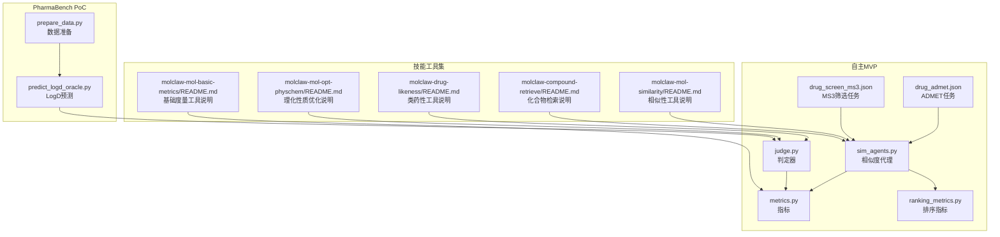
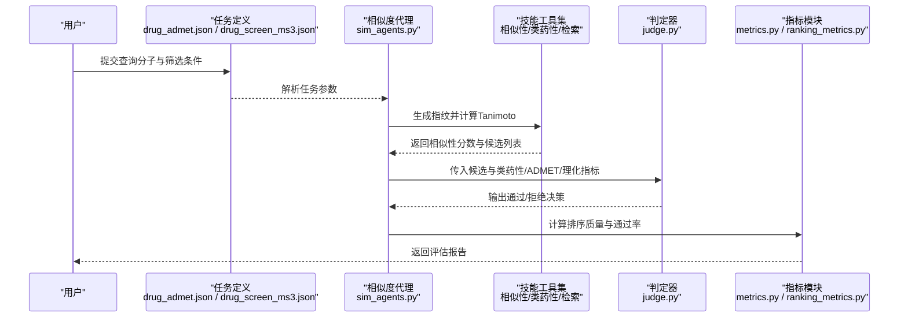
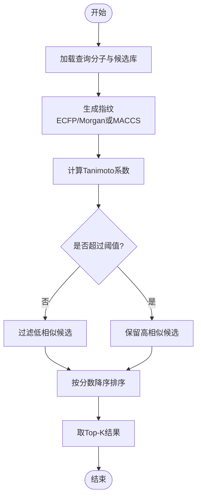
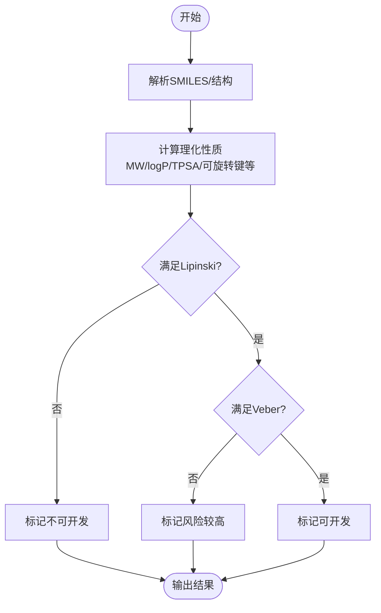
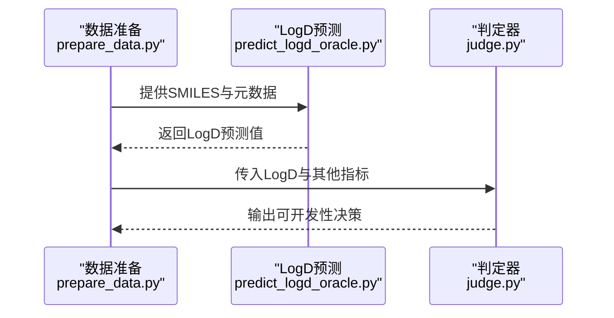
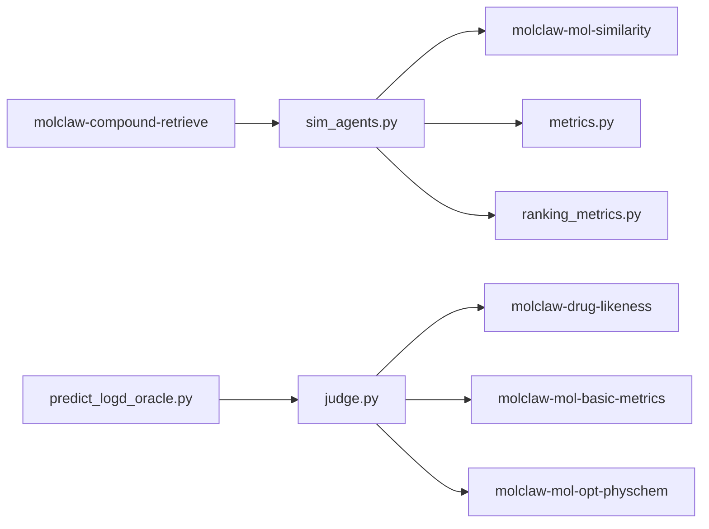

# 药物相似性与可开发性分析

<cite>
**本文引用的文件**   
- [autonomy_mvp/core/sim_agents.py](file://autonomy_mvp/core/sim_agents.py)
- [autonomy_mvp/core/judge.py](file://autonomy_mvp/core/judge.py)
- [autonomy_mvp/core/metrics.py](file://autonomy_mvp/core/metrics.py)
- [autonomy_mvp/core/ranking_metrics.py](file://autonomy_mvp/core/ranking_metrics.py)
- [autonomy_mvp/tasks/drug_admet.json](file://autonomy_mvp/tasks/drug_admet.json)
- [autonomy_mvp/tasks/drug_screen_ms3.json](file://autonomy_mvp/tasks/drug_screen_ms3.json)
- [docs/molbench_repo/skills/L1_tools/molclaw-mol-similarity/README.md](file://docs/molbench_repo/skills/L1_tools/molclaw-mol-similarity/README.md)
- [docs/molbench_repo/skills/L1_tools/molclaw-drug-likeness/README.md](file://docs/molbench_repo/skills/L1_tools/molclaw-drug-likeness/README.md)
- [docs/molbench_repo/skills/L1_tools/molclaw-mol-basic-metrics/README.md](file://docs/molbench_repo/skills/L1_tools/molclaw-mol-basic-metrics/README.md)
- [docs/molbench_repo/skills/L1_tools/molclaw-mol-opt-physchem/README.md](file://docs/molbench_repo/skills/L1_tools/molclaw-mol-opt-physchem/README.md)
- [docs/molbench_repo/skills/L1_tools/molclaw-compound-retrieve/README.md](file://docs/molbench_repo/skills/L1_tools/molclaw-compound-retrieve/README.md)
- [task6/poc4_pharmabench/tools/predict_logd_oracle.py](file://task6/poc4_pharmabench/tools/predict_logd_oracle.py)
- [task6/poc4_pharmabench/data/prepare_data.py](file://task6/poc4_pharmabench/data/prepare_data.py)
</cite>

## 目录
1. [简介](#简介)
2. [项目结构](#项目结构)
3. [核心组件](#核心组件)
4. [架构总览](#架构总览)
5. [详细组件分析](#详细组件分析)
6. [依赖关系分析](#依赖关系分析)
7. [性能考量](#性能考量)
8. [故障排查指南](#故障排查指南)
9. [结论](#结论)
10. [附录](#附录)

## 简介
本文件面向“药物相似性与可开发性分析”的端到端实践，覆盖以下主题：
- 分子相似性计算：Tanimoto系数、指纹算法（如ECFP/Morgan）与大规模库检索策略
- 药物可开发性规则：Lipinski五规则、Veber规则等，以及理化性质评估
- 分子描述符计算、理化性质分析与结构活性关系（SAR）研究思路
- 化合物聚类、骨架提取与类似物搜索方法
- 安全性评估、毒性预测与脱靶效应分析
- 结合仓库中现有工具与任务定义，给出大规模化合物库相似性搜索与可开发性筛选的流程化示例路径

## 项目结构
仓库中与药物化学相关的实现主要分布在以下位置：
- autonomy_mvp：包含相似度代理、评测指标与任务定义（ADMET、MS3筛选）
- docs/molbench_repo/skills/L1_tools：提供一系列分子技能（相似性、类药性、基础度量、理化性质优化、化合物检索等）
- task6/poc4_pharmabench：LogD预测与数据准备脚本，体现可开发性相关属性预测流程

图表来源
- [autonomy_mvp/core/sim_agents.py](file://autonomy_mvp/core/sim_agents.py)
- [autonomy_mvp/core/judge.py](file://autonomy_mvp/core/judge.py)
- [autonomy_mvp/core/metrics.py](file://autonomy_mvp/core/metrics.py)
- [autonomy_mvp/core/ranking_metrics.py](file://autonomy_mvp/core/ranking_metrics.py)
- [autonomy_mvp/tasks/drug_admet.json](file://autonomy_mvp/tasks/drug_admet.json)
- [autonomy_mvp/tasks/drug_screen_ms3.json](file://autonomy_mvp/tasks/drug_screen_ms3.json)
- [docs/molbench_repo/skills/L1_tools/molclaw-mol-similarity/README.md](file://docs/molbench_repo/skills/L1_tools/molclaw-mol-similarity/README.md)
- [docs/molbench_repo/skills/L1_tools/molclaw-drug-likeness/README.md](file://docs/molbench_repo/skills/L1_tools/molclaw-drug-likeness/README.md)
- [docs/molbench_repo/skills/L1_tools/molclaw-mol-basic-metrics/README.md](file://docs/molbench_repo/skills/L1_tools/molclaw-mol-basic-metrics/README.md)
- [docs/molbench_repo/skills/L1_tools/molclaw-mol-opt-physchem/README.md](file://docs/molbench_repo/skills/L1_tools/molclaw-mol-opt-physchem/README.md)
- [docs/molbench_repo/skills/L1_tools/molclaw-compound-retrieve/README.md](file://docs/molbench_repo/skills/L1_tools/molclaw-compound-retrieve/README.md)
- [task6/poc4_pharmabench/tools/predict_logd_oracle.py](file://task6/poc4_pharmabench/tools/predict_logd_oracle.py)
- [task6/poc4_pharmabench/data/prepare_data.py](file://task6/poc4_pharmabench/data/prepare_data.py)

章节来源
- [autonomy_mvp/core/sim_agents.py](file://autonomy_mvp/core/sim_agents.py)
- [autonomy_mvp/core/judge.py](file://autonomy_mvp/core/judge.py)
- [autonomy_mvp/core/metrics.py](file://autonomy_mvp/core/metrics.py)
- [autonomy_mvp/core/ranking_metrics.py](file://autonomy_mvp/core/ranking_metrics.py)
- [autonomy_mvp/tasks/drug_admet.json](file://autonomy_mvp/tasks/drug_admet.json)
- [autonomy_mvp/tasks/drug_screen_ms3.json](file://autonomy_mvp/tasks/drug_screen_ms3.json)
- [docs/molbench_repo/skills/L1_tools/molclaw-mol-similarity/README.md](file://docs/molbench_repo/skills/L1_tools/molclaw-mol-similarity/README.md)
- [docs/molbench_repo/skills/L1_tools/molclaw-drug-likeness/README.md](file://docs/molbench_repo/skills/L1_tools/molclaw-drug-likeness/README.md)
- [docs/molbench_repo/skills/L1_tools/molclaw-mol-basic-metrics/README.md](file://docs/molbench_repo/skills/L1_tools/molclaw-mol-basic-metrics/README.md)
- [docs/molbench_repo/skills/L1_tools/molclaw-mol-opt-physchem/README.md](file://docs/molbench_repo/skills/L1_tools/molclaw-mol-opt-physchem/README.md)
- [docs/molbench_repo/skills/L1_tools/molclaw-compound-retrieve/README.md](file://docs/molbench_repo/skills/L1_tools/molclaw-compound-retrieve/README.md)
- [task6/poc4_pharmabench/tools/predict_logd_oracle.py](file://task6/poc4_pharmabench/tools/predict_logd_oracle.py)
- [task6/poc4_pharmabench/data/prepare_data.py](file://task6/poc4_pharmabench/data/prepare_data.py)

## 核心组件
- 相似度代理（sim_agents.py）：封装基于指纹与Tanimoto系数的相似性计算流程，支持批量查询与结果排序。
- 判定器（judge.py）：将多源指标（类药性、ADMET、理化性质）聚合为可判定的决策信号。
- 指标模块（metrics.py、ranking_metrics.py）：提供相似性、排序质量与筛选通过率等量化指标。
- 任务定义（drug_admet.json、drug_screen_ms3.json）：描述ADMET与质谱筛选任务的输入输出与约束。
- 技能工具集（L1_tools）：提供相似性、类药性、基础度量、理化性质优化与化合物检索等能力说明。
- PharmaBench PoC（predict_logd_oracle.py、prepare_data.py）：展示LogD预测与数据准备流程，用于可开发性评估。

章节来源
- [autonomy_mvp/core/sim_agents.py](file://autonomy_mvp/core/sim_agents.py)
- [autonomy_mvp/core/judge.py](file://autonomy_mvp/core/judge.py)
- [autonomy_mvp/core/metrics.py](file://autonomy_mvp/core/metrics.py)
- [autonomy_mvp/core/ranking_metrics.py](file://autonomy_mvp/core/ranking_metrics.py)
- [autonomy_mvp/tasks/drug_admet.json](file://autonomy_mvp/tasks/drug_admet.json)
- [autonomy_mvp/tasks/drug_screen_ms3.json](file://autonomy_mvp/tasks/drug_screen_ms3.json)
- [docs/molbench_repo/skills/L1_tools/molclaw-mol-similarity/README.md](file://docs/molbench_repo/skills/L1_tools/molclaw-mol-similarity/README.md)
- [docs/molbench_repo/skills/L1_tools/molclaw-drug-likeness/README.md](file://docs/molbench_repo/skills/L1_tools/molclaw-drug-likeness/README.md)
- [docs/molbench_repo/skills/L1_tools/molclaw-mol-basic-metrics/README.md](file://docs/molbench_repo/skills/L1_tools/molclaw-mol-basic-metrics/README.md)
- [docs/molbench_repo/skills/L1_tools/molclaw-mol-opt-physchem/README.md](file://docs/molbench_repo/skills/L1_tools/molclaw-mol-opt-physchem/README.md)
- [docs/molbench_repo/skills/L1_tools/molclaw-compound-retrieve/README.md](file://docs/molbench_repo/skills/L1_tools/molclaw-compound-retrieve/README.md)
- [task6/poc4_pharmabench/tools/predict_logd_oracle.py](file://task6/poc4_pharmabench/tools/predict_logd_oracle.py)
- [task6/poc4_pharmabench/data/prepare_data.py](file://task6/poc4_pharmabench/data/prepare_data.py)

## 架构总览
整体流程由“任务驱动 + 工具链 + 指标评估”构成：
- 任务层：ADMET与MS3筛选任务定义输入输出与阈值
- 工具层：相似性、类药性、基础度量、理化性质优化、化合物检索
- 执行层：相似度代理负责批量计算与排序；判定器整合多指标进行决策
- 评估层：指标模块输出相似性质量、排序质量与筛选通过率

图表来源
- [autonomy_mvp/tasks/drug_admet.json](file://autonomy_mvp/tasks/drug_admet.json)
- [autonomy_mvp/tasks/drug_screen_ms3.json](file://autonomy_mvp/tasks/drug_screen_ms3.json)
- [autonomy_mvp/core/sim_agents.py](file://autonomy_mvp/core/sim_agents.py)
- [docs/molbench_repo/skills/L1_tools/molclaw-mol-similarity/README.md](file://docs/molbench_repo/skills/L1_tools/molclaw-mol-similarity/README.md)
- [docs/molbench_repo/skills/L1_tools/molclaw-drug-likeness/README.md](file://docs/molbench_repo/skills/L1_tools/molclaw-drug-likeness/README.md)
- [autonomy_mvp/core/judge.py](file://autonomy_mvp/core/judge.py)
- [autonomy_mvp/core/metrics.py](file://autonomy_mvp/core/metrics.py)
- [autonomy_mvp/core/ranking_metrics.py](file://autonomy_mvp/core/ranking_metrics.py)

## 详细组件分析

### 分子相似性计算（Tanimoto系数与指纹算法）
- 指纹类型：常用包括ECFP/Morgan、MACCS键型、RDKit拓扑指纹等；选择依据是表征能力与速度权衡。
- Tanimoto系数：定义为两指纹交集比特数除以并集比特数，取值[0,1]，值越大越相似。
- 批量计算：对候选库预计算指纹矩阵，使用向量化或分块计算提升吞吐。
- 阈值与截断：根据任务设定相似性阈值（如≥0.7），并结合Top-K截断控制候选规模。
- 索引加速：对大规模库可采用LSH、KD树或倒排索引进行近似最近邻检索。

图表来源
- [docs/molbench_repo/skills/L1_tools/molclaw-mol-similarity/README.md](file://docs/molbench_repo/skills/L1_tools/molclaw-mol-similarity/README.md)
- [autonomy_mvp/core/sim_agents.py](file://autonomy_mvp/core/sim_agents.py)

章节来源
- [docs/molbench_repo/skills/L1_tools/molclaw-mol-similarity/README.md](file://docs/molbench_repo/skills/L1_tools/molclaw-mol-similarity/README.md)
- [autonomy_mvp/core/sim_agents.py](file://autonomy_mvp/core/sim_agents.py)

### 药物可开发性规则与理化性质评估
- Lipinski五规则：分子量≤500、logP≤5、氢供体≤5、氢受体≤10、可旋转键≤10（经验阈值）。
- Veber规则：可旋转键≤10且极性表面积（TPSA）≤140 Ų。
- 其他常见规则：Ghose、Egan、Rule of 3（片段库）、PAINS/NIH警示结构剔除。
- 理化性质：logP/logD、溶解度、pKa、TPSA、MW、可旋转键数、芳香环比例等。
- 工具集成：类药性工具与基础度量工具提供自动化计算与阈值判断。

图表来源
- [docs/molbench_repo/skills/L1_tools/molclaw-drug-likeness/README.md](file://docs/molbench_repo/skills/L1_tools/molclaw-drug-likeness/README.md)
- [docs/molbench_repo/skills/L1_tools/molclaw-mol-basic-metrics/README.md](file://docs/molbench_repo/skills/L1_tools/molclaw-mol-basic-metrics/README.md)
- [docs/molbench_repo/skills/L1_tools/molclaw-mol-opt-physchem/README.md](file://docs/molbench_repo/skills/L1_tools/molclaw-mol-opt-physchem/README.md)

章节来源
- [docs/molbench_repo/skills/L1_tools/molclaw-drug-likeness/README.md](file://docs/molbench_repo/skills/L1_tools/molclaw-drug-likeness/README.md)
- [docs/molbench_repo/skills/L1_tools/molclaw-mol-basic-metrics/README.md](file://docs/molbench_repo/skills/L1_tools/molclaw-mol-basic-metrics/README.md)
- [docs/molbench_repo/skills/L1_tools/molclaw-mol-opt-physchem/README.md](file://docs/molbench_repo/skills/L1_tools/molclaw-mol-opt-physchem/README.md)

### 分子描述符计算与SAR研究
- 描述符类别：拓扑（连接性指数、环数）、电子（电荷分布、偶极矩）、几何（体积、形状）、量子化学（HOMO/LUMO、电离能）。
- SAR研究：以相似性为起点，围绕关键药效团与骨架变化构建系列化合物，观察活性趋势与构效关系。
- 可视化与统计：二维/三维结构比对、热图、相关性分析、回归模型辅助解释。

章节来源
- [docs/molbench_repo/skills/L1_tools/molclaw-mol-basic-metrics/README.md](file://docs/molbench_repo/skills/L1_tools/molclaw-mol-basic-metrics/README.md)
- [docs/molbench_repo/skills/L1_tools/molclaw-mol-opt-physchem/README.md](file://docs/molbench_repo/skills/L1_tools/molclaw-mol-opt-physchem/README.md)

### 化合物聚类、骨架提取与类似物搜索
- 聚类：基于指纹距离（Tanimoto）进行层次聚类或KMeans，识别结构簇与多样性。
- 骨架提取：使用 Bemis-Murcko 骨架或自定义子图匹配，提炼核心骨架集合。
- 类似物搜索：在骨架内或相似簇内进行局部修饰（取代基替换、环扩展/收缩），结合类药性与ADMET约束筛选。

章节来源
- [docs/molbench_repo/skills/L1_tools/molclaw-mol-similarity/README.md](file://docs/molbench_repo/skills/L1_tools/molclaw-mol-similarity/README.md)
- [docs/molbench_repo/skills/L1_tools/molclaw-compound-retrieve/README.md](file://docs/molbench_repo/skills/L1_tools/molclaw-compound-retrieve/README.md)

### 安全性评估、毒性预测与脱靶效应分析
- ADMET任务：吸收、分布、代谢、排泄与毒性（肝毒、心脏毒性、致突变性等）。
- 脱靶效应：基于同源蛋白或已知脱靶数据库进行相似性/对接/网络药理分析。
- 工具与任务：结合ADMET任务定义与判定器，形成自动化筛选管线。

章节来源
- [autonomy_mvp/tasks/drug_admet.json](file://autonomy_mvp/tasks/drug_admet.json)
- [autonomy_mvp/core/judge.py](file://autonomy_mvp/core/judge.py)

### 实际代码示例：大规模库相似性搜索与可开发性筛选
- 步骤一：准备数据与索引
  - 使用化合物检索工具建立索引（如倒排或LSH），预计算指纹。
  - 参考路径：[docs/molbench_repo/skills/L1_tools/molclaw-compound-retrieve/README.md](file://docs/molbench_repo/skills/L1_tools/molclaw-compound-retrieve/README.md)
- 步骤二：相似性搜索
  - 调用相似度代理，设置指纹类型与Tanimoto阈值，返回Top-K候选。
  - 参考路径：[autonomy_mvp/core/sim_agents.py](file://autonomy_mvp/core/sim_agents.py)、[docs/molbench_repo/skills/L1_tools/molclaw-mol-similarity/README.md](file://docs/molbench_repo/skills/L1_tools/molclaw-mol-similarity/README.md)
- 步骤三：可开发性筛选
  - 应用类药性与基础度量工具，执行Lipinski/Veber规则与警示结构剔除。
  - 参考路径：[docs/molbench_repo/skills/L1_tools/molclaw-drug-likeness/README.md](file://docs/molbench_repo/skills/L1_tools/molclaw-drug-likeness/README.md)、[docs/molbench_repo/skills/L1_tools/molclaw-mol-basic-metrics/README.md](file://docs/molbench_repo/skills/L1_tools/molclaw-mol-basic-metrics/README.md)
- 步骤四：ADMET与理化性质优化
  - 结合ADMET任务与理化性质优化工具，进行多目标权衡与迭代优化。
  - 参考路径：[autonomy_mvp/tasks/drug_admet.json](file://autonomy_mvp/tasks/drug_admet.json)、[docs/molbench_repo/skills/L1_tools/molclaw-mol-opt-physchem/README.md](file://docs/molbench_repo/skills/L1_tools/molclaw-mol-opt-physchem/README.md)
- 步骤五：评估与报告
  - 使用指标模块输出排序质量与通过率，生成评估报告。
  - 参考路径：[autonomy_mvp/core/metrics.py](file://autonomy_mvp/core/metrics.py)、[autonomy_mvp/core/ranking_metrics.py](file://autonomy_mvp/core/ranking_metrics.py)

章节来源
- [docs/molbench_repo/skills/L1_tools/molclaw-compound-retrieve/README.md](file://docs/molbench_repo/skills/L1_tools/molclaw-compound-retrieve/README.md)
- [autonomy_mvp/core/sim_agents.py](file://autonomy_mvp/core/sim_agents.py)
- [docs/molbench_repo/skills/L1_tools/molclaw-mol-similarity/README.md](file://docs/molbench_repo/skills/L1_tools/molclaw-mol-similarity/README.md)
- [docs/molbench_repo/skills/L1_tools/molclaw-drug-likeness/README.md](file://docs/molbench_repo/skills/L1_tools/molclaw-drug-likeness/README.md)
- [docs/molbench_repo/skills/L1_tools/molclaw-mol-basic-metrics/README.md](file://docs/molbench_repo/skills/L1_tools/molclaw-mol-basic-metrics/README.md)
- [autonomy_mvp/tasks/drug_admet.json](file://autonomy_mvp/tasks/drug_admet.json)
- [docs/molbench_repo/skills/L1_tools/molclaw-mol-opt-physchem/README.md](file://docs/molbench_repo/skills/L1_tools/molclaw-mol-opt-physchem/README.md)
- [autonomy_mvp/core/metrics.py](file://autonomy_mvp/core/metrics.py)
- [autonomy_mvp/core/ranking_metrics.py](file://autonomy_mvp/core/ranking_metrics.py)

### 可开发性属性预测示例：LogD
- 数据准备：从CSV读取SMILES与标签，清洗与去重，划分训练/验证集。
  - 参考路径：[task6/poc4_pharmabench/data/prepare_data.py](file://task6/poc4_pharmabench/data/prepare_data.py)
- LogD预测：调用预测脚本，输入SMILES，输出LogD估计值，用于脂溶性评估。
  - 参考路径：[task6/poc4_pharmabench/tools/predict_logd_oracle.py](file://task6/poc4_pharmabench/tools/predict_logd_oracle.py)

图表来源
- [task6/poc4_pharmabench/data/prepare_data.py](file://task6/poc4_pharmabench/data/prepare_data.py)
- [task6/poc4_pharmabench/tools/predict_logd_oracle.py](file://task6/poc4_pharmabench/tools/predict_logd_oracle.py)
- [autonomy_mvp/core/judge.py](file://autonomy_mvp/core/judge.py)

章节来源
- [task6/poc4_pharmabench/data/prepare_data.py](file://task6/poc4_pharmabench/data/prepare_data.py)
- [task6/poc4_pharmabench/tools/predict_logd_oracle.py](file://task6/poc4_pharmabench/tools/predict_logd_oracle.py)
- [autonomy_mvp/core/judge.py](file://autonomy_mvp/core/judge.py)

## 依赖关系分析
- 组件耦合：
  - sim_agents.py依赖相似性工具与指标模块，输出候选与评分
  - judge.py聚合类药性、ADMET与理化性质指标，输出决策
  - metrics.py与ranking_metrics.py提供评估指标
- 外部依赖：
  - 技能工具集（L1_tools）作为独立能力单元，被代理与判定器调用
  - PharmaBench PoC提供LogD预测与数据处理能力

图表来源
- [autonomy_mvp/core/sim_agents.py](file://autonomy_mvp/core/sim_agents.py)
- [autonomy_mvp/core/judge.py](file://autonomy_mvp/core/judge.py)
- [autonomy_mvp/core/metrics.py](file://autonomy_mvp/core/metrics.py)
- [autonomy_mvp/core/ranking_metrics.py](file://autonomy_mvp/core/ranking_metrics.py)
- [docs/molbench_repo/skills/L1_tools/molclaw-mol-similarity/README.md](file://docs/molbench_repo/skills/L1_tools/molclaw-mol-similarity/README.md)
- [docs/molbench_repo/skills/L1_tools/molclaw-drug-likeness/README.md](file://docs/molbench_repo/skills/L1_tools/molclaw-drug-likeness/README.md)
- [docs/molbench_repo/skills/L1_tools/molclaw-mol-basic-metrics/README.md](file://docs/molbench_repo/skills/L1_tools/molclaw-mol-basic-metrics/README.md)
- [docs/molbench_repo/skills/L1_tools/molclaw-mol-opt-physchem/README.md](file://docs/molbench_repo/skills/L1_tools/molclaw-mol-opt-physchem/README.md)
- [docs/molbench_repo/skills/L1_tools/molclaw-compound-retrieve/README.md](file://docs/molbench_repo/skills/L1_tools/molclaw-compound-retrieve/README.md)
- [task6/poc4_pharmabench/tools/predict_logd_oracle.py](file://task6/poc4_pharmabench/tools/predict_logd_oracle.py)

章节来源
- [autonomy_mvp/core/sim_agents.py](file://autonomy_mvp/core/sim_agents.py)
- [autonomy_mvp/core/judge.py](file://autonomy_mvp/core/judge.py)
- [autonomy_mvp/core/metrics.py](file://autonomy_mvp/core/metrics.py)
- [autonomy_mvp/core/ranking_metrics.py](file://autonomy_mvp/core/ranking_metrics.py)
- [docs/molbench_repo/skills/L1_tools/molclaw-mol-similarity/README.md](file://docs/molbench_repo/skills/L1_tools/molclaw-mol-similarity/README.md)
- [docs/molbench_repo/skills/L1_tools/molclaw-drug-likeness/README.md](file://docs/molbench_repo/skills/L1_tools/molclaw-drug-likeness/README.md)
- [docs/molbench_repo/skills/L1_tools/molclaw-mol-basic-metrics/README.md](file://docs/molbench_repo/skills/L1_tools/molclaw-mol-basic-metrics/README.md)
- [docs/molbench_repo/skills/L1_tools/molclaw-mol-opt-physchem/README.md](file://docs/molbench_repo/skills/L1_tools/molclaw-mol-opt-physchem/README.md)
- [docs/molbench_repo/skills/L1_tools/molclaw-compound-retrieve/README.md](file://docs/molbench_repo/skills/L1_tools/molclaw-compound-retrieve/README.md)
- [task6/poc4_pharmabench/tools/predict_logd_oracle.py](file://task6/poc4_pharmabench/tools/predict_logd_oracle.py)

## 性能考量
- 指纹计算：优先使用向量化与并行化，避免重复计算；对大库采用分块处理。
- 相似性检索：引入近似最近邻（LSH/HNSW）降低O(N)复杂度。
- 内存管理：控制候选集大小，及时释放中间结果；使用流式IO处理超大数据集。
- 批处理与缓存：对频繁计算的描述符与性质进行缓存，减少重复开销。
- 硬件利用：GPU加速（若可用）用于向量运算与深度学习预测（如LogD）。

## 故障排查指南
- 常见问题
  - SMILES无效或结构异常：检查输入格式与标准化流程
  - 指纹维度不匹配：确认指纹类型与长度一致
  - 阈值设置不当导致召回过低：调整Tanimoto阈值与Top-K
  - ADMET预测失败：检查模型输入特征与缺失值处理
- 定位方法
  - 查看判定器日志与指标输出，定位失败环节
  - 对比不同指纹类型的结果差异，验证表征稳定性
  - 使用小规模样本进行端到端回归测试

章节来源
- [autonomy_mvp/core/judge.py](file://autonomy_mvp/core/judge.py)
- [autonomy_mvp/core/metrics.py](file://autonomy_mvp/core/metrics.py)
- [autonomy_mvp/core/ranking_metrics.py](file://autonomy_mvp/core/ranking_metrics.py)

## 结论
本方案以任务驱动为核心，结合相似度代理、技能工具集与指标评估，构建了从相似性搜索到可开发性筛选的完整流程。通过指纹与Tanimoto系数实现高效相似性计算，借助Lipinski/Veber等规则与ADMET任务完成可开发性评估，并以PharmaBench的LogD预测为例展示了属性预测与数据准备的落地方式。建议在实际工程中引入索引加速与批处理优化，以提升大规模库的处理效率与稳定性。

## 附录
- 术语表
  - Tanimoto系数：衡量两个二进制向量相似度的指标
  - ECFP/Morgan指纹：基于原子环境的圆形指纹
  - TPSA：极性表面积，反映分子极性与渗透性
  - LogD：分配系数（考虑解离状态）
- 参考路径汇总
  - 相似性工具：[docs/molbench_repo/skills/L1_tools/molclaw-mol-similarity/README.md](file://docs/molbench_repo/skills/L1_tools/molclaw-mol-similarity/README.md)
  - 类药性工具：[docs/molbench_repo/skills/L1_tools/molclaw-drug-likeness/README.md](file://docs/molbench_repo/skills/L1_tools/molclaw-drug-likeness/README.md)
  - 基础度量：[docs/molbench_repo/skills/L1_tools/molclaw-mol-basic-metrics/README.md](file://docs/molbench_repo/skills/L1_tools/molclaw-mol-basic-metrics/README.md)
  - 理化性质优化：[docs/molbench_repo/skills/L1_tools/molclaw-mol-opt-physchem/README.md](file://docs/molbench_repo/skills/L1_tools/molclaw-mol-opt-physchem/README.md)
  - 化合物检索：[docs/molbench_repo/skills/L1_tools/molclaw-compound-retrieve/README.md](file://docs/molbench_repo/skills/L1_tools/molclaw-compound-retrieve/README.md)
  - 相似度代理：[autonomy_mvp/core/sim_agents.py](file://autonomy_mvp/core/sim_agents.py)
  - 判定器：[autonomy_mvp/core/judge.py](file://autonomy_mvp/core/judge.py)
  - 指标模块：[autonomy_mvp/core/metrics.py](file://autonomy_mvp/core/metrics.py)、[autonomy_mvp/core/ranking_metrics.py](file://autonomy_mvp/core/ranking_metrics.py)
  - ADMET任务：[autonomy_mvp/tasks/drug_admet.json](file://autonomy_mvp/tasks/drug_admet.json)
  - MS3筛选任务：[autonomy_mvp/tasks/drug_screen_ms3.json](file://autonomy_mvp/tasks/drug_screen_ms3.json)
  - LogD预测：[task6/poc4_pharmabench/tools/predict_logd_oracle.py](file://task6/poc4_pharmabench/tools/predict_logd_oracle.py)
  - 数据准备：[task6/poc4_pharmabench/data/prepare_data.py](file://task6/poc4_pharmabench/data/prepare_data.py)