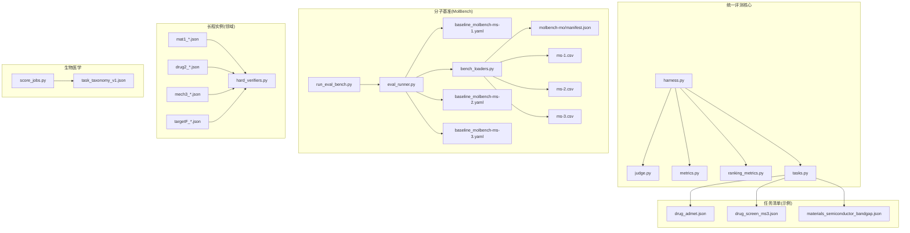
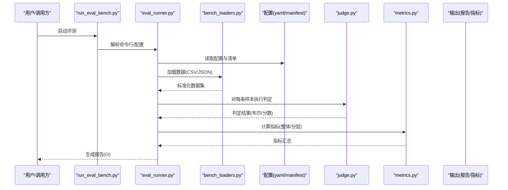
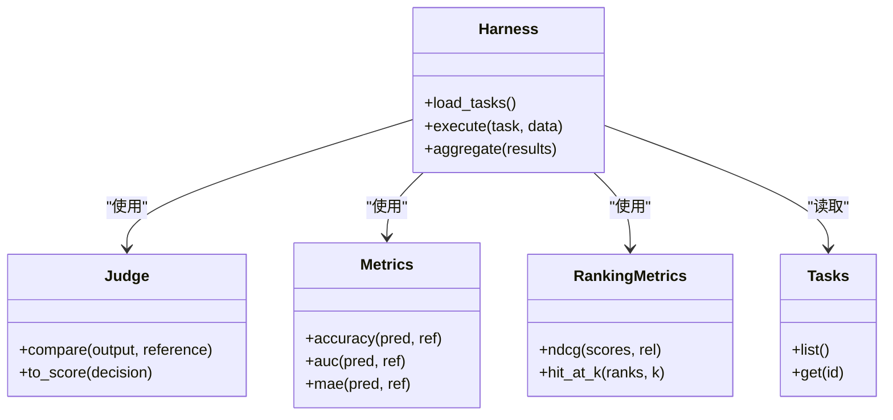
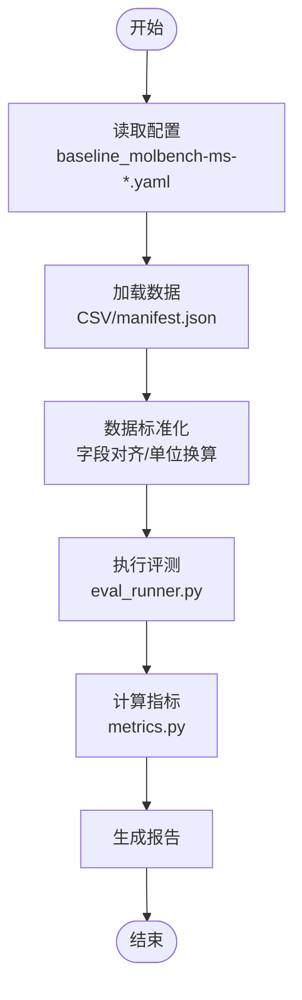
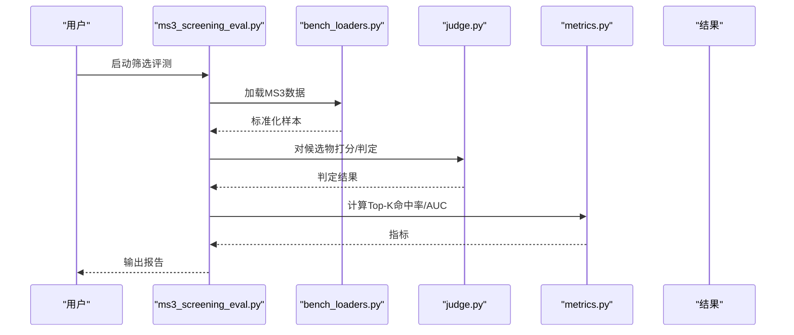
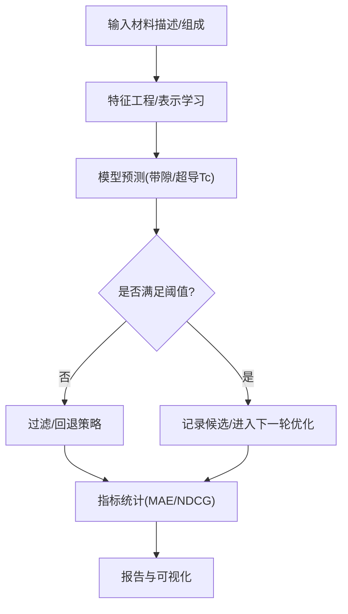
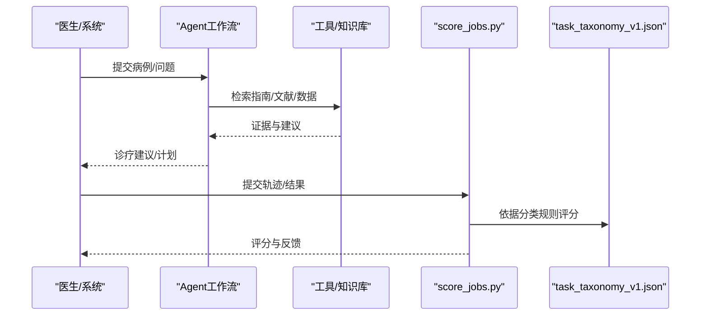
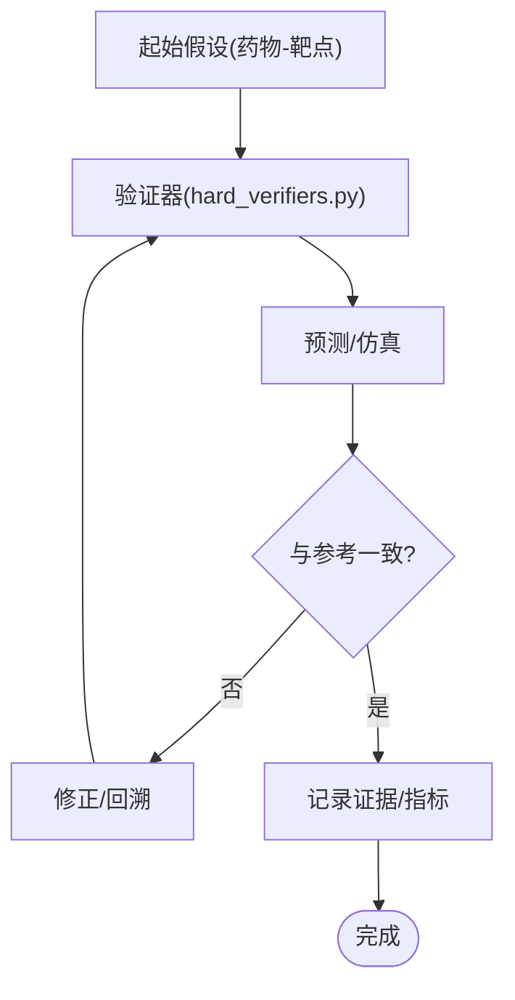
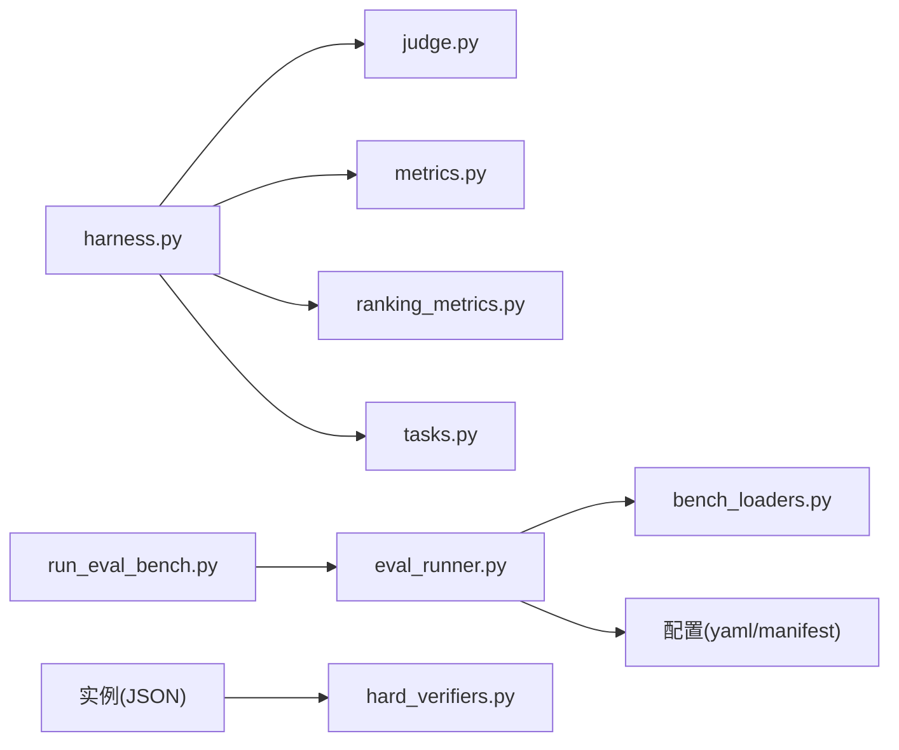

# 领域基准测试

<cite>
**本文引用的文件**   
- [autonomy_mvp/core/harness.py](file://autonomy_mvp/core/harness.py)
- [autonomy_mvp/core/judge.py](file://autonomy_mvp/core/judge.py)
- [autonomy_mvp/core/metrics.py](file://autonomy_mvp/core/metrics.py)
- [autonomy_mvp/core/ranking_metrics.py](file://autonomy_mvp/core/ranking_metrics.py)
- [autonomy_mvp/core/tasks.py](file://autonomy_mvp/core/tasks.py)
- [autonomy_mvp/tasks/drug_admet.json](file://autonomy_mvp/tasks/drug_admet.json)
- [autonomy_mvp/tasks/drug_screen_ms3.json](file://autonomy_mvp/tasks/drug_screen_ms3.json)
- [autonomy_mvp/tasks/materials_semiconductor_bandgap.json](file://autonomy_mvp/tasks/materials_semiconductor_bandgap.json)
- [autonomy_mvp/tests/fixtures/fixture_drugscreen.json](file://autonomy_mvp/tests/fixtures/fixture_drugscreen.json)
- [autonomy_mvp/tests/fixtures/fixture_materials.json](file://autonomy_mvp/tests/fixtures/fixture_materials.json)
- [autonomy_mvp/run_validation.py](file://autonomy_mvp/run_validation.py)
- [autonomy_mvp/schema.md](file://autonomy_mvp/schema.md)
- [docs/prd/molbench_repo/config/baseline_molbench-ms-1.yaml](file://docs/prd/molbench_repo/config/baseline_molbench-ms-1.yaml)
- [docs/prd/molbench_repo/config/baseline_molbench-ms-2.yaml](file://docs/prd/molbench_repo/config/baseline_molbench-ms-2.yaml)
- [docs/prd/molbench_repo/config/baseline_molbench-ms-3.yaml](file://docs/prd/molbench_repo/config/baseline_molbench-ms-3.yaml)
- [docs/prd/molbench_repo/data_full/molbench-mo/manifest.json](file://docs/prd/molbench_repo/data_full/molbench-mo/manifest.json)
- [docs/prd/molbench_repo/data_full/molbench-ms-1/molbench-ms-1.csv](file://docs/prd/molbench_repo/data_full/molbench-ms-1/molbench-ms-1.csv)
- [docs/prd/molbench_repo/data_full/molbench-ms-2/molbench-ms-2.csv](file://docs/prd/molbench_repo/data_full/molbench-ms-2/molbench-ms-2.csv)
- [docs/prd/molbench_repo/data_full/molbench-ms-3/molbench-ms-3.csv](file://docs/prd/molbench_repo/data_full/molbench-ms-3/molbench-ms-3.csv)
- [docs/prd/molbench_repo/eval/bench_loaders.py](file://docs/prd/molbench_repo/eval/bench_loaders.py)
- [docs/prd/molbench_repo/eval/eval_runner.py](file://docs/prd/molbench_repo/eval/eval_runner.py)
- [docs/prd/molbench_repo/eval/run_eval_bench.py](file://docs/prd/molbench_repo/eval/run_eval_bench.py)
- [longhorizon/instantiate/instances/mat1_Ca-Si-O_funnel.json](file://longhorizon/instantiate/instances/mat1_Ca-Si-O_funnel.json)
- [longhorizon/instantiate/instances/mat1_Li-Fe-O_funnel.json](file://longhorizon/instantiate/instances/mat1_Li-Fe-O_funnel.json)
- [longhorizon/instantiate/instances/mat1_Na-Nb-O_funnel.json](file://longhorizon/instantiate/instances/mat1_Na-Nb-O_funnel.json)
- [longhorizon/instantiate/instances/mat1_superconductor_premium.json](file://longhorizon/instantiate/instances/mat1_superconductor_premium.json)
- [longhorizon/instantiate/instances/drug2_BACE1.json](file://longhorizon/instantiate/instances/drug2_BACE1.json)
- [longhorizon/instantiate/instances/drug2_DPP-4.json](file://longhorizon/instantiate/instances/drug2_EGFR.json)
- [longhorizon/instantiate/instances/drug2_GLP-1R.json)
- [longhorizon/instantiate/instances/drug2_mTOR.json](file://longhorizon/instantiate/instances/drug2_mTOR.json)
- [longhorizon/instantiate/instances/mech3_Crizotinib-ALK+_NSCLC.json](file://longhorizon/instantiate/instances/mech3_Crizotinib-ALK+_NSCLC.json)
- [longhorizon/instantiate/instances/mech3_Dasatinib-CML.json](file://longhorizon/instantiate/instances/mech3_Dasatinib-CML.json)
- [longhorizon/instantiate/instances/mech3_Gefitinib-EGFR+_NSCLC.json](file://longhorizon/instantiate/instances/mech3_Gefitinib-EGFR+_NSCLC.json)
- [longhorizon/instantiate/instances/mech3_Trastuzumab-HER2+_breast_cancer.json](file://longhorizon/instantiate/instances/mech3_Trastuzumab-HER2+_breast_cancer.json)
- [longhorizon/instantiate/instances/mech3_Vemurafenib-BRAF_V600E_melanoma.json](file://longhorizon/instantiate/instances/mech3_Vemurafenib-BRAF_V600E_melanoma.json)
- [longhorizon/instantiate/instances/targetF_ABL1-CML.json](file://longhorizon/instantiate/instances/targetF_ABL1-CML.json)
- [longhorizon/instantiate/instances/targetF_ALK-NSCLC.json](file://longhorizon/instantiate/instances/targetF_ALK-NSCLC.json)
- [longhorizon/instantiate/instances/targetF_BRAF-Melanoma.json](file://longhorizon/instantiate/instances/targetF_BRAF-Melanoma.json)
- [longhorizon/instantiate/instances/targetF_BTK-CLL.json](file://longhorizon/instantiate/instances/targetF_BTK-CLL.json)
- [longhorizon/instantiate/instances/targetF_EGFR-NSCLC.json](file://longhorizon/instantiate/instances/targetF_EGFR-NSCLC.json)
- [longhorizon/instantiate/instances/targetF_ERBB2-BreastCancer.json](file://longhorizon/instantiate/instances/targetF_ERBB2-BreastCancer.json)
- [longhorizon/verifiers/hard_verifiers.py](file://longhorizon/verifiers/hard_verifiers.py)
- [task3/B_ms3_screening_prototype/ms3_screening_eval.py](file://task3/B_ms3_screening_prototype/ms3_screening_eval.py)
- [task3/B_ms3_screening_prototype/results.md](file://task3/B_ms3_screening_prototype/results.md)
- [poc3_physicianbench/scripts/score_jobs.py](file://poc3_physicianbench/scripts/score_jobs.py)
- [poc3_physicianbench/scripts/task_taxonomy_v1.json](file://poc3_physicianbench/scripts/task_taxonomy_v1.json)
</cite>

## 目录
1. [引言](#引言)
2. [项目结构](#项目结构)
3. [核心组件](#核心组件)
4. [架构总览](#架构总览)
5. [详细组件分析](#详细组件分析)
6. [依赖关系分析](#依赖关系分析)
7. [性能考量](#性能考量)
8. [故障排查指南](#故障排查指南)
9. [结论](#结论)
10. [附录](#附录)

## 引言
本文件面向多领域基准测试，聚焦药物发现、材料科学与生物医学三大领域。文档旨在：
- 解释各领域任务的特点、评估标准与应用场景
- 说明基准数据集的结构、数据格式规范与预处理流程
- 提供领域特定的配置方法、参数调优与结果分析方法
- 阐述跨领域比较方法与统一评估框架的设计理念

## 项目结构
仓库采用“领域+任务”的模块化组织方式：
- autonomy_mvp：统一的评测编排与指标计算核心，包含任务清单与最小可运行验证
- docs/prd/molbench_repo：分子层面的基准（MS/MO），含配置、数据清单、加载器与评测运行器
- longhorizon/instantiate/instances：按领域划分的实例化任务定义（JSON）
- task3：药物筛选原型评测脚本与结果
- poc3_physicianbench：生物医学任务评分与分类体系

图示来源
- [autonomy_mvp/core/harness.py](file://autonomy_mvp/core/harness.py)
- [autonomy_mvp/core/judge.py](file://autonomy_mvp/core/judge.py)
- [autonomy_mvp/core/metrics.py](file://autonomy_mvp/core/metrics.py)
- [autonomy_mvp/core/ranking_metrics.py](file://autonomy_mvp/core/ranking_metrics.py)
- [autonomy_mvp/core/tasks.py](file://autonomy_mvp/core/tasks.py)
- [autonomy_mvp/tasks/drug_admet.json](file://autonomy_mvp/tasks/drug_admet.json)
- [autonomy_mvp/tasks/drug_screen_ms3.json](file://autonomy_mvp/tasks/drug_screen_ms3.json)
- [autonomy_mvp/tasks/materials_semiconductor_bandgap.json](file://autonomy_mvp/tasks/materials_semiconductor_bandgap.json)
- [docs/prd/molbench_repo/config/baseline_molbench-ms-1.yaml](file://docs/prd/molbench_repo/config/baseline_molbench-ms-1.yaml)
- [docs/prd/molbench_repo/config/baseline_molbench-ms-2.yaml](file://docs/prd/molbench_repo/config/baseline_molbench-ms-2.yaml)
- [docs/prd/molbench_repo/config/baseline_molbench-ms-3.yaml](file://docs/prd/molbench_repo/config/baseline_molbench-ms-3.yaml)
- [docs/prd/molbench_repo/data_full/molbench-mo/manifest.json](file://docs/prd/molbench_repo/data_full/molbench-mo/manifest.json)
- [docs/prd/molbench_repo/data_full/molbench-ms-1/molbench-ms-1.csv](file://docs/prd/molbench_repo/data_full/molbench-ms-1/molbench-ms-1.csv)
- [docs/prd/molbench_repo/data_full/molbench-ms-2/molbench-ms-2.csv](file://docs/prd/molbench_repo/data_full/molbench-ms-2/molbench-ms-2.csv)
- [docs/prd/molbench_repo/data_full/molbench-ms-3/molbench-ms-3.csv](file://docs/prd/molbench_repo/data_full/molbench-ms-3/molbench-ms-3.csv)
- [docs/prd/molbench_repo/eval/bench_loaders.py](file://docs/prd/molbench_repo/eval/bench_loaders.py)
- [docs/prd/molbench_repo/eval/eval_runner.py](file://docs/prd/molbench_repo/eval/eval_runner.py)
- [docs/prd/molbench_repo/eval/run_eval_bench.py](file://docs/prd/molbench_repo/eval/run_eval_bench.py)
- [longhorizon/instantiate/instances/mat1_Ca-Si-O_funnel.json](file://longhorizon/instantiate/instances/mat1_Ca-Si-O_funnel.json)
- [longhorizon/instantiate/instances/mat1_Li-Fe-O_funnel.json](file://longhorizon/instantiate/instances/mat1_Li-Fe-O_funnel.json)
- [longhorizon/instantiate/instances/mat1_Na-Nb-O_funnel.json](file://longhorizon/instantiate/instances/mat1_Na-Nb-O_funnel.json)
- [longhorizon/instantiate/instances/mat1_superconductor_premium.json](file://longhorizon/instantiate/instances/mat1_superconductor_premium.json)
- [longhorizon/instantiate/instances/drug2_BACE1.json](file://longhorizon/instantiate/instances/drug2_BACE1.json)
- [longhorizon/instantiate/instances/drug2_DPP-4.json](file://longhorizon/instantiate/instances/drug2_DPP-4.json)
- [longhorizon/instantiate/instances/drug2_EGFR.json](file://longhorizon/instantiate/instances/drug2_EGFR.json)
- [longhorizon/instantiate/instances/drug2_mTOR.json](file://longhorizon/instantiate/instances/drug2_mTOR.json)
- [longhorizon/instantiate/instances/mech3_Crizotinib-ALK+_NSCLC.json](file://longhorizon/instantiate/instances/mech3_Crizotinib-ALK+_NSCLC.json)
- [longhorizon/instantiate/instances/mech3_Dasatinib-CML.json](file://longhorizon/instantiate/instances/mech3_Dasatinib-CML.json)
- [longhorizon/instantiate/instances/mech3_Gefitinib-EGFR+_NSCLC.json](file://longhorizon/instantiate/instances/mech3_Gefitinib-EGFR+_NSCLC.json)
- [longhorizon/instantiate/instances/mech3_Trastuzumab-HER2+_breast_cancer.json](file://longhorizon/instantiate/instances/mech3_Trastuzumab-HER2+_breast_cancer.json)
- [longhorizon/instantiate/instances/mech3_Vemurafenib-BRAF_V600E_melanoma.json](file://longhorizon/instantiate/instances/mech3_Vemurafenib-BRAF_V600E_melanoma.json)
- [longhorizon/instantiate/instances/targetF_ABL1-CML.json](file://longhorizon/instantiate/instances/targetF_ABL1-CML.json)
- [longhorizon/instantiate/instances/targetF_ALK-NSCLC.json](file://longhorizon/instantiate/instances/targetF_ALK-NSCLC.json)
- [longhorizon/instantiate/instances/targetF_BRAF-Melanoma.json](file://longhorizon/instantiate/instances/targetF_BRAF-Melanoma.json)
- [longhorizon/instantiate/instances/targetF_BTK-CLL.json](file://longhorizon/instantiate/instances/targetF_BTK-CLL.json)
- [longhorizon/instantiate/instances/targetF_EGFR-NSCLC.json](file://longhorizon/instantiate/instances/targetF_EGFR-NSCLC.json)
- [longhorizon/instantiate/instances/targetF_ERBB2-BreastCancer.json](file://longhorizon/instantiate/instances/targetF_ERBB2-BreastCancer.json)
- [longhorizon/verifiers/hard_verifiers.py](file://longhorizon/verifiers/hard_verifiers.py)
- [poc3_physicianbench/scripts/score_jobs.py](file://poc3_physicianbench/scripts/score_jobs.py)
- [poc3_physicianbench/scripts/task_taxonomy_v1.json](file://poc3_physicianbench/scripts/task_taxonomy_v1.json)

章节来源
- [autonomy_mvp/schema.md](file://autonomy_mvp/schema.md)
- [autonomy_mvp/run_validation.py](file://autonomy_mvp/run_validation.py)

## 核心组件
- 统一编排与执行
  - harness.py：负责任务加载、执行调度、结果收集与汇总
  - tasks.py：声明式任务清单与元信息，驱动具体评测用例
- 判定与指标
  - judge.py：将模型输出与参考答案进行比对，产出布尔或分数型判定
  - metrics.py：通用指标计算（如准确率、AUC、MAE等）
  - ranking_metrics.py：排序类指标（如NDCG、Hit@K）
- 领域实例与验证
  - longhorizon/instantiate/instances/*.json：各领域的任务实例定义
  - hard_verifiers.py：严格校验器，用于复杂任务的自动化验证
- 分子基准（MolBench）
  - bench_loaders.py：CSV/清单数据的加载与标准化
  - eval_runner.py / run_eval_bench.py：评测运行入口与流水线控制
  - baseline_molbench-ms-*.yaml：不同子集的配置模板
  - data_full/*：数据清单与CSV样例
- 生物医学
  - score_jobs.py：批量任务评分聚合
  - task_taxonomy_v1.json：任务分类与标签体系

章节来源
- [autonomy_mvp/core/harness.py](file://autonomy_mvp/core/harness.py)
- [autonomy_mvp/core/judge.py](file://autonomy_mvp/core/judge.py)
- [autonomy_mvp/core/metrics.py](file://autonomy_mvp/core/metrics.py)
- [autonomy_mvp/core/ranking_metrics.py](file://autonomy_mvp/core/ranking_metrics.py)
- [autonomy_mvp/core/tasks.py](file://autonomy_mvp/core/tasks.py)
- [docs/prd/molbench_repo/eval/bench_loaders.py](file://docs/prd/molbench_repo/eval/bench_loaders.py)
- [docs/prd/molbench_repo/eval/eval_runner.py](file://docs/prd/molbench_repo/eval/eval_runner.py)
- [docs/prd/molbench_repo/eval/run_eval_bench.py](file://docs/prd/molbench_repo/eval/run_eval_bench.py)
- [longhorizon/verifiers/hard_verifiers.py](file://longhorizon/verifiers/hard_verifiers.py)
- [poc3_physicianbench/scripts/score_jobs.py](file://poc3_physicianbench/scripts/score_jobs.py)
- [poc3_physicianbench/scripts/task_taxonomy_v1.json](file://poc3_physicianbench/scripts/task_taxonomy_v1.json)

## 架构总览
统一评估框架以“任务清单 + 加载器 + 运行器 + 指标”为核心，支持跨领域复用。

图示来源
- [docs/prd/molbench_repo/eval/run_eval_bench.py](file://docs/prd/molbench_repo/eval/run_eval_bench.py)
- [docs/prd/molbench_repo/eval/eval_runner.py](file://docs/prd/molbench_repo/eval/eval_runner.py)
- [docs/prd/molbench_repo/eval/bench_loaders.py](file://docs/prd/molbench_repo/eval/bench_loaders.py)
- [autonomy_mvp/core/judge.py](file://autonomy_mvp/core/judge.py)
- [autonomy_mvp/core/metrics.py](file://autonomy_mvp/core/metrics.py)

## 详细组件分析

### 统一评测核心（autonomy_mvp）
- 设计要点
  - 通过tasks.py声明任务，由harness.py统一调度
  - judge.py实现“输出-参考”对齐与判定逻辑
  - metrics.py与ranking_metrics.py提供通用与排序类指标
- 关键流程
  - 任务注册 → 数据加载 → 执行判定 → 指标聚合 → 结果导出
- 适用性
  - 适用于药物、材料、生物医学等多领域任务，只要遵循统一的数据与判定接口

图示来源
- [autonomy_mvp/core/harness.py](file://autonomy_mvp/core/harness.py)
- [autonomy_mvp/core/judge.py](file://autonomy_mvp/core/judge.py)
- [autonomy_mvp/core/metrics.py](file://autonomy_mvp/core/metrics.py)
- [autonomy_mvp/core/ranking_metrics.py](file://autonomy_mvp/core/ranking_metrics.py)
- [autonomy_mvp/core/tasks.py](file://autonomy_mvp/core/tasks.py)

章节来源
- [autonomy_mvp/core/harness.py](file://autonomy_mvp/core/harness.py)
- [autonomy_mvp/core/judge.py](file://autonomy_mvp/core/judge.py)
- [autonomy_mvp/core/metrics.py](file://autonomy_mvp/core/metrics.py)
- [autonomy_mvp/core/ranking_metrics.py](file://autonomy_mvp/core/ranking_metrics.py)
- [autonomy_mvp/core/tasks.py](file://autonomy_mvp/core/tasks.py)

### 分子基准（MolBench）
- 数据与配置
  - manifest.json：MO子集清单
  - ms-1/2/3.csv：MS子集数据
  - baseline_molbench-ms-*.yaml：不同子集的评测配置
- 加载与运行
  - bench_loaders.py：从CSV/清单加载并标准化
  - eval_runner.py / run_eval_bench.py：评测流水线入口
- 典型流程
  - 读取配置 → 加载数据 → 执行预测/筛选 → 计算指标 → 输出报告

图示来源
- [docs/prd/molbench_repo/config/baseline_molbench-ms-1.yaml](file://docs/prd/molbench_repo/config/baseline_molbench-ms-1.yaml)
- [docs/prd/molbench_repo/config/baseline_molbench-ms-2.yaml](file://docs/prd/molbench_repo/config/baseline_molbench-ms-2.yaml)
- [docs/prd/molbench_repo/config/baseline_molbench-ms-3.yaml](file://docs/prd/molbench_repo/config/baseline_molbench-ms-3.yaml)
- [docs/prd/molbench_repo/data_full/molbench-mo/manifest.json](file://docs/prd/molbench_repo/data_full/molbench-mo/manifest.json)
- [docs/prd/molbench_repo/data_full/molbench-ms-1/molbench-ms-1.csv](file://docs/prd/molbench_repo/data_full/molbench-ms-1/molbench-ms-1.csv)
- [docs/prd/molbench_repo/data_full/molbench-ms-2/molbench-ms-2.csv](file://docs/prd/molbench_repo/data_full/molbench-ms-2/molbench-ms-2.csv)
- [docs/prd/molbench_repo/data_full/molbench-ms-3/molbench-ms-3.csv](file://docs/prd/molbench_repo/data_full/molbench-ms-3/molbench-ms-3.csv)
- [docs/prd/molbench_repo/eval/bench_loaders.py](file://docs/prd/molbench_repo/eval/bench_loaders.py)
- [docs/prd/molbench_repo/eval/eval_runner.py](file://docs/prd/molbench_repo/eval/eval_runner.py)
- [docs/prd/molbench_repo/eval/run_eval_bench.py](file://docs/prd/molbench_repo/eval/run_eval_bench.py)

章节来源
- [docs/prd/molbench_repo/eval/bench_loaders.py](file://docs/prd/molbench_repo/eval/bench_loaders.py)
- [docs/prd/molbench_repo/eval/eval_runner.py](file://docs/prd/molbench_repo/eval/eval_runner.py)
- [docs/prd/molbench_repo/eval/run_eval_bench.py](file://docs/prd/molbench_repo/eval/run_eval_bench.py)
- [docs/prd/molbench_repo/data_full/molbench-mo/manifest.json](file://docs/prd/molbench_repo/data_full/molbench-mo/manifest.json)
- [docs/prd/molbench_repo/data_full/molbench-ms-1/molbench-ms-1.csv](file://docs/prd/molbench_repo/data_full/molbench-ms-1/molbench-ms-1.csv)
- [docs/prd/molbench_repo/data_full/molbench-ms-2/molbench-ms-2.csv](file://docs/prd/molbench_repo/data_full/molbench-ms-2/molbench-ms-2.csv)
- [docs/prd/molbench_repo/data_full/molbench-ms-3/molbench-ms-3.csv](file://docs/prd/molbench_repo/data_full/molbench-ms-3/molbench-ms-3.csv)
- [docs/prd/molbench_repo/config/baseline_molbench-ms-1.yaml](file://docs/prd/molbench_repo/config/baseline_molbench-ms-1.yaml)
- [docs/prd/molbench_repo/config/baseline_molbench-ms-2.yaml](file://docs/prd/molbench_repo/config/baseline_molbench-ms-2.yaml)
- [docs/prd/molbench_repo/config/baseline_molbench-ms-3.yaml](file://docs/prd/molbench_repo/config/baseline_molbench-ms-3.yaml)

### 药物发现领域
- 任务特点
  - ADMET性质预测、虚拟筛选、结合亲和力估计、逆合成规划、机理模拟等
- 评估标准
  - 分类任务：准确率、AUC、F1；回归任务：MAE、RMSE、R²；排序任务：NDCG、Hit@K
- 应用场景
  - 先导化合物优化、靶点验证、成药性评估
- 数据与实例
  - 任务清单：drug_admet.json、drug_screen_ms3.json
  - 实例：drug2_*.json（如BACE1、DPP-4、EGFR、mTOR）
  - 原型评测：task3/B_ms3_screening_prototype/ms3_screening_eval.py

图示来源
- [task3/B_ms3_screening_prototype/ms3_screening_eval.py](file://task3/B_ms3_screening_prototype/ms3_screening_eval.py)
- [autonomy_mvp/core/judge.py](file://autonomy_mvp/core/judge.py)
- [autonomy_mvp/core/metrics.py](file://autonomy_mvp/core/metrics.py)
- [docs/prd/molbench_repo/eval/bench_loaders.py](file://docs/prd/molbench_repo/eval/bench_loaders.py)

章节来源
- [autonomy_mvp/tasks/drug_admet.json](file://autonomy_mvp/tasks/drug_admet.json)
- [autonomy_mvp/tasks/drug_screen_ms3.json](file://autonomy_mvp/tasks/drug_screen_ms3.json)
- [longhorizon/instantiate/instances/drug2_BACE1.json](file://longhorizon/instantiate/instances/drug2_BACE1.json)
- [longhorizon/instantiate/instances/drug2_DPP-4.json](file://longhorizon/instantiate/instances/drug2_DPP-4.json)
- [longhorizon/instantiate/instances/drug2_EGFR.json](file://longhorizon/instantiate/instances/drug2_EGFR.json)
- [longhorizon/instantiate/instances/drug2_mTOR.json](file://longhorizon/instantiate/instances/drug2_mTOR.json)
- [task3/B_ms3_screening_prototype/ms3_screening_eval.py](file://task3/B_ms3_screening_prototype/ms3_screening_eval.py)
- [task3/B_ms3_screening_prototype/results.md](file://task3/B_ms3_screening_prototype/results.md)

### 材料科学领域
- 任务特点
  - 带隙预测、超导体属性预测、成分-性能映射、逆向设计与闭环优化
- 评估标准
  - 回归：MAE/RMSE/R²；排序：NDCG/Hit@K；约束满足率（如稳定性阈值）
- 应用场景
  - 新材料发现、性能筛选、高通量计算辅助
- 数据与实例
  - 半导体带隙任务：materials_semiconductor_bandgap.json
  - 材料实例：mat1_*.json（Ca-Si-O、Li-Fe-O、Na-Nb-O、superconductor_premium）

图示来源
- [autonomy_mvp/tasks/materials_semiconductor_bandgap.json](file://autonomy_mvp/tasks/materials_semiconductor_bandgap.json)
- [longhorizon/instantiate/instances/mat1_Ca-Si-O_funnel.json](file://longhorizon/instantiate/instances/mat1_Ca-Si-O_funnel.json)
- [longhorizon/instantiate/instances/mat1_Li-Fe-O_funnel.json](file://longhorizon/instantiate/instances/mat1_Li-Fe-O_funnel.json)
- [longhorizon/instantiate/instances/mat1_Na-Nb-O_funnel.json](file://longhorizon/instantiate/instances/mat1_Na-Nb-O_funnel.json)
- [longhorizon/instantiate/instances/mat1_superconductor_premium.json](file://longhorizon/instantiate/instances/mat1_superconductor_premium.json)

章节来源
- [autonomy_mvp/tasks/materials_semiconductor_bandgap.json](file://autonomy_mvp/tasks/materials_semiconductor_bandgap.json)
- [longhorizon/instantiate/instances/mat1_Ca-Si-O_funnel.json](file://longhorizon/instantiate/instances/mat1_Ca-Si-O_funnel.json)
- [longhorizon/instantiate/instances/mat1_Li-Fe-O_funnel.json](file://longhorizon/instantiate/instances/mat1_Li-Fe-O_funnel.json)
- [longhorizon/instantiate/instances/mat1_Na-Nb-O_funnel.json](file://longhorizon/instantiate/instances/mat1_Na-Nb-O_funnel.json)
- [longhorizon/instantiate/instances/mat1_superconductor_premium.json](file://longhorizon/instantiate/instances/mat1_superconductor_premium.json)

### 生物医学领域
- 任务特点
  - 临床决策支持、用药建议、诊断路径推理、随访计划制定
- 评估标准
  - 流程合规性、安全性约束满足率、临床指南一致性、效率指标（步骤数/耗时）
- 应用场景
  - 医生工作流辅助、患者管理、临床试验方案生成
- 数据与实例
  - 任务分类：task_taxonomy_v1.json
  - 评分聚合：score_jobs.py

图示来源
- [poc3_physicianbench/scripts/score_jobs.py](file://poc3_physicianbench/scripts/score_jobs.py)
- [poc3_physicianbench/scripts/task_taxonomy_v1.json](file://poc3_physicianbench/scripts/task_taxonomy_v1.json)

章节来源
- [poc3_physicianbench/scripts/score_jobs.py](file://poc3_physicianbench/scripts/score_jobs.py)
- [poc3_physicianbench/scripts/task_taxonomy_v1.json](file://poc3_physicianbench/scripts/task_taxonomy_v1.json)

### 机理模拟与靶点验证（跨领域）
- 任务特点
  - 基于已知药物-靶点关系的机理验证、通路分析与表型推断
- 评估标准
  - 因果一致性、机制合理性、预测与实验对照的一致性
- 数据与实例
  - mech3_*.json（多种疾病-药物组合）
  - targetF_*.json（靶点集合）

图示来源
- [longhorizon/instantiate/instances/mech3_Crizotinib-ALK+_NSCLC.json](file://longhorizon/instantiate/instances/mech3_Crizotinib-ALK+_NSCLC.json)
- [longhorizon/instantiate/instances/mech3_Dasatinib-CML.json](file://longhorizon/instantiate/instances/mech3_Dasatinib-CML.json)
- [longhorizon/instantiate/instances/mech3_Gefitinib-EGFR+_NSCLC.json](file://longhorizon/instantiate/instances/mech3_Gefitinib-EGFR+_NSCLC.json)
- [longhorizon/instantiate/instances/mech3_Trastuzumab-HER2+_breast_cancer.json](file://longhorizon/instantiate/instances/mech3_Trastuzumab-HER2+_breast_cancer.json)
- [longhorizon/instantiate/instances/mech3_Vemurafenib-BRAF_V600E_melanoma.json](file://longhorizon/instantiate/instances/mech3_Vemurafenib-BRAF_V600E_melanoma.json)
- [longhorizon/instantiate/instances/targetF_ABL1-CML.json](file://longhorizon/instantiate/instances/targetF_ABL1-CML.json)
- [longhorizon/instantiate/instances/targetF_ALK-NSCLC.json](file://longhorizon/instantiate/instances/targetF_ALK-NSCLC.json)
- [longhorizon/instantiate/instances/targetF_BRAF-Melanoma.json](file://longhorizon/instantiate/instances/targetF_BRAF-Melanoma.json)
- [longhorizon/instantiate/instances/targetF_BTK-CLL.json](file://longhorizon/instantiate/instances/targetF_BTK-CLL.json)
- [longhorizon/instantiate/instances/targetF_EGFR-NSCLC.json](file://longhorizon/instantiate/instances/targetF_EGFR-NSCLC.json)
- [longhorizon/instantiate/instances/targetF_ERBB2-BreastCancer.json](file://longhorizon/instantiate/instances/targetF_ERBB2-BreastCancer.json)
- [longhorizon/verifiers/hard_verifiers.py](file://longhorizon/verifiers/hard_verifiers.py)

章节来源
- [longhorizon/instantiate/instances/mech3_Crizotinib-ALK+_NSCLC.json](file://longhorizon/instantiate/instances/mech3_Crizotinib-ALK+_NSCLC.json)
- [longhorizon/instantiate/instances/mech3_Dasatinib-CML.json](file://longhorizon/instantiate/instances/mech3_Dasatinib-CML.json)
- [longhorizon/instantiate/instances/mech3_Gefitinib-EGFR+_NSCLC.json](file://longhorizon/instantiate/instances/mech3_Gefitinib-EGFR+_NSCLC.json)
- [longhorizon/instantiate/instances/mech3_Trastuzumab-HER2+_breast_cancer.json](file://longhorizon/instantiate/instances/mech3_Trastuzumab-HER2+_breast_cancer.json)
- [longhorizon/instantiate/instances/mech3_Vemurafenib-BRAF_V600E_melanoma.json](file://longhorizon/instantiate/instances/mech3_Vemurafenib-BRAF_V600E_melanoma.json)
- [longhorizon/instantiate/instances/targetF_ABL1-CML.json](file://longhorizon/instantiate/instances/targetF_ABL1-CML.json)
- [longhorizon/instantiate/instances/targetF_ALK-NSCLC.json](file://longhorizon/instantiate/instances/targetF_ALK-NSCLC.json)
- [longhorizon/instantiate/instances/targetF_BRAF-Melanoma.json](file://longhorizon/instantiate/instances/targetF_BRAF-Melanoma.json)
- [longhorizon/instantiate/instances/targetF_BTK-CLL.json](file://longhorizon/instantiate/instances/targetF_BTK-CLL.json)
- [longhorizon/instantiate/instances/targetF_EGFR-NSCLC.json](file://longhorizon/instantiate/instances/targetF_EGFR-NSCLC.json)
- [longhorizon/instantiate/instances/targetF_ERBB2-BreastCancer.json](file://longhorizon/instantiate/instances/targetF_ERBB2-BreastCancer.json)
- [longhorizon/verifiers/hard_verifiers.py](file://longhorizon/verifiers/hard_verifiers.py)

## 依赖关系分析
- 模块耦合
  - harness.py 强依赖 judge.py、metrics.py、ranking_metrics.py 与 tasks.py
  - MolBench 运行器依赖 loaders 与配置（yaml/manifest/csv）
  - 长程实例依赖 hard_verifiers.py 进行严格校验
- 外部集成点
  - 领域工具链（对接外部预测/仿真服务）通过 runners 与 verifiers 抽象
- 潜在循环依赖
  - 当前结构未见明显循环；若新增领域适配器，应通过接口层解耦

图示来源
- [autonomy_mvp/core/harness.py](file://autonomy_mvp/core/harness.py)
- [autonomy_mvp/core/judge.py](file://autonomy_mvp/core/judge.py)
- [autonomy_mvp/core/metrics.py](file://autonomy_mvp/core/metrics.py)
- [autonomy_mvp/core/ranking_metrics.py](file://autonomy_mvp/core/ranking_metrics.py)
- [autonomy_mvp/core/tasks.py](file://autonomy_mvp/core/tasks.py)
- [docs/prd/molbench_repo/eval/run_eval_bench.py](file://docs/prd/molbench_repo/eval/run_eval_bench.py)
- [docs/prd/molbench_repo/eval/eval_runner.py](file://docs/prd/molbench_repo/eval/eval_runner.py)
- [docs/prd/molbench_repo/eval/bench_loaders.py](file://docs/prd/molbench_repo/eval/bench_loaders.py)
- [longhorizon/verifiers/hard_verifiers.py](file://longhorizon/verifiers/hard_verifiers.py)

章节来源
- [autonomy_mvp/core/harness.py](file://autonomy_mvp/core/harness.py)
- [docs/prd/molbench_repo/eval/run_eval_bench.py](file://docs/prd/molbench_repo/eval/run_eval_bench.py)
- [docs/prd/molbench_repo/eval/eval_runner.py](file://docs/prd/molbench_repo/eval/eval_runner.py)
- [docs/prd/molbench_repo/eval/bench_loaders.py](file://docs/prd/molbench_repo/eval/bench_loaders.py)
- [longhorizon/verifiers/hard_verifiers.py](file://longhorizon/verifiers/hard_verifiers.py)

## 性能考量
- 批处理与并行
  - 在评测运行器中启用批处理与并行I/O，减少磁盘与网络开销
- 缓存与去重
  - 对重复计算的特征/中间结果进行缓存，避免重复调用外部工具
- 内存与精度
  - 大数据集下采用分块读取与惰性加载；数值类型选择兼顾精度与速度
- 指标计算优化
  - 向量化计算常用指标（AUC、MAE、NDCG），避免逐条循环

[本节为通用指导，不直接分析具体文件]

## 故障排查指南
- 常见问题
  - 数据缺失或字段不一致：检查CSV/manifest与加载器的字段映射
  - 判定失败：核对judge.py中的对齐规则与阈值设置
  - 指标异常：确认排序/分类标签与权重配置
- 定位方法
  - 使用run_validation.py进行最小化验证
  - 查看schema.md确保数据符合规范
  - 针对长程任务，借助hard_verifiers.py逐步定位断点

章节来源
- [autonomy_mvp/run_validation.py](file://autonomy_mvp/run_validation.py)
- [autonomy_mvp/schema.md](file://autonomy_mvp/schema.md)
- [longhorizon/verifiers/hard_verifiers.py](file://longhorizon/verifiers/hard_verifiers.py)

## 结论
本框架通过统一的任务编排、判定与指标体系，实现了药物发现、材料科学与生物医学三大领域的跨域基准评测。依托MolBench的数据与配置、长程实例与严格验证器，以及生物医学的分类与评分体系，可在一致的评估范式下进行公平比较与持续迭代。

[本节为总结性内容，不直接分析具体文件]

## 附录
- 数据格式规范
  - 统一字段命名、单位与缺失值处理策略
  - JSON实例需包含任务ID、输入、参考与可选元数据
- 领域特定配置
  - 使用baseline_molbench-ms-*.yaml调整阈值、筛选策略与指标权重
- 结果分析方法
  - 分层统计（按难度/类别）、误差分析（错误模式聚类）、敏感性分析（阈值/采样）

[本节为补充说明，不直接分析具体文件]