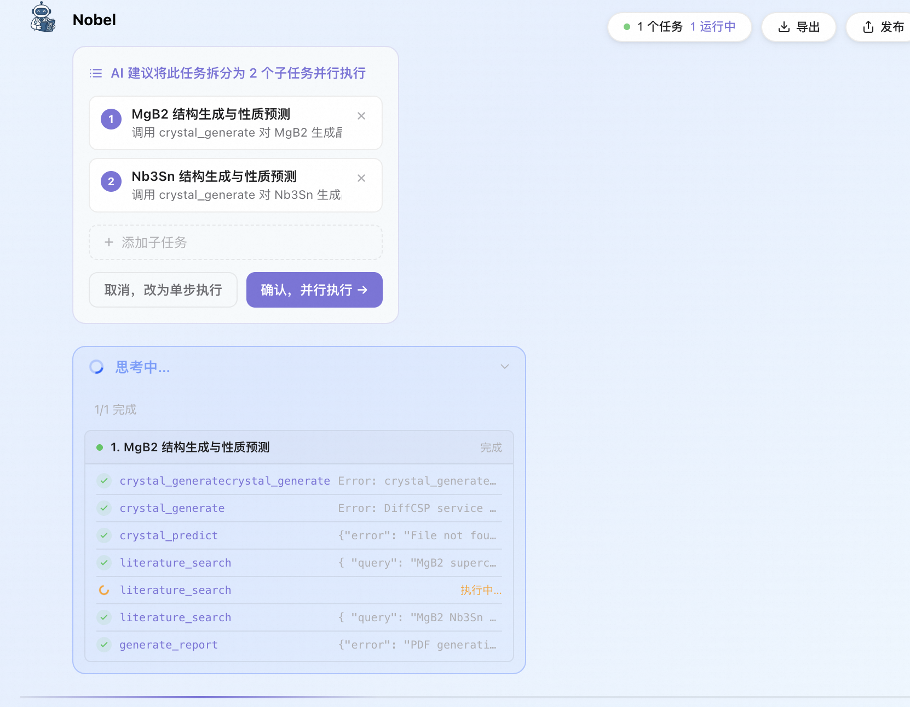

# 实验 0005 — 分阶段(并行) vs 不分阶段(单步) 实测与卡点排查

> 按 `TEMPLATE.md` 六节填写。这是 task5 本轮实验的综合排查报告,细节链到 `0001~0004`;对外卡点成品见 `../block.md`。

## 1. 测试时间

2026-06-04;**API 驱动**(非浏览器,浏览器易卡死/丢面板);账号 sher;平台 `http://nobelclaw.aliyun-inc.com`,后端代码 `~/work/nobelclaw`。

## 2. 测试目的

验证一个可证伪命题:**「分阶段(并行执行)」与「不分阶段(单步顺序)」两种回答模式,在同一批多阶段 pipeline 题上的效果有无差异、差在哪。**

## 3. 测试结果

6 道 pipeline 题 × 2 模式 = 12 次运行(明细见 [0003](0003-single-vs-parallel-12-runs.md)):

| 模式 | 跑完 | 平均成稿 | 工具报错合计 | 关键现象 |
|---|---|---|---|---|
| 单步 | **6/6** | 4157c | 13 | 完整走完 1–5 步并交付 |
| 并行 | **0/6** | 2041c(多为子agent片段) | 24 | 全部在汇总前卡死;`synthesis_start` 0/5 出现 |

- **可复现的最大效果差异 = 能否做完并交付**:单步全成,并行全卡。
- **前提**:三领域预测工具全停摆(见 [0002](0002-platform-tools-availability.md)),两模式都退化为记忆+文献,**数值精度测不出模式差异**——差异落在编排/交付层面。
- 分解触发是**随机的**(初始发送 8/12 触发,见 [0001](0001-api-decomposition-trigger.md))。

截图证据(并行分解选择框 + 子任务执行中的工具报错 + 工具名翻倍,一图覆盖 B1/B3/B4):

## 4. 卡点排查方式

本轮暴露 4 个卡点,逐个排查:

- **B1 并行卡死**:读后端 `nobelclaw/server/routes/chat.py` 的 `run_parallel_agents`(L644+)与 `nobelclaw/db.py` 的 `get_db`(L269)、`save_message`(L624);比对 SSE 事件流(`synthesis_start` 是否出现、卡在哪一步)。
- **B2 切换后并行面板丢失**:读前端 `composables/useChat.ts`(状态定义 + `handleSSEEvent` + `loadHistory`)、`App.vue`/`AppSidebar.vue`(切换触发)、`TaskExecCard.vue`/`MessageBubble.vue`(渲染条件);再回查后端 `routes/sessions.py` 的 `_message_dict` 与 `db.py` 的 `sub_agent_id` 列,确认数据在哪一层断的。
- **B3 预测工具停摆**:逐题看 SSE 里 `tool_call`→`tool_result` 的**真实返回内容**(非模型口述),含 error/not found/insufficient 即判不可用。证据见第 3 节截图。
- **B4 工具名翻倍**:截图 + transcript 里看到 `crystal_generatecrystal_generate` 无效调用,仅出现在并行子 agent。

## 5. 卡点排查结果(根因)

> 排查发现:B1/B2/B4 是**同一个并行卡点的三面**(详 [../block.md](../block.md) 的根因 / 关键发现);B3 是测试环境前提,非并行缺陷。

- **B1｜并行后端卡死**(并行卡点·根因 A):N 个子 agent 经 `asyncio.create_task` 并发**复用同一个请求级 `AsyncSession`**(`get_db` 每请求只 yield 一个);并发 `commit` 抛 `InvalidRequestError`。致命点是首行 `update_sub_agent_task_status`(chat.py:675)在 `try` 之外抛错 → 末尾 `DONE_SENTINEL`(chat.py:740)永不入队 → 消费循环 `while done_count<N`(chat.py:751)死等 → 永不汇总、SSE 不关闭。
- **B2｜切换丢面板**(并行卡点·根因 B):三层都丢并行结构——① 前端 `messages` 是模块级单例(useChat.ts:9-13),`loadHistory` 无条件 `messages.value=rebuilt`(:623)覆盖实时态;② `loadHistory` 重建循环(:533-618)只拼扁平 `taskSteps`,**从不读 `sub_agent_id`、不还原 `subAgents[]`**;③ 后端 `_message_dict`(sessions.py:57-66)**没序列化 `sub_agent_id`**(DB 有列 db.py:87、并行也存了 chat.py:712/729),分组键根本没传到前端。面板渲染靠 `v-if="subAgents&&subAgents.length"`(TaskExecCard.vue:343),键一空即整块不渲染。
- **B3｜预测工具停摆**(测试环境前提,非并行缺陷;详 [0002](0002-platform-tools-availability.md)):`crystal_generate` DiffCSP 离线、`crystal_predict` 无 cif、`generate_report` PDF 报错、`predict_admet` 是 mock 肽类过滤器、半导体无带隙工具;仅 `literature_search` 可用。属服务/数据缺位,非模式问题。
- **B4｜工具名翻倍**(并行卡点·根因 C 次要):并行子 agent 出现 `crystal_generatecrystal_generate` 无效调用,疑似工具名在子 agent tool-call 组装路径被拼接两次;单步未见。

## 6. 后续解决方案

- **B1**(后端,任一即解死锁):① 每个子 agent 用独立会话 `async with _get_session_factory()() as sub_db:`(首选治本);② `DONE_SENTINEL` 放进 try/finally(止血);③ `asyncio.Lock` 串行化 DB(消错但牺牲并行)。
- **B2**(三层都要动):① 后端 `_message_dict` 补 `"sub_agent_id": message.sub_agent_id`;② 前端 `loadHistory` 增加按 `sub_agent_id` 分组重建 `subAgents[]` 的分支;③ 前端聊天状态按 `sessionId` 缓存(`Map<sid,state>`),`loadHistory` 仅在无在途流时覆盖。
- **B3**(平台/外部阻塞):需平台方恢复 DiffCSP / 提供可用 cif / 接真实 `predict_admet` / 补带隙工具;**恢复前「科学答案质量」维度无法测量**。
- **B4**(后端):排查子 agent tool-call 组装路径的工具名拼接;修复后并行报错应明显回落。
