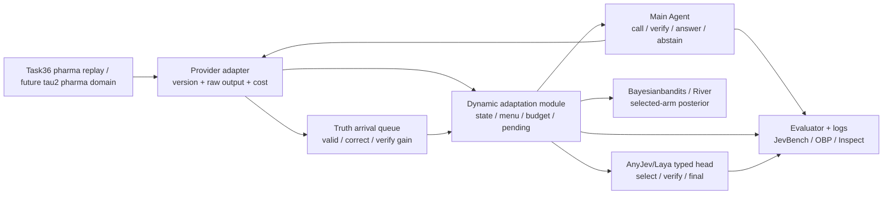

# 开源复用与集成路线：动态 Jev 可靠工具调用

日期：2026-09-24

状态：执行蓝图（功能合同和候选组件已形成；最终依赖、实验参数和论文贡献仍需验收）。

本文件把当前故事线落成可执行的工程与评测计划。它回答四个问题：系统必须具备什么功能、怎样做 benchmark、哪些 baseline 必须出现、每个功能由哪个开源项目承接。项目的科学主张仍以 [动态Jev可信工具调用质量规则](论文质量规则_动态Jev可信工具调用.md) 和 [ADR-0012](adr/0012-three-layer-dynamic-jev-agent-loop.md) 为准。

## 1. 故事线与方法论

### 1.1 研究问题

医药工具会正常返回格式正确、数值合理但实际不可靠的结果。主 Agent 需要在有限调用预算下完成一条可审计的证据闭环：

```text
理解请求 → 选择具体工具/版本 → 读取并记录原始结果
        → 判断证据风险 → 必要时复核/验证
        → 作答或拒答 → 真值到达后更新策略
```

这里的对象是一个带延迟反馈的序贯部分可观测决策问题。工具选择只是第一个动作；复核、验证、作答和拒答共享同一个 episode 状态与成本约束。Jev 的概率表示决策不确定性，不能直接当工具正确率或证据充分度。

### 1.2 三层方法

| 层 | 责任 | 需要证明的事情 |
| --- | --- | --- |
| 动态工具适应模块 | 管理 provider/version、候选集、历史、预算和反馈时钟；给出选择/复核/拒答建议 | 在新工具、漂移和有限反馈下，调用成本与最终错误之间的取舍得到改善 |
| 动态 Jev | 用 typed decisions 输出候选分布、风险、验证收益和终止建议；反馈到达后实时更新轻量 head/后验 | 冷启动比无结构基线有信息，且后期 prequential 错误或校准改善 |
| 主 Agent | 看到原始工具结果与结构化状态，实际决定 call/verify/answer/abstain | 端到端最终错误、危险作答、拒答质量和调用预算改善 |

第一版冻结预训练主体，只更新小型决策 head 或后验。题内看到新结果后更新 evidence state；题间等真值到达后更新 provider 可靠率、验证边际收益和终止效用。未调用工具不补负标签，真值未到达的事件进入 pending。

### 1.3 贡献边界

论文主张必须按以下顺序验证：

1. **Jev 层**：在线更新是否真的发生，是否比冻结 JEV/标准在线头更有效。
2. **模块层**：动态选择、复核和拒答是否在固定 Agent 下带来净收益。
3. **Agent 层**：主 Agent 是否学会可靠调用，动态模块和 Agent 是否存在可重复的交互收益。

缺少对应证据时，撤掉相应层的主张；开源项目的原始结果只用于接口 sanity check 和实现参考。

## 2. 功能合同：必须实现什么

### 2.1 功能清单

| ID | 功能 | 最小接口 | 允许复用 | 本项目必须补的胶水 |
| --- | --- | --- | --- | --- |
| F1 | 工具/版本注册与候选掩码 | `registry.list(function_key, state)` → `Candidate[]` | Laya/AnyJev 的 typed option 结构；tau² 的 `Tool`/`ToolKit` | provider 版本、健康、重复调用和预算规则 |
| F2 | 冷启动状态表示 | `encode(state, candidate)` → 固定向量/概率 | Laya；AnyJev backend/head；SemIf-OpenJev 作冻结 JEV baseline | 医药状态字段、候选版本字段、表示版本 hash |
| F3 | typed decisions | `decide(state, menu, decision_type)` → 分布、uncertainty、provenance | AnyJev `Decider`、jev-benchmarks 的 Prediction schema | `select/verify/final` 三类动作空间和动态 mask |
| F4 | 选中动作的在线更新 | `observe(event_id, outcome)` → posterior/head version | **bayesianbandits（P1主实现候选）**；River/contextualbandits/MABWiser 作对照 | pending queue、延迟真值、selected-only 约束和版本切换 |
| F5 | 动态候选和探索 | `select(...)` → action、propensity、uncertainty | VW ADF、River bandit、MABWiser | 新 provider 加入、旧版本下线、支持集和方差审计 |
| F6 | 证据复核/拒答 | `gate(observation, risk, budget)` → `verify/answer/abstain` | jev-ultrafast 的 freshness/guard/after-observe 结构；openJev-verdict 的 insufficient-evidence schema 仅作参考 | 医药真值 evaluator、验证收益 `Δ`、拒答损失和安全门 |
| F7 | Agent 交互轨迹 | `step(action)` → observation、state snapshot、trace | tau²-Bench Gym；Inspect AI solver/log | pharma domain、原始返回、主 Agent override 记录 |
| F8 | 评测与 OPE | `evaluate(log, split, policy)` → metrics/CI | jev-benchmarks、OBP、Inspect AI scorer | 外部真值、工具正确性、验证收益和风险覆盖指标 |

### 2.2 事件和日志 schema

每个 episode 写入 JSONL；最小字段如下：

```json
{
  "episode_id": "…",
  "state_version": "…",
  "function_key": "bbb",
  "candidate_menu": ["provider_a@v1", "provider_b@v2"],
  "decision_type": "select|verify|final",
  "jev_recommendation": "…",
  "agent_action": "call|verify|answer|abstain",
  "agent_overrode": false,
  "selected_action": "provider_a@v1",
  "propensity": 0.42,
  "tool_status": "ok|failure|timeout",
  "raw_output_ref": "…",
  "truth_status": "pending|arrived|unavailable",
  "truth_ref": "…",
  "reward": null,
  "update_version": "…",
  "timestamp": "…"
}
```

`raw_output_ref` 指向原始缓存或脱敏快照；state 不得包含隐藏真值、未调用 provider 的结果或未来事件。每次更新都保存行为概率、候选菜单、随机种子和策略版本，以便做 IPS/DR 和支持范围审计。

## 3. Benchmark 方案

### 3.1 本项目主 benchmark 草案：Pharma Tool Reliability Benchmark（工作名 PTRB-v0）

PTRB-v0 是**本项目拟构建的领域 benchmark**，不是已经被社区承认的现成标准。Task36 提供真实医药结果、具体模型回放和信息隔离环境；我们新增 episode schema、任务定义、数据切分、延迟反馈合同和评分规则。论文只能在这些协议和数据完成发布、独立复核后，把它称为公开 benchmark。当前 Task38 的外部资格仍未闭合，因此 PTRB-v0 只是协议冻结候选，尚未获得真实学习运行授权。

**一个 episode** 是 `(molecule, function_key, candidate provider/version set)` 加上一段受预算约束的交互轨迹。环境隐藏独立真值 `Y`；Agent 只能看到实际调用返回的原始结果。终止动作是 `answer(label/value)` 或 `abstain`，随后 evaluator 才能在合法时刻产生反馈。

### 3.2 四个可分开的任务

| 任务 | 信息条件 | 目的 | 主读出 |
| --- | --- | --- | --- |
| T0 冻结选择 | 训练集可见完整标签，测试只见候选描述 | 检查表示/候选匹配的冷启动信息 | top-1 correctness、NLL/ECE |
| T1 预序列选择 | 每步只消费选中 provider 的结果，真值延迟到达 | 检查实时 selected-only 学习 | cumulative error、prequential curve、反馈样本效率 |
| T2 复核决策 | 已有首个结果，第二次调用有成本和边际收益 | 检查“是否值得验证” | verification gain、calls/episode、净 utility |
| T3 终止决策 | 原始结果、风险摘要、预算可见，真值隐藏 | 检查作答/拒答 | final error、unsafe answer、abstention precision/recall、coverage-risk |

T0 是诊断任务；T1–T3 构成主实验。端到端 Agent 结果必须单独报告，不能由 T0/T1 的 provider 命中率代替。

### 3.3 划分与泄漏控制

1. **分子留出**：同一分子不能跨 train/online/test；同一结构的近重复物要登记。
2. **provider/version 留出**：至少保留一个新版本或新 provider 的到达阶段，检验候选动态变化。
3. **时间/漂移留出**：有时间戳时按时间切分；没有时间戳时用预先声明的顺序模拟非平稳到达，并报告这是协议模拟。
4. **轨迹隔离**：测试真值、未调用输出、后续结果、评估标签不能进入 state/feature。
5. **行为支持**：在线策略记录 propensity；OPE 只在正支持范围内报告，另报 ESS、IPS/DR 方差和被拒绝的样本比例。
6. **全信息上界**：允许一个只用于诊断的 oracle 看完整输出和真值，量化机会，不作为可学习策略或主结果。

### 3.4 指标

**Jev 层**：accuracy/macro-F1、Brier、NLL、ECE、option-order flip、冷启动与后期 prequential error、每个反馈点的 head version、额外推理开销。

**模块层**：provider correctness、选择 regret、verification gain `L(first)-L(first+verify)`、coverage-risk、平均/分位调用数、成本、延迟、支持范围。

**Agent 层**：最终答案错误率、危险作答率（证据不足仍作答）、拒答 precision/recall、可接受覆盖率、复核触发率、调用成本/延迟、轨迹 milestone 完成率。拒答代价 `c_abs`、调用代价 `c_call`、复核代价 `c_verify` 必须预注册并做至少三档敏感性。

### 3.5 辅助 benchmark 的位置

- `jev-benchmarks` 的 typed-decision 数据可做 probability/calibration 和 artifact pipeline sanity check；其 teacher agreement 不能替代医药真值。
- ASlib SAT12-ALL 与 LLMRouterBench 可做跨域 routing transfer；它们没有医药工具的“正常返回但可能错误”证据链，不能作为主结论。
- `tau2-bench` 自定义 pharma domain 后可承载多轮 tool/user 交互；其默认 customer-service DB 终态不能直接充当 provider correctness，因此 evaluator 必须由本项目注入。

因此外部 benchmark 用来检验迁移性和工程接口，PTRB-v0 用来回答医药工具证据可靠性这个核心问题；两者的结果不能合并成一个排行榜。

## 4. Baseline 冻结建议

### 4.1 主表（必须实现）

| 编号 | baseline | 覆盖问题 | 实现来源 | 备注 |
| --- | --- | --- | --- | --- |
| B0 | random / majority | 最低可用线 | 本地十几行策略 | 每个 task 都保留 |
| B1 | fixed best / fixed incumbent | 动态适应的价值 | 本地 replay + 训练集统计 | 只用训练信息；测试禁止看真值 |
| B2 | static Laya / static AnyJev L0 | 冷启动 typed decision | Laya、AnyJev | 不更新；报告概率不能当正确率 |
| B3 | full-information supervised head | 可用信息上界 | AnyJev/Laya 表示 + sklearn/closed-form | 训练时使用合法完整标签，不能冒充 bandit |
| B4 | LinUCB | 标准线性 contextual bandit | contextualbandits 或 River | selected-only、延迟反馈由 wrapper 处理 |
| B5 | Linear Thompson Sampling | Bayesian exploration | contextualbandits 或 MABWiser | 与 B4 相同 feature/预算 |
| B6 | AnyJev `observe` | 最近的实时 typed head | AnyJev Apache-2.0 | 30/60/120 重拟合规则固定并单独报告 |
| B7 | ours: dynamic Jev + posterior | 主方法候选 | AnyJev/Laya + **bayesianbandits** | 仅新增 adapter、pending queue、typed feedback heads；River 作为替换实现/稳健性对照 |
| B8 | base Agent / base Agent + static JEV / base Agent + dynamic module | 端到端归因 | tau²/Inspect runner + 同一底座模型 | 固定 Agent 时比较模块；固定模块时比较 Agent |

### 4.2 规则和诊断对照

T2/T3 必须加入：`never-verify`、`always-verify`、`random-verify`、confidence threshold、`always-abstain`。这些策略分别给出调用成本、拒答和安全风险的边界。`LLM-as-judge` 只作诊断，不作外部真值。

### 4.3 次要强基线

候选菜单变化明显时加入 VW `cb_explore_adf`；需要离线策略评估时加入 OBP 的 replay/DR/IPW；需要成本漂移时加入 EntroShape/Online_Multi_LLM 的 budget-aware router 作为近邻复现。它们进入主表前必须通过同一事件 schema 和许可证审查。

## 5. 开源组件清单与拼装决定

许可证以本轮固定的 GitHub `LICENSE`/metadata 为准；提交前还要把固定 commit 写入 lock 文件并保留上游版权文本。

| 功能 | 项目与许可证 | 复用级别 | 具体接法 | 已知缺口/处置 |
| --- | --- | --- | --- | --- |
| 静态 typed decision/候选表示 | [Laya](https://github.com/NandhaKishorM/laya)，Apache-2.0 | 直接基线/适配 | 保留 Choice/Score/Noul 输出和候选 mask | 当前没有 `observe`/partial-fit；不宣称实时学习 |
| 动态 typed head | [AnyJev](https://github.com/nokia-applied-research/AnyJev)，Apache-2.0 | P0 候选核心 | 用 `Decider.observe` 的周期闭式 head，包装 provider/action question | 默认每题单标签、全量重拟合；要补 selected-only、延迟反馈和多 provider reward |
| 冻结 JEV 强基线 | [SemIf-OpenJev](https://github.com/TheoLeeCJ/SemIf-OpenJev)，MIT | P1 baseline | 固定 prompt hash、概率校准和 option permutation 作为另一 frozen backend | 主要是 teacher/typed 数据；医药结果仍由 PTRB 真值评估 |
| Jev 概率指标/工件 | [jev-benchmarks](https://github.com/AbdelStark/jev-benchmarks)，Apache-2.0 | 直接复用评估代码/结构 | 借 Prediction schema、ECE/Brier/NLL、coverage-risk、bootstrap、pinned manifest | 其公开结果是小型 typed benchmark，不外推为医药效果 |
| 阈值/拒答报告 | [jevcal](https://github.com/abhixhek/jevcal)，MIT | 参考/可选依赖 | 借 held-out threshold、coverage-risk、fail-closed lock/report | teacher label 和 hosted Jev 不进主真值链 |
| 在线 Bayesian 后验 | [bayesianbandits](https://github.com/bayesianbandits/bayesianbandits)，MIT | **P1 主实现候选** | `pull/update` 包装成 `select/observe`；可加 decay 处理漂移 | 延迟队列、动态 action set、propensity 由本项目写；若接口合同不过则退回 River |
| 透明 CB/TS 基线 | [contextualbandits](https://github.com/david-cortes/contextualbandits)，BSD-2-Clause | P0 baseline | LinUCB、LinTS、partial_fit、DR/OPE 对照 | 原生假设二值即时 reward/固定 arm；禁止把未选 arm 填 0 |
| 轻量 bandit baseline | [MABWiser](https://github.com/fidelity/mabwiser)，Apache-2.0 | P1 baseline | fit/partial_fit、LinUCB/LinTS/epsilon、add/remove arm | 较久未更新，锁 commit 并跑接口合同 |
| 流式 head/透明 bandit | [River](https://github.com/online-ml/river)，BSD-3-Clause | P0/P1 | `river.bandit` 的 LinUCB/TS + `learn_one` 做 reward/calibration | 延迟反馈和 OPE 仍由外层处理 |
| 动态 action-set CB | [Vowpal Wabbit](https://github.com/VowpalWabbit/vowpal_wabbit)，BSD 风格 LICENSE（GitHub SPDX 为 NOASSERTION） | P1 可选 | `cb_explore_adf` 记录 action/cost/propensity | 许可证元数据需人工复核；不作为首个可分发依赖 |
| OPE/回放评测 | [Open Bandit Pipeline](https://github.com/st-tech/zr-obp)，Apache-2.0 | P1 评估层 | replay、IPW/SNIPW、DR/MRDR、时间切分 | 不能替代真实工具运行和医药真值 |
| 交互环境/Gym | [tau2-bench](https://github.com/sierra-research/tau2-bench)，MIT | P0 环境骨架 | 自定义 pharma domain、ToolKit、Gym step、trajectory | 默认 DB reward 不适用；必须注入 provider correctness/evaluator；锁 Python/版本 |
| 运行器/日志/评分 | [Inspect AI](https://github.com/UKGovernmentBEIS/inspect_ai)，MIT | P1 评估运行器 | solver、custom scorer、sandbox/log viewer | 不把其 LLM judge 当真值 |
| 调用可靠性状态机参考 | [jev-ultrafast](https://github.com/browser-use/jev-ultrafast)，MIT | 借接口/模式 | 参考 candidate validation、freshness guard、执行后复查、DONE verification | 浏览器/hosted Jev 依赖不进入医药 runtime |
| 不充分证据 schema | [openJev-verdict-2.0](https://github.com/Heman10x-NGU/openJev-verdict-2.0)，GitHub metadata 为 NOASSERTION | 只读参考 | 参考 `insufficient_evidence`、correctness head、DAG gate | 许可证和模型权重需逐项核验；不作为依赖 |
| 轨迹 milestone 思路 | [ToolSandbox](https://github.com/apple-aiml-research/ToolSandbox)，Apple 自定义/Other | 只借思想 | 参考 milestone DAG 和 insufficient-information 评分 | 不复制代码或数据，避免许可证与数据再分发风险 |
| 安全/恶意工具输入切片 | [AgentDojo](https://github.com/ethz-spylab/agentdojo)，MIT | P2 辅助鲁棒性 | 选取 tool filter/错误输入场景 | 不是医药真值 benchmark，不进入主表 |

### 5.1 组件组合图



适配层的数量应保持小：provider adapter、feedback queue、trace schema、evaluator。任何新增模块都要填写“功能合同—开源候选—未满足的缺口—验收测试”四列。

## 6. 实施顺序与闸门

### P0：冻结合同和依赖

- 固定 PTRB-v0 episode/schema、信息条件、四个任务和主指标。
- 固定 B0–B8 baseline 的 feature、预算、随机种子和更新时钟。
- 保存每个候选仓库的 LICENSE、URL、commit、Python 依赖和上游修改说明。
- 用静态 fixture 验证 `selected-only`、延迟 feedback、candidate mask、日志字段和无真值泄漏。

### P1：回放适配层

- 把 Task36 replay 包成 `Tool`/`ToolKit` 风格 provider adapter。
- 先跑 B0–B6 与规则对照，结果只作为接口/协议验证，当前不启动新训练。
- 让 AnyJev `observe` 和 bayesianbandits wrapper 在同一事件日志上运行；River/contextualbandits/MABWiser 保持同接口作为替换基线。

### P2：动态 Jev 小闭环

- 在外部数据资格和 P02 反馈协议满足后，运行最小真实批次。
- 只更新最后一层/后验；保存每次 head/posterior version 和 pending 状态。
- 先检验冷启动、反馈样本效率、后期 prequential error 和 calibration；没有改善就撤掉“实时学习”主张。

### P3：模块和 Agent

- 固定动态模块，比较 base Agent、static JEV、dynamic JEV 三种输入。
- 主 Agent 实际拥有复核和拒答权；日志记录推荐与实际动作及 override。
- 用 tau²/Inspect 运行多轮轨迹，补做 always/never/random verify 和 always-abstain 边界。

### P4：跨域与稳健性

- 只在主域主张闭合后，将 ASlib/LLMRouterBench 用作 transfer stress test。
- 加入新 provider、工具失败、漂移和预算变化的受控切片。
- 用 OPE 估计未执行策略时，报告支持范围和方差，禁止只报一个点估计。

## 7. 明确不从零建设的部分

1. 不训练新的基础语言模型或通用 JEV transformer。
2. 不重写 LinUCB/TS/Neural-Linear 的数学实现；只写统一 wrapper 和反馈合同。
3. 不另造一套通用 Agent runtime；使用现有 Task36 replay、tau² domain 和 Inspect runner。
4. 不另造概率指标、bootstrap 或 OPE 库；使用 jev-benchmarks/OBP 并保留独立真值 scorer。
5. 不把 hosted Jev、LLM judge、teacher agreement、数据库终态奖励当医药科学真值。

## 8. 当前阻塞与完成定义

当前 33 个具体模型/722 分子池仍受 Task38 外部资格限制，不能据此运行新的训练或新预测。P0/P1 的合同、适配和静态 baseline 可以先完成；P2 需要外部资格和反馈协议双重放行。

本路线达到“可进入科学实验”的条件是：

- 每个主 baseline 都能在同一 episode log 上运行；
- 日志能证明只更新实际观察到的动作；
- 关键 split 没有真值/未调用输出泄漏；
- AnyJev/Laya、bandit、Agent 和 evaluator 的版本均可复现；
- 结果能按 JEV、模块、Agent 三层归因；
- 所有失败、超时、缺失真值和被拒绝的 OPE 样本均保留。

这套组合让工程工作服务于一个可反驳的问题：**在正常返回但可能不可靠的医药工具环境中，实时学习的 typed decision 模块能否让主 Agent 用更少的调用达到更低的最终错误和更安全的拒答行为。**
