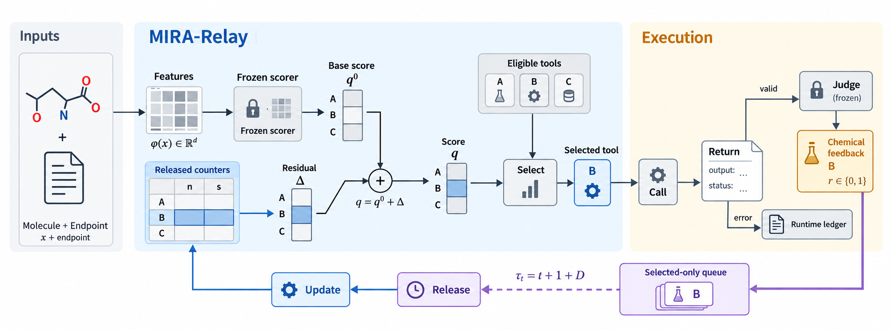

# 决策之后：从结果中学习适应

**英文题目：** *After the Decision: Learning to Adapt from Outcomes*  
**稿件状态：** 故事线重写讨论版；尚未同步英文主稿  
**对应英文源码：** [`main.tex`](main.tex)  
**当前英文源码 SHA-256：** `4272e3689ddd3c88be317c948b0608bae30b0d32c3d65e1be4a5ec4d1c7ac045`

> 这份文件现在承担故事线重写和中文讨论的作用，**不声称逐段对应当前 `main.tex`**，也不替代 AAMAS 的英文双盲提交文件。英文主稿的数字、实验状态和边界仍以封存的英文 PDF、`main.tex` 和实验回执为准；这里先把问题切口和行文顺序理清。

## 故事线重写：从“工具冲突”到“工具过拟合”

上一版从“多个工具会返回冲突答案”开始，切口太靠后。冲突只是结果，不是最值得研究的根因。更锋利的问题是：**当训练时反复出现的是一套固定 harness 和工具表面，测试时换成同功能但不同实现的工具，智能体还能不能按任务需要做选择？**

我们把这个现象拆成一条可检验的因果链：

`训练分布反复出现某些工具和 harness` → `熟悉的名称、schema 或调用轨迹可能被当成适配度线索` → `功能重叠工具之间出现与任务无关的偏好` → `测试时更容易先调用熟悉但当前不合适的工具` → `正常返回却交付错误结果` → `智能体没有继续验证、换工具或拒答`。

这里的核心不是让智能体记住哪个 provider 平均更准，而是让它学会判断：当前任务需要什么能力，这个工具在当前场景是否可信，已有结果是否足以交付，以及下一次调用的价值是否超过成本。工具名、描述和参数格式只是表面；真正要学的是工具的工作范围、结果证据和失败边界。一个 agent 在同一问题上通常只会先调用一个工具，所以关键决策发生在调用前；拿到结果之后，还要决定相信、复核、互补调用、继续申请工具，还是拒答。

六大写作范式在这里的对应关系很明确：主线采用“根因手术刀”，先检验训练/测试 harness 不一致是否造成工具过拟合；药物工具生态提供“新基准暴露失效”的天然场景，因为同一性质往往有多个实现、版本和参数接口；虚拟筛选中一次错误排序会浪费后续湿实验资源，使问题具备真实的科研成本。我们不把“工具输出不同”直接当成错误标签，也不把一次错误选择直接当成过拟合的充分证明；错误选择只是可观测信号，必须通过工具名和 schema 置换、功能保持的包装变化、未见工具和独立真值来检验它是否来自错误的熟悉偏好。

### 这条根因链目前能说到哪一步

已有外部证据支持的是“模型能力依赖执行环境”：DeepSeek 的公开对照把同一模型放在不同 harness 下，得到明显不同的分数；OpenAgent 也把工具改名、schema 噪声、观察格式和领域迁移列为独立的开放世界压力。它们支持我们去测 harness 和工具表面的变化，但不支持“工具越少越好”或“bash 普遍更强”。相反，另一个公开工程评测中，结构化 SQL 高于裸 bash，而 bash 加第二种工具并进行核验后才恢复到高准确率。这说明真正值得研究的是**抽象选择与验证策略的匹配**。

因此，“工具过拟合”在本文中是一个待检验的操作性定义，不是假定已经成立的因果解释：在保持任务和工具功能不变时，只改变名称、schema、包装或工具是否见过，若 agent 的选择和信任随表面而不是随任务效用改变，才称为过拟合。一次被选工具返回错误，只能提供结果层面的监督信号；它不能单独证明 agent 是因为熟悉偏好才选错。这个区分决定了后面的实验必须同时记录选择、结果、验证动作和表面置换。

### 从观察到实验的主线

研究路线按四步推进：先复核数据科学 agent 中 harness 依赖和工具泛化的证据；再在药物工具生态中构造同功能、不同实现和不同表面的提供方菜单；随后用独立真值把“选了什么”和“结果是否兑现”接起来，检验熟悉偏好、任务适配和验证需求能否区分；最后用这些事件生成训练或 harness 改进数据，并在未见包装、未见工具和非药物任务上测试迁移。当前论文先固定最小、可回放的一次调用切片，但方法目标仍是让 agent 学会可信地使用工具，而不是记住工具名单。

因此，本文的研究对象不是一个记住工具名单的选择器，而是一种可迁移的可信调用能力：先基于任务和工具工作范围选择，拿到结果后判断相信、交叉验证、互补调用、继续申请工具还是拒答，外部真值到达后再更新后续决策。当前论文先用一次调用的动态选择作为可审计切口；验证、复核、互补和拒答沿着同一信息合同扩展。

## 摘要

工具生态变大并不自动提升智能体能力。一个智能体可能在训练时熟悉某个工具，却在测试时继续优先调用它，即使另一个功能重叠的工具更适合当前任务。我们把这种训练工具分布与测试工具效用之间的落差称为工具过拟合。它的外显不是“工具一定会冲突”，而是智能体在看不到结果时形成了与任务无关的熟悉偏好，并在结果不可靠时仍然直接交付。

我们研究一个更完整的可信调用闭环：在调用前根据任务和工具工作范围选择，在调用后判断是否相信、复核、互补调用或拒答，在外部真值到达后更新后续决策。药物分子性质预测提供了可审计的训练场：同一性质有多个实现和参数接口，输出可以与独立实验标签核对，错误的候选排序又会直接浪费虚拟筛选资源。我们提出 **MIRA-Relay**，将冻结的任务条件工具评分函数、仅已选的局部可靠性适配器和显式释放账本连接起来。冷启动时它与冻结选择器完全一致；结果释放后只更新真正被选中的工具，因此可以检验“反馈是否改变后续选择”，而不会把未调用工具的反事实结果伪造成标签。

我们在一次调用的 BBB 路由合同上验证这个切口：使用公开真值、四个与检查点绑定的独立确认工具、骨架不相交分子、仅已选反馈以及 $D\in\{0,1,4\}$ 的延迟。在自然独立确认菜单上，MIRA-Relay 与 Frozen 都达到 89.81%；在预登记的受控正确性漂移下，MIRA-Relay 达到 87.56%，Frozen 为 73.38%，配对增益为 14.18 个百分点，95% 骨架 bootstrap 区间为 [+9.61,+19.03] 个百分点。这个结果只支持一个清楚的结论：当已选工具的正确性发生声明的变化时，延迟的选中反馈能够帮助后续选择恢复；它不能被写成平稳工具菜单上的普遍在线增益，也不能单独证明智能体已经学会了跨领域的可信调用。

**关键词：** 工具选择；在线学习；延迟反馈；科学智能体；分子性质预测

## 1 引言

外部工具的数量增加后，智能体面对的第一个问题不是“答案是否冲突”，而是“我为什么选择这个工具”。训练阶段看过的工具往往拥有更熟悉的名称、描述和参数格式；测试阶段出现功能重叠但工作范围不同的工具时，这种熟悉度可能被误当成当前任务的适配度。于是，工具调用能力出现了训练 harness 与真实工具生态之间的 gap。

这个 gap 在药物工具中尤其容易被看见。同一分子性质可以由不同实现、版本和参数接口计算；工具都可能正常返回，但正常返回不等于当前性质正确，更不等于这个结果足以支持最终决策。分子性质预测使这一区分可以被测量，因为输出能够与独立记录的端点标签进行核对；虚拟筛选又把错误选择传递到候选排序，形成可量化的下游损失。

在冻结的 BBB 开发面板中，分子 `z000282` 的基准标签为 $1$：`admet_ai_1_4_0` 返回 $0$，而 `b3clf_dtree_common` 返回 $1$；两次调用的运行状态都为成功。这个例子不是为了把“分歧”本身当作问题，而是为了把选择错误变成可审计事件：如果智能体在调用前偏向其中一个工具，结果返回后又没有验证或切换，错误就能被记录为“任务条件下的错误信任”。它仍然不能单独证明过拟合，因为错误也可能来自特征不足、描述歧义或工具本身的随机误差；后续实验必须用工具表面置换和独立真值把这些原因分开。

要修复这个问题，不能只把工具名字打乱，也不能只在同一批工具上再训练一次。名字和 schema 置换可以制造必要的压力，但真正的目标是让智能体依据任务、工具输出和证据价值行动：什么时候可以相信，什么时候需要第二个工具相互验证，什么时候应该找互补证据，什么时候应该拒答。训练时的工具应当随机改变表面形式；测试时则要放入未见过的包装、版本和功能重叠工具，观察决策是否仍然跟随任务效用而不是跟随熟悉度。

反馈带来两个额外障碍：标签只属于实际调用的工具，而且可能延迟释放。固定策略不能利用新证据；仅已选学习器无法直接知道未选工具的反事实结果；延迟又会推迟反馈真正可用的时间。这些约束使“可信调用”成为一个有因果边界的在线决策问题，而不是把所有工具输出拼成一次离线分类。

我们的核心假设是：如果把工具熟悉度与任务条件效用分开，并把已经释放的真实结果接回后续决策，智能体可以逐步修正错误信任。这里的反馈信号不是“某个工具永远好”这样的偏好标签，而是“在当前任务和当前证据下，这次选择是否兑现了预期”的结果。只有当工具表面变化后决策仍跟随任务效用、且未见工具上仍能工作时，才说明学到的是可信调用能力，而不是新一轮工具名单记忆。

在一次调用切口中，我们先把这一假设具体化为提供方局部残差：不可变的拟合期参考分数负责冷启动，已释放的选中结果只改变实际被调用工具的可靠性状态。这个设计不会自动解决验证和拒答，但它把未来的证据决策放在同一个状态和反馈合同中，并允许我们先检验最小的因果链。

MIRA-Relay 是这一假设在当前一次调用实验中的具体实现。它的冷启动评分保持冻结；仅已选可靠性账本只在相应结果释放后增加该工具的局部残差。残差以该工具的拟合期成功率为中心，因此适配器从 Frozen 精确开始，只有释放证据足以改变后续排序时才改变动作。运行失败、未知真值和化学错误仍保留在不同字段中。调用后的验证器、互补调用和拒答是同一合同的扩展接口；当前主结果只回答第一步选择能否在合法延迟反馈下适应。

本文作出四个可检验的承诺，每个承诺都在实验矩阵中配有否证条件：

- **任务有效性。** 公开真值和具体的提供方面板，在不泄漏未选输出的情况下，应当相对于固定提供方产生依赖输入的提升空间。如果唯一信号来自评估器可见的全面板分数，则该承诺失败。
- **忠实适配。** 仅已选的延迟事件应该能够按精确的可见性、释放时钟和失败语义回放。如果独立检查器不能验证记录的动作、释放和状态哈希链，则该承诺失败。
- **机制性适配。** 共享残差反馈应当在相同探测计划、没有更新的控制之外改变后续利用决策。如果所有变化都来自直接探测，或在提供方/家族置换后消失，则该承诺失败。
- **实际价值。** 未来正确率的任何提升都必须在最强的合法固定控制和匹配在线控制下成立，同时报告受损决策、调用数、延迟和内存。否则，结论只能停留在协议或诊断层面。

下文依次定义工具过拟合的可观测任务，给出 MIRA-Relay 的反馈和更新规格，固定 benchmark 与 baseline 合同，并用独立真值、表面置换和受控正确性漂移把“熟悉偏好”与“任务效用”分开。自然独立确认、验证扩展和拒答扩展分别报告，避免用一次选择准确率冒充完整的可信调用能力。

### 图 1：MIRA-Relay 总体架构

MIRA-Relay 把一次调用前的选择闭环连接到下一次决策。分子、端点、可用菜单和已释放状态进入冻结的提供方表面与上下文相对可靠性账本。一次选中的调用产生终止记录；冻结端点评估器只在调用终止后给出化学正确性，运行失败则进入独立的运行账本。选中结果等待到 $\tau_t=t+1+D$，随后更新释放状态；反馈尚未释放时，决策仍继续进行。图中灰色表示冻结或基线元素，蓝色表示 MIRA-Relay 元素，橙色表示终止记录或冻结评估器，紫色表示等待或延迟释放元素。

## 2 问题与任务合同

我们研究一个智能体连续进行工具调用的过程。图 1 展示 relay 如何把调用前选择、调用终止、外部评估和延迟释放接成一个闭环；正文合同进一步固定反馈何时能够影响后续动作。合同的粒度是具体提供方，而不是提供方家族或事后多数投票。

### 2.1 回合、菜单与反馈

在决策时刻 $t$，智能体收到分子 $x_t$、端点 $e_t$ 以及具体提供方标识组成的可用菜单 $A_t$。它在读取当前输出面板之前，选择一个提供方 $a_t\in A_t$。benchmark 保存独立的端点真值 $y_t\in\{0,1\}$，仅供评估使用。被选调用返回输出 $o_t$、运行状态 $s_t\in\{\mathrm{ok},\mathrm{error}\}$，以及在可用时返回置信度 $c_t$。驱动方法的标签被明确分开：

$$
\begin{aligned}
 r_t^{\mathrm{run}}&=\mathbf{1}[s_t=\mathrm{ok}],\\
 r_t^{\mathrm{chem}}&=\begin{cases}\mathbf{1}[o_t=y_t],&s_t=\mathrm{ok},\\\mathrm{null},&s_t=\mathrm{error},\end{cases}\\
 r_t^{\mathrm{sys}}&=\mathbf{1}[s_t=\mathrm{ok}\land o_t=y_t].
\end{aligned}
$$

正确性头只使用非空的 $r^{\mathrm{chem}}$ 训练；运行头使用 $r^{\mathrm{run}}$；bandit reward 可以使用 $r^{\mathrm{sys}}$，同时分开计入运行失败和化学错误的成本。因此，执行失败不会被悄悄重新标成化学错误。

调用终止后，独立的回放评估器记录选中结果。结果只有在登记的释放时刻 $\tau_t$ 才变得可见。在时刻 $t$ 合法可用的历史为：

$$
H_t=\{(x_s,e_s,a_s,r_s^{\mathrm{sys}},\tau_s):s<t,\ \tau_s\leq t\}.
$$

以分子 `z000282` 为例，benchmark 真值为 $1$。调用 `admet_ai_1_4_0` 返回 $0$ 且状态为 `ok`；调用 `b3clf_dtree_common` 返回 $1$ 且状态为 `ok`。两次调用都有 $r^{\mathrm{run}}=1$，但化学标签不同。时刻 2 的决策不能读取这两个未选输出、当前真值或未来的终止记录。

提供方参数使用初始化时固定的注册表 $\mathcal P$；$A_t\subseteq\mathcal P$ 是当前候选菜单。MIRA-Relay 在每个菜单中保留 fallback。移除某个 challenger 不会删除其已存储状态。在 BBB 回放中，整个流的 $|\mathcal P|=33$。队列按应释放时刻排序，同一时刻按入队顺序打破平局；每条反馈只消费一次，回执明确记录释放顺序。

在固定延迟回放中，时刻 $t$ 的决策终止后，将其反馈入队，并在以下时刻释放：

$$
\tau_t=t+1+D,\qquad D\in\{0,1,4\}.
$$

只有在释放之后，该事件才可以进入 $H_{t'}$ 并影响后续决策。$D=0$ 时，释放在下一个决策时刻前处理，因此永远不会改变产生它的动作。未知真值不产生正确性标签，并停止当前评分流；拒答不产生选中提供方标签。两者都在回合账本中显式保留。

### 2.2 选择与验证接口

调用前选择器和调用后验证器使用彼此分离的接口：

$$
a_t=\pi_{\mathrm{sel}}(x_t,e_t,A_t,H_t,S_t),\qquad v_t=\pi_{\mathrm{ver}}(o_t,c_t,s_t),
$$

其中 $v_t$ 可以是接受、升级或拒答。验证器只有在第一次调用返回之后，才能请求第二个提供方。这是 E5 的扩展接口，而不是当前直接选择运行器执行的动作。在运行例子中，选择器可以选择 `b3clf_dtree_common`；只有在拿到输出和置信度之后，验证器才能决定是否升级。

在线学习器维护一个可序列化的释放后状态 $S_t$。在时刻 $t$，释放阶段先应用恰好在该时刻到期的所有事件，选择器再读取更新后的状态：

$$
\begin{aligned}
S_t&=U\left(S_{t-1},\right.\\[-2pt]
&\qquad\left.\{(x_s,e_s,a_s,r_s^{\mathrm{sys}},\tau_s):s<t,\ \tau_s=t\}\right),\\
a_t&=\pi_{\mathrm{sel}}(x_t,e_t,A_t,H_t,S_t).
\end{aligned}
$$

没有到期事件时，$U$ 是恒等映射。因此，时刻 $t$ 的 $D=0$ 事件进入 $S_{t+1}$，可以影响动作 $t+1$，但不能影响动作 $t$。

未选提供方、尚未释放的事件、未知标签或拒答都不允许更新正确性残差。终止时出现的未知或拒答仍可以更新运行/可用性记录；fallback 反馈永远不改变残差均值、方差或提供方偏置。这份合同允许回执验证器在不导入训练运行器的情况下，检查可见读取集合、动作、释放队列、状态哈希链以及记录的 schema 和计数。完整指标重算交给 E5 transition replayer；回执检查本身不重算分数、propensity 或 MAP 更新。

### 2.3 估计对象与成本

主要估计对象是前序系统成功：选中的调用必须返回一个有效且正确的答案。我们还报告有效返回条件下的化学正确性、配对的挽救与受损决策、失败，以及调用和更新成本。扩展接口还记录升级、拒答和未知真值；这些效用不计入本文报告的一次调用结果。静态全 panel 准确率和评估器可见的 Oracle 准确率分别用来衡量任务的提升空间，而不是在线效果。

## 3 MIRA-Relay：方法规格

本节给出 MIRA-Relay 的完整规格，以及一次调用实验所检验的信息边界。

### 3.1 冷启动分数与不可变参考

设 $\phi(x)\in\mathbb{R}^{d}$ 为冻结的分子表示，$K=|\mathcal P|$ 为具体提供方数。对每个提供方 $a$，在拟合分区上一次性拟合逻辑正确性头 $w_a^0$。其冷启动分数为：

$$
q_a^0(x)=\sigma\!\left((w_a^0)^\top\phi(x)\right).
$$

当前菜单只负责屏蔽哪些坐标可以行动；动作发生前不读取当前输出。对于新鲜 BBB 确认集，$d=65$，即 64 个 Morgan bit 加一个截距。拟合期 Best Fixed provider 是拟合分区正确率最高的提供方。fallback 分数在整个评估期间保持不变；即便 challenger 切换是错误的，也仍然计入切换。

运行例子具体如下。对分子 `z000282`，$\phi(x)$ 是由其规范 SMILES 和截距生成的冻结 65 维向量；拟合头为四个新鲜提供方分别分配分数。因此，在冷启动时，MIRA-Relay 与 Frozen 对同一菜单选择同一个提供方。未出现在封存 checkpoint manifest 中的提供方不在范围内。

### 3.2 上下文相对可靠性适配器

对提供方 $a$，令 $\bar r_a$ 表示其拟合分区正确率；令 $n_{a,t}$ 和 $s_{a,t}$ 分别表示截至时刻 $t$ 已释放的、由该提供方被选出的结果数量，以及其中正确的数量。固定先验计数为 $n_0=20$ 时，释放后的后验率和残差为：

$$
\widehat r_{a,t}=\frac{n_0\bar r_a+s_{a,t}}{n_0+n_{a,t}},\qquad
\Delta_{a,t}=\widehat r_{a,t}-\bar r_a.
$$

动作分数为：

$$
q_{a,t}(x)=q_a^0(x)+\Delta_{a,t},
\qquad
 a_t=\arg\max_{a\in A_t}q_{a,t}(x_t).
$$

冷启动时，$n_{a,0}=s_{a,0}=0$，因此 $\Delta_{a,0}=0$：适配器严格等于 Frozen。选中结果变得可见后，只有该提供方的计数发生变化；未选提供方永远不会收到合成标签。运行错误被记录为执行失败，不会被放进化学正确性计数。这一更新是提供方局部的上下文残差，而不是全局可靠性乘子，因此它能够改变后续排序，同时不改变拟合期表示。

更新例子如下。如果 `z000282` 所选提供方返回正确结果，那么在释放时刻 $s_{a,t}$ 和 $n_{a,t}$ 都增加 1；如果结果错误，则只有 $n_{a,t}$ 增加 1。下一次分数按对应残差改变；所有未选提供方保持原有残差。每个释放事件的更新复杂度为 $O(1)$，全部 $K$ 个提供方的打分复杂度为 $O(Kd)$；在线账本保存 $2K$ 个计数，固定的拟合头不计入在线状态。

### 3.3 有界证据接口

同一个选择器可以在第一次调用之后扩展。令 $E_t$ 表示返回的输出和运行记录。验证器可以接受、拒答，或者通过最小化包含调用成本和拒答成本的声明损失，请求再调用一个提供方。这个接口是为了让未来的证据实验使用固定的动作词表；它不属于本文报告的一次调用主结果。

### 3.4 释放账本与延迟更新

在线状态是仅已选账本 $S_t=\{(n_{a,t},s_{a,t}) : a\in\mathcal P\}$。在时刻 $t$，释放队列先应用所有到期时间 $\tau=t$ 的事件，选择器随后读取结果状态。固定延迟为：

$$
\tau_t=t+1+D,\qquad D\in\{0,1,4\}.
$$

因此，时刻 $t$ 的 $D=0$ 事件能够影响动作 $t+1$，但不能影响动作 $t$。给定已释放事件前缀，状态转移是确定性的，所以回执可以被独立回放。

更新只触及所选提供方。对于带有化学标签 $r_t^{\mathrm{chem}}\in\{0,1\}$ 的已评分终止记录：

$$
 n_{a_t,t+1}=n_{a_t,t}+1,\qquad
 s_{a_t,t+1}=s_{a_t,t}+r_t^{\mathrm{chem}},
$$

其他提供方计数不变。如果调用失败，$r^{\mathrm{chem}}$ 为空，运行失败账本单独记录该事件。未知真值和拒答不更新正确性计数。这一区分是核心信息边界：学习器只在释放之后接收所选结果，从不接收当前真值或未选提供方的输出。

每个释放事件更新成本为 $O(1)$，给全部 $K$ 个提供方打分的成本为 $O(Kd)$。在线状态由 $2K$ 个整数计数、mask 和释放队列组成；封存的拟合头保持不变。对 `z000282` 而言，释放一个正确的 `b3clf` 结果只会改变该提供方的残差；后续动作可以根据已释放证据离开它，也可以重新选回它。

### 3.5 动作规则与否证

一次调用运行器在可用菜单中选择当前分数最高的提供方。报告的新鲜确认不包含依赖结果的探测，因此所有方法使用相同的一次调用预算和相同的仅已选反馈时钟。受控压力测试在预登记的中点之后翻转拟合期最佳提供方的选中标签；它不泄漏任何未选输出，也不改变输入特征。

实现保持五个不变量：(i) 动作之前不读取当前真值或未选输出；(ii) 只有已释放的选中事件更新状态；(iii) 拟合表面不可变；(iv) 运行失败与化学正确性分离；(v) 状态快照加事件前缀能够确定性地重建下一次动作。回执验证器检查动作、释放队列、状态哈希和事件 schema；独立回放则重算每一个动作和分数。

如果上下文残差在声明的漂移下无法改变后续动作，独立回放发现不匹配，或者增益相对于同一时序的 Frozen 与匹配 Online-SGD 控制消失，则拒绝适配性主张。仅有动作变化不能被当作效用；评估还需要报告挽救与受损决策、骨架聚类区间、调用数和更新延迟。

## 4 Benchmark 与 Baseline

### 4.1 两层 benchmark 合同

主 benchmark 由公开真值层和提供方路由层组成。真值层使用 Therapeutics Data Commons（TDC）的 BBB 端点、固定标签语义和 split archive~\cite{huang2021tdc}。开发 manifest 包含 722 个带参考标签的 BBB 分子；其中 716 个分子拥有 Task36 的 33 提供方面板的完整缓存输出。根据项目决议，规范冲突组从主评价中排除，但原始冲突回执仍保留供审计。旧开发面板与官方 BBB 测试集重叠 147 个规范分子和 235 个骨架，因此不能称为未经接触的确认集。

路由层把缓存的提供方输出转换为顺序决策：注册表固定，可用菜单通过 mask 动态变化，反馈仅来自已选提供方，释放存在延迟，失败被显式记录。这是一个以公开真值为基础的项目协议。主研究使用固定提供方注册表；722 个开发分子中有 716 个分子拥有 33 个运行正常的单元格，另有 6 个分子保留 144 个明确错误单元格。可用性 gate 可以改变 eligible challenger。提供方到达和版本迁移需要单独的协议。未知真值会停止当前一次调用流；验证和拒答使用另行规定的 E5 协议。hERG 和 AMES 仍是待完成端点语义与 lineage 审计的扩展目标。

### 4.2 Baseline 与公平性

表 1 固定每个比较方法的角色。所有可部署方法接收相同的分子、端点、菜单、特征分层、初始化权限、仅已选反馈、延迟和调用预算。全 panel 标签只允许出现在拟合期 warm start、评估器可见的 Oracle 控制或离线审计中。Oracle 永远不参与可部署排序。

| 角色 | 比较方法 | 回答的问题 |
|---|---|---|
| 下界锚点 | Random | 是否存在超越盲选的信号？ |
| 固定锚点 | Best Fixed | 仅靠拟合期 incumbent 能达到什么水平？ |
| 特权上界 | Oracle | 在所有输出都可见时，任务还剩多少 panel 提升空间？ |
| 静态控制 | Frozen selector | 表示加拟合期映射是否已经足够？ |
| 匹配在线控制 | Online SGD | 严格合同下，普通的仅已选更新是否有帮助？ |
| 独立控制 | Replay SGD（独立控制） | 具有兼容先验的历史回放是否提供有用的次级检查？ |
| 上下文控制 | Greedy LinUCB | 标准乐观策略在同一合同下是否有效？ |
| 现代适配方法 | PILOT、BayesianRouter | 近期路由思想在忠实适配后如何迁移？ |
| 证据控制 | Independent / Frozen Joint | 在相同证据模型之外，提供方依赖或在线更新是否增加价值？ |
| 仅审计的现代方法 | GraphRouter（仅审计，目前阻塞） | 不做事后调参时，图路由能否被审计？ |
| 任务控制 | Direct property predictor；confidence threshold | 增益来自路由，还是来自端点恢复/调用后风险识别？ |
| 提出的方法 | MIRA-Relay（MIRA-Relay） | 在声明的漂移下，释放的上下文证据能否改善后续选择？ |

公平性记录必须包含：源码 commit、checkpoint 或封存拟合状态 hash、特征与先验、拟合期 warm start、反馈 likelihood、延迟、随机种子、预算、选择/更新延迟、状态字节数、失败与未知分母，以及 license 或仅审计状态。缺失字段就保持缺失；适配过的 baseline 不能通过改名被当作原生实现。

## 5 实验协议与矩阵

实验按研究问题组织，而不是按实现顺序组织。每个结果都使用原始 JSONL、配置和输入 hash、逐事件可见性与释放字段、源码树身份以及独立恢复脚本。结果按分子和骨架聚类聚合；不能把单个事件行当作相互独立的样本。

### 5.1 研究问题

**RQ1（有效性）：** 冻结面板相对于拟合期 incumbent 是否包含依赖上下文的提升空间？  
**RQ2（比较）：** 在仅已选延迟反馈下，MIRA-Relay 是否以匹配成本改善未来正确性？  
**RQ3（机制）：** 在声明的漂移下，释放的上下文残差是否改变后续利用？  
**RQ4（边界/成本）：** 延迟、失败、暴露、验证、延迟、内存和确认如何影响结论？

MIRA 表示适配框架；MIRA-Relay 是本文规定的实现，其中 MIRA-Relay 是动态残差适配器，MIRA-Relative 是已经停止的负向变体。严格的共同先验控制共享同一评估合同；历史 Replay 和适配后的路由器保留在独立的比较层中。

### 5.2 预登记实验矩阵

表 2 记录预登记矩阵。新鲜的一次调用确认和受控漂移压力测试已经冻结并在下文报告；调用后验证和更大规模的 33 提供方 model-fresh 扩展仍不属于本文主张。

| ID / RQ | 设置 | 比较方法 / 干预 | 主要测量 | 状态 |
|---|---|---|---|---|
| E1 / RQ1 | BBB 开发集、骨架 folds、拟合期面板 | Random、Best Fixed、Oracle、Frozen | OOF 正确率、提升空间、family macro、冲突与失败计数 | VERIFIED |
| E2a / RQ2 | 新鲜四提供方菜单，延迟 $\{0,1,4\}$ | Frozen、Matched Online SGD、MIRA-Relative、Greedy、BayesianRouter | 前序正确率、配对 CI、调用数、更新 p50/p95 | VERIFIED |
| E2b / RQ2 | 历史 33 提供方回执 | Replay SGD 只与自身历史 Frozen/控制比较 | 独立先验 lineage 诊断 | OUT OF SCOPE |
| E2c / RQ2 | 新鲜菜单、适配的在线 likelihood | LinUCB、BayesianRouter | 层内配对效果与成本 | VERIFIED |
| E3 / RQ3 | 中点正确性漂移 | Frozen、Matched SGD、Greedy LinUCB、MIRA-Relay | 恢复正确率、挽救/受损、骨架 CI | VERIFIED |
| E4a / RQ4 | 受控正确性漂移 | 中点翻转拟合期最佳提供方的选中标签；Frozen、Matched SGD、LinUCB、MIRA-Relay | 恢复准确率、配对骨架 CI、调用数、更新成本 | VERIFIED |
| E4b / RQ4 | 调用后证据扩展 | Independent Evidence、Frozen Joint、MIRA planner | 接受/调用/拒答效用与校准 | OUT OF SCOPE |
| E4c / RQ4 | 自然生命周期范围 | 提供方到达、退役、版本变化 | 生命周期特定恢复 | OUT OF SCOPE |
| E5 / RQ4 | 新鲜菜单事件账本 | 所有一次调用方法 | 调用数、失败/未知/拒答、状态字节、选择/更新 p95、恢复 | VERIFIED |
| E6 / RQ4 | 157 个骨架不相交 BBB 分子；四个新鲜 checkpoint | Random、Best Fixed、Frozen、Matched SGD、LinUCB、BayesianRouter、MIRA、Oracle | 选中正确率、配对骨架 CI、调用数、更新成本 | VERIFIED |

E2a 是严格共同先验比较；E2b 保留 Replay 作为独立历史控制；E2c 单独报告适配后的 likelihood/先验层。E3 共享探测随机性、顺序和时钟；延迟仍可能改变动作，因此对比是完整策略的配对效果。family macro 结果会考虑相关提供方。E4a 是受控压力测试，E4b 是有界证据扩展，必须让所有方法使用相同调用预算。没有冻结的生命周期轨迹时，自然到达、退役、版本变化和自然漂移都保持 BLOCKED。

## 6 结果

以下结果视图使用已经闭合的新鲜菜单回执；扩展单元仍明确不属于声明的一次调用主张。

**确认的新鲜菜单结果。** 主确认包含 240 条自然流和 120 条受控漂移流。自然流没有运行失败、未知、拒答或额外调用；受控压力测试只在第 78 个时刻之后改变评估器侧的选中标签。原始事件和独立恢复记录列在补充材料的 artifact 路径中。

### 表 3：自然新鲜菜单确认（157 个骨架不相交分子）

$N$ 表示被评分的决策数，calls 表示调用次数；Fail/U/R 分别表示执行失败、未知真值和拒答。Delta 使用同一回执中的 Frozen 控制，以及骨架聚类 bootstrap 区间。

| 方法 | $N$/calls | 成功率 | 配对 $\Delta$（95% CI） | Fail/U/R | 更新 p95 |
|---|---:|---:|---:|---:|---:|
| Random（锚点） | 4710/4710 | 83.76% | -6.05 pp [-9.93,-2.26] | 0/0/0 | $2.7\,\mu\mathrm{s}$ |
| Best Fixed（锚点） | 4710/4710 | 88.15% | -1.66 pp [-3.97,+0.51] | 0/0/0 | $0.5\,\mu\mathrm{s}$ |
| Frozen（严格控制） | 4710/4710 | 89.81% | 0 | 0/0/0 | $0.7\,\mu\mathrm{s}$ |
| MIRA-Relative | 4710/4710 | 89.81% | 0.00 pp [0.00,0.00] | 0/0/0 | $51.5\,\mu\mathrm{s}$ |
| Online SGD（严格控制） | 4710/4710 | 89.21% | -0.59 pp [-1.80,+0.52] | 0/0/0 | $11.9\,\mu\mathrm{s}$ |
| Greedy LinUCB | 4710/4710 | 89.72% | -0.08 pp [-0.58,+0.41] | 0/0/0 | $63.5\,\mu\mathrm{s}$ |
| Bayesian Router | 4710/4710 | 89.53% | -0.28 pp [-1.75,+0.97] | 0/0/0 | $60.5\,\mu\mathrm{s}$ |
| Oracle（上界） | 4710/4710 | 90.45% | +0.64 pp [-2.86,+4.07] | 0/0/0 | $0.5\,\mu\mathrm{s}$ |

**自然确认与受控漂移。** 在 157 个分子的新鲜留出集上，Frozen 和原始 MIRA-Relative baseline 的选中正确率均为 89.81%；二者的配对骨架差异为 0.00 个百分点，区间为 [0.00,0.00]。这是稳定性结果，而不是普遍在线提升。在预登记的正确性漂移压力测试中，拟合期最佳提供方的选中标签在中点之后被翻转。MIRA-Relay 达到 87.56%，Frozen 为 73.38%，配对增益为 14.18 个百分点（95% 骨架 bootstrap [+9.61,+19.03]）；Matched Online-SGD 和 Greedy LinUCB 的增益分别为 +10.66 和 +7.77 个百分点。全部 360 条流通过独立回放，每种方法对每个分子都恰好调用一个提供方。

### 表 4：受控正确性漂移压力测试

Changes 表示相对于 Frozen 的释放后动作变化；rescued/harmed 使用拟合期 incumbent 计算。区间是骨架聚类 bootstrap 区间，$N$ 表示被评分的决策数。

| 范围 / 延迟 | $N$ | Probes | Changes | Rescued / harmed | 配对 $\Delta$（95% CI） |
|---|---:|---:|---:|---:|---:|
| Frozen / stress | 4710 | 0 | 0 | — | — |
| Matched SGD / stress | 4710 | 0 | 2566 | 720 / 218 | +10.66 pp [+6.05,+15.45] |
| Greedy LinUCB / stress | 4710 | 0 | 874 | 414 / 48 | +7.77 pp [+5.08,+10.72] |
| MIRA-Relay / stress | 4710 | 0 | 1884 | 780 / 112 | +14.18 pp [+9.61,+19.03] |

### 表 5：一步证据决策

规划器可以接受当前后验、拒答，或再调用一个提供方。所有方法使用相同的第一次调用输出、调用成本、拒答成本和证据预算。

| 规划器 | Calls | 拒答率 | 系统效用 | Rescued / harmed |
|---|---:|---:|---:|---:|
| Always accept | — | — | — | — |
| Fixed cascade | — | — | — | — |
| Independent Evidence | — | — | — | — |
| Frozen Joint Evidence | — | — | — | — |
| MIRA one-step planner | -- | -- | -- | -- |

## 7 错误与成本分析

我们按提供方、骨架组、运行状态和反馈可见性报告错误。错误的终止预测、提供方执行失败、未知真值和有意拒答是不同事件，始终使用不同分母。对于每个自适应方法，我们会相对于拟合期 incumbent 展示 both-correct、both-wrong、rescued、harmed 和 switch-away 计数。这一分解是必要的，因为一个很小的汇总准确率变化，可能掩盖大量有害切换。

成本表包含提供方调用数、选择与更新 p50/p95、序列化状态和回放时间。Python 回放时间是策略计算成本，不会被写成提供方货币成本、token 成本或服务延迟。调用后验证成本不在声明范围内。

## 8 局限与讨论

benchmark 将公开答案语义与项目路由协议分开。这使提供方选择问题可以被回放，但并不意味着路由层本身已经成为社区 benchmark。当前主要开发端点是 BBB；在 assay 语义、覆盖率、冲突和提供方训练 lineage 关闭之前，hERG 和 AMES 仍属于扩展。当前提供方面板还包含相关模型家族，因此如果不做 family-balanced 分析，不能把提供方数量上的提升解释为相互独立的证据。

本文方法的范围是反馈自适应选择。延迟的仅已选回放本身不能证明自然提供方到达、退役、版本漂移或广泛非平稳性。除非有独立的部署轨迹支持更强主张，否则这些事件都只能作为受控压力测试。不可变 fallback 是参考和护栏，不是“不会产生有害切换”的定理。

当探测很少到达相关提供方、残差更新太小而不能改变下一次选择，或共享把一个错误沿错误方向传递时，方法都可能失败。这些可能性正是暴露率、分数间隔以及 rescued/harmed 分析的动机。一个失败的候选方法应当成为修正机制的证据；它不能被用来把项目目标偷换成仅有协议价值的结论。

## 9 有效性与可复现性检查

确认实验与开发诊断在三个地方分开。第一，提供方 checkpoint 在候选分子评分前已经封存；四个新鲜模型都绑定到源码 commit、checkpoint hash 和原生预测代码。157 个确认分子与开发拟合、验证分区在骨架上不相交。真值只在所选提供方返回之后由评估器使用，决策时选择器不能读取真值。

第二，每条流都以回执记录，而不是只保存一个汇总分数。决策记录包含分子标识、菜单、特征 hash、释放状态版本、选中提供方和动作分数；不包含当前真值，也不包含未选输出。终止记录把选中提供方与其返回输出、运行状态绑定起来。释放队列记录应释放时刻和消费顺序。只有在相应的已选反馈释放后，状态 hash 才会推进。这些字段使独立回放器可以在不导入训练运行器的情况下重建提供方序列。

第三，不确定性按分子骨架聚类。自然结果在同一批 157 个确认分子上汇集 5 folds、2 seeds 和 3 个延迟；受控压力测试使用相同调度，只在第 78 个时刻之后改变拟合期最佳提供方的选中标签。报告区间是 Bemis--Murcko 骨架聚类上的 bootstrap 区间，不是单个事件行上的区间。我们同时报告 rescued 和 harmed 切换，因为正的汇总结果可能掩盖不安全替换。独立检查显示，240/240 条自然流和 120/120 条压力流均可回放，没有禁止的决策字段，也没有动作不匹配。

这份设计也明确了结果不能证明什么。自然的新鲜菜单是一个平稳的 checkpoint 面板，因此它没有在线增益只能反驳普遍提升主张，不能反驳所有形式的漂移适配。压力测试是带有声明的评估器侧标签翻转的机制实验，不是部署轨迹。调用后验证、拒答效用、提供方到达以及 hERG/AMES 扩展都使用独立合同，不会被悄悄并入一次调用估计。

## 10 相关工作

工具使用智能体学习调用外部 API 和执行动作，但它们的训练目标通常没有施加“仅已选正确性时钟”~\cite{schick2023toolformer,yao2023react}。本文的任务则把提供方调用看作在线决策：动作先发生，结果可能延迟，正确性由可独立审计的科学端点决定。

上下文 bandit 为“在看到上下文后选择一个动作，再观察奖励”提供了自然语言。LinUCB~\cite{li2010contextual} 和上下文 Thompson sampling~\cite{agrawal2013thompson} 是经典控制；warm-start 方法研究先验数据如何降低早期探索成本~\cite{oetomo2023warmstart}。延迟反馈研究表明，即使动作空间不变，释放时钟也会改变在线学习~\cite{joulani2013online}。MIRA-Relay 将这些思想用作 baseline 和合同；其方法差异在于显式的仅已选释放账本：在保持科学端点和运行时信息边界的同时，把提供方特定的上下文残差转成下一次动作。

近期模型路由工作研究语言模型之间的静态或在线选择，包括预算感知的自适应路由~\cite{panda2025pilot}、基于图的选择~\cite{feng2025graphrouter}、双对比路由~\cite{chen2024routerdc} 以及多模型路由 benchmark~\cite{hu2024routerbench}。这些系统提供了有价值的现代比较对象，但它们通常以选中响应的偏好或任务分数作为反馈，提供方面板也是语言模型面板。只有当其输入特征、先验、反馈和预算能够在药物合同下被审计时，我们才保留其适配版本；如果 GraphRouter 的图输入语义无法保留，则只将其作为审计对象。

最后，分子 benchmark 工作强调公开的任务定义和可复现数据集~\cite{huang2021tdc,wu2018moleculenet}。药物提供方是具有不同训练 lineage 的相关预测器，因此本文报告家族敏感性与训练成员关系的边界，而不把每个缓存模型都当成独立真值源。

## 11 结论

要让科学工具使用具备适应性，必须把已经释放的结果连接到更好的后续决策。MIRA-Relay 通过冻结的提供方表面、仅已选的上下文残差和显式释放时钟，使这条连接可以被检验。在自然的新鲜菜单上，它与冻结选择器持平；在声明的正确性漂移下，它比匹配控制恢复得更准确。其余证据扩展和生命周期主张被有意留在本文范围之外。

## 术语与引用说明

- `MIRA-Relay`、`MIRA-Relative`、`Frozen`、`Best Fixed`、`Oracle`、`Matched Online-SGD` 等方法名保留英文，以便与英文稿、代码和实验回执逐一对应。
- 正文中的 `\cite{...}` 是 `references.bib` 中的引用键；中文阅读版不另造中文文献表。
- 2026-10-09 图像说明：正文保留图 1；原图 2 的历史版本仍在 `figures/figure2/` 和版本画廊中，但不再进入当前中文叙事或主稿候选。图稿资产只作追溯，不据此声明中文正文与最新英文稿已经全文同步。
- 表中的 `VERIFIED`、`OUT OF SCOPE`、`BLOCKED` 是实验状态，不是中文翻译上的修辞；它们必须与实验回执和论文主表同步。
